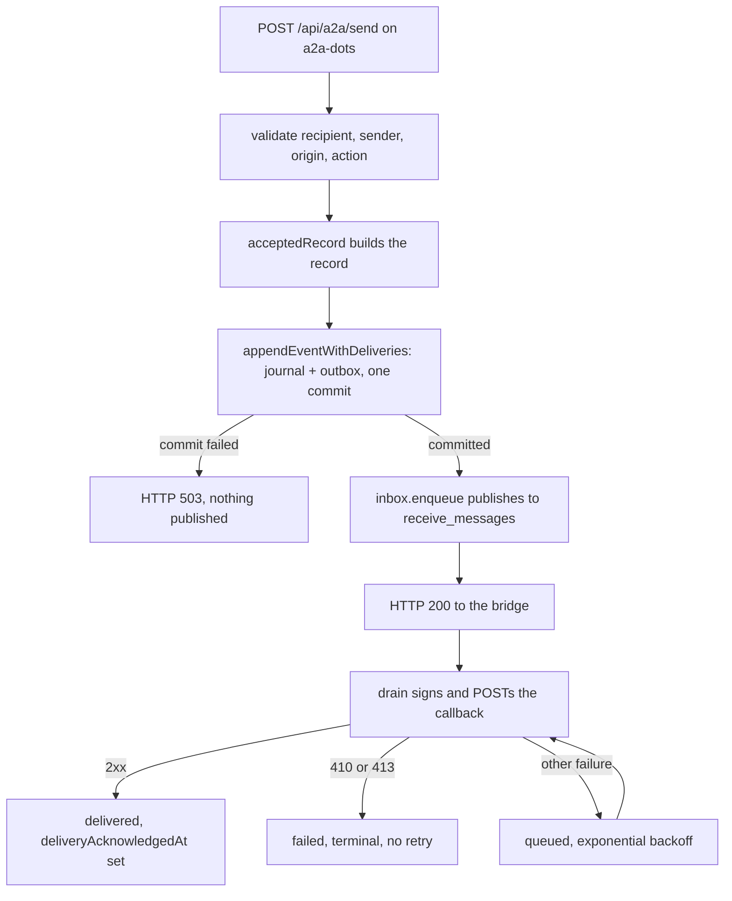

# ChatGPT Dot MCP adapter

`a2a-dots` makes a ChatGPT Dot a first-class peer in the existing a2a runtime.

## Topology

```text
ChatGPT Dot
    |
    | remote MCP (Streamable HTTP)
    v
a2a-dots
    |
    | authenticated bridge HTTP
    v
a2a-server
    |
    +--> Claude / Codex / Gemini / Cursor agents
    |
    +--> configured peer bridges
```

The adapter does not replace a2a routing, identity, teams, transports, or federation. It registers one ordinary a2a peer (default id `dot`) with a callback `bridgeUrl`. Existing agents therefore reply to `dot` through the same `POST /api/a2a/send` remote-delivery path already used by peer bridges.

## MCP tools

- `list_agents()` reads `GET /api/a2a/agents`; it never reads `registry.json`.
- `get_agent({ agent })` resolves one agent from the bridge's registered inventory.
- `send_message({ to, text, action? })` posts directly to `/api/a2a/send` as `from="dot"`, `origin="peer"`, `source="chatgpt-dot"`.
- `receive_messages({ after? })` returns callback messages and an opaque `cursor`. Pass that returned cursor as `after`; inspect `reset` and `gap` as described below.
- `start_team({ team })` delegates to `a2a start --require-team <team>`. The reference must resolve to an existing team spec; a typo does not start a single agent. Named specs, dotted names, and spec paths use the normal team resolver.
- `stop_agent({ agent })` delegates to `a2a kill --agent <agent>`, preserving existing ownership checks for that single registered agent. It rejects option-shaped IDs and its own peer ID, and never expands a team or group name into bulk cleanup. Ordinary CLI `start NAME`, `kill NAME`, and `kill --all` retain their existing semantics.
- `start_agent({ agent, backend?, prompt?, skills?, cohort?, cwd?, interactive? })` delegates to `a2a start <agent> [--<backend>] [--prompt TEXT] [--skill NAME]… [--cohort NAME] [--no-yolo]`, run in `cwd` when given (an existing absolute directory; otherwise the adapter's own working directory). Every value is its own argv element, so prompt text is never parsed as a flag; the agent id, cohort, and skill names are validated as identifiers and the Dot's own id is refused. A name that is already running is re-registered by the CLI, not duplicated.
- `peek_agent({ agent, lines? })` delegates to `a2a peek <agent> --lines=N` (default 30, at most 2000) for a registered agent and returns the tail of its terminal without sending it anything.

## Run

Use the updated bridge and adapter from the same checkout, then:

```sh
npm run dots
```

Defaults:

```text
A2A_BRIDGE=http://127.0.0.1:7742
A2A_DOTS_HOST=127.0.0.1
A2A_DOTS_PORT=7743
A2A_DOTS_MCP_PATH=/mcp
A2A_DOTS_AGENT_ID=dot
A2A_DOTS_CALLBACK_PORT=7744
A2A_DOTS_CALLBACK_URL=http://127.0.0.1:7744
A2A_DOTS_MAX_INBOX=1000
A2A_DOTS_REQUEST_TIMEOUT_MS=2000
A2A_DOTS_RECONCILE_MS=2000
```

If the bridge requires its operator key, set `A2A_KEY`. The adapter uses it for bridge registration, inventory, send, and unregister operations.

Port, inbox-capacity, timeout, and reconciliation settings must be positive integers; ports must be at most 65535 and timeout/reconciliation intervals at most 60000 ms. Invalid values fail before listeners bind. MCP and callback ports must differ. Bridge and callback URLs must be HTTP(S) base URLs without credentials, query strings, or fragments.

The MCP endpoint is:

```text
http://127.0.0.1:7743/mcp
```

ChatGPT connects to remote MCP servers rather than directly to localhost. Keep `a2a-dots` loopback-bound and expose only the MCP listener through OpenAI Secure MCP Tunnel or another trusted HTTPS deployment path. Reply ingress is a separate listener hard-bound to `127.0.0.1` (port `7744` by default), so tunneling the MCP port does not expose `/api/a2a/send`. `A2A_DOTS_CALLBACK_URL` exists for bridge registration overrides, but the callback listener itself intentionally remains loopback-only.

## Identity

The adapter never sends as the human operator. Outbound messages are:

```json
{
  "from": "dot",
  "origin": "peer",
  "source": "chatgpt-dot"
}
```

That intentionally follows the existing fail-closed sender identity model.

## Reply path

No second message bus is introduced.

```text
worker
  -> a2a --reply --dot "done"
  -> a2a-server
  -> dot registration.bridgeUrl
  -> POST /api/a2a/send on a2a-dots
  -> cursor inbox
  -> receive_messages({ after })
  -> Dot
```

The inbox is bounded and holds at most `A2A_DOTS_MAX_INBOX` messages, 1000 by default. Whether it survives a restart depends on whether event subscriptions are configured:

| `A2A_DOTS_EVENTS_KEY` | Restart behavior |
| --- | --- |
| Unset | The inbox is runtime state only and a restart clears it |
| Set | Accepted messages are journaled durably and restored on start, up to `min(A2A_DOTS_EVENTS_MAX_JOURNAL, A2A_DOTS_MAX_INBOX)` — 500 and 1000 by default |

The existing a2a message log remains the audit trail in both cases. See [Durable state](#durable-state) for what is persisted and [Reading the full content of a truncated event](#reading-the-full-content-of-a-truncated-event) for the retention boundary.

## Registration and readiness

The adapter owns its registration through a fresh `registrationOwner` token for each process. Before writing a route, it requires the bridge's inventory response to advertise `registrationOwnership=true`. It reconciles the bridge's inventory periodically, with exponential backoff up to 30 seconds (or the configured interval when larger), and re-registers a missing or mismatched route owned by this instance. Bridge restarts therefore recover the callback route without clearing the adapter inbox. A missing bridge at startup leaves the adapter running in a degraded state while it retries.

`GET /health` checks the bridge and registration on demand. It returns HTTP 200 with `data.ok=true, state="ready"` only after confirming the owned callback route, and HTTP 503 with `ok=false, state="degraded"` and an error otherwise. `checkedAt` records the observation time. Receive-only inbox reads remain available while the bridge is down. Other tools verify registration before using the bridge or CLI. Readiness confirms registration and listener availability; it does not prove worker completion or callback reachability through a deployment override.

The bridge rejects a conflicting owner instead of silently overwriting its route. Duplicate adapters must use different IDs and ports, or share the existing adapter. Shutdown sends a conditional unregister header (`x-a2a-registration-owner`), so an older process cannot remove another instance's route. Ordinary registrations without an owner retain their existing overwrite behavior. An authorized operator's unconditional unregister remains an explicit administrative override.

Ownership is runtime state, without leases or persistent recovery. After a crash that leaves a route on the bridge, verify the prior adapter is stopped before explicitly unregistering the abandoned ID and starting a replacement. Upgrading requires stopping the old adapter before replacing the bridge, then starting the new adapter; an old bridge cannot provide owned registration readiness. Bridge requests, including unregister, have deadlines. Shutdown stops listeners immediately and does not wait indefinitely for an unavailable bridge.

## Incremental inbox reads

The MCP runtime version is 1.1.0. Cursors now identify both the adapter instance and an increasing sequence; treat them as opaque strings. A read returns `agentId`, `generation`, `cursor` (the latest inbox position, including an empty inbox), `oldestCursor`, `reset`, `gap`, and `messages`. Each message retains its own `cursor` and `receivedAt`.

- With no `after`, the read returns the retained inbox.
- With a cursor from this instance, it returns newer retained messages. `gap=true` means the cursor predates an evicted message; the response includes the remaining messages and retention boundary.
- With a cursor from another instance, `reset=true` and all retained messages are replayed. Old numeric cursors also replay with `reset=true` because they cannot identify an instance. This can duplicate previously seen messages during migration; it prevents silently hiding fresh replies after restart.
- Malformed, unsafe, or future cursors for this instance are rejected.

After processing a read, retain its returned `cursor`, even when there are no messages. Report `reset` or `gap` when it affects task completeness and consult the existing message log for missing history.

Inbox cursors are per-process in both configurations, so a cursor never survives a restart and a client resuming on an old one still sees `reset=true`. What changes with `A2A_DOTS_EVENTS_KEY` set is the *messages*: the retained journal window is restored, so the replay after a reset returns real history rather than an empty inbox. Evicted messages are still never replayed automatically.

## Tests

```sh
npm run test:vitest:dots
```

The process tests copy source into temporary runtime directories and use temporary loopback listeners, synthetic messages, and fixture CLI programs. They cover callback routing, registration recovery and conflicts, scoped lifecycle commands, inbox resets/eviction, input validation, and bounded shutdown without touching production runtime files or agents.

## Automatic message events

Nothing in the inbox path wakes a ChatGPT conversation. `receive_messages` is a pull: a client already in a turn asks for replies. A worker that answers an hour later reaches the inbox and no further, because the plugin manifest defines only a Streamable HTTP MCP endpoint and no host chat mapping.

[MCP Events][ref-mcp-events-guide] is the supported push direction. A *subscription* is a standing request, made by an authenticated caller, that names an event and an HTTPS callback the adapter should POST to when that event occurs. The host then needs no poller: delivery is one signed HTTP request per event. The contract is webhook-only — polling, streaming, and gap or terminated control events are not part of it.

The adapter emits one event, [`EVENT_NAME`][ref-events-name] = `a2a.message.received`, from the callback route that already accepts bridge traffic.

### Protocol surface

MCP revision `2026-07-28` removes `initialize`, `initialized`, and `Mcp-Session-Id`. Every request instead carries its own protocol metadata and every result carries a `resultType` ([base protocol][ref-mcp-spec-basic]), and the transport mirrors selected body fields into headers the server must validate ([Streamable HTTP][ref-mcp-spec-transport]). The installed SDK negotiates only the initialize-era versions, so the modern methods are served directly by [`createModernHandler`][ref-modern-handler] rather than through the SDK, and [`serveLegacyMcp`][ref-serve-legacy] keeps the older era on the same path and port.

| Method | Authenticated | Served by |
| --- | --- | --- |
| `server/discover` | No | [`createModernHandler`][ref-modern-handler] |
| `tools/list` | No | [`createToolRouter`][ref-tool-router] |
| `tools/call` | When a key is set | [`createToolRouter`][ref-tool-router] |
| `events/list` | Yes | [`createEventService`][ref-event-service] |
| `events/subscribe` | Yes | [`createEventService`][ref-event-service] |
| `events/unsubscribe` | Yes | [`createEventService`][ref-event-service] |

Both eras share one tool implementation, [`TOOL_DEFINITIONS`][ref-tool-definitions] and [`createToolRouter`][ref-tool-router], so the eight tools cannot drift between them. A modern `tools/call` result carries `resultType: "complete"` with `content` and `isError`, and an unknown tool is a protocol error rather than a result ([tools][ref-mcp-spec-tools]).

[`validateProtocolHeaders`][ref-validate-headers] enforces the header-to-body match the transport requires: `MCP-Protocol-Version`, `Mcp-Method`, and `Mcp-Name` must each equal the corresponding body value, with the `=?base64?…?=` sentinel decoded first. A mismatch or a missing required header is HTTP 400 with [`HEADER_MISMATCH`][ref-header-mismatch] = `-32020`. An unknown version is `-32022` and lists what this endpoint supports; an unknown method is HTTP 404 with `-32601`. [`validateOrigin`][ref-validate-origin] answers HTTP 403 for a present but unpermitted `Origin`, which is the DNS-rebinding defense for browser callers; an absent `Origin` is a non-browser caller and is allowed.

This revision defines no client-to-server notifications over Streamable HTTP, so a request without an `id` is refused rather than executed. A `null` id is also refused, because MCP forbids it where base JSON-RPC permits it.

### Subscription identity and lifecycle

[`subscriptionIdFor`][ref-subscription-id] derives the id from the authenticated principal, the callback URL, the event name, and the canonical JSON of the filters. Two spellings of one filter set therefore produce one subscription, and a second `events/subscribe` with the same identity updates that row instead of creating another. A different principal computes a different id and cannot address another principal's row at all.

Each grant carries a finite `refreshBefore`. A request may ask for a shorter lifetime through `ttlMs`, and the grant never exceeds what was asked, with a floor from `A2A_DOTS_EVENTS_MIN_TTL_MS` so a tiny value cannot become a refresh storm. `ttlMs: null` asks for no expiry and is still answered with a finite one unless `A2A_DOTS_EVENTS_ALLOW_UNBOUNDED_TTL=1`. Delivery stops once `refreshBefore` passes, checked in [`deliverOne`][ref-deliver-one].

A refresh that presents a new secret keeps the retiring one for `A2A_DOTS_EVENTS_VERIFICATION_TTL_MS`, and both sign each request as a space-delimited list, so a rotation needs no downtime.

### Callback verification and address policy

A callback destination is attacker-influenced input, so [`createCallbackGuard`][ref-callback-guard] verifies control of the destination before any application data reaches it. The handshake POSTs `{"type":"verification","challenge":"…"}`, requires a 2xx, and compares the echoed challenge in constant time. Failure is [`CALLBACK_ENDPOINT_ERROR`][ref-callback-error] = `-32015` with `data.reason`, and no subscription is stored.

[`parseCallbackUrl`][ref-parse-callback-url] requires `https` and refuses embedded credentials and fragments. [`resolvePinned`][ref-resolve-pinned] then resolves the name once and refuses the hostname if *any* answer is non-public, so a round-robin or rebinding answer cannot steer the connection inward. The validated address is pinned as the connection's lookup result, with `autoSelectFamily` disabled at [`callback-guard.mjs:173`][ref-auto-select-family], so no second DNS query happens between the check and the connection. Redirects are refused outright, since a redirect is a second unvalidated destination.

[`addressReason`][ref-address-reason] returns `null` only for an ordinary public address. [`ipv6Reason`][ref-ipv6-reason] normalizes mixed notation into 16-bit groups first, so `::ffff:127.0.0.1` and `::ffff:7f00:1` are the same loopback destination and both are refused.

[`withDeadline`][ref-with-deadline] races the whole operation — resolution, connection, and response body — against one deadline rather than only signalling an abort, because a resolver that never settles ignores a signal.

### Signing

[`sign`][ref-sign] implements [Standard Webhooks][ref-standard-webhooks] with `node:crypto`; the repository has no webhook dependency. [`signedPayload`][ref-signed-payload] builds the normative `id.timestamp.body` string and rejects an id containing `.`, which would make that string ambiguous. [`signingHeaders`][ref-signing-headers] sets `webhook-id`, `webhook-timestamp`, `webhook-signature` as `v1,<base64 HMAC-SHA256>`, and `X-MCP-Subscription-Id`. [`parseSigningSecret`][ref-parse-secret] accepts only a `whsec_` secret whose canonical base64 decodes to 24–64 bytes.

### Delivery states and limits



The order is the contract. [`appendEventWithDeliveries`][ref-append-with-deliveries] commits the journal entry and its outbox rows in one write, [`events.emit`][ref-events-emit] runs before the inbox is touched at [`a2a-dots.mjs:359`][ref-events-emit-call], and a failed commit answers HTTP 503 at [`a2a-dots.mjs:371`][ref-persist-503]. Acknowledging a message whose state did not persist would drop it while telling the bridge it was accepted; publishing before the commit would leave a visible message the adapter refused.

A delivery is in exactly one of three states, written by [`appendEventWithDeliveries`][ref-append-with-deliveries] and [`deliverOne`][ref-deliver-one]: `queued`, `delivered`, `failed`. `delivered` means a 2xx receipt and nothing more. There is no completion field, because an acknowledged webhook is not a processed message and not a finished task.

A retry reuses the event id and regenerates only the timestamp and signature, so a receiver can deduplicate on `webhook-id`. `A2A_DOTS_EVENTS_MAX_ATTEMPTS` bounds the attempts, default 5. HTTP 410 and 413 are terminal and are not retried.

[`MAX_PAYLOAD_BYTES`][ref-max-payload] is 262144 bytes, which is 256 KiB. An envelope over that limit is delivered as a summary: `text` is replaced by `contentTruncated`, `contentBytes`, and `contentAvailableAtCursor`.

### Reading the full content of a truncated event

`contentAvailableAtCursor` names where the full text is retained. The tool that reads it is `receive_messages`, and the field that joins a truncated event to its inbox entry is `data.messageId` — not the cursor, because inbox cursors and event cursors are separate sequences.

```text
webhook body: { eventId, data: { messageId, contentTruncated: true, contentAvailableAtCursor } }
  -> receive_messages({ after })
  -> match the returned message whose messageId equals data.messageId
  -> that message's text is the full content
```

Two independent bounds apply, and they are not the same set:

| Store | Bound | Default | Read by | Survives restart |
| --- | --- | --- | --- | --- |
| In-memory inbox | `A2A_DOTS_MAX_INBOX` | 1000 | `receive_messages` | Only as seeded from the journal |
| Durable journal | `A2A_DOTS_EVENTS_MAX_JOURNAL` | 500 | No client-facing method | Yes |

What a tool can return is the inbox, never the journal directly. So the readable set is the inbox's contents: within one process that is the last `A2A_DOTS_MAX_INBOX` accepted messages, and after a restart it is what the journal had retained, which is at most `min(A2A_DOTS_EVENTS_MAX_JOURNAL, A2A_DOTS_MAX_INBOX)`.

`contentAvailableAtCursor` therefore carries no retrieval guarantee. Three ways it stops resolving:

- The message left the inbox after `A2A_DOTS_MAX_INBOX` further messages, even though the journal may still hold it on disk.
- The message left the journal after `A2A_DOTS_EVENTS_MAX_JOURNAL` further messages, so a restart will not restore it.
- `A2A_DOTS_MAX_INBOX` is configured below `A2A_DOTS_EVENTS_MAX_JOURNAL`, in which case entries the durable file still retains are never loaded into the inbox and no tool can reach them.

Nothing reports journal truncation to a client. `gap=true` describes eviction from the current in-memory inbox only, and `reset=true` after a restart means the cursor came from a previous process — neither says the journal dropped anything. There is no cursor-addressed RPC that reads the durable store, and [`accepted`][ref-events-accepted] is the internal read behind the restore rather than a client-facing method.

A consumer that needs the full text should fetch it promptly on receiving a truncated event and treat a missing entry as expected rather than as an error.

### Durable state

[`createEventStore`][ref-event-store] writes one file, `events.json`, in `A2A_DOTS_STATE_DIR` — by default under the operator's home directory, never the checkout — with mode `0600` inside a `0700` directory. It persists subscriptions, granted expiry, retiring secrets, the replay journal, and the outbox. It deliberately does not persist `registrationOwner`: bridge registration ownership stays process-specific, so a crashed adapter cannot hand its route to a replacement.

[`loadState`][ref-load-state] treats only a missing file as a fresh start. A corrupt file, an unreadable file, or an unsupported version fails closed and leaves the bytes untouched, because overwriting would destroy the live subscriptions and the generation behind every issued cursor.

Two reads exist and are not interchangeable. `eventsAfter` implements the replay contract, where a null cursor means "from now" and correctly returns nothing, and where a point the journal no longer retains returns `truncated: true`. [`allAccepted`][ref-all-accepted] returns the retained window and is what restart restore uses, at [`accepted`][ref-events-accepted]. A cursor ahead of the store is rejected rather than reported as "nothing new".

On start the adapter restores the retained window into the inbox and then calls `drain` at [`a2a-dots.mjs:441`][ref-startup-drain], because nothing else re-triggers a delivery a previous process left queued.

### Trust boundary: claimed sender versus authenticated route

The callback route does not authenticate a peer identity, and the bridge's remote delivery attaches destination peer credentials rather than authenticated sender provenance. A `from` or `origin` value is therefore what the caller claimed, and every payload says so: [`events.emit`][ref-events-emit] stamps `provenance` with `senderClaimed`, `bridgeAuthenticated`, and `transport`, and the caller cannot set those fields.

| Field | Meaning |
| --- | --- |
| `senderClaimed` | `from` and `origin` are as supplied, not independently verified |
| `bridgeAuthenticated` | The callback request itself presented the configured key |
| `transport` | The route the message arrived on |

[`acceptedRecord`][ref-accepted-record] copies an explicit field list, so `owner`, `role`, `principal`, `authorization`, and any other field a caller invents never enter the record. `from: "op"` with `origin: "user"` is preserved as data and grants nothing. Message content is third-party data and is never authorization: a body that reads like an instruction is delivered as text.

Setting `A2A_DOTS_CALLBACK_KEY` makes the callback route authenticate its caller at [`a2a-dots.mjs:340`][ref-callback-key], which refuses a forged direct POST and is the only condition under which `bridgeAuthenticated` is `true`. Left unset, the route keeps its existing open local behavior.

Setting that key alone breaks real delivery. The bridge sends a destination peer's key and never the global operator key, so an unmatched callback destination gets HTTP 401 at the adapter and the bridge reports 502. Enabling the key therefore requires a matching peer entry in the bridge configuration whose `url` is the exact callback URL and whose `key` is the same value as `A2A_DOTS_CALLBACK_KEY`, alongside the existing operator key. Verified in a fixture bridge, not against production, and no production configuration was read or changed.

Even with that route authenticated, `senderClaimed` stays `true`. An authenticated transport proves which process delivered the message, not who wrote it.

Seven distinct secrets appear around this feature. Only the first two are ever checked by this adapter; the rest authenticate other hops, and none substitutes for another:

| Secret | Authenticates | Direction | Created in |
| --- | --- | --- | --- |
| `A2A_DOTS_EVENTS_KEY` | A caller to the adapter's events methods and guarded tool calls | Inbound to this adapter | This adapter's environment |
| `A2A_DOTS_CALLBACK_KEY` | The bridge to the adapter's callback route | Inbound to this adapter | This adapter, mirrored in the bridge's peer entry |
| Bridge operator key (`A2A_KEY`) | A caller to the a2a bridge | Inbound to the bridge | a2a bridge configuration |
| Subscription `whsec_` secret | Each webhook delivery, as a signature over the body | Outbound from this adapter | Supplied by the subscribing host per subscription |
| `CONTROL_PLANE_API_KEY` | The long-lived tunnel-client daemon to OpenAI's control plane | Outbound from the daemon | OpenAI Runtime API keys |
| `OPENAI_ADMIN_KEY` | `tunnel-client admin tunnels list\|create\|update\|delete` | Outbound to control plane admin routes | OpenAI, needs Platform admin-key permission |
| ngrok authtoken | This machine's ngrok client to its ngrok account | Outbound from the client | The ngrok dashboard, per account |

The last three are commonly conflated and are separate vendors with separate rotation. Neither OpenAI key authenticates an incoming MCP request: `CONTROL_PLANE_API_KEY` is what the tunnel-client daemon presents when it polls the control plane for commands, with `OPENAI_API_KEY` used only as a fallback when it is unset, and `OPENAI_ADMIN_KEY` is restricted to tunnel CRUD and is explicitly not for the daemon ([Secure MCP Tunnels][ref-openai-secure-tunnels], [tunnel-client configuration][ref-tunnel-client-config]). The ngrok authtoken is an ngrok account credential that [`scripts/install.mjs`][ref-install-script] provisions; it only authorizes starting a tunnel from this machine and carries no MCP meaning.

Rotating any of them does not rotate the others. A request that reaches the adapter over a tunnel is still authorized only by `A2A_DOTS_EVENTS_KEY`, because that is the single value the adapter checks.

### Authentication

`A2A_DOTS_EVENTS_KEY` is the bearer secret for events methods, with the principal from `A2A_DOTS_EVENTS_PRINCIPAL`. Configuring it is also the signal that the endpoint is reachable beyond loopback, so tool calls join the same boundary: [`protectToolCalls`][ref-protect-tool-calls] guards the modern path and [`assertToolCallAuthorized`][ref-assert-tool-auth] guards the legacy SDK path. Guarding only one era would leave the other as an open route to the same `send_message`, `start_agent`, `start_team`, and `stop_agent` handlers.

Authority is read from the `Authorization` header alone. A token in `params` or in `_meta` is ignored.

With no key configured the adapter is fail-closed for subscriptions and unchanged for everything else: `server/discover` answers and omits the `events` capability, no callback destination is accepted from anyone, no durable state is created, and the local tool behavior is exactly what it was. [`EVENTS_ENABLED`][ref-events-enabled] is that switch. [`eventsConfig`][ref-events-config] validates every related setting at startup, including a 16-character minimum on the key.

This is the whole identity model. The adapter defines no users, roles, or grants beyond the single configured principal.

### Cloud activation gates

The source and its tests are complete and the focused suites pass locally. No host-side activation has been performed or verified, and each item below remains open:

- Host-created signing credentials. No real `whsec_` secret exists; every secret in the tests is a fixture.
- Plugin installation and rescan, so a client loads the updated manifest and skill.
- Parent subscription activation, which is the call that would create the first real subscription.
- A real callback verification and delivery. No outbound request has ever been made: every fixture callback address is one the production policy refuses, so delivery is attempted and refused locally.

Until those run, automatic parent-chat delivery is implemented and unexercised against a host. Registration recovery and inbox transport are separate and already verified; neither establishes cloud delivery.

### Event tests

```sh
npm run test:vitest:dots-events
```

[`tests/dots-events.test.mjs`][ref-test-events] covers the pure modules: signing and secret validation, the address policy including every IPv6 mapped spelling, store durability and fail-closed loading, subscription identity and expiry, filter matching, retry and payload limits, and the modern protocol handler. [`tests/dots-events-runtime.test.mjs`][ref-test-events-runtime] drives the real adapter process over HTTP against a copied runtime: discovery with no handshake, header validation, legacy and modern authentication parity, the accepted callback path, the trust boundary against spoofed fields, a refused durable write, restart restore, and the startup drain.

The fixtures inject only the HTTPS transport and a resolver that answers with a public address. The address policy itself is never relaxed, so no test reaches a loopback destination through a weakened production rule.

## References

[ref-events-name]: ../src/dots/events.mjs#L7
[ref-subscription-id]: ../src/dots/events.mjs#L20
[ref-event-service]: ../src/dots/events.mjs#L115
[ref-deliver-one]: ../src/dots/events.mjs#L157
[ref-events-emit]: ../src/dots/events.mjs#L361
[ref-events-accepted]: ../src/dots/events.mjs#L401
[ref-header-mismatch]: ../src/dots/mcp-modern.mjs#L25
[ref-callback-error]: ../src/dots/mcp-modern.mjs#L34
[ref-validate-origin]: ../src/dots/mcp-modern.mjs#L84
[ref-validate-headers]: ../src/dots/mcp-modern.mjs#L103
[ref-modern-handler]: ../src/dots/mcp-modern.mjs#L170
[ref-ipv6-reason]: ../src/dots/callback-guard.mjs#L45
[ref-address-reason]: ../src/dots/callback-guard.mjs#L86
[ref-parse-callback-url]: ../src/dots/callback-guard.mjs#L93
[ref-callback-guard]: ../src/dots/callback-guard.mjs#L106
[ref-with-deadline]: ../src/dots/callback-guard.mjs#L110
[ref-resolve-pinned]: ../src/dots/callback-guard.mjs#L126
[ref-auto-select-family]: ../src/dots/callback-guard.mjs#L173
[ref-load-state]: ../src/dots/event-store.mjs#L38
[ref-event-store]: ../src/dots/event-store.mjs#L79
[ref-append-with-deliveries]: ../src/dots/event-store.mjs#L145
[ref-all-accepted]: ../src/dots/event-store.mjs#L226
[ref-max-payload]: ../src/dots/webhooks.mjs#L13
[ref-parse-secret]: ../src/dots/webhooks.mjs#L15
[ref-signed-payload]: ../src/dots/webhooks.mjs#L40
[ref-sign]: ../src/dots/webhooks.mjs#L49
[ref-signing-headers]: ../src/dots/webhooks.mjs#L80
[ref-tool-definitions]: ../src/dots/tools.mjs#L6
[ref-tool-router]: ../src/dots/tools.mjs#L65
[ref-events-config]: ../src/dots/config.mjs#L65
[ref-events-enabled]: ../src/a2a-dots.mjs#L36
[ref-accepted-record]: ../src/a2a-dots.mjs#L240
[ref-assert-tool-auth]: ../src/a2a-dots.mjs#L274
[ref-protect-tool-calls]: ../src/a2a-dots.mjs#L321
[ref-callback-key]: ../src/a2a-dots.mjs#L340
[ref-events-emit-call]: ../src/a2a-dots.mjs#L359
[ref-persist-503]: ../src/a2a-dots.mjs#L371
[ref-serve-legacy]: ../src/a2a-dots.mjs#L384
[ref-startup-drain]: ../src/a2a-dots.mjs#L441
[ref-test-events]: ../tests/dots-events.test.mjs
[ref-test-events-runtime]: ../tests/dots-events-runtime.test.mjs
[ref-install-script]: ../scripts/install.mjs
[ref-openai-secure-tunnels]: https://developers.openai.com/api/docs/guides/secure-mcp-tunnels
[ref-tunnel-client-config]: https://github.com/openai/tunnel-client/blob/master/docs/configuration.md
[ref-mcp-events-guide]: https://developers.openai.com/plugins/build/mcp-events
[ref-mcp-spec-basic]: https://modelcontextprotocol.io/specification/2026-07-28/basic/index
[ref-mcp-spec-tools]: https://modelcontextprotocol.io/specification/2026-07-28/server/tools
[ref-mcp-spec-transport]: https://modelcontextprotocol.io/specification/2026-07-28/basic/transports/streamable-http
[ref-standard-webhooks]: https://github.com/standard-webhooks/standard-webhooks/blob/main/spec/standard-webhooks.md
