## Architecture Topography

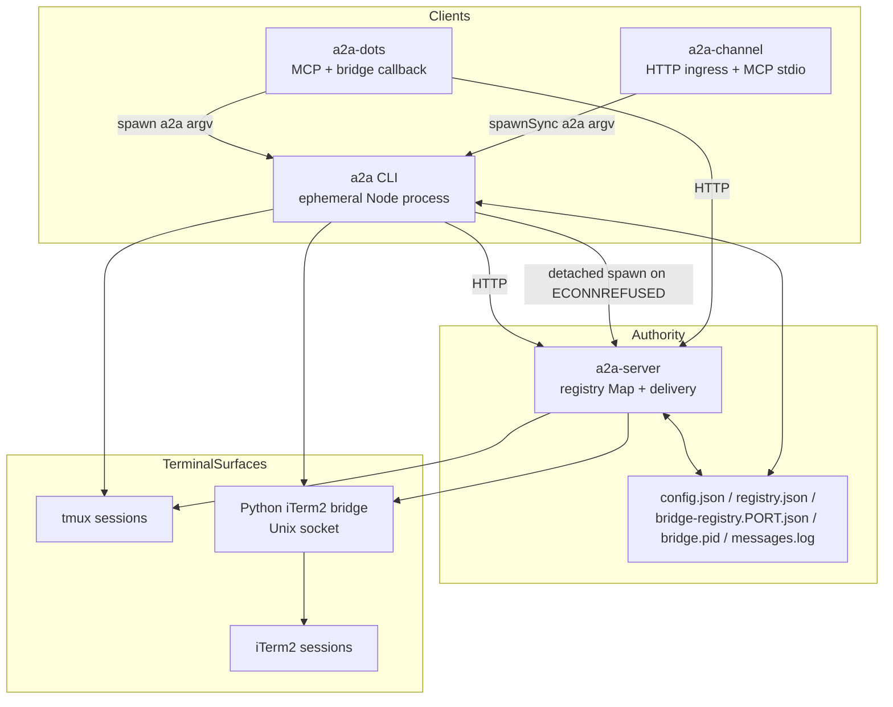

The repository is organized around a **short-lived client / long-lived authority** split. [`bin/a2a.mjs`][ref-1002] is a two-line shim that imports the composition root [`src/cli.mjs`][ref-1003] for one operator action, while [`src/a2a-server.mjs`][ref-1004] retains the live routing registry across those invocations. Files owned by [`src/a2a-config.mjs`][ref-1005] provide the durable rendezvous required when either process restarts; terminal sessions remain the durable execution surfaces for the agents themselves. The two MCP-facing adapters never reimplement delivery: both reach the bridge over HTTP or shell back into the `a2a` executable, so identity and transport policy have exactly one implementation.

- [Executable entrypoints](#architecture-topography-executable-entrypoints)
- [Codebase-map evidence](#architecture-topography-codebase-map-evidence)
- [Runtime system inventory](#architecture-topography-runtime-system-inventory)

<a id="architecture-topography-executable-entrypoints"></a>
### Executable entrypoints

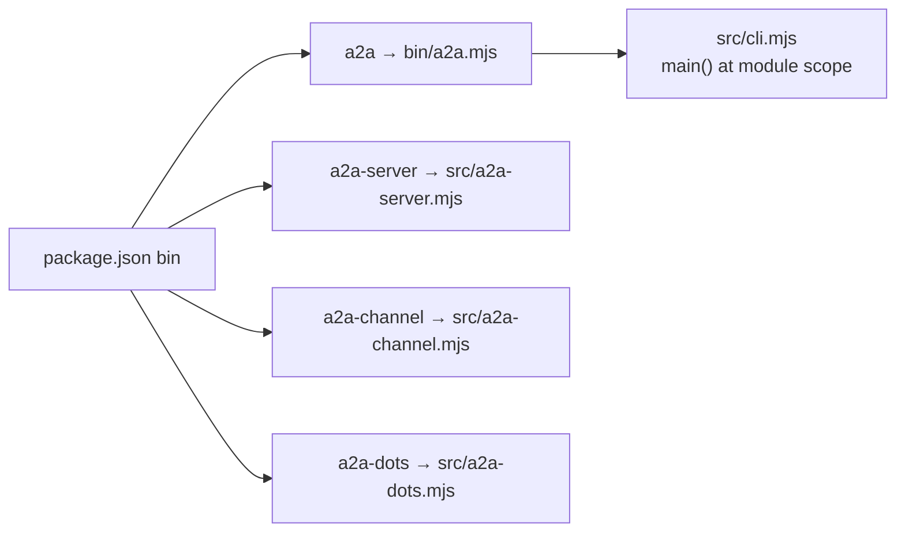

| Executable | Target | npm script | Process lifetime |
| --- | --- | --- | --- |
| `a2a` | [`bin/a2a.mjs`][ref-1002] → [`src/cli.mjs`][ref-1003] | none | One command per invocation |
| `a2a-server` | [`src/a2a-server.mjs`][ref-1004] | `start` | Long-lived bridge listener |
| `a2a-channel` | [`src/a2a-channel.mjs`][ref-1007] | `channel` | Hosted by Claude Code over MCP stdio |
| `a2a-dots` | [`src/a2a-dots.mjs`][ref-1006] | `dots` | Long-lived MCP and callback adapter |

[`package.json`][ref-1001] declares package version `1.1.0`, `"type": "module"`, an `engines` floor of Node `>=18`, and three runtime dependencies (`@modelcontextprotocol/sdk`, `js-yaml`, `zod`). [`main()`][ref-1016] runs at module scope in [`src/cli.mjs`][ref-1003], so importing the composition root executes a command; every policy that tests or other processes need without that side effect lives in a leaf module, as the header comment of [`src/cli/parse-start-args.mjs`][ref-1017] states for the start-argument parser. The bridge is both an advertised executable and a CLI-managed daemon: [`ensureBridgeRunning()`][ref-1021] spawns the same file detached with `process.execPath`, so an operator who never runs `a2a-server` directly still receives a bridge on the first refused connection.

<a id="architecture-topography-codebase-map-evidence"></a>
### Codebase-map evidence

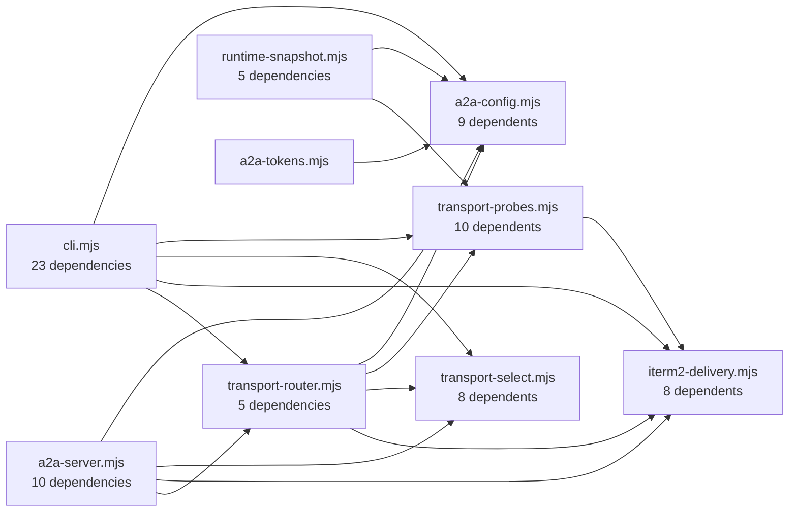

Arrows point from the importing module to the imported module. The diagram shows only runtime (`src/`) importers of the four highest fan-in hubs.

| Graph property | Observed value |
| --- | ---: |
| Scan root (`build.sourceRoots`) | `.` |
| Files | 111 |
| Files under `src/` | 45 |
| Files under `tests/` (including `tests/helpers/`) | 57 |
| Other scanned files (`bin/`, `scripts/`, `schemas/`, `teams/dw-bug-killers/`, root configs) | 9 |
| Directories | 13 |
| Lines | 36,821 |
| Declarations (all / `src/`) | 1,491 / 1,000 |
| Exports (all / `src/`) | 260 / 243 |
| Import edges | 145 |
| Import edges `src/` → `src/` | 78 |
| Import edges from `tests/` | 65 |
| Type flows | 0 |
| Graph operations | 55,991 |
| Build timestamp (`build.builtAt`) | `2026-10-13T21:47:36.846Z` |

| Module | Dependents | Runtime importers | Test importers | Exports |
| --- | ---: | ---: | ---: | ---: |
| [`src/transport-probes.mjs`][ref-1008] | 10 | 5 | 5 | 19 |
| [`src/a2a-config.mjs`][ref-1005] | 9 | 5 | 4 | 63 |
| [`src/iterm2-delivery.mjs`][ref-1010] | 8 | 5 | 3 | 11 |
| [`src/transport-select.mjs`][ref-1009] | 8 | 6 | 2 | 4 |
| [`src/key-sequence.mjs`][ref-1019] | 7 | 3 | 4 | 7 |
| [`src/a2a-team-spec.mjs`][ref-1018] | 7 | 2 | 5 | 9 |
| [`src/backend-delivery.mjs`][ref-1020] | 6 | 5 | 1 | 2 |

| Module | Dependencies | Imported modules |
| --- | ---: | --- |
| [`src/cli.mjs`][ref-1003] | 23 | Every parser, transport, team, identity, runtime, and CLI leaf module |
| [`src/a2a-server.mjs`][ref-1004] | 10 | Config, auth, envelope, body reader, transport selection and delivery, runtime snapshot |
| [`src/a2a-dots.mjs`][ref-1006] | 8 | All eight `src/dots/*` modules |
| [`src/runtime/runtime-snapshot.mjs`][ref-1012] | 5 | Config, team spec, probes, session inventory, status snapshot |
| [`src/transport-router.mjs`][ref-1011] | 5 | Config, iTerm delivery, tmux delivery, probes, selection |
| [`src/a2a-channel.mjs`][ref-1007] | 4 | `a2a-tokens` plus three `src/channel/*` modules |

The live codebase-map graph ranks [`src/transport-probes.mjs`][ref-1008] and [`src/a2a-config.mjs`][ref-1005] highest by total fan-in, but both counts include test importers; by runtime importers alone, [`src/transport-select.mjs`][ref-1009] leads with six. That pressure reflects shared policy rather than utility accumulation: transport evidence and selection must agree between CLI lifecycle and bridge delivery, while every process must resolve the same bind coordinates and persistence paths. [`src/a2a-config.mjs`][ref-1005] has the largest export surface in the repository (63), yet only 27 of those exports have a runtime importer; the remaining 36 are imported only by tests, which is the module's stated reason for exporting its log and ANSI helpers.

Static edges understate runtime coupling in three places. The scanner covers JavaScript and TypeScript only, so `cmd/a2a-iterm2-bridge/bridge.py` and the Go programs under `cmd/` are absent from the graph. Subprocess links (CLI to bridge, Dot and channel adapters to CLI) and the installer's dynamic `import()` of [`src/a2a-config.mjs`][ref-1005] produce no import edge. [`bin/a2a.mjs`][ref-1002] is the only non-test, non-`src/` file with an outgoing edge.

<a id="architecture-topography-runtime-system-inventory"></a>
### Runtime system inventory

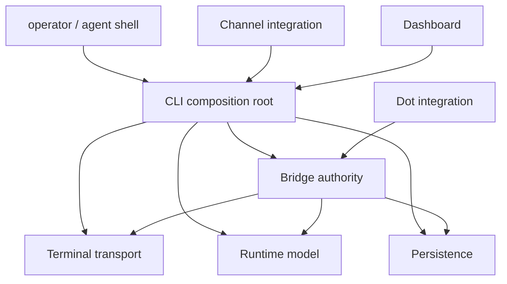

| Runtime system | Owning entrypoint | Supporting modules | Architectural responsibility | Owning section |
| --- | --- | --- | --- | --- |
| CLI | [`src/cli.mjs`][ref-1003] | `src/cli/*`, parsers, lifecycle helpers | Operator composition and subprocess orchestration | [Command-Line Orchestrator](#command-line-orchestrator) |
| Bridge | [`src/a2a-server.mjs`][ref-1004] | `src/server/*`, transport router | Registry authority, authentication, delivery, federation | [Bridge Server and Registry](#bridge-server-and-registry) |
| Persistence | [`src/a2a-config.mjs`][ref-1005] | [`schemas/config.schema.json`][ref-1014], [`schemas/registry.schema.json`][ref-1015] | Shared cross-process file and environment contracts | [Configuration and Persistent State](#configuration-and-persistent-state) |
| Terminal transport | [`src/transport-router.mjs`][ref-1011] | Probes, selectors, tmux and iTerm delivery, DSL | Per-recipient reachability and input delivery | [Terminal Transport System](#terminal-transport-system) |
| Runtime model | [`src/runtime/runtime-snapshot.mjs`][ref-1012] | Inventory and projection modules | Reconciled local and remote operational state | [Runtime State and Observability](#runtime-state-and-observability) |
| Dot integration | [`src/a2a-dots.mjs`][ref-1006] | `src/dots/*` | Streamable MCP, bridge callback inbox, durable webhooks | [ChatGPT Dot Adapter](#chatgpt-dot-adapter) |
| Channel integration | [`src/a2a-channel.mjs`][ref-1007] | `src/channel/*` | HTTP webhook ingress into Claude Code MCP stdio | [Claude Code Channel Adapter](#claude-code-channel-adapter) |
| Dashboard | [`src/cli/dashboard-tui.mjs`][ref-1013] | Go dashboard under `cmd/a2a-dashboard/`, CLI attach and peek | Human control and terminal inspection | [Dashboard and Operator Interfaces](#dashboard-and-operator-interfaces) |

The system has three distinct trust boundaries. Operator and peer credentials are interpreted by the bridge in [`src/server/auth.mjs`][ref-1154]; sender authority is resolved by [`src/cli/sender-identity.mjs`][ref-1153] before an outbound message is posted; and terminal ownership is proven independently for tmux (the `@a2a-install-token` session option) and iTerm2 (the Python bridge's GUID ownership map). Keeping those boundaries separate prevents a valid routing credential from becoming permission to impersonate the human operator or destroy an unrelated terminal session.

Refer to [Bridge Server and Registry](#bridge-server-and-registry) for the authority boundary, [Message Framing and Identity](#message-framing-and-identity) for sender authority, and [Agent Lifecycle](#agent-lifecycle) for terminal ownership.

## Configuration and Persistent State

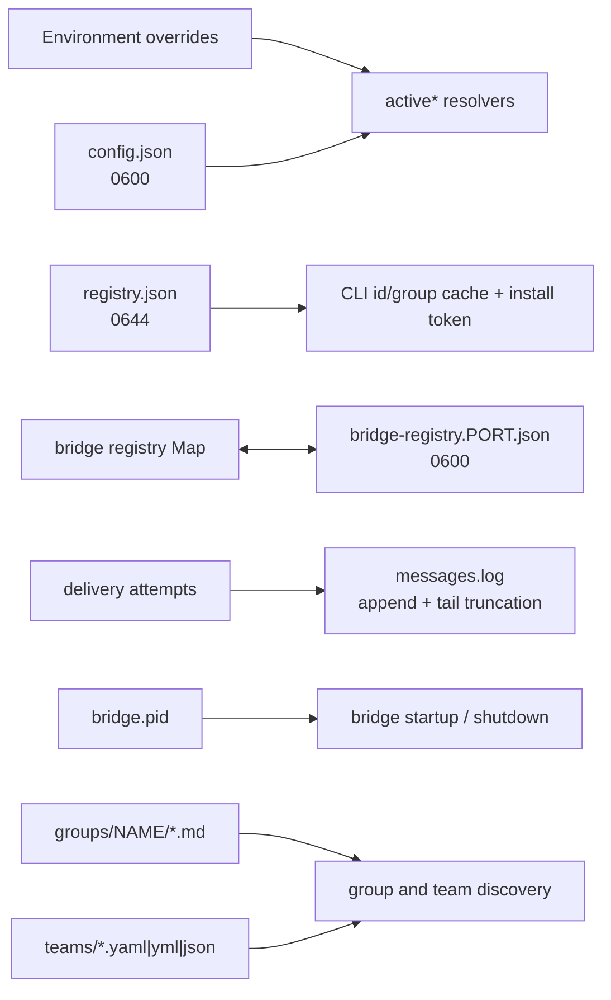

[`src/a2a-config.mjs`][ref-1005] is the shared persistence boundary for processes that otherwise share no memory. It owns path derivation, defaults, environment precedence, atomic JSON replacement, installation identity, group discovery, and message-log sanitation in one module so a bridge started from one directory behaves identically to a CLI invoked from another. Callers consume narrow operations while the module retains ownership of file modes, paths, and value coercion.

- [Path roots and durable artifacts](#configuration-and-persistent-state-path-roots-and-durable-artifacts)
- [Export inventory](#configuration-and-persistent-state-export-inventory)
- [Schema contracts](#configuration-and-persistent-state-schema-contracts)
- [Configuration normalization](#configuration-and-persistent-state-configuration-normalization)
- [Environment precedence](#configuration-and-persistent-state-environment-precedence)
- [Persistence and installation identity](#configuration-and-persistent-state-persistence-and-installation-identity)
- [Group and team-spec discovery](#configuration-and-persistent-state-group-and-team-spec-discovery)
- [Message log](#configuration-and-persistent-state-message-log)

<a id="configuration-and-persistent-state-path-roots-and-durable-artifacts"></a>
### Path roots and durable artifacts

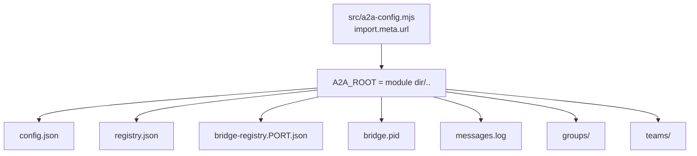

```js
const __filename = fileURLToPath(import.meta.url);
const __dirname = dirname(__filename);
const A2A_ROOT = resolve(join(__dirname, ".."));

const CONFIG_FILE = join(A2A_ROOT, "config.json");
const REGISTRY_FILE = join(A2A_ROOT, "registry.json");
const GROUPS_DIR = join(A2A_ROOT, "groups");
const TEAMS_DIR = join(A2A_ROOT, "teams");
const PID_FILE = join(A2A_ROOT, "bridge.pid");
const DEFAULT_LOG_FILE = join(A2A_ROOT, "messages.log");
```

*`src/a2a-config.mjs:7-16`*

| Durable artifact | Writers | Authority and use | File mode | Write behavior |
| --- | --- | --- | --- | --- |
| `config.json` | [`patchConfig()`][ref-1031], [`configSet()`][ref-1033] | Bind coordinates, protocol preference, operator key, peer keys, log settings | `0600` | Temp file plus `rename` |
| `registry.json` | [`saveRegistry()`][ref-1053], [`installToken()`][ref-1054] | Cached agent ids and groups plus install token; never liveness | `0644` | Temp file plus `rename`; first token claim uses `link(2)` |
| `bridge-registry.<port>.json` | [`saveBridgeRegistry()`][ref-1044] | Recovery snapshot of the bridge's live rows, including launch records | `0600` | Temp file plus `rename` |
| `bridge.pid` | [`writePid()`][ref-1040], [`removePid()`][ref-1041] | Local bridge process hint | Process umask | Temp file plus `rename`; errors swallowed |
| `messages.log` | [`appendMessageLog()`][ref-1064] | Human-readable delivery audit | `0644` on creation | Append; optional in-place tail truncation |

`A2A_ROOT` is derived from the module's own location rather than from `HOME` or the working directory, so every process launched from the same checkout resolves the same files regardless of where an agent's shell happens to be. The consequence is that the checkout directory is the installation root: on the machine where this wiki was generated, the repository root holds `config.json` and `bridge-registry.*.json` at mode `-rw-------` and `registry.json` at `-rw-r--r--`, matching the modes in the table. [`writeJson()`][ref-1066] creates a fresh temp file named `<path>.<pid>.<timestamp>.tmp` for every write, so the requested mode is applied on each replacement rather than only on first creation, and a reader never observes a partially written JSON document.

<a id="configuration-and-persistent-state-export-inventory"></a>
### Export inventory

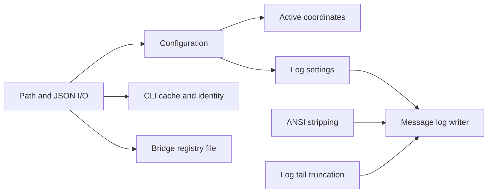

| Family | Exports | Runtime importers | Contract |
| --- | --- | --- | --- |
| Path and JSON I/O | `stripTrailingSlash`, [`ensureDirs()`][ref-1077], `normalizeFsPath`, `looksLikeFilePath`, `targetDirectoryFor`, [`readJson()`][ref-1065], [`writeJson()`][ref-1066] | none (tests only) | `file://` or plain paths only; missing or empty file yields defaults; malformed JSON or a non-object top level throws |
| Configuration | [`loadConfig()`][ref-1030], [`patchConfig()`][ref-1031], `nestedGet`, [`nestedSet()`][ref-1073], [`configGet()`][ref-1032], [`configSet()`][ref-1033] | CLI, bridge, transport router | Defaults merge, protocol normalization, validated dotted writes |
| Active coordinates | [`activeKey()`][ref-1034], [`activePort()`][ref-1035], [`activeHost()`][ref-1036], [`activeUrl()`][ref-1037], [`bridgeUrl()`][ref-1038] | CLI, bridge | Environment over config over constant |
| Process lock | [`readPid()`][ref-1039], [`writePid()`][ref-1040], [`removePid()`][ref-1041] | CLI, bridge | Positive safe-integer PID; owner-guarded removal |
| Bridge registry file | [`bridgeRegistryPath()`][ref-1042], [`loadBridgeRegistry()`][ref-1043], [`saveBridgeRegistry()`][ref-1044] | Bridge | One file per listener port; `0600` |
| Groups and team specs | [`isTrustedGroupPathSegment()`][ref-1045], [`resolvedTrustedGroupDirectory()`][ref-1046], `isExistingDirectory`, [`sanitizeAgentName()`][ref-1074], [`isGroup()`][ref-1047], [`listGroupNames()`][ref-1048], [`listGroupMembers()`][ref-1049], [`teamSpecsDir()`][ref-1050], [`listTeamSpecNames()`][ref-1051] | CLI, `a2a-tokens`, runtime snapshot | Traversal-safe single-segment group names; filesystem-backed launcher references |
| CLI cache and identity | [`loadRegistry()`][ref-1052], [`saveRegistry()`][ref-1053], [`installToken()`][ref-1054], [`generateKey()`][ref-1056], [`peerKeyForUrl()`][ref-1057] | CLI, bridge, `a2a-tokens`, runtime snapshot | Closed registry shape; per-install token; operator secrets; peer key by canonical URL |
| Log settings | [`logConfig()`][ref-1058], [`messageLogPath()`][ref-1059], [`messageLogEnabled()`][ref-1060], `messageLogMaxBytes`, [`messageLogRedactRemote()`][ref-1079] | CLI (`messageLogPath`) | Environment and config resolution of log behavior |
| Log tail truncation | `isAsciiDigit`, `isUtf8Continuation`, [`truncateRotatedMessageLogTail()`][ref-1062], `stripLeadingUtf8Continuations`, `findNextLineStartedHeader`, `isoLogHeaderStartsAt` | none (tests only) | Retained tail starts on a UTF-8 boundary and an ISO header line |
| ANSI stripping | `isCsiParamByte`, `isCsiIntermediateByte`, `isCsiFinalByte`, `isEscFinalByte`, [`stripAnsiCodes()`][ref-1063], `scanCsi`, `scanOsc`, `scanGenericEsc` | none (tests only) | ECMA-48 / ECMA-35 state machine without regular expressions |
| Message log writer | `formatLogStatus`, `formatLogBytes`, [`formatLogHeader()`][ref-1078], [`formatLogBody()`][ref-1075], [`rotateLogIfNeeded()`][ref-1061], [`appendMessageLog()`][ref-1064] | Bridge (`appendMessageLog`) | Best-effort, never-throwing audit append |

The 63 exports fall into eleven families, but only 27 exports have a runtime importer. The runtime surface concentrates in [`src/cli.mjs`][ref-1003] (21 names) and [`src/a2a-server.mjs`][ref-1004] (12 names), with [`src/a2a-tokens.mjs`][ref-1090], [`src/runtime/runtime-snapshot.mjs`][ref-1012], and [`src/transport-router.mjs`][ref-1011] each consuming a narrow slice. The bridge is the only runtime caller of the message log writer, which makes it the single producer of `messages.log`; the CLI resolves the log path only to print it, follow it with `tail -F` in `a2a log`, and report it in the doctor bundle. The installer imports the module dynamically for [`activeKey()`][ref-1034], [`configSet()`][ref-1033], and [`generateKey()`][ref-1056], so operator-key generation at install time passes through the same coercion and file mode as `a2a config set key`.

<a id="configuration-and-persistent-state-schema-contracts"></a>
### Schema contracts

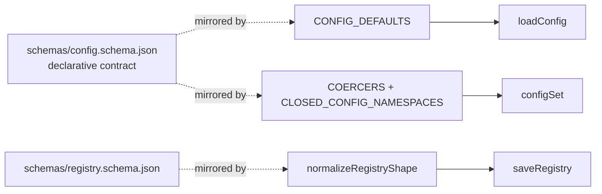

| `config.json` field | Schema type and constraint | Schema default | Code default ([`CONFIG_DEFAULTS`][ref-1069]) | [`configSet()`][ref-1033] coercion ([`COERCERS`][ref-1071]) |
| --- | --- | --- | --- | --- |
| `port` | integer, 1–65535, required | `7742` | `7742` | Strict decimal integer, 1–65535 |
| `host` | string, required | `127.0.0.1` | `127.0.0.1` | Non-empty bare host; rejects `://` and `/` |
| `url` | string or null, `format: uri` | `null` | `null` | `http:` or `https:` only; hash, query, and trailing slashes removed; empty string becomes `null` |
| `key` | string or null | `null` | `null` | Trimmed; empty becomes `null` |
| `global` | boolean | `false` | `false` | `true`, `false`, `"true"`, `"false"` only |
| `protocol` | enum `tmux`, `iterm` | `tmux` | `tmux` | Trimmed, lowercased; `iterm2` aliases to `iterm`; other values throw |
| `log.mode` | enum `on`, `off` | `on` | `on` | Exact `on` or `off` |
| `log.path` | string or null | `messages.log` | Absolute `<A2A_ROOT>/messages.log` | String; empty or `null` becomes `null` |
| `log.maxBytes` | integer, minimum 0 | `0` | `0` | Strict non-negative integer |
| `log.redactRemote` | boolean | `false` | `false` | Boolean or `"true"` / `"false"` |
| `peers` | map of `{url, key}`, both required, no extra keys | `{}` | `{}` | Every `peers.*` key rejected as an unknown setting |
| other top-level keys | allowed (`additionalProperties: true`) | none | none | Stored as the raw value |

| `registry.json` field | Schema type | Default | Enforcement |
| --- | --- | --- | --- |
| `agents` | string array, required | `[]` | Non-arrays replaced with `[]` |
| `groups` | string array, required | `[]` | Non-arrays replaced with `[]` |
| `installToken` | string or null | `null` | Empty or non-string becomes `null` |
| other keys | forbidden (`additionalProperties: false`) | none | Dropped on every write |

```js
const CLOSED_CONFIG_NAMESPACES = new Set([ "log", "peers" ]);

export function configSet(key, value) {
    if (typeof key !== "string" || key.trim() === "") {
        throw new Error("config set requires a non-empty key");
    }
    // Known keys keep their strict coercion (ports must be ints, log.mode must
    // be on|off, etc.). Novel top-level keys are stored as the raw value —
    // config.schema.json allows additional top-level properties — but keys
    // inside schema-closed namespaces must be documented settings.
    // Object.hasOwn so `config set toString x` can't dredge up a prototype fn.
    const coerce = Object.hasOwn(COERCERS, key) ? COERCERS[key] : undefined;
    if (!coerce && CLOSED_CONFIG_NAMESPACES.has(key.split(".")[0])) {
        throw new Error(`unknown setting: ${key}`);
    }
    const coerced = coerce ? coerce(value) : value;
    const updated = patchConfig(nestedSet(loadConfig(), key, coerced));
    return nestedGet(updated, key);
}
```

*`src/a2a-config.mjs:380-398`*

[`schemas/config.schema.json`][ref-1014] and [`schemas/registry.schema.json`][ref-1015] are declarative contracts that no runtime module loads; no `src/` file reads either schema. Enforcement is reimplemented in code: [`CONFIG_DEFAULTS`][ref-1069] mirrors the schema defaults, [`COERCERS`][ref-1071] and [`CLOSED_CONFIG_NAMESPACES`][ref-1072] reproduce its closed `log` and `peers` objects at write time, and [`normalizeRegistryShape()`][ref-1076] reproduces the registry schema's `additionalProperties: false` so that callers spreading a hand-edited registry back into [`saveRegistry()`][ref-1053] cannot re-persist unknown keys. The duplication avoids a runtime JSON Schema dependency but leaves the two copies to drift independently; `log.path` already differs, since the schema default is the relative `messages.log` while the code default is an absolute path under `A2A_ROOT`, and the schema's `log.path` description documents the resolution rule that reconciles them.

<a id="configuration-and-persistent-state-configuration-normalization"></a>
### Configuration normalization

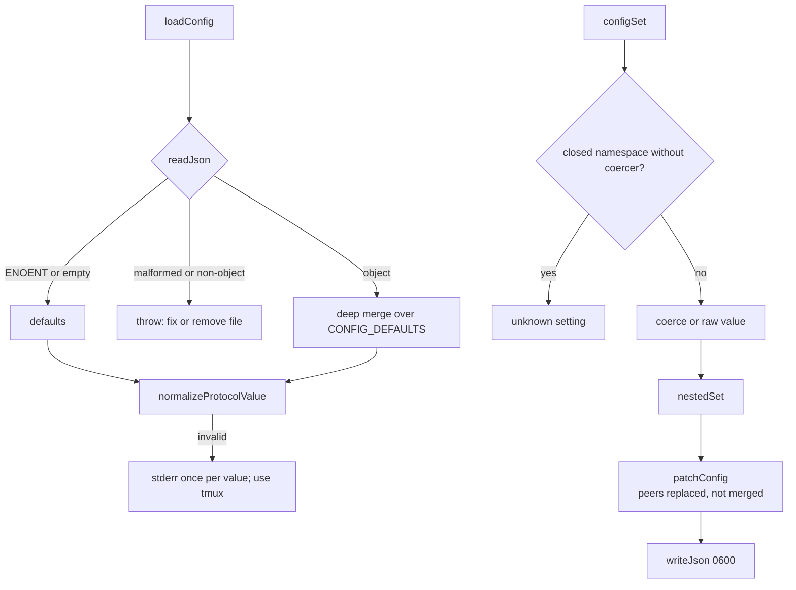

[`loadConfig()`][ref-1030] deep-merges persisted values over [`CONFIG_DEFAULTS`][ref-1069] through [`mergeDefaults()`][ref-1067] and then normalizes `protocol`. An invalid persisted protocol falls back to `tmux` with one stderr warning per distinct value per process, because `loadConfig()` runs on nearly every accessor and an unconditional warning would flood stderr; direct mutation through [`configSet()`][ref-1033] rejects the same value. The difference preserves startup availability for a hand-edited file without allowing new invalid state through the documented write path. [`patchConfig()`][ref-1031] sits between the two policies: it coerces an invalid `protocol` to `tmux` with the warning instead of throwing, so programmatic callers that bypass `configSet()` cannot persist an invalid protocol but also receive no exception.

[`readJson()`][ref-1065] distinguishes absence from corruption. A missing or empty file yields defaults, while unparseable JSON, unreadable files, and top-level arrays or scalars throw with an instruction to fix or remove the file; earlier behavior silently treated a top-level array as all-defaults. [`patchConfig()`][ref-1031] passes `peers` in the merge's replace list, so writing a peer map replaces it wholesale and a removed peer cannot survive through recursive merging. [`nestedSet()`][ref-1073] replaces non-object intermediates with fresh objects rather than spreading them, which prevents a string value from exploding into index keys. [`configGet()`][ref-1032] with no key lists every documented key from [`USER_KEYS`][ref-1080] plus unknown top-level extras, while skipping top-level names such as `log` that prefix a documented dotted key so the listing remains flat.

<a id="configuration-and-persistent-state-environment-precedence"></a>
### Environment precedence

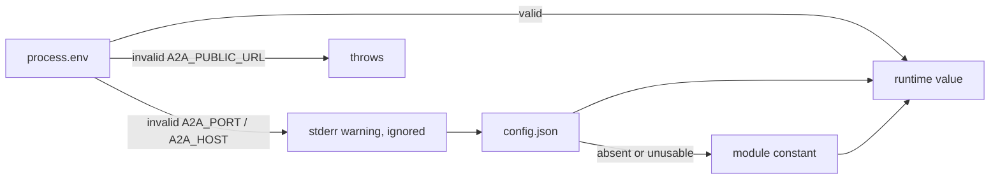

| Runtime value | Resolver | Precedence | Invalid environment value |
| --- | --- | --- | --- |
| Operator key | [`activeKey()`][ref-1034] | trimmed `A2A_KEY` → `config.key` → `null` | Not applicable |
| Port | [`activePort()`][ref-1035] | `A2A_PORT` (1–65535) → `config.port` when a positive safe integer → `7742` | Warning; falls through |
| Host | [`activeHost()`][ref-1036] | `A2A_HOST` (bare host) → `config.host` → `127.0.0.1` | Warning; falls through |
| Public URL | [`activeUrl()`][ref-1037] | `A2A_PUBLIC_URL` → `config.url` → `null`, both normalized | Throws |
| Bridge client URL | [`bridgeUrl()`][ref-1038] | `A2A_BRIDGE` verbatim → `http://<activeHost()>:<activePort()>` | Not validated |
| Bridge registry file | [`bridgeRegistryPath()`][ref-1042] | `A2A_BRIDGE_REGISTRY_FILE` → `<A2A_ROOT>/bridge-registry.<port>.json` | Not validated |
| Log path | [`messageLogPath()`][ref-1059] | `A2A_LOG_FILE` → `config.log.path` → `<A2A_ROOT>/messages.log` | Not validated |
| Log enabled | [`messageLogEnabled()`][ref-1060] | `A2A_LOG=0` off, `A2A_LOG=1` on → `config.log.mode !== "off"` | Other values defer to config |

Environment variables outrank `config.json` because one checkout serves several concurrent processes that need different coordinates: test harnesses point each bridge at its own registry file through `A2A_BRIDGE_REGISTRY_FILE`, and [`agentEnv()`][ref-1155] copies `A2A_BRIDGE`, `A2A_BRIDGE_PUBLIC`, `A2A_PUBLIC_URL`, `A2A_PORT`, `A2A_HOST`, and `A2A_KEY` from the launching process into every spawned agent so that agents route to the bridge that created them. Validation strength differs by variable. A malformed `A2A_PORT` or `A2A_HOST` is reported and ignored, so a bad override degrades to the configured bridge, whereas a malformed `A2A_PUBLIC_URL` raises an exception in every caller of [`activeUrl()`][ref-1037]. `A2A_BRIDGE` is returned without normalization.

<a id="configuration-and-persistent-state-persistence-and-installation-identity"></a>
### Persistence and installation identity

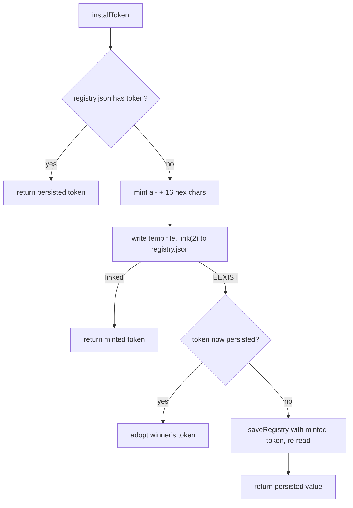

```js
function claimRegistryFileWithToken(cached, token) {
    ensureDirs(REGISTRY_FILE);
    const tmp = `${REGISTRY_FILE}.${process.pid}.${Date.now()}.claim.tmp`;
    try {
        writeFileSync(tmp, `${JSON.stringify(normalizeRegistryShape({ ...cached, installToken: token }), null, 2)}\n`, { mode: FILE_MODE_DEFAULT });
        linkSync(tmp, REGISTRY_FILE);
        return true;
    } catch ( err ) {
        if (err && err.code === "EEXIST") {
            return false;
        }
        throw err;
    } finally {
        try {
            unlinkSync(tmp);
        } catch {
            /* best effort */
        }
    }
}
```

*`src/a2a-config.mjs:716-735`*

| Secret or marker | Generator | Format | Stored in |
| --- | --- | --- | --- |
| Install token | [`installToken()`][ref-1054] | `ai-` + 8 random bytes as hex | `registry.json`; tmux option [`@a2a-install-token`][ref-1087]; iTerm bridge ownership map at [`OWNERSHIP_PATH`][ref-1088] (`~/.local/state/a2a/iterm2-bridge.ownership.json` by default) |
| Operator or peer key | [`generateKey()`][ref-1056] | `a2a-` + 16 random bytes as hex | `config.json` `key`, or a peer's `peers.<name>.key` |

[`installToken()`][ref-1054] gives each checkout a stable identity that is stronger than a session name, because names are user-controlled and reusable while the token is random per installation. [`claimRegistryFileWithToken()`][ref-1055] makes the first claim atomic: `link(2)` fails with `EEXIST` for every concurrent loser, which then adopts the winner's token instead of minting a second one. That guarantee covers only the case where `registry.json` does not yet exist. When the file exists without a token, the fallback writes and re-reads, which narrows but does not close the window in which two first callers return different tokens; the comment above the function records that earlier last-writer-wins behavior left sessions tagged with the losing token invisible to `kill --all`.

The persisted bridge registry is a recovery snapshot rather than the live authority. [`bridgeRegistryPath()`][ref-1042] keys the file by listener port because two bridges from one checkout sharing a file would overwrite each other and restart holding the other bridge's agents; the repository root on the generating machine holds both `bridge-registry.6553.json` and `bridge-registry.7742.json`. [`saveBridgeRegistry()`][ref-1044] writes `0600` because registration rows carry `backendEnv`, and [`agentEnv()`][ref-1155] places `A2A_KEY` into that map whenever the launcher has it set. On the bridge side, [`restorePersistedRegistry()`][ref-1085] runs before `server.listen`, drops rows without a valid id, a non-empty `tmuxTarget`, and a recognized `local` or `remote` kind, and starts empty with a stderr notice when the file is unreadable; [`persistRegistry()`][ref-1086] reports write failures without failing the request that already changed the in-memory map. See [Bridge Server and Registry](#bridge-server-and-registry) for the registration semantics those rows encode.

[`writePid()`][ref-1040] runs only inside the listen callback, so the PID file appears after the socket is bound. [`removePid()`][ref-1041] accepts an expected PID and deletes the file only when it still contains that value; the bridge passes its own PID on `SIGINT`, `SIGTERM`, and `exit`, which prevents an exiting stale bridge from deleting the PID file of its replacement. [`readPid()`][ref-1039] accepts only an all-digit positive safe integer and returns `null` for anything else, leaving liveness verification to the CLI's bridge-startup logic described in [Command-Line Orchestrator](#command-line-orchestrator).

<a id="configuration-and-persistent-state-group-and-team-spec-discovery"></a>
### Group and team-spec discovery

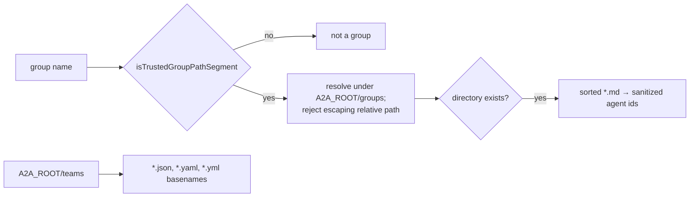

[`isTrustedGroupPathSegment()`][ref-1045] admits only names matching `^[A-Za-z0-9._-]+$` that are not `.`, `..`, or any string containing `..`, `/`, or `\`, and [`resolvedTrustedGroupDirectory()`][ref-1046] re-checks the joined path with `path.relative` before any `stat`. The double check rejects traversal before the filesystem is consulted, so a group name supplied through a message or CLI argument cannot address a directory outside `groups/`. [`listGroupMembers()`][ref-1049] treats every `.md` file in sorted order as one member and derives the agent id through [`sanitizeAgentName()`][ref-1074], which collapses unsafe characters to `-` and falls back to `agent`. [`listTeamSpecNames()`][ref-1051] lists only top-level `.json`, `.yaml`, and `.yml` files in `<A2A_ROOT>/teams`; nested directory specs are resolved by the team-spec module instead, and [`teamSpecsDir()`][ref-1050] creates the directory as a side effect of returning it. The CLI passes both [`REPO_TEAMS_DIR`][ref-1089] and `teamSpecsDir()` to team resolution, and both evaluate to `<checkout>/teams`; see [Team Specifications and Backend Translation](#team-specifications-and-backend-translation) for the resolution order.

<a id="configuration-and-persistent-state-message-log"></a>
### Message log

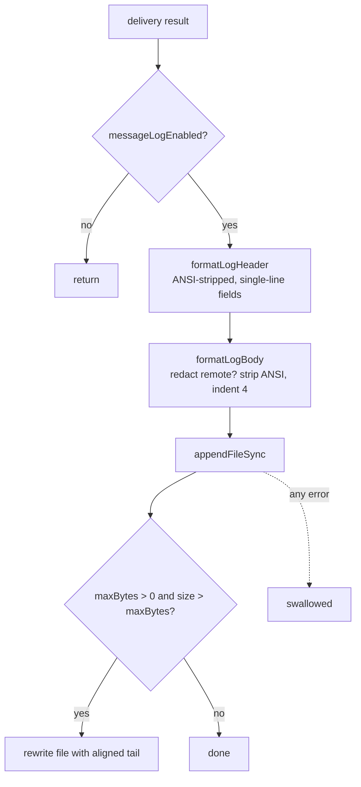

```js
export function formatLogHeader(entry, stamp) {
    const from = cleanLogHeaderField(entry.from);
    const to = cleanLogHeaderField(entry.to);
    const action = cleanLogHeaderField(entry.action || "message", "message");
    const origin = cleanLogHeaderField(entry.origin);
    return `[${stamp}] ${from} -> ${to}  ${action}/${origin}  ${formatLogBytes(entry)}  ${formatLogStatus(entry)}`;
}
```

*`src/a2a-config.mjs:1067-1073`*

[`appendMessageLog()`][ref-1064] is intentionally non-fatal: every error inside it is swallowed, because audit I/O must never fail an inter-agent delivery. Header fields pass through ANSI stripping and newline collapsing, so a sender id or error string cannot forge an additional log entry, while body lines keep their content but receive a four-space indent that keeps entries scannable under `tail -f`. [`formatLogBody()`][ref-1075] substitutes `[redacted remote body]` only when `log.redactRemote` is true and the entry's final transport is `remote`, preserving local debugging detail while allowing federated content suppression.

[`rotateLogIfNeeded()`][ref-1061] is tail truncation rather than file rotation: when `log.maxBytes` is positive and the file exceeds it, the file is rewritten in place with its last `maxBytes` bytes and no rotated sibling is kept. [`truncateRotatedMessageLogTail()`][ref-1062] drops orphaned UTF-8 continuation bytes and advances to the next line that begins with an ISO `[YYYY-MM-DDT` header, so the retained file never starts mid-character or mid-entry. The rewrite reads and then overwrites the same path without a temp file, so an append from another process that lands between the read and the write is discarded. The default `maxBytes` of `0` disables the check entirely; the generating machine's `messages.log` measured 5,346,455 bytes under that default.

[`stripAnsiCodes()`][ref-1063] implements the ECMA-48 / ECMA-35 escape grammar as a byte-class state machine covering CSI, OSC terminated by BEL or `ESC \`, and generic `ESC` sequences. Its comment records that earlier SGR-only and Fe-only versions left OSC hyperlinks, cursor-movement CSIs, and charset switches in persisted lines, which broke plain-text matching against the log. Malformed sequences drop only the introducer bytes, while an unterminated OSC consumes the remainder of the string.

See [Runtime State and Observability](#runtime-state-and-observability) for the consumers of `registry.json` and [Bridge Server and Registry](#bridge-server-and-registry) for the live map.

## Installation and Generated Assets

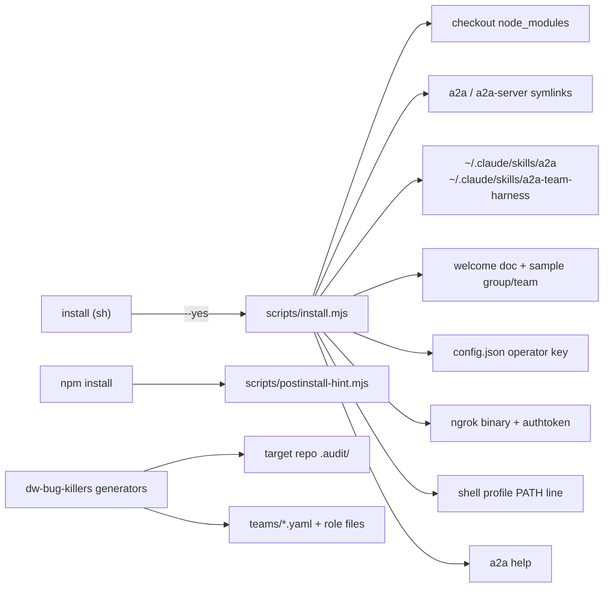

Installation is a conservative migration of repository entrypoints and skills into user-owned locations, while the worklist generators produce task-specific coordination assets for another repository. Neither belongs to the message runtime, but both shape the filesystem and team specifications consumed by runtime commands, so their safety contracts matter to agents modifying packaging or generated workflows.

- [Artifact inventory](#installation-and-generated-assets-artifact-inventory)
- [Installer stages](#installation-and-generated-assets-installer-stages)
- [Installer safety](#installation-and-generated-assets-installer-safety)
- [Bootstrap wrapper and npm lifecycle](#installation-and-generated-assets-bootstrap-wrapper-and-npm-lifecycle)
- [Install-location coupling](#installation-and-generated-assets-install-location-coupling)
- [Flag transformer](#installation-and-generated-assets-flag-transformer)
- [Worklist generators](#installation-and-generated-assets-worklist-generators)

<a id="installation-and-generated-assets-artifact-inventory"></a>
### Artifact inventory

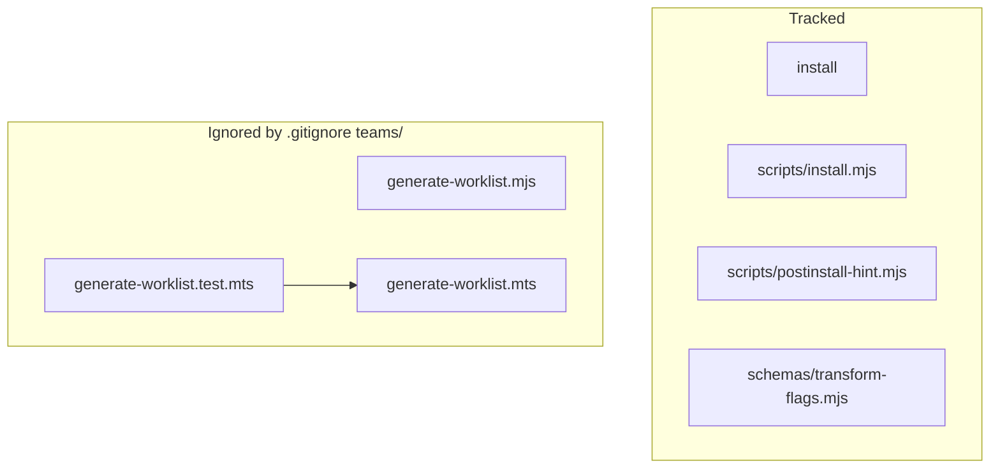

| Artifact | Git status | Important symbols | Responsibility |
| --- | --- | --- | --- |
| [`scripts/install.mjs`][ref-1100] | Tracked | [`parseInstallArgv()`][ref-1101], [`writeFileAtomic()`][ref-1103], [`ensureSymlinkWithoutReplacing()`][ref-1104], [`copyTreeWithBackup()`][ref-1106], [`INSTALL_STEPS`][ref-1119], [`verifyInstall()`][ref-1118], [`main()`][ref-1120] | Eleven-stage interactive or unattended installer |
| [`install`][ref-1125] | Tracked | POSIX shell wrapper | Node 18 gate, then `exec` of the installer with `--yes` |
| [`scripts/postinstall-hint.mjs`][ref-1126] | Tracked | top-level statements | Non-mutating npm `postinstall` guidance |
| [`schemas/transform-flags.mjs`][ref-1127] | Tracked | [`FLAG_REGISTRY`][ref-1128], [`transformFlags()`][ref-1129], [`registerCli()`][ref-1130], [`registerFlag()`][ref-1131] | Standalone cross-backend flag transformer with no importers |
| [`teams/dw-bug-killers/generate-worklist.mjs`][ref-1135] | Untracked, ignored | [`importPackage()`][ref-1136], [`writeTeamSpec()`][ref-1137], [`resetArtifacts()`][ref-1138] | Earlier worklist generator; one agent per surface with inline roles |
| [`teams/dw-bug-killers/generate-worklist.mts`][ref-1139] | Untracked, ignored | [`findTscProjects()`][ref-1140], [`extractLogBugs()`][ref-1142], [`writeTeamSpec()`][ref-1141], [`mainEslint()`][ref-1144] | Successor generator with ESLint mode, gate-runner, and role files |
| [`teams/dw-bug-killers/generate-worklist.test.mts`][ref-1146] | Untracked, ignored | `node:test` suite | Tests for the `.mts` generator; the only scanned edge into it |

`git ls-files teams` lists only the `star-wars` and `west-world` samples; every other entry under `teams/`, including both generators, is excluded by the `teams/` rule in [`.gitignore`][ref-1147] and exists only in this working tree.

<a id="installation-and-generated-assets-installer-stages"></a>
### Installer stages

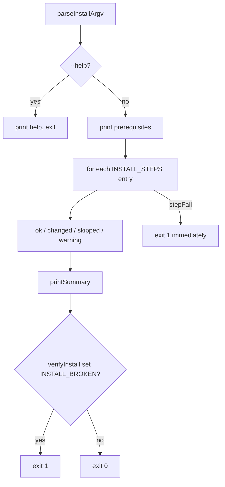

```js
const INSTALL_STEPS = [
  ["Install dependencies", installDependencies],
  ["Link commands", installBinaries],
  ["Install Claude skill", installSkill],
  ["Install team-harness skill", installTeamHarnessSkill],
  ["Install welcome document", installWelcomeDoc],
  ["Install sample group", installGroups],
  ["Install sample team", installTeams],
  ["Generate operator key", ensureOperatorKey],
  ["Set up ngrok", setupNgrok],
  ["Configure PATH", configureShellPath],
  ["Verify install", verifyInstall],
];
```

*`scripts/install.mjs:1409-1421`*

| # | Stage | Function | Destination | Guard | Failure class |
| ---: | --- | --- | --- | --- | --- |
| 1 | Install dependencies | [`installDependencies()`][ref-1108] | Checkout `node_modules` via `npm install --no-audit --no-fund --loglevel=error` | Skipped when `js-yaml`, `zod`, and `@modelcontextprotocol/sdk` all exist | Hard failure on npm error or still-missing dependency |
| 2 | Link commands | [`installBinaries()`][ref-1109] | `a2a` → `bin/a2a.mjs`, `a2a-server` → `src/a2a-server.mjs` in the first writable of `~/.local/bin`, `~/bin`, `/usr/local/bin` ([`detectInstallBinDir()`][ref-1107]) | [`ensureSymlinkWithoutReplacing()`][ref-1104] | Warning on conflict; hard failure when only sudo-gated `/usr/local/bin` remains |
| 3 | Install Claude skill | [`installSkill()`][ref-1110] | `skills/a2a` → `~/.claude/skills/a2a` | [`copyTreeWithBackup()`][ref-1106] | Hard failure when the source `SKILL.md` is missing |
| 4 | Install team-harness skill | [`installTeamHarnessSkill()`][ref-1111] | `skills/a2a-team-harness` → `~/.claude/skills/a2a-team-harness` | `copyTreeWithBackup()` | Warning when the source is missing |
| 5 | Install welcome document | [`installWelcomeDoc()`][ref-1112] | [`src/a2a-welcome.md`][ref-1148] → `~/.claude/a2a-welcome.md` | [`copyFileWithBackup()`][ref-1105] | Skip when the source is missing |
| 6 | Install sample group | [`installGroups()`][ref-1113] | `teams/star-wars/` → `~/.claude/skills/a2a/groups/star-wars` | Create-only | Skip when the destination exists |
| 7 | Install sample team | [`installTeams()`][ref-1114] | `teams/star-wars.yaml` → `~/.claude/skills/a2a/teams/star-wars.yaml` | Create-only | Skip; the source path does not exist in this checkout |
| 8 | Generate operator key | [`ensureOperatorKey()`][ref-1115] | `config.json` `key` through `configSet("key", generateKey())` | Skipped when [`activeKey()`][ref-1034] returns a key from env or config | Warning only |
| 9 | Set up ngrok | [`setupNgrok()`][ref-1116] | `brew install --cask ngrok` (macOS) or `snap install ngrok` (Linux); `ngrok config add-authtoken` | No auto-install under CI | Warning only; never fails the install |
| 10 | Configure PATH | [`configureShellPath()`][ref-1117] | `~/.zshrc`, `~/.bashrc` or `~/.bash_profile`, or fish `config.fish` | Only when the bin directory is absent from `PATH` and the profile text lacks it | Warning for unrecognized shells |
| 11 | Verify install | [`verifyInstall()`][ref-1118] | Runs `a2a help` through the installed link, or `node bin/a2a.mjs help` when linking was declined | Missing deps, nonzero exit, missing link, or missing skill | Sets `INSTALL_BROKEN`; process exits 1 |

| Option | Environment equivalent | Effect |
| --- | --- | --- |
| `--yes`, `-y` | `A2A_SETUP_YES=1`, `CI=1`, `CI=true` | Answers every `y/N` confirmation and suppresses step explanations |
| `--no-ngrok` | `A2A_SETUP_NO_NGROK=1` | Skips stage 9 |
| `--no-key` | `A2A_SETUP_NO_KEY=1` | Skips stage 8 |
| `--no-path` | `A2A_SETUP_NO_PATH=1` | Skips stage 10 |
| `--verify-ngrok` | none | Starts `ngrok http 4599` for up to 20 seconds and classifies its log |
| `--help`, `-h` | none | Prints usage and exits |

[`verifyInstall()`][ref-1118] proves usability by executing the CLI rather than by inspecting a symlink, because the earlier check reported a ready install over a clone with no `node_modules` that then failed with `ERR_MODULE_NOT_FOUND`. Declined steps are recorded separately from defects, so an operator who skips linking receives a note while an unexpected missing link marks the install broken. [`promptValue()`][ref-1123] is the one input that `--yes` does not answer: an ngrok authtoken is an account secret, so the installer asks on a TTY and otherwise records the missing credential as a warning. With `--verify-ngrok`, [`classifyNgrokAuthLog()`][ref-1121] maps `ERR_NGROK_4018` to a rejected credential and treats `client session established` followed by `ERR_NGROK_334` as an accepted credential on a busy account, and it deliberately does not parse a tunnel URL.

<a id="installation-and-generated-assets-installer-safety"></a>
### Installer safety

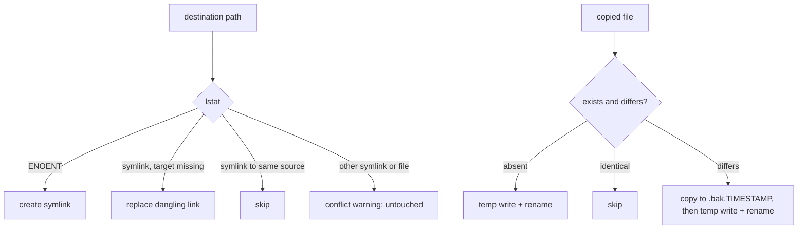

[`ensureSymlinkWithoutReplacing()`][ref-1104] never replaces an existing file or a live symlink to a different target; the one replacement it performs is a dangling symlink, which cannot be anyone's working file and which previously aborted the installer with `EEXIST` because `existsSync` follows links. Skill and document updates go through [`copyFileWithBackup()`][ref-1105], which keeps a `.bak.<timestamp>` copy of any differing destination before an atomic [`writeFileAtomic()`][ref-1103] replacement; sample groups and team specs are create-only; an existing operator key is never regenerated. PATH edits append a `# added by a2a install` marker and one export line after backing up the profile, and they are skipped when the profile already contains the bin directory in either `$HOME`-relative or absolute form.

"Non-destructive" in the installer's vocabulary means guarded destination replacement and backups, not absence of system side effects. A run can execute npm lifecycle scripts, install ngrok through Homebrew or Snap, pass the pasted authtoken as a process argument to `ngrok config add-authtoken`, and `chmod 0755` both `bin/a2a.mjs` and `src/a2a-server.mjs` inside the checkout. Under CI, `--yes` is implied but ngrok auto-installation is refused, so an unattended build cannot install system packages as a side effect.

<a id="installation-and-generated-assets-bootstrap-wrapper-and-npm-lifecycle"></a>
### Bootstrap wrapper and npm lifecycle

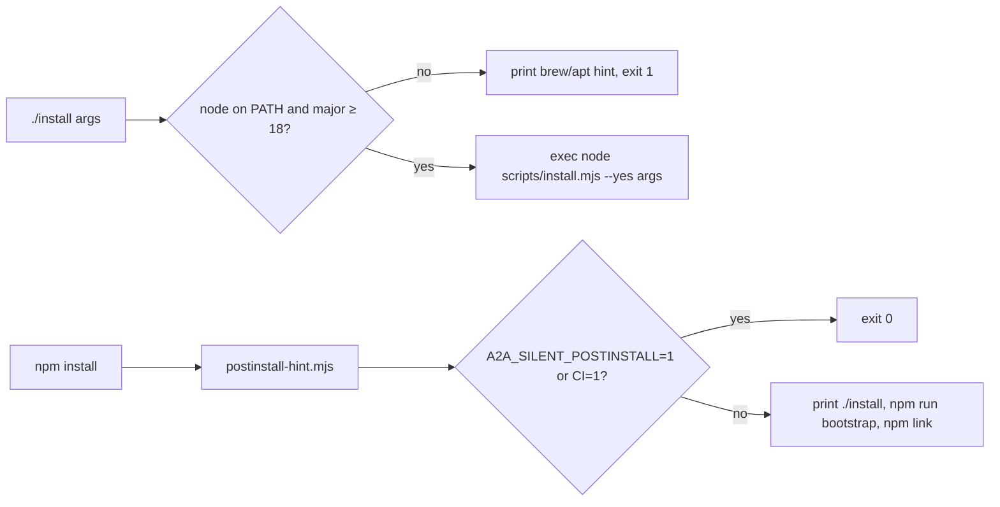

```sh
NODE_MAJOR="$(node -p 'process.versions.node.split(".")[0]' 2>/dev/null || echo 0)"
if [ "$NODE_MAJOR" -lt 18 ]; then
  red "a2a install: Node.js 18 or newer is required, found $(node --version)"
  exit 1
fi

# --yes suppresses the per-step y/N confirmations. It does NOT suppress the one
# unavoidable question: if ngrok has no authtoken, the installer asks for it,
# because an authtoken is a per-account secret that cannot be generated locally.
exec node "$SCRIPT_DIR/scripts/install.mjs" --yes "$@"
```

*`install:44-53`*

The root [`install`][ref-1125] wrapper resolves its own directory with `CDPATH` cleared, gates on Node 18, and always supplies `--yes`, so `./install` and `npm run bootstrap` are the unattended path while `npm run setup` keeps per-step confirmations. Its header comment advertises a `--verify-tunnel` option, but [`parseInstallArgv()`][ref-1101] recognizes only `--verify-ngrok` and ignores unknown arguments without error, so the documented spelling performs no verification. The same comment lists eight steps, while [`INSTALL_STEPS`][ref-1119] contains eleven.

[`scripts/postinstall-hint.mjs`][ref-1126] prints choices after `npm install` and performs no mutation. It suppresses output for `A2A_SILENT_POSTINSTALL=1` or `CI=1` but not `CI=true`, whereas [`isCI()`][ref-1102] in the installer accepts both, so GitHub Actions runners print the hint. The hint points readers to `docs/cli.md`, which does not exist in the repository, and it offers `npm link`, which exposes all four `bin` entries from [`package.json`][ref-1001], while the installer links only `a2a` and `a2a-server`.

<a id="installation-and-generated-assets-install-location-coupling"></a>
### Install-location coupling

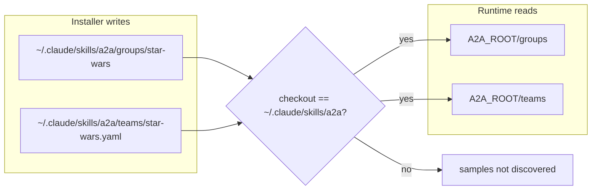

The installer places sample content under `~/.claude/skills/a2a/{groups,teams}`, while [`src/a2a-config.mjs`][ref-1005] discovers groups under `<A2A_ROOT>/groups` and team specs under `<A2A_ROOT>/teams`, where `A2A_ROOT` is the checkout. The two locations coincide only when the checkout itself is `~/.claude/skills/a2a`, which is the historical layout that the comment above `SAFE_GROUP_SEGMENT` still names. For a checkout elsewhere, such as the one this wiki was generated from, the installed sample group is invisible to [`isGroup()`][ref-1047] and the checkout has no `groups/` directory at all. Stage 7 cannot succeed in this checkout regardless of location, because its source `teams/star-wars.yaml` does not exist; the tracked spec lives at [`teams/star-wars/star-wars.yaml`][ref-1151]. The sample group copy also carries `star-wars.yaml` and `council-log.md`, and [`listGroupMembers()`][ref-1049] treats every `.md` file as a persona, so `council-log` becomes a group member when that directory is used as a group.

<a id="installation-and-generated-assets-flag-transformer"></a>
### Flag transformer

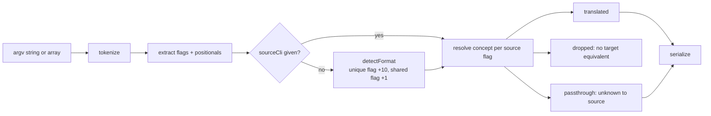

| Backend key | Concepts with a mapping | Concepts mapped to `null` |
| --- | ---: | ---: |
| `claude` | 29 | 11 |
| `codex` | 13 | 27 |
| `gemini` | 16 | 24 |
| `cursor-agent` | 0 | 40 |

```js
export function registerFlag(concept, cli, spec) {
  if (!FLAG_REGISTRY.has(concept)) {
    const entry = Object.fromEntries(CLIS.map((c) => [c, null]));
    FLAG_REGISTRY.set(concept, entry);
  }
  FLAG_REGISTRY.get(concept)[cli] = spec;
  // Rebuild indices
  KNOWN_FLAGS.set(cli, knownFlagsFor(cli));
  const idx = buildFlagIndex();
  for (const [k, v] of idx) FLAG_INDEX.set(k, v);
}
```

*`schemas/transform-flags.mjs:544-554`*

[`schemas/transform-flags.mjs`][ref-1127] is a standalone tokenizer, registry, and serializer for translating CLI concepts across four backend keys, runnable directly as `node schemas/transform-flags.mjs --target <cli>`. It is not the runtime team translator in [`src/agent-backend-args.mjs`][ref-1134], and no file in the repository imports it. [`FLAG_REGISTRY`][ref-1128] holds 40 concepts, but `cursor-agent` is `null` for every one, so a Cursor Agent target drops every recognized flag and emits only passthrough flags.

[`detectFormat()`][ref-1132] scores flags unique to one backend at +10 and shared flags at +1, and a flag unknown to the detected source is passed through untranslated rather than re-scored against other backends. Executing `transformFlags("--model x --yolo --verbose", "codex")` on this tree detects `claude`, translates `--model`, drops `--verbose`, and passes `--yolo` through unchanged because `--yolo` is a Codex alias rather than a Claude flag. [`registerFlag()`][ref-1131] rebuilds the per-backend known-flag set and merges a fresh index into `FLAG_INDEX`, but it never deletes superseded index entries and never rebuilds `UNIQUE_FLAGS`, so dynamically registered flags do not participate in unique-flag detection; [`registerCli()`][ref-1130] adds a backend to `CLIS` without touching the index. [`tokenize()`][ref-1133] splits on spaces and tabs, honors quote characters while counting `{`/`}` depth for embedded JSON, and has no backslash escapes, so callers cannot rely on shell-equivalent parsing.

<a id="installation-and-generated-assets-worklist-generators"></a>
### Worklist generators

```mermaid
flowchart TD
  START["generator main"] --> CHECK["repo is a directory with package.json"]
  CHECK --> DRY{"--dry-run?"}
  DRY -->|yes| PRINT["print commands and paths only"]
  DRY -->|no| RESET["rm -rf target .audit/test-audit or .audit/eslint-audit"]
  RESET --> RUN["run each oracle sequentially under RUN LOCK in status.md"]
  RUN --> PARSE["extract failure lines"]
  PARSE --> WRITE["worklist.md + worklist.json"]
  WRITE --> SPEC["team YAML for a2a start"]
  SPEC --> EXIT["exit 0 when GREEN, 1 when RED"]
```

| Property | [`generate-worklist.mjs`][ref-1135] | [`generate-worklist.mts`][ref-1139] |
| --- | --- | --- |
| Default target repository | `$HOME/Documents/dev/DisputeWell` | `process.cwd()` |
| Typecheck project discovery | Filesystem walk for `tsconfig.json` | `-p`/`--project` arguments in `typecheck*` npm scripts ([`findTscProjects()`][ref-1140]); walk only as fallback |
| `tsc` environment | Inherited | `NODE_OPTIONS=--max-old-space-size=8192`, recorded in the command text |
| Failure extraction | First 200 unique matching lines (400 for `tsc`) | Clustered by normalized signature ([`extractLogBugs()`][ref-1142]) with leak patterns such as `TimeoutNegativeWarning` and `"level":"error"` |
| GREEN rule | Every exit code is 0 | Every exit code is 0 and no failure line was extracted ([`worklistStatus()`][ref-1143]) |
| Agents emitted | One per surface, including passing surfaces | One per failing surface plus `gate-runner` |
| Role storage | Inline `role` strings in the YAML | `role_file` paths under `teams/<team>/roles/` plus `base-role.md` |
| Team spec path | `teams/dw-bug-killers/dw-bug-killers.yaml` | `teams/dw-bug-killers.yaml` (flat) |
| ESLint mode | none | `--eslint`: `npx eslint . --format json`, bucketed by [`ESLINT_BUCKET_GLOBS`][ref-1145] into `teams/dw-eslint-killers.yaml` |

Both generators are task-specific tooling for a separate repository rather than a2a runtime code, and both are destructive by design: a real run removes the target repository's `.audit/test-audit` (or `.audit/eslint-audit`) directory and the team's previous generated files before executing any oracle, which keeps stale results from leaking into a fresh worklist. `--dry-run` (or `--dry`) is the only non-mutating path. Each oracle runs sequentially while `status.md` records `RUN LOCK: HELD`, which matches the single-heavy-command discipline that the generated roles impose on the swarm.

The two files are not a typed mirror of each other, and their outputs conflict. [`writeTeamSpec()`][ref-1141] in the `.mts` writes the flat `teams/dw-bug-killers.yaml` and deletes the nested `teams/dw-bug-killers/dw-bug-killers.yaml`, which is exactly the file that [`writeTeamSpec()`][ref-1137] in the `.mjs` produces, because a nested spec beside the flat one confuses directory probing in team resolution. The `.mts` output depends on the CLI's `role_file` support, which loads role text relative to the spec directory and rejects an agent or defaults block that sets both `role` and `role_file` ([`combinedRolePrompt()`][ref-1152]).

Both generators load `js-yaml` through [`importPackage()`][ref-1136], which tries a local import first and otherwise fetches `https://unpkg.com/js-yaml@4.1.0/dist/js-yaml.mjs` and executes it through a `data:` URL import. In the `.mjs`, that load is a top-level `await`, so even `--help` and `--dry-run` can trigger the network fallback; the `.mts` defers it until a spec is written. The fallback executes remotely served code without integrity pinning whenever `js-yaml` is not resolvable from the generator's location.

See [Team Specifications and Backend Translation](#team-specifications-and-backend-translation) for consumption of generated YAML and [Verification Architecture](#verification-architecture) for test coverage of these artifacts.

<!-- refs -->
[ref-1001]: ../package.json
[ref-1002]: ../bin/a2a.mjs
[ref-1003]: ../src/cli.mjs
[ref-1004]: ../src/a2a-server.mjs
[ref-1005]: ../src/a2a-config.mjs
[ref-1006]: ../src/a2a-dots.mjs
[ref-1007]: ../src/a2a-channel.mjs
[ref-1008]: ../src/transport-probes.mjs
[ref-1009]: ../src/transport-select.mjs
[ref-1010]: ../src/iterm2-delivery.mjs
[ref-1011]: ../src/transport-router.mjs
[ref-1012]: ../src/runtime/runtime-snapshot.mjs
[ref-1013]: ../src/cli/dashboard-tui.mjs
[ref-1014]: ../schemas/config.schema.json
[ref-1015]: ../schemas/registry.schema.json
[ref-1016]: ../src/cli.mjs#L5720
[ref-1017]: ../src/cli/parse-start-args.mjs
[ref-1018]: ../src/a2a-team-spec.mjs
[ref-1019]: ../src/key-sequence.mjs
[ref-1020]: ../src/backend-delivery.mjs
[ref-1021]: ../src/cli.mjs#L368
[ref-1030]: ../src/a2a-config.mjs#L254
[ref-1031]: ../src/a2a-config.mjs#L258
[ref-1032]: ../src/a2a-config.mjs#L287
[ref-1033]: ../src/a2a-config.mjs#L382
[ref-1034]: ../src/a2a-config.mjs#L415
[ref-1035]: ../src/a2a-config.mjs#L420
[ref-1036]: ../src/a2a-config.mjs#L444
[ref-1037]: ../src/a2a-config.mjs#L463
[ref-1038]: ../src/a2a-config.mjs#L472
[ref-1039]: ../src/a2a-config.mjs#L476
[ref-1040]: ../src/a2a-config.mjs#L489
[ref-1041]: ../src/a2a-config.mjs#L499
[ref-1042]: ../src/a2a-config.mjs#L531
[ref-1043]: ../src/a2a-config.mjs#L544
[ref-1044]: ../src/a2a-config.mjs#L557
[ref-1045]: ../src/a2a-config.mjs#L567
[ref-1046]: ../src/a2a-config.mjs#L581
[ref-1047]: ../src/a2a-config.mjs#L609
[ref-1048]: ../src/a2a-config.mjs#L617
[ref-1049]: ../src/a2a-config.mjs#L625
[ref-1050]: ../src/a2a-config.mjs#L637
[ref-1051]: ../src/a2a-config.mjs#L642
[ref-1052]: ../src/a2a-config.mjs#L652
[ref-1053]: ../src/a2a-config.mjs#L667
[ref-1054]: ../src/a2a-config.mjs#L687
[ref-1055]: ../src/a2a-config.mjs#L716
[ref-1056]: ../src/a2a-config.mjs#L737
[ref-1057]: ../src/a2a-config.mjs#L753
[ref-1058]: ../src/a2a-config.mjs#L766
[ref-1059]: ../src/a2a-config.mjs#L789
[ref-1060]: ../src/a2a-config.mjs#L798
[ref-1061]: ../src/a2a-config.mjs#L1080
[ref-1062]: ../src/a2a-config.mjs#L844
[ref-1063]: ../src/a2a-config.mjs#L977
[ref-1064]: ../src/a2a-config.mjs#L1106
[ref-1065]: ../src/a2a-config.mjs#L199
[ref-1066]: ../src/a2a-config.mjs#L228
[ref-1067]: ../src/a2a-config.mjs#L183
[ref-1069]: ../src/a2a-config.mjs#L27
[ref-1071]: ../src/a2a-config.mjs#L306
[ref-1072]: ../src/a2a-config.mjs#L380
[ref-1073]: ../src/a2a-config.mjs#L272
[ref-1074]: ../src/a2a-config.mjs#L604
[ref-1075]: ../src/a2a-config.mjs#L1075
[ref-1076]: ../src/a2a-config.mjs#L662
[ref-1077]: ../src/a2a-config.mjs#L113
[ref-1078]: ../src/a2a-config.mjs#L1067
[ref-1079]: ../src/a2a-config.mjs#L813
[ref-1080]: ../src/a2a-config.mjs#L64
[ref-1085]: ../src/a2a-server.mjs#L136
[ref-1086]: ../src/a2a-server.mjs#L165
[ref-1087]: ../src/cli.mjs#L745
[ref-1088]: ../cmd/a2a-iterm2-bridge/bridge.py#L70
[ref-1089]: ../src/cli.mjs#L36
[ref-1090]: ../src/a2a-tokens.mjs
[ref-1100]: ../scripts/install.mjs
[ref-1101]: ../scripts/install.mjs#L56
[ref-1102]: ../scripts/install.mjs#L23
[ref-1103]: ../scripts/install.mjs#L297
[ref-1104]: ../scripts/install.mjs#L422
[ref-1105]: ../scripts/install.mjs#L473
[ref-1106]: ../scripts/install.mjs#L514
[ref-1107]: ../scripts/install.mjs#L370
[ref-1108]: ../scripts/install.mjs#L580
[ref-1109]: ../scripts/install.mjs#L633
[ref-1110]: ../scripts/install.mjs#L704
[ref-1111]: ../scripts/install.mjs#L740
[ref-1112]: ../scripts/install.mjs#L771
[ref-1113]: ../scripts/install.mjs#L796
[ref-1114]: ../scripts/install.mjs#L825
[ref-1115]: ../scripts/install.mjs#L854
[ref-1116]: ../scripts/install.mjs#L1050
[ref-1117]: ../scripts/install.mjs#L1176
[ref-1118]: ../scripts/install.mjs#L1346
[ref-1119]: ../scripts/install.mjs#L1409
[ref-1120]: ../scripts/install.mjs#L1423
[ref-1121]: ../scripts/install.mjs#L976
[ref-1123]: ../scripts/install.mjs#L538
[ref-1125]: ../install
[ref-1126]: ../scripts/postinstall-hint.mjs
[ref-1127]: ../schemas/transform-flags.mjs
[ref-1128]: ../schemas/transform-flags.mjs#L6
[ref-1129]: ../schemas/transform-flags.mjs#L509
[ref-1130]: ../schemas/transform-flags.mjs#L539
[ref-1131]: ../schemas/transform-flags.mjs#L544
[ref-1132]: ../schemas/transform-flags.mjs#L401
[ref-1133]: ../schemas/transform-flags.mjs#L337
[ref-1134]: ../src/agent-backend-args.mjs
[ref-1135]: ../teams/dw-bug-killers/generate-worklist.mjs
[ref-1136]: ../teams/dw-bug-killers/generate-worklist.mjs#L61
[ref-1137]: ../teams/dw-bug-killers/generate-worklist.mjs#L216
[ref-1138]: ../teams/dw-bug-killers/generate-worklist.mjs#L349
[ref-1139]: ../teams/dw-bug-killers/generate-worklist.mts
[ref-1140]: ../teams/dw-bug-killers/generate-worklist.mts#L895
[ref-1141]: ../teams/dw-bug-killers/generate-worklist.mts#L740
[ref-1142]: ../teams/dw-bug-killers/generate-worklist.mts#L1255
[ref-1143]: ../teams/dw-bug-killers/generate-worklist.mts#L1326
[ref-1144]: ../teams/dw-bug-killers/generate-worklist.mts#L1714
[ref-1145]: ../teams/dw-bug-killers/generate-worklist.mts#L511
[ref-1146]: ../teams/dw-bug-killers/generate-worklist.test.mts
[ref-1147]: ../.gitignore
[ref-1148]: ../src/a2a-welcome.md
[ref-1151]: ../teams/star-wars/star-wars.yaml
[ref-1152]: ../src/cli.mjs#L1618
[ref-1153]: ../src/cli/sender-identity.mjs
[ref-1154]: ../src/server/auth.mjs
[ref-1155]: ../src/cli.mjs#L1161
