## Message Framing and Identity

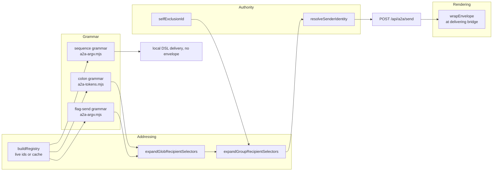

The message boundary splits one outbound send into four independently testable concerns: syntax, addressing, authority, and rendering. [`src/a2a-tokens.mjs`][ref-2001] owns the registry-aware colon grammar, [`src/a2a-argv.mjs`][ref-2002] owns the flag-send and sequence grammars, [`src/recipient-selectors.mjs`][ref-2003] owns wildcard expansion, [`src/cli/sender-identity.mjs`][ref-2004] owns sender authority, and [`src/server/envelope.mjs`][ref-2005] owns the terminal-visible `<a2a>` header. The split exists so that convenience syntax added to a grammar cannot widen who a message claims to come from or how its header is escaped; the order in which [`main()`][ref-2073] tries the grammars is owned by [Command-Line Orchestrator](#command-line-orchestrator-dispatch-and-command-families).

- [Parser and selector inventory](#message-framing-and-identity-parser-and-selector-inventory)
- [Send grammars](#message-framing-and-identity-send-grammars)
- [Recipient registry and selectors](#message-framing-and-identity-recipient-registry-and-selectors)
- [Sender authority](#message-framing-and-identity-sender-authority)
- [Envelope contract](#message-framing-and-identity-envelope-contract)

<a id="message-framing-and-identity-parser-and-selector-inventory"></a>
### Parser and selector inventory

| Module | Public surface | Policy boundary |
| --- | --- | --- |
| [`src/a2a-tokens.mjs`][ref-2001] | [`ACTIONS`][ref-2006], `ACTION_ALIASES`, [`buildRegistry()`][ref-2007], [`classifyToken()`][ref-2008], [`isColonFlagArgv()`][ref-2009], [`parseColonFlagArgv()`][ref-2010] | Registry-aware colon grammar and recipient cache refresh |
| [`src/a2a-argv.mjs`][ref-2002] | [`isSequenceFlagArgv()`][ref-2013], [`isFlagSendArgv()`][ref-2014], [`parseFlagSendArgv()`][ref-2015], [`parseSequenceFlagArgv()`][ref-2016]; re-exports the two colon functions | Flag-send versus raw sequence grammar |
| [`src/recipient-selectors.mjs`][ref-2003] | [`hasUnescapedGlob()`][ref-2018], [`globPatternToRegExp()`][ref-2019], [`expandGlobRecipientSelectors()`][ref-2020] | Case-insensitive `*`/`?` expansion with backslash escapes |
| [`src/cli/sender-identity.mjs`][ref-2004] | [`resolveSenderIdentity()`][ref-2021], [`selfExclusionId()`][ref-2022], `VALID_ORIGINS` | Actor id, authority class, operator surface |
| [`src/server/envelope.mjs`][ref-2005] | [`sanitizeForXmlCharacterData()`][ref-2024], [`escapeXml()`][ref-2025], [`wrapEnvelope()`][ref-2026] | Terminal framing and display provenance |
| [`src/cli.mjs`][ref-2072] | [`getRegistry()`][ref-2031], [`expandGroupRecipientSelectors()`][ref-2032], [`sanitizeEnvelopeMeta()`][ref-2030] | I/O glue: live agent list, group directories, reserved-key stripping |

<a id="message-framing-and-identity-send-grammars"></a>
### Send grammars

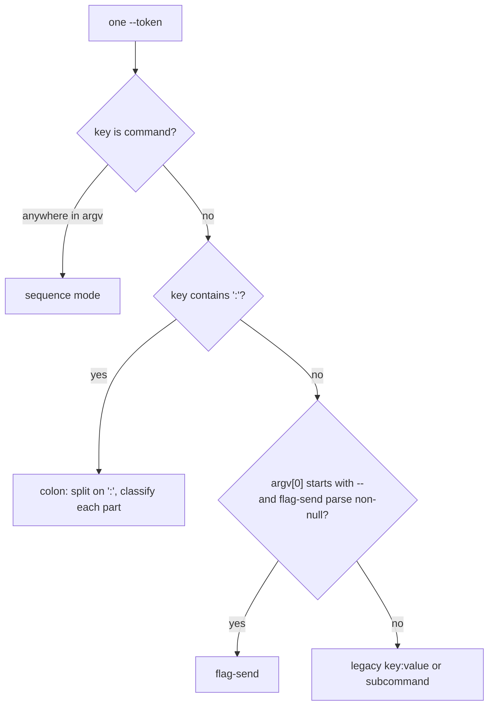

| Grammar | Detection | Recipients | Action | Content source | Metadata | Delivery class |
| --- | --- | --- | --- | --- | --- | --- |
| Colon | Any `--` token whose key contains `:` ([`isColonFlagArgv()`][ref-2009]) | Colon parts that are not actions, bare `--<agent|group>`, `--to X` placed first | One action token from `ACTIONS`; a second throws | `--ask:bob=body`, `--content`, or positional; any two together throw | Bare `--source X`; any unreserved `--key=value` | Bridge envelope |
| Flag-send | `argv[0]` starts with `--`, no `--command`, and a registry-free parse returns non-null ([`isFlagSendArgv()`][ref-2014]) | Bare `--<name>` flags checked against the registry; `--to X` first | Bare `--message`, `--reply`, `--ask`, `--write`; last one wins | `--content` or positional, never both | None; an unknown `--key=value` makes the argv not a flag send | Bridge envelope |
| Sequence | Any `--command` key ([`isSequenceFlagArgv()`][ref-2013]) | Bare `--<name>` flags, `--to X` | Fixed `sequence` | `--write TEXT`, `--write -`, or `--stdin`; positional content throws | None; `--from`/`--origin` accepted and unused by delivery | Local DSL, no envelope |

```js
const RESERVED_FLAG_KEYS = new Set([ "from", "to", "origin", "content", "url", "key", "id", "target", "desc", "lines", "system-prompt", "port", "user" ]);
const VALUE_FLAG_KEYS = new Set([ "from", "to", "origin", "content" ]);
// Bare meta keys that may consume the NEXT argv word as their value. Only
// keys actually read downstream qualify: the CLI's sendNormalizedEnvelope
// (src/cli.mjs) reads `meta.source` to override the resolved sender source;
// every other meta key is spread into the bridge POST body and silently
// dropped by the server. Any other bare unknown flag throws — historically a
// typo'd recipient (`--scot`) swallowed the first word of the message into
// meta and silently broadcast the rest. Explicit `--key=value` metadata is
// still accepted (the `=` binds the value, so nothing can be swallowed).
const META_FLAG_KEYS = new Set([ "source" ]);
```

*Caption: `src/a2a-tokens.mjs:6-16`*

The colon grammar treats every unbound token as suspect. [`RESERVED_FLAG_KEYS`][ref-2012] names flags that belong to other subcommands (`--url`, `--key`, `--lines`, `--user`, and others) and throws when they appear in a send, while [`META_FLAG_KEYS`][ref-2011] admits exactly one bare metadata key, `--source`, because it is the only metadata the CLI reads. Every other bare flag that [`classifyToken()`][ref-2008] cannot match to an action, agent, or group throws `unknown flag`, which closes the historical failure in which a misspelled recipient consumed the first message word and the remainder broadcast to every agent. `--key=value` metadata stays legal because `=` binds the value and nothing can be swallowed; of that metadata, only `mood` and `priority` survive into the rendered header.

The flag-send grammar is stricter about metadata and looser about detection. [`parseFlagSendArgv()`][ref-2015] returns `null` for any unknown `--key=value`, so such an argv is not a send at all and falls through to subcommand dispatch, and it always returns `meta: {}`. Action keys are matched with `Object.hasOwn` rather than `in`, preventing `--toString` from resolving to a prototype method. Detection runs the parser with no registry, so every bare flag counts as a recipient at that stage; the authoritative parse in `main()` repeats with the live registry, where [`assertKnownRecipient()`][ref-2017] throws for names that are neither known agents nor groups and skips the check for unescaped globs. A flag-send with no recipient and no `--to` sets `broadcast: true`, which is the only path to an all-agents envelope send; a colon send with no recipient falls back to the single inferred peer instead.

[`parseSequenceFlagArgv()`][ref-2016] joins repeated `--command` values with `|`, the DSL step separator, rejects a second `--write`, and refuses positional words so a body can never be silently dropped. The sequence grammar is the one grammar whose output never becomes an envelope; see [Command sequence DSL](#terminal-transport-system-command-sequence-dsl) for the language itself.

<a id="message-framing-and-identity-recipient-registry-and-selectors"></a>
### Recipient registry and selectors

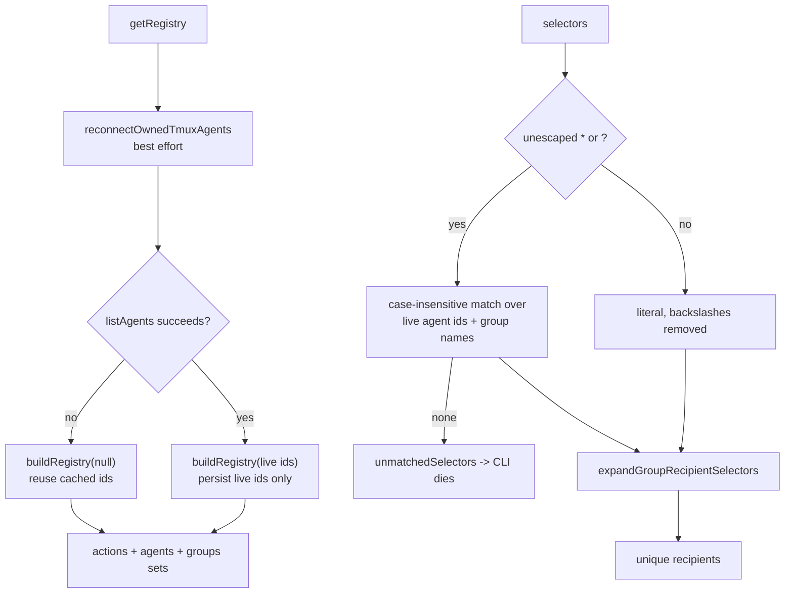

[`buildRegistry()`][ref-2007] treats a live bridge agent list as ground truth and writes only those ids back to `registry.json`; cached ids are consulted only when the bridge is unreachable and the caller passes `null`. Merging cached ids into a live list previously re-hydrated dead agents into the cache on every send. [`getRegistry()`][ref-2031] runs owned-session reconnection before listing agents, because a freshly restarted bridge has an empty in-memory map and every recipient would otherwise fail as an unknown flag.

[`expandGlobRecipientSelectors()`][ref-2020] deduplicates candidates and results in first-seen order and reports unmatched wildcard selectors separately instead of dropping them. A backslash escapes `*`, `?`, or `\`, so `web\*` addresses the agent literally named `web*`, and [`globPatternToRegExp()`][ref-2019] anchors the pattern and escapes every regex metacharacter so selector text cannot inject regex syntax. Group names are glob candidates alongside agent ids; [`expandGroupRecipientSelectors()`][ref-2032] then replaces each group name with its member ids and dies on an empty group, so a wildcard can address whole groups. Glob selectors require a reachable bridge, while literal selectors survive a failed agent listing and are validated later by the bridge itself.

<a id="message-framing-and-identity-sender-authority"></a>
### Sender authority

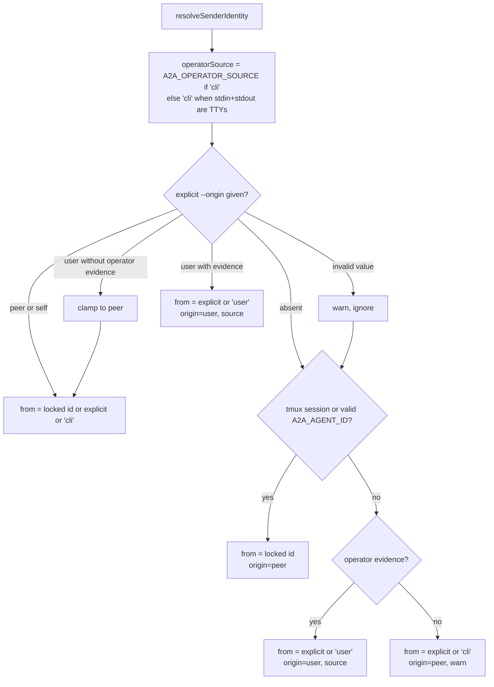

| Output field | Values | Meaning |
| --- | --- | --- |
| `fromId` | locked agent id, explicit `--from`, `user`, or `cli` | Actor rendered in the envelope |
| `origin` | `user`, `peer`, `self` (`VALID_ORIGINS`) | Authority class the bridge validates and the receiver trusts |
| `source` | `cli` only (`VALID_OPERATOR_SOURCES`) | Operator surface shown in place of `origin` for human sends |

[`resolveSenderIdentity()`][ref-2021] never throws, because the channel adapter and dashboard shell out through it with incomplete context and must still deliver. Its fail-closed default stamps a process with neither a locked agent identity nor operator evidence as `from=cli origin=peer`, preventing `sudo` wrappers, environment-stripping spawners, and CI shells from impersonating the human. Operator evidence is an interactive TTY on both stdin and stdout, or `A2A_OPERATOR_SOURCE=cli`, which [`src/cli/dashboard-tui.mjs`][ref-2033] sets when it shells out non-interactively on the human's behalf. [`normalizeOriginForContext()`][ref-2023] clamps an explicit `--origin user` without that evidence to `peer`.

An explicit, valid `--origin` is evaluated before the locked identity. For `peer` and `self` the locked tmux or `A2A_AGENT_ID` id still replaces a conflicting `--from`, but an accepted `--origin user` returns the explicit `--from` (or `user`) even inside an agent session, although the preceding warning reports that `--from` was ignored. [`selfExclusionId()`][ref-2022] applies the same tmux-first, `A2A_AGENT_ID`-second precedence for broadcast and inferred-peer exclusion, so iTerm-backed agents, which have no `TMUX`, do not deliver their own broadcasts back to themselves; `A2A_AGENT_ID` must match `[A-Za-z0-9_-]+` to count.

[`sendNormalizedEnvelope()`][ref-2077] applies one override after identity resolution: a `--source X` metadata value replaces the resolved `source` without passing through `VALID_OPERATOR_SOURCES`. The override changes only the display label of user-origin messages and cannot grant `origin=user`, because the origin decision has already been made.

<a id="message-framing-and-identity-envelope-contract"></a>
### Envelope contract

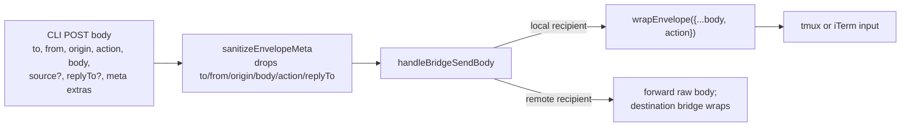

```js
export function wrapEnvelope(msg) {
  const safeBody = sanitizeForXmlCharacterData(String(msg.body));
  const origin = displayOrigin(msg);
  const originAttr = origin ? ` origin="${escapeXml(origin)}"` : "";
  const extras = Object.entries(msg)
    .filter(([k]) => ENVELOPE_EXTRA_DISPLAY_KEYS.has(k))
    .filter(([, v]) => typeof v === "string")
    .map(([k, v]) => ` ${escapeXml(k)}="${escapeXml(v)}"`)
    .join("");
  return `<a2a from="${escapeXml(msg.from)}"${originAttr}${extras}>\n${safeBody}\n</a2a>`;
}

function displayOrigin(msg) {
  if (msg?.origin === "user") {
    return typeof msg.source === "string" && msg.source.trim()
      ? msg.source.trim()
      : "cli";
  }
  if (msg?.origin === "self") {
    return "self";
  }
  return null;
}
```

*Caption: `src/server/envelope.mjs:82-104`*

| Header attribute | Present when | Value | Escaping |
| --- | --- | --- | --- |
| `from` | Always | Sender actor id | [`escapeXml()`][ref-2025] |
| `origin` | `origin` is `user` or `self` | Trimmed `source` or `cli` for user; `self` for self | `escapeXml()` |
| `mood` | String value supplied | Free text | `escapeXml()` |
| `priority` | String value supplied | Free text | `escapeXml()` |
| `action` | Never | Carried in the POST body and message log, not rendered | Not applicable |

[`wrapEnvelope()`][ref-2026] runs at the delivering bridge ([`src/a2a-server.mjs`][ref-2028]), which spreads the raw `/api/a2a/send` body into it; [`ENVELOPE_EXTRA_DISPLAY_KEYS`][ref-2027] is therefore an allowlist rather than a denylist, so a sender cannot render provenance-looking attributes such as `trusted="yes"` or leak internal objects into the header. Header values are attribute-escaped, while the body only loses XML-illegal control characters and lone surrogates through [`sanitizeForXmlCharacterData()`][ref-2024]; nothing parses the envelope, so leaving `<`, `>`, and `&` literal preserves code, JSX, shell syntax, comparisons, and quoted envelope examples. Peer origin is omitted from the header because the `from` actor already names the peer, and user origin displays the operator surface rather than the word `user`. The CLI strips reserved keys from metadata through [`OUTBOUND_ENVELOPE_RESERVED`][ref-2029] before posting so metadata cannot overwrite `to`, `from`, `origin`, `body`, `action`, or `replyTo`.

See [Bridge Server and Registry](#bridge-server-and-registry-delivery-and-federation) for server-side origin and peer-namespace validation and [Terminal Transport System](#terminal-transport-system-command-sequence-dsl) for the sequence path.

## Team Specifications and Backend Translation

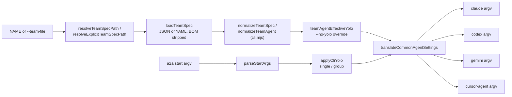

Team specifications separate declarative role intent from backend command syntax. [`src/a2a-team-spec.mjs`][ref-2034] owns location and file parsing, [`normalizeTeamSpec()`][ref-2059] in [`src/cli.mjs`][ref-2072] owns field merging and validation, [`src/cli/parse-start-args.mjs`][ref-2051] separates launcher flags from pass-through backend flags, and [`src/agent-backend-args.mjs`][ref-2046] projects the common `approval`, `sandbox`, `model`, and `yolo` fields onto four CLIs with incompatible permission vocabularies. A spec therefore stays backend-neutral, while explicit `args` keep vendor-specific behavior authoritative.

- [Module inventory](#team-specifications-and-backend-translation-module-inventory)
- [Spec resolution](#team-specifications-and-backend-translation-spec-resolution)
- [Spec fields and normalization](#team-specifications-and-backend-translation-spec-fields-and-normalization)
- [Yolo resolution](#team-specifications-and-backend-translation-yolo-resolution)
- [Start argv partition](#team-specifications-and-backend-translation-start-argv-partition)
- [Backend translation matrix](#team-specifications-and-backend-translation-backend-translation-matrix)

<a id="team-specifications-and-backend-translation-module-inventory"></a>
### Module inventory

| Module | Important symbols | Responsibility |
| --- | --- | --- |
| [`src/a2a-team-spec.mjs`][ref-2034] | [`AmbiguousTeamSpecDirectoryError`][ref-2039], [`resolveTeamSpecPath()`][ref-2035], [`resolveExplicitTeamSpecPath()`][ref-2036], [`TEAM_SPEC_YOLO_DEFAULT_TRUE_VERSION`][ref-2041], [`teamSpecDefaultsToYolo()`][ref-2040], [`parseTeamFlags()`][ref-2042], [`teamArgFragments()`][ref-2043], [`mergeTeamArgs()`][ref-2044], [`loadTeamSpec()`][ref-2045] | Discovery, parse, version gate, argument fragments |
| [`src/cli.mjs`][ref-2072] | [`normalizeTeamSpec()`][ref-2059], [`normalizeTeamAgent()`][ref-2058], [`combinedRolePrompt()`][ref-2062], [`loadResolvedTeamSpec()`][ref-2060], [`loadTeamSpecFromFile()`][ref-2061], [`applyCliYolo()`][ref-2063] | Field merge, id rules, role text, CLI yolo for non-team starts |
| [`src/agent-backend-args.mjs`][ref-2046] | [`translateCommonAgentSettings()`][ref-2047], [`applyBackendDefaults()`][ref-2048] | Common settings to backend argv |
| [`src/cli/parse-start-args.mjs`][ref-2051] | [`parseStartArgs()`][ref-2052], [`BACKEND_FLAGS`][ref-2053] | Launcher/backend argv partition |
| [`src/cli/team-agent-args.mjs`][ref-2055] | [`teamAgentEffectiveYolo()`][ref-2056], [`translateTeamAgentArgs()`][ref-2057] | CLI opt-out plus agent-local yolo, error attribution |
| [`schemas/a2a-team.schema.json`][ref-2065] | draft-07 schema | Documentation contract; no runtime module loads it |

<a id="team-specifications-and-backend-translation-spec-resolution"></a>
### Spec resolution

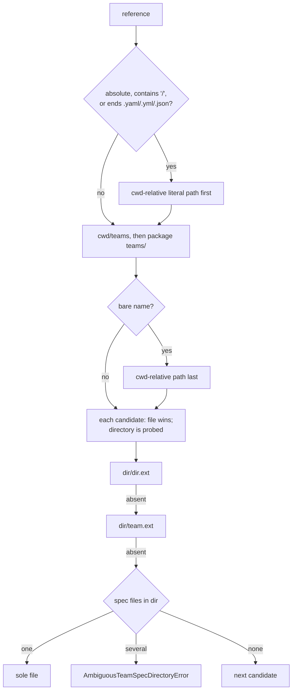

[`resolveTeamSpecPath()`][ref-2035] distinguishes path-like references from bare team names so an unrelated directory in the working directory cannot shadow a canonical spec; bare names still reach the cwd-relative path, but only after the teams directories. Extension detection uses an allowlist of `.yaml`, `.yml`, and `.json` instead of `extname()` alone because team names such as `release-1.2` contain dots. The repository teams directory ([`REPO_TEAMS_DIR`][ref-2066]) and the installed directory ([`TEAMS_DIR`][ref-2067]) both resolve to `<package root>/teams` in the current tree, so the candidate de-duplication in [`candidatePaths()`][ref-2038] collapses them into one probe.

[`probeDirectory()`][ref-2037] prefers `<dir>/<dir>.<ext>`, then `team.<ext>`, then a sole spec file, and raises [`AmbiguousTeamSpecDirectoryError`][ref-2039] when more than one residual candidate exists rather than choosing by directory order. [`resolveExplicitTeamSpecPath()`][ref-2036] serves `--team-file` and `--team` with the literal location only; [`loadTeamSpecFromFile()`][ref-2061] turns a miss into a hard error instead of falling back to group or single-agent launch, and a positional `NAME` given alongside replaces only the team runtime name. [`loadTeamSpec()`][ref-2045] strips a UTF-8 BOM, parses by extension, treats an empty YAML document as `{}`, and rejects any top level that is not an object.

<a id="team-specifications-and-backend-translation-spec-fields-and-normalization"></a>
### Spec fields and normalization

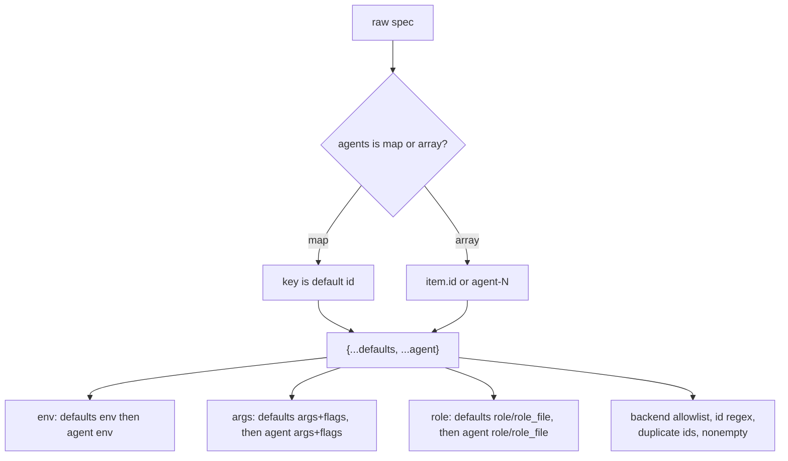

| Field | Scope | Runtime rule | Source |
| --- | --- | --- | --- |
| `version` | Top | Integer or digit string; `>= 2` turns on yolo-by-default | [`teamSpecDefaultsToYolo()`][ref-2040] |
| `name` | Top | Defaults to file stem; must match `[A-Za-z0-9_-]+` | [`normalizeTeamSpec()`][ref-2059] |
| `description` | Top | Stringified; empty when absent | `normalizeTeamSpec()` |
| `dashboard` | Top | `true` only; CLI `--dashboard` takes precedence when passed | [`startTeam()`][ref-2064] |
| `agents` | Top | Map of id to agent, or array with `id` (missing id becomes `agent-N`); at least one; ids unique | `normalizeTeamSpec()` |
| `backend` | Defaults, agent | `claude` (default), `codex`, `gemini`, `cursor-agent`; other values die | [`normalizeTeamAgent()`][ref-2058] |
| `cwd` | Defaults, agent | Resolved against launch cwd; absolute paths allowed | `normalizeTeamAgent()` |
| `env` | Defaults, agent | Keys `[A-Za-z_][A-Za-z0-9_]*`, values stringified, NUL rejected; agent keys override defaults | `validateEnvMap()` in [`src/cli.mjs`][ref-2072] |
| `args` | Defaults, agent | Array only, stringified; defaults first, then agent | [`teamArgFragments()`][ref-2043] |
| `flags` | Defaults, agent | String split with shell-like quotes and backslash escapes, or array | [`parseTeamFlags()`][ref-2042] |
| `role`, `role_file` | Defaults, agent | Mutually exclusive per scope; `role_file` relative to the spec directory; defaults text precedes agent text, joined by a blank line | [`combinedRolePrompt()`][ref-2062] |
| `model` | Defaults, agent | Stringified; becomes `--model` unless already in args | [`translateCommonAgentSettings()`][ref-2047] |
| `approval` | Defaults, agent | `default`, `plan`, `edit`, `never` ([`COMMON_APPROVALS`][ref-2050]) | `translateCommonAgentSettings()` |
| `sandbox` | Defaults, agent | `default`, `read-only`, `workspace-write`, `danger-full-access` | `translateCommonAgentSettings()` |
| `yolo` | Defaults, agent | Boolean or absent; non-boolean dies | `normalizeTeamAgent()` |

Normalization lives in the CLI rather than the spec module because it needs `die()`, id validation, and environment validation shared with single-agent starts. Agent fields override defaults by shallow spread, but `env`, argument fragments, and role text accumulate, so team-wide policy (a base role, shared environment, common flags) is stated once while each agent appends its own. [`startTeam()`][ref-2064] translates every agent and checks every backend executable before spawning the first session, so an invalid `approval` value or missing CLI in the last agent aborts the launch without leaving earlier agents running.

[`schemas/a2a-team.schema.json`][ref-2065] is a documentation contract that diverges from the loader in five places, and no runtime module reads it:

| Schema statement | Runtime behavior |
| --- | --- |
| `args` is a string | [`teamArgFragments()`][ref-2043] ignores a string `args`; string arguments must use `flags` |
| `additionalProperties: false` with no `flags` property | `flags` is the only string-argument path the loader honors |
| `model`, `approval`, `sandbox` reference `#/$defs/*` entries | Those `$defs` entries do not exist in the schema |
| Array agents require `id` while the agent definition forbids extra properties | The loader accepts array agents and defaults a missing `id` to `agent-N` |
| `name` and agent ids allow `.` | The loader requires `[A-Za-z0-9_-]+` and dies on a dot |

No shipped spec under `teams/` uses `args` or `flags`; [`teams/star-wars/star-wars.yaml`][ref-2068] shows the common shape of `version: 2`, `defaults`, and role-bearing agents.

<a id="team-specifications-and-backend-translation-yolo-resolution"></a>
### Yolo resolution

```js
    // yolo resolution order: explicit per-agent → explicit team default →
    // schema-version gate. Explicit booleans (true or false) always win,
    // even false against schema_version >= 2.
    for ( const value of [ defaults.yolo, raw.yolo ] ) {
        if (value != null && typeof value !== "boolean") {
            die(`agent '${agentId}': yolo must be a boolean`);
        }
    }
    let yolo;
    if (typeof raw.yolo === "boolean") {
        yolo = raw.yolo;
    } else if (typeof defaults.yolo === "boolean") {
        yolo = defaults.yolo;
    } else {
        yolo = schemaYoloDefault === true;
    }
```

*Caption: `src/cli.mjs:1660-1675`*

| Launch kind | Inputs | Effective yolo |
| --- | --- | --- |
| Team | agent `yolo`, defaults `yolo`, `version`, CLI `--no-yolo` | `false` when `--no-yolo`; otherwise the spec-resolved value ([`teamAgentEffectiveYolo()`][ref-2056]) |
| Single or group | CLI `--yolo` / `--no-yolo` (default on) | CLI value through [`applyCliYolo()`][ref-2063] |

[`teamSpecDefaultsToYolo()`][ref-2040] gates yolo-by-default at [`TEAM_SPEC_YOLO_DEFAULT_TRUE_VERSION`][ref-2041] (`2`). Unversioned and version-1 specs remain interactive unless they set `yolo`, preserving replay equivalence: upgrading a2a cannot silently move an older spec's agents into bypass mode. The CLI default of `yolo: true` from [`parseStartArgs()`][ref-2052] does not force team agents on; only `--no-yolo` overrides a spec, which keeps the spec authoritative in the permissive direction and the operator authoritative in the restrictive one. `startTeam()` records the same effective value on the bridge registration so restart and reload compare the authority the agent actually has.

<a id="team-specifications-and-backend-translation-start-argv-partition"></a>
### Start argv partition

| Flag | Value | Result field | Notes |
| --- | --- | --- | --- |
| positional `NAME` | first bare word | `name` | Later bare words go to `backendArgs` |
| `--user` | required | `name` | Alternative to positional name |
| `--prompt` | required; may be empty or start with `--` | `promptText` | Appended in source order with blank-line separators |
| `--prompt-file` | required path | `promptText` | Read relative to cwd at parse time |
| `--skill` | required; repeatable | `skills` | |
| `--team-file`, `--team` | required path | `teamFile` | Literal resolution only |
| `--cohort` | required | `cohort` | Orthogonal tmux description tag |
| `--url` | required | `url` | Global mode only |
| `--port` | integer 1–65535 | `port` | Global mode only |
| `--insecure` | boolean | `insecure` | Global mode only |
| `--require-team` | boolean | `requireTeam` | Disables group and single fallback |
| `--dashboard`, `--layout` | boolean | `dashboard: true` | `null` when absent |
| `--yolo` / `--no-yolo` | boolean | `yolo` | Default `true` |
| `--global` / `--no-global` | boolean | `global` | Tri-state; `null` defers to `config.global` |
| `--claude[=PATH]` | optional path | `backend`, `backendCommand` | A following word is taken as `PATH` only when it looks like a path |
| `--codex`, `--gemini`, `--cursor-agent` | boolean | `backend` | Clears `backendCommand` |
| `--` | terminator | `backendArgs` | Everything after is forwarded |
| any other `--flag` | optional next word | `backendArgs` | Next word forwarded when it does not start with `--` |

[`parseStartArgs()`][ref-2052] partitions argv without knowing any backend's flag vocabulary: launcher-owned flags are consumed, and [`consumeUnknownBackendFlag()`][ref-2054] forwards everything else together with one following non-flag word, leaving validation to the backend CLI that owns those flags. Every boolean rejects `=value` and every value flag rejects a missing value, so a misspelled launcher flag degrades only into a backend flag rather than a silent mis-parse of launcher state. The parser lives outside `cli.mjs` because importing the composition root executes `main()`; the CLI injects a process-exiting `die()` and tests inject a throwing one.

Team launches consume only part of this result. [`cmdStart()`][ref-2069] does not pass `backendArgs` or the selected backend to `startTeam()`; each team agent's backend and arguments come from the spec, and only the `--claude=PATH` executable override reaches the team, keyed by the selected backend. Persona flags (`--prompt`, `--prompt-file`, `--skill`) are rejected outright for team and group starts because those roles come from spec or group files.

<a id="team-specifications-and-backend-translation-backend-translation-matrix"></a>
### Backend translation matrix

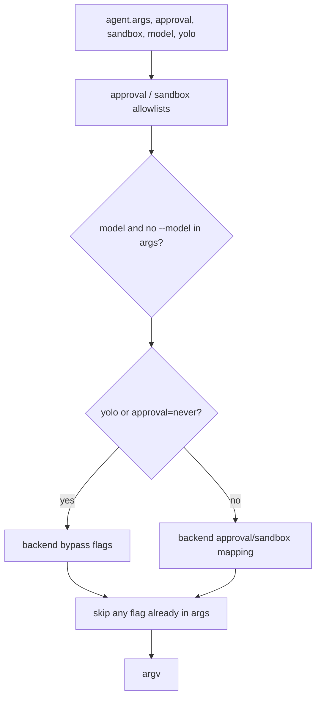

| Backend | `yolo` or `approval: never` | `approval: plan` | `approval: edit` | `approval: default` with non-default `sandbox` | `model` |
| --- | --- | --- | --- | --- | --- |
| `claude` | `--dangerously-skip-permissions` | `--permission-mode plan` | `--permission-mode acceptEdits` | Ignored; Claude has no CLI sandbox | `--model` |
| `codex` | `--dangerously-bypass-approvals-and-sandbox` | `--ask-for-approval never --sandbox <sandbox or read-only>` | `--ask-for-approval never --sandbox <sandbox or workspace-write>` | `--sandbox <sandbox>` | `--model` unless `-m`/`--model` |
| `gemini` | `--approval-mode yolo --skip-trust` | `--approval-mode plan --skip-trust` | `--approval-mode auto_edit --skip-trust` | Never translated; `--sandbox` is a container toggle | `--model` unless `-m`/`--model` |
| `cursor-agent` | `--yolo --sandbox disabled --approve-mcps` | `--mode plan` plus sandbox mapping | `--yolo` plus sandbox mapping | `danger-full-access` → `--sandbox disabled`; other → `--sandbox enabled` | `--model` |

[`translateCommonAgentSettings()`][ref-2047] never overwrites an equivalent flag already present in `agent.args`; [`hasAnyFlag()`][ref-2049] matches both the bare flag and its `--flag=` form, and alias sets such as `-a`/`--ask-for-approval` and `--yolo`/`--force`/`-f` count as equivalents. Claude treats `approval: never` as bypass regardless of sandbox, because gating it on `danger-full-access` previously left tool-approval prompts active in unattended agents. Codex uses the bypass flag rather than `workspace-write` for unattended mode because `workspace-write` blocks writes outside the agent cwd, including a2a's own state files, and `codex exec` rejects `--ask-for-approval`. Gemini receives `--skip-trust` whenever any unattended mode is active, since its first-launch trust dialog would otherwise stall a headless agent, and `sandbox` is never synthesized for it because `--sandbox` enables Docker or Podman rather than restricting permissions. An unknown backend throws, and [`translateTeamAgentArgs()`][ref-2057] rewraps any translation error as `agent '<id>': …` so the failing team member is named.

[`applyBackendDefaults()`][ref-2048] prepends the Codex bypass flag unless an approval or sandbox override is already present. It is exported and covered by [`tests/agent-backend-args.test.mjs`][ref-2070], but no runtime module imports it; unattended Codex launches receive the bypass flag through `translateCommonAgentSettings()` instead.

See [Agent Lifecycle](#agent-lifecycle) for materialization of normalized specifications and [Runtime State and Observability](#runtime-state-and-observability) for reload planning against them.

## Command-Line Orchestrator

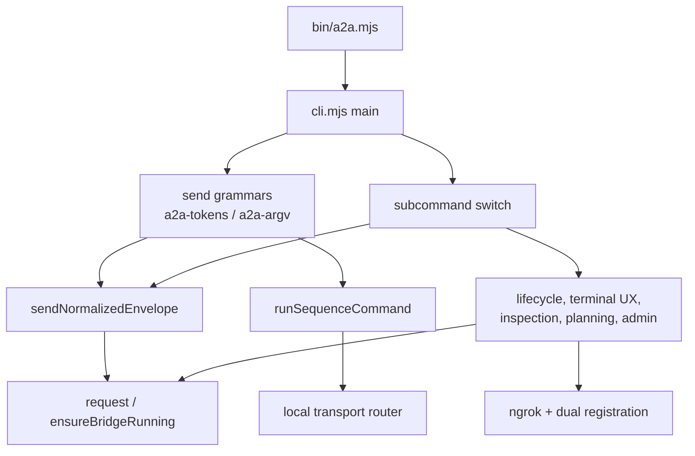

[`src/cli.mjs`][ref-2072] is the repository's composition root: it binds pure parser, transport, team, identity, and observability modules to filesystem, HTTP, tmux, subprocess, and terminal I/O. [`bin/a2a.mjs`][ref-2071] contains only a shebang and the import, and the module ends with an unconditional call to [`main()`][ref-2073]; that side effect is why every testable policy lives in an extracted leaf module instead of an export of `cli.mjs`. The live codebase-map graph reports no exports from `src/cli.mjs`, confirming that nothing imports it as a library.

- [Composition inventory](#command-line-orchestrator-composition-inventory)
- [Dispatch and command families](#command-line-orchestrator-dispatch-and-command-families)
- [Lazy bridge client](#command-line-orchestrator-lazy-bridge-client)
- [Bridge daemon management](#command-line-orchestrator-bridge-daemon-management)
- [Envelope send workflow](#command-line-orchestrator-envelope-send-workflow)
- [Global and dual-registration mode](#command-line-orchestrator-global-and-dual-registration-mode)

<a id="command-line-orchestrator-composition-inventory"></a>
### Composition inventory

| File | Role | Consumed by |
| --- | --- | --- |
| [`bin/a2a.mjs`][ref-2071] | Published `a2a` executable shim | Shell |
| [`src/cli.mjs`][ref-2072] | I/O composition, command handlers, lifecycle | `bin/a2a.mjs` |
| [`src/cli/parse-start-args.mjs`][ref-2051] | Pure `start` argv partition | `parseStartArgsForCli()` |
| [`src/cli/sender-identity.mjs`][ref-2004] | Pure sender authority | [`sendNormalizedEnvelope()`][ref-2077], [`currentAgentId()`][ref-2134] |
| [`src/cli/team-agent-args.mjs`][ref-2055] | Team yolo and translation wrapper | [`startTeam()`][ref-2064] |
| [`src/cli/iterm-restart-plan.mjs`][ref-2101] | Pure stored-versus-live GUID choice: stored GUID live, else first session whose agent tag matches | [`restartViaIterm()`][ref-2103] |
| [`src/cli/reconnect-targets.mjs`][ref-2102] | Pure target selection: group, team, single name, `--all` live tmux, else cached ids still live | [`resolveReconnectTargets()`][ref-2104] wrapper, which first prefers live cohort members |

The pure modules receive their I/O as injected functions or plain data. [`resolveReconnectTargets()`][ref-2102] takes `isGroup`, `listGroupMembers`, `loadResolvedTeamSpec`, `tmuxListSessions`, and `loadRegistry` as parameters, so the selection order (group before team before literal name) is testable without tmux or a bridge, while the CLI wrapper adds the one bridge-dependent rule: registered agents tagged `team:<name>` or `group:<name>` win over static membership.

<a id="command-line-orchestrator-dispatch-and-command-families"></a>
### Dispatch and command families

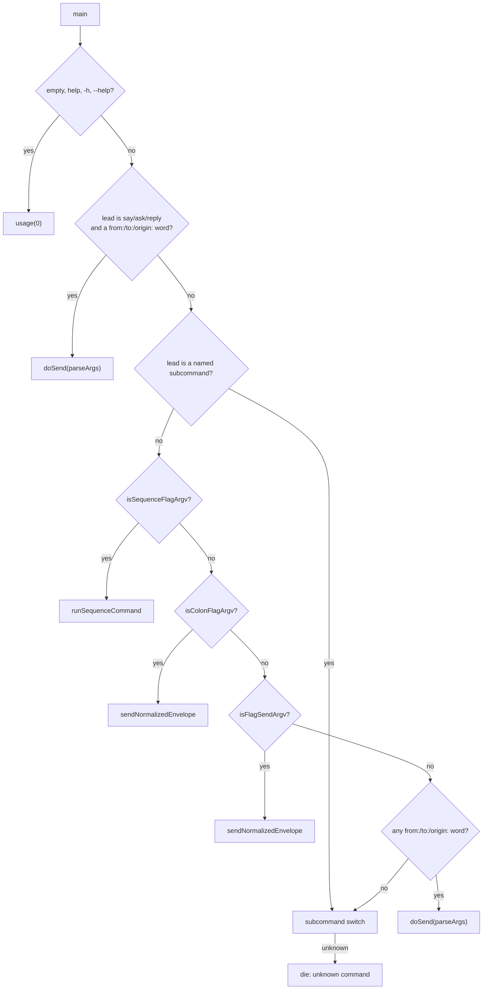

```js
    const lead = argv[0];
    const isSubcommand = new Set([ "bridge", "raw", "command", "completion", "say", "ask", "reply", "start", "start-global", "kill", "reconnect", "ui", "attach", "peek", "log", "status", "events", "attention", "doctor", "reload", "layout", "iterm", "pm", "list", "auth", "config", "gen-key", "register", "unregister" ]).has(lead);
```

*Caption: `src/cli.mjs:5726-5727`*

[`main()`][ref-2073] checks the subcommand set before any grammar so that a subcommand's own flags (`a2a raw --bob`, `a2a command --command …`) are never reinterpreted as a top-level send. Among the grammars, sequence detection runs first because `--command` must never be wrapped in an `<a2a>` envelope, colon runs second because a colon token is unambiguous anywhere in argv, and flag-send runs third because its detection is the loosest. The legacy positional form (`to:bob`, `from:`, `origin:`), parsed by [`parseArgs()`][ref-2075] and sent by [`doSend()`][ref-2076], is checked both for a leading `say`/`ask`/`reply` and as a last resort before the switch. Every branch converts thrown errors into `die(message, 1)`, so all user-facing failures exit with code 1, while usage errors from `die()` default to code 2.

| Command | Handler | Family | Behavior owner |
| --- | --- | --- | --- |
| `--<agent> …`, `--ask:<agent> …` | [`sendNormalizedEnvelope()`][ref-2077] | Envelope delivery | This section |
| `say`, `ask`, `reply` | [`doSend()`][ref-2076] | Envelope delivery | This section |
| `--<agent> --command …`, `command` | [`runSequenceCommand()`][ref-2078], [`cmdCommand()`][ref-2108] | Direct input, no envelope | [Terminal Transport System](#terminal-transport-system-command-sequence-dsl) |
| `raw` | [`cmdRaw()`][ref-2107] | Direct input, no envelope | [Terminal Transport System](#terminal-transport-system) |
| `start`, `start-global` | [`cmdStart()`][ref-2069], [`cmdStartGlobal()`][ref-2095] | Lifecycle | [Agent Lifecycle](#agent-lifecycle-launch-and-adoption) |
| `kill` | [`cmdKill()`][ref-2110] | Lifecycle | [Agent Lifecycle](#agent-lifecycle-teardown-and-orphan-sweep) |
| `reconnect` | [`cmdReconnect()`][ref-2111] | Lifecycle | [Agent Lifecycle](#agent-lifecycle-reconnect-attach-and-peek) |
| `attach`, `peek` | [`cmdAttach()`][ref-2113], [`cmdPeek()`][ref-2114] | Terminal UX | [Agent Lifecycle](#agent-lifecycle-reconnect-attach-and-peek) |
| `ui` | [`cmdUi()`][ref-2112] | Terminal UX | [Dashboard and Operator Interfaces](#dashboard-and-operator-interfaces) |
| `iterm` | [`cmdIterm()`][ref-2122] | Terminal UX | [Dashboard and Operator Interfaces](#dashboard-and-operator-interfaces) |
| `list` | [`cmdList()`][ref-2124] | Runtime inspection | [Runtime State and Observability](#runtime-state-and-observability) |
| `status`, `events`, `attention`, `doctor` | [`cmdStatus()`][ref-2116], [`cmdEvents()`][ref-2117], [`cmdAttention()`][ref-2118], [`cmdDoctor()`][ref-2119] | Runtime inspection | [Runtime State and Observability](#runtime-state-and-observability) |
| `log` | [`cmdLog()`][ref-2115] | Runtime inspection | [Configuration and Persistent State](#configuration-and-persistent-state) |
| `reload`, `layout`, `pm` | [`cmdReload()`][ref-2120], [`cmdLayout()`][ref-2121], [`cmdPm()`][ref-2123] | Declarative planning | [Runtime State and Observability](#runtime-state-and-observability) |
| `bridge` | [`cmdBridge()`][ref-2086] | Bridge administration | This section |
| `register`, `unregister` | [`cmdRegister()`][ref-2127], [`cmdUnregister()`][ref-2128] | Bridge administration | [Bridge Server and Registry](#bridge-server-and-registry-registration-ownership) |
| `auth`, `config` | [`cmdAuth()`][ref-2125], [`cmdConfig()`][ref-2126] | Bridge administration | [Configuration and Persistent State](#configuration-and-persistent-state) |
| `gen-key` | [`generateKey()`][ref-2129] inline | Bridge administration | [Configuration and Persistent State](#configuration-and-persistent-state) |
| `completion` | [`cmdCompletion()`][ref-2109] | Shell integration | This section |

[`cmdCompletion()`][ref-2109] prints `completions/a2a.bash` or `completions/a2a.zsh` and exits 0 on `EPIPE`, because `source <(a2a completion zsh)` closes the pipe once the shell has read the script. [`usage()`][ref-2106] points readers of the sequence examples at `docs/command-dsl.md`, which does not exist in the working tree.

<a id="command-line-orchestrator-lazy-bridge-client"></a>
### Lazy bridge client

```js
async function request(method, pathname, body, opts = {}) {
    try {
        return await requestOnce(method, pathname, body);
    } catch ( err ) {
        if (err?.code !== "ECONNREFUSED") {
            throw err;
        }
        if (opts.autoStartBridge === false || !isLocalBridgeUrl()) {
            throw new Error(`connection refused at ${bridgeUrl()}`, { cause: err });
        }
        await ensureBridgeRunning();
        return requestOnce(method, pathname, body);
    }
}
```

*Caption: `src/cli.mjs:427-440`*

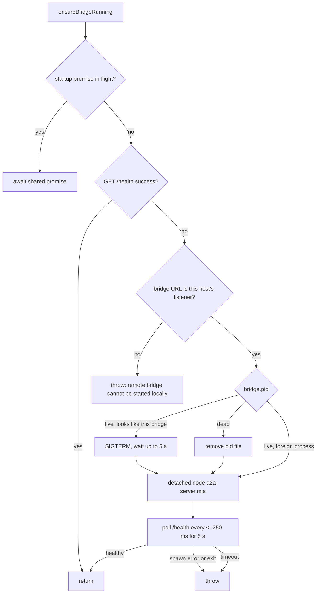

| Constant or rule | Value | Location |
| --- | --- | --- |
| Local request deadline | 5,000 ms per request | [`LOCAL_REQUEST_TIMEOUT_MS`][ref-2132] |
| Peer request deadline | 5,000 ms | [`peerRequest()`][ref-2105] |
| Health probe deadline | 2,000 ms | [`bridgeHealthy()`][ref-2085] |
| Startup and stale-stop budget | 5,000 ms each | [`ensureBridgeRunning()`][ref-2079] |
| Auto-start trigger | `ECONNREFUSED` on a local URL only | [`request()`][ref-2080] |
| Local URL test | `http:`, same host or loopback pair, same port, root path | [`isLocalBridgeUrl()`][ref-2083] |

[`request()`][ref-2080] treats the bridge as lazily started infrastructure: only a refused connection to a URL that [`isLocalBridgeUrl()`][ref-2083] recognizes as this machine's listener triggers startup and a single retry, while HTTP 4xx and 5xx responses return as ordinary `{status, body}` results for command-specific rendering. [`requestJsonAtUrl()`][ref-2082] holds one elapsed-time deadline across connect and body, rejects a body truncated by `aborted` or `close`, and rejects non-JSON responses, so a half-received reply cannot parse as an empty success.

[`ensureBridgeRunning()`][ref-2079] shares one in-flight promise per process, so concurrent callers within one command cannot spawn two bridges. It refuses to start anything when `A2A_BRIDGE` names a remote bridge, and it signals a recorded PID only after [`pidLooksLikeBridge()`][ref-2084] proves that the process is either titled `a2a-bridge` or a Node invocation (without `-e`/`-p`) of this installation's canonical `a2a-server.mjs`. A recorded PID that belongs to an unrelated live process is left untouched, preventing a recycled PID from turning startup into a kill of someone else's process. Startup waits for `/health` rather than trusting a detached `spawn()`, and reports early exit or spawn errors instead of timing out silently.

<a id="command-line-orchestrator-bridge-daemon-management"></a>
### Bridge daemon management

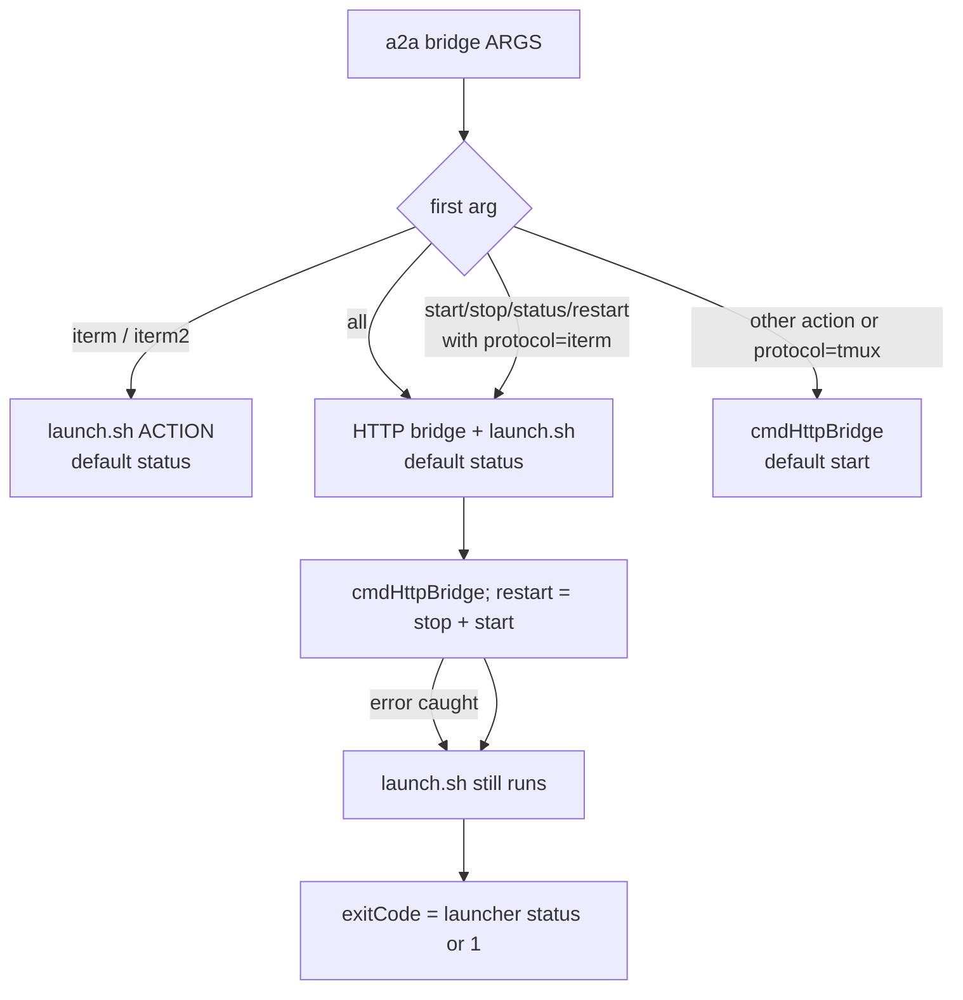

| Invocation | HTTP bridge | Python iTerm sidecar | Default action |
| --- | --- | --- | --- |
| `a2a bridge [ACTION]`, protocol `tmux` | `start`, `stop`, `status` (`bridge` aliases `start`) | Untouched | `start` |
| `a2a bridge [ACTION]`, protocol `iterm` | `start`, `stop`, `status`, `restart` | Same action | `start` |
| `a2a bridge all [ACTION]` | `start`, `stop`, `status`, `restart` | Same action | `status` |
| `a2a bridge iterm [ACTION]` | Untouched | `start`, `stop`, `status`, `restart`, `foreground` ([`ITERM2_BRIDGE_ACTIONS`][ref-2133]) | `status` |

[`cmdBridge()`][ref-2086] manages the Node bridge and the Python sidecar as one lifecycle unit whenever the configured protocol is `iterm` or `all` is explicit, because iTerm-backed delivery is unavailable unless both are up. An HTTP-side failure is logged and caught so [`runIterm2BridgeLauncher()`][ref-2088] still runs; the command then exits nonzero, reporting partial failure without suppressing the other daemon's attempted action. [`cmdHttpBridge()`][ref-2087] refuses to stop a remote bridge, stops a listener found through `lsof` only when it passes the same ownership test, leaves an unrecognized PID file intact, and fails loudly when a healthy bridge is listening with no manageable PID rather than reporting it stopped.

<a id="command-line-orchestrator-envelope-send-workflow"></a>
### Envelope send workflow

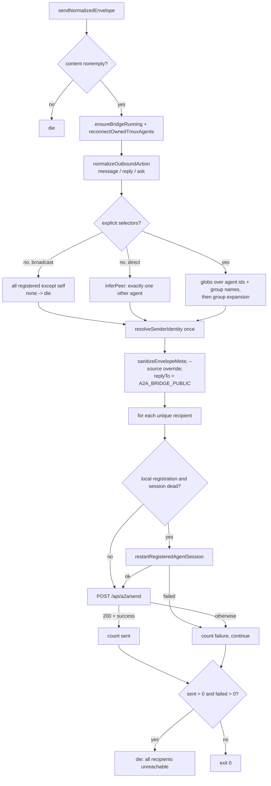

[`sendNormalizedEnvelope()`][ref-2077] is the single convergence point for colon, flag-send, legacy positional, and `say`/`ask`/`reply` sends, so every grammar inherits the same healing, selector, identity, and partial-failure policy. [`reconnectOwnedTmuxAgents()`][ref-2098] runs at most once per process and re-registers only install-token-owned tmux sessions and iTerm sessions, and it does nothing when the bridge URL is remote, because a remote registry must not acquire local placeholders without callback routes. Remote recipients, identified by [`agentIsRemote()`][ref-2099] through `kind: "remote"` or a `bridgeUrl` that is neither the local listener nor this machine's public URL, skip the local liveness check and are left to the bridge; an unparsable `bridgeUrl` counts as remote so it can never authorize touching a local pane.

A send without selectors means "the other agent": [`inferPeer()`][ref-2097] succeeds only when exactly one non-self agent is registered and otherwise names the candidates, which prevents an ambiguous direct message from silently becoming a broadcast. A multi-recipient send succeeds when at least one recipient accepts delivery and exits 1 only when every attempt failed, preserving partial broadcast progress while still failing single-recipient sends. Each accepted delivery logs `from -> to [origin/action] (bytes)` to stderr, giving the operator per-recipient evidence without a second command.

<a id="command-line-orchestrator-global-and-dual-registration-mode"></a>
### Global and dual-registration mode

```mermaid
sequenceDiagram
  participant CLI as a2a start --global [--url R]
  participant Local as local bridge (callback)
  participant Ngrok as ngrok :4040 API
  participant Primary as primary bridge (R or local)
  CLI->>Local: ensureBridgeRunning with A2A_BRIDGE=local listener
  CLI->>Ngrok: reuse https tunnel for port, else spawn ngrok (10 s)
  CLI->>CLI: A2A_BRIDGE_PUBLIC = tunnel URL; save config.url
  CLI->>CLI: A2A_BRIDGE = R when --url given
  CLI->>Local: register agent without bridgeUrl
  CLI->>Primary: register agent with bridgeUrl = public URL
  alt primary registration fails
    CLI->>Local: restore previous row or DELETE
  end
```

| Gate or rule | Behavior | Location |
| --- | --- | --- |
| Global mode selection | `--global`/`--no-global` win; else `config.global === true` | [`resolveGlobalMode()`][ref-2094] |
| `start-global` alias | Prepends `--global` unless `--global` or `--no-global` is already present | [`cmdStartGlobal()`][ref-2095] |
| Non-global misuse | `--insecure`, `--url`, `--port` without global mode die | [`cmdStart()`][ref-2069] |
| Operator key | Required unless `--insecure`; `--insecure` without a key warns | `cmdStart()` |
| Tunnel discovery | `GET http://localhost:4040/api/tunnels`, 2,000 ms, `https` tunnel whose `config.addr` port matches | [`getNgrokUrl()`][ref-2092] |
| Tunnel start | `ngrok http PORT`, detached, polled every 500 ms for 10 s | [`startNgrok()`][ref-2093] |
| `--url` | Must be `http:`/`https:`, no credentials; query and fragment dropped | [`normalizePeerUrlForConfig()`][ref-2100] |
| Spawned routing env | `A2A_BRIDGE`, `A2A_BRIDGE_PUBLIC`, `A2A_PUBLIC_URL`, `A2A_PORT`, `A2A_HOST`, `A2A_KEY` copied into each agent and its registration | [`agentEnv()`][ref-2096] |

Global start brings up the local bridge as a callback listener before switching command routing to an optional remote bridge, because replies from the remote side must have a reachable local target before any agent is announced there. [`registerLocalAgent()`][ref-2089] activates dual registration only when the agent's recorded `A2A_BRIDGE` is not the local listener: it snapshots any existing local row, writes the terminal locally without `bridgeUrl` through [`localBridgeUrl()`][ref-2091], and then registers the public callback URL on the primary bridge. When the primary write fails it restores the previous local row or deletes the new one, so a half-registered agent never remains routable locally while invisible remotely.

[`unregisterAgentRegistration()`][ref-2090] reverses the order, deleting the remote route first and the callback row second; a failed remote delete therefore leaves the local metadata, including the remote address, available for retry. ngrok coordination lives in the CLI rather than the bridge because it couples local process state, external tunnel discovery, and the environment exported into spawned agents, none of which belong to delivery policy. [`startNgrok()`][ref-2093] destroys its piped stderr once the outcome is known, since an open pipe otherwise keeps `a2a start --global` from exiting while the detached tunnel lives.

See [Agent Lifecycle](#agent-lifecycle) for the handlers that materialize and remove sessions and [Bridge Server and Registry](#bridge-server-and-registry-delivery-and-federation) for how the bridge routes the resulting remote rows.

<!-- refs -->
[ref-2001]: ../src/a2a-tokens.mjs
[ref-2002]: ../src/a2a-argv.mjs
[ref-2003]: ../src/recipient-selectors.mjs
[ref-2004]: ../src/cli/sender-identity.mjs
[ref-2005]: ../src/server/envelope.mjs
[ref-2006]: ../src/a2a-tokens.mjs#L3
[ref-2007]: ../src/a2a-tokens.mjs#L48
[ref-2008]: ../src/a2a-tokens.mjs#L66
[ref-2009]: ../src/a2a-tokens.mjs#L101
[ref-2010]: ../src/a2a-tokens.mjs#L111
[ref-2011]: ../src/a2a-tokens.mjs#L16
[ref-2012]: ../src/a2a-tokens.mjs#L6
[ref-2013]: ../src/a2a-argv.mjs#L80
[ref-2014]: ../src/a2a-argv.mjs#L94
[ref-2015]: ../src/a2a-argv.mjs#L112
[ref-2016]: ../src/a2a-argv.mjs#L210
[ref-2017]: ../src/a2a-argv.mjs#L31
[ref-2018]: ../src/recipient-selectors.mjs#L5
[ref-2019]: ../src/recipient-selectors.mjs#L26
[ref-2020]: ../src/recipient-selectors.mjs#L70
[ref-2021]: ../src/cli/sender-identity.mjs#L107
[ref-2022]: ../src/cli/sender-identity.mjs#L193
[ref-2023]: ../src/cli/sender-identity.mjs#L57
[ref-2024]: ../src/server/envelope.mjs#L27
[ref-2025]: ../src/server/envelope.mjs#L74
[ref-2026]: ../src/server/envelope.mjs#L82
[ref-2027]: ../src/server/envelope.mjs#L17
[ref-2028]: ../src/a2a-server.mjs#L808
[ref-2029]: ../src/cli.mjs#L54
[ref-2030]: ../src/cli.mjs#L333
[ref-2031]: ../src/cli.mjs#L2012
[ref-2032]: ../src/cli.mjs#L1583
[ref-2033]: ../src/cli/dashboard-tui.mjs#L448
[ref-2034]: ../src/a2a-team-spec.mjs
[ref-2035]: ../src/a2a-team-spec.mjs#L147
[ref-2036]: ../src/a2a-team-spec.mjs#L179
[ref-2037]: ../src/a2a-team-spec.mjs#L108
[ref-2038]: ../src/a2a-team-spec.mjs#L68
[ref-2039]: ../src/a2a-team-spec.mjs#L19
[ref-2040]: ../src/a2a-team-spec.mjs#L227
[ref-2041]: ../src/a2a-team-spec.mjs#L219
[ref-2042]: ../src/a2a-team-spec.mjs#L233
[ref-2043]: ../src/a2a-team-spec.mjs#L293
[ref-2044]: ../src/a2a-team-spec.mjs#L299
[ref-2045]: ../src/a2a-team-spec.mjs#L303
[ref-2046]: ../src/agent-backend-args.mjs
[ref-2047]: ../src/agent-backend-args.mjs#L42
[ref-2048]: ../src/agent-backend-args.mjs#L169
[ref-2049]: ../src/agent-backend-args.mjs#L22
[ref-2050]: ../src/agent-backend-args.mjs#L19
[ref-2051]: ../src/cli/parse-start-args.mjs
[ref-2052]: ../src/cli/parse-start-args.mjs#L143
[ref-2053]: ../src/cli/parse-start-args.mjs#L36
[ref-2054]: ../src/cli/parse-start-args.mjs#L65
[ref-2055]: ../src/cli/team-agent-args.mjs
[ref-2056]: ../src/cli/team-agent-args.mjs#L3
[ref-2057]: ../src/cli/team-agent-args.mjs#L7
[ref-2058]: ../src/cli.mjs#L1642
[ref-2059]: ../src/cli.mjs#L1693
[ref-2060]: ../src/cli.mjs#L1717
[ref-2061]: ../src/cli.mjs#L1736
[ref-2062]: ../src/cli.mjs#L1618
[ref-2063]: ../src/cli.mjs#L1352
[ref-2064]: ../src/cli.mjs#L3756
[ref-2065]: ../schemas/a2a-team.schema.json
[ref-2066]: ../src/cli.mjs#L36
[ref-2067]: ../src/a2a-config.mjs#L14
[ref-2068]: ../teams/star-wars/star-wars.yaml
[ref-2069]: ../src/cli.mjs#L3964
[ref-2070]: ../tests/agent-backend-args.test.mjs
[ref-2071]: ../bin/a2a.mjs
[ref-2072]: ../src/cli.mjs
[ref-2073]: ../src/cli.mjs#L5720
[ref-2075]: ../src/cli.mjs#L471
[ref-2076]: ../src/cli.mjs#L2424
[ref-2077]: ../src/cli.mjs#L2331
[ref-2078]: ../src/cli.mjs#L2967
[ref-2079]: ../src/cli.mjs#L368
[ref-2080]: ../src/cli.mjs#L427
[ref-2082]: ../src/cli.mjs#L270
[ref-2083]: ../src/cli.mjs#L231
[ref-2084]: ../src/cli.mjs#L2505
[ref-2085]: ../src/cli.mjs#L2601
[ref-2086]: ../src/cli.mjs#L3053
[ref-2087]: ../src/cli.mjs#L3102
[ref-2088]: ../src/cli.mjs#L3040
[ref-2089]: ../src/cli.mjs#L634
[ref-2090]: ../src/cli.mjs#L675
[ref-2091]: ../src/cli.mjs#L623
[ref-2092]: ../src/cli.mjs#L1776
[ref-2093]: ../src/cli.mjs#L1801
[ref-2094]: ../src/cli.mjs#L3952
[ref-2095]: ../src/cli.mjs#L4095
[ref-2096]: ../src/cli.mjs#L1161
[ref-2097]: ../src/cli.mjs#L2001
[ref-2098]: ../src/cli.mjs#L2047
[ref-2099]: ../src/cli.mjs#L244
[ref-2100]: ../src/cli.mjs#L1074
[ref-2101]: ../src/cli/iterm-restart-plan.mjs#L4
[ref-2102]: ../src/cli/reconnect-targets.mjs#L1
[ref-2103]: ../src/cli.mjs#L2183
[ref-2104]: ../src/cli.mjs#L4732
[ref-2105]: ../src/cli.mjs#L458
[ref-2106]: ../src/cli.mjs#L58
[ref-2107]: ../src/cli.mjs#L2829
[ref-2108]: ../src/cli.mjs#L3019
[ref-2109]: ../src/cli.mjs#L2626
[ref-2110]: ../src/cli.mjs#L4311
[ref-2111]: ../src/cli.mjs#L4789
[ref-2112]: ../src/cli.mjs#L4940
[ref-2113]: ../src/cli.mjs#L4429
[ref-2114]: ../src/cli.mjs#L4667
[ref-2115]: ../src/cli.mjs#L5014
[ref-2116]: ../src/cli.mjs#L5119
[ref-2117]: ../src/cli.mjs#L5176
[ref-2118]: ../src/cli.mjs#L5193
[ref-2119]: ../src/cli.mjs#L5210
[ref-2120]: ../src/cli.mjs#L5237
[ref-2121]: ../src/cli.mjs#L5277
[ref-2122]: ../src/cli.mjs#L5300
[ref-2123]: ../src/cli.mjs#L5322
[ref-2124]: ../src/cli.mjs#L5372
[ref-2125]: ../src/cli.mjs#L5641
[ref-2126]: ../src/cli.mjs#L5594
[ref-2127]: ../src/cli.mjs#L5544
[ref-2128]: ../src/cli.mjs#L5570
[ref-2129]: ../src/a2a-config.mjs#L737
[ref-2132]: ../src/cli.mjs#L52
[ref-2133]: ../src/cli.mjs#L3032
[ref-2134]: ../src/cli.mjs#L736
