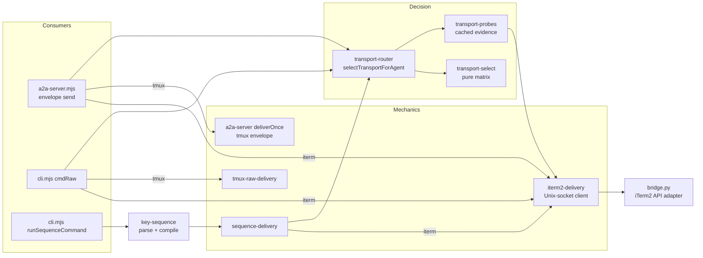
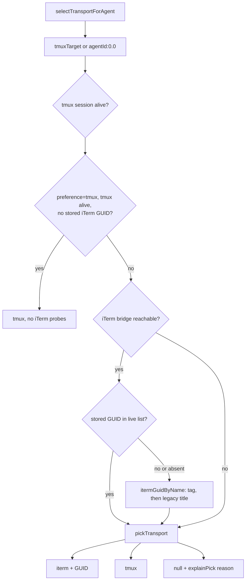
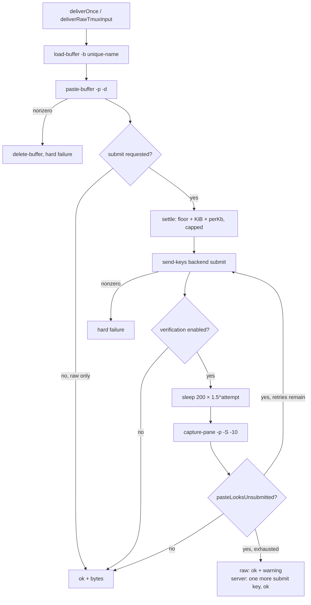
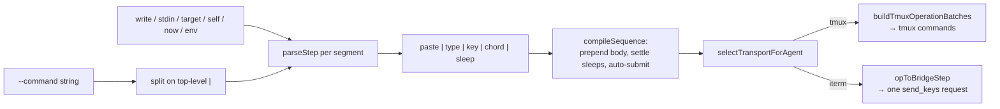
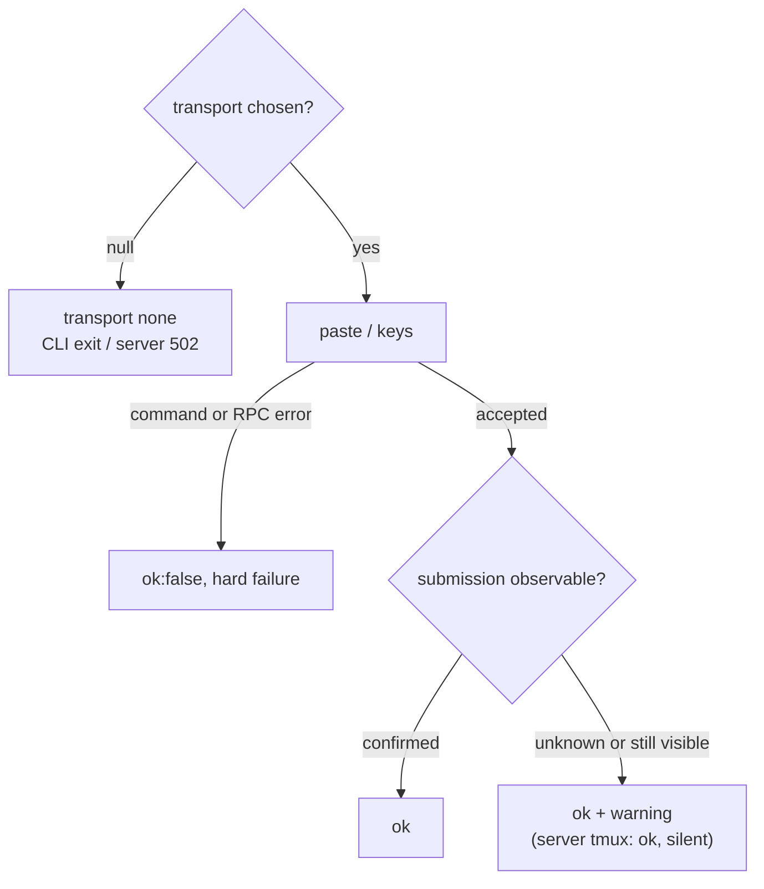

## Terminal Transport System



The transport stack treats `config.protocol` as a preference rather than a global switch. Capability evidence is gathered by [`src/transport-probes.mjs`][ref-3002], evaluated by pure policy in [`src/transport-select.mjs`][ref-3001], and applied per recipient by [`src/transport-router.mjs`][ref-3003]. This arrangement permits a mixed swarm in which one agent remains reachable through tmux while another uses iTerm2, and it lets an unavailable optional iTerm bridge fall back to tmux without changing persisted configuration. Three consumers share the one decision layer: the bridge envelope path in [`src/a2a-server.mjs`][ref-3107], the CLI raw path, and the CLI command-sequence path. Each consumer still owns its own delivery mechanics, so their retry and warning behavior differs; the differences are tabulated in [tmux delivery](#terminal-transport-system-tmux-delivery) and [Failure semantics](#terminal-transport-system-failure-semantics).

- [Selection and probe caching](#terminal-transport-system-selection-and-probe-caching) covers the capability matrix, probe TTLs, generation counters, and iTerm session identity.
- [tmux delivery](#terminal-transport-system-tmux-delivery) covers the three tmux paths, the settle-delay formula, verification, and submit keys.
- [iTerm2 RPC bridge](#terminal-transport-system-iterm2-rpc-bridge) covers the Node client, the Python adapter's operation table, reconnect supervision, ownership, and the launcher.
- [Command sequence DSL](#terminal-transport-system-command-sequence-dsl) covers grammar, variables, the key table, chord bytes, and compilation.
- [Failure semantics](#terminal-transport-system-failure-semantics) covers per-path outcomes and comments that no longer match the code.

### Module inventory

| Module | Important symbols | Responsibility | Production importers |
| --- | --- | --- | --- |
| [`src/transport-select.mjs`][ref-3001] | [`viableItermGuid()`][ref-3014], [`isDefaultTmuxPlaceholder()`][ref-3015], [`pickTransport()`][ref-3016], [`explainPick()`][ref-3017] | Pure capability matrix, no I/O | router, agent-transport, iterm-agent-resolve, `cli/iterm-restart-plan.mjs`, `cli.mjs`, `a2a-server.mjs` |
| [`src/transport-probes.mjs`][ref-3002] | [`bridgeReachable()`][ref-3018], [`tmuxSessionAlive()`][ref-3019], [`itermGuidByName()`][ref-3022], [`itermGuidExists()`][ref-3028], [`itermSessionIsAgent()`][ref-3023], [`itermSessionAgentId()`][ref-3024], [`listITermSessionsWithOwnership()`][ref-3025], [`isA2aOwnedITermSession()`][ref-3026], [`invalidateITermSessionCache()`][ref-3027] | Cached bridge, tmux, and iTerm evidence | router, `cli.mjs`, `cli/session-inventory.mjs`, `runtime/runtime-snapshot.mjs`, `cli/iterm-restart-plan.mjs` |
| [`src/transport-router.mjs`][ref-3003] | [`activeProtocol()`][ref-3030], [`selectTransportForAgent()`][ref-3031], [`deliverViaActiveProtocol()`][ref-3032], [`resolveITerm2GuidByName()`][ref-3033] | Probe integration and raw dispatch | `cli.mjs`, `a2a-server.mjs`, sequence-delivery |
| [`src/agent-transport.mjs`][ref-3004] | [`isAgentSessionAlive()`][ref-3035], [`shouldReviveAgentInTmux()`][ref-3034] | Liveness policy over injected probes | `cli.mjs` (`isAgentSessionAlive` only) |
| [`src/backend-delivery.mjs`][ref-3005] | [`submitKeysForBackend()`][ref-3036], [`submitRecoveryKeysForBackend()`][ref-3037] | Backend submit chord in tmux spelling | tmux-raw-delivery, iterm2-delivery, key-sequence, `a2a-server.mjs`, `cli.mjs` |
| [`src/tmux-raw-delivery.mjs`][ref-3006] | [`exactTmuxTarget()`][ref-3038], [`rawPasteLooksUnsubmitted()`][ref-3039], [`deliverRawTmuxInput()`][ref-3040] | Synchronous raw tmux paste with verification | router, probes, sequence-delivery |
| [`src/tmux-paste-verifier.mjs`][ref-3007] | [`pasteLooksUnsubmitted()`][ref-3041] | Placeholder and prompt-overlap test over captured text | tmux-raw-delivery, `a2a-server.mjs` |
| [`src/iterm-agent-resolve.mjs`][ref-3008] | [`resolveLiveItermTarget()`][ref-3042], [`resolveLiveItermGuid()`][ref-3043] | Live-name over stored-GUID reconciliation | none; tests only |
| [`src/iterm2-delivery.mjs`][ref-3009] | [`deliverITerm2Input()`][ref-3047], [`deliverITerm2Sequence()`][ref-3049], [`rpcTimeoutForSteps()`][ref-3044], lifecycle wrappers | Node Unix-socket RPC client | router, probes, sequence-delivery, `cli.mjs`, `a2a-server.mjs` |
| [`src/key-sequence.mjs`][ref-3010] | [`KEY_TABLE`][ref-3059], [`computeSettleMs()`][ref-3058], [`parseCommandDsl()`][ref-3060], [`compileSequence()`][ref-3061], [`compileOpToTmuxKeys()`][ref-3064], [`compileOpToBytes()`][ref-3065], [`chordBytes()`][ref-3066] | Transport-neutral command language | iterm2-delivery, sequence-delivery, `cli.mjs` |
| [`src/sequence-delivery.mjs`][ref-3011] | [`deliverSequenceViaActiveProtocol()`][ref-3067], [`buildTmuxOperationBatches()`][ref-3068] | Ordered op-list execution | `cli.mjs` |
| [`cmd/a2a-iterm2-bridge/bridge.py`][ref-3012] | [`OPS`][ref-3069], [`ITermLink`][ref-3070], [`supervise()`][ref-3071], [`_run_op()`][ref-3072], [`handle_client()`][ref-3073] | iTerm2 API adapter and GUID ownership store | Unix-socket clients |
| [`cmd/a2a-iterm2-bridge/launch.sh`][ref-3013] | [`find_python()`][ref-3081], [`ensure_venv()`][ref-3082], [`cmd_start()`][ref-3083], [`cmd_stop()`][ref-3084] | Python resolution and daemon control | [`runIterm2BridgeLauncher()`][ref-3096] in `cli.mjs` |

Two modules carry policy that production code does not import. [`src/iterm-agent-resolve.mjs`][ref-3008] prefers a live name match over a stored GUID without checking ownership, while the CLI uses its own [`resolveLiveItermTargetForAgent()`][ref-3091] in [`src/cli.mjs`][ref-3108], which prefers a stored GUID that is still live and otherwise accepts only a name match owned by this installation's token. [`shouldReviveAgentInTmux()`][ref-3034] is likewise exercised only by tests. The CLI variant is the authoritative behavior; the standalone module documents an earlier, weaker policy and should not be assumed to describe runtime reconciliation.

<a id="terminal-transport-system-selection-and-probe-caching"></a>
### Selection and probe caching



```js
export function pickTransport({ agent = {}, preference = "tmux", bridgeReachable = false, itermNameMatch = false, tmuxSessionAlive = false } = {}) {
    const itermViable = Boolean(bridgeReachable && (viableItermGuid(agent.itermGuid) || itermNameMatch));
    let tmuxViable = Boolean(agent.tmuxTarget && typeof agent.tmuxTarget === "string" && tmuxSessionAlive);
    // iTerm-backed agents carry a placeholder tmux target for registration.
    // Ignore coincidental tmux sessions with the same name when iTerm works.
    if (tmuxViable && isDefaultTmuxPlaceholder(agent) && viableItermGuid(agent.itermGuid) && itermViable) {
        tmuxViable = false;
    }

    if (itermViable && !tmuxViable) {
        return "iterm";
    }
    if (tmuxViable && !itermViable) {
        return "tmux";
    }
    if (!itermViable && !tmuxViable) {
        return null;
    }
    // Both viable — preference wins.
    return preference === "iterm" ? "iterm" : "tmux";
}
```

*Caption: `src/transport-select.mjs:64-84`*

| Bridge reachable | Non-blank GUID or name match | tmux target string with live session | Target equals `${agentId}:0.0` and GUID non-blank | Result |
| --- | --- | --- | --- | --- |
| no | any | no | any | `null` |
| no | any | yes | any | `tmux` |
| yes | no | no | any | `null` |
| yes | no | yes | any | `tmux` |
| yes | yes | no | any | `iterm` |
| yes | yes | yes | yes | `iterm` (placeholder suppressed, preference ignored) |
| yes | yes | yes | no | preference: `iterm` when `preference === "iterm"`, otherwise `tmux` |

[`pickTransport()`][ref-3016] defines viability conservatively: a stored GUID is never sufficient without a reachable bridge, and tmux requires both a string target and a live session. The placeholder row exists because iTerm-spawned agents register `${agentId}:0.0` as a compatibility target even when no tmux session exists; without suppression, an unrelated tmux session that happens to share the agent name would win under the default `tmux` preference and receive another agent's messages. [`explainPick()`][ref-3017] renders the same inputs as a log reason and orders the actionable remedy first, emitting `a2a bridge iterm start` when iTerm is preferred, the agent has an iTerm shape, and the bridge is down.

[`selectTransportForAgent()`][ref-3031] supplies the matrix inputs and adds two behaviors the pure function cannot know about. The fast path returns tmux without pinging the iTerm bridge when the preference is `tmux`, the target is alive, and no GUID is stored, which keeps tmux-only swarms free of socket round-trips on every send. Outside the fast path, a stored GUID is validated against the live session list through [`itermGuidExists()`][ref-3028] and discarded when absent, because trusting a GUID from a closed window would fail with `unknown session` instead of falling through to a live tmux pane. A name-resolved GUID is then passed to the matrix as the agent's GUID, so placeholder suppression also applies to agents found by tag rather than by registry record. [`activeProtocol()`][ref-3030] reads the preference from configuration on every call, mapping anything other than `iterm` to `tmux`.

#### Probe cache semantics

| Probe | Constant | Cached on success | Cached on failure | Concurrency |
| --- | --- | --- | --- | --- |
| [`bridgeReachable()`][ref-3018] (`ping`, 1,000 ms RPC timeout) | `BRIDGE_REACHABLE_TTL_MS = 5000` | `{expires}` for 5,000 ms | Cache cleared to `null` | One in-flight ping shared by all callers |
| [`tmuxSessionAlive()`][ref-3019] (`tmux has-session -t =<session>`) | `TMUX_ALIVE_TTL_MS = 2000` | Per-session entry for 2,000 ms | Entry deleted | Synchronous `spawnSync`; expired entries swept at most once per 2,000 ms |
| iTerm session list (`list_sessions`) | `ITERM_SESSIONS_TTL_MS = 2000` | Indexed entry for 2,000 ms, including an empty list | Not stored | One in-flight listing shared by all callers |

| Event | Bridge-reachable cache | Session-list cache | tmux cache |
| --- | --- | --- | --- |
| Successful `list_sessions` | Refreshed for 5,000 ms | Replaced | Unchanged |
| Failed `list_sessions` | Cleared | Unchanged (expired entries are not reused) | Unchanged |
| [`invalidateITermSessionCache()`][ref-3027] | Retained; pending ping dropped | Cleared; pending listing dropped | Unchanged |
| [`resetTransportProbeCache()`][ref-3029] (tests) | Cleared | Cleared | Cleared, sweep timer reset |
| Result arriving after a generation bump | Not written | Not written | Not applicable |

```js
export function invalidateITermSessionCache() {
    probeGeneration++;
    pendingBridgePing = null;
    pendingITermSessions = null;
    cachedITermSessions = null;
}
```

*Caption: `src/transport-probes.mjs:395-400`*

[`src/transport-probes.mjs`][ref-3002] caches only positive evidence because the long-lived bridge calls the router on every send: a dead bridge must be re-detected on the next delivery, and an agent spawned immediately after a failed probe must be reachable without waiting out a TTL. The generation counter closes the remaining race. A ping or listing started before a spawn, kill, or close completes may still resolve to its caller, but it cannot overwrite the cache that the invalidation emptied, so stale pre-spawn state never shadows the new session. A listing doubles as a ping in both directions: success refreshes reachability, and failure clears a previously cached success, while explicit invalidation leaves an independent successful ping untouched. All GUID, name, and ownership queries read one indexed entry built by [`buildITermSessionCacheEntry()`][ref-3021], so a single `list_sessions` round-trip answers every iTerm question asked during one delivery.

#### iTerm session identity

| Session kind | Indexed under (`guidByAgentName`) | [`itermSessionIsAgent()`][ref-3023] match rule | [`itermSessionAgentId()`][ref-3024] result |
| --- | --- | --- | --- |
| Tagged with `user.a2a_agent_id` | The tag only; first tagged session wins | Tag equality only; a mismatching tag is a different agent even when the title matches | The tag |
| Untagged, titled | Full title and the title prefix before the first space-dash-space separator, unless a tag already owns that key | Exact title, or title followed by whitespace, then `-`, `–`, or `—`, then whitespace | Title head before the separator when it matches `^[A-Za-z0-9_-]+$`, else `null` |
| Untagged, untitled | Not indexed | No match | `null` |

The durable tag outranks the title because backends retitle their tabs; Claude Code writes the task title, so a title lookup stops finding the agent and the CLI would respawn a duplicate. Tags are indexed in a first pass so a legacy session's title can never claim an id that a tagged session already owns. Separator tolerance exists because iTerm decorates `session.name` with ` — <pwd>` according to the active profile, so a session named `driver` reads back as `driver — ~/path`.

#### Liveness policy

[`isAgentSessionAlive()`][ref-3035] in [`src/agent-transport.mjs`][ref-3004] fast-paths tmux when no iTerm GUID is stored, probes iTerm when needed, and checks tmux again after an optional iTerm failure. The final recheck covers a session created during an in-flight bridge probe and prevents an unavailable optional adapter from hiding a valid tmux fallback. Its production caller, [`agentSessionAlive()`][ref-3092] in [`src/cli.mjs`][ref-3108], invokes it only for agents without a stored GUID, filters the iTerm list to sessions carrying this installation's token, and wraps the tmux probe in the CLI's own `exactTmuxTarget()`; GUID-backed agents instead go through [`resolveLiveItermTargetForAgent()`][ref-3091]. Restart consumers are documented in [Agent Lifecycle](#agent-lifecycle-transport-aware-restart).

<a id="terminal-transport-system-tmux-delivery"></a>
### tmux delivery



| Property | Bridge envelope path | Raw CLI path | Sequence path |
| --- | --- | --- | --- |
| Entry | [`tmuxDeliver()`][ref-3089] → [`deliverOnce()`][ref-3090] in `a2a-server.mjs` | [`deliverRawTmuxInput()`][ref-3040] via [`deliverViaActiveProtocol()`][ref-3032] from [`cmdRaw()`][ref-3094] | `tmuxPaste()`, `tmuxTypeLiteral()`, `tmuxSendKeys()` in [`src/sequence-delivery.mjs`][ref-3011] |
| Target form | Recorded target, unmodified | `=`-prefixed exact target | `=`-prefixed exact target |
| Serialization | [`withTargetLock()`][ref-3086] per target string | None (one CLI process) | None |
| Settle source | Server [`computeSettleMs()`][ref-3087], `A2A_PASTE_SETTLE_*`, read once at module load | Private `computeSettleMs()` in [`src/tmux-raw-delivery.mjs`][ref-3097], `A2A_RAW_PASTE_SETTLE_*`, read per call | Compiled `sleep` op from [`computeSettleMs()`][ref-3058], `A2A_RAW_PASTE_SETTLE_*` |
| Sleep primitive | `await sleep()` | `Atomics.wait` (blocks the CLI process) | `setTimeout` |
| Verification switch | Off when `A2A_PASTE_VERIFY=0` | Off when `A2A_RAW_PASTE_VERIFY=0` or `A2A_PASTE_VERIFY=0` | None |
| Retry count | `A2A_PASTE_MAX_ENTER_RETRIES`, default 5, minimum 1 | `A2A_RAW_PASTE_MAX_ENTER_RETRIES`, default 5, minimum 1 | None |
| Base retry delay | `A2A_PASTE_VERIFY_RETRY_DELAY_MS`, default 200 | `A2A_RAW_PASTE_VERIFY_RETRY_DELAY_MS`, default 200 | None |
| Capture failure | Treated as submitted; no warning | `ok:true` + `tmux paste verify could not read pane; submit uncertain` | Not applicable |
| Retries exhausted | One extra submit key; `ok:true`, no warning | `ok:true` + `tmux paste submit could not be verified; leaving input in pane` | Not applicable |

```js
export function computeSettleMs(byteLength) {
    const floor = parseNonNegativeIntegerEnv("A2A_RAW_PASTE_SETTLE_FLOOR_MS", SETTLE_FLOOR_MS_DEFAULT);
    const perKb = parseNonNegativeIntegerEnv("A2A_RAW_PASTE_SETTLE_PER_KB_MS", SETTLE_PER_KB_MS_DEFAULT);
    const ceiling = parseNonNegativeIntegerEnv("A2A_RAW_PASTE_SETTLE_CEILING_MS", SETTLE_CEILING_MS_DEFAULT);
    const kib = byteLength <= 0 ? 0 : Math.ceil(byteLength / BYTES_PER_KIB);
    return Math.max(0, Math.min(ceiling, floor + kib * perKb));
}
```

*Caption: `src/key-sequence.mjs:52-58`*

```js
function computeSettleMs(byteLength) {
    const kib = byteLength <= 0 ? 0 : Math.ceil(byteLength / SERVER_BODY_BYTES_PER_KIB);
    const scaled = PASTE_SETTLE_FLOOR_MS + kib * PASTE_SETTLE_PER_KB_MS;
    return Math.max(0, Math.min(PASTE_SETTLE_CEILING_MS, scaled));
}
```

*Caption: `src/a2a-server.mjs:458-462`*

| Settle parameter | Default | Raw, sequence, and iTerm variable | Server variable |
| --- | ---: | --- | --- |
| Floor | 300 ms | `A2A_RAW_PASTE_SETTLE_FLOOR_MS` | `A2A_PASTE_SETTLE_FLOOR_MS` |
| Per started KiB | 8 ms | `A2A_RAW_PASTE_SETTLE_PER_KB_MS` | `A2A_PASTE_SETTLE_PER_KB_MS` |
| Ceiling | 1,500 ms | `A2A_RAW_PASTE_SETTLE_CEILING_MS` | `A2A_PASTE_SETTLE_CEILING_MS` |

| UTF-8 payload | Settle with defaults |
| ---: | ---: |
| 0 bytes | 300 ms |
| 100 bytes | 308 ms |
| 10,240 bytes | 380 ms |
| 153,600 bytes | 1,500 ms |

| Verify attempt | Delay after submit key (defaults) |
| ---: | ---: |
| 0 | 200 ms |
| 1 | 300 ms |
| 2 | 450 ms |
| 3 | 675 ms |
| 4 | 1,012 ms |

The settle formula is defined three times with the same shape: exported in [`src/key-sequence.mjs`][ref-3010] (also consumed by the iTerm client), private in [`src/tmux-raw-delivery.mjs`][ref-3097], and private in the server. Every path separates paste from submit and waits a byte-scaled interval because a submit key that arrives before the receiving TUI commits the bracketed-paste end marker is absorbed into the paste, leaving the message unsubmitted. Any started KiB adds the per-KiB increment, so a 100-byte message waits 308 ms rather than the floor. The server reads its knobs under the `A2A_PASTE_` prefix once at startup, while raw and sequence delivery read the `A2A_RAW_PASTE_` prefix on each call; tuning one prefix does not affect the other path.

[`withTargetLock()`][ref-3086] serializes server deliveries per target because awaited sleeps would otherwise let two concurrent `/api/a2a/send` requests interleave load, paste, and submit on one pane; before delivery became asynchronous, `spawnSync` blocking provided that serialization implicitly. The server iTerm path uses the same lock under the key `iterm:<guid>` through [`itermDeliver()`][ref-3085], so concurrent bracketed pastes to one iTerm session are ordered by the bridge rather than by the Python sidecar. [`exactTmuxTarget()`][ref-3038] prefixes `=` unless the target already begins with `=`, `$`, `@`, or `%`, because tmux resolves `-t name` by prefix and a dead `alice` would otherwise reach a live `alice-worker`. The server envelope path does not apply this prefix to its paste and submit commands; exactness on that path comes from the preceding [`tmuxSessionAlive()`][ref-3019] probe, which always queries `=<session>`.

| Backend | tmux submit (`send-keys`) | iTerm raw delivery steps | DSL auto-submit op |
| --- | --- | --- | --- |
| `cursor-agent` | `C-Enter` | `ESC`, `ENTER` keys (bytes `\x1b\r`) | chord `C` + `ENTER` |
| Any other or empty | `Enter` | `ENTER` key (byte `\r`) | key `ENTER` |
| Any, with `A2A_ITERM2_SUBMIT_BYTES` set | Unchanged | Override bytes; `\x1b`, `\r`, `\t` become keys, other characters become `type` steps | Unchanged |

[`submitKeysForBackend()`][ref-3036] in [`src/backend-delivery.mjs`][ref-3005] is the single backend-to-key mapping; the iTerm client and DSL compiler translate its tmux spelling into their own representations. [`submitRecoveryKeysForBackend()`][ref-3037] returns an empty list for every backend and has no production caller; the test named `paste delivery does not use recovery keys that can cancel submitted content` in [`tests/backend-delivery.test.mjs`][ref-3102] records the intent that no speculative cancel key follows a paste.

[`pasteLooksUnsubmitted()`][ref-3041] in [`src/tmux-paste-verifier.mjs`][ref-3007] reports unsubmitted input when the captured text contains `[Pasted text #N` or when one of the last six non-trailing-blank lines is a prompt line (`>`, `›`, or `❯` followed by whitespace) whose text overlaps the first line of the pasted content by prefix in either direction. An arbitrary non-empty prompt does not count, so a stray retry cannot submit text the recipient was typing. [`rawPasteLooksUnsubmitted()`][ref-3039] wraps that test as a tri-state, returning `null` when `capture-pane` fails so the raw path can report uncertainty instead of claiming submission; the server's [`pasteStillUnsubmitted()`][ref-3088] collapses the same failure to `false`.

```js
    if (!submitted) {
        // Placeholder still visible after retries. Resolution is to send Enter and move on
        // rather than warn/block -- a stuck placeholder clears on the next Enter in practice.
        spawnSync(TMUX_EXECUTABLE, [ "send-keys", "-t", target, ...submitKeys ]);
    }
    return { ok: true, bytes: Buffer.byteLength(content, "utf8") };
}
```

*Caption: `src/a2a-server.mjs:557-563`*

<a id="terminal-transport-system-iterm2-rpc-bridge"></a>
### iTerm2 RPC bridge

```mermaid
sequenceDiagram
  participant Node as iterm2-delivery.mjs
  participant Socket as Unix socket (0600)
  participant Python as bridge.py handle_client
  participant Link as ITermLink
  participant API as iTerm2 API
  Node->>Socket: connect, one JSON request + newline
  Socket->>Python: readline, json.loads
  Python->>Python: OPS[op] lookup
  Python->>Link: _run_op races handler vs link.closed
  Link->>API: session operation
  API-->>Link: result, or websocket closed
  Link-->>Python: result or "connection lost during op"
  Python-->>Node: one JSON response + newline, close
```

| Client call | Timeout |
| --- | --- |
| Default RPC (`rpc()`) | `A2A_ITERM2_RPC_TIMEOUT_MS` when a positive integer, else 5,000 ms |
| [`pingITerm2Bridge()`][ref-3052] | 1,000 ms |
| [`spawnITerm2Window()`][ref-3053] | 15,000 ms |
| `send_keys` via [`deliverITerm2Input()`][ref-3047] or [`deliverITerm2Sequence()`][ref-3049] | Base + 250 ms per step + every `sleep` step's `ms` |

```js
export function rpcTimeoutForSteps(steps) {
    let ms = baseRpcTimeoutMs();
    for ( const step of Array.isArray(steps) ? steps : [] ) {
        ms += RPC_PER_STEP_BUDGET_MS;
        if (step && step.type === "sleep" && Number.isFinite(step.ms)) {
            ms += Math.max(0, step.ms);
        }
    }
    return ms;
}
```

*Caption: `src/iterm2-delivery.mjs:41-50`*

[`src/iterm2-delivery.mjs`][ref-3009] opens one Unix-socket connection per request through [`rpc()`][ref-3045] and settles exactly once, converting socket errors, timeouts, malformed JSON, and a close without a response into `{ok:false,error}`. The step-scaled timeout exists because the bridge replies only after executing every step, including sleeps of up to 60,000 ms; a fixed timeout would report failure while the bridge was still delivering, and a caller retry would then deliver twice. The socket path is `A2A_ITERM2_BRIDGE_SOCKET` or `~/.local/state/a2a/iterm2-bridge.sock`.

#### Raw delivery and verification

[`deliverITerm2Input()`][ref-3047] sends a `paste` step, a settle `sleep` step from [`computeSettleMs()`][ref-3058], and the backend submit keys from [`submitBytesForBackend()`][ref-3046] as one `send_keys` request rather than using `send_text`, whose single combined write races the receiving TUI's bracketed-paste commit. Verification then runs as separate `screen` requests through [`screenLooksUnsubmitted()`][ref-3048], which is on unless `A2A_ITERM_PASTE_VERIFY=0`.

| Verification parameter | Value |
| --- | --- |
| Attempts | 3 (`ITERM_VERIFY_MAX_RETRIES`) |
| Delay before each read | 200 ms × (attempt + 1): 200, 400, 600 ms |
| Screen lines requested | 8 |
| Lines inspected for prompt overlap | Last 5, skipping blank lines and rules of three or more `─`/`━` |
| Unsubmitted signals | `[Pasted text #N` anywhere in the 8 lines; prompt line overlapping the content's first line; a `</a2a>` line when the content contains `</a2a>` |
| Resubmit | One `ENTER` key step, regardless of backend |
| Unreadable screen | `ok:true` + `iterm paste verify could not read screen; submit uncertain` |
| Resubmit RPC failure | `ok:true` + `iterm resubmit ENTER failed: …; paste may be left in input` |
| Persisting after 3 reads | `ok:true` + `iterm paste placeholder persisted after retries; left in input` |

The `</a2a>` signal covers multi-line envelopes, whose wrapped tail sits below the prompt line and therefore never matches the first-line overlap test. The iTerm verifier is linear in backoff and inspects fewer lines than the tmux verifier, and its resubmit always sends `ENTER`, so a `cursor-agent` recipient receives a plain carriage return on retry rather than its `ESC CR` submit chord.

#### Operation table

| Operation | Request `params` | Success response | Node caller |
| --- | --- | --- | --- |
| `ping` | none | `version` (`"0.3"`); while disconnected returns `ok:false` with `version` and the reconnecting error | [`pingITerm2Bridge()`][ref-3052] |
| `list_sessions` | none | `sessions[]` of `guid`, `name`, `job_name`, `pwd`, `window_id`, `tab_id`, `install_token`, `agent_id` | [`listITerm2Sessions()`][ref-3050] |
| `send_text` | `guid`, `text`, `submit=false`, `submit_bytes="\r"` | `bytes` of the bracketed payload | none |
| `send_keys` | `guid`, non-empty `steps[]` | `bytes` of every emitted payload, including paste markers | [`deliverITerm2Input()`][ref-3047], [`deliverITerm2Sequence()`][ref-3049] |
| `screen` | `guid`, `lines=40` | `lines[]`, the last N lines of the visible screen contents | [`screenITerm2Session()`][ref-3051], verifier |
| `spawn` | `name`, `cwd` (default home), `command`, `where="window"`, `parent_guid` (required for `tab`), optional `install_token`, `shell`, `path_env` | `guid` | [`spawnITerm2Window()`][ref-3053] |
| `close` | `guid` | none | [`closeITerm2Session()`][ref-3054] |
| `focus` | `guid` | none | [`focusITerm2Session()`][ref-3055] |
| `set_name` | `guid`, `name` | none | [`setITerm2SessionName()`][ref-3057] |
| `configure_session` | `guid`, `native_scroll=true` | none | [`configureITerm2Session()`][ref-3056] |

| `send_keys` step `type` | Required fields | Bytes written |
| --- | --- | --- |
| `paste` | `text` string | `\x1b[200~` + text + `\x1b[201~` |
| `type` | `text` string | Text as given |
| `key` | `key` present in `KEY_BYTES` | Table bytes |
| `chord` | `mods` list, `key` string | [`_chord_bytes()`][ref-3075] |
| `sleep` | `ms` non-negative integer, no upper bound | None; `asyncio.sleep` |
| other | — | Request fails with `step N: unknown type` |

[`op_send_keys()`][ref-3074] validates each step as it reaches it and writes each payload immediately, so a malformed step N fails the request after steps 0 through N−1 have already reached the terminal. Every handler resolves the session per request with `get_session_by_id`, and a missing GUID returns `unknown session: <guid>`; [`op_close()`][ref-3099] also drops that GUID's ownership entry on this path, giving the Node side a recognizable benign-cleanup string. [`op_configure_session()`][ref-3100] sets the session-local profile property `Allow Alternate Mouse Scroll` to the inverse of `native_scroll`, so the mouse wheel scrolls iTerm's buffer instead of sending arrow keys into the agent's input history. [`op_send_text()`][ref-3101] remains in [`OPS`][ref-3069] but has no Node caller.

#### Connection supervision

```python
async def _run_op(handler, op, params):
    link = LINK
    if link is None:
        if op == "ping":
            return {"ok": False, "version": VERSION, "error": DISCONNECTED_ERROR}
        return {"ok": False, "error": DISCONNECTED_ERROR}
    # Race the op against the link closing: an RPC in flight when iTerm2 dies
    # waits on a reply future only the (now dead) dispatch loop resolves.
    task = asyncio.ensure_future(handler(link.app, link.connection, params))
    closed = asyncio.ensure_future(link.closed.wait())
    try:
        await asyncio.wait({task, closed}, return_when=asyncio.FIRST_COMPLETED)
    finally:
        closed.cancel()
    if not task.done():
        task.cancel()
        return {"ok": False, "error": f"iTerm2 connection lost during {op}"}
    try:
        return task.result()
    except Exception as exc:
        return {"ok": False, "error": f"{type(exc).__name__}: {exc}"}
```

*Caption: `cmd/a2a-iterm2-bridge/bridge.py:623-643`*

[`cmd/a2a-iterm2-bridge/bridge.py`][ref-3012] owns its event loop instead of using `iterm2.run_until_complete`, because the library helper opens exactly one connection and cannot replace it after iTerm2 restarts. [`supervise()`][ref-3071] keeps one [`ITermLink`][ref-3070] per websocket and never reuses a closed link; [`_connect_once()`][ref-3109] clears `ITERM2_COOKIE` and `ITERM2_KEY` and invalidates the library's process-wide `App` singleton so a new iTerm2 process neither rejects a stale cookie nor receives an `App` bound to the dead connection. Connection failures retry with delay doubling from 0.5 s to a 5.0 s cap, a lost link reconnects immediately with the delay reset, and `authenticate()` never launches iTerm2, so a quit application stays quit. [`main()`][ref-3080] opens the socket only after the first successful connection and applies mode `0600`, which makes socket existence a truthful readiness signal for the launcher; [`_run_op()`][ref-3072] then answers during later outages with an explicit disconnected error, so `ping` reports `ok:false` and the Node probes fall back to tmux rather than waiting on a reply future that the dead dispatch loop will never resolve.

#### Spawn and ownership

[`op_spawn()`][ref-3076] writes a mode-`0700` wrapper script through [`_write_spawn_script()`][ref-3077] using the caller's `$SHELL` as the shebang (default `/bin/sh`), an explicit `export PATH=` from the CLI's environment, a `cd` into the validated `cwd`, and a detached `( sleep 60 && rm -f -- <script> ) &` cleanup before the backend command. Login mode is avoided because replaying shell rc files costs one to three seconds per spawn, and the script is not self-deleting because iTerm re-executes it on profile restore and an already-removed script surfaced `execvp failed`. Display-name assignment is best effort, while setting `user.a2a_agent_id` is mandatory: on failure the new session is force-closed and the request fails, since an untagged session would later be indistinguishable from a retitled foreign tab.

The bridge persists `guid → install_token` as the iTerm analog of tmux's `@a2a-install-token` session option. [`op_list_sessions()`][ref-3078] reports the token beside each GUID and garbage-collects entries whose GUID is no longer present; spawn adds an entry and close removes it. Writes use a `.tmp` file and atomic `replace`, a corrupt or unreadable file loads as an empty map so the bridge still boots, and persistence failure leaves the in-memory map authoritative until restart. Ownership consumers are documented in [Runtime State and Observability](#runtime-state-and-observability).

#### Launcher

| Order | Python candidate | Accepted when |
| ---: | --- | --- |
| 1 | `A2A_PYTHON` | Set and executable |
| 2 | `~/.config/iterm2/AppSupport/iterm2env/versions/3.14.0/bin/python3.14` | Executable |
| 3 | `~/Library/Application Support/iTerm2/iterm2env/versions/3.14.0/bin/python3.14` | Executable |
| 4 | `versions/*/bin/python3*` under either iTerm2 runtime root | Executable and not ending in `-config` |
| 5 | `$STATE_DIR/iterm2-venv/bin/python3` | `import iterm2` succeeds; otherwise built once from the first `python3` on `PATH` with `pip install iterm2` |

| Command | Behavior |
| --- | --- |
| `start` | No-op when the PID is live; otherwise removes a stale socket, launches `nohup` with output appended to the log, writes the PID, and polls for the socket every 0.2 s up to 50 times (10 s); on timeout or early exit prints the last 15 log lines, kills the process, removes the PID file, and exits 1 |
| `stop` | Sends `SIGTERM`, polls 10 times at 0.2 s (2 s), then `SIGKILL`; removes PID file and socket |
| `status` | Prints PID and socket; exits 1 when not running |
| `restart` | `stop` then `start` |
| `foreground` | Removes a stale socket and `exec`s the bridge |
| other | Usage message, exit 2 |

| Artifact | Default location | Override | Read by |
| --- | --- | --- | --- |
| State directory | `~/.local/state/a2a` | `A2A_ITERM2_BRIDGE_STATE_DIR` | `launch.sh` only |
| Socket | `$STATE_DIR/iterm2-bridge.sock` | `A2A_ITERM2_BRIDGE_SOCKET` | `launch.sh`, `bridge.py`, Node client (defaults to `~/.local/state/a2a/iterm2-bridge.sock`) |
| PID file | `$STATE_DIR/iterm2-bridge.pid` | none | `launch.sh` |
| Log | `$STATE_DIR/iterm2-bridge.log` | none | `launch.sh` |
| Ownership map | `~/.local/state/a2a/iterm2-bridge.ownership.json` | `A2A_ITERM2_BRIDGE_OWNERSHIP` | `bridge.py` |
| Private virtual environment | `$STATE_DIR/iterm2-venv` | none | `launch.sh` |

[`cmd/a2a-iterm2-bridge/launch.sh`][ref-3013] prefers iTerm2's bundled runtime because it already contains the `iterm2` package, and falls back to a private virtual environment so a machine without that runtime still works after a one-time build. Only the virtual environment is checked for an importable `iterm2`; an executable `A2A_PYTHON` or bundled interpreter is accepted without that check. Stale PID and socket cleanup keeps `start` idempotent, and the CLI reaches these commands through [`runIterm2BridgeLauncher()`][ref-3096], which accepts exactly the five commands above. `A2A_ITERM2_BRIDGE_STATE_DIR` relocates the launcher's socket but not the Node client's default socket or the ownership map, so relocating state requires setting `A2A_ITERM2_BRIDGE_SOCKET` for every process as well.

<a id="terminal-transport-system-command-sequence-dsl"></a>
### Command sequence DSL



| Step form (checked in this order) | Produces | Constraint |
| --- | --- | --- |
| `STEP*N` | The inner step's ops unrolled N times | 1 ≤ N ≤ 1000; nests |
| `SLEEP(ms)` | `sleep` | 0 ≤ ms ≤ 60,000 |
| `$name` or `${name}` | `paste` of the variable's value; nothing when empty | Unknown variable or missing env name throws |
| `"text"` or `'text'` | `type`; nothing when empty | Only `\\`, `\'`, `\"` are unescaped; other backslashes stay literal |
| Named key, exact uppercase | `key` | Must be a `KEY_TABLE` name |
| `MOD[-MOD]-TAIL` | `chord` | Modifiers `C`, `S`, `M`, `A` (alias of `M`), deduplicated and sorted `C`, `S`, `M`; tail is a key name (case-insensitive) or one character |
| `/text` | `type` of the whole token | Slash commands typed as keystrokes |
| anything else | error | `unknown command step` |

| Variable | Value in [`runSequenceCommand()`][ref-3093] |
| --- | --- |
| `$write`, `$content`, `$command` | `--write` body, or stdin when `--stdin` or `--write -` |
| `$stdin` | The same body as `$write` |
| `$target` | Recipient id, compiled per recipient |
| `$self` | Current agent id or empty string |
| `$now` | ISO-8601 timestamp |
| `${env:NAME}` | `process.env[NAME]`; throws when absent |

[`parseCommandDsl()`][ref-3060] splits on `|` only outside quotes, drops empty segments, and rejects unterminated quotes, unknown variables, and unrecognized bare tokens instead of turning them into empty input, because a silent empty would deliver a partial command. Variables become `paste` operations and quoted literals become `type` operations: a body is delivered as one bracketed paste the TUI treats as a unit, while literals arrive as keystrokes so backend slash-command handlers fire. Named keys are case-sensitive at top level but case-insensitive as chord tails.

#### Key table

| Name | tmux spelling | Bytes | Name | tmux spelling | Bytes |
| --- | --- | --- | --- | --- | --- |
| `ENTER` | `Enter` | `\r` | `INS` | `IC` | `ESC [2~` |
| `ESC` | `Escape` | `ESC` | `DEL` | `DC` | `ESC [3~` |
| `TAB` | `Tab` | `\t` | `F1` | `F1` | `ESC OP` |
| `BTAB` | `BTab` | `ESC [Z` | `F2` | `F2` | `ESC OQ` |
| `SPACE` | `Space` | space | `F3` | `F3` | `ESC OR` |
| `BSPACE` | `BSpace` | `\x7f` | `F4` | `F4` | `ESC OS` |
| `UP` | `Up` | `ESC [A` | `F5` | `F5` | `ESC [15~` |
| `DOWN` | `Down` | `ESC [B` | `F6` | `F6` | `ESC [17~` |
| `RIGHT` | `Right` | `ESC [C` | `F7` | `F7` | `ESC [18~` |
| `LEFT` | `Left` | `ESC [D` | `F8` | `F8` | `ESC [19~` |
| `HOME` | `Home` | `ESC OH` | `F9` | `F9` | `ESC [20~` |
| `END` | `End` | `ESC OF` | `F10` | `F10` | `ESC [21~` |
| `PGUP` | `PageUp` | `ESC [5~` | `F11` | `F11` | `ESC [23~` |
| `PGDN` | `PageDown` | `ESC [6~` | `F12` | `F12` | `ESC [24~` |

| Chord condition | iTerm bytes ([`chordBytes()`][ref-3066] and [`_chord_bytes()`][ref-3075]) | tmux argument |
| --- | --- | --- |
| `C` with `ENTER` | `ESC \r` | `C-Enter` |
| `S` with `TAB` | `ESC [Z` | `S-Tab` |
| `C` or `S` with any other named key | The key's plain bytes; the modifier is dropped | `C-<tmux name>` / `S-<tmux name>` |
| `S` with one character | Uppercased character | `S-<char>` |
| `C` with one character | Character code AND `0x1f` (after any shift uppercasing) | `C-<char>` |
| `M` with anything | `ESC` prefixed to the result | `M-…` |

[`KEY_TABLE`][ref-3059] in [`src/key-sequence.mjs`][ref-3010] supplies tmux spellings to [`compileOpToTmuxKeys()`][ref-3064], while production iTerm bytes come from the separate [`KEY_BYTES`][ref-3079] dictionary and [`_chord_bytes()`][ref-3075] in `bridge.py`, because the Node runner sends structured steps and lets Python encode them. The two 28-entry tables are identical in the current working tree, but they are a manually synchronized protocol contract marked only by comments on both sides. The JavaScript [`compileOpToBytes()`][ref-3065] and [`chordBytes()`][ref-3066] mirror the Python encoder and have no importer under `src/`. Because named-key chords drop `C` and `S` in the byte encoding, a chord such as `C-UP` reaches tmux as a modified key but reaches iTerm as a plain up arrow.

#### Compilation

```js
function shouldAppendSubmit(ops) {
    if (ops.length === 0) {
        return false;
    }
    for ( let i = ops.length - 1; i >= 0; i-- ) {
        const op = ops[i];
        if (op.kind === "sleep") {
            continue;
        }
        if (op.kind === "paste" || op.kind === "type") {
            return true;
        }
        return false;
    }
    return false;
}
```

*Caption: `src/key-sequence.mjs:453-468`*

| Implicit operation in [`compileSequence()`][ref-3061] | Condition |
| --- | --- |
| Leading `paste` of the write body | Body is non-empty and no step references `$write`, `$content`, `$command`, or `$stdin` |
| `sleep(computeSettleMs(bytes))` | After every `paste` |
| Backend submit ops | `submit` is not `false` and the last non-sleep op is `paste` or `type` |
| Error `command sequence compiled to zero ops` | Nothing remains after compilation |

[`referencesBodyVariable()`][ref-3063] strips nested repeat markers and ignores quoted literals before testing for a body reference; without the stripping, `$write*2` would fail the variable pattern, the body would also be prepended, and the message would arrive three times. The submit rule ends a sequence on a commit only when the sequence ends on text, so a sequence that already ends on a key or chord is delivered exactly as written.

| Op | tmux realization ([`buildTmuxOperationBatches()`][ref-3068]) | iTerm realization ([`opToBridgeStep()`][ref-3105]) |
| --- | --- | --- |
| `paste` | Own batch: `load-buffer` + `paste-buffer -p -d` ([`tmuxPaste()`][ref-3103]) | `paste` step |
| `type` | Adjacent types concatenated: `send-keys -l -- text` ([`tmuxTypeLiteral()`][ref-3104]) | `type` step |
| `key`, `chord` | Adjacent keys and chords share one `send-keys` | `key` / `chord` step |
| `sleep` | Own batch: `setTimeout` | `sleep` step inside the one request |
| unknown | `invalid` batch that fails at execution | Throws |

[`deliverSequenceViaActiveProtocol()`][ref-3067] in [`src/sequence-delivery.mjs`][ref-3011] runs the compiled list in order through the router's choice. Batching reduces tmux subprocess count without reordering, while the iTerm path sends the entire list as one `send_keys` request with a step-scaled timeout. Neither sequence runner performs submit verification; the compiled settle sleeps are the only protection against an early submit. [`runSequenceCommand()`][ref-3093] compiles every recipient before delivering to any, so a parse error aborts before terminal input, and it rejects remote recipients because sequences require a local pane; recipient resolution belongs to [Command-Line Orchestrator](#command-line-orchestrator).

<a id="terminal-transport-system-failure-semantics"></a>
### Failure semantics



| Condition | Raw CLI (tmux / iTerm) | Bridge envelope (tmux / iTerm) | Command sequence |
| --- | --- | --- | --- |
| No viable transport | `ok:false`, `transport:"none"`, [`explainPick()`][ref-3017] reason | HTTP 502 with the reason; message log row records transport `tmux` | Same as raw |
| tmux `load-buffer`, `paste-buffer`, or `send-keys` non-zero | Hard failure | Hard failure | Hard failure at that op |
| iTerm socket error, timeout, malformed JSON, close without reply, or `ok:false` | Hard failure | HTTP 502 | Hard failure |
| iTerm2 API disconnected | `ping` returns `ok:false`, so selection falls back to a live tmux target or returns no route | Same | Same |
| Capture or screen unreadable | `ok:true` + warning | tmux: treated as submitted, silent; iTerm: `ok:true` + warning | Not verified |
| Paste still visible after retries | `ok:true` + warning, input left in pane | tmux: one more submit key, silent; iTerm: `ok:true` + warning | Not verified |
| Later op or `send_keys` step fails | Not applicable | Not applicable | Failure after earlier ops already reached the terminal; the CLI aborts remaining recipients |
| Client timeout while the bridge is still executing | Hard failure although delivery may complete | Same | Same; reduced by [`rpcTimeoutForSteps()`][ref-3044] |

Transport operations are intentionally non-transactional because terminals expose no rollback. The warning-success policy avoids duplicate resubmission when the only missing fact is screen observability, while hard errors are reserved for commands and RPCs that reported failure. The server tmux path is the exception: it treats unobservable submission as success without a warning and sends one extra submit key after exhausted retries, on the stated assumption that a stuck placeholder clears on the next submit. Envelope-level 502 handling belongs to [Delivery and federation](#bridge-server-and-registry-delivery-and-federation).

#### Comments that diverge from code

| Location | Comment states | Code behavior |
| --- | --- | --- |
| `src/transport-router.mjs:7-9` | iTerm is viable with a recorded `itermGuid` alone | [`pickTransport()`][ref-3016] also requires a reachable bridge |
| `src/transport-router.mjs:42-43` | `cli.mjs` still calls `resolveITerm2GuidByName` | No module under `src/` imports it |
| `src/a2a-server.mjs:446-448` | `computeSettleMs(100)` returns 300 | Returns 308; one started KiB adds 8 ms |
| `src/a2a-server.mjs:471` | Capture failure returns `false`, "allowing retry logic to proceed" | `false` ends the retry loop as submitted |
| `src/iterm2-delivery.mjs:136` | `verify` is reserved and the bridge does not verify | `verify` enables screen-based retries |
| `src/iterm2-delivery.mjs:387-388` | Command runs in a self-deleting `zsh -l` script | Caller's shell without login mode; delayed background removal |
| `src/key-sequence.mjs:12` | Grammar lives in `docs/command-dsl.md` | The file does not exist |
| `src/key-sequence.mjs:403` | Trailing `ENTER` when the final op is `paste` | Backend submit ops when the last non-sleep op is `paste` or `type` |

See [Agent Lifecycle](#agent-lifecycle) for transport-aware revival and [Bridge Server and Registry](#bridge-server-and-registry) for envelope routing.

<!-- refs -->
[ref-3001]: ../src/transport-select.mjs
[ref-3002]: ../src/transport-probes.mjs
[ref-3003]: ../src/transport-router.mjs
[ref-3004]: ../src/agent-transport.mjs
[ref-3005]: ../src/backend-delivery.mjs
[ref-3006]: ../src/tmux-raw-delivery.mjs
[ref-3007]: ../src/tmux-paste-verifier.mjs
[ref-3008]: ../src/iterm-agent-resolve.mjs
[ref-3009]: ../src/iterm2-delivery.mjs
[ref-3010]: ../src/key-sequence.mjs
[ref-3011]: ../src/sequence-delivery.mjs
[ref-3012]: ../cmd/a2a-iterm2-bridge/bridge.py
[ref-3013]: ../cmd/a2a-iterm2-bridge/launch.sh
[ref-3014]: ../src/transport-select.mjs#L40
[ref-3015]: ../src/transport-select.mjs#L52
[ref-3016]: ../src/transport-select.mjs#L64
[ref-3017]: ../src/transport-select.mjs#L93
[ref-3018]: ../src/transport-probes.mjs#L74
[ref-3019]: ../src/transport-probes.mjs#L107
[ref-3021]: ../src/transport-probes.mjs#L195
[ref-3022]: ../src/transport-probes.mjs#L252
[ref-3023]: ../src/transport-probes.mjs#L325
[ref-3024]: ../src/transport-probes.mjs#L344
[ref-3025]: ../src/transport-probes.mjs#L365
[ref-3026]: ../src/transport-probes.mjs#L377
[ref-3027]: ../src/transport-probes.mjs#L395
[ref-3028]: ../src/transport-probes.mjs#L408
[ref-3029]: ../src/transport-probes.mjs#L421
[ref-3030]: ../src/transport-router.mjs#L34
[ref-3031]: ../src/transport-router.mjs#L76
[ref-3032]: ../src/transport-router.mjs#L126
[ref-3033]: ../src/transport-router.mjs#L48
[ref-3034]: ../src/agent-transport.mjs#L14
[ref-3035]: ../src/agent-transport.mjs#L36
[ref-3036]: ../src/backend-delivery.mjs#L2
[ref-3037]: ../src/backend-delivery.mjs#L6
[ref-3038]: ../src/tmux-raw-delivery.mjs#L74
[ref-3039]: ../src/tmux-raw-delivery.mjs#L96
[ref-3040]: ../src/tmux-raw-delivery.mjs#L120
[ref-3041]: ../src/tmux-paste-verifier.mjs#L4
[ref-3042]: ../src/iterm-agent-resolve.mjs#L16
[ref-3043]: ../src/iterm-agent-resolve.mjs#L47
[ref-3044]: ../src/iterm2-delivery.mjs#L41
[ref-3045]: ../src/iterm2-delivery.mjs#L60
[ref-3046]: ../src/iterm2-delivery.mjs#L112
[ref-3047]: ../src/iterm2-delivery.mjs#L145
[ref-3048]: ../src/iterm2-delivery.mjs#L245
[ref-3049]: ../src/iterm2-delivery.mjs#L318
[ref-3050]: ../src/iterm2-delivery.mjs#L341
[ref-3051]: ../src/iterm2-delivery.mjs#L357
[ref-3052]: ../src/iterm2-delivery.mjs#L371
[ref-3053]: ../src/iterm2-delivery.mjs#L400
[ref-3054]: ../src/iterm2-delivery.mjs#L439
[ref-3055]: ../src/iterm2-delivery.mjs#L457
[ref-3056]: ../src/iterm2-delivery.mjs#L481
[ref-3057]: ../src/iterm2-delivery.mjs#L500
[ref-3058]: ../src/key-sequence.mjs#L52
[ref-3059]: ../src/key-sequence.mjs#L66
[ref-3060]: ../src/key-sequence.mjs#L376
[ref-3061]: ../src/key-sequence.mjs#L412
[ref-3063]: ../src/key-sequence.mjs#L529
[ref-3064]: ../src/key-sequence.mjs#L565
[ref-3065]: ../src/key-sequence.mjs#L601
[ref-3066]: ../src/key-sequence.mjs#L633
[ref-3067]: ../src/sequence-delivery.mjs#L39
[ref-3068]: ../src/sequence-delivery.mjs#L85
[ref-3069]: ../cmd/a2a-iterm2-bridge/bridge.py#L513
[ref-3070]: ../cmd/a2a-iterm2-bridge/bridge.py#L532
[ref-3071]: ../cmd/a2a-iterm2-bridge/bridge.py#L584
[ref-3072]: ../cmd/a2a-iterm2-bridge/bridge.py#L623
[ref-3073]: ../cmd/a2a-iterm2-bridge/bridge.py#L646
[ref-3074]: ../cmd/a2a-iterm2-bridge/bridge.py#L245
[ref-3075]: ../cmd/a2a-iterm2-bridge/bridge.py#L222
[ref-3076]: ../cmd/a2a-iterm2-bridge/bridge.py#L350
[ref-3077]: ../cmd/a2a-iterm2-bridge/bridge.py#L313
[ref-3078]: ../cmd/a2a-iterm2-bridge/bridge.py#L126
[ref-3079]: ../cmd/a2a-iterm2-bridge/bridge.py#L187
[ref-3080]: ../cmd/a2a-iterm2-bridge/bridge.py#L675
[ref-3081]: ../cmd/a2a-iterm2-bridge/launch.sh#L16
[ref-3082]: ../cmd/a2a-iterm2-bridge/launch.sh#L40
[ref-3083]: ../cmd/a2a-iterm2-bridge/launch.sh#L89
[ref-3084]: ../cmd/a2a-iterm2-bridge/launch.sh#L71
[ref-3085]: ../src/a2a-server.mjs#L105
[ref-3086]: ../src/a2a-server.mjs#L400
[ref-3087]: ../src/a2a-server.mjs#L458
[ref-3088]: ../src/a2a-server.mjs#L473
[ref-3089]: ../src/a2a-server.mjs#L493
[ref-3090]: ../src/a2a-server.mjs#L513
[ref-3091]: ../src/cli.mjs#L2255
[ref-3092]: ../src/cli.mjs#L1302
[ref-3093]: ../src/cli.mjs#L2967
[ref-3094]: ../src/cli.mjs#L2829
[ref-3096]: ../src/cli.mjs#L3040
[ref-3097]: ../src/tmux-raw-delivery.mjs#L56
[ref-3099]: ../cmd/a2a-iterm2-bridge/bridge.py#L462
[ref-3100]: ../cmd/a2a-iterm2-bridge/bridge.py#L431
[ref-3101]: ../cmd/a2a-iterm2-bridge/bridge.py#L161
[ref-3102]: ../tests/backend-delivery.test.mjs
[ref-3103]: ../src/sequence-delivery.mjs#L178
[ref-3104]: ../src/sequence-delivery.mjs#L200
[ref-3105]: ../src/sequence-delivery.mjs#L232
[ref-3107]: ../src/a2a-server.mjs
[ref-3108]: ../src/cli.mjs
[ref-3109]: ../cmd/a2a-iterm2-bridge/bridge.py#L564
