## Bridge Server and Registry

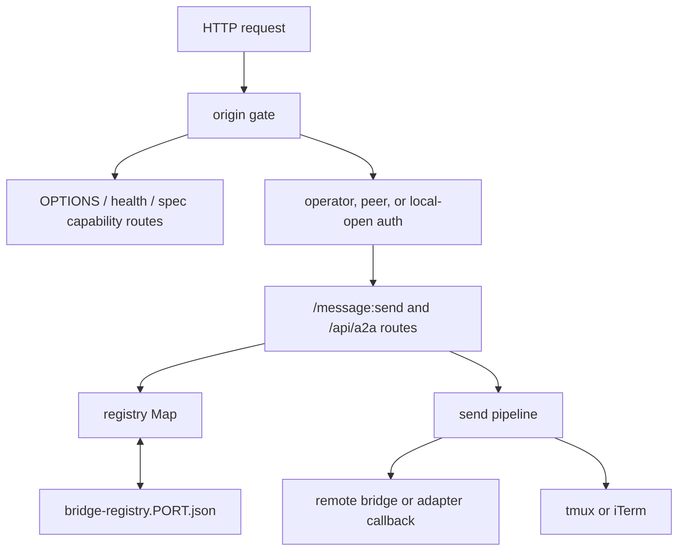

[`src/a2a-server.mjs`][ref-4001] is the long-lived routing authority and the `a2a-server` executable declared in [`package.json`][ref-4040]. Its in-memory [`registry`][ref-4044] `Map` owns current registrations, while a per-port registry file supports process restart and inspection. The module exports nothing: evaluation resolves bind coordinates, restores valid rows, creates the HTTP listener, writes the PID, and installs signal handlers, so external behavior is locked by subprocess tests in [`tests/a2a-server-vitest.test.mjs`][ref-4038] rather than by imported internals. Keeping registration, authentication, and delivery in one process gives every client the same view of which agents exist and which credential may act on each of them.

- [Module inventory and configuration](#bridge-server-and-registry-module-inventory-and-configuration)
- [HTTP route table](#bridge-server-and-registry-http-route-table)
- [HTTP and authentication boundary](#bridge-server-and-registry-http-and-authentication-boundary)
- [Registration ownership](#bridge-server-and-registry-registration-ownership)
- [Delivery and federation](#bridge-server-and-registry-delivery-and-federation)
- [A2A protocol façade](#bridge-server-and-registry-a2a-protocol-façade)
- [Implementation boundaries](#bridge-server-and-registry-implementation-boundaries)

<a id="bridge-server-and-registry-module-inventory-and-configuration"></a>
### Module inventory and configuration

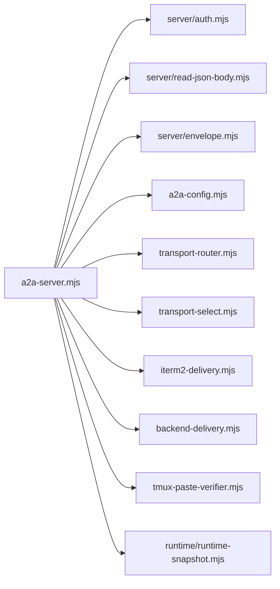

| Module | Important symbols | Responsibility |
| --- | --- | --- |
| [`src/a2a-server.mjs`][ref-4001] | [`handleRequest()`][ref-4005], [`handleA2ARoutes()`][ref-4006], [`handleBridgeSendBody()`][ref-4007], [`tmuxDeliver()`][ref-4010], [`itermDeliver()`][ref-4024], [`remoteDeliver()`][ref-4015] | Executable registry and delivery server |
| [`src/server/auth.mjs`][ref-4002] | [`isLoopbackAddress()`][ref-4022], [`secretsEqualUtf8()`][ref-4019], [`isTrustedBrowserLoopbackHostname()`][ref-4020], [`authFromRequest()`][ref-4018], [`configuredPeerUrl()`][ref-4021] | Credential and browser-origin classification |
| [`src/server/read-json-body.mjs`][ref-4003] | [`readJsonBody()`][ref-4012] | Single-settlement JSON reader with a 1 MiB byte cap |
| [`src/server/envelope.mjs`][ref-4004] | [`wrapEnvelope()`][ref-4023] | Local terminal framing; see [Message Framing and Identity](#message-framing-and-identity) |

The live codebase-map graph records ten import edges out of [`src/a2a-server.mjs`][ref-4001] and zero dependents, consistent with an executable leaf that is only ever launched, never imported. The three `src/server/*` modules have no dependencies of their own and two dependents each (the server and its tests), which keeps credential and body-reading policy testable without binding a port.

| Environment variable | Default | Effect |
| --- | --- | --- |
| `A2A_HOST`, `A2A_PORT` | `config.host` / `config.port`, then `127.0.0.1` / `7742` | Listener bind coordinates; precedence is owned by [Configuration and Persistent State](#configuration-and-persistent-state) |
| `A2A_KEY` | `config.key` | Operator credential; [`checkAuth()`][ref-4033] overlays it on the loaded config, while peer keys come only from `config.peers` |
| `A2A_PUBLIC_URL` | `config.url` | Own canonical URL for remote-versus-local routing and the agent card `url` |
| `A2A_BRIDGE_REGISTRY_FILE` | `bridge-registry.<port>.json` under the a2a root | Persisted registry path ([`bridgeRegistryPath()`][ref-4037]) |
| `A2A_PASTE_SETTLE_FLOOR_MS` | `300` | Minimum delay between tmux paste and submit key |
| `A2A_PASTE_SETTLE_PER_KB_MS` | `8` | Additional settle delay per started KiB of envelope |
| `A2A_PASTE_SETTLE_CEILING_MS` | `1500` | Upper bound on settle delay |
| `A2A_PASTE_VERIFY_RETRY_DELAY_MS` | `200` | Base verification delay, multiplied by 1.5 per attempt |
| `A2A_PASTE_MAX_ENTER_RETRIES` | `5` (minimum 1) | Submit-and-verify attempts per tmux delivery |
| `A2A_PASTE_VERIFY` | enabled | The literal value `0` disables pane capture after submit |

The six paste variables are parsed by a non-negative-integer reader that silently falls back to the default on malformed input, so a mistyped tuning value degrades to stock timing rather than preventing the bridge from starting.

<a id="bridge-server-and-registry-http-route-table"></a>
### HTTP route table

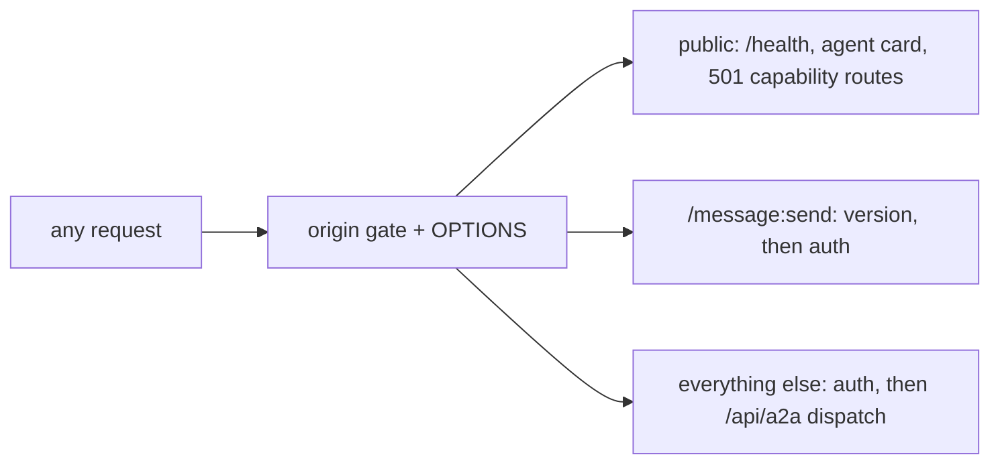

| Method | Path | Authentication | Handler | Status codes |
| --- | --- | --- | --- | --- |
| `OPTIONS` | any | none (origin gate only) | [`handleRequest()`][ref-4005] | 200, 403 |
| `GET` | `/health` | none | [`handleRequest()`][ref-4005] | 200 `{ok, agents, auth}` |
| `GET` | `/.well-known/agent-card.json` | none | [`handleSpecRoute()`][ref-4008] | 200, 400 version |
| `POST` | `/message:stream` | none | [`handleSpecRoute()`][ref-4008] | 501 `StreamingNotSupportedError`, 400 version |
| `POST`, `PUT`, `PATCH` | `/tasks/<id>/subscribe`, `/push-config`, `/pushNotificationConfig` | none | [`handleSpecRoute()`][ref-4008] | 501 `PushNotificationNotSupportedError`, 400 version |
| `POST` | `/message:send` | any authenticated class | [`handleSpecMessageSendRoute()`][ref-4011] | 200, 400, 401, 403, 404, 413, 502 |
| `POST` | `/api/a2a/register` | operator-like, or peer inside its namespace | [`handleA2ARoutes()`][ref-4006] | 200, 400, 401, 403, 409, 413 |
| `DELETE` | `/api/a2a/register/<agentId>` | operator-like, or peer inside its namespace | [`handleA2ARoutes()`][ref-4006] | 200 `{agentId, removed}`, 400, 401, 403, 409 |
| `GET` | `/api/a2a/agents` | any authenticated class | [`handleA2ARoutes()`][ref-4006] | 200 `{agents, registrationOwnership: true}`, 401 |
| `GET` | `/api/a2a/runtime-snapshot?self=&cwd=&fresh=1` | any authenticated class | [`handleA2ARoutes()`][ref-4006] | 200, 401 |
| `POST` | `/api/a2a/send` | any authenticated class | [`handleBridgeSendBody()`][ref-4007] | 200, 400, 401, 403, 404, 413, 502 |
| any | any other path | authenticated | [`handleRequest()`][ref-4005] | 404 when authenticated, 401 otherwise |

Every route answers 403 before dispatch when an `Origin` header is present and untrusted, and any exception escaping a handler becomes 500 unless headers were already sent. Compatibility routes answer `{success, data, timestamp}` or `{success: false, error}`; spec routes answer bare protocol objects or `{error: {name, message, …}}`. The `runtime-snapshot` route is the bridge-side projection consumed by status tooling; its `fresh=1` parameter bypasses the 750 ms snapshot cache described in [Runtime State and Observability](#runtime-state-and-observability).

<a id="bridge-server-and-registry-http-and-authentication-boundary"></a>
### HTTP and authentication boundary

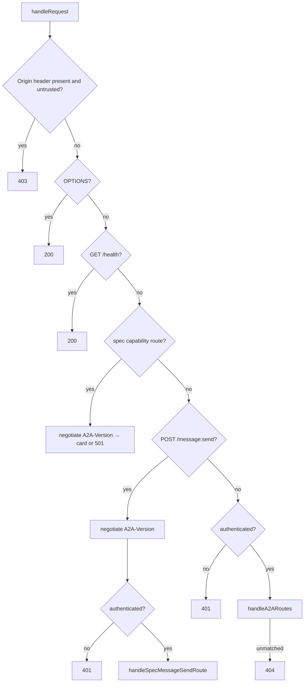

```js
export function authFromRequest(req, cfg) {
  const loopback = isLoopbackAddress(req.socket?.remoteAddress || "");
  if (!cfg.key && !Object.keys(cfg.peers || {}).length) {
    return loopback
      ? { ok: true, kind: "local-open", loopback }
      : { ok: false };
  }
  const header = firstHeader(req.headers.authorization);
  const token = header.startsWith("Bearer ") ? header.slice(7) : header;
  if (!token) {
    return { ok: false };
  }

  /** Always evaluate every peer digest so match position does not leak via early exit */
  let matchedPeer = null;
  for (const [name, p] of Object.entries(cfg.peers || {})) {
    const pk = typeof p?.key === "string" ? p.key : "";
    if (pk && secretsEqualUtf8(token, pk)) {
      matchedPeer = name;
    }
  }

  const operatorConfigured = typeof cfg.key === "string" && cfg.key !== "";
  if (operatorConfigured && secretsEqualUtf8(token, cfg.key)) {
    return { ok: true, kind: "operator", loopback };
  }
  if (matchedPeer !== null) {
    return { ok: true, kind: "peer", peer: matchedPeer, loopback };
  }
  return { ok: false };
}
```
*src/server/auth.mjs:48-78*

[`handleRequest()`][ref-4005] separates public capability discovery from state-changing routes. `OPTIONS`, `/health`, the agent card, and the structured 501 capability responses complete before any credential is read; `/message:send` negotiates protocol version before authenticating; every remaining path, including unmatched ones, requires authentication, so an unauthenticated caller cannot distinguish a missing route from a protected one. Browser origins are trusted when [`isTrustedBrowserLoopbackHostname()`][ref-4020] accepts the hostname (`localhost`, `127.0.0.1`, `::1` in bracketed or expanded form) or the scheme is `chrome-extension:`, because the Claude Bridge extension calls the bridge from an extension origin that has no loopback hostname.

[`authFromRequest()`][ref-4018] grants `local-open` only when neither an operator key nor any peer key is configured and the socket address is `127.0.0.1`, `::1`, or `::ffff:127.0.0.1`. Once one key exists, loopback no longer bypasses credentials. [`secretsEqualUtf8()`][ref-4019] compares SHA-256 digests with `timingSafeEqual`, every configured peer key is evaluated without early exit, and an operator-key match takes precedence over a duplicate peer-key match. The `Authorization` header is accepted either as `Bearer <token>` or as a raw token.

| Authentication class | Credential source | Authority |
| --- | --- | --- |
| `local-open` | Keyless bridge plus loopback socket | Operator-like registration and deletion |
| `operator` | `A2A_KEY` over `config.key` | Any registration, deletion, and send origin |
| `peer` | `config.peers.<name>.key` | Exact peer id or `<peer>__<agent>` namespace; sends must use `origin=peer` |

[`readJsonBody()`][ref-4012] caps request bytes rather than JavaScript string length and tags oversize errors with `code: 413`, which every bridge route maps directly to the HTTP status. All terminal events share one settlement guard, so `end` or `close` cannot resolve after an abort or oversize rejection, and settled chunks are drained without retention to keep the socket alive long enough to answer 413. The channel adapter implements a separate text reader with a 2 MiB cap because its payloads are opaque text, not JSON; see [Claude Code Channel Adapter](#claude-code-channel-adapter).

<a id="bridge-server-and-registry-registration-ownership"></a>
### Registration ownership

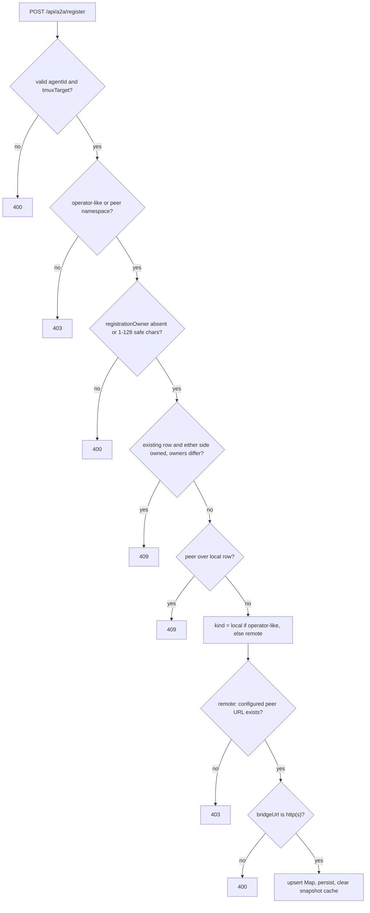

```js
            const existing = registry.get(body.agentId);
            if (body.registrationOwner !== undefined && (typeof body.registrationOwner !== "string" || !/^[A-Za-z0-9_-]{1,128}$/.test(body.registrationOwner))) {
                fail(res, 400, "invalid registration owner");
                return true;
            }
            // Owned adapter routes may only be renewed by the same instance. Ordinary
            // registrations keep their existing overwrite behavior; an operator can
            // explicitly unregister an abandoned route before replacing it.
            if (existing && (existing.registrationOwner || body.registrationOwner) && existing.registrationOwner !== body.registrationOwner) {
                fail(res, 409, "agent registration belongs to another instance");
                return true;
            }
            if (peer && existing?.kind === REGISTRY_KIND_LOCAL) {
                fail(res, 409, "remote peer cannot overwrite local registration");
                return true;
            }
```
*src/a2a-server.mjs:873-888*

| Field group | Fields | Source |
| --- | --- | --- |
| Identity | `agentId`, `kind`, `registeredAt`, optional `registrationOwner` | `kind` and `registeredAt` are bridge-derived |
| Terminal routing | `tmuxTarget`, optional `itermGuid`, optional `bridgeUrl` | `itermGuid` kept only when viable; peer `bridgeUrl` comes from config, never the body |
| Launch context | `cwd`, `description`, `backend`, `backendCommand`, `backendArgs`, `backendEnv` | Restart metadata; see [Agent Lifecycle](#agent-lifecycle) |
| Agent intent | `startupPrompt`, `yolo` (`null` when unclaimed), `installToken` (`null` when absent) | Reconnect and orphan-ownership evidence |

[`handleA2ARoutes()`][ref-4006] derives `kind` from caller authentication rather than trusting the request body: [`isOperatorLike()`][ref-4031] callers create `local` rows with any body-supplied `bridgeUrl`, while [`peerOwnsAgentId()`][ref-4032] callers create `remote` rows whose URL is the authenticated peer's configured URL. `registrationOwner` adds instance ownership above credential ownership. Replacement is guarded symmetrically: an owned row cannot be replaced by an unowned or differently owned request, and an owned request cannot claim an existing unowned row. Unowned rows keep last-writer-wins overwrite, which preserves the CLI's ordinary re-registration behavior.

Deletion applies the owner guard only when the caller presents `x-a2a-registration-owner`. A DELETE carrying a different owner value receives 409, while a DELETE without the header removes an owned row; the test `an older owner cannot overwrite or delete a replacement registration` in [`tests/a2a-dots-vitest.test.mjs`][ref-4147] relies on this as the explicit operator path for abandoned adapter routes. The guard therefore protects replacement routes from adapters that identify themselves, which the Dot adapter always does on shutdown, rather than from arbitrary credential holders.

Registry persistence is weaker than in-memory commit by design. [`persistRegistry()`][ref-4013] writes the full row set with mode `0600` and reports disk errors to stderr without failing a request whose map mutation already happened, while [`restorePersistedRegistry()`][ref-4017] runs before `listen` and drops rows lacking a valid id, a nonempty `tmuxTarget`, or a `local`/`remote` kind; an unreadable file starts the bridge empty because the CLI reconnect path can re-register surviving sessions. Registration always clears the runtime snapshot cache, and deletion clears it only when a row was actually removed.

<a id="bridge-server-and-registry-delivery-and-federation"></a>
### Delivery and federation

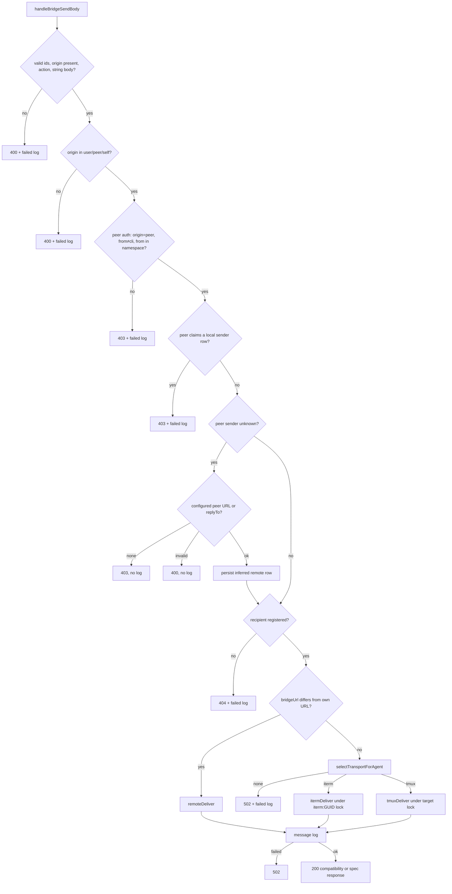

```js
function itermDeliver(recipient, content, itermGuid) {
    const guid = itermGuid || recipient.itermGuid;
    const lockKey = `iterm:${guid}`;
    return withTargetLock(lockKey, () => deliverITerm2Input({ target: guid, content, backend: recipient.backend, submit: true }));
}
```
*src/a2a-server.mjs:105-109*

[`handleBridgeSendBody()`][ref-4007] is the single delivery core behind both `/api/a2a/send` and `/message:send`. It normalizes an absent action to `message`, rejects peer claims that use a non-peer origin, the reserved sender `cli`, an id outside the peer namespace, or a sender id already registered as local. An unknown peer sender becomes an inferred `remote` row (`tmuxTarget` `<from>:0.0`) whose URL is the authenticated peer's configured URL or, failing that, the request `replyTo`; this lets a recipient reply to a previously unseen federated actor without separate registration choreography. Validation, unknown-recipient, transport-selection, and delivery outcomes are written to the message log, but the two inferred-row failures (no peer URL, invalid URL) return without a log entry, and the inferred row is persisted without clearing the runtime snapshot cache.

[`shouldRemoteDeliver()`][ref-4014] compares canonical URLs rather than checking `kind`: transport locality is decided by a `bridgeUrl` that differs from the bridge's own `A2A_PUBLIC_URL`/`config.url`, so an operator-created `local` row with a callback URL, which is how the Dot adapter registers, is still forwarded over HTTP. [`remoteDeliver()`][ref-4015] posts the body with the normalized action to `<bridgeUrl>/api/a2a/send`, attaches `Authorization: Bearer <key>` only when [`peerKeyForUrl()`][ref-4036] finds a configured peer whose canonical URL equals the target, times out after 5,000 ms, and never rejects. Success depends on the parsed response's `success` field rather than HTTP status alone, and a non-JSON reply is reported as a failure carrying the status code.

```js
function computeSettleMs(byteLength) {
    const kib = byteLength <= 0 ? 0 : Math.ceil(byteLength / SERVER_BODY_BYTES_PER_KIB);
    const scaled = PASTE_SETTLE_FLOOR_MS + kib * PASTE_SETTLE_PER_KB_MS;
    return Math.max(0, Math.min(PASTE_SETTLE_CEILING_MS, scaled));
}
```
*src/a2a-server.mjs:458-462*

Local delivery is serialized per destination by [`withTargetLock()`][ref-4016]: tmux deliveries lock on the exact `tmuxTarget`, and [`itermDeliver()`][ref-4024] locks on `iterm:<GUID>`. The lock exists because [`deliverOnce()`][ref-4025] awaits sleeps between `load-buffer`, `paste-buffer -p -d`, and `send-keys`; without it, two concurrent sends to one pane would interleave pastes and submit keys, while different targets still proceed in parallel. The bridge path settles for [`computeSettleMs()`][ref-4026], passes the registered `tmuxTarget` to `-t` without the `=` exact-match prefix, treats a failed `capture-pane` in [`pasteStillUnsubmitted()`][ref-4034] as submitted, and answers exhausted retries with one final submit key and `ok: true` without a warning field. The bridge therefore reports success to HTTP callers in cases where the CLI raw path reports uncertainty; [Terminal Transport System](#terminal-transport-system-tmux-delivery) owns the comparison between the two tmux paths.

<a id="bridge-server-and-registry-a2a-protocol-façade"></a>
### A2A protocol façade

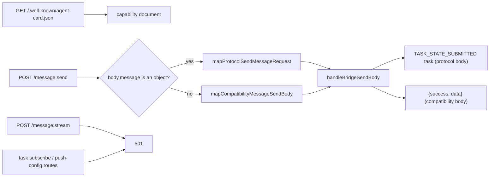

| Spec input | Mapping | Default |
| --- | --- | --- |
| `message.messageId` | Required, nonempty | none (400) |
| `message.role` | Must equal `ROLE_USER` | none (400) |
| `metadata.to` or `message.metadata.to` | Recipient id | none (400) |
| `from`, `origin`, `source`, `action`, `replyTo` | Request metadata, then message metadata | `a2a-client`, `user`, `api`, `message`, none |
| `message.parts[]` | Exactly one of `text`/`raw`/`url`/`data` per part; `text` verbatim, `data` JSON-stringified, joined with `\n` | `raw`/`url` rejected (400) |

[`handleSpecRoute()`][ref-4008] exposes only capabilities the bridge implements, and [`buildAgentCard()`][ref-4027] advertises one `http+json` interface at `A2A_PUBLIC_URL`/`config.url`, or at the bind host and port when no public URL exists, with `discovery`, `registration`, and `messaging` capabilities. [`negotiateA2AVersion()`][ref-4009] requires `Major.Minor` with major `1`, defaults an absent `A2A-Version` header to `1.0`, and answers a malformed or unsupported version with 400 `VersionNotSupportedError` and `supportedVersions: ["1.0"]`; the check applies to the agent card and both 501 routes as well as to `/message:send`. Streaming and task push/subscription routes return structured 501 errors rather than pretending support.

[`mapProtocolSendMessageRequest()`][ref-4028] defaults `origin` to `user`, so a peer credential must set `origin: "peer"` in metadata or receive 403 from the shared core. A body without a `message` object falls through [`mapCompatibilityMessageSendBody()`][ref-4029], which forwards only `to`, `from`, `origin`, `body`, `action`, and `replyTo`; `source`, `mood`, and `priority` therefore do not reach the envelope on that path, whereas `/api/a2a/send` passes the raw body to [`wrapEnvelope()`][ref-4023]. The successful protocol response from [`buildSpecAckTask()`][ref-4030] is a `TASK_STATE_SUBMITTED` task whose history contains the incoming message and whose `metadata.delivery` records bytes and routing; it acknowledges bridge acceptance and delivery, not downstream agent completion.

<a id="bridge-server-and-registry-implementation-boundaries"></a>
### Implementation boundaries

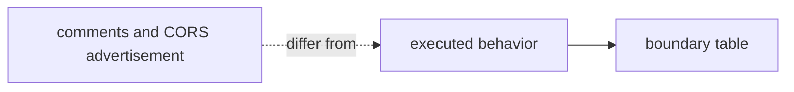

| Property | Executed behavior | Evidence |
| --- | --- | --- |
| CORS methods | `Access-Control-Allow-Methods` advertises `GET,POST,DELETE,OPTIONS`, while capability-route matching also recognizes `PUT` and `PATCH` | [`CORS_ALLOW_METHODS`][ref-4035], [`isSpecFacingRoute()`][ref-4041] |
| CORS headers | Allowed request headers are `Content-Type`, `Authorization`, `A2A-Version`; `x-a2a-registration-owner` is not listed, so preflighted browser deletes cannot present an owner | [`CORS_ALLOW_HEADERS`][ref-4042] |
| Bind host | The listener binds `activeHost()`, which `A2A_HOST` or `config.host` may set to a non-loopback address, although the origin-gate comment states the bridge binds `127.0.0.1` only | [`server.listen`][ref-4039], [`handleRequest()`][ref-4005] |
| Registry readability | `GET /api/a2a/agents` and `runtime-snapshot` accept any authenticated class, so a peer credential reads every row, including `backendEnv`, `startupPrompt`, and `installToken` | [`handleA2ARoutes()`][ref-4006] |
| Peer deletion | A peer may delete any id inside its namespace without a `kind` check, while registration forbids a peer from overwriting a `local` row | [`handleA2ARoutes()`][ref-4006] |
| Unauthenticated health | `/health` reports the registration count and whether any credential is configured | [`handleRequest()`][ref-4005] |

These properties are current implementation behavior, not documented guarantees. The registry-readability and peer-deletion rows matter most for federation: a peer key authorizes routing within its namespace but also exposes launch metadata of local agents, so operators who share peer keys across trust domains share that metadata as well.

See [Message Framing and Identity](#message-framing-and-identity) for envelope rendering, [Terminal Transport System](#terminal-transport-system) for transport selection, and [ChatGPT Dot Adapter](#chatgpt-dot-adapter) for the owned callback registration.

## ChatGPT Dot Adapter

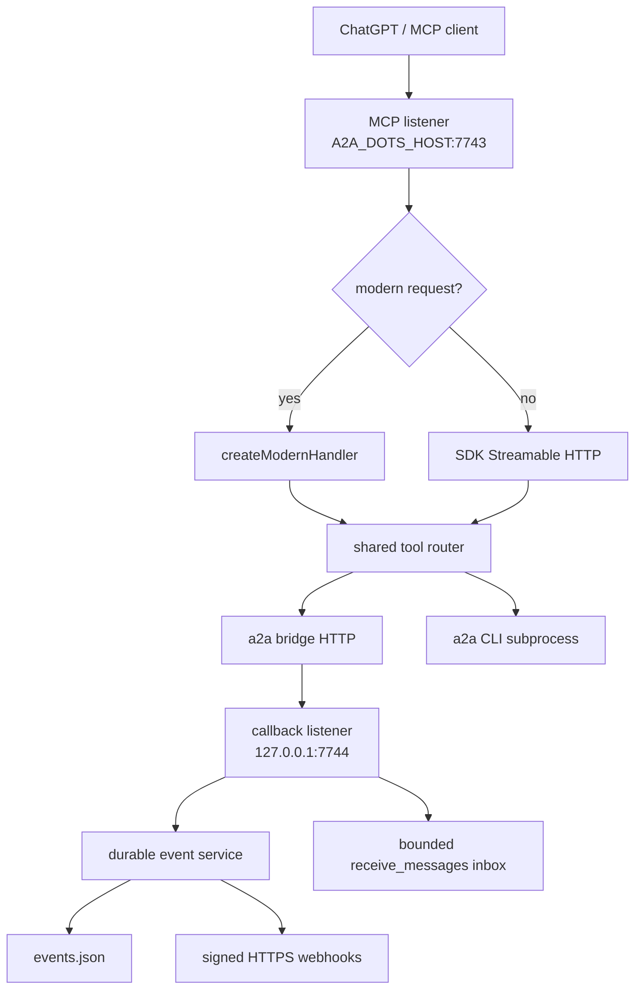

[`src/a2a-dots.mjs`][ref-4101] is the `a2a-dots` executable: a long-lived adapter that lets an MCP client such as ChatGPT act as the a2a peer `dot`. It runs two HTTP listeners, a Streamable MCP endpoint for tool clients and a callback endpoint registered as the `dot` row's `bridgeUrl`, so a reply addressed to `dot` arrives over HTTP instead of a terminal. One tool router serves both the legacy initialize-era and the stateless `2026-07-28` MCP eras, and an optional event service adds signed webhook delivery without changing the inbox contract. Separating the MCP and callback origins keeps the client-facing listener from ever becoming the bridge's delivery target, which configuration enforces by rejecting a callback URL with the MCP listener's origin.

- [Module inventory and configuration](#chatgpt-dot-adapter-module-inventory-and-configuration)
- [Registration and tools](#chatgpt-dot-adapter-registration-and-tools)
- [Callback inbox](#chatgpt-dot-adapter-callback-inbox)
- [Modern MCP](#chatgpt-dot-adapter-modern-mcp)
- [Durable events and webhooks](#chatgpt-dot-adapter-durable-events-and-webhooks)
- [Security boundaries](#chatgpt-dot-adapter-security-boundaries)

<a id="chatgpt-dot-adapter-module-inventory-and-configuration"></a>
### Module inventory and configuration

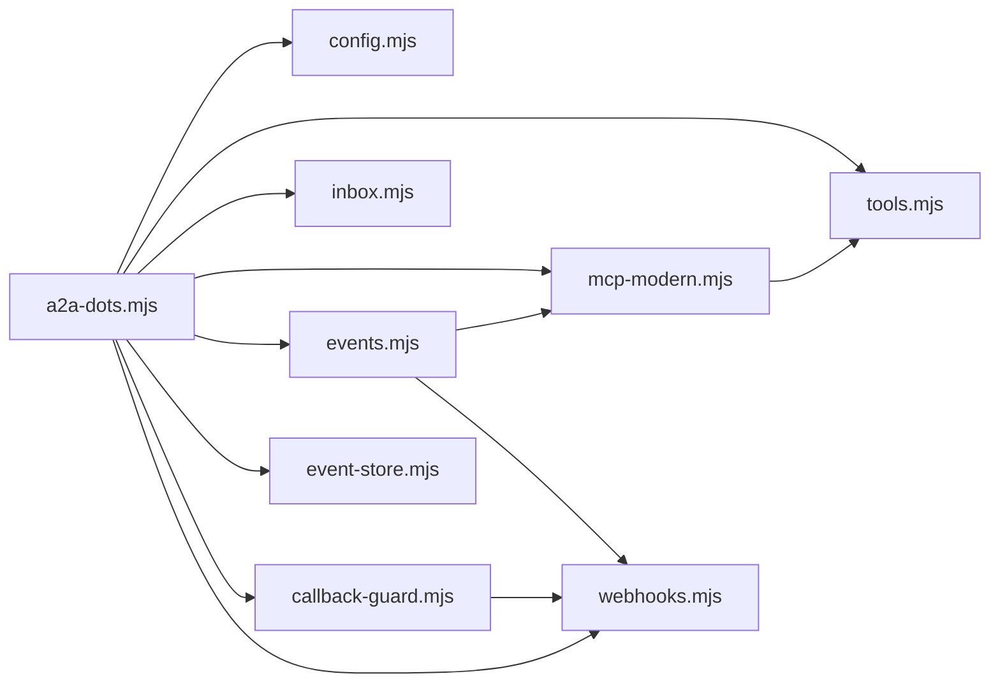

| Module | Important symbols | Responsibility |
| --- | --- | --- |
| [`src/a2a-dots.mjs`][ref-4101] | [`reconcileRegistration()`][ref-4110], [`sendMessage()`][ref-4111], [`runCli()`][ref-4112], [`acceptedRecord()`][ref-4113], [`serveLegacyMcp()`][ref-4135], [`shutdown()`][ref-4114] | Process composition, both listeners, bridge client |
| [`src/dots/config.mjs`][ref-4102] | [`dotsConfig()`][ref-4115], [`eventsConfig()`][ref-4116], [`agentId()`][ref-4145] | Strict environment normalization |
| [`src/dots/tools.mjs`][ref-4103] | [`TOOL_DEFINITIONS`][ref-4117], [`createToolRouter()`][ref-4118], [`startAgentArgs()`][ref-4139] | One tool implementation for both MCP eras |
| [`src/dots/inbox.mjs`][ref-4104] | [`createInbox()`][ref-4119] | Bounded generation-cursor reply buffer |
| [`src/dots/mcp-modern.mjs`][ref-4105] | [`PROTOCOL_VERSION`][ref-4148], [`RpcError`][ref-4121], [`isModernRequest()`][ref-4131], [`validateProtocolHeaders()`][ref-4132], [`createModernHandler()`][ref-4120] | Stateless MCP `2026-07-28` dispatch |
| [`src/dots/events.mjs`][ref-4106] | [`eventDefinitions()`][ref-4141], [`subscriptionIdFor()`][ref-4140], [`createEventService()`][ref-4122] | Event semantics and delivery scheduler |
| [`src/dots/event-store.mjs`][ref-4107] | [`EventStateError`][ref-4123], [`redactSubscription()`][ref-4146], [`createEventStore()`][ref-4124] | Atomic single-file journal, outbox, and subscriptions |
| [`src/dots/webhooks.mjs`][ref-4108] | [`parseSigningSecret()`][ref-4127], [`sign()`][ref-4126], [`signingHeaders()`][ref-4125], [`constantTimeEquals()`][ref-4142] | Standard Webhooks wire contract |
| [`src/dots/callback-guard.mjs`][ref-4109] | [`addressReason()`][ref-4129], [`parseCallbackUrl()`][ref-4130], [`createCallbackGuard()`][ref-4128] | SSRF-resistant callback verification and delivery |

| Environment variable | Default | Effect |
| --- | --- | --- |
| `A2A_DOTS_HOST` | `127.0.0.1` | MCP listener bind host; must be a bare hostname or IP |
| `A2A_DOTS_PORT` | `7743` | MCP listener port (1–65535) |
| `A2A_DOTS_CALLBACK_PORT` | `7744` | Callback listener port on fixed host `127.0.0.1`; must differ from the MCP port |
| `A2A_DOTS_MCP_PATH` | `/mcp` | MCP route; absolute, no `?`, `#`, or whitespace, and not `/health` |
| `A2A_DOTS_CALLBACK_URL` | `http://127.0.0.1:<callback port>` | URL registered as the `dot` row's `bridgeUrl`; HTTP(S), no credentials, query, or fragment, and not the MCP origin |
| `A2A_BRIDGE` | `http://127.0.0.1:7742` | Bridge base URL |
| `A2A_KEY` | empty | Bearer credential sent to the bridge |
| `A2A_DOTS_AGENT_ID` | `dot` | Registered agent id |
| `A2A_DOTS_BIN` | `a2a` | CLI executable for lifecycle tools |
| `A2A_DOTS_MAX_INBOX` | `1000` | Retained inbox messages |
| `A2A_DOTS_REQUEST_TIMEOUT_MS` | `2000` (max 60,000) | Per-request bridge timeout; shutdown deadline adds 1,000 ms |
| `A2A_DOTS_RECONCILE_MS` | `2000` (max 60,000) | Base registration reconcile interval |
| `A2A_DOTS_EVENTS_KEY` | empty (events disabled) | Bearer key for event methods and, when set, for tool calls; minimum 16 characters |
| `A2A_DOTS_EVENTS_PRINCIPAL` | `chatgpt` | Principal recorded on subscriptions |
| `A2A_DOTS_STATE_DIR` | `~/.a2a/dots` | Directory holding `events.json` |
| `A2A_DOTS_CALLBACK_KEY` | empty | Bearer key required on the callback route when set |
| `A2A_DOTS_ALLOWED_ORIGINS` | the MCP listener origin | Comma-separated `Origin` allowlist for the modern path |
| `A2A_DOTS_EVENTS_TTL_MS` | `86400000` | Default subscription lifetime |
| `A2A_DOTS_EVENTS_MIN_TTL_MS` | `60000` | Floor applied to requested lifetimes |
| `A2A_DOTS_EVENTS_MAX_TTL_MS` | the default TTL | Ceiling applied to requested lifetimes |
| `A2A_DOTS_EVENTS_ALLOW_UNBOUNDED_TTL` | off | `1` lets `ttlMs: null` create a subscription without expiry |
| `A2A_DOTS_EVENTS_VERIFICATION_TTL_MS` | `3600000` | Validity of a callback verification and of a retiring secret |
| `A2A_DOTS_EVENTS_MAX_ATTEMPTS` | `5` (max 20) | Delivery attempts before terminal failure |
| `A2A_DOTS_EVENTS_RETRY_BASE_MS` | `1000` | Exponential retry base |
| `A2A_DOTS_EVENTS_RETRY_MAX_MS` | `30000` | Retry delay ceiling |
| `A2A_DOTS_EVENTS_DEADLINE_MS` | `5000` | Single deadline for DNS, connect, and response per callback exchange |
| `A2A_DOTS_EVENTS_MAX_JOURNAL` | `500` | Retained journal records |

[`dotsConfig()`][ref-4115] parses every numeric value with a strict positive-integer reader that throws on junk such as `7743junk` or `0`, and module evaluation calls it before either listener binds, so an invalid environment exits with status 1 instead of serving a half-configured adapter. This is the opposite policy from the bridge's paste tuning, which falls back silently; the adapter fails closed because several of its values are security parameters.

| Listener | Method and path | Status codes |
| --- | --- | --- |
| MCP | `POST <mcpPath>`, modern request | 200 result; 400, 401, 403, 404, 500 per [`errorResponse()`][ref-4152]; 413 over 1 MiB |
| MCP | `POST <mcpPath>`, legacy request | SDK Streamable HTTP response |
| MCP | `GET`/`DELETE <mcpPath>` | SDK legacy handling |
| MCP | `GET /health` | 200 ready, 503 starting/degraded/stopping |
| MCP | anything else | 404 |
| Callback | `POST /api/a2a/send` | 200, 400, 401, 404, 413, 503 |
| Callback | anything else | 404 |

<a id="chatgpt-dot-adapter-registration-and-tools"></a>
### Registration and tools

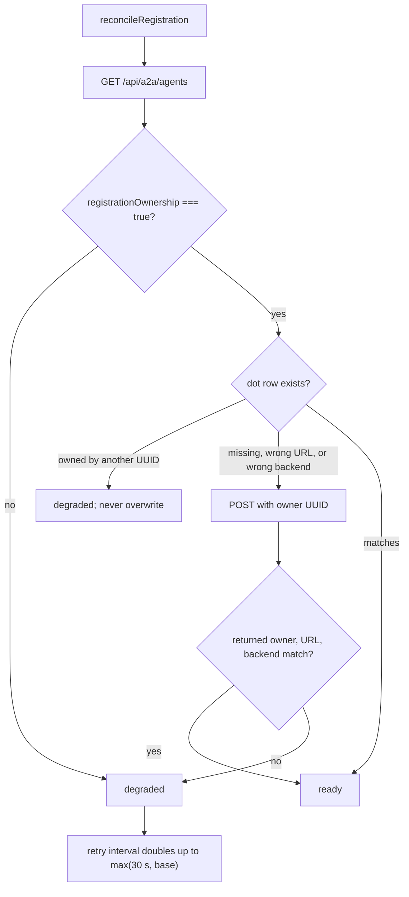

[`reconcileRegistration()`][ref-4110] runs on a self-rescheduling loop, on every `/health` request, and before every tool that reads inventory or starts work, sharing one in-flight promise across callers. It refuses to proceed unless [`bridgeAgents()`][ref-4136] reports `registrationOwnership: true`, because an older bridge would accept the registration but not enforce instance ownership. [`registerDot()`][ref-4137] sends `backend: "mcp"`, the callback URL, and a per-process `randomUUID()` owner; a row owned by another UUID is reported as degraded rather than replaced, and a row with this owner but a drifted URL or backend is repaired. The owner UUID is never persisted, so a crashed adapter cannot hand its route to a successor; [`unregisterDot()`][ref-4138] deletes with `x-a2a-registration-owner` during [`shutdown()`][ref-4114] whenever a registration was attempted, including one whose response was lost.

| Tool | Required | Optional | Backing operation | Validation |
| --- | --- | --- | --- | --- |
| `send_message` | `to`, `text` | `action` ∈ `message`/`reply`/`ask` | Bridge `POST /api/a2a/send` with `from=<dot id>`, `origin=peer`, `source=chatgpt-dot` | Recipient must be in reconciled inventory; nonempty text |
| `list_agents` | none | none | Reconciled bridge inventory | No arguments accepted |
| `get_agent` | `agent` | none | Reconciled bridge inventory | Agent id syntax; must be registered |
| `receive_messages` | none | `after` (cursor string) | Inbox read | Cursor syntax; see [Callback inbox](#chatgpt-dot-adapter-callback-inbox) |
| `start_team` | `team` | none | `a2a start --require-team <team>` | Nonempty, no leading `-`, no control characters |
| `start_agent` | `agent` | `backend` ∈ `claude`/`codex`/`gemini`/`cursor-agent`; `prompt`; `skills[]`; `cohort`; `cwd`; `interactive` | `a2a start <agent> [--<backend>] [--prompt P] [--skill S]… [--cohort C] [--no-yolo]` | Not the dot id; prompt nonempty without NUL; skills safe single segments; cohort is an agent id; `cwd` absolute existing directory |
| `stop_agent` | `agent` | none | `a2a kill --agent <agent>` | Not the dot id; must be registered |
| `peek_agent` | `agent` | `lines` integer 1–2000, default 30 | `a2a peek <agent> --lines=N` | Must be registered |

[`createToolRouter()`][ref-4118] rejects unknown tools and any argument field outside the tool's allowlist before invoking a dependency, and [`runCli()`][ref-4112] passes argv arrays to `spawn` without a shell, returning stdout, else stderr, else `ok` on exit 0. [`agentId()`][ref-4145] requires the first character to be alphanumeric or `_`, so no id or cohort can start with `-` and be parsed as a CLI option; prompt text travels as the argument after `--prompt`, which the tests show arriving intact even when it begins with `--`. `start_team` uses `--require-team` and `stop_agent` uses `--agent` so that an MCP client naming a team cannot fall back to a group or single-agent launch, or expand a kill to a whole team; see [Team Specifications and Backend Translation](#team-specifications-and-backend-translation) and [Agent Lifecycle](#agent-lifecycle).

<a id="chatgpt-dot-adapter-callback-inbox"></a>
### Callback inbox

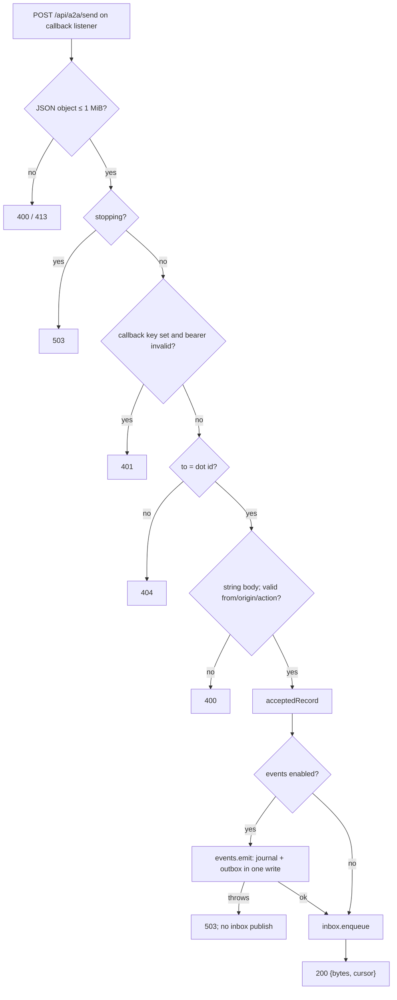

```js
        const accepted = acceptedRecord(body);
        // Emitted from the real accepted path. The event is persisted before this
        // request is acknowledged and before the message is published to the
        // inbox: a failed persist is NOT acknowledged, because returning 200 would
        // drop the message while telling the bridge it was accepted, and
        // publishing first would leave a visible message the adapter refused.
        if (events) {
            try {
                events.emit(accepted, {
                    // from/origin are what the caller claimed. This route does not
                    // independently authenticate a peer identity, and the bridge does not
                    // attach authenticated provenance, so the payload says so plainly
                    // rather than implying a verified sender.
                    senderClaimed: true,
                    bridgeAuthenticated,
                    transport: "a2a-bridge-callback"
                });
            } catch ( error ) {
                const reason = error instanceof Error ? error.message : String(error);
                process.stderr.write(`a2a-dots event persist failed: ${reason}\n`);
                return sendJson(res, 503, { success: false, error: `event state not persisted: ${reason}` });
            }
        }
        // Durable commit succeeded (or events are disabled); publish to the inbox.
        const message = inbox.enqueue(accepted);
        return sendJson(res, 200, { success: true, data: { bytes: Buffer.byteLength(body.body, "utf8"), cursor: message.cursor } });
```
*src/a2a-dots.mjs:379-404*

The [`callbackServer`][ref-4143] treats persistence, visibility, and acknowledgement as one ordering invariant. [`acceptedRecord()`][ref-4113] assigns an adapter-owned `a2amsg_<uuid>` id and acceptance time and carries `replyTo`, `source`, `teamId`, and `taskId` only when the sender supplied them; when events are enabled the durable write must succeed before [`createInbox()`][ref-4119] publishes the record or HTTP returns 200. The ordering prevents both acknowledged loss and inbox messages the durable service refused, and the 200 body's `bytes` field satisfies the bridge's [`remoteDeliver()`][ref-4015] success contract.

The callback route authenticates its caller only when `A2A_DOTS_CALLBACK_KEY` is set, and the bridge sends a bearer token on that hop only when `config.peers` contains an entry whose canonical URL equals the callback URL. Enabling callback authentication therefore requires the operator to configure both sides with the same key; the event provenance field `bridgeAuthenticated` reports whether that check ran, and `senderClaimed: true` states that `from` and `origin` are never independently verified here.

| Inbox read input | Outcome |
| --- | --- |
| absent | Entire retained window; `reset:false`, `gap:false` |
| `<this generation>:<n>` with `n` ≤ last sequence | Messages after `n`; `gap:true` when messages after `n` were already evicted |
| `<other generation UUID>:<n>` | `reset:true`; entire retained window |
| decimal legacy cursor | `reset:true`; entire retained window |
| `<this generation>:<n>` with `n` beyond last sequence | Error `cursor is ahead of this inbox` |
| any other string | Error `invalid inbox cursor` |

Inbox cursors use `<generation UUID>:<sequence>` and every read returns `generation`, `cursor`, and `oldestCursor`. These explicit states let clients distinguish adapter restart from bounded-buffer loss. When events are enabled, startup replays the durable journal's retained window into a fresh inbox with `restored: true` and the original `receivedAt`, so a restart preserves content while still reporting `reset:true` to a client holding an old-generation cursor.

<a id="chatgpt-dot-adapter-modern-mcp"></a>
### Modern MCP

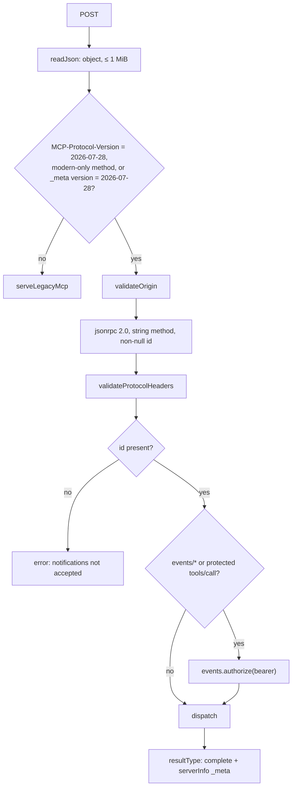

```js
        const needsAuth = AUTHORIZED_METHODS.has(body.method) ||
          (body.method === "tools/call" && deps.protectToolCalls?.() === true);
        const principal = needsAuth ? deps.events.authorize(authorization) : null;
        return { status: 200, body: { jsonrpc: "2.0", id, result: await dispatch(body, principal) } };
```
*src/dots/mcp-modern.mjs:279-282*

| Method | Authorization | Result |
| --- | --- | --- |
| `server/discover` | none; exempt from `_meta` requirements | `supportedVersions` (`2026-07-28` plus SDK initialize-era versions) and `capabilities` |
| `tools/list` | none | The eight tool definitions |
| `tools/call` | bearer `A2A_DOTS_EVENTS_KEY` when events are enabled | `content`, `structuredContent`, `isError:false`; tool failures become `isError:true` results |
| `events/list` | bearer always; 403 when events are disabled | One event definition |
| `events/subscribe` | bearer always; 403 when events are disabled | `{id, refreshBefore, cursor, truncated}` |
| `events/unsubscribe` | bearer always; 403 when events are disabled | `{}`; idempotent for absent subscriptions |
| other | n/a | `-32601`, HTTP 404 |

| Header or field | Rule | Error |
| --- | --- | --- |
| `Origin` | Absent allowed; present must be in `A2A_DOTS_ALLOWED_ORIGINS` | `-32602`, HTTP 403 |
| `MCP-Protocol-Version` | Required and equal to `2026-07-28` | `-32020` missing; `-32022` unsupported with `data.supported` |
| `params._meta["io.modelcontextprotocol/protocolVersion"]` | Required except for `server/discover`; must equal the header | `-32602` missing; `-32020` mismatch |
| `Mcp-Method` | Required; must equal body `method` | `-32020` |
| `Mcp-Name` | Required for `tools/call`, `resources/read`, `prompts/get`; must equal `params.name` or `params.uri`; `=?base64?…?=` values are decoded | `-32020` |
| `params._meta["io.modelcontextprotocol/clientCapabilities"]` | Required object except for `server/discover` | `-32602` |
| `id` | String or number; `null` rejected; absent rejected as a notification | `-32602`; `-32020` for side-effecting methods |

[`createModernHandler()`][ref-4120] answers the stateless `2026-07-28` revision directly because the installed SDK (version 1.29.0) negotiates only initialize-era versions; the modern path has no initialize handshake or session, and every result is wrapped by [`completeResult()`][ref-4153] with `resultType: "complete"` and the server info in `_meta`. Protocol errors use JSON-RPC codes with an HTTP status carried on [`RpcError`][ref-4121] (default 400), unknown tool names are protocol errors, and execution failures are tool results so the client model can act on them. Because the MCP [`server`][ref-4144] parses every POST through [`readJson()`][ref-4151], which rejects any JSON value that is not an object, JSON-RPC batch arrays are refused with 400 before era detection.

Event exposure couples the two eras through one boundary: when `A2A_DOTS_EVENTS_KEY` is set, `tools/call` requires the same bearer token on the modern path and, through [`assertToolCallAuthorized()`][ref-4134], on the legacy SDK path. This dual-era guard prevents a client from bypassing modern authorization by selecting the legacy transport. The `Origin` allowlist, by contrast, is applied only by [`validateOrigin()`][ref-4133] on the modern path; [`serveLegacyMcp()`][ref-4135] constructs the SDK transport with only `sessionIdGenerator: undefined` and passes no allowlist.

<a id="chatgpt-dot-adapter-durable-events-and-webhooks"></a>
### Durable events and webhooks

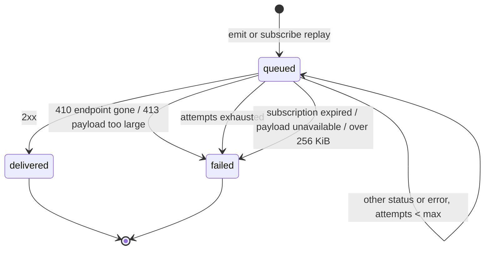

| Event element | Contract |
| --- | --- |
| Event name | `a2a.message.received`, delivery mode `webhook` only |
| Filters | `to` (must equal the dot id), `from[]` (≤ 64 agent ids), `origin[]` (≤ 3), `action[]` (≤ 3); unknown keys rejected |
| Payload `data` | `messageId`, `to`, `from`, `origin`, `action`, `text`, `receivedAt`, optional `replyTo`/`source`/`teamId`/`taskId`, `provenance {senderClaimed, bridgeAuthenticated, transport}` |
| Webhook body | `{eventId, name, timestamp, data, cursor}`; `eventId` is `msg_<uuid>` and stable across retries |
| Oversize body | Above 256 KiB, `text` is replaced by `contentTruncated`, `contentBytes`, `contentAvailableAtCursor`; still oversize fails terminally |
| Subscription id | `sub_` + first 32 hex digits of SHA-256 over principal, normalized URL, event name, canonical filters |
| Lifetime | `ttlMs` clamped to `[min, max]`; absent uses the default; `null` uses the default unless unbounded TTL is enabled |
| Replay | `params.cursor` of this store's generation enqueues retained matching events after it; a foreign generation returns `truncated:true` without replay |

| Webhook header | Value |
| --- | --- |
| `content-type` | `application/json` |
| `webhook-id` | Event id, or `msg_verification_<uuid>` for the handshake |
| `webhook-timestamp` | Unix seconds of this attempt |
| `webhook-signature` | Space-separated `v1,<base64 HMAC-SHA256(key, "<id>.<timestamp>.<body>")>`, one per active key |
| `X-MCP-Subscription-Id` | Subscription id |

```js
export function signingHeaders({ secretKey, secretKeys, id, body, subscriptionId, timestampSeconds }) {
  const keys = (secretKeys && secretKeys.length ? secretKeys : [secretKey]).filter(Boolean);
  if (!keys.length) {
    throw new Error("signing requires at least one secret key");
  }
  const stamp = Number.isSafeInteger(timestampSeconds) ? timestampSeconds : Math.floor(Date.now() / 1000);
  return {
    "content-type": "application/json",
    "webhook-id": id,
    "webhook-timestamp": String(stamp),
    "webhook-signature": keys.map((key) => sign(key, id, stamp, body)).join(" "),
    "X-MCP-Subscription-Id": subscriptionId,
  };
}
```
*src/dots/webhooks.mjs:94-107*

[`createEventService()`][ref-4122] journals every accepted message whether or not a subscription exists, so durable acceptance never depends on subscriber state and truncated payloads can point at a cursor that survives restart. Subscription requires a `whsec_`-prefixed canonical base64 secret decoding to 24–64 bytes ([`parseSigningSecret()`][ref-4127]), a callback URL accepted by the guard, and a verification handshake: a signed POST of `{type: "verification", challenge}` that must answer 2xx with the challenge echoed. A successful verification is cached for `A2A_DOTS_EVENTS_VERIFICATION_TTL_MS`, a refresh presenting a new secret keeps the previous one signing for the same window, and a subscription owned by another principal answers 403. Callback rejection and verification failure use the `-32015` code that, per the comment on `CALLBACK_ENDPOINT_ERROR` in [`src/dots/mcp-modern.mjs`][ref-4105], the ChatGPT MCP Events guide requires for callback endpoint failures.

A single drain loop delivers queued rows; retries back off as `min(base × 2^(attempts−1), max)`, and each drain is bounded to `2 × maxAttempts + 2` passes so a stuck destination cannot pin the loop. Subscriptions are not removed on expiry: [`createEventService()`][ref-4122] skips expired subscriptions when matching new events and fails their queued rows with `subscription expired`. Startup calls `drain()` after both listeners bind, so rows queued by a previous process resume without a new message.

```js
      const next = { ...state, sequence, journal, outbox };
      // Write first; only adopt the new state once it is durable, so a failed
      // flush leaves the store exactly as it was and the caller can refuse to
      // acknowledge the message.
      atomicWrite(path, next);
      state.sequence = sequence;
      state.journal = journal;
      state.outbox = outbox;
      evictTerminalDeliveries();
      return record;
```
*src/dots/event-store.mjs:184-193*

| `events.json` key | Content | Limit and policy |
| --- | --- | --- |
| `version` | `1` | Any other value is refused |
| `generation` | UUID issuing every event cursor | Missing value is refused; a fresh store is written immediately so restart reuses it |
| `sequence` | Last issued event sequence | Cursor `<generation>:<sequence>` |
| `subscriptions` | Map of id → `{id, principal, url, name, arguments, argumentsCanonical, secret, previousSecret?, previousSecretUntil?, refreshBefore, verifiedUntil, createdAt, updatedAt}` | Secrets stored in the file; outward views pass through [`redactSubscription()`][ref-4146] |
| `journal` | Array of `{eventId, name, timestamp, data, sequence, cursor}` | Last `A2A_DOTS_EVENTS_MAX_JOURNAL` records (default 500) |
| `outbox` | Map of `<subscriptionId>:<eventId>` → `{key, subscriptionId, eventId, cursor, event, state, attempts, nextAttemptAt, lastStatus, lastError, terminalReason, deliveryAcknowledgedAt}` | 5,000 rows; only settled rows are evicted, queued rows never |

[`createEventStore()`][ref-4124] keeps the journal, outbox, and subscriptions in one `events.json` file under `A2A_DOTS_STATE_DIR`, written through a temporary file, `rename`, and `chmod 0600`, with the directory created as `0700`. One file means one write commits a journal append together with its outbox rows, so a crash cannot leave an event journaled without its deliveries. A missing file is a fresh start, but an unreadable, unparsable, non-object, wrong-version, or generation-less file raises [`EventStateError`][ref-4123] and is left untouched; because the store is opened at module evaluation, the adapter refuses to start rather than overwrite subscriptions and invalidate issued cursors. Registration ownership is deliberately absent from this file.

[`createCallbackGuard()`][ref-4128] requires `https:`, rejects embedded credentials and fragments, and classifies every resolved address with [`addressReason()`][ref-4129]: loopback, RFC 1918, carrier-grade NAT, link-local, documentation, benchmarking, multicast, unique-local, site-local, NAT64, Teredo, 6to4, IPv4-mapped and IPv4-compatible forms are all refused. All DNS answers must be public, the first is pinned as the connection's lookup result with `autoSelectFamily` disabled, SNI still carries the hostname, redirects are refused, responses above 64 KiB fail, and one deadline races DNS, connection, and response. Pinning closes the DNS-rebinding window between validation and connection, and racing the deadline instead of relying on abort covers resolvers that ignore abort signals.

<a id="chatgpt-dot-adapter-security-boundaries"></a>
### Security boundaries

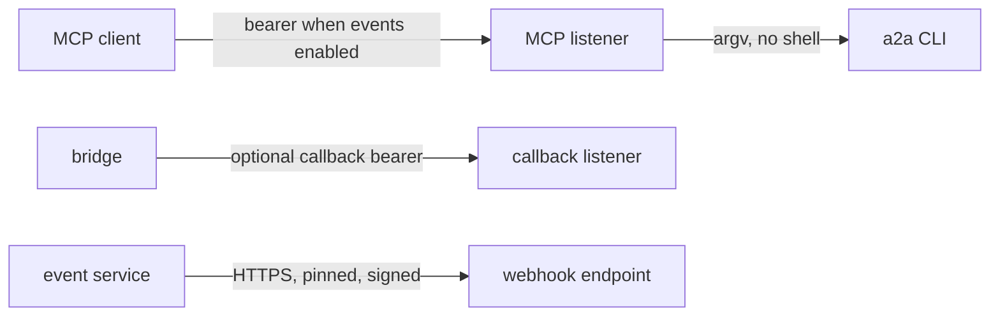

| Boundary | Mechanism | Failure prevented |
| --- | --- | --- |
| Bridge row ownership | Process UUID, owner-checked replacement, owner header on delete | Stale adapter removes or replaces a newer adapter's route |
| Tool and event authentication | `Bearer` token compared by SHA-256 digest with `timingSafeEqual` | Remote lifecycle control and subscription creation |
| Callback provenance | Optional callback bearer; `senderClaimed`/`bridgeAuthenticated` in every event | False claim of a bridge-authenticated sender |
| Callback destinations | HTTPS, all-public DNS, pinned address, no redirects, 64 KiB response cap | SSRF and DNS rebinding |
| Durable state | Atomic `0600` file in a `0700` directory, corruption fail-closed, redacted outward views | Secret disclosure and silent state loss |
| CLI invocation | Agent-id syntax without leading `-`, field allowlists, argv arrays without a shell | Shell and option injection |
| Health route | Aggregate delivery counts only from `publicSnapshot()` | Disclosure of webhook URLs, subscription ids, or secrets |

Two implementation limits are material. `A2A_DOTS_HOST` may be a non-loopback address while `A2A_DOTS_EVENTS_KEY` is empty, leaving tool calls unauthenticated even though the comments above [`assertToolCallAuthorized()`][ref-4134] and the modern handler's `protectToolCalls` describe keyless mode as loopback-only; [`dotsConfig()`][ref-4115] performs no such check. The `events` capability is omitted from `server/discover` when events are disabled, while the comment above [`eventsConfig()`][ref-4116] states that discovery still advertises it. The adapter's own credentials also require the `Bearer ` prefix, unlike the bridge and channel, which accept a raw token.

See [Bridge Server and Registry](#bridge-server-and-registry) for remote callback routing and owner enforcement.

## Claude Code Channel Adapter

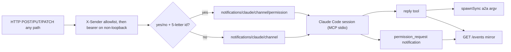

[`src/a2a-channel.mjs`][ref-4201] is the `a2a-channel` executable: an HTTP ingress listener combined with an MCP stdio server owned by Claude Code. The HTTP listener and SSE mirror run even when no stdio peer is attached, but notifications reach an agent only while Claude Code hosts the process over MCP. Its `reply` tool shells back into the normal a2a CLI, so outbound messages inherit the CLI's sender-identity and bridge delivery rules instead of a second send implementation; see [Message Framing and Identity](#message-framing-and-identity).

- [Module inventory and configuration](#claude-code-channel-adapter-module-inventory-and-configuration)
- [HTTP and stdio contracts](#claude-code-channel-adapter-http-and-stdio-contracts)
- [Reply tool and boundaries](#claude-code-channel-adapter-reply-tool-and-boundaries)

<a id="claude-code-channel-adapter-module-inventory-and-configuration"></a>
### Module inventory and configuration

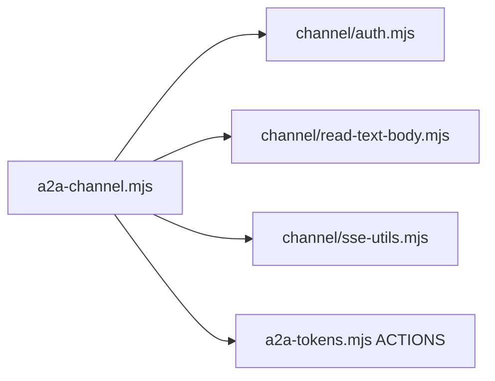

| Module | Important symbols | Responsibility |
| --- | --- | --- |
| [`src/a2a-channel.mjs`][ref-4201] | [`validatePeerId()`][ref-4205], [`RESERVED_PEER_IDS`][ref-4214], [`handleHttpRequest()`][ref-4206], [`rejectUnauthorizedEventStream()`][ref-4216], MCP [`Server`][ref-4217] | HTTP and stdio process composition |
| [`src/channel/auth.mjs`][ref-4202] | [`isLoopbackHost()`][ref-4207], [`parseAllowedSenders()`][ref-4208], [`channelStartupProblem()`][ref-4209], [`bearerToken()`][ref-4210] | Bind-time and request authentication policy |
| [`src/channel/read-text-body.mjs`][ref-4203] | [`readTextBody()`][ref-4211] | Single-settlement UTF-8 reader with a 2 MiB byte cap |
| [`src/channel/sse-utils.mjs`][ref-4204] | [`sseFrameFromText()`][ref-4212], [`broadcastSseChunk()`][ref-4213] | Injection-safe SSE framing and fan-out |

| Environment variable | Default | Effect |
| --- | --- | --- |
| `A2A_CHANNEL_HOST` | `127.0.0.1` | Bind host; anything other than `127.0.0.1`, `localhost`, or `::1` is non-loopback |
| `A2A_CHANNEL_PORT` | `8788` | Bind port; unparsable values fall back to `8788` |
| `A2A_CHANNEL_SENDERS` | empty | Comma-separated exact `X-Sender` allowlist |
| `A2A_CHANNEL_KEY` | empty | Token required on non-loopback binds for mutating requests and `/events` |
| `A2A_CHANNEL_BIN` | `a2a` | CLI executable used by `reply` |
| `A2A_CHANNEL_SSE_KEEPALIVE_MS` | `30000` | Interval of `: ping` SSE comments; non-positive or invalid values use the default |

The reply subprocess receives the channel's full environment, so `A2A_BRIDGE`, `A2A_KEY`, and `A2A_AGENT_ID` set for the Claude Code session govern which bridge the reply reaches and which sender it claims. [`channelStartupProblem()`][ref-4209] refuses a non-loopback bind unless both a nonempty sender allowlist and a channel key exist, exiting with status 1 before `listen`; on loopback with an empty allowlist the process starts but answers every mutating request with 403.

<a id="claude-code-channel-adapter-http-and-stdio-contracts"></a>
### HTTP and stdio contracts

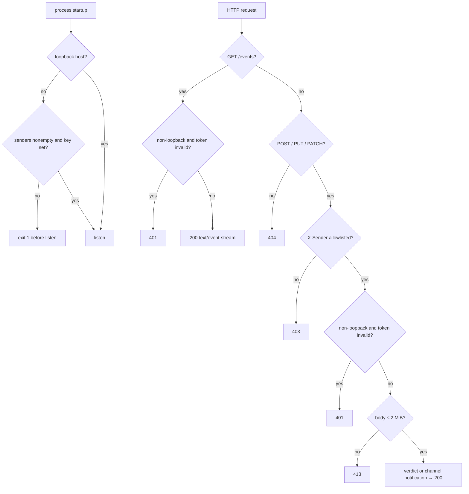

| Method | Path | Gate | Response |
| --- | --- | --- | --- |
| `GET` | `/events` | Token on non-loopback binds | 200 SSE stream starting with `: connected`; 401 |
| `POST`, `PUT`, `PATCH` | any | `X-Sender` allowlist, then token on non-loopback binds | 200 `verdict recorded` or `ok`; 400; 401; 403; 413 |
| any other | any | none | 404 |
| any | any | handler exception | 500 |

| MCP surface | Direction | Shape |
| --- | --- | --- |
| Capabilities | server → client | `experimental["claude/channel"]`, `experimental["claude/channel/permission"]`, `tools` |
| `notifications/claude/channel` | server → client | `{content: body, meta: {chat_id, path, method}}` |
| `notifications/claude/channel/permission` | server → client | `{request_id: lowercase id, behavior: "allow" \| "deny"}` |
| `notifications/claude/channel/permission_request` | client → server | `{request_id, tool_name, description, input_preview}`; mirrored to SSE as a reply prompt |
| `reply` tool | client → server | `{peer, text, action?}`; see [Reply tool and boundaries](#claude-code-channel-adapter-reply-tool-and-boundaries) |

[`handleHttpRequest()`][ref-4206] checks exact `X-Sender` membership before token authentication, then reads at most 2 MiB through [`readTextBody()`][ref-4211]. A body matching [`PERMISSION_REPLY_RE`][ref-4215] (`y`, `yes`, `n`, or `no`, case-insensitive, then a five-letter id drawn from `a`–`z` without `l`) becomes a permission verdict; every other body becomes a channel notification whose `chat_id` is a per-process counter and whose `path` and `method` metadata are sanitized to `[A-Za-z0-9_/:-]` (200 characters) and uppercase letters. Sanitizing metadata matters because Claude Code renders it as attributes of a `<channel>` tag, while the body content is passed through unchanged as the notification payload.

[`sseFrameFromText()`][ref-4212] prefixes every source line with `data: ` and splits on CR, LF, and CRLF, so mirrored text cannot inject SSE fields or terminate an event early. [`broadcastSseChunk()`][ref-4213] removes a listener whose write throws without interrupting the rest, and the keepalive interval writes `: ping` comments that force write errors on half-open sockets. The [`httpServer`][ref-4220] disables `requestTimeout` and `headersTimeout` so long-lived SSE streams survive, which also removes Node's default timeouts from the mutating routes.

<a id="claude-code-channel-adapter-reply-tool-and-boundaries"></a>
### Reply tool and boundaries

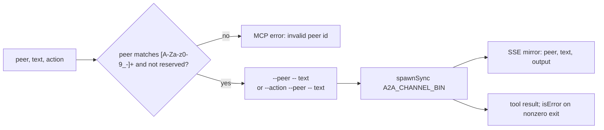

```js
    // SECURITY: "--" terminates flag parsing (a2a-argv.mjs treats everything
    // after it as positional). Without it, reply text starting with "--" is
    // parsed as CLI flags — e.g. "--from=cli ..." overrides sender identity
    // and "--help" aborts the send.
    const argv = action === "message" ? [ `--${peer}`, "--", text ] : [ `--${action}`, `--${peer}`, "--", text ];
```
*src/a2a-channel.mjs:128-132*

[`validatePeerId()`][ref-4205] rejects ids outside `[A-Za-z0-9_-]+` and, case-insensitively, every name in [`RESERVED_PEER_IDS`][ref-4214]: the exported [`ACTIONS`][ref-4219] (`message`, `reply`, `ask`, `write`) plus `content`, `from`, `origin`, `to`, `command`, `stdin`, `no-submit`, and `submit`, which mirror private flag sets in the CLI parser. A peer named `from` would otherwise turn `--from <text>` into a sender override. The `--` terminator places reply text after flag parsing, and an unrecognized `action` silently becomes `message`; the subprocess runs without a shell, and its stdout or stderr is returned to Claude Code and mirrored to `/events`.

| Boundary | Executed behavior | Consequence |
| --- | --- | --- |
| Token format | [`bearerToken()`][ref-4210] accepts `Bearer <key>` or a raw `Authorization` value | Operator-facing text says bearer, but either form passes, as on the bridge |
| Token comparison | `bearerToken(req) === CHANNEL_KEY` / `!==` | Plain string comparison, unlike the digest-based comparison in the bridge and Dot adapter |
| Loopback SSE | `/events` is unauthenticated on loopback binds | Any local process can read mirrored reply text and permission prompts |
| Reply execution | `spawnSync` | The HTTP listener and SSE fan-out are blocked for the duration of each CLI invocation |
| Sender gate | Exact `X-Sender` header membership | The header is an identifier, not a credential; on loopback it is the only gate |

These boundaries follow from the channel's scope as a local developer bridge: the sender allowlist routes and labels webhook traffic, while the startup rule ties any network exposure to the presence of a key. Deployments that bind beyond loopback depend on that key alone, so its plain comparison and the raw-token acceptance are the properties to review first.

See [Message Framing and Identity](#message-framing-and-identity) for the CLI grammar protected by peer-name validation and [Bridge Server and Registry](#bridge-server-and-registry) for the delivery path a reply takes.

<!-- refs -->

[ref-4001]: ../src/a2a-server.mjs
[ref-4002]: ../src/server/auth.mjs
[ref-4003]: ../src/server/read-json-body.mjs
[ref-4004]: ../src/server/envelope.mjs
[ref-4005]: ../src/a2a-server.mjs#L1023
[ref-4006]: ../src/a2a-server.mjs#L854
[ref-4007]: ../src/a2a-server.mjs#L747
[ref-4008]: ../src/a2a-server.mjs#L339
[ref-4009]: ../src/a2a-server.mjs#L301
[ref-4010]: ../src/a2a-server.mjs#L493
[ref-4011]: ../src/a2a-server.mjs#L825
[ref-4012]: ../src/server/read-json-body.mjs#L12
[ref-4013]: ../src/a2a-server.mjs#L165
[ref-4014]: ../src/a2a-server.mjs#L268
[ref-4015]: ../src/a2a-server.mjs#L586
[ref-4016]: ../src/a2a-server.mjs#L400
[ref-4017]: ../src/a2a-server.mjs#L136
[ref-4018]: ../src/server/auth.mjs#L48
[ref-4019]: ../src/server/auth.mjs#L15
[ref-4020]: ../src/server/auth.mjs#L29
[ref-4021]: ../src/server/auth.mjs#L80
[ref-4022]: ../src/server/auth.mjs#L3
[ref-4023]: ../src/server/envelope.mjs#L82
[ref-4024]: ../src/a2a-server.mjs#L105
[ref-4025]: ../src/a2a-server.mjs#L513
[ref-4026]: ../src/a2a-server.mjs#L458
[ref-4027]: ../src/a2a-server.mjs#L289
[ref-4028]: ../src/a2a-server.mjs#L708
[ref-4029]: ../src/a2a-server.mjs#L728
[ref-4030]: ../src/a2a-server.mjs#L736
[ref-4031]: ../src/a2a-server.mjs#L230
[ref-4032]: ../src/a2a-server.mjs#L234
[ref-4033]: ../src/a2a-server.mjs#L573
[ref-4034]: ../src/a2a-server.mjs#L473
[ref-4035]: ../src/a2a-server.mjs#L60
[ref-4036]: ../src/a2a-config.mjs#L753
[ref-4037]: ../src/a2a-config.mjs#L531
[ref-4038]: ../tests/a2a-server-vitest.test.mjs
[ref-4039]: ../src/a2a-server.mjs#L1116
[ref-4040]: ../package.json
[ref-4041]: ../src/a2a-server.mjs#L318
[ref-4042]: ../src/a2a-server.mjs#L61
[ref-4044]: ../src/a2a-server.mjs#L126
[ref-4101]: ../src/a2a-dots.mjs
[ref-4102]: ../src/dots/config.mjs
[ref-4103]: ../src/dots/tools.mjs
[ref-4104]: ../src/dots/inbox.mjs
[ref-4105]: ../src/dots/mcp-modern.mjs
[ref-4106]: ../src/dots/events.mjs
[ref-4107]: ../src/dots/event-store.mjs
[ref-4108]: ../src/dots/webhooks.mjs
[ref-4109]: ../src/dots/callback-guard.mjs
[ref-4110]: ../src/a2a-dots.mjs#L157
[ref-4111]: ../src/a2a-dots.mjs#L215
[ref-4112]: ../src/a2a-dots.mjs#L235
[ref-4113]: ../src/a2a-dots.mjs#L269
[ref-4114]: ../src/a2a-dots.mjs#L480
[ref-4115]: ../src/dots/config.mjs#L33
[ref-4116]: ../src/dots/config.mjs#L69
[ref-4117]: ../src/dots/tools.mjs#L13
[ref-4118]: ../src/dots/tools.mjs#L160
[ref-4119]: ../src/dots/inbox.mjs#L3
[ref-4120]: ../src/dots/mcp-modern.mjs#L186
[ref-4121]: ../src/dots/mcp-modern.mjs#L43
[ref-4122]: ../src/dots/events.mjs#L143
[ref-4123]: ../src/dots/event-store.mjs#L15
[ref-4124]: ../src/dots/event-store.mjs#L81
[ref-4125]: ../src/dots/webhooks.mjs#L94
[ref-4126]: ../src/dots/webhooks.mjs#L57
[ref-4127]: ../src/dots/webhooks.mjs#L15
[ref-4128]: ../src/dots/callback-guard.mjs#L168
[ref-4129]: ../src/dots/callback-guard.mjs#L138
[ref-4130]: ../src/dots/callback-guard.mjs#L149
[ref-4131]: ../src/dots/mcp-modern.mjs#L98
[ref-4132]: ../src/dots/mcp-modern.mjs#L113
[ref-4133]: ../src/dots/mcp-modern.mjs#L88
[ref-4134]: ../src/a2a-dots.mjs#L300
[ref-4135]: ../src/a2a-dots.mjs#L412
[ref-4136]: ../src/a2a-dots.mjs#L146
[ref-4137]: ../src/a2a-dots.mjs#L128
[ref-4138]: ../src/a2a-dots.mjs#L135
[ref-4139]: ../src/dots/tools.mjs#L97
[ref-4140]: ../src/dots/events.mjs#L24
[ref-4141]: ../src/dots/events.mjs#L31
[ref-4142]: ../src/dots/webhooks.mjs#L66
[ref-4143]: ../src/a2a-dots.mjs#L348
[ref-4144]: ../src/a2a-dots.mjs#L423
[ref-4145]: ../src/dots/config.mjs#L18
[ref-4146]: ../src/dots/event-store.mjs#L33
[ref-4147]: ../tests/a2a-dots-vitest.test.mjs
[ref-4148]: ../src/dots/mcp-modern.mjs#L13
[ref-4151]: ../src/a2a-dots.mjs#L80
[ref-4152]: ../src/dots/mcp-modern.mjs#L52
[ref-4153]: ../src/dots/mcp-modern.mjs#L167
[ref-4201]: ../src/a2a-channel.mjs
[ref-4202]: ../src/channel/auth.mjs
[ref-4203]: ../src/channel/read-text-body.mjs
[ref-4204]: ../src/channel/sse-utils.mjs
[ref-4205]: ../src/a2a-channel.mjs#L71
[ref-4206]: ../src/a2a-channel.mjs#L153
[ref-4207]: ../src/channel/auth.mjs#L1
[ref-4208]: ../src/channel/auth.mjs#L5
[ref-4209]: ../src/channel/auth.mjs#L14
[ref-4210]: ../src/channel/auth.mjs#L24
[ref-4211]: ../src/channel/read-text-body.mjs#L12
[ref-4212]: ../src/channel/sse-utils.mjs#L5
[ref-4213]: ../src/channel/sse-utils.mjs#L21
[ref-4214]: ../src/a2a-channel.mjs#L69
[ref-4215]: ../src/a2a-channel.mjs#L83
[ref-4216]: ../src/a2a-channel.mjs#L85
[ref-4217]: ../src/a2a-channel.mjs#L97
[ref-4219]: ../src/a2a-tokens.mjs#L3
[ref-4220]: ../src/a2a-channel.mjs#L221
