## Runtime State and Observability

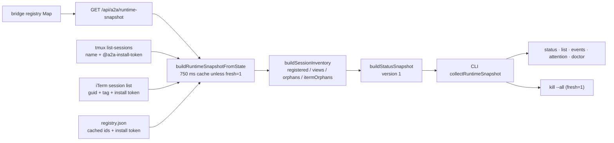

The runtime model reconciles four evidence sources whose failure modes differ: bridge registrations (lost on bridge restart), tmux sessions (named by users, prefix-matched by tmux unless exact), iTerm sessions (GUIDs that die with the session), and the cached id list in `registry.json`. [`src/cli/session-inventory.mjs`][ref-5001] classifies that evidence without I/O, [`src/runtime/runtime-snapshot.mjs`][ref-5007] collects it and owns caching, [`src/cli/status-snapshot.mjs`][ref-5012] turns the inventory into a versioned health model, and [`src/cli/redesign-runtime.mjs`][ref-5016] projects that model into events, attention, layout, reload, and doctor views. One shared definition of "live" serves the status line, both dashboards, `a2a list`, and destructive cleanup, so an operator view can never disagree with what `kill --all` is about to remove.

- [Module inventory and command surface](#runtime-state-and-observability-module-inventory)
- [Session classification](#runtime-state-and-observability-session-classification)
- [Snapshot collection and caching](#runtime-state-and-observability-snapshot-collection-and-caching)
- [Status snapshot schema](#runtime-state-and-observability-status-snapshot-schema)
- [Events, attention, and doctor projections](#runtime-state-and-observability-events-attention-and-doctor)
- [Reload and layout plans](#runtime-state-and-observability-reload-and-layout-plans)

<a id="runtime-state-and-observability-module-inventory"></a>
### Module inventory and command surface

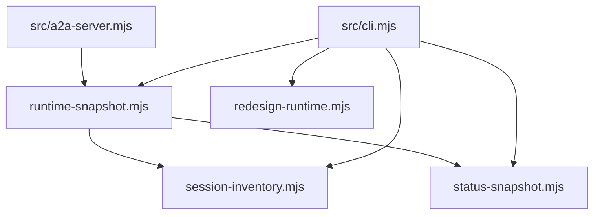

| Module | Important symbols | Responsibility | Live-graph fan-in |
| --- | --- | --- | ---: |
| [`src/cli/session-inventory.mjs`][ref-5001] | [`buildSessionInventory()`][ref-5002], [`makeItermOwnershipChecker()`][ref-5003], [`findOwnedItermSessionByName()`][ref-5004], [`isViewName()`][ref-5005], [`baseFromView()`][ref-5006] | Pure registered/view/orphan classification | 4 |
| [`src/runtime/runtime-snapshot.mjs`][ref-5007] | [`buildRuntimeSnapshotFromState()`][ref-5008], [`clearRuntimeSnapshotCache()`][ref-5009], [`tmuxListSessions()`][ref-5010] | Evidence collection, request coalescing, [`RUNTIME_SNAPSHOT_CACHE_TTL_MS`][ref-5011] = 750 | 3 |
| [`src/cli/status-snapshot.mjs`][ref-5012] | [`buildStatusSnapshot()`][ref-5013], [`formatStatusSegment()`][ref-5014], [`formatHumanStatus()`][ref-5015] | Versioned health, counts, attention list | 4 |
| [`src/cli/redesign-runtime.mjs`][ref-5016] | [`buildRuntimeEvents()`][ref-5017], [`buildAttentionStack()`][ref-5018], [`buildLayoutPlan()`][ref-5019], [`buildReloadPlan()`][ref-5020], [`buildDoctorSnapshot()`][ref-5021], [`maskConfig()`][ref-5022], [`buildPmWorkerSpec()`][ref-5023] | Pure projections and plans over a status snapshot or team spec | 2 |

Fan-in counts come from the live codebase-map graph (`/api/graph`, 2026-10-13); the bridge and the CLI are the only runtime importers of the snapshot module, and every other dependent is a test.

| Command | Handler | Flags | Output |
| --- | --- | --- | --- |
| `a2a status` | [`cmdStatus()`][ref-5026] | `--json` or `--segment` (mutually exclusive), `--peers` or `--no-peers` (mutually exclusive) | [`formatHumanStatus()`][ref-5015], raw snapshot JSON, or [`formatStatusSegment()`][ref-5014] |
| `a2a list` | [`cmdList()`][ref-5032] | `--json`, `--no-peers`; peers are fetched unless `--no-peers` | Cohort-grouped table or a stable JSON shape with `registered`, `views`, `orphans`, `itermOrphans`, `peers` |
| `a2a events` | [`cmdEvents()`][ref-5027] | `--json`, `--peers`, `--no-peers` | Numbered event lines or event JSON |
| `a2a attention` | [`cmdAttention()`][ref-5028] | `--json`, `--peers`, `--no-peers` | `attention: clear` or `#N severity kind id: message` |
| `a2a doctor` | [`cmdDoctor()`][ref-5029] | `--json`, `--peers`, `--no-peers`, `--bundle DIR` | Summary, doctor JSON, or `doctor.json` + `status.json` + `events.json` written into `DIR` |
| `a2a reload TEAM` | [`cmdReload()`][ref-5030] | `--dry-run`, `--json` | Reload plan; applies safe additions only when the plan is safe |
| `a2a layout TEAM` | [`cmdLayout()`][ref-5031] | `--json` | Layout validation plan |

`status`, `list`, `events`, `attention`, and `doctor` all obtain their data from one function, [`collectRuntimeSnapshot()`][ref-5025] in [`src/cli.mjs`][ref-5091], so their counts cannot drift from each other. `status` defaults to local-only and requires `--peers` for federation fan-out, while `list` defaults to fan-out; the asymmetry keeps the tmux status-line segment cheap while making the interactive roster complete. Flag parsing for the event, attention, doctor, reload, and layout handlers goes through [`parseSimpleCommandArgs()`][ref-5101], which rejects unknown flags and values on boolean flags rather than forwarding them.

<a id="runtime-state-and-observability-session-classification"></a>
### Session classification

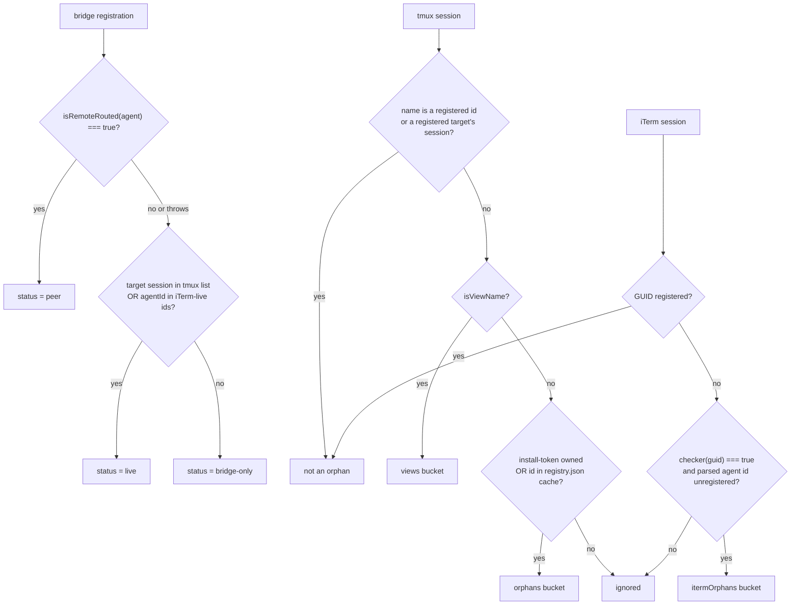

| Bucket | Entry fields | Membership rule |
| --- | --- | --- |
| `registered` | `agentId`, `tmuxTarget` (default `${agentId}:0.0`), `itermGuid` (trimmed or `null`), `cwd`, `description`, `cohort`, `status`, `yolo` (boolean or `null`), `backend` | Every bridge row with a non-empty string `agentId` |
| `views` | `session`, `baseName`, `known`, `sources` (`description` and/or `tmux`), `existsInTmux` | `${cohort}-view` implied by a `team:`/`group:` description, plus every tmux session accepted by [`isViewName()`][ref-5005] (`a2a-view` or a non-empty prefix followed by `-view`) |
| `orphans` | session name | Unregistered, non-view tmux session that is install-token owned or present in the cached id list |
| `itermOrphans` | `guid`, `name` | Unregistered iTerm GUID that the synchronous ownership checker proves owned and whose parsed agent id is not registered |

[`buildSessionInventory()`][ref-5002] receives every external fact as an argument and every predicate as an injected callback whose default answers "not owned", so a pure test that omits a callback can never manufacture an orphan. Predicate exceptions are caught and treated as `false`, which keeps a pathological tmux state from turning into a destructive false positive. Registration matching uses the session parsed out of the recorded `tmuxTarget`, not only the agent id, so a manually registered pane inside a differently named session counts as registered and is never offered for cleanup. A view's base is `known` when a registered description implied it, when `isGroup(base)` succeeds, or when a team spec resolves for it; the description source short-circuits filesystem team discovery.

`src/cli/session-inventory.mjs:262-282`

```js
  // Orphans: tmux sessions that a2a owns but the bridge no longer knows
  // about. The install token is the durable ownership proof; the cache is
  // only a compatibility hint for older sessions that pre-date the token.
  const orphans = [];
  for (const s of tmuxSessions) {
    if (registeredIds.has(s) || registeredTmuxSessions.has(s)) {
      continue;
    }
    if (isViewName(s)) {
      continue;
    }
    let owned;
    try {
      owned = isA2aOwnedSession(s) === true;
    } catch {
      owned = false;
    }
    if (owned || cached.has(s)) {
      orphans.push(s);
    }
  }
```

The tmux orphan rule is an **OR**: install-token ownership or membership in the cached `registry.json` id list each suffices. The cache branch keeps cleanup working for sessions created before the `@a2a-install-token` marker existed, at the cost of being weaker than token proof, because the cache is a list of names and names are user-reusable. The module header comment (lines 11–16) still states that both conditions are required; the executable rule and three tests contradict it: [`legacy cache still marks a tmux session as an orphan without an install token`][ref-5084], [`install-token ownership marks an orphan even when the cache missed it`][ref-5085], and [`install-token and legacy cache both classify unregistered tmux sessions as orphans`][ref-5086]. The weaker bucket is contained at the destructive boundary: `kill --all` re-intersects it with token ownership (see [Teardown and orphan sweep](#agent-lifecycle-teardown-and-orphan-sweep)).

[`makeItermOwnershipChecker()`][ref-5003] exists because the classifier compares the checker's result with `=== true`; wiring the asynchronous transport-probe ownership query directly would return a Promise, which is never `=== true`, and would silently disable iTerm orphan detection. The factory closes over one already-fetched session list, keeps the first token seen per GUID, and refuses ownership outright when the expected install token is empty. [`findOwnedItermSessionByName()`][ref-5004] is the name-keyed counterpart used by spawn, kill, and attach: it matches the durable agent tag or decorated title only when the install token also matches, so an unrelated user window titled with an agent name cannot be adopted.

<a id="runtime-state-and-observability-snapshot-collection-and-caching"></a>
### Snapshot collection and caching

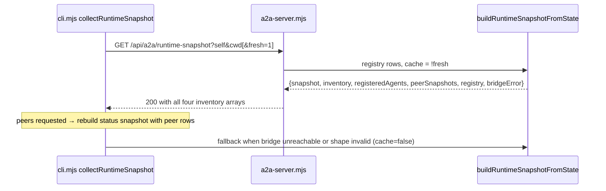

`src/a2a-server.mjs:986-993`

```js
    if (method === HTTP_METHOD_GET && path === API_PATH_A2A_RUNTIME_SNAPSHOT) {
        const url = new URL(req.url, `${URL_PROTOCOL_HTTP}//${HOST}:${PORT}`);
        const self = url.searchParams.get("self") || null;
        const launchCwd = url.searchParams.get("cwd") || process.cwd();
        const fresh = url.searchParams.get("fresh") === "1";
        ok(res, await buildRuntimeSnapshotFromState({ registeredAgents: Array.from(registry.values()), self, launchCwd, cache: !fresh, isRemoteRouted: shouldRemoteDeliver }));
        return true;
    }
```

The 750 ms cache lives in the **bridge process** ([`src/a2a-server.mjs`][ref-5024]), the only long-lived caller. [`collectRuntimeSnapshot()`][ref-5025] asks the bridge route first and accepts the response only when `inventory.registered`, `views`, `orphans`, `itermOrphans`, `snapshot.attention`, and `registeredAgents` are all arrays; any other answer, including a connection error, falls back to a local, uncached [`buildRuntimeSnapshotFromState()`][ref-5008] call with an explicit bridge error. The fallback keeps a newer CLI working against an older or stopped bridge and still reports local tmux state when the registry is unreachable. Peer fan-out happens in the CLI, not the bridge, so the bridge cache never holds peer credentials or remote latency; when peers are requested, the CLI rebuilds the status snapshot from the bridge's inventory plus its own peer rows.

`src/runtime/runtime-snapshot.mjs:185-205`

```js
  if (cacheKey && pendingRuntimeSnapshots.has(cacheKey)) {
    return await pendingRuntimeSnapshots.get(cacheKey);
  }
  const generation = runtimeSnapshotGeneration;
  const pending = collectRuntimeSnapshot({
    registeredAgents, peerSnapshots, bridgeError, self, launchCwd, registry, isRemoteRouted,
  }).then((value) => {
    if (cacheKey && generation === runtimeSnapshotGeneration) {
      runtimeSnapshotCache = {
        key: cacheKey,
        expires: Date.now() + RUNTIME_SNAPSHOT_CACHE_TTL_MS,
        value,
      };
    }
    return value;
  }).finally(() => {
    // A reset may already have started a newer collection under the same key.
    if (cacheKey && pendingRuntimeSnapshots.get(cacheKey) === pending) {
      pendingRuntimeSnapshots.delete(cacheKey);
    }
  });
```

| Cache property | Mechanism | Failure prevented |
| --- | --- | --- |
| Identity | `JSON.stringify` of registered rows, peer snapshots, bridge error, `self`, `launchCwd`, and the freshly read `registry.json` state | A metadata-only change (cwd, argv, peer error) serving a stale snapshot |
| Excluded from key | `isRemoteRouted` predicate | None; the predicate is constant per process |
| Coalescing | One pending promise per key in `pendingRuntimeSnapshots` | Twenty concurrent status requests spawning twenty tmux and iTerm probes |
| Invalidation | [`clearRuntimeSnapshotCache()`][ref-5009] increments a generation, clears pending entries, drops the cached value | A collection started before a registration change repopulating the cache afterward |
| Invalidation triggers | Successful register and actual unregister in the bridge (`src/a2a-server.mjs:942`, `:975`) | A just-registered agent appearing as missing for up to 750 ms |
| Bypass | `fresh=1` query, sent by `kill --all` | Destructive cleanup acting on a snapshot up to 750 ms old |

One collection reads tmux sessions and install tokens in a single `list-sessions -F "#{session_name}\t#{@a2a-install-token}"` call and lists iTerm sessions once; iTerm liveness for a registration is then a set lookup by parsed agent tag or by stored GUID. Reading the GUID as well as the tag keeps an iTerm window live after the operator retitles it. An iTerm listing failure degrades to an empty list rather than an error, so an unavailable optional sidecar leaves tmux-backed state intact.

<a id="runtime-state-and-observability-status-snapshot-schema"></a>
### Status snapshot schema

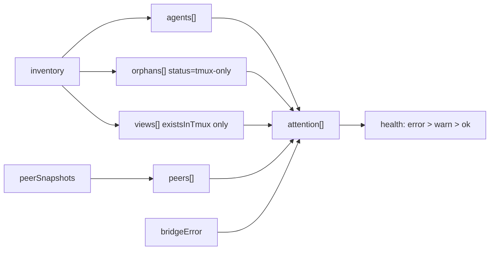

| Field | Type | Derivation |
| --- | --- | --- |
| `version` | number | Constant `1` |
| `generatedAt` | ISO string | Argument `Date` or string, else now |
| `self` | string or `null` | Caller's agent id or tmux session |
| `health` | `ok` · `warn` · `error` | `error` when a bridge error exists; else `warn` when any attention item exists; else `ok` |
| `bridge.ok`, `bridge.error` | boolean, string or `null` | Presence of the bridge error string |
| `counts.localAgents` | number | `registered.length + orphans.length` |
| `counts.registeredAgents` | number | Registered rows, including `peer`-status rows |
| `counts.liveAgents`, `counts.bridgeOnlyAgents`, `counts.tmuxOnlyAgents` | number | Status tallies; tmux-only equals orphan count |
| `counts.views`, `counts.knownViews`, `counts.unknownViews` | number | Views that exist in tmux, split by `known` |
| `counts.peers`, `counts.remoteAgents`, `counts.peerErrors` | number | Peer snapshot tallies |
| `counts.attention` | number | Attention item count |
| `agents[]` | objects | `id`, `status` (default `unknown`), `cohort`, `backend`, `yolo`, `cwd`, `tmuxTarget`, `self` |
| `orphans[]` | objects | `id`, `status: "tmux-only"`, `self` |
| `views[]` | objects | `session`, `baseName`, `known`, `existsInTmux`, `sources`, `self`; views absent from tmux are dropped |
| `peers[]` | objects | `peer`, `url`, `error`, `agents[]` of `id`, `status` (default `peer`), `cwd`, `description`, `yolo` |
| `attention[]` | objects | `kind`, `id`, `message`, optional `severity` |

| Attention kind | Source | Severity field |
| --- | --- | --- |
| `bridge-error` | Bridge or registry read error | `error` |
| `bridge-only` | Registered row without a live tmux or iTerm surface | absent (projected as `warn`) |
| `tmux-only` | Orphan tmux session | absent (projected as `warn`) |
| `unknown-view` | View session that exists but matches no team or group | absent (projected as `warn`) |
| `peer-error` | Peer fetch failure | `warn` |

`src/cli/status-snapshot.mjs:17-25`

```js
function healthFor({ bridgeError, attentionCount }) {
  if (bridgeError) {
    return "error";
  }
  if (attentionCount > 0) {
    return "warn";
  }
  return "ok";
}
```

[`buildStatusSnapshot()`][ref-5013] is the single place where inventory becomes operator meaning: every non-healthy fact becomes exactly one attention item, and health is a pure function of those items. [`formatStatusSegment()`][ref-5014] emits nothing for an empty healthy install, `a2a bridge down` on bridge error, and otherwise `a2a LIVE/LOCAL[ Nv][ !N]`, which lets a tmux `status-right` call `a2a status --segment` without rendering noise on machines that run no agents.

Three projection properties follow directly from the source and are visible to consumers. `itermOrphans` are not projected into the status snapshot, its counts, or attention, although `a2a list` shows them as `iterm-only` rows and `kill --all` closes them. A registered row whose status is `peer` (a remote-routed registration such as the Dot callback) is counted in `localAgents` and `registeredAgents`, so the segment denominator includes it. Such a row is not `live`, so it also produces a `warn`-severity `agent.status` event.

<a id="runtime-state-and-observability-events-attention-and-doctor"></a>
### Events, attention, and doctor projections

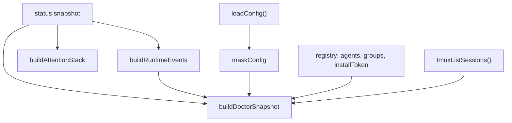

| Event type | Severity | Target | Emitted per |
| --- | --- | --- | --- |
| `bridge.ok` | `info` | `bridge` | Snapshot without bridge error |
| `bridge.error` | `error` | `bridge` | Snapshot with bridge error |
| `agent.status` | `info` when `live`, else `warn` | agent id | Registered agent; `data` carries `cohort`, `backend`, `yolo` |
| `agent.tmux-only` | `warn` | session name | Orphan tmux session |
| `view.status` | `info` when known, else `warn` | view session | Existing view; `data` carries `baseName`, `sources` |
| `peer.status` | `info` | peer name | Reachable peer |
| `peer.error` | `warn` | peer name | Unreachable or rejected peer |
| `attention` | item severity or `warn` | item id | Attention item; `data.kind` carries its kind |

[`buildRuntimeEvents()`][ref-5017] is not an event log; it is a deterministic re-description of one snapshot, numbered from `sequence: 1` and stamped with the snapshot's `generatedAt`. Determinism lets two calls on the same snapshot compare equal and lets the doctor bundle store events beside the status they were derived from. Attention facts appear twice by design (once as their domain event, once as an `attention` event) so a consumer filtering on `type` alone sees the operator queue without reconstructing it. [`buildAttentionStack()`][ref-5018] is the narrower projection the Go dashboard consumes through `a2a attention --json`: an indexed list of `index`, `kind`, `id`, `severity` (default `warn`), and `message`.

[`buildDoctorSnapshot()`][ref-5021] assembles `generatedAt`, `health`, `counts`, `paths` (`cwd`, message log, repository teams directory, bridge URL), `versions` (Node, platform, and a hard-coded `a2a` string `1.1.0` in [`cmdDoctor()`][ref-5029]), tmux session names, masked config, registry ids and groups, attention, and events. [`maskConfig()`][ref-5022] replaces every non-empty operator or peer key with `***` and leaves peer URLs intact, while the registry section reports `installTokenPresent` instead of the token; the bundle written by `--bundle DIR` is therefore shareable without exporting credentials or the ownership marker that authorizes cleanup.

<a id="runtime-state-and-observability-reload-and-layout-plans"></a>
### Reload and layout plans

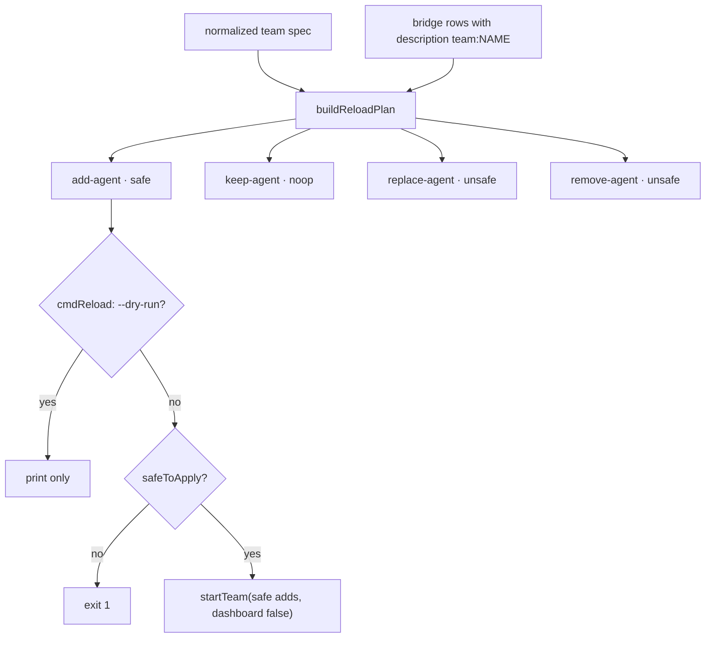

`src/cli/redesign-runtime.mjs:265-277`

```js
    const backendChanged =
      current.backend && agent.backend && current.backend !== agent.backend;
    const cwdChanged = current.cwd && agent.cwd && current.cwd !== agent.cwd;
    const yoloChanged =
      typeof current.yolo === "boolean" && current.yolo !== agent.yolo;
    if (backendChanged || cwdChanged || yoloChanged) {
      pushChange({
        action: "replace-agent",
        safety: "unsafe",
        agent: agent.id,
        detail: "backend, cwd, or yolo changed; restart explicitly",
      });
    } else {
```

[`buildReloadPlan()`][ref-5020] considers only bridge rows whose `description` is exactly `team:<name>`, so agents joined under a different cohort tag never appear as removals. Additions are the only mutation [`cmdReload()`][ref-5030] performs, because adding a session does not change any running process; replacements and removals would kill work in progress and are reported for an explicit restart. Backend and cwd differences count only when both sides are non-empty, which tolerates legacy rows without that metadata, whereas yolo counts whenever the registration carries a boolean. Because [`startTeam()`][ref-5037] registers the effective yolo after a CLI `--no-yolo` override, a team started with `--no-yolo` from a version-2 spec plans every member as `replace-agent`.

[`buildLayoutPlan()`][ref-5019] validates a nested `layout` tree (`direction` `row` or `column`, alias `flex_direction`; positive `flex`, default 1; non-empty `panes`; leaf `agent` that must name a spec agent; optional `focus` and `zoom`). It reports missing and duplicated agents and sets `valid` only when both lists are empty; without a `layout` key it synthesizes a single row of all agents. The plan is a preview: no command in [`src/cli.mjs`][ref-5091] consumes the tree to arrange tmux panes, and dashboard views use linked windows instead.

See [Agent Lifecycle](#agent-lifecycle) for the cleanup consumers of the inventory and [Dashboard and Operator Interfaces](#dashboard-and-operator-interfaces) for the roster projections.

## Agent Lifecycle

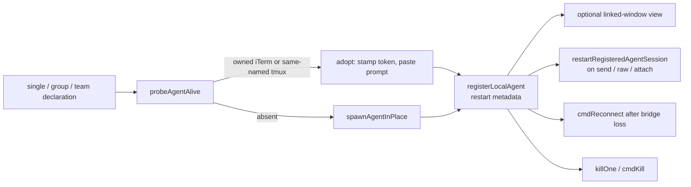

Agent lifecycle is **adopt-or-create** rather than unconditional spawning. A live session under the agent's name is re-registered without restarting its backend, while a new session receives routing environment, an install-token ownership marker, optional persona content, and enough launch metadata (`backend`, `backendCommand`, `backendArgs`, `backendEnv`, `cwd`, `startupPrompt`, `yolo`, `installToken`) for a later process to restart it from another terminal. Teardown distinguishes remote routes, dedicated sessions, and manually registered panes so that a registration never acts as ownership of an unrelated same-named terminal. [`src/cli.mjs`][ref-5091] owns every handler in this section; their dispatch is documented in [Command-Line Orchestrator](#command-line-orchestrator).

- [Lifecycle command reference](#agent-lifecycle-command-reference)
- [Launch and adoption](#agent-lifecycle-launch-and-adoption)
- [Transport-aware restart](#agent-lifecycle-transport-aware-restart)
- [Teardown and orphan sweep](#agent-lifecycle-teardown-and-orphan-sweep)
- [Reconnect, attach, and peek](#agent-lifecycle-reconnect-attach-and-peek)

### Lifecycle inventory

| Component | Important symbols | Responsibility |
| --- | --- | --- |
| Start dispatch | [`cmdStart()`][ref-5034], [`parseStartArgs()`][ref-5056] | Team → group → single selection, persona and global-mode guards |
| Single launch | [`startSingle()`][ref-5035] | One agent; optional cohort join and single-member view |
| Group launch | [`startGroup()`][ref-5036] | One agent per `.md` file in a group directory |
| Team launch | [`startTeam()`][ref-5037] | Per-agent backend, cwd, env, role, yolo from a normalized spec |
| Launch command | [`agentEnv()`][ref-5038], [`buildAgentLaunchCommand()`][ref-5039], [`preparePersonaDelivery()`][ref-5042] | Routing env, quoting, parent-session scrubbing, persona inline-or-paste choice |
| Spawn boundary | [`spawnAgentInPlace()`][ref-5040], [`probeAgentAlive()`][ref-5041] | Owned iTerm reuse, new window/tab, or tmux fallback |
| Ownership marker | [`tmuxSetInstallToken()`][ref-5054] | Session-scoped `@a2a-install-token` via `$NN` session id |
| Restart | [`restartRegisteredAgentSession()`][ref-5043], [`restartViaIterm()`][ref-5044], [`restartViaTmux()`][ref-5045], [`resolveItermRestartSession()`][ref-5058] | Restore the recorded transport and metadata |
| Kill | [`killOne()`][ref-5046], [`killGroup()`][ref-5059], [`killTeam()`][ref-5060], [`cmdKill()`][ref-5047] | Close exact surface, unregister, prune cache, sweep owned leftovers |
| Reconnect | [`cmdReconnect()`][ref-5048], [`resolveReconnectTargets()`][ref-5057], [`reconnectOwnedTmuxAgents()`][ref-5055] | Re-register surviving sessions without backend restart |
| Inspection | [`cmdAttach()`][ref-5049], [`cmdPeek()`][ref-5050] | Focus, attach, or capture the correct transport |

<a id="agent-lifecycle-command-reference"></a>
### Lifecycle command reference

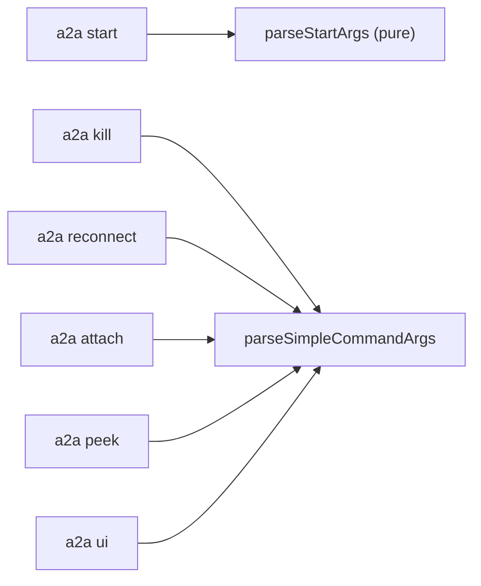

| `a2a start` argument | Effect |
| --- | --- |
| `NAME` (first positional), `--user NAME` | Agent, group, or team reference; defaults to the sanitized cwd basename |
| `--team-file PATH`, `--team PATH` | Explicit spec; a missing file is a hard error; `NAME` then overrides the team runtime name |
| `--cohort NAME` | Description tag `team:NAME` (or `group:NAME` when joining a group cohort); links into an existing `NAME-view` |
| `--prompt TEXT`, `--prompt-file PATH`, `--skill NAME` | Persona text merged in source order; skills repeatable; rejected for teams and groups |
| `--dashboard`, `--layout` | Build or open the linked-window view |
| `--yolo`, `--no-yolo` | Yolo is the default; `--no-yolo` keeps backend approvals and sandboxing |
| `--global`, `--no-global` | Tri-state over `config.global`; `--url`, `--port` (1–65535), `--insecure` require global mode |
| `--require-team` | Fail instead of falling back to group or single launch |
| `--claude[=PATH]`, `--gemini`, `--codex`, `--cursor-agent` | Backend; only `--claude` accepts an executable override |
| Any other `--flag [value]`, extra positionals, everything after `--` | Forwarded to the backend argv |

| Command | Arguments and flags | Constraints |
| --- | --- | --- |
| `a2a kill` | `NAME`, `--agent NAME`, `--all` | `--agent` excludes `--all` and `NAME`; `--all` excludes `NAME`; one positional |
| `a2a reconnect` | `NAME`, `--all`, `--dashboard` / `--layout` | `--all` excludes `NAME` |
| `a2a attach` | `NAME` (optional), `--dashboard` / `--layout`, `--rebuild`, `--native-scroll` / `--cc` | Without `NAME`, the sole other registered agent is inferred; native scroll is refused inside tmux |
| `a2a peek` | `NAME` (optional), `--lines N` | `N` is a positive integer, default 30; without `NAME`, the sole other agent is inferred |
| `a2a ui` | `NAME` (required), `--rebuild` | Accepts a base reference or a literal `*-view` name |

[`parseStartArgs()`][ref-5056] lives in [`src/cli/parse-start-args.mjs`][ref-5056] because importing [`src/cli.mjs`][ref-5091] runs `main()`; its forwarding policy (an unknown flag consumes one following non-flag token) gives backend CLIs authority over their own flags without a2a enumerating them. Every other lifecycle command uses the closed [`parseSimpleCommandArgs()`][ref-5101] grammar, so a mistyped destructive flag fails rather than being read as a target.

<a id="agent-lifecycle-launch-and-adoption"></a>
### Launch and adoption

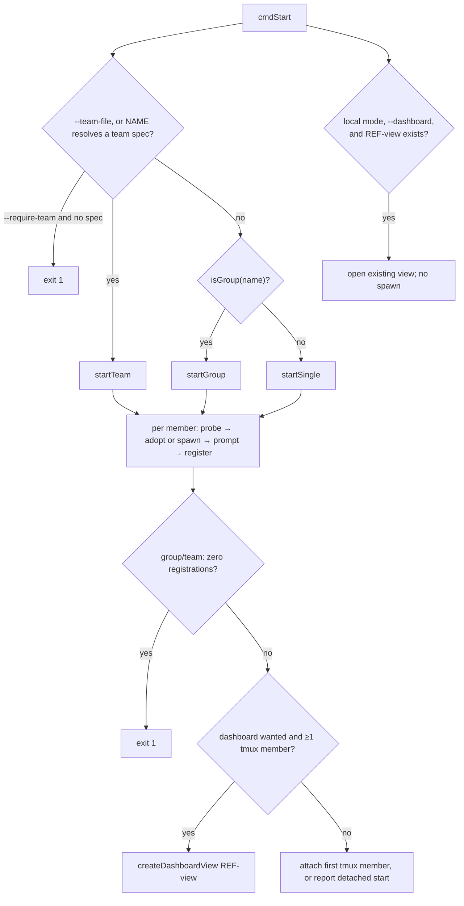

[`cmdStart()`][ref-5034] resolves a team spec before a group and a group before a single agent, rejects `--prompt`, `--prompt-file`, and `--skill` when a team or group already supplies roles, and applies global-mode prerequisites (operator key unless `--insecure`, `ngrok` binary, tunnel URL) before any terminal is created. With `--dashboard` in local mode and an existing `REF-view` session, it opens that view and spawns nothing, which makes repeated `a2a start TEAM --dashboard` an idempotent "open the cockpit" command. Group and team loops tolerate per-member failure, close only sessions they created when prompt paste or registration fails, and fail the command only when no member registers.

`src/cli.mjs:1293-1299`

```js
    if (tmuxSessionExists(name)) {
        const target = tmuxTargetForSession(name);
        if (target) {
            return { alive: true, transport: "tmux", tmuxTarget: target };
        }
    }
    return { alive: false, transport: null };
```

[`probeAgentAlive()`][ref-5041] applies different adoption evidence per transport. iTerm adoption requires an install-token-owned session matched by tag or title, whereas tmux adoption accepts **any** session with the agent's exact name. The launcher then stamps this install's token onto that session with [`tmuxSetInstallToken()`][ref-5054]. The stamp converts sessions from older installs into sweepable ones, but it also means `a2a start NAME` claims a pre-existing user tmux session named `NAME`. Adoption never changes the running backend: requested backend args are recorded with a warning, and the persona is pasted into the running process as a startup message.

`src/cli.mjs:1199-1200`

```js
    const unsets = `unset ${STALE_PARENT_SESSION_ENV_VARS.join(" ")};`;
    return `${unsets} export A2A_SESSION=1; ${exports ? `${exports} ` : ""}if command -v caffeinate >/dev/null 2>&1; then exec caffeinate -i -t 3600 ${quoted}; else exec ${quoted}; fi`;
```

[`agentEnv()`][ref-5038] copies the bridge routing variables (`A2A_BRIDGE`, `A2A_BRIDGE_PUBLIC`, `A2A_PUBLIC_URL`, `A2A_PORT`, `A2A_HOST`, `A2A_KEY`), validated spec env, and `A2A_AGENT_ID` into the recorded `backendEnv`, so a restart from a different terminal reproduces the same routes. [`buildAgentLaunchCommand()`][ref-5039] owns the shell boundary: it throws on non-string or NUL-bearing argv, single-quotes every argument, unsets the parent-session markers `CLAUDE_TUI_FIX_ACTIVE`, `CLAUDECODE`, `CLAUDE_CODE_SESSION_ID`, `CLAUDE_CODE_CHILD_SESSION`, and `CLAUDE_CODE_ENTRYPOINT`, exports `A2A_SESSION=1`, and `exec`s the backend under `caffeinate -i -t 3600` when that binary exists. The unset list exists because a Claude wrapper exits 127 when it sees its own marker, killing any agent spawned from inside a wrapped session.

[`preparePersonaDelivery()`][ref-5042] injects the persona inline (`--append-system-prompt` for Claude, `--prompt-interactive` for Gemini, a trailing positional for Codex and Cursor Agent) and measures the resulting launch command. When it exceeds `A2A_INLINE_PERSONA_COMMAND_MAX` bytes (default 1,800; `0` disables the check), the persona moves to a startup message pasted after spawn. The paste waits a settle delay of 500 ms plus 60 ms per KiB, capped at 1,500 ms, then submits up to five times while `[Pasted text #N` remains visible, as implemented in [`pasteStartupPrompt()`][ref-5066]. Moving large personas out of argv avoids shell length limits and quoting of multi-kilobyte role files.

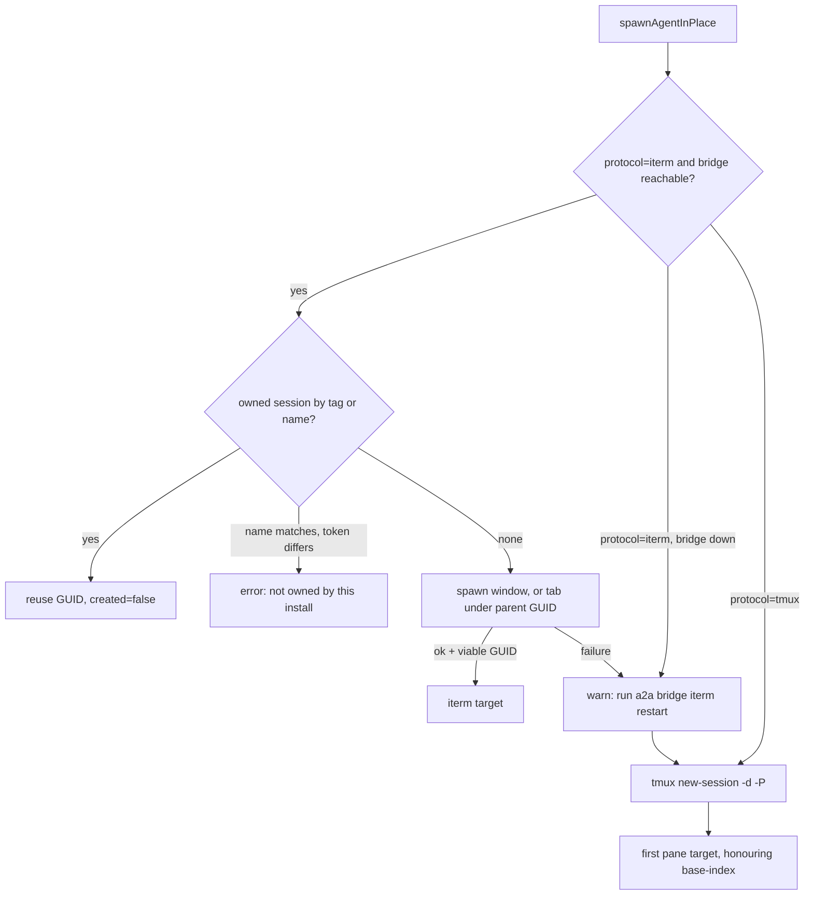

[`spawnAgentInPlace()`][ref-5040] treats iTerm as an opportunistic preference: a reachable sidecar is used, and an unavailable one degrades to tmux with an instruction rather than a failure. A same-named iTerm session owned by another install is an error rather than a fallback, because silently creating a tmux twin would leave two surfaces answering to one name. Group and team launches pass the GUID of the first iTerm-registered member as the parent so later members open as tabs in one window. Dashboards are tmux-only, so iTerm-only teams skip the view with a message.

<a id="agent-lifecycle-transport-aware-restart"></a>
### Transport-aware restart

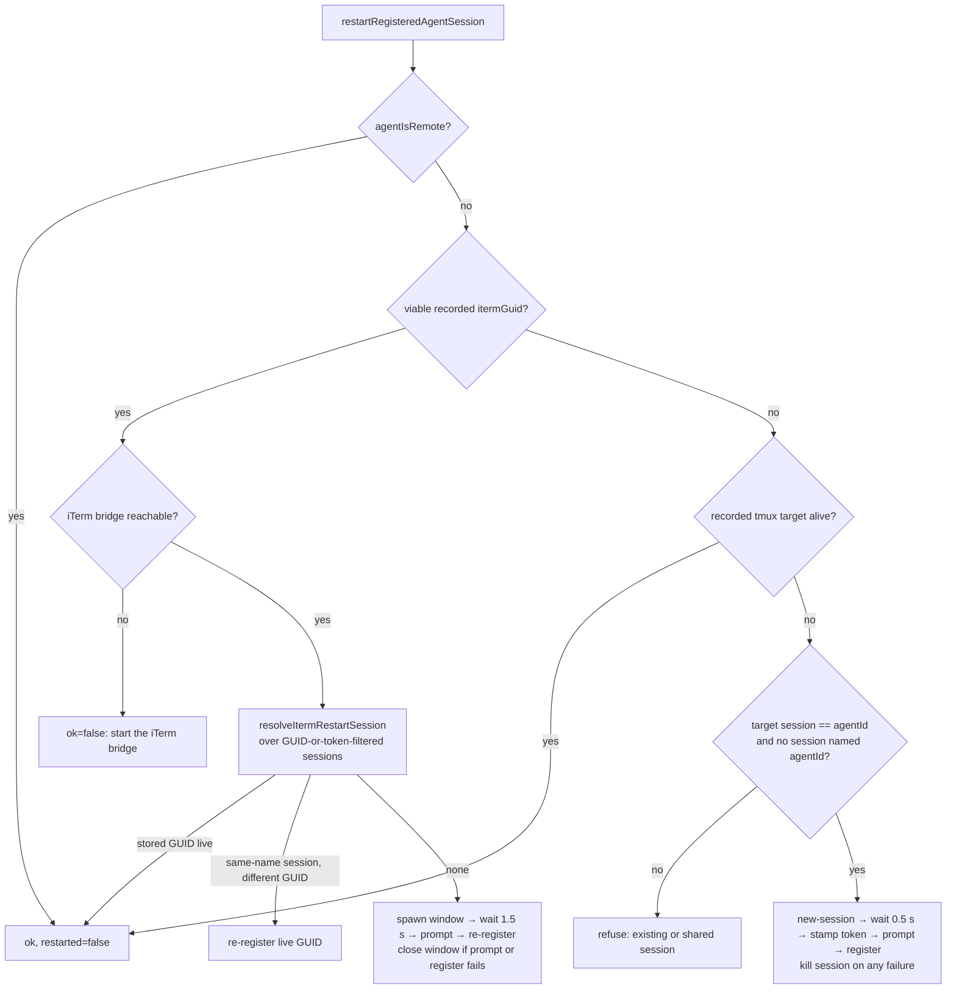

`src/cli.mjs:2282-2289`

```js
async function restartViaTmux({ agent, backend, backendCommand, backendArgs }) {
    // A manual registration can point into a shared session. Never replace that
    // session or silently redirect its missing pane to a new agent-named session.
    const recorded = agent.tmuxTarget || `${agent.agentId}:0.0`;
    const sessionName = recorded.replace(/^=/, "").split(":")[0];
    if (sessionName !== agent.agentId || tmuxSessionExists(agent.agentId)) {
        return { ok: false, restarted: false, error: `registered pane '${recorded}' is unavailable; refusing to replace an existing or shared session` };
    }
```

[`restartRegisteredAgentSession()`][ref-5043] trusts the recorded transport over fresh probes: a row with a viable GUID is restarted only through iTerm, so a sidecar outage produces an explicit failure instead of a stray tmux duplicate that would corrupt the registry. iTerm GUIDs live only as long as their session, so a changed owned GUID is written back by re-registration and onto the in-memory row that the caller keeps using. The tmux branch refuses whenever the recorded pane lives in a session not named after the agent, or when a session with the agent's name already exists; both cases mean a respawn would replace or shadow something the registration does not own. Restart runs implicitly before an envelope send to a dead local recipient, before `raw` and `command` input, and before `attach`, which makes the recorded metadata a self-healing contract rather than documentation.

<a id="agent-lifecycle-teardown-and-orphan-sweep"></a>
### Teardown and orphan sweep

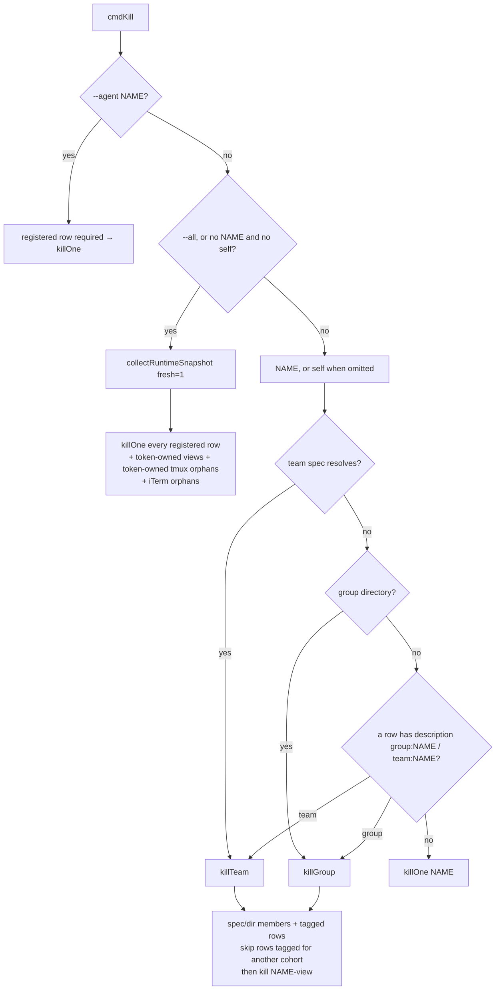

`src/cli.mjs:4339-4343`

```js
    if (hasAll || (!name && !self)) {
        const { registeredAgents, inventory: inv } = await collectRuntimeSnapshot({ fresh: true });
        const ownership = tmuxListSessionOwnership(installToken());
        const viewsToKill = inv.views.filter((v) => v.existsInTmux && ownership.ownedSessionIds.has(v.session));
        const tmuxOrphans = inv.orphans.filter((id) => ownership.ownedSessionIds.has(id));
```

| [`killOne()`][ref-5046] branch | Condition | Terminal action | Registration |
| --- | --- | --- | --- |
| Remote route | [`agentIsRemote()`][ref-5033] | None (`remote session not modified`) | Unregistered on the routing bridge |
| iTerm, sidecar down | Recorded GUID, bridge unreachable | None | **Kept**; exit 1 with a retry hint |
| iTerm | Recorded GUID live, or owned session found by name | `close` RPC; `unknown session` / `already closed` count as success | Unregistered |
| Manual pane | Registered target's session name differs from the id | `kill-pane` on that exact pane only | Unregistered |
| Dedicated session | Session named after the id | `kill-session`, then `kill-window` on every captured `window_id` still linked into views | Unregistered |
| Session gone, view link survives | No session; one token-owned window named after the id | `kill-window` on that `window_id` | Unregistered |
| Any close failure | Error from tmux or iTerm | Reported | **Kept** (`skipped`) |

[`killOne()`][ref-5046] removes the registration only after terminal cleanup succeeds or is proven unnecessary, so a failed close never orphans a running process from the routing table that could reach it. After a successful unregister it prunes the id from the cached `registry.json` list, which removes the name from the legacy orphan branch. Capturing global `window_id` values before killing a session lets teardown also remove dashboard links that would otherwise keep the agent's process alive inside a `*-view` session.

[`cmdKill()`][ref-5047] narrows `--agent` to one registered row so the Dot `stop_agent` tool can never expand a team or group name. The `--all` path asks the bridge for a **fresh** snapshot and re-intersects views and tmux orphans with current token ownership, so the cache-only orphan branch described in [Session classification](#runtime-state-and-observability-session-classification) is listed by `a2a list` but never destroyed. iTerm orphans need no second filter because their bucket already requires token proof. Team and group kills merge declared members with rows carrying the matching tag but skip any member whose live row carries a different cohort tag, protecting an agent that was reassigned to another cohort.

<a id="agent-lifecycle-reconnect-attach-and-peek"></a>
### Reconnect, attach, and peek

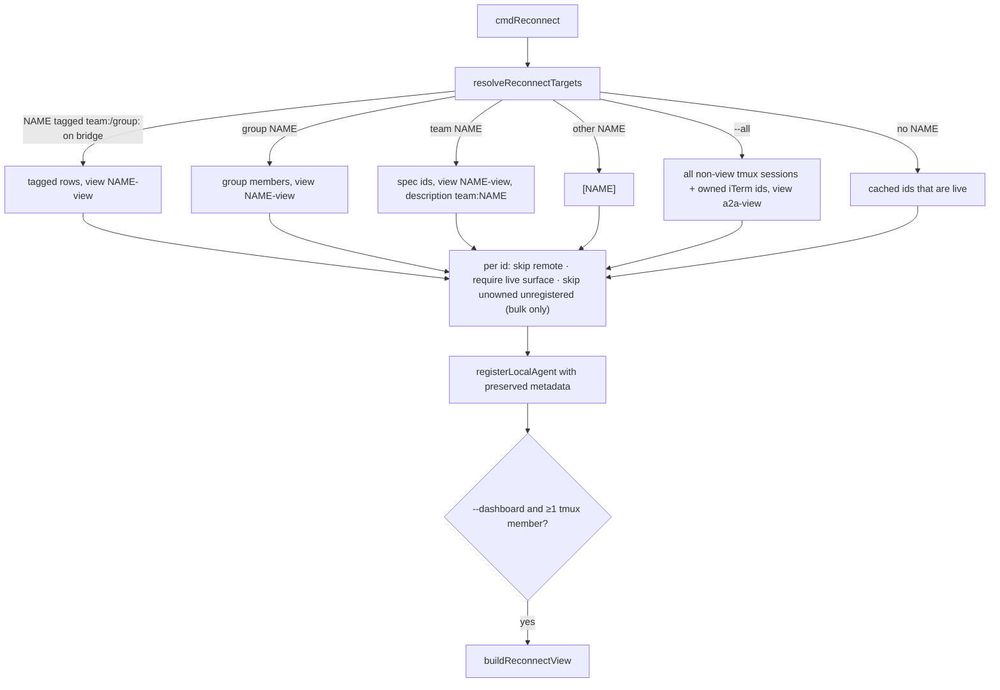

[`cmdReconnect()`][ref-5048] re-registers sessions that outlived a bridge restart without launching another backend. It carries forward `backend`, `backendCommand`, `backendArgs`, `backendEnv`, `cwd`, `startupPrompt`, `bridgeUrl`, and `yolo` from the surviving row. The install token comes from that row, then from the token on the live tmux session, then from this install, so a reconnect never downgrades a yolo agent to interactive or drops its ownership proof. Bulk reconnect silently skips dead surfaces and reports unowned, unregistered tmux sessions as skipped. An explicit `NAME` reports a dead surface as a failure and bypasses the ownership skip, treating the operator's naming as consent. An implicit variant, [`reconnectOwnedTmuxAgents()`][ref-5055], runs at most once per CLI process before any send, raw input, or sequence: it registers only token-owned tmux sessions and token-owned iTerm sessions, and it is skipped entirely when the configured bridge is not local.

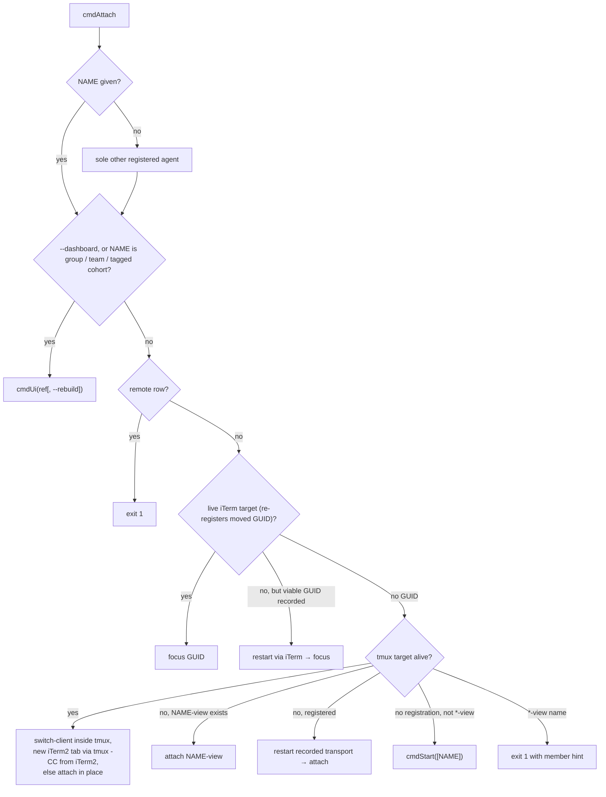

[`cmdAttach()`][ref-5049] treats team, group, and tagged-cohort labels as dashboards and recovers dead registered agents on their recorded transport. An unknown single-agent name is bootstrapped through `cmdStart`, while a missing `*-view` name is never converted into an agent. The open step depends on the caller's terminal, as implemented in [`attachTmuxSession()`][ref-5065]. Inside tmux it switches the client. From iTerm2 outside tmux, [`openTmuxSessionInItermTab()`][ref-5099] detaches stale control-mode clients, clears iTerm2's `@hidden` window list, and opens the session through `tmux -CC` in a new tab, giving the operator native scrollback without consuming the invoking shell. Elsewhere it attaches in place, and a non-interactive shell skips the attach with instructions.

[`cmdPeek()`][ref-5050] reads the last `N` lines (default 30) through the iTerm `screen` RPC for a reachable iTerm session and through `tmux capture-pane -p -S -N` on the registered target otherwise. The `-S -N` start offset pulls scrollback history; without it the capture is capped at the visible pane height. Unlike attach, peek never restarts anything: a recorded GUID whose sidecar or session is unavailable fails with `no reachable iterm session` rather than falling back to a same-named tmux session, and remote rows are rejected because their terminals are not local.

See [Dashboard and Operator Interfaces](#dashboard-and-operator-interfaces) for linked-window view construction.

## Dashboard and Operator Interfaces

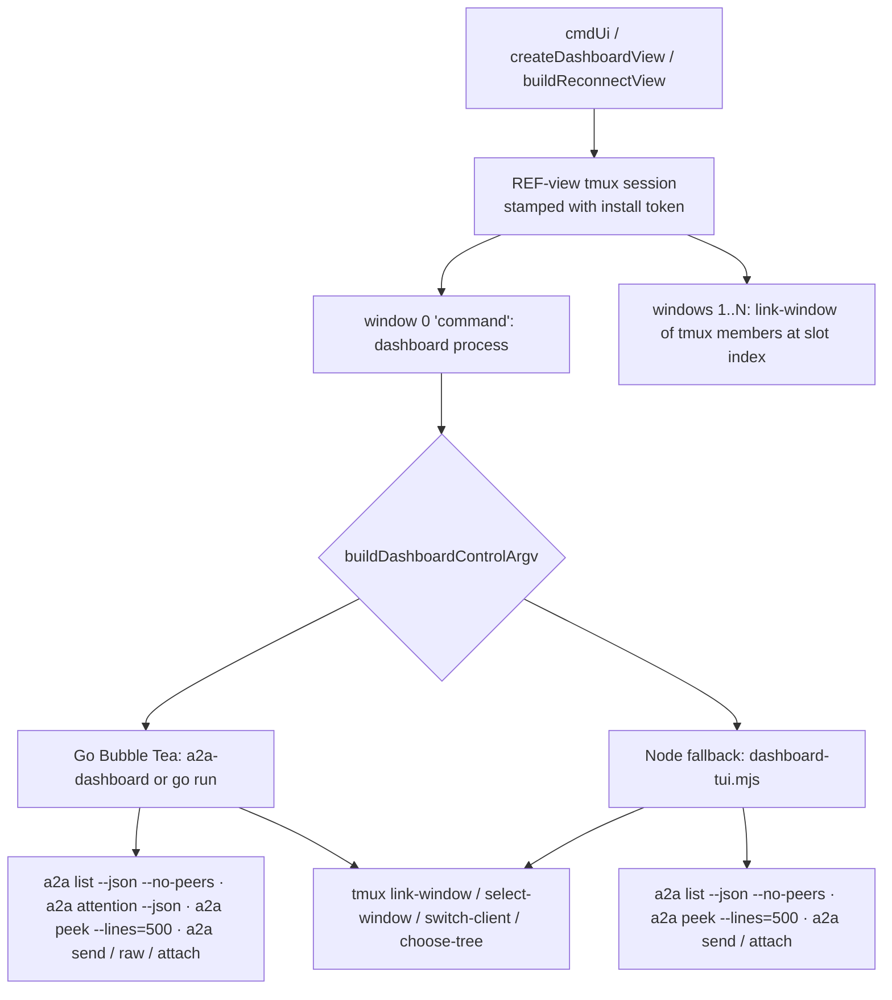

Dashboard views are tmux sessions named `REF-view` whose window zero runs a control process and whose numbered windows are links to tmux-backed agents' own windows. iTerm-backed members appear in the roster without a linked window and open through `a2a attach`. Neither dashboard reads bridge or tmux state directly for roster, preview, or messaging: both spawn the public CLI, so the human cockpit observes the same transport selection, sender authority (`--from user` with `A2A_OPERATOR_SOURCE=cli`), and restart behavior as scripts. The dashboards call tmux directly only for window navigation and link repair, the one capability the CLI does not expose.

- [View construction and repair](#dashboard-and-operator-interfaces-view-construction-and-repair)
- [Node and Go capabilities](#dashboard-and-operator-interfaces-node-and-go-capabilities)
- [Node key bindings](#dashboard-and-operator-interfaces-node-key-bindings)
- [Go key bindings](#dashboard-and-operator-interfaces-go-key-bindings)
- [Input probe](#dashboard-and-operator-interfaces-input-probe)

### Interface inventory

| Component | Runtime status | Responsibility |
| --- | --- | --- |
| [`cmd/a2a-dashboard/main.go`][ref-5072] | Preferred when `A2A_DASHBOARD_BIN` is set, `a2a-dashboard` is on `PATH`, or `go` is on `PATH` | Bubble Tea cockpit with focus panes, raw insert, attention, command palette |
| [`src/cli/dashboard-tui.mjs`][ref-5067] | Fallback when neither a binary nor Go exists | ANSI/readline cockpit with no dependency beyond Node |
| [`cmd/a2a-input-probe/main.go`][ref-5078] | Diagnostic only; not launched by any a2a command | Records decoded key and mouse messages |
| [`createDashboardView()`][ref-5052] | CLI composition | Validates members, replaces the view, links windows, attaches |
| [`buildReconnectView()`][ref-5061] | CLI composition | Same view build for `reconnect --dashboard` |
| [`cmdUi()`][ref-5051] | CLI command | Attach fast path or membership-based rebuild |
| [`buildDashboardControlArgv()`][ref-5053] | CLI composition | Selects the dashboard implementation |

<a id="dashboard-and-operator-interfaces-view-construction-and-repair"></a>
### View construction and repair

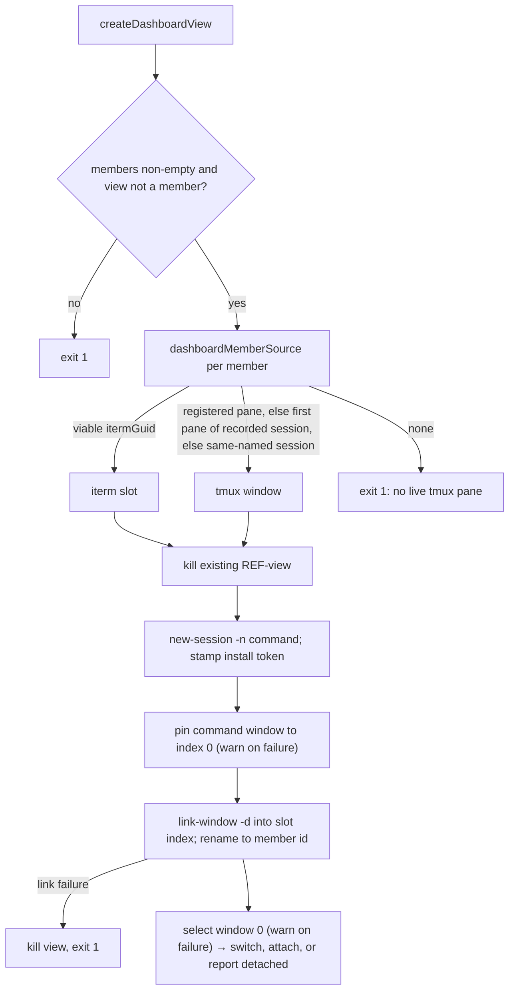

`src/cli.mjs:3343-3356`

```js
function buildDashboardControlArgv(viewSession, members) {
    const args = [ "--session", viewSession, ...members.flatMap((member, index) => [ "--member", `${member}:${index + 1}` ]) ];
    if (process.env.A2A_DASHBOARD_BIN || hasBinary(DASHBOARD_BUBBLE_TEA_BIN)) {
        return [ DASHBOARD_BUBBLE_TEA_BIN, ...args ];
    }
    if (hasBinary("go")) {
        return [ "go", "-C", DASHBOARD_BUBBLE_TEA_DIR, "run", ".", ...args ];
    }
    // No Bubble Tea binary and no Go toolchain: exec'ing `go run` would kill
    // window 0 instantly and fail the whole dashboard build. Fall back to the
    // built-in Node command center, which speaks the same --session/--member
    // contract.
    return [ process.execPath, DASHBOARD_TUI_SCRIPT, ...args ];
}
```

[`createDashboardView()`][ref-5052] resolves every member's surface before touching tmux and aborts when any declared member has none, so a view is never half-built around a missing agent. [`dashboardMemberSource()`][ref-5062] resolves a registered pane, then the first pane of its recorded session, then the same-named session. That order lets `a2a register --target` panes inside shared sessions appear in a view. [`linkDashboardSources()`][ref-5063] links each tmux member at the window index equal to its roster slot and leaves gaps at iTerm slots, so the slot number shown in the roster is also a tmux window index. Failure to pin window 0 with [`pinDashboardCommandWindow()`][ref-5064] or to select it is downgraded to a warning because the linked agent windows remain usable, whereas a failed link kills the half-built view. The view session receives the install token, which is what lets `kill --all` remove it.

The shared `--session` plus repeated `--member id:slot` argv lets either implementation inhabit the same view, and the selection order prefers the richer Go cockpit while guaranteeing that window 0 never runs a command that exits immediately. `go run` compiles [`cmd/a2a-dashboard/main.go`][ref-5072] on every view build when no prebuilt binary is on `PATH`; it does not use the binary checked into `cmd/a2a-dashboard/`.

`cmd/a2a-dashboard/main.go:1181-1199`

```go
func resolveViewWindowTarget(session string, item member, source string) (string, error) {
	wid, err := agentWindowID(source)
	if err == nil && wid != "" {
		if index, ok := viewWindowIndexByWindowID(session, wid); ok {
			return session + ":" + index, nil
		}
		if result := run("tmux", "link-window", "-d", "-s", source, "-t", session+":"); result.Err != nil {
			return "", fmt.Errorf("relink %s failed: %s", item.ID, firstNonEmpty(result.Stderr, result.Err.Error()))
		}
		if index, ok := viewWindowIndexByWindowID(session, wid); ok {
			return session + ":" + index, nil
		}
		return "", fmt.Errorf("relinked %s but could not resolve window index", item.ID)
	}
	if index, ok := viewWindowIndexForMember(session, item); ok {
		return session + ":" + index, nil
	}
	return "", fmt.Errorf("cannot open %s: source window unavailable", item.ID)
}
```

Repair is lazy and identical in both implementations ([`resolveViewWindowTarget()`][ref-5075] in Go, [`jumpToAgent()`][ref-5068] in Node). A registered iTerm member opens through `a2a attach`. Otherwise the agent's source window is resolved to its global tmux `window_id`, which `link-window` preserves across sessions and which therefore joins the agent session to the view regardless of renumbering. A missing link is re-created on demand. When the source session itself is gone, the surviving view window is found by name and then by original slot. The surviving-link case is the behavior locked by the real-tmux test [`Enter opens a surviving linked dashboard tab when the source agent session is gone`][ref-5222]. [`cmdUi()`][ref-5051] attaches to an existing `REF-view` without recomputing membership unless `--rebuild` is passed; the slow path lists agents without auto-starting the bridge, resolves members through [`resolveReconnectTargets()`][ref-5057], keeps only members with an openable surface, and rebuilds. Routine entry stays cheap and repair happens per window on first use.

<a id="dashboard-and-operator-interfaces-node-and-go-capabilities"></a>
### Node and Go capabilities

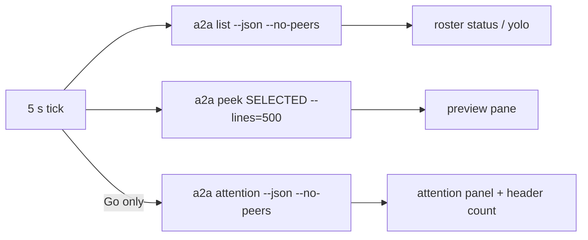

| Capability | Node fallback ([`src/cli/dashboard-tui.mjs`][ref-5067]) | Go dashboard ([`cmd/a2a-dashboard/main.go`][ref-5072]) |
| --- | --- | --- |
| Roster with status, mark, and yolo/safe mode | Yes | Yes |
| Preview of last 500 lines via `a2a peek` | Yes; PgUp/PgDn in 10-line steps | Yes; viewport with line, half-page, page, top/bottom |
| Refresh cadence | 5 s `setInterval`, paused outside normal mode | 5 s `tea.Tick`, also refreshes on selection change |
| Open slot, selected, or by-name; tmux chooser; lazy link repair | Yes | Yes |
| Message, ask, group message, broadcast | Yes | Yes |
| Raw input (`a2a raw --to … --content …`, optional `--open`) | No | Yes: single, marked, with `/` or `@` prefix |
| Attention surface | No; header shows bridge status only | Yes: `!` panel and `!N attention` in header and footer |
| Command palette and help panel | Help footer toggle only | `:` palette over a shared command table; `?` help panel |
| Pane focus | Single focus | Roster and preview focus via Tab, `[`, `]` |
| Mouse | None | Wheel scrolls the preview viewport; the dashboard sets tmux `mouse on` for its view session |

`src/cli/dashboard-tui.mjs:959-964`

```js
  const timer = setInterval(() => {
    if (state.mode === "normal") {
      refresh(state);
      render(state);
    }
  }, 5000);
```

Both cockpits deliberately share one data contract with the CLI: [`readA2aState()`][ref-5069] and [`readA2AState()`][ref-5076] parse `a2a list --json --no-peers`, whose JSON shape is documented in [`cmdList()`][ref-5032] as the stable machine interface, while the human table may change. The Go cockpit additionally calls `a2a attention --json --no-peers` and turns a failure or malformed reply into a synthetic `attention-error` item instead of hiding the panel. Messages pass `--from user` with `A2A_OPERATOR_SOURCE=cli`, so dashboard sends carry operator provenance under the authority rules in [Message Framing and Identity](#message-framing-and-identity), and Go raw input uses [`sendRawInputCmd()`][ref-5077] to invoke `a2a raw` rather than `tmux send-keys`, inheriting transport selection and paste verification.

The view builder prints the hint `1-9 quick jump, Enter open, ! attention, ? help, : commands, m message, a ask` regardless of which implementation runs; under the Node fallback `!` and `:` have no binding and `?` toggles a footer rather than opening a panel.

<a id="dashboard-and-operator-interfaces-node-key-bindings"></a>
### Node key bindings

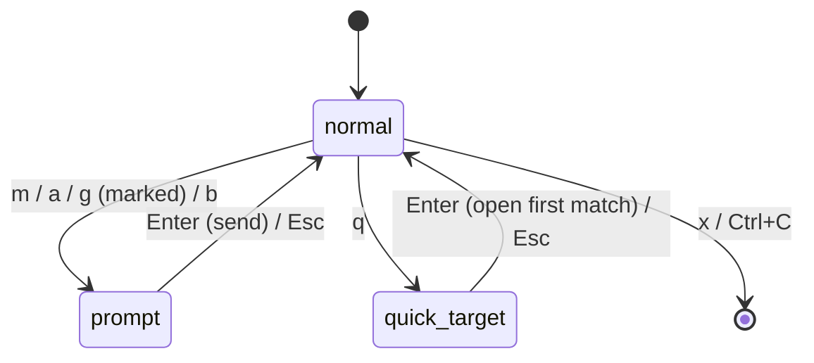

| Key | Mode | Action |
| --- | --- | --- |
| `↑` / `↓` | normal | Move selection and refresh preview |
| `PgUp` / `PgDn` | normal | Scroll preview 10 lines back or forward |
| `Home` / `End` | normal | Select first or last roster member |
| `1`–`9` | normal | Open the member whose slot equals the digit |
| `Enter` | normal | Open the selected member |
| `q` | normal | Enter open-by-name filter |
| `Space` | normal | Toggle mark on selected member |
| `m` / `a` | normal | Message or ask the selected member |
| `g` | normal | Message marked members (logs a hint when none are marked) |
| `b` | normal | Broadcast message |
| `r` (also `p`, `l`) | normal | Refresh roster and preview |
| `c` | normal | `tmux choose-tree -w` |
| `?` | normal | Toggle help footer |
| `x`, `Ctrl+C` | any / normal | Exit |
| `Enter` / `Esc` / `Backspace` / printable | prompt, quick-target | Submit or open first match / cancel / delete / type |

The [`HELP`][ref-5071] table omits the `p` and `l` refresh aliases that [`handleNormalKey()`][ref-5070] accepts. Every normal-mode key handler returns to rendering, and the 5-second refresh does not run while a prompt or filter is open, so typed input is never overwritten by a redraw from a background refresh.

<a id="dashboard-and-operator-interfaces-go-key-bindings"></a>
### Go key bindings

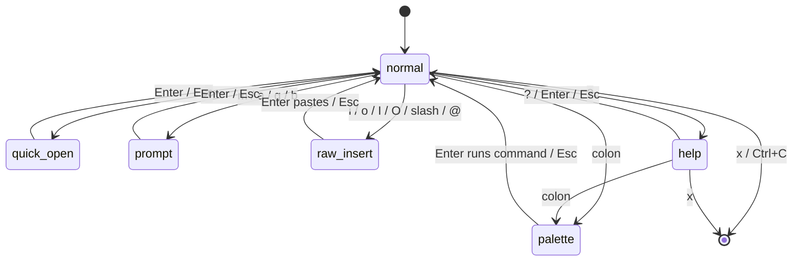

| Key | Scope | Action |
| --- | --- | --- |
| `x`, `Ctrl+C` | normal | Quit |
| `Tab`, `Shift+Tab` / `[` / `]` | normal | Toggle focus / focus roster / focus preview |
| `?` | normal | Help panel |
| `:` | normal, help | Command palette |
| `!` | normal | Toggle attention panel |
| `Enter` | normal | Open selected member |
| `1`–`9` | normal | Open slot; status `no agent in slot N` when empty |
| `q` | normal | Open-by-name filter |
| `Space` | normal | Toggle mark |
| `m` / `a` / `g` / `b` | normal | Message / ask / message marked / broadcast |
| `i` / `o` | normal | Raw insert into selected pane / raw insert then open |
| `I` / `O` | normal | Raw insert into marked panes / then open |
| `/` / `@` | normal | Raw insert pre-filled with `/` or `@` |
| `r` / `c` | normal | Refresh / `tmux choose-tree -w` |
| `PgUp`, `PgDn`, `Ctrl+U`, `Ctrl+D` | normal, any focus | Scroll preview page or half page |
| `Ctrl+Home` / `Ctrl+End` | normal, any focus | Preview top / bottom |
| `↑`/`k`, `↓`/`j` | normal | Roster selection, or preview scroll when preview has focus |
| `Home` / `End` | normal | First/last member, or preview top/bottom when preview has focus |
| Mouse wheel | normal | Scroll preview viewport |
| `↑`/`k`, `↓`/`j`, `Enter`, `Esc`, typing | palette | Choose, run, cancel, filter |

[`dashboardCommands`][ref-5073] is a single table that drives the help panel, the palette, and the palette's dispatch, so a key cannot be documented in help without also being executable from the palette; [`main_test.go`][ref-5079] locks that coupling. Palette filtering ranks key-plus-name matches before description-only matches. The viewport's default key map is replaced so that `Space`, `u`, `d`, `b`, `f`, `h`, and `l` keep dashboard meanings instead of scrolling, and arrow keys are routed by focus rather than by the viewport. The key binding table is reproduced from [`handleNormalKey()`][ref-5074].

<a id="dashboard-and-operator-interfaces-input-probe"></a>
### Input probe

```mermaid
flowchart LR
  TERM["terminal / tmux"] --> TEA["Bubble Tea, all-motion mouse"]
  TEA --> LOG["last 200 KEY / MOUSE events, newest first"]
  FLAG["--enable-tmux-mouse inside tmux"] --> OPT["tmux set-option mouse on"]
```

[`cmd/a2a-input-probe/main.go`][ref-5078] prints every decoded key (string, type, alt, runes) and mouse message (cell, button, action) with millisecond timestamps, keeping the last 200 events and showing the current tmux `mouse` option. `--enable-tmux-mouse` turns tmux mouse mode on for the current session so wheel behavior can be compared before and after. The probe is a separate Go module with no a2a imports; it exists to make terminal-emulator and tmux differences in wheel and modifier decoding observable when changing the dashboard's key map, which is why the dashboard sets tmux `mouse on` and replaces the viewport key bindings.

See [Runtime State and Observability](#runtime-state-and-observability) for the roster data and [Agent Lifecycle](#agent-lifecycle) for attach and restart semantics.

## Verification Architecture

```mermaid
flowchart TB
  PURE["Pure policy suites<br/>parsers, selection, inventory, projections"] --> VITEST["vitest run<br/>55 files, fileParallelism=false"]
  PROC["Subprocess suites<br/>real CLI, bridge, Dot, channel, installer"] --> VITEST
  NET["Random-port HTTP + Unix-socket fakes"] --> PROC
  TMUX["Real tmux server<br/>(some suites skip without tmux)"] --> VITEST
  GO["cmd/a2a-dashboard/main_test.go"] --> GOTOOL["go test ./... in cmd/a2a-dashboard<br/>no package script"]
  MTS["teams/dw-bug-killers/*.test.mts"] --> OUT["git-ignored, outside Vitest include"]
```

The verification strategy tests policy at pure seams and behavior at real process boundaries. Leaf modules extracted from [`src/cli.mjs`][ref-5091] (inventory, snapshot, projections, start-argv, reconnect targets, restart plan) are imported directly. The CLI, bridge, Dot adapter, channel adapter, and installer are executed as child processes against fake binaries on `PATH`, random-port HTTP fakes, Unix-socket fakes, and, where needed, the real tmux server. Static import edges therefore understate coverage: the live graph shows zero importers for [`src/cli/dashboard-tui.mjs`][ref-5067], which a test still drives inside real tmux.

- [Harness configuration](#verification-architecture-harness-configuration)
- [Test-file inventory](#verification-architecture-test-file-inventory)
- [Measured results](#verification-architecture-measured-results)
- [Isolation boundaries and gaps](#verification-architecture-isolation-boundaries-and-gaps)

<a id="verification-architecture-harness-configuration"></a>
### Harness configuration

```mermaid
flowchart LR
  PKG["package.json scripts"] --> T["test / test:vitest → vitest run"]
  PKG --> TS["test:vitest:* → named subsets"]
  PKG --> L["lint → eslint src tests scripts bin"]
  CFG["vitest.config.mjs"] --> T
  ESL["eslint.config.mjs"] --> L
```

`vitest.config.mjs:1-9`

```js
import { defineConfig } from "vitest/config";

export default defineConfig({
  test: {
    include: ["tests/*.test.mjs", "tests/*vitest.test.mjs"],
    fileParallelism: false,
    watch: false,
  },
});
```

| Script ([`package.json`][ref-5082]) | Command | Scope |
| --- | --- | --- |
| `test`, `test:vitest` | `vitest run` | All 55 included files |
| `test:vitest:argv`, `:channel`, `:cli`, `:config`, `:server`, `:team-spec`, `:tokens` | `vitest run tests/<name>.test.mjs` | One file each |
| `test:vitest:dots` | `vitest run` on four Dot files | Dot adapter family |
| `test:vitest:dots-events` | `vitest run` on two event files | Durable events |
| `lint`, `lint:fix` | `eslint src tests scripts bin [--fix]` | Runtime, tests, scripts, executable shim |

[`vitest.config.mjs`][ref-5080] includes root-level `tests/*.test.mjs` only; the second pattern is a subset of the first, so exactly 55 files run and nothing under `tests/helpers/` or nested directories is collected. File parallelism is disabled: several files drive one shared tmux server and spawn the CLI against the checkout's own `config.json` and `registry.json` ([`REGISTRY_FILE`][ref-5090] resolves next to `src/`), so concurrent files would race on the same sessions and files. [`tests/run.mjs`][ref-5092] spawns `vitest run` directly from `node_modules`; no package script references it. [`eslint.config.mjs`][ref-5081] starts from `js.configs.all` and `eslint-plugin-n` `flat/all`, disables stylistic rules, and enforces correctness rules such as `no-shadow`, `require-atomic-updates`, `preserve-caught-error`, and `n/prefer-node-protocol`. The `require-atomic-updates` rule is the reason for the recurring `// eslint-disable-next-line require-atomic-updates` comments beside deliberate single-command write-backs in the lifecycle code, each of which states why no concurrent writer exists.

<a id="verification-architecture-test-file-inventory"></a>
### Test-file inventory

```mermaid
flowchart LR
  F1["Parsers and argv · 6"] --> V["55 files / 669 tests"]
  F2["Identity and envelope · 2"] --> V
  F3["Configuration · 5"] --> V
  F4["Team spec and backend · 5"] --> V
  F5["Transport and DSL · 15"] --> V
  F6["Runtime model · 5"] --> V
  F7["CLI lifecycle and operator · 6"] --> V
  F8["Bridge server · 3"] --> V
  F9["Dot adapter · 4"] --> V
  F10["Channel adapter · 3"] --> V
  F11["Installer · 1"] --> V
```

| Family | Files (tests) | Harness | Contract verified |
| --- | --- | --- | --- |
| Parsers and argv | [`a2a-argv-vitest`][ref-5201] (6), [`a2a-tokens-vitest`][ref-5210] (6), [`parsers`][ref-5236] (11), [`cli-command-argv`][ref-5218] (16), [`recipient-selectors`][ref-5238] (4), [`parse-start-args`][ref-5235] (33) | Pure imports | Unknown bare flags throw, no phantom recipients from prototype-chain names, sequence mode wins over send syntax, glob expansion and escapes, start-argv forwarding and tri-state global |
| Identity and envelope | [`sender-identity`][ref-5242] (29), [`envelope`][ref-5226] (7) | Pure imports | Locked tmux / `A2A_AGENT_ID` identity, fail-closed peer origin, attribute escaping and literal bodies |
| Configuration | [`a2a-config-get`][ref-5203] (2), [`a2a-config-protocol`][ref-5204] (2), [`a2a-config-vitest`][ref-5205] (18), [`config`][ref-5221] (4), [`strip-ansi-codes`][ref-5247] (21) | Imports against the checkout's config files | Env precedence, protocol alias and coercion, pid and group helpers with traversal guards, UTF-8-safe log rotation, ANSI stripping |
| Team spec and backend | [`a2a-team-spec-vitest`][ref-5209] (3), [`a2a-team-spec-dotted-names`][ref-5208] (3), [`team-spec`][ref-5249] (22), [`team-spec-yolo`][ref-5248] (10), [`agent-backend-args`][ref-5211] (38) | Pure imports, temp spec files | Spec resolution and dotted names, version-2 yolo gate, per-backend permission flags never duplicated |
| Transport and DSL | [`transport-select`][ref-5255] (12), [`transport-select-guid`][ref-5254] (4), [`transport-probes`][ref-5252] (27), [`transport-probes-cache`][ref-5251] (3), [`transport-router`][ref-5253] (8), [`agent-transport`][ref-5212] (10), [`backend-delivery`][ref-5215] (3), [`tmux-raw-delivery`][ref-5250] (8), [`iterm2-delivery`][ref-5230] (8), [`iterm-agent-resolve`][ref-5228] (5), [`sequence-delivery`][ref-5243] (3), [`key-sequence`][ref-5234] (30), [`key-sequence-body-ref`][ref-5231] (3), [`key-sequence-chord`][ref-5232] (4), [`key-sequence-stdin`][ref-5233] (1) | Pure imports, Unix-socket fake sidecar, real tmux (three files skip without tmux) | Capability matrix, positive-only probe caching, exact tmux targeting, submit verification, RPC timeout budgeting, DSL compile and key-table parity |
| Runtime model | [`session-inventory`][ref-5245] (40), [`session-inventory-regressions`][ref-5244] (3), [`runtime-snapshot`][ref-5241] (8), [`status-snapshot`][ref-5246] (3), [`redesign-runtime`][ref-5240] (6) | Pure imports; `vi.mock` of `spawnSync`, registry, probes | Bucket rules including the OR orphan rule, sync ownership checker, cache identity, coalescing, generation invalidation, counts, events, reload and layout plans, doctor masking |
| CLI lifecycle and operator | [`cli-vitest`][ref-5220] (23), [`cli-regressions`][ref-5219] (17), [`attach`][ref-5213] (5), [`reconnect`][ref-5239] (5), [`iterm-restart-plan`][ref-5229] (4), [`dashboard-tui`][ref-5222] (1) | Real `node src/cli.mjs` with fake tmux/claude/osascript on `PATH`, fake HTTP bridge, fake iTerm socket; real tmux for the dashboard | Start/register/token stamping, peek capture arguments, reconnect ownership, kill safety, iTerm reuse refusal, attach in tmux / iTerm2 / plain terminals, restart planning, dashboard link repair |
| Bridge server | [`a2a-server-vitest`][ref-5207] (13), [`auth`][ref-5214] (8), [`read-json-body`][ref-5237] (6) | Real bridge process on a test port, pure auth and body readers | Version negotiation, agent card, registry persistence across restart, peer ownership, byte caps and single settlement |
| Dot adapter | [`a2a-dots-vitest`][ref-5206] (21), [`dots-contracts`][ref-5223] (19), [`dots-events`][ref-5225] (82), [`dots-events-runtime`][ref-5224] (17) | [`tests/helpers/dots-runtime.mjs`][ref-5083] copies `src` and `bin` into a temp root with its own config and registry | Owned callback registration, eight tools over MCP, modern and legacy auth parity, webhook signing, SSRF guard, durable outbox |
| Channel adapter | [`a2a-channel-vitest`][ref-5202] (6), [`channel-body`][ref-5216] (4), [`channel-sse`][ref-5217] (3) | Real channel process, pure helpers | Sender allowlist, non-loopback bearer requirement, reply argv injection, SSE framing and keepalive |
| Installer | [`install-script`][ref-5227] (11) | Real installer subprocess with an isolated `HOME` | Unattended CI mode, symlink replacement rules, skill installation, sample team, executable verification |

| Go test ([`cmd/a2a-dashboard/main_test.go`][ref-5079]) | Contract |
| --- | --- |
| `TestCommandHelpAndPaletteUseSharedCommandTable` | Help and palette render from one command table; `attention` query ranks the attention command first |
| `TestAttentionLinesAndAgentKeys` | Registered rows key by `agentId` or `id`; empty attention renders `attention clear` |
| `TestDashboardViewsExposeHelpPaletteAndAttention` | Help, palette, and attention surfaces appear in the rendered view |

<a id="verification-architecture-measured-results"></a>
### Measured results

```mermaid
flowchart LR
  RUN["npx vitest run --reporter=verbose<br/>2026-10-13, Node 24.18.0, vitest 4.1.7"] --> RES["55 files: 50 pass, 5 fail<br/>669 tests: 656 pass, 13 fail"]
  GORUN["go test -count=1 -v ./... in cmd/a2a-dashboard<br/>go 1.26.5"] --> GORES["3 of 3 pass"]
```

The suite was measured on 2026-10-13 against the uncommitted working tree with `npx vitest run --reporter=verbose` (87.4 s) and, in `cmd/a2a-dashboard`, `go test -count=1 -v ./...`. Vitest reported **656 of 669 tests passing in 50 of 55 files**, with no skipped tests on a machine with tmux 3.7b; Go reported 3 of 3 passing. The failing tests are listed below with the assertion each one reported.

| File | Failing test | Reported assertion |
| --- | --- | --- |
| [`a2a-config-vitest`][ref-5205] | environment-driven accessors prefer env overrides and handle invalid edge cases | `warnings.at(-1)` is `undefined`; no invalid-port warning was captured |
| [`a2a-config-vitest`][ref-5205] | invalid persisted protocol is coerced to tmux with a one-time warning | 0 protocol warnings captured, expected 1 |
| [`cli-regressions`][ref-5219] | prototype-chain flag names are rejected as unknown flags | `unknown flag --toString` with exit 1, expected exit 2 |
| [`cli-regressions`][ref-5219] | peek passes -S -\<lines\> to capture-pane so --lines exceeds pane height | Log shows `capture-pane -t =a2a-test-peek …`; the regex expects the target without `=` |
| [`cli-regressions`][ref-5219] | peek falls back after one failed iTerm bridge ping | `no reachable iterm session for 'a2a-test-iterm-peek'`, exit 1 |
| [`cli-regressions`][ref-5219] | reconnect registers a live owned iTerm session with its guid | `registering a local agent on a remote bridge requires a public callback URL` |
| [`cli-regressions`][ref-5219] | reconnect --all batches tmux ownership instead of probing each session | Same remote-bridge registration error for `a2a-test-owned` |
| [`cli-regressions`][ref-5219] | kill --all uses a fresh daemon runtime snapshot | `kill --all must probe each tmux session once before killing` (0 vs 1) |
| [`cli-regressions`][ref-5219] | start under protocol=tmux ignores a same-named unowned iTerm session | `iterm session 'a2a-test-imp' is not owned by this install; refusing to adopt it` |
| [`cli-regressions`][ref-5219] | start under protocol=iterm reuses a same-named iTerm session by guid | `iterm session 'a2a-test-iterm-reuse' is not owned by this install` |
| [`cli-vitest`][ref-5220] | attach on a team ref builds the dashboard view from live agent sessions | Output lists iTerm slots for `vitest-runner`, `typecheck-root`, `typecheck-tests`, `gate-runner` and view `dw-bug-killers-view` instead of `window 1: alpha-mgr` |
| [`install-script`][ref-5227] | sample team step installs the tracked star-wars.yaml spec | Installer output contains `source team spec not found` |
| [`transport-router`][ref-5253] | selectTransportForAgent — stale registry guid › tmux-preferred live tmux agents skip iTerm bridge probing | `bridgeReachable` called once, expected zero calls |

Several failures trace to the current source rather than to flakiness. The two reconnect failures follow from `isLocalBridgeUrl()` requiring the bridge URL's port to equal `activePort()`: the fake bridge listens on an ephemeral port while [`cli-regressions`][ref-5219] does not set `A2A_PORT`, so registration takes the global-mode callback path (`src/cli.mjs:231-242`, `:634-641`); [`cli-vitest`][ref-5220] already carries a `localBridgePortEnv()` helper whose comment documents exactly this requirement. The peek-argument failure follows from the `tmux()` wrapper rewriting every `-t` target to the exact `=name` form (`src/cli.mjs:697-702`), which the test's regular expression predates. The two `start` failures print a refusal that only the iTerm branch of [`spawnAgentInPlace()`][ref-5040] produces, and that branch runs only when the active protocol is `iterm`, which is the value recorded in the checkout's `config.json` at measurement time. The `attach` failure runs `a2a attach dw-bug-killers` without a test bridge URL, and its output shows registrations from the operator's live bridge rather than the test's fixtures. The suite therefore cannot be cited as green evidence for this working tree, and lifecycle results depend on the machine's own a2a configuration.

<a id="verification-architecture-isolation-boundaries-and-gaps"></a>
### Isolation boundaries and gaps

```mermaid
flowchart TD
  SUITE["subprocess suite"] --> ENV{"environment"}
  ENV -->|"install-script"| ISO["isolated HOME"]
  ENV -->|"Dot runtime"| COPY["copied src/bin + own config.json / registry.json"]
  ENV -->|"cli-vitest, cli-regressions, a2a-config-vitest"| LIVE["inherits process.env and the checkout's config.json / registry.json"]
  LIVE --> RISK["results depend on operator config and live bridge"]
```

| Boundary | Isolated by | Not isolated |
| --- | --- | --- |
| Ports | `listen(0, "127.0.0.1")` fakes and free-port probes; [`cli-vitest`][ref-5220] pairs each fake bridge with a matching `A2A_PORT` | [`cli-regressions`][ref-5219] omits `A2A_PORT`, so its fake bridge is classified as remote; a `cli-vitest` call without `A2A_BRIDGE` (the team-ref `attach` test) reaches the configured bridge |
| iTerm sidecar | Per-test Unix socket path or a dead socket path via `A2A_ITERM2_BRIDGE_SOCKET` | [`cli-vitest`][ref-5220] and [`attach`][ref-5213] do not set `A2A_ITERM2_BRIDGE_SOCKET`, so any iTerm probe they trigger targets the operator's default sidecar socket |
| tmux | Fake `tmux` shim on `PATH` for [`cli-regressions`][ref-5219] and [`attach`][ref-5213]; unique session names for real-tmux suites | [`cli-vitest`][ref-5220], [`dashboard-tui`][ref-5222], and the real-tmux transport suites share the operator's tmux server |
| Persistent files | Dot runtime copies `src` and `bin` so config resolves inside the temp root | CLI and config suites read and write the checkout's `config.json` and `registry.json` |
| Home directory | `install-script` only | Every other subprocess suite inherits `HOME` |

The isolation pattern follows from where state lives: [`src/a2a-config.mjs`][ref-5090] resolves `config.json` and `registry.json` relative to the source directory, so only a suite that copies the source (the Dot runtime helper) obtains private state. Suites that run `node src/cli.mjs` from the checkout share the operator's protocol preference, install token, and bridge, which is what the `attach` and `start` failures above demonstrate.

| Gap | Evidence |
| --- | --- |
| Real iTerm2 application, global mode, and ngrok are not exercised | Suites use socket fakes and `--no-ngrok` |
| Go dashboard key handling, mouse, raw insert, and link repair are untested | [`main_test.go`][ref-5079] covers rendering and the command table only |
| Node dashboard covers one repair path | [`dashboard-tui`][ref-5222] has a single test |
| Input probe, `schemas/transform-flags.mjs`, `scripts/postinstall-hint.mjs`, and the worklist generators have no suite in `tests/` | No test file references them |
| Generator tests are outside routine runs | `teams/dw-bug-killers/generate-worklist.test.mts` is git-ignored via `teams/` and excluded by the Vitest include |
| Go tests are outside the package scripts | No `package.json` script runs `go test` |
| Lint covers `src`, `tests`, `scripts`, `bin` only | `schemas`, `teams`, root configs, `.mts`, Python, and Go are not linted |
| `itermOrphans` have no status-snapshot projection | [`buildStatusSnapshot()`][ref-5013] reads only `registered`, `orphans`, `views` |
| Layout plans are validated but never applied | No caller consumes `buildLayoutPlan().tree` |

See each owning runtime section for the behavior these tests lock; test names are evidence of contracts, not substitutes for the source-derived rationale above.

<!-- refs -->
[ref-5001]: ../src/cli/session-inventory.mjs
[ref-5002]: ../src/cli/session-inventory.mjs#L129
[ref-5003]: ../src/cli/session-inventory.mjs#L34
[ref-5004]: ../src/cli/session-inventory.mjs#L66
[ref-5005]: ../src/cli/session-inventory.mjs#L108
[ref-5006]: ../src/cli/session-inventory.mjs#L118
[ref-5007]: ../src/runtime/runtime-snapshot.mjs
[ref-5008]: ../src/runtime/runtime-snapshot.mjs#L152
[ref-5009]: ../src/runtime/runtime-snapshot.mjs#L256
[ref-5010]: ../src/runtime/runtime-snapshot.mjs#L44
[ref-5011]: ../src/runtime/runtime-snapshot.mjs#L26
[ref-5012]: ../src/cli/status-snapshot.mjs
[ref-5013]: ../src/cli/status-snapshot.mjs#L31
[ref-5014]: ../src/cli/status-snapshot.mjs#L176
[ref-5015]: ../src/cli/status-snapshot.mjs#L200
[ref-5016]: ../src/cli/redesign-runtime.mjs
[ref-5017]: ../src/cli/redesign-runtime.mjs#L17
[ref-5018]: ../src/cli/redesign-runtime.mjs#L103
[ref-5019]: ../src/cli/redesign-runtime.mjs#L183
[ref-5020]: ../src/cli/redesign-runtime.mjs#L233
[ref-5021]: ../src/cli/redesign-runtime.mjs#L411
[ref-5022]: ../src/cli/redesign-runtime.mjs#L403
[ref-5023]: ../src/cli/redesign-runtime.mjs#L318
[ref-5024]: ../src/a2a-server.mjs#L986
[ref-5025]: ../src/cli.mjs#L5082
[ref-5026]: ../src/cli.mjs#L5119
[ref-5027]: ../src/cli.mjs#L5176
[ref-5028]: ../src/cli.mjs#L5193
[ref-5029]: ../src/cli.mjs#L5210
[ref-5030]: ../src/cli.mjs#L5237
[ref-5031]: ../src/cli.mjs#L5277
[ref-5032]: ../src/cli.mjs#L5372
[ref-5033]: ../src/cli.mjs#L244
[ref-5034]: ../src/cli.mjs#L3964
[ref-5035]: ../src/cli.mjs#L3158
[ref-5036]: ../src/cli.mjs#L3589
[ref-5037]: ../src/cli.mjs#L3756
[ref-5038]: ../src/cli.mjs#L1161
[ref-5039]: ../src/cli.mjs#L1186
[ref-5040]: ../src/cli.mjs#L1221
[ref-5041]: ../src/cli.mjs#L1281
[ref-5042]: ../src/cli.mjs#L1475
[ref-5043]: ../src/cli.mjs#L2154
[ref-5044]: ../src/cli.mjs#L2183
[ref-5045]: ../src/cli.mjs#L2282
[ref-5046]: ../src/cli.mjs#L4116
[ref-5047]: ../src/cli.mjs#L4311
[ref-5048]: ../src/cli.mjs#L4789
[ref-5049]: ../src/cli.mjs#L4429
[ref-5050]: ../src/cli.mjs#L4667
[ref-5051]: ../src/cli.mjs#L4940
[ref-5052]: ../src/cli.mjs#L3542
[ref-5053]: ../src/cli.mjs#L3343
[ref-5054]: ../src/cli.mjs#L862
[ref-5055]: ../src/cli.mjs#L2047
[ref-5056]: ../src/cli/parse-start-args.mjs#L143
[ref-5057]: ../src/cli/reconnect-targets.mjs#L1
[ref-5058]: ../src/cli/iterm-restart-plan.mjs#L4
[ref-5059]: ../src/cli.mjs#L4217
[ref-5060]: ../src/cli.mjs#L4262
[ref-5061]: ../src/cli.mjs#L4752
[ref-5062]: ../src/cli.mjs#L3434
[ref-5063]: ../src/cli.mjs#L3510
[ref-5064]: ../src/cli.mjs#L3370
[ref-5065]: ../src/cli.mjs#L1017
[ref-5066]: ../src/cli.mjs#L1515
[ref-5067]: ../src/cli/dashboard-tui.mjs
[ref-5068]: ../src/cli/dashboard-tui.mjs#L377
[ref-5069]: ../src/cli/dashboard-tui.mjs#L211
[ref-5070]: ../src/cli/dashboard-tui.mjs#L805
[ref-5071]: ../src/cli/dashboard-tui.mjs#L38
[ref-5072]: ../cmd/a2a-dashboard/main.go
[ref-5073]: ../cmd/a2a-dashboard/main.go#L160
[ref-5074]: ../cmd/a2a-dashboard/main.go#L343
[ref-5075]: ../cmd/a2a-dashboard/main.go#L1181
[ref-5076]: ../cmd/a2a-dashboard/main.go#L1065
[ref-5077]: ../cmd/a2a-dashboard/main.go#L813
[ref-5078]: ../cmd/a2a-input-probe/main.go
[ref-5079]: ../cmd/a2a-dashboard/main_test.go
[ref-5080]: ../vitest.config.mjs
[ref-5081]: ../eslint.config.mjs
[ref-5082]: ../package.json
[ref-5083]: ../tests/helpers/dots-runtime.mjs
[ref-5084]: ../tests/session-inventory.test.mjs#L273
[ref-5085]: ../tests/session-inventory.test.mjs#L287
[ref-5086]: ../tests/session-inventory.test.mjs#L298
[ref-5090]: ../src/a2a-config.mjs#L12
[ref-5091]: ../src/cli.mjs
[ref-5092]: ../tests/run.mjs
[ref-5099]: ../src/cli.mjs#L991
[ref-5101]: ../src/cli.mjs#L5140
[ref-5201]: ../tests/a2a-argv-vitest.test.mjs
[ref-5202]: ../tests/a2a-channel-vitest.test.mjs
[ref-5203]: ../tests/a2a-config-get.test.mjs
[ref-5204]: ../tests/a2a-config-protocol.test.mjs
[ref-5205]: ../tests/a2a-config-vitest.test.mjs
[ref-5206]: ../tests/a2a-dots-vitest.test.mjs
[ref-5207]: ../tests/a2a-server-vitest.test.mjs
[ref-5208]: ../tests/a2a-team-spec-dotted-names.test.mjs
[ref-5209]: ../tests/a2a-team-spec-vitest.test.mjs
[ref-5210]: ../tests/a2a-tokens-vitest.test.mjs
[ref-5211]: ../tests/agent-backend-args.test.mjs
[ref-5212]: ../tests/agent-transport.test.mjs
[ref-5213]: ../tests/attach.test.mjs
[ref-5214]: ../tests/auth.test.mjs
[ref-5215]: ../tests/backend-delivery.test.mjs
[ref-5216]: ../tests/channel-body.test.mjs
[ref-5217]: ../tests/channel-sse.test.mjs
[ref-5218]: ../tests/cli-command-argv.test.mjs
[ref-5219]: ../tests/cli-regressions.test.mjs
[ref-5220]: ../tests/cli-vitest.test.mjs
[ref-5221]: ../tests/config.test.mjs
[ref-5222]: ../tests/dashboard-tui.test.mjs
[ref-5223]: ../tests/dots-contracts.test.mjs
[ref-5224]: ../tests/dots-events-runtime.test.mjs
[ref-5225]: ../tests/dots-events.test.mjs
[ref-5226]: ../tests/envelope.test.mjs
[ref-5227]: ../tests/install-script.test.mjs
[ref-5228]: ../tests/iterm-agent-resolve.test.mjs
[ref-5229]: ../tests/iterm-restart-plan.test.mjs
[ref-5230]: ../tests/iterm2-delivery.test.mjs
[ref-5231]: ../tests/key-sequence-body-ref.test.mjs
[ref-5232]: ../tests/key-sequence-chord.test.mjs
[ref-5233]: ../tests/key-sequence-stdin.test.mjs
[ref-5234]: ../tests/key-sequence.test.mjs
[ref-5235]: ../tests/parse-start-args.test.mjs
[ref-5236]: ../tests/parsers.test.mjs
[ref-5237]: ../tests/read-json-body.test.mjs
[ref-5238]: ../tests/recipient-selectors.test.mjs
[ref-5239]: ../tests/reconnect.test.mjs
[ref-5240]: ../tests/redesign-runtime.test.mjs
[ref-5241]: ../tests/runtime-snapshot.test.mjs
[ref-5242]: ../tests/sender-identity.test.mjs
[ref-5243]: ../tests/sequence-delivery.test.mjs
[ref-5244]: ../tests/session-inventory-regressions.test.mjs
[ref-5245]: ../tests/session-inventory.test.mjs
[ref-5246]: ../tests/status-snapshot.test.mjs
[ref-5247]: ../tests/strip-ansi-codes.test.mjs
[ref-5248]: ../tests/team-spec-yolo.test.mjs
[ref-5249]: ../tests/team-spec.test.mjs
[ref-5250]: ../tests/tmux-raw-delivery.test.mjs
[ref-5251]: ../tests/transport-probes-cache.test.mjs
[ref-5252]: ../tests/transport-probes.test.mjs
[ref-5253]: ../tests/transport-router.test.mjs
[ref-5254]: ../tests/transport-select-guid.test.mjs
[ref-5255]: ../tests/transport-select.test.mjs
