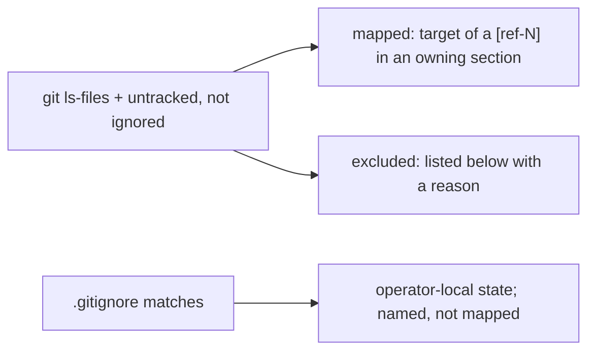

<!-- insert-before: ## Architecture Topography -->
## Scope

The wiki maps every file that `git ls-files` reports plus every untracked file that `.gitignore` does not exclude: each such file is either the target of a reference in the section that owns it or a row in the first table below. Paths matched by [`.gitignore`][ref-10001] hold operator-local runtime state, credentials, build output, or private team specifications; they are named in the second table so their absence from the map is a stated decision rather than an omission.

| Excluded path | Kind | Reason not mapped |
| --- | --- | --- |
| `.codebase-map/` | Generated scan cache | Context bundles, the SQLite graph database, and per-root `tsconfig` shims written by the `codebase-map` and `query` tools that produced the graph evidence in [Architecture Topography](#architecture-topography); regenerated on every scan and not read by any a2a process |
| `cmd/a2a-iterm2-bridge/__pycache__/` | Interpreter cache | CPython bytecode for `bridge.py`, regenerated on import |
| `docs/wiki.md` | This document | Self-reference |
| `docs/wiki-parts/` | Generation intermediates | Per-section drafts from which this document was merged; superseded by it |
| `docs/wiki_outline.json` | Generation outline | Section titles and per-section file inventories derived from this document's references; describes the wiki rather than the system |

| Ignored path (`.gitignore`) | Content |
| --- | --- |
| config.json, registry.json, bridge-registry.PORT.json, bridge.pid, messages.log | Runtime state under the checkout root; contracts in [Configuration and Persistent State](#configuration-and-persistent-state) |
| node_modules/, package-lock.json | Installed dependencies |
| cmd/a2a-dashboard/a2a-dashboard, cmd/a2a-input-probe/a2a-input-probe | Go build outputs; see [Dashboard and Operator Interfaces](#dashboard-and-operator-interfaces) |
| teams/ other than the tracked star-wars and west-world samples | Operator-authored and generated team specifications, including the worklist generators documented in [Installation and Generated Assets](#installation-and-generated-assets) |
| tools/tunnel-client/v0.0.16/ | Downloaded third-party executable bundle |
| .archive/, archive/, wiki/, .claude/, .mcp.*, .vscode/, .DS_Store | Operator archives, local agent and editor settings, OS metadata |

<!-- refs -->
[ref-10001]: ../.gitignore
