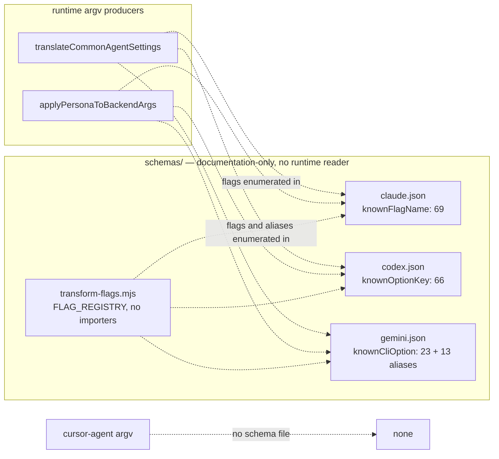
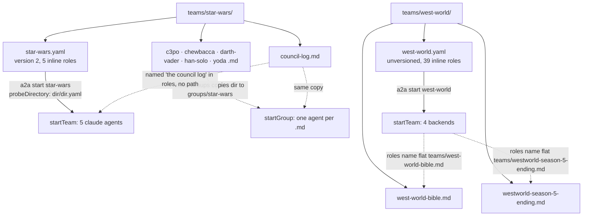

<!-- insert-before: See [Agent Lifecycle](#agent-lifecycle) for materialization of normalized specifications and [Runtime State and Observability](#runtime-state-and-observability) for reload planning against them. -->
<a id="team-specifications-and-backend-translation-backend-cli-schemas"></a>
### Backend CLI schemas



| File | `$id` / `title` constant | Required top-level keys | Flag vocabulary | Value vocabulary |
| --- | --- | --- | --- | --- |
| [`schemas/claude.json`][ref-6001] | `claude-code-cli-reference.schema.json` / `CLI reference` | 8: `documentationIndex`, `title`, `summary`, `commands`, `flags`, `systemPromptFlags`, `notes`, `seeAlso` | [`knownFlagName`][ref-6004]: 69 strings; short aliases (`-c`, `-n`, `-p`, `-r`, `-v`, `-w`) are separate members | No per-flag value enum; [`systemPromptFlags`][ref-6005] pins the two replacement and two append system-prompt flags |
| [`schemas/codex.json`][ref-6002] | `codex-cli-reference.schema.json` / `Command line options` | 8: `title`, `summary`, `howToRead`, `globalFlagOptions`, `commandOverview`, `commandDetails`, `flagCombinationsAndSafetyTips`, `relatedResources` | [`knownOptionKey`][ref-6006]: 66 strings; long name and aliases joined in one string (`--model, -m`); positionals as `PROMPT`, `SESSION_ID` | [`knownOptionType`][ref-6007] holds value sets as display strings (`untrusted \| on-request \| never`, `read-only \| workspace-write \| danger-full-access`); [`commandDetails`][ref-6008] requires all 20 subcommand entries |
| [`schemas/gemini.json`][ref-6003] | `gemini-cli-cheatsheet.schema.json` / `Gemini CLI cheatsheet` | 10: `title`, `summary`, `cliCommands`, `positionalArguments`, `interactiveCommands`, `cliOptions`, `modelSelection`, `extensionsManagement`, `mcpServerManagement`, `skillsManagement` | [`knownCliOption`][ref-6009]: 23 long options; [`knownCliOptionAlias`][ref-6011]: 13 short aliases in a separate, unpaired enum | [`knownAllowedValue`][ref-6010]: approval modes `default`, `auto_edit`, `yolo`, `plan`, output formats, and model aliases |

```json
    "knownOptionKey": {
      "enum": [
        "PROMPT",
        "--image, -i",
        "--model, -m",
        "--oss",
        "--profile, -p",
        "--sandbox, -s",
        "--ask-for-approval, -a",
        "--dangerously-bypass-approvals-and-sandbox, --yolo",
```

*`schemas/codex.json:1036-1045`*

[`schemas/claude.json`][ref-6001], [`schemas/codex.json`][ref-6002], and [`schemas/gemini.json`][ref-6003] are documentation-only JSON Schema (draft 2020-12) documents: no file in the repository names, loads, or imports them, the live codebase-map overview of `schemas/` indexes only `schemas/transform-flags.mjs`, and no instance document carrying any of their `title` constants exists in the tree. Each schema describes a structured transcription of one vendor's CLI reference page rather than an a2a file format, closing every object with `additionalProperties: false` and restricting flag names, command syntaxes, and option types to closed enums. The closed enums are the part with value for a2a, because they record per backend the exact flag spellings that existed when each page was transcribed; unlike [`schemas/a2a-team.schema.json`][ref-267] and [`schemas/config.schema.json`][ref-19], which describe a2a's own files, these three describe third-party CLIs, and all of them share the status of declarative contracts without a runtime reader. [`package.json`][ref-6029] lists `schemas` in `files`, so the three documents ship in the npm package.

The three files transcribe three differently organized vendor pages and therefore disagree on structure. Claude lists each short alias as its own enum member, Codex packs the long name and its aliases into one display string, so an exact-match lookup for `-m` fails until the string is split on `, `, and Gemini keeps long options and aliases in two enums with no pairing between them. Value vocabularies are equally uneven: Gemini enumerates approval-mode values, Codex embeds them inside type display strings, and Claude enumerates none. Validating argv against the three files would require a per-backend adapter, and none exists.

| Backend | Runtime flag or argument | Producer | Schema entry |
| --- | --- | --- | --- |
| `claude` | `--model`, `--dangerously-skip-permissions`, `--permission-mode` | [`translateCommonAgentSettings()`][ref-260] | [`knownFlagName`][ref-6004] members |
| `claude` | `--append-system-prompt` | [`applyPersonaToBackendArgs()`][ref-6012] | `knownFlagName`; `systemPromptFlags.appendFlags` |
| `codex` | `--model`/`-m`, `--dangerously-bypass-approvals-and-sandbox`, `--ask-for-approval`/`-a` `never`, `--sandbox`/`-s` | `translateCommonAgentSettings()` | [`knownOptionKey`][ref-6006] strings; values in [`knownOptionType`][ref-6007] |
| `codex` | Trailing persona positional | `applyPersonaToBackendArgs()` | `knownOptionKey` member `PROMPT` |
| `gemini` | `--model`/`-m`, `--approval-mode` (`yolo`, `plan`, `auto_edit`), `--skip-trust` | `translateCommonAgentSettings()` | [`knownCliOption`][ref-6009], [`knownCliOptionAlias`][ref-6011], [`knownAllowedValue`][ref-6010] |
| `gemini` | `--prompt-interactive` | `applyPersonaToBackendArgs()` | `knownCliOption` |
| `cursor-agent` | `--yolo`, `--sandbox disabled\|enabled`, `--approve-mcps`, `--mode plan` | `translateCommonAgentSettings()` | No schema file |

A read-only cross-check run on 2026-10-13, a Node script that parsed the three files, split Codex keys on `, `, and imported [`FLAG_REGISTRY`][ref-460], found every flag in the table above for `claude`, `codex`, and `gemini` present in the corresponding schema enum, and every flag and alias that `FLAG_REGISTRY` maps for those three backends present as well. Cursor Agent has no schema file, which matches `FLAG_REGISTRY` mapping `cursor-agent` to `null` for every concept (see [Flag transformer](#installation-and-generated-assets-flag-transformer)). The agreement is a snapshot rather than an enforced property: no test, lint rule, or script compares the argv produced by [`src/agent-backend-args.mjs`][ref-245] or [`preparePersonaDelivery()`][ref-418] with these files, so a vendor rename leaves every copy to drift independently.

Value vocabularies already diverge between [`schemas/transform-flags.mjs`][ref-459] and the schemas. The transformer's [`approvalMode`][ref-6014] concept lists `on-request` and `never` for Codex where `knownOptionType` also admits `untrusted`, and lists `default`, `auto_edit`, and `yolo` for Gemini where `knownAllowedValue`, and the runtime's `approval: plan` translation, also use `plan`. The divergence is inert because [`transformParsedFlags()`][ref-6013] never reads the `allowed` lists; it copies values through unchecked.

<a id="team-specifications-and-backend-translation-shipped-sample-teams"></a>
### Shipped sample teams



| File | Kind | Loader treatment | Role in the sample |
| --- | --- | --- | --- |
| [`teams/star-wars/star-wars.yaml`][ref-272] | Team spec | Resolved as `<dir>/<dir>.yaml` by [`probeDirectory()`][ref-270] | `version: 2`, `defaults.backend: claude`, five agents with inline `role` |
| [`teams/star-wars/yoda.md`][ref-6020] | Group persona | Ignored by team launch; group member `yoda` when the directory is a group | Inverted-syntax voice; the YAML embeds the same text |
| [`teams/star-wars/han-solo.md`][ref-6019] | Group persona | Group member `han-solo` | Voice only; the YAML adds the scope lane and Chewbacca translation duty |
| [`teams/star-wars/darth-vader.md`][ref-6018] | Group persona | Group member `darth-vader` | Voice only; the YAML adds the risk-and-destruction lane |
| [`teams/star-wars/c3po.md`][ref-6015] | Group persona | Group member `c3po` | Voice plus an appended a2a communications section with CLI examples |
| [`teams/star-wars/chewbacca.md`][ref-6016] | Group persona | Group member `chewbacca` | Wookiee-only voice; the YAML adds the verification-by-execution lane |
| [`teams/star-wars/council-log.md`][ref-6017] | Consult ledger | Group member `council-log` when the directory is a group | Six-row verdict table the YAML roles read and append to |
| [`teams/west-world/west-world.yaml`][ref-6021] | Team spec | Resolved as `<dir>/<dir>.yaml` | 39 agents, no `version`, four backends |
| [`teams/west-world/west-world-bible.md`][ref-6022] | Canon brief | Never opened by a2a | Shared reference every agent is told to read first |
| [`teams/west-world/westworld-season-5-ending.md`][ref-6023] | Swarm deliverable | Never opened by a2a | Converged output document owned by the `showrunner` agent |

| Sample | `version` | Yolo default | Agents | Backend, approval → translated argv |
| --- | --- | --- | ---: | --- |
| `star-wars` | `2` | on | 5 | `claude`, `default` → `--dangerously-skip-permissions` for every agent unless `--no-yolo` |
| `west-world` | absent | off | 29 | `claude`, `default` → none |
| `west-world` | absent | off | 3 | `gemini`, `plan` → `--approval-mode plan --skip-trust` (`season-architect`, `the-sublime`, `rehoboam`) |
| `west-world` | absent | off | 2 | `gemini`, `default` → none (`continuity-bible`, `bernard-lowe`) |
| `west-world` | absent | off | 2 | `codex`, `default` → none (`ending-critic`, `maeve-millay`) |
| `west-world` | absent | off | 2 | `cursor-agent`, `default` → none (`william-man-in-black`, `felix-and-sylvester`) |
| `west-world` | absent | off | 1 | `codex`, `never` → `--dangerously-bypass-approvals-and-sandbox` (`ashley-stubbs`) |

The rows were produced on 2026-10-13 by a read-only Node probe that imported [`resolveTeamSpecPath()`][ref-247], `loadTeamSpec()`, and [`teamSpecDefaultsToYolo()`][ref-250] from `src/a2a-team-spec.mjs`, replayed the `{...defaults, ...agent}` merge and yolo order of [`normalizeTeamAgent()`][ref-255], and passed each agent to [`translateCommonAgentSettings()`][ref-260]. No sample agent sets `args`, `flags`, `model`, `sandbox`, `cwd`, `env`, or `role_file`.

`teams/star-wars/` and `teams/west-world/` are sample teams and the only tracked content under `teams/`. [`.gitignore`][ref-6031] ignores `teams/`, and `git check-ignore --no-index` reports that rule matching both directories, but the ten files belong to the repository's initial commit and Git applies ignore rules only to untracked paths, so they stay tracked while any new file placed beside them, such as an appended council log or a regenerated deliverable, stays ignored unless force-added. Packaging follows a different rule: [`package.json`][ref-6029] lists `teams` in `files`, and `npm pack --dry-run --ignore-scripts` (npm 11.16.0) on this working tree packs 284 files under `teams/`, only ten of them tracked, so a publish from a working tree also ships the ignored generators, plans, and nested `node_modules` described in [Artifact inventory](#installation-and-generated-assets-artifact-inventory).

```yaml
version: 2
name: star-wars
description: Five-agent character-driven review council for the DisputeWell codebase — each persona owns one review lane and answers consults with a concrete verdict.
dashboard: true

defaults:
  backend: claude
  role: |
    you are in the star wars universe... may the force be with you.
```

*`teams/star-wars/star-wars.yaml:1-9`*

[`teams/star-wars/star-wars.yaml`][ref-272] exercises the version-2 contract in its smallest complete form. `version: 2` turns on yolo-by-default through [`teamSpecDefaultsToYolo()`][ref-250], `defaults` supplies the backend and a one-line base role that [`combinedRolePrompt()`][ref-256] prepends to each agent's text, and every agent carries an inline `role` rather than a `role_file`. Four of the five roles are lane contracts (`YOUR LANE`, `REPORTING`, `DONE`, `FIRST ACTION FROM COLD START`) that partition review work and prescribe `a2a list` plus `a2a peek` as the cold-start protocol, so the sample demonstrates a2a coordination conventions, not only spec syntax. The spec is a captured working team rather than a neutral template: its description targets the DisputeWell codebase, and the Chewbacca role hard-codes `/Users/op/Documents/dev/DisputeWell` as the directory in which checks run ([`star-wars.yaml:238`][ref-6024]).

The five persona files are the group-mode rendition of the same cast and are never read by team launch, because no agent sets `role_file` and the YAML embeds expanded versions of their text. They become live only when the directory is used as a group, which [`installGroups()`][ref-483] arranges by copying `teams/star-wars/` to the installed `groups/star-wars`; [`startGroup()`][ref-416] then reads each member file in full as the persona ([`src/cli.mjs:3606`][ref-6028]). Because a group member's persona is exactly its file, each file carries its own reply instruction (`a2a --reply --<peer>`), and [`teams/star-wars/c3po.md`][ref-6015] appends a short a2a communications section. Where both a spec and a group copy are discoverable, [`cmdStart()`][ref-274] starts a group only when no team spec resolved ([`src/cli.mjs:3979`][ref-6027]), so `a2a start star-wars` launches the YAML cast.

[`teams/star-wars/council-log.md`][ref-6017] is a sample consult ledger rather than a persona: a Markdown table with `agent`, `requester`, `question`, `verdict`, and `evidence` columns holding six C-3PO rows from a role-play consult, including a requester `start-wars` that names no agent in the spec. The YAML roles tell every member to read "the council log" and append rows to it, but name no path, so agents locate the ledger by convention. In a group copy, [`listGroupMembers()`][ref-51] turns it into a sixth member `council-log` whose persona is the table; [Install-location coupling](#installation-and-generated-assets-install-location-coupling) owns that installer-side consequence.

```yaml
  ashley-stubbs:
    backend: codex
    approval: never
    role: |
```

*`teams/west-world/west-world.yaml:309-312`*

[`teams/west-world/west-world.yaml`][ref-6021] is the large-swarm sample: 39 agents and no `version` field, so every agent stays interactive unless it opts out, and exactly one does, through `approval: never` on `ashley-stubbs` ([`west-world.yaml:309`][ref-6025]), which [`translateCommonAgentSettings()`][ref-260] treats as bypass regardless of yolo. The spec exercises per-agent `backend` overrides over the implicit `claude` default across all four supported backends, and it reaches three outcomes of the [Backend translation matrix](#team-specifications-and-backend-translation-backend-translation-matrix): no added flags, Gemini plan mode, and Codex bypass. It is the counterexample to the version-2 sample: starting it with the default CLI `--yolo` still leaves 38 agents prompting for approval, as [Yolo resolution](#team-specifications-and-backend-translation-yolo-resolution) specifies for unversioned specs. `dashboard: true` in both samples makes a team start build the linked-window view.

```yaml
    The swarm's deliverable is a file at `teams/westworld-season-5-ending.md`.
    Contribute toward that artifact. When you have a concrete finding, pitch,
    objection, fix, or improvement, frame it so the orchestrator can fold it
    into the document.

    At the start of your work, read `teams/west-world-bible.md` if it exists.
    Treat it as the shared canon brief for the room. If it is missing, rely on
    known canon but flag uncertainty instead of bluffing.
```

*`teams/west-world/west-world.yaml:13-20`*

[`teams/west-world/west-world-bible.md`][ref-6022] and [`teams/west-world/westworld-season-5-ending.md`][ref-6023] are sample working documents that a2a never opens. The team-spec loader reads only `.yaml`, `.yml`, and `.json`, and [`probeDirectory()`][ref-270] selects `west-world.yaml` by name before scanning siblings, so neither Markdown file affects resolution or produces an ambiguity error. The defaults role assigns their meaning: the bible is the canon brief every agent reads first, and the ending document is the showrunner-owned deliverable the swarm converges on. The shipped ending file is one such deliverable, and its own `Room status` section records which agents contributed and which were blocked ([`westworld-season-5-ending.md:469`][ref-6030]).

The role text and the tracked layout disagree on location. Both roles name flat paths (`teams/west-world-bible.md`, `teams/westworld-season-5-ending.md`, [`west-world.yaml:13`][ref-6026]) while the files sit under `teams/west-world/`, and no agent sets `cwd`, so agents resolve those paths against the launch directory. Launched from the checkout root, every agent finds no bible and takes the role's "if it is missing" fallback, and the `showrunner` creates a new flat deliverable instead of revising the tracked one. No test loads either sample; the one test that names `star-wars`, in [`tests/install-script.test.mjs`][ref-549], expects the flat `teams/star-wars.yaml` and fails, as recorded in [Measured results](#verification-architecture-measured-results).

<!-- refs -->
[ref-6001]: ../schemas/claude.json
[ref-6002]: ../schemas/codex.json
[ref-6003]: ../schemas/gemini.json
[ref-6004]: ../schemas/claude.json#L575
[ref-6005]: ../schemas/claude.json#L225
[ref-6006]: ../schemas/codex.json#L1036
[ref-6007]: ../schemas/codex.json#L1106
[ref-6008]: ../schemas/codex.json#L103
[ref-6009]: ../schemas/gemini.json#L599
[ref-6010]: ../schemas/gemini.json#L646
[ref-6011]: ../schemas/gemini.json#L626
[ref-6012]: ../src/cli.mjs#L1449
[ref-6013]: ../schemas/transform-flags.mjs#L436
[ref-6014]: ../schemas/transform-flags.mjs#L134
[ref-6015]: ../teams/star-wars/c3po.md
[ref-6016]: ../teams/star-wars/chewbacca.md
[ref-6017]: ../teams/star-wars/council-log.md
[ref-6018]: ../teams/star-wars/darth-vader.md
[ref-6019]: ../teams/star-wars/han-solo.md
[ref-6020]: ../teams/star-wars/yoda.md
[ref-6021]: ../teams/west-world/west-world.yaml
[ref-6022]: ../teams/west-world/west-world-bible.md
[ref-6023]: ../teams/west-world/westworld-season-5-ending.md
[ref-6024]: ../teams/star-wars/star-wars.yaml#L238
[ref-6025]: ../teams/west-world/west-world.yaml#L309
[ref-6026]: ../teams/west-world/west-world.yaml#L13
[ref-6027]: ../src/cli.mjs#L3979
[ref-6028]: ../src/cli.mjs#L3606
[ref-6029]: ../package.json#L49
[ref-6030]: ../teams/west-world/westworld-season-5-ending.md#L469
[ref-6031]: ../.gitignore#L5
