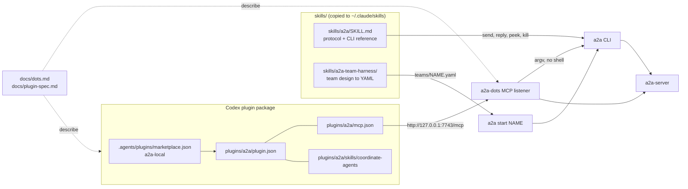
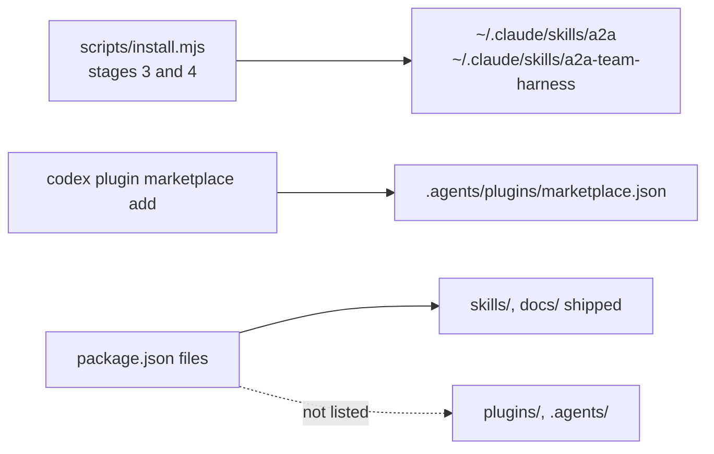
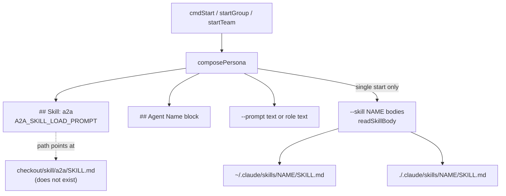
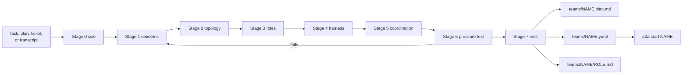
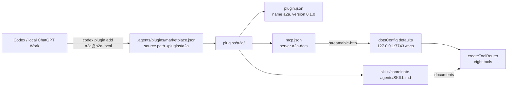
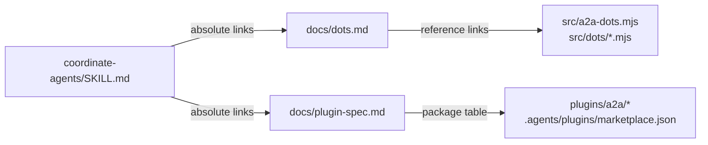
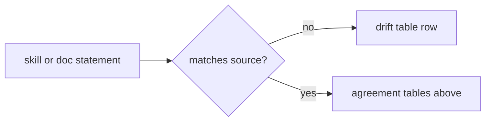

<!-- insert-before: - **Installation and Generated Assets** and **Verification Architecture** cover bootstrap, generated team support, and the test strategy. See [Installation and Generated Assets](#installation-and-generated-assets) and [Verification Architecture](#verification-architecture). -->
- **Agent Skills and Plugin Packaging** maps the two Claude skills, the Codex plugin package, and the Dot and plugin prose documents against the source they describe. See [Agent Skills and Plugin Packaging](#agent-skills-and-plugin-packaging).
<!-- insert-before: ## Installation and Generated Assets -->
## Agent Skills and Plugin Packaging



The repository ships agent-facing instruction artifacts beside its code: a runtime skill that teaches spawned agents the envelope protocol and the CLI, a team-harness skill that turns a task into a launchable team spec, a Codex plugin package that points a local Codex or ChatGPT Work client at the Dot adapter, and two prose documents for that adapter and package. Every one of them is a contract written in prose against [`src/cli.mjs`][ref-3], the team-spec loader, or [`src/a2a-dots.mjs`][ref-7], and nothing in the repository parses or tests the prose, so the source can move while the text stands still. The subsections map each file to the runtime contract it depends on and record where the text and the current working tree disagree.

- [Artifact inventory](#agent-skills-and-plugin-packaging-artifact-inventory)
- [Runtime skill](#agent-skills-and-plugin-packaging-runtime-skill)
- [Team-harness skill](#agent-skills-and-plugin-packaging-team-harness-skill)
- [Codex plugin package](#agent-skills-and-plugin-packaging-codex-plugin-package)
- [Prose documentation](#agent-skills-and-plugin-packaging-prose-documentation)
- [Drift against source](#agent-skills-and-plugin-packaging-drift-against-source)

<a id="agent-skills-and-plugin-packaging-artifact-inventory"></a>
### Artifact inventory



| Path | Kind | Consumer | Distribution | Owning subsection |
| --- | --- | --- | --- | --- |
| [`skills/a2a/SKILL.md`][ref-7005] | Claude skill | Every spawned agent; operators | Installer stage 3 | [Runtime skill](#agent-skills-and-plugin-packaging-runtime-skill) |
| [`skills/a2a-team-harness/SKILL.md`][ref-7006] | Claude skill, seven-stage design procedure | Planning agent before launch | Installer stage 4 (whole tree) | [Team-harness skill](#agent-skills-and-plugin-packaging-team-harness-skill) |
| [`skills/a2a-team-harness/references/architecture.md`][ref-7012] | Design theory | Harness Stage 0 | Installer stage 4 | Team-harness skill |
| [`skills/a2a-team-harness/references/topologies.md`][ref-7015] | Worked roster per topology | Harness Stage 2 | Installer stage 4 | Team-harness skill |
| [`skills/a2a-team-harness/references/execution-discipline.md`][ref-7013] | Fifteen drop-in role blocks for fix-to-terminus swarms | Harness Stages 4 and 5 | Installer stage 4 | Team-harness skill |
| [`skills/a2a-team-harness/references/team-spec-contract.md`][ref-7014] | Binding YAML rules and validation checklist | Harness Stage 7 | Installer stage 4 | Team-harness skill |
| [`skills/a2a-team-harness/assets/harness-template.md`][ref-7010] | Fill-in role brief | Harness Stage 4 | Installer stage 4 | Team-harness skill |
| [`skills/a2a-team-harness/assets/team-spec.example.yaml`][ref-7011] | Three-agent star spec (`bug-killers`) | Harness Stage 7 | Installer stage 4 | Team-harness skill |
| [`skills/a2a-team-harness/assets/bug-killers/scanner.md`][ref-7007] | `role_file` for the example's read-only auditor | `team-spec.example.yaml` | Installer stage 4 | Team-harness skill |
| [`skills/a2a-team-harness/assets/bug-killers/surgeon.md`][ref-7008] | `role_file` for the example's fixer | `team-spec.example.yaml` | Installer stage 4 | Team-harness skill |
| [`skills/a2a-team-harness/assets/fix-swarm.example.yaml`][ref-7009] | Four-agent racing-pairs spec with every discipline block inline | Harness Stage 7 | Installer stage 4 | Team-harness skill |
| [`.agents/plugins/marketplace.json`][ref-7001] | Local plugin marketplace `a2a-local` | Codex | `codex plugin marketplace add <checkout>` | [Codex plugin package](#agent-skills-and-plugin-packaging-codex-plugin-package) |
| [`plugins/a2a/plugin.json`][ref-7002] | Plugin identity and `com.openai` presentation | Codex, ChatGPT Work | Marketplace entry | Codex plugin package |
| [`plugins/a2a/mcp.json`][ref-7003] | Streamable HTTP MCP endpoint | Codex, ChatGPT Work | Marketplace entry | Codex plugin package |
| [`plugins/a2a/skills/coordinate-agents/SKILL.md`][ref-7004] | Tool-selection and reply-handling skill | Model in the plugin host | Marketplace entry | Codex plugin package |
| [`docs/dots.md`][ref-7016] | Operator guide to `a2a-dots` | Humans; linked from the plugin skill | npm `files` (`docs`) | [Prose documentation](#agent-skills-and-plugin-packaging-prose-documentation) |
| [`docs/plugin-spec.md`][ref-7017] | Package specification and local setup | Humans; linked from the plugin skill | npm `files` (`docs`) | Prose documentation |

The two skill trees reach agents through the installer, whose copy semantics belong to [Installer stages](#installation-and-generated-assets-installer-stages); [`copyTreeWithBackup()`][ref-453] copies every file under each tree, which is why the harness's `references/` and `assets/` arrive beside its `SKILL.md`. The plugin package takes a different route: the `files` list in [`package.json`][ref-7031] names `skills` and `docs` but neither `plugins` nor `.agents`, and [`scripts/install.mjs`][ref-449] never reads either directory, so the package exists only in a checkout and is registered by pointing Codex at that checkout. The split keeps the Claude path self-contained while leaving the Codex path dependent on a live source tree, which is the arrangement the plugin skill itself states when it says its linked documents "live in the source repository, outside the install cache".

<a id="agent-skills-and-plugin-packaging-runtime-skill"></a>
### Runtime skill



| Block in [`skills/a2a/SKILL.md`][ref-7005] | Instructs the agent to | Source contract it relies on | Owning section |
| --- | --- | --- | --- |
| `<identity>`, `<embodiment>`, `<character_neutrality>`, core rule 4 | Treat the a2a name as a persona; persona precedence is `--prompt`, then name, then `--skill` | The `## Agent Name` block that [`composePersona()`][ref-7020] prepends to every persona | This subsection |
| `<message_economy>`, `<partnership>`, `<peer_message_workflow>`, `<edge_cases>` | Send only substantive messages; reply through `a2a`, never in the pane | Send grammars and inferred-peer rules | [Message Framing and Identity](#message-framing-and-identity-send-grammars) |
| `<message_format>` | Pass prose bodies through a quoted heredoc | Flag-send positional content | [Send grammars](#message-framing-and-identity-send-grammars) |
| `<peer_protocol>`, `<sender_trust>`, `<action_semantics>` | Read `from` and `origin` from the `<a2a>` header; answer with `--reply`, ask with `--ask` | [`wrapEnvelope()`][ref-99] header and the `message` / `reply` / `ask` actions | [Envelope contract](#message-framing-and-identity-envelope-contract) |
| `<delegation>` | Run decompose, spawn, monitor, correct, synthesize with `a2a start --prompt --skill`, `a2a peek`, `a2a list`, `a2a kill` | [`cmdStart()`][ref-274], [`cmdList()`][ref-231], [`cmdKill()`][ref-381] | [Agent Lifecycle](#agent-lifecycle) |
| `# CLI Reference` | Construct commands | An earlier copy of [`usage()`][ref-395] | [Command-Line Orchestrator](#command-line-orchestrator-dispatch-and-command-families) |

```js
const REPO_TEAMS_DIR = join(dirname(fileURLToPath(import.meta.url)), "..", "teams");
const COMPLETIONS_DIR = join(dirname(fileURLToPath(import.meta.url)), "..", "completions");
const PACKAGE_A2A_SKILL_PATH = join(dirname(fileURLToPath(import.meta.url)), "..", "skill", "a2a", "SKILL.md");
```

*`src/cli.mjs:36-38`*

```js
// The skills live in `skills/` (plural). This pointed at a non-existent
// `skill/` for long enough that every install silently reported "skipped:
// skill/a2a/SKILL.md not found in package" and still exited 0 — the skill,
// which is the entire point of the install, never landed.
const A2A_SKILL_SRC_DIR = path.join(A2A_ROOT, "skills", "a2a");
const A2A_SKILL_FILE = path.join(A2A_SKILL_SRC_DIR, "SKILL.md");
```

*`scripts/install.mjs:89-94`*

The runtime skill reaches an agent by two independent paths. The installer copies [`skills/a2a/`][ref-7005] to `~/.claude/skills/a2a` through [`installSkill()`][ref-478], and [`composePersona()`][ref-7020] prepends a `## Skill: a2a` block whose body is [`A2A_SKILL_LOAD_PROMPT`][ref-7019] to every persona built by single, group, and team starts, so an agent is pointed at the protocol text even when nobody passes `--skill a2a`. The two paths disagree about where the file lives: [`A2A_SKILL_SRC_DIR`][ref-7022] uses the plural `skills/`, and the installer comment records that the singular spelling once kept the skill from ever landing, while [`PACKAGE_A2A_SKILL_PATH`][ref-7018] in the CLI still spells `skill/`, a directory that does not exist in this checkout. Every spawned agent therefore receives an instruction to load a missing file and depends on the installed copy under `~/.claude/skills/a2a` being discoverable by its backend under the name `a2a`.

`--skill NAME` is the operator's way to append further skill text, and [`readSkillBody()`][ref-7021] resolves it from `~/.claude/skills/NAME/SKILL.md` first and `./.claude/skills/NAME/SKILL.md` second, skipping `a2a` because the automatic block already covers it; the runtime skill's own CLI reference states that order correctly. Team and group starts pass an empty skill list to `composePersona()`, which is the source of the harness rule that a per-agent skill must be named inside the role text. The skill's colon example `a2a --message:darth --mood=angry` is also load-bearing in the other direction: the comment above [`ENVELOPE_EXTRA_DISPLAY_KEYS`][ref-110] in [`src/server/envelope.mjs`][ref-7030] cites that example as the origin of `mood`, one of the two metadata keys rendered into the header, so the skill text and the header allowlist are coupled by a comment rather than by a test.

<a id="agent-skills-and-plugin-packaging-team-harness-skill"></a>
### Team-harness skill



| File | Role inside the skill | Runtime contract it encodes |
| --- | --- | --- |
| [`SKILL.md`][ref-7006] | Seven stages, output mode (write files or print), done condition | `a2a start <team-name>`; `version: 2`; `role` / `role_file` |
| [`references/architecture.md`][ref-7012] | Orchestrator-worker rationale and the isolation-boundary rule | None; design theory only |
| [`references/topologies.md`][ref-7015] | Star, pipeline, adversarial pair, supervised and racing pairs, fan-out, composition | Backend casting (`claude` manager, `codex` fixer) |
| [`references/execution-discipline.md`][ref-7013] | AUTHORITIES, RUN LOCK, static worklist, correct-side contract, bans, drift re-anchor, never-park, NEXT ACTION, reporting | `a2a peek`, `a2a --<agent> --command '$write\|ENTER' --write ...` |
| [`references/team-spec-contract.md`][ref-7014] | File resolution, field rules, orchestrator command surface, validation checklist | Team-spec resolver and normalizer |
| [`assets/harness-template.md`][ref-7010] | Eight-field role brief plus execution add-ons | Inline `role:` or `role_file:` text |
| [`assets/team-spec.example.yaml`][ref-7011] | Worked star: `orchestrator`, `scanner`, `surgeon` | `defaults.role` plus two spec-relative `role_file` entries |
| [`assets/bug-killers/scanner.md`][ref-7007], [`assets/bug-killers/surgeon.md`][ref-7008] | The two role files that example references | Read by `role_file` relative to the spec directory |
| [`assets/fix-swarm.example.yaml`][ref-7009] | Racing pairs `alpha-mgr`/`alpha-fix`, `beta-mgr`/`beta-fix`, discipline blocks numbered to `execution-discipline.md` | `backend: codex` on fixers; RUN LOCK in `<REPO>/.audit/status.md` |

```yaml
  scanner:
    role_file: bug-killers/scanner.md

  surgeon:
    role_file: bug-killers/surgeon.md
```

*`skills/a2a-team-harness/assets/team-spec.example.yaml:35-39`*

[`skills/a2a-team-harness/SKILL.md`][ref-7006] is a design procedure that runs before any agent exists and ends in two artifacts, a human plan and a team-spec YAML, so the expensive decisions (team size, cut lines, integration owner) are reviewed on paper rather than discovered by a running swarm. Its binding half is [`references/team-spec-contract.md`][ref-7014], whose field rules match the loader on the points that decide launch behavior: [`combinedRolePrompt()`][ref-256] rejects `role` and `role_file` at one level and joins `defaults` text before agent text, [`loadRoleText()`][ref-7028] resolves `role_file` against the spec's directory, and [`teamSpecDefaultsToYolo()`][ref-250] turns on unattended mode at `version: 2`, all as [Spec fields and normalization](#team-specifications-and-backend-translation-spec-fields-and-normalization) and [Yolo resolution](#team-specifications-and-backend-translation-yolo-resolution) describe. The example spec's `role_file: bug-killers/scanner.md` therefore resolves to `assets/bug-killers/scanner.md` when the example is launched in place and to `teams/bug-killers/scanner.md` under the flat layout the contract prescribes, which is why the two role files ship beside the example rather than inside it.

[`references/execution-discipline.md`][ref-7013] states that each of its fifteen patterns came from runs of the `dw-bug-killers` swarm, and its RUN LOCK and static-worklist blocks match the generators described in [Worklist generators](#installation-and-generated-assets-worklist-generators), which record `RUN LOCK: HELD` in `status.md` while an oracle runs. [`assets/fix-swarm.example.yaml`][ref-7009] is the assembled form of those blocks, numbered pattern by pattern, so the reference and the asset are meant to change together; nothing enforces that coupling beyond the comment at the top of the asset. The harness's rule that per-agent skills belong inside role text follows from [`startTeam()`][ref-243], which composes each team persona with no `--skill` list.

<a id="agent-skills-and-plugin-packaging-codex-plugin-package"></a>
### Codex plugin package



```json
{
  "$schema": "https://agent-plugins.org/schemas/1.0.0/mcp.schema.json",
  "mcpServers": {
    "a2a-dots": {
      "type": "streamable-http",
      "url": "http://127.0.0.1:7743/mcp"
    }
  }
}
```

*`plugins/a2a/mcp.json:1-9`*

| Manifest field | Value | Source counterpart | Agreement |
| --- | --- | --- | --- |
| Marketplace `name` ([`marketplace.json`][ref-7001]) | `a2a-local` | `codex plugin add a2a@a2a-local` in [`docs/plugin-spec.md`][ref-7047] | Match |
| Marketplace `source` | `{ "source": "local", "path": "./plugins/a2a" }` | Directory [`plugins/a2a/`][ref-7002] | Match |
| `plugin.json` `version` | `0.1.0` | [`SERVER_INFO`][ref-7023] `version` `1.1.0` | Independent version lines |
| `mcp.json` server key | `a2a-dots` | `SERVER_INFO.name` `a2a-dots` | Match |
| `mcp.json` `url` host and port | `127.0.0.1:7743` | [`dotsConfig()`][ref-313] defaults for `A2A_DOTS_HOST` and `A2A_DOTS_PORT` | Match only at defaults |
| `mcp.json` `url` path | `/mcp` | `A2A_DOTS_MCP_PATH` default | Match only at defaults |
| Callback port in [`coordinate-agents`][ref-7046] | `7744` | `A2A_DOTS_CALLBACK_PORT` default | Match |
| `mcp.json` credential | none | [`assertToolCallAuthorized()`][ref-353] requires `Bearer` when `A2A_DOTS_EVENTS_KEY` is set | Manifest carries no token |

```js
const TOOL_FIELDS = {
  send_message: ["to", "text", "action"],
  list_agents: [],
  get_agent: ["agent"],
  receive_messages: ["after"],
  start_team: ["team"],
  stop_agent: ["agent"],
  start_agent: ["agent", "backend", "prompt", "skills", "cohort", "cwd", "interactive"],
  peek_agent: ["agent", "lines"],
};
```

*`src/dots/tools.mjs:83-92`*

| Tool | Input documented in [`coordinate-agents/SKILL.md`][ref-7004] | Allowed fields in [`TOOL_FIELDS`][ref-7024] | Agreement |
| --- | --- | --- | --- |
| `list_agents` | none | none | Match |
| `get_agent` | `agent` | `agent` | Match |
| `send_message` | `to`, `text`, optional `action` of `message` / `reply` / `ask` | `to`, `text`, `action` | Match |
| `receive_messages` | optional `after` cursor | `after` | Match |
| `start_team` | `team` | `team` | Match |
| `start_agent` | `agent`; optional `backend`, `prompt`, `skills`, `cohort`, absolute `cwd`, `interactive` | same seven | Match; `interactive: true` becomes `--no-yolo` in [`startAgentArgs()`][ref-319] |
| `peek_agent` | `agent`; optional `lines` | `agent`, `lines` | Match |
| `stop_agent` | `agent` | `agent` | Match |

The package is a pointer, not a runtime: [`plugins/a2a/plugin.json`][ref-7002] carries presentation text and default prompts, [`plugins/a2a/mcp.json`][ref-7003] names one Streamable HTTP endpoint, and [`coordinate-agents/SKILL.md`][ref-7004] tells the host model which of the eight tools in [`TOOL_DEFINITIONS`][ref-317] to call and how to treat replies. Identity, the inbox, registration ownership, and lifecycle authority all stay in the adapter described in [ChatGPT Dot Adapter](#chatgpt-dot-adapter), so a host that loads the package gains exactly the `dot` peer's authority and no more; the skill's statement that the adapter "never sends as the human operator" restates the fixed `origin: "peer"` in [Registration and tools](#chatgpt-dot-adapter-registration-and-tools). The tool surface in the skill matches the router field for field, and the adapter repeats the same tool guidance in the MCP `instructions` string built by [`createMcpServer()`][ref-7025], so a host that ignores the plugin skill still receives it over the legacy initialize path.

Three properties of the manifest follow from the source rather than from the package's own text. The URL is the adapter's default bind, so an operator who changes `A2A_DOTS_PORT`, `A2A_DOTS_HOST`, or `A2A_DOTS_MCP_PATH` must edit `mcp.json` by hand, because nothing generates it. The manifest declares no credential, while setting `A2A_DOTS_EVENTS_KEY` makes [`EVENTS_ENABLED`][ref-7053] true and requires a `Bearer` token on every `tools/call` in both eras ([Modern MCP](#chatgpt-dot-adapter-modern-mcp)); the package as written therefore reaches a keyless loopback adapter, and any other arrangement depends on the host supplying the header, which this repository does not define. No file under `tests/` reads `plugins/` or `.agents/`, so the agreement in the tables above is maintained by hand.

<a id="agent-skills-and-plugin-packaging-prose-documentation"></a>
### Prose documentation



| Document | Scope | Sections | Content not held in this wiki |
| --- | --- | --- | --- |
| [`docs/dots.md`][ref-7016] | Operator guide to `a2a-dots` | Topology, MCP tools, run defaults, identity, reply path, registration and readiness, incremental inbox reads, tests, automatic message events (protocol surface, subscription lifecycle, callback verification, signing, delivery states, truncated-event retrieval, durable state, trust boundary, authentication, cloud activation gates, event tests) | The seven-secret table separating adapter, bridge, webhook, OpenAI tunnel, and ngrok credentials; the open host-side activation gates; the procedure for recovering a truncated event's text through `receive_messages` |
| [`docs/plugin-spec.md`][ref-7017] | Specification of the Codex plugin package | Package table, operations, local setup, verification | The `codex plugin marketplace add`, `codex plugin add`, and `codex plugin list` commands; the upgrade order for adapter, bridge, and installed skill cache |

[`docs/dots.md`][ref-7016] is the operator-facing companion to [ChatGPT Dot Adapter](#chatgpt-dot-adapter), which owns the adapter's mechanics in this wiki; the document's statements checked here agree with the source on the default ports and path, the eight tools and their CLI translations, the `1.1.0` server version in [`SERVER_INFO`][ref-7023], and the omission of the `events` capability from `server/discover` when no key is set. What has decayed is its reference list, which links symbols by line number into files that have since grown, as tabulated in [Drift against source](#agent-skills-and-plugin-packaging-drift-against-source). [`docs/plugin-spec.md`][ref-7017] is the human-facing specification of the package mapped in [Codex plugin package](#agent-skills-and-plugin-packaging-codex-plugin-package); it describes the same tool set as [`src/dots/tools.mjs`][ref-316] and states that the package holds no credentials or startup hook, which matches the manifests. [`docs/plugin-spec.md`][ref-7017] and the plugin skill address the checkout through the absolute path `/Users/op/Documents/dev/a2a` ([`plugin-spec.md`][ref-7047], [`coordinate-agents/SKILL.md`][ref-7046]), so the package's setup instructions are bound to one machine's layout.

<a id="agent-skills-and-plugin-packaging-drift-against-source"></a>
### Drift against source



```js
        // Agent cwd may legitimately live outside the launch directory (e.g.
        // running a2a from one repo while pointing agents at sibling repos).
        // Resolve relative paths against launchCwd but allow absolute escapes.
        cwd: merged.cwd ? resolve(launchCwd, String(merged.cwd)) : launchCwd,
```

*`src/cli.mjs:1679-1682`*

| Artifact and statement | Current source behavior | Evidence |
| --- | --- | --- |
| [`skills/a2a/SKILL.md`][ref-7038]: "Spawned agents are instructed to read the a2a skill automatically" (same text in `usage()`) | The instruction names `<checkout>/skill/a2a/SKILL.md`; no `skill/` directory exists, while the installer and the repository use `skills/` | [`PACKAGE_A2A_SKILL_PATH`][ref-7018], [`A2A_SKILL_LOAD_PROMPT`][ref-7019] |
| [`skills/a2a/SKILL.md`][ref-7033] frontmatter: "`<a2a_message>` routing" | The delivered envelope tag is `<a2a ...>` | [`wrapEnvelope()`][ref-99] |
| [`skills/a2a/SKILL.md`][ref-7034]: envelope example `origin="user\|peer\|self"`, with `user` meaning a human | `origin` renders the operator source (default `cli`) for user-origin sends, `self` for self, and is omitted for peers | [`displayOrigin()`][ref-7029] |
| [`skills/a2a/SKILL.md`][ref-7035]: "ENTER is appended automatically" after a final paste or type | The compiler appends the backend submit ops, `C-Enter` for `cursor-agent`, when the last non-sleep op is a paste or type | [`compileSequence()`][ref-149]; [Command sequence DSL](#terminal-transport-system-command-sequence-dsl) |
| [`skills/a2a/SKILL.md`][ref-7036]: "See docs/iterm-transport.md" | The file does not exist; transport selection is documented only in this wiki | [Terminal Transport System](#terminal-transport-system) |
| [`skills/a2a/SKILL.md`][ref-7039]: `a2a list` "columns: NAME TARGET STATUS MODE COHORT CWD", `view` as a status | Output is grouped under cohort header lines that carry shared status, mode, cwd, and `view <session>`; rows add `iterm-only` | [`cmdList()`][ref-231] |
| [`skills/a2a/SKILL.md`][ref-7040]: `kill --all` reaps "every `*-view` dashboard present in tmux" and orphans "cached in `~/.claude/skills/a2a/registry.json` _and_" token-stamped | Views and tmux orphans are both filtered to sessions carrying this install's token, cache membership is not required, iTerm orphans are closed too, and the cache file is `<A2A_ROOT>/registry.json` | [`cmdKill()`][ref-381]; [Teardown and orphan sweep](#agent-lifecycle-teardown-and-orphan-sweep) |
| [`skills/a2a/SKILL.md`][ref-7037] CLI reference for `start` and `kill` | `usage()` also documents `--team-file`, `--cohort`, `--no-yolo`, `kill --agent`, `raw`, `status`, `events`, `attention`, `doctor`, `reload`, `layout`, `pm`; the skill omits them | [`usage()`][ref-395] |
| [`skills/a2a-team-harness/SKILL.md`][ref-7041] and the contract: kebab-case "so `sanitizeId` leaves it unchanged" | [`sanitizeId()`][ref-7026] only derives a default name from the cwd basename; team names and agent ids pass [`normalizeDeclaredAgentId()`][ref-7027], which accepts `[A-Za-z0-9_-]+` and exits on anything else instead of sanitizing | [`normalizeTeamSpec()`][ref-244], [`normalizeTeamAgent()`][ref-255] |
| [`skills/a2a-team-harness/SKILL.md`][ref-7042] Stage 7 template: `cwd: $HOME/Documents/dev/a2a` | `cwd` is passed to `path.resolve` against the launch directory with no environment expansion, so `$HOME` becomes a literal path segment under the launch cwd | `src/cli.mjs:1679-1682` above |
| [`skills/a2a-team-harness/SKILL.md`][ref-7043]: write specs to `$HOME/Documents/dev/a2a/teams/` | That directory is ignored by the `teams/` rule in [`.gitignore`][ref-474] apart from the two tracked samples, and it is the package teams directory only for a checkout at that path | [`candidatePaths()`][ref-269]; [Artifact inventory](#installation-and-generated-assets-artifact-inventory) |
| [`team-spec-contract.md`][ref-7044] "File resolution": flat, then nested | Candidates are `<cwd>/teams`, then the package `teams/`, then a cwd-relative path for bare names; each base tries `<ref>` itself, probed when it is a directory, before `<ref>.yaml\|.yml\|.json`, and a directory also resolves through a sole spec file | [`candidatePaths()`][ref-269], [`probeDirectory()`][ref-270]; [Spec resolution](#team-specifications-and-backend-translation-spec-resolution) |
| [`team-spec-contract.md`][ref-7045]: "The file stem must equal `name`" | Not enforced; a `name` field overrides the stem, which is only the default | [`normalizeTeamSpec()`][ref-244] |
| [`docs/dots.md`][ref-7048] references | 33 of its 39 line-anchored links land on a line other than the named definition, for example `ref-tool-definitions` on the `import` at `tools.mjs` line 6 while `TOOL_DEFINITIONS` is at line 13 | [`TOOL_DEFINITIONS`][ref-317], [`createModernHandler()`][ref-327] |
| [`docs/dots.md`][ref-7049] inline citations `a2a-dots.mjs:359`, `:371`, `:441` | `events.emit` is at line 387, the 503 at line 399, and the startup `drain()` at line 475 | [`src/a2a-dots.mjs`][ref-7] |

The runtime skill's drift concentrates in its CLI reference, which is a hand-maintained copy of [`usage()`][ref-395] that has not followed the command set, and in the automatic load instruction, which is the one row that affects every spawned agent rather than an agent reading a reference table. The harness drift is confined to conventions stated more strictly than the loader enforces, with one exception: the Stage 7 template's `$HOME` cwd, copied verbatim, produces a working directory under the launch cwd instead of the home directory, because the loader treats `cwd` as a filesystem path rather than a shell word. The [`docs/dots.md`][ref-7016] rows are reference decay only; the behavior those links describe still matches the source.

<!-- refs -->
[ref-7001]: ../.agents/plugins/marketplace.json
[ref-7002]: ../plugins/a2a/plugin.json
[ref-7003]: ../plugins/a2a/mcp.json
[ref-7004]: ../plugins/a2a/skills/coordinate-agents/SKILL.md
[ref-7005]: ../skills/a2a/SKILL.md
[ref-7006]: ../skills/a2a-team-harness/SKILL.md
[ref-7007]: ../skills/a2a-team-harness/assets/bug-killers/scanner.md
[ref-7008]: ../skills/a2a-team-harness/assets/bug-killers/surgeon.md
[ref-7009]: ../skills/a2a-team-harness/assets/fix-swarm.example.yaml
[ref-7010]: ../skills/a2a-team-harness/assets/harness-template.md
[ref-7011]: ../skills/a2a-team-harness/assets/team-spec.example.yaml
[ref-7012]: ../skills/a2a-team-harness/references/architecture.md
[ref-7013]: ../skills/a2a-team-harness/references/execution-discipline.md
[ref-7014]: ../skills/a2a-team-harness/references/team-spec-contract.md
[ref-7015]: ../skills/a2a-team-harness/references/topologies.md
[ref-7016]: ../docs/dots.md
[ref-7017]: ../docs/plugin-spec.md
[ref-7018]: ../src/cli.mjs#L38
[ref-7019]: ../src/cli.mjs#L56
[ref-7020]: ../src/cli.mjs#L1407
[ref-7021]: ../src/cli.mjs#L1385
[ref-7022]: ../scripts/install.mjs#L93
[ref-7023]: ../src/a2a-dots.mjs#L33
[ref-7024]: ../src/dots/tools.mjs#L83
[ref-7025]: ../src/a2a-dots.mjs#L310
[ref-7026]: ../src/cli.mjs#L1052
[ref-7027]: ../src/cli.mjs#L1065
[ref-7028]: ../src/cli.mjs#L1613
[ref-7029]: ../src/server/envelope.mjs#L94
[ref-7030]: ../src/server/envelope.mjs#L10
[ref-7031]: ../package.json#L49
[ref-7033]: ../skills/a2a/SKILL.md#L3
[ref-7034]: ../skills/a2a/SKILL.md#L250
[ref-7035]: ../skills/a2a/SKILL.md#L443
[ref-7036]: ../skills/a2a/SKILL.md#L454
[ref-7037]: ../skills/a2a/SKILL.md#L465
[ref-7038]: ../skills/a2a/SKILL.md#L475
[ref-7039]: ../skills/a2a/SKILL.md#L479
[ref-7040]: ../skills/a2a/SKILL.md#L528
[ref-7041]: ../skills/a2a-team-harness/SKILL.md#L226
[ref-7042]: ../skills/a2a-team-harness/SKILL.md#L398
[ref-7043]: ../skills/a2a-team-harness/SKILL.md#L83
[ref-7044]: ../skills/a2a-team-harness/references/team-spec-contract.md#L8
[ref-7045]: ../skills/a2a-team-harness/references/team-spec-contract.md#L13
[ref-7046]: ../plugins/a2a/skills/coordinate-agents/SKILL.md#L35
[ref-7047]: ../docs/plugin-spec.md#L43
[ref-7048]: ../docs/dots.md#L348
[ref-7049]: ../docs/dots.md#L206
[ref-7053]: ../src/a2a-dots.mjs#L37
