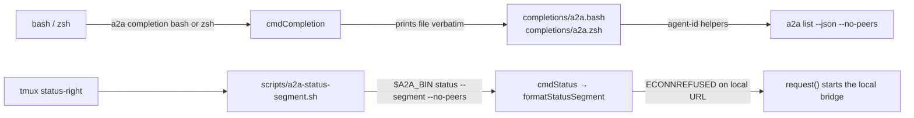
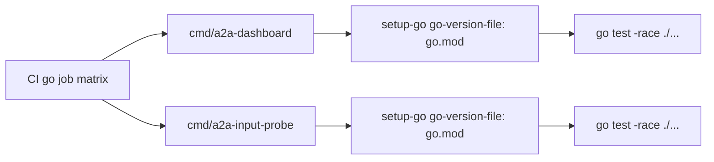
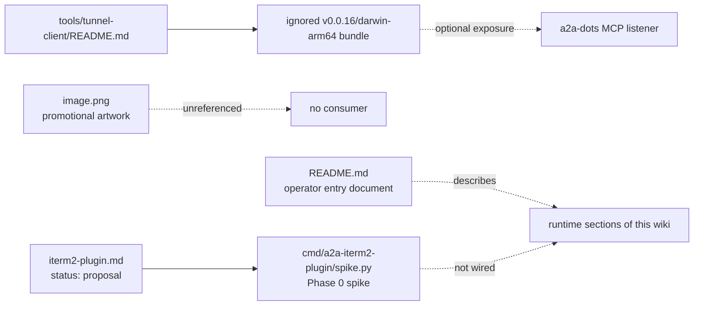
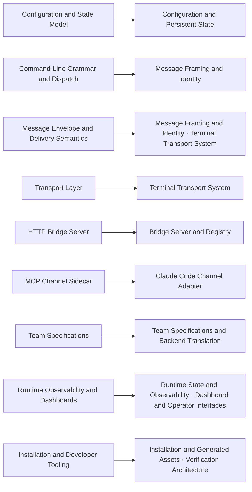
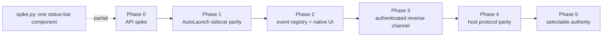

<!-- insert-before: See [Agent Lifecycle](#agent-lifecycle) for the handlers that materialize and remove sessions and [Bridge Server and Registry](#bridge-server-and-registry-delivery-and-federation) for how the bridge routes the resulting remote rows. -->
<a id="command-line-orchestrator-shell-integration"></a>
### Shell integration



| File | Entry point | Behavior | CI check ([`.github/workflows/a2a-maintenance-verify.yml`][ref-550]) |
| --- | --- | --- | --- |
| [`completions/a2a.bash`][ref-8001] | [`_a2a()`][ref-8004], registered with `complete -F _a2a a2a` | Fixed word list per subcommand; agent ids from [`__a2a_agent_ids()`][ref-8005] | `bash -n` |
| [`completions/a2a.zsh`][ref-8002] | `#compdef a2a`, [`_a2a()`][ref-8006] | `_arguments` specifications with descriptions; agent ids from [`__a2a_agents()`][ref-8007] and [`__a2a_agent_flags()`][ref-8008] | none |
| [`scripts/a2a-status-segment.sh`][ref-8003] | top-level statements | Runs `a2a status --segment --no-peers` through `A2A_BIN` (default `a2a`), discards stderr, always exits 0 | `bash -n` |

The two completion scripts are hand-maintained static files. [`cmdCompletion()`][ref-394] reads `completions/a2a.<shell>` from [`COMPLETIONS_DIR`][ref-8009] and writes it unchanged, so the completion vocabulary is a second copy of the argv grammar that no test compares against [`main()`][ref-8] or the per-command parsers. The subcommand list itself matches: both files offer exactly the 29 names in the `isSubcommand` set of `main()` plus `help`. Below the subcommand level, the twelve offers in the following table diverge from the parsers.

```bash
__a2a_agent_ids() {
  a2a list --json --no-peers 2>/dev/null \
    | sed -n 's/.*"agentId":"\([^"]*\)".*/\1/p'
}
```

*`completions/a2a.bash:9-12`*

| Completion offer | Executed grammar | Effect |
| --- | --- | --- |
| Agent ids in both files (`__a2a_agent_ids`, `__a2a_agents`, `__a2a_agent_flags`) | [`cmdList()`][ref-231] writes `JSON.stringify(payload, null, 2)` at [`src/cli.mjs:5386`][ref-8010], so every key renders as `"agentId": "<id>"` with a space after the colon | The `sed` pattern requires `"agentId":"` and extracts nothing; a pretty-printed sample built with the same `JSON.stringify` call yields zero ids, so no agent name and no `--<agent>` flag is ever completed |
| `kill`: `--all --rebuild --dashboard --layout` | [`cmdKill()`][ref-381] accepts `--all` and `--agent NAME` | `--rebuild`, `--dashboard`, `--layout` exit with `unknown flag`; `--agent` is never offered |
| `attach`: same four flags | [`cmdAttach()`][ref-383] accepts `--native-scroll`, `--cc`, `--dashboard`, `--layout`, `--rebuild` | `--all` exits with `unknown flag`; `--native-scroll` and `--cc` are never offered |
| `peek`: same four flags | [`cmdPeek()`][ref-384] accepts only `--lines` | Every offered flag fails; `--lines` is never offered |
| `ui`: same four flags | [`cmdUi()`][ref-385] accepts only `--rebuild` | `--all`, `--dashboard`, `--layout` fail |
| `log`: same four flags | [`cmdLog()`][ref-387] accepts `--path`, `--follow` (`-f`), `--lines` | Every offered flag fails; no real flag is offered |
| `unregister`: same four flags | [`cmdUnregister()`][ref-391] accepts no flags | Every offered flag fails |
| `say`, `ask`, `reply`: `--from --ask --reply --message --write` and `--<agent>` | The subcommand path parses with [`parseArgs()`][ref-377] restricted to `to`, `from`, `origin`, each requiring a value | Only `--from` works; `--to` and `--origin` are never offered; zsh describes `--write` as "broadcast to all", while [`ACTION_ALIASES`][ref-8012] maps `write` to `message` |
| `register`: `--target --description --cwd --backend` | [`cmdRegister()`][ref-390] accepts `--id`, `--target`, `--desc`; `--id` is required | Three of four offered flags fail; the required `--id` is never offered |
| `start`, `start-global` | [`parseStartArgs()`][ref-262] also recognizes `--team`, `--require-team`, `--layout` | Not offered; no failure, because unknown start flags are forwarded to the backend |
| `bridge all` second word: `start stop status restart foreground` | [`cmdBridge()`][ref-389] accepts `start`, `stop`, `status`, `restart` after `all` | `a2a bridge all foreground` exits with `unknown bridge action`; the `iterm2` alias is never offered |
| Top-level `--` words: `--ask --reply --message --write --from --command --stdin --no-submit` | [`VALUE_FLAGS`][ref-8013] in the flag-send grammar also accepts `--to`, `--content`, `--origin` | Not offered |

The `command`, `raw`, `config`, `auth`, `completion`, `list`, `status`, `events`, `attention`, `doctor`, `reload`, `layout`, `iterm`, and `pm` branches match their parsers ([`parseSequenceFlagArgv()`][ref-91] for `command`). The four-flag branch shared by `kill`, `attach`, `peek`, `ui`, `unregister`, and `log` is the source of most failures: one `case` arm serves six commands whose parsers are each closed through [`parseSimpleCommandArgs()`][ref-238], so every flag that is valid for one of them is an `unknown flag` exit for the others. Because CI applies only `bash -n` to the bash file and nothing to the zsh file, neither syntax checking nor the Vitest suite can detect vocabulary drift.

```sh
A2A_BIN="${A2A_BIN:-a2a}"

"$A2A_BIN" status --segment --no-peers 2>/dev/null || true
```

*`scripts/a2a-status-segment.sh:5-7`*

[`scripts/a2a-status-segment.sh`][ref-8003] adapts [`cmdStatus()`][ref-230] to a tmux `status-right` command: `--segment` selects [`formatStatusSegment()`][ref-221], whose output contract belongs to [Status snapshot schema](#runtime-state-and-observability-status-snapshot-schema), and `|| true` with stderr discarded means a failing CLI renders as an empty segment instead of an error in the status line. `--no-peers` restates the default of `a2a status`, which fans out to peers only under `--peers`; [`validateStatusArgs()`][ref-8011] accepts it, and the flag pins the cheap local path even if that default changes. The segment is not read-only with respect to the bridge: [`collectRuntimeSnapshot()`][ref-237] calls [`request()`][ref-399] without disabling auto-start, so when the configured bridge is local and refuses the connection, each status refresh starts it, and `a2a bridge down` appears only when that start fails. A status line that runs this script therefore restarts a deliberately stopped local bridge on its next refresh.

<!-- insert-before: See [Runtime State and Observability](#runtime-state-and-observability) for the roster data and [Agent Lifecycle](#agent-lifecycle) for attach and restart semantics. -->
<a id="dashboard-and-operator-interfaces-go-module-manifests"></a>
### Go module manifests



| Manifest | Module path | `go` directive | Direct requirements | Indirect requirements | Checksum file |
| --- | --- | --- | --- | --- | --- |
| [`cmd/a2a-dashboard/go.mod`][ref-8014] | `a2a-dashboard` | `1.24.0` | `github.com/charmbracelet/bubbletea v1.3.10`, `github.com/charmbracelet/lipgloss v1.1.0` | 18, including `github.com/charmbracelet/bubbles v0.21.0` | [`cmd/a2a-dashboard/go.sum`][ref-8015], 45 lines |
| [`cmd/a2a-input-probe/go.mod`][ref-8016] | `a2a-input-probe` | `1.24.0` | `github.com/charmbracelet/bubbletea v1.3.10` | 18, including `github.com/charmbracelet/lipgloss v1.1.0` | [`cmd/a2a-input-probe/go.sum`][ref-8017], 43 lines |

```go
require (
	github.com/charmbracelet/bubbletea v1.3.10
	github.com/charmbracelet/lipgloss v1.1.0
)

require (
	github.com/aymanbagabas/go-osc52/v2 v2.0.1 // indirect
	github.com/charmbracelet/bubbles v0.21.0 // indirect
```

*`cmd/a2a-dashboard/go.mod:5-12`*

Each Go program is its own module with a bare module path, no `go.work` file joins them, and neither imports a2a code, so the diagnostic probe never builds against the dashboard's dependency set and either module can be tested or deleted alone. The CI `go` job runs `go test -race ./...` once per module and passes `go-version-file: <module>/go.mod` to `setup-go`; neither manifest declares a `toolchain` line, so the `go 1.24.0` directive is the only version source CI receives, while the local run recorded in [Measured results](#verification-architecture-measured-results) used Go 1.26.5. The dashboard manifest misclassifies one requirement: [`cmd/a2a-dashboard/main.go`][ref-8018] imports `github.com/charmbracelet/bubbles/key` and `github.com/charmbracelet/bubbles/viewport` directly, yet [`go.mod`][ref-8019] marks `bubbles v0.21.0` as `// indirect`, which `go mod tidy` would move into the direct block. The build is unaffected because the requirement and its checksums are present. The probe's `lipgloss` entry is correctly indirect, since [`cmd/a2a-input-probe/main.go`][ref-431] imports only `bubbletea`. The compiled outputs `cmd/a2a-dashboard/a2a-dashboard` and `cmd/a2a-input-probe/a2a-input-probe` are excluded by `.gitignore`.

<!-- insert-before: ## References -->
## Repository Documentation and External Tools



Five artifacts accompany the runtime without being loaded by it: the operator-facing [`README.md`][ref-8020], the promotional [`image.png`][ref-8035], the vendor-bundle notes in [`tools/tunnel-client/README.md`][ref-8036], the iTerm2-native host proposal [`iterm2-plugin.md`][ref-8040], and that proposal's Phase 0 spike [`cmd/a2a-iterm2-plugin/spike.py`][ref-8050]. None is imported, executed, or read by any `src/`, `bin/`, or `scripts/` file, so each can drift from the code without failing a test; the subsections below record where each one diverges from current source and which wiki section owns the behavior it describes.

- [Artifact inventory](#repository-documentation-and-external-tools-artifact-inventory)
- [Operator README](#repository-documentation-and-external-tools-operator-readme)
- [Promotional image](#repository-documentation-and-external-tools-promotional-image)
- [OpenAI tunnel-client bundle](#repository-documentation-and-external-tools-openai-tunnel-client-bundle)
- [iTerm2-native host proposal and Phase 0 spike](#repository-documentation-and-external-tools-iterm2-native-host-proposal-and-phase-0-spike)

<a id="repository-documentation-and-external-tools-artifact-inventory"></a>
### Artifact inventory

| Artifact | Git status | Referenced by | Role |
| --- | --- | --- | --- |
| [`README.md`][ref-8020] | Tracked; one paragraph modified in the working tree | No repository file | Operator entry document with GitHub-hosted references |
| [`image.png`][ref-8035] | Tracked since the initial commit; 1536 × 1024 PNG, 2,177,613 bytes | No repository file | Promotional illustration |
| [`tools/tunnel-client/README.md`][ref-8036] | Tracked; the bundle directory it describes is ignored by [`.gitignore`][ref-8037] | No runtime file | Provenance and checksum of a downloaded vendor executable |
| [`iterm2-plugin.md`][ref-8040] | Untracked | The docstring of `spike.py` | Design proposal for an iTerm2-hosted a2a authority |
| [`cmd/a2a-iterm2-plugin/spike.py`][ref-8050] | Untracked | No repository file | Phase 0 status-bar spike for that proposal |

<a id="repository-documentation-and-external-tools-operator-readme"></a>
### Operator README



| README section | Owning wiki section |
| --- | --- |
| Configuration and State Model | [Configuration and Persistent State](#configuration-and-persistent-state) |
| Command-Line Grammar and Dispatch | [Message Framing and Identity](#message-framing-and-identity), [Command-Line Orchestrator](#command-line-orchestrator) |
| Message Envelope and Delivery Semantics | [Envelope contract](#message-framing-and-identity-envelope-contract), [Command sequence DSL](#terminal-transport-system-command-sequence-dsl) |
| Transport Layer | [Terminal Transport System](#terminal-transport-system) |
| HTTP Bridge Server | [Bridge Server and Registry](#bridge-server-and-registry) |
| MCP Channel Sidecar | [Claude Code Channel Adapter](#claude-code-channel-adapter) |
| Team Specifications | [Team Specifications and Backend Translation](#team-specifications-and-backend-translation) |
| Runtime Observability and Dashboards | [Runtime State and Observability](#runtime-state-and-observability), [Dashboard and Operator Interfaces](#dashboard-and-operator-interfaces) |
| Installation and Developer Tooling | [Installation and Generated Assets](#installation-and-generated-assets), [Shell integration](#command-line-orchestrator-shell-integration), [Verification Architecture](#verification-architecture) |

[`README.md`][ref-8020] is the operator-facing entry document: nine sections in the same overview-bullet, diagram, table, and rationale format as this wiki, written for a reader browsing the GitHub repository. Its reference definitions at [`README.md:339`][ref-8031] onward are absolute `github.com/MauricioAndrades/a2a/blob/main/` URLs, so they resolve against the `main` branch rather than the checked-out working tree, which is the `a2a-dots` branch with uncommitted source changes. Nothing tests or renders the README, so the table below records every checkable claim that current source contradicts; the owning wiki section is authoritative in each case.

| README claim | Current source | Status |
| --- | --- | --- |
| `src/cli.mjs` is "~6,300 lines" ([`README.md:76`][ref-8021]) | 5,907 lines | Overstated |
| Links to `docs/command-dsl.md` and `docs/iterm-transport.md` ([`README.md:120`][ref-8022], [`README.md:162`][ref-8024]) | Neither file exists; `docs/` holds `dots.md`, `plugin-spec.md`, and the wiki files | Dangling links |
| One `KEY_TABLE` generates both the tmux and the raw-byte target, so one sequence runs unchanged on iTerm2 ([`README.md:120`][ref-8022]) | Production iTerm bytes come from the separate `KEY_BYTES` table in `bridge.py`, and named-key chords lose `C` and `S` on iTerm; see [Command sequence DSL](#terminal-transport-system-command-sequence-dsl) | Partly contradicted |
| The iTerm2 bridge exposes `ping`, `list_sessions`, `send_text`, `send_keys`, `screen`, `spawn` ([`README.md:154`][ref-8023]) | `OPS` registers ten operations, adding `close`, `focus`, `set_name`, `configure_session`; see [iTerm2 RPC bridge](#terminal-transport-system-iterm2-rpc-bridge) | Incomplete |
| A recipient addressed as `<peer>/<agent>` is forwarded to the peer bridge ([`README.md:202`][ref-8025]) | [`PEER_AGENT_ID_SEPARATOR`][ref-8034] (`/`) only labels peer rows in `a2a list`; routing follows a registration's `bridgeUrl` (see [Delivery and federation](#bridge-server-and-registry-delivery-and-federation)), and agent ids must match `[A-Za-z0-9_-]+` | Contradicted |
| Claude Code wires the channel through the project's `.mcp.json` ([`README.md:227`][ref-8026]) | The checkout holds `.mcp.disabled.json`, and `.gitignore` excludes every `.mcp.*` file | No tracked or active `.mcp.json` |
| The orphan bucket requires both a cached name and a matching install token ([`README.md:299`][ref-8027]) | Either proof suffices; see [Session classification](#runtime-state-and-observability-session-classification) | Contradicted |
| The Node TUI renders a palette with `!` attention and `:` commands, and the Go binary is resolved via `A2A_DASHBOARD_BIN` ([`README.md:303`][ref-8028]) | The Node fallback binds neither key, and the Go dashboard is also found on `PATH` or run through `go run`; see [Node and Go capabilities](#dashboard-and-operator-interfaces-node-and-go-capabilities) and [View construction and repair](#dashboard-and-operator-interfaces-view-construction-and-repair) | Contradicted |
| Every spawn instructs the agent to read the installed `SKILL.md` ([`README.md:331`][ref-8029]) | [`composePersona()`][ref-8033] prepends `Load the a2a skill location at` followed by [`PACKAGE_A2A_SKILL_PATH`][ref-8032], which is `<checkout>/skill/a2a/SKILL.md`; the checkout has `skills/a2a/` and no `skill/` directory, and the installer copies the skill to `~/.claude/skills/a2a` | The injected path does not exist |
| Shell completion is generated rather than hand-maintained and completes live agent ids ([`README.md:333`][ref-8030]) | `cmdCompletion()` prints static files, and their id extraction matches no `a2a list --json` output; see [Shell integration](#command-line-orchestrator-shell-integration) | Contradicted |

The skill-path row is the one with runtime consequences beyond documentation: every single, group, and team launch places that sentence at the top of the persona, so the first instruction every spawned agent receives names a file that does not exist in this tree.

<a id="repository-documentation-and-external-tools-promotional-image"></a>
### Promotional image

| Depicted element | Runtime counterpart |
| --- | --- |
| Central message `<a2a_message from="scout" to="reviewer" origin="peer" ts="…">` | [`wrapEnvelope()`][ref-99] renders `<a2a from="…">` with `origin` only for `user` or `self`, and no `to` or timestamp attribute; see [Envelope contract](#message-framing-and-identity-envelope-contract) |
| Panels labelled `origin: broadcast` | The valid origins are `user`, `peer`, and `self`; broadcast is a recipient set, not an origin; see [Sender authority](#message-framing-and-identity-sender-authority) |
| Claude, Gemini, Codex, and Cursor agents | The four backends `claude`, `gemini`, `codex`, `cursor-agent` |
| ChatGPT agent | Reaches a2a only as the MCP peer registered by [`src/a2a-dots.mjs`][ref-7]; see [ChatGPT Dot Adapter](#chatgpt-dot-adapter) |
| Copilot and Perplexity agents | No backend, adapter, or source file mentions either |
| Bridge panel `STATUS: RUNNING`, `AGENTS: 6`, `TRANSPORT: LOCAL + REMOTE` | Illustrative; no command prints this layout |

[`image.png`][ref-8035] is marketing artwork headed "Every agent. One conversation." showing robot operators for seven vendors around a central a2a bridge, with footer tags for persistent sessions, real terminals, secure messaging, team coordination, local and remote operation, and engineers. It has been tracked since the initial commit, and no file in the repository references it, including the README. The rows above matter only because the picture contains code-shaped text: its envelope, attribute set, and origin vocabulary are not the wire format, so the owning sections remain the reference for anything an agent or parser consumes.

<a id="repository-documentation-and-external-tools-openai-tunnel-client-bundle"></a>
### OpenAI tunnel-client bundle

[`tools/tunnel-client/README.md`][ref-8036] records a locally downloaded OpenAI `tunnel-client` v0.0.16 bundle for Apple Silicon: the pinned upstream release ([`tools/tunnel-client/README.md:5`][ref-8053]), the archive name, a verified archive SHA-256, and the rule that the bundled `cloudflared`, license, and manifest files stay beside the executable. The bundle directory `tools/tunnel-client/v0.0.16/darwin-arm64/` is excluded by [`.gitignore:51`][ref-8037], so only the README is tracked and the executable is per-machine state. No file under `src/`, `bin/`, `scripts/`, `cmd/`, `schemas/`, `tests/`, or `skills/`, nor `install` or `package.json`, mentions `tunnel-client` or `cloudflared`; a2a neither launches nor configures the bundle, in contrast with ngrok, which the CLI starts and queries itself in [Global and dual-registration mode](#command-line-orchestrator-global-and-dual-registration-mode). The bundle's only in-repository context is [`docs/dots.md`][ref-8038], which directs operators to expose only the `a2a-dots` MCP listener through OpenAI Secure MCP Tunnel and whose secrets table ([`docs/dots.md:280`][ref-8039]) attributes `CONTROL_PLANE_API_KEY` and `OPENAI_ADMIN_KEY` to the tunnel-client daemon rather than to any a2a process. Keeping the executable out of Git and its keys outside the repository keeps a vendor credential path separate from the a2a authentication boundaries described in [Security boundaries](#chatgpt-dot-adapter-security-boundaries).

<a id="repository-documentation-and-external-tools-iterm2-native-host-proposal-and-phase-0-spike"></a>
### iTerm2-native host proposal and Phase 0 spike



| Phase ([`iterm2-plugin.md:214`][ref-8043]) | Proposed scope | Writable authority during the phase | Repository state |
| --- | --- | --- | --- |
| 0 — API spike | One status-bar component, Toolbelt web view, session monitor, and custom control-sequence monitor; the proposal's next action narrows this to the status-bar component alone ([`iterm2-plugin.md:418`][ref-8048]) | Node bridge | [`spike.py`][ref-8050] registers the status-bar component only |
| 1 — AutoLaunch sidecar parity | Existing `OPS` handlers under `iterm2.run_forever`, same Unix socket, installed into iTerm2's AutoLaunch folder | Node bridge ([`iterm2-plugin.md:140`][ref-8049]) | Not started; [`bridge.py`][ref-156] and [`launch.sh`][ref-162] remain the sidecar |
| 2 — Event-driven registry and native UI | Session lifecycle pushed to the Node bridge; Toolbelt and status-bar surfaces | Node bridge | Not started |
| 3 — Authenticated reverse channel | Bounded OSC 1337 events bound to the emitting session | Node bridge ([`iterm2-plugin.md:399`][ref-8055]) | Not started |
| 4 — Host protocol parity | Full bridge contract suite against a plugin-host candidate | Node bridge until parity is shown | Not started |
| 5 — Selectable authority | `host=iterm\|node` with an exclusive host lock | The selected host | Not started |

[`iterm2-plugin.md`][ref-8040] is a design proposal, not implemented behavior: its title names it a proposal and its phase statement ([`iterm2-plugin.md:11`][ref-8041]) records that implementation had not started. The decision it commits to ([`iterm2-plugin.md:17`][ref-8042], [decision log][ref-8045]) is that an iTerm2 AutoLaunch daemon becomes the primary local a2a host on iTerm-first macOS installations, the Node bridge remains the host for headless tmux, Linux, and non-iTerm use behind the same HTTP and Unix-socket contracts, and exactly one writable authority runs per installation. The document is also a resumable context capture written before the spike and before this wiki's expansion, so several of its statements no longer describe the tree:

| Proposal statement | Current state |
| --- | --- |
| Implementation has not started ([`iterm2-plugin.md:11`][ref-8041]); no plugin directory or source file exists ([`iterm2-plugin.md:414`][ref-8047]) | `cmd/a2a-iterm2-plugin/spike.py` exists |
| Phase 0 registers four API surfaces ([`iterm2-plugin.md:214`][ref-8043]) | The next action and the spike cover one surface |
| `docs/wiki.md` is a 1,425-line wiki with 41 Mermaid diagrams and 142 references ([`iterm2-plugin.md:258`][ref-8044]) | This wiki exceeds 4,000 lines and 500 reference definitions |

```python
    @iterm2.StatusBarRPC
    async def a2a_spike_status(knobs):
        return "a2a spike"

    await component.async_register(connection, a2a_spike_status)
```

*`cmd/a2a-iterm2-plugin/spike.py:24-28`*

[`cmd/a2a-iterm2-plugin/spike.py`][ref-8050] is an untracked Phase 0 spike, not part of the runtime: [`main()`][ref-8052] registers one `iterm2.StatusBarComponent` with identifier [`COMPONENT_ID`][ref-8051] `com.a2a.spike.status`, no knobs, and no update cadence, whose callback returns the fixed string `a2a spike`. It imports no a2a module, opens no socket, and is compiled by no CI job, since the `syntax` job runs `py_compile` on `bridge.py` only. The narrow scope follows the proposal's gate: no bridge logic is ported until the component is observed in the installed iTerm2 application, and the repository does not yet record that observation. The spike runs under `iterm2.run_forever`, the library helper that the production bridge replaces with its own supervised loop because the helper cannot reconnect after iTerm2 restarts (see [iTerm2 RPC bridge](#terminal-transport-system-iterm2-rpc-bridge)); whether AutoLaunch relaunch compensates for that is one of the proposal's open assumptions ([`iterm2-plugin.md:406`][ref-8046]).

See [Terminal Transport System](#terminal-transport-system) for the iTerm2 transport that the proposal would reorganize, and [Command-Line Orchestrator](#command-line-orchestrator) for the CLI surface the README introduces.

<!-- refs -->
[ref-8001]: ../completions/a2a.bash
[ref-8002]: ../completions/a2a.zsh
[ref-8003]: ../scripts/a2a-status-segment.sh
[ref-8004]: ../completions/a2a.bash#L14
[ref-8005]: ../completions/a2a.bash#L9
[ref-8006]: ../completions/a2a.zsh#L28
[ref-8007]: ../completions/a2a.zsh#L7
[ref-8008]: ../completions/a2a.zsh#L15
[ref-8009]: ../src/cli.mjs#L37
[ref-8010]: ../src/cli.mjs#L5386
[ref-8011]: ../src/cli.mjs#L5067
[ref-8012]: ../src/a2a-argv.mjs#L4
[ref-8013]: ../src/a2a-argv.mjs#L6
[ref-8014]: ../cmd/a2a-dashboard/go.mod
[ref-8015]: ../cmd/a2a-dashboard/go.sum
[ref-8016]: ../cmd/a2a-input-probe/go.mod
[ref-8017]: ../cmd/a2a-input-probe/go.sum
[ref-8018]: ../cmd/a2a-dashboard/main.go#L8
[ref-8019]: ../cmd/a2a-dashboard/go.mod#L12
[ref-8020]: ../README.md
[ref-8021]: ../README.md#L76
[ref-8022]: ../README.md#L120
[ref-8023]: ../README.md#L154
[ref-8024]: ../README.md#L162
[ref-8025]: ../README.md#L202
[ref-8026]: ../README.md#L227
[ref-8027]: ../README.md#L299
[ref-8028]: ../README.md#L303
[ref-8029]: ../README.md#L331
[ref-8030]: ../README.md#L333
[ref-8031]: ../README.md#L339
[ref-8032]: ../src/cli.mjs#L38
[ref-8033]: ../src/cli.mjs#L1407
[ref-8034]: ../src/cli.mjs#L53
[ref-8035]: ../image.png
[ref-8036]: ../tools/tunnel-client/README.md
[ref-8037]: ../.gitignore#L51
[ref-8038]: ../docs/dots.md#L69
[ref-8039]: ../docs/dots.md#L280
[ref-8040]: ../iterm2-plugin.md
[ref-8041]: ../iterm2-plugin.md#L11
[ref-8042]: ../iterm2-plugin.md#L17
[ref-8043]: ../iterm2-plugin.md#L214
[ref-8044]: ../iterm2-plugin.md#L258
[ref-8045]: ../iterm2-plugin.md#L337
[ref-8046]: ../iterm2-plugin.md#L406
[ref-8047]: ../iterm2-plugin.md#L414
[ref-8048]: ../iterm2-plugin.md#L418
[ref-8049]: ../iterm2-plugin.md#L140
[ref-8050]: ../cmd/a2a-iterm2-plugin/spike.py
[ref-8051]: ../cmd/a2a-iterm2-plugin/spike.py#L11
[ref-8052]: ../cmd/a2a-iterm2-plugin/spike.py#L14
[ref-8053]: ../tools/tunnel-client/README.md#L5
[ref-8055]: ../iterm2-plugin.md#L399
