# a2a

**a2a** is a Node.js coordination runtime for named coding-agent sessions. It joins an ephemeral command-line client, a durable HTTP bridge, tmux and iTerm2 terminal transports, declarative team launch, runtime inventory, and MCP adapters into one local-first system. [`package.json`][ref-1] declares Node 18+, ESM, and four executable entrypoints. The repository is not an agent runtime in its own right: agent processes remain ordinary terminal programs, while a2a owns their addressing, message framing, lifecycle metadata, and operator surfaces.

- **Scope** states which files the map covers and which paths are excluded or ignored, with reasons. See [Scope](#scope).
- **Architecture Topography** defines process boundaries, graph evidence, and module ownership. See [Architecture Topography](#architecture-topography).
- **Configuration and Persistent State** explains the file contracts shared by otherwise short-lived processes. See [Configuration and Persistent State](#configuration-and-persistent-state).
- **Message Framing and Identity** covers send grammars, recipient expansion, authority classification, and the terminal envelope. See [Message Framing and Identity](#message-framing-and-identity).
- **Terminal Transport System** covers capability probes, per-recipient routing, tmux delivery, iTerm2 RPC, and the command DSL. See [Terminal Transport System](#terminal-transport-system).
- **Runtime State and Observability** covers session classification, snapshots, status, events, attention, reload, and diagnostics. See [Runtime State and Observability](#runtime-state-and-observability).
- **Team Specifications and Backend Translation** covers YAML/JSON resolution, backend-specific permission flags, the documentation-only backend CLI schemas, and the shipped sample teams. See [Team Specifications and Backend Translation](#team-specifications-and-backend-translation).
- **Bridge Server and Registry** covers HTTP routing, registration ownership, authentication, delivery, federation, and the A2A protocol façade. See [Bridge Server and Registry](#bridge-server-and-registry).
- **Command-Line Orchestrator** covers argv dispatch, bridge startup, send aggregation, and operator command families. See [Command-Line Orchestrator](#command-line-orchestrator).
- **Agent Lifecycle** covers spawn, adoption, restart, reconnect, attach, peek, and teardown. See [Agent Lifecycle](#agent-lifecycle).
- **ChatGPT Dot Adapter** and **Claude Code Channel Adapter** cover the two MCP-facing integration processes. See [ChatGPT Dot Adapter](#chatgpt-dot-adapter) and [Claude Code Channel Adapter](#claude-code-channel-adapter).
- **Dashboard and Operator Interfaces** covers the Node cockpit, optional Go dashboard, and input probe. See [Dashboard and Operator Interfaces](#dashboard-and-operator-interfaces).
- **Agent Skills and Plugin Packaging** maps the two Claude skills, the Codex plugin package, and the Dot and plugin prose documents against the source they describe. See [Agent Skills and Plugin Packaging](#agent-skills-and-plugin-packaging).
- **Installation and Generated Assets** and **Verification Architecture** cover bootstrap, generated team support, and the test strategy. See [Installation and Generated Assets](#installation-and-generated-assets) and [Verification Architecture](#verification-architecture).
- **Repository Documentation and External Tools** maps the operator README, the promotional image, the tunnel-client bundle notes, and the iTerm2-native host proposal with its spike. See [Repository Documentation and External Tools](#repository-documentation-and-external-tools).

## Scope

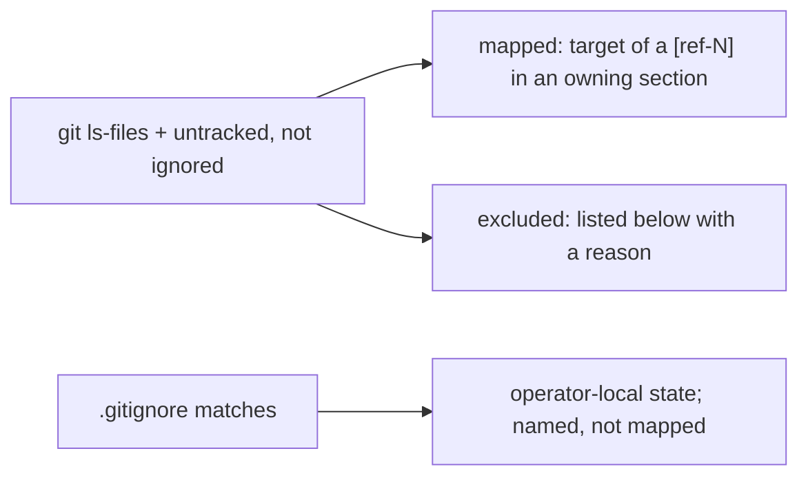

The wiki maps every file that `git ls-files` reports plus every untracked file that `.gitignore` does not exclude: each such file is either the target of a reference in the section that owns it or a row in the first table below. Paths matched by [`.gitignore`][ref-474] hold operator-local runtime state, credentials, build output, or private team specifications; they are named in the second table so their absence from the map is a stated decision rather than an omission.

| Excluded path | Kind | Reason not mapped |
| --- | --- | --- |
| `.codebase-map/` | Generated scan cache | Context bundles, the SQLite graph database, and per-root `tsconfig` shims written by the `codebase-map` and `query` tools that produced the graph evidence in [Architecture Topography](#architecture-topography); regenerated on every scan and not read by any a2a process |
| `cmd/a2a-iterm2-bridge/__pycache__/` | Interpreter cache | CPython bytecode for `bridge.py`, regenerated on import |
| `ItermProfiles.json` | Operator export | Untracked iTerm2 profile export (four profiles: `Default`, `Hotkey Window`, `Copy of Default`, `tmux`); no a2a process, test, or script reads it, and no profile in it references an a2a status-bar component |
| `docs/wiki.md` | This document | Self-reference |
| `docs/wiki-parts/` | Generation intermediates | Per-section drafts from which this document was merged; superseded by it |
| `docs/wiki_outline.json` | Generation outline | Section titles and per-section file inventories derived from this document's references; describes the wiki rather than the system |

| Ignored path (`.gitignore`) | Content |
| --- | --- |
| config.json, registry.json, bridge-registry.PORT.json, bridge.pid, messages.log | Runtime state under the checkout root; contracts in [Configuration and Persistent State](#configuration-and-persistent-state) |
| node_modules/, package-lock.json | Installed dependencies |
| cmd/a2a-dashboard/a2a-dashboard, cmd/a2a-input-probe/a2a-input-probe | Go build outputs; see [Dashboard and Operator Interfaces](#dashboard-and-operator-interfaces) |
| teams/ other than the tracked star-wars and west-world samples | Operator-authored and generated team specifications, including the worklist generators documented in [Installation and Generated Assets](#installation-and-generated-assets) |
| tools/tunnel-client/v0.0.16/ | Downloaded third-party executable bundle |
| .archive/, archive/, wiki/, .claude/, .mcp.*, .vscode/, .DS_Store | Operator archives, local agent and editor settings, OS metadata |

## Architecture Topography

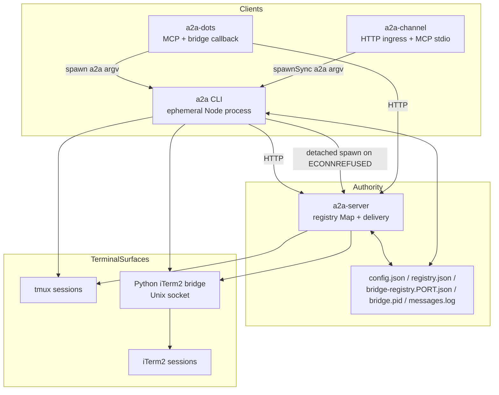

The repository is organized around a **short-lived client / long-lived authority** split. [`bin/a2a.mjs`][ref-2] is a two-line shim that imports the composition root [`src/cli.mjs`][ref-3] for one operator action, while [`src/a2a-server.mjs`][ref-4] retains the live routing registry across those invocations. Files owned by [`src/a2a-config.mjs`][ref-5] provide the durable rendezvous required when either process restarts; terminal sessions remain the durable execution surfaces for the agents themselves. The two MCP-facing adapters never reimplement delivery: both reach the bridge over HTTP or shell back into the `a2a` executable, so identity and transport policy have exactly one implementation.

- [Executable entrypoints](#architecture-topography-executable-entrypoints)
- [Codebase-map evidence](#architecture-topography-codebase-map-evidence)
- [Runtime system inventory](#architecture-topography-runtime-system-inventory)

<a id="architecture-topography-executable-entrypoints"></a>
### Executable entrypoints

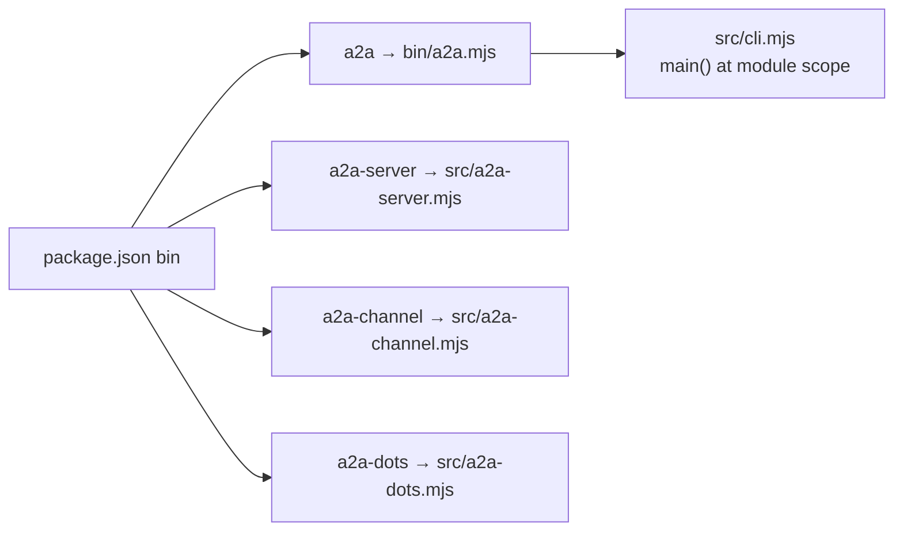

| Executable | Target | npm script | Process lifetime |
| --- | --- | --- | --- |
| `a2a` | [`bin/a2a.mjs`][ref-2] → [`src/cli.mjs`][ref-3] | none | One command per invocation |
| `a2a-server` | [`src/a2a-server.mjs`][ref-4] | `start` | Long-lived bridge listener |
| `a2a-channel` | [`src/a2a-channel.mjs`][ref-6] | `channel` | Hosted by Claude Code over MCP stdio |
| `a2a-dots` | [`src/a2a-dots.mjs`][ref-7] | `dots` | Long-lived MCP and callback adapter |

[`package.json`][ref-1] declares package version `1.1.0`, `"type": "module"`, an `engines` floor of Node `>=18`, and three runtime dependencies (`@modelcontextprotocol/sdk`, `js-yaml`, `zod`). [`main()`][ref-8] runs at module scope in [`src/cli.mjs`][ref-3], so importing the composition root executes a command; every policy that tests or other processes need without that side effect lives in a leaf module, as the header comment of [`src/cli/parse-start-args.mjs`][ref-9] states for the start-argument parser. The bridge is both an advertised executable and a CLI-managed daemon: [`ensureBridgeRunning()`][ref-10] spawns the same file detached with `process.execPath`, so an operator who never runs `a2a-server` directly still receives a bridge on the first refused connection.

<a id="architecture-topography-codebase-map-evidence"></a>
### Codebase-map evidence

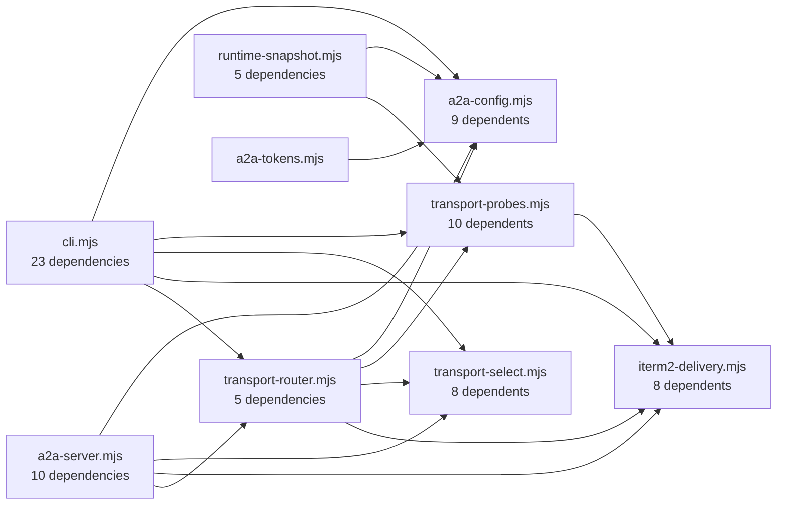

Arrows point from the importing module to the imported module. The diagram shows only runtime (`src/`) importers of the four highest fan-in hubs.

| Graph property | Observed value |
| --- | ---: |
| Scan root (`build.sourceRoots`) | `.` |
| Files | 111 |
| Files under `src/` | 45 |
| Files under `tests/` (including `tests/helpers/`) | 57 |
| Other scanned files (`bin/`, `scripts/`, `schemas/`, `teams/dw-bug-killers/`, root configs) | 9 |
| Directories | 13 |
| Lines | 36,821 |
| Declarations (all / `src/`) | 1,491 / 1,000 |
| Exports (all / `src/`) | 260 / 243 |
| Import edges | 145 |
| Import edges `src/` → `src/` | 78 |
| Import edges from `tests/` | 65 |
| Type flows | 0 |
| Graph operations | 55,991 |
| Build timestamp (`build.builtAt`) | `2026-10-13T21:47:36.846Z` |

| Module | Dependents | Runtime importers | Test importers | Exports |
| --- | ---: | ---: | ---: | ---: |
| [`src/transport-probes.mjs`][ref-11] | 10 | 5 | 5 | 19 |
| [`src/a2a-config.mjs`][ref-5] | 9 | 5 | 4 | 63 |
| [`src/iterm2-delivery.mjs`][ref-12] | 8 | 5 | 3 | 11 |
| [`src/transport-select.mjs`][ref-13] | 8 | 6 | 2 | 4 |
| [`src/key-sequence.mjs`][ref-14] | 7 | 3 | 4 | 7 |
| [`src/a2a-team-spec.mjs`][ref-15] | 7 | 2 | 5 | 9 |
| [`src/backend-delivery.mjs`][ref-16] | 6 | 5 | 1 | 2 |

| Module | Dependencies | Imported modules |
| --- | ---: | --- |
| [`src/cli.mjs`][ref-3] | 23 | Every parser, transport, team, identity, runtime, and CLI leaf module |
| [`src/a2a-server.mjs`][ref-4] | 10 | Config, auth, envelope, body reader, transport selection and delivery, runtime snapshot |
| [`src/a2a-dots.mjs`][ref-7] | 8 | All eight `src/dots/*` modules |
| [`src/runtime/runtime-snapshot.mjs`][ref-17] | 5 | Config, team spec, probes, session inventory, status snapshot |
| [`src/transport-router.mjs`][ref-18] | 5 | Config, iTerm delivery, tmux delivery, probes, selection |
| [`src/a2a-channel.mjs`][ref-6] | 4 | `a2a-tokens` plus three `src/channel/*` modules |

The live codebase-map graph ranks [`src/transport-probes.mjs`][ref-11] and [`src/a2a-config.mjs`][ref-5] highest by total fan-in, but both counts include test importers; by runtime importers alone, [`src/transport-select.mjs`][ref-13] leads with six. That pressure reflects shared policy rather than utility accumulation: transport evidence and selection must agree between CLI lifecycle and bridge delivery, while every process must resolve the same bind coordinates and persistence paths. [`src/a2a-config.mjs`][ref-5] has the largest export surface in the repository (63), yet only 27 of those exports have a runtime importer; the remaining 36 are imported only by tests, which is the module's stated reason for exporting its log and ANSI helpers.

Static edges understate runtime coupling in three places. The scanner covers JavaScript and TypeScript only, so `cmd/a2a-iterm2-bridge/bridge.py` and the Go programs under `cmd/` are absent from the graph. Subprocess links (CLI to bridge, Dot and channel adapters to CLI) and the installer's dynamic `import()` of [`src/a2a-config.mjs`][ref-5] produce no import edge. [`bin/a2a.mjs`][ref-2] is the only non-test, non-`src/` file with an outgoing edge.

<a id="architecture-topography-runtime-system-inventory"></a>
### Runtime system inventory

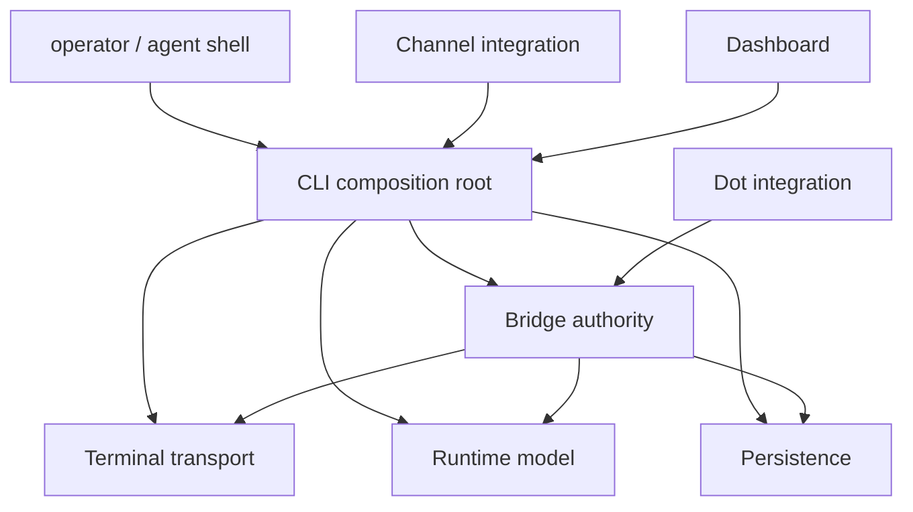

| Runtime system | Owning entrypoint | Supporting modules | Architectural responsibility | Owning section |
| --- | --- | --- | --- | --- |
| CLI | [`src/cli.mjs`][ref-3] | `src/cli/*`, parsers, lifecycle helpers | Operator composition and subprocess orchestration | [Command-Line Orchestrator](#command-line-orchestrator) |
| Bridge | [`src/a2a-server.mjs`][ref-4] | `src/server/*`, transport router | Registry authority, authentication, delivery, federation | [Bridge Server and Registry](#bridge-server-and-registry) |
| Persistence | [`src/a2a-config.mjs`][ref-5] | [`schemas/config.schema.json`][ref-19], [`schemas/registry.schema.json`][ref-20] | Shared cross-process file and environment contracts | [Configuration and Persistent State](#configuration-and-persistent-state) |
| Terminal transport | [`src/transport-router.mjs`][ref-18] | Probes, selectors, tmux and iTerm delivery, DSL | Per-recipient reachability and input delivery | [Terminal Transport System](#terminal-transport-system) |
| Runtime model | [`src/runtime/runtime-snapshot.mjs`][ref-17] | Inventory and projection modules | Reconciled local and remote operational state | [Runtime State and Observability](#runtime-state-and-observability) |
| Dot integration | [`src/a2a-dots.mjs`][ref-7] | `src/dots/*` | Streamable MCP, bridge callback inbox, durable webhooks | [ChatGPT Dot Adapter](#chatgpt-dot-adapter) |
| Channel integration | [`src/a2a-channel.mjs`][ref-6] | `src/channel/*` | HTTP webhook ingress into Claude Code MCP stdio | [Claude Code Channel Adapter](#claude-code-channel-adapter) |
| Dashboard | [`src/cli/dashboard-tui.mjs`][ref-21] | Go dashboard under `cmd/a2a-dashboard/`, CLI attach and peek | Human control and terminal inspection | [Dashboard and Operator Interfaces](#dashboard-and-operator-interfaces) |

The system has three distinct trust boundaries. Operator and peer credentials are interpreted by the bridge in [`src/server/auth.mjs`][ref-22]; sender authority is resolved by [`src/cli/sender-identity.mjs`][ref-23] before an outbound message is posted; and terminal ownership is proven independently for tmux (the `@a2a-install-token` session option) and iTerm2 (the Python bridge's GUID ownership map). Keeping those boundaries separate prevents a valid routing credential from becoming permission to impersonate the human operator or destroy an unrelated terminal session.

Refer to [Bridge Server and Registry](#bridge-server-and-registry) for the authority boundary, [Message Framing and Identity](#message-framing-and-identity) for sender authority, and [Agent Lifecycle](#agent-lifecycle) for terminal ownership.

## Configuration and Persistent State

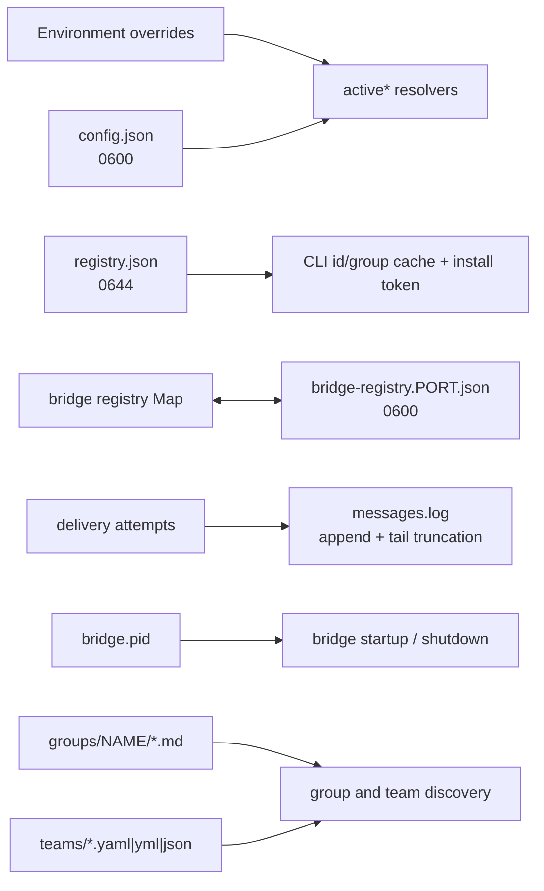

[`src/a2a-config.mjs`][ref-5] is the shared persistence boundary for processes that otherwise share no memory. It owns path derivation, defaults, environment precedence, atomic JSON replacement, installation identity, group discovery, and message-log sanitation in one module so a bridge started from one directory behaves identically to a CLI invoked from another. Callers consume narrow operations while the module retains ownership of file modes, paths, and value coercion.

- [Path roots and durable artifacts](#configuration-and-persistent-state-path-roots-and-durable-artifacts)
- [Export inventory](#configuration-and-persistent-state-export-inventory)
- [Schema contracts](#configuration-and-persistent-state-schema-contracts)
- [Configuration normalization](#configuration-and-persistent-state-configuration-normalization)
- [Environment precedence](#configuration-and-persistent-state-environment-precedence)
- [Persistence and installation identity](#configuration-and-persistent-state-persistence-and-installation-identity)
- [Group and team-spec discovery](#configuration-and-persistent-state-group-and-team-spec-discovery)
- [Message log](#configuration-and-persistent-state-message-log)

<a id="configuration-and-persistent-state-path-roots-and-durable-artifacts"></a>
### Path roots and durable artifacts

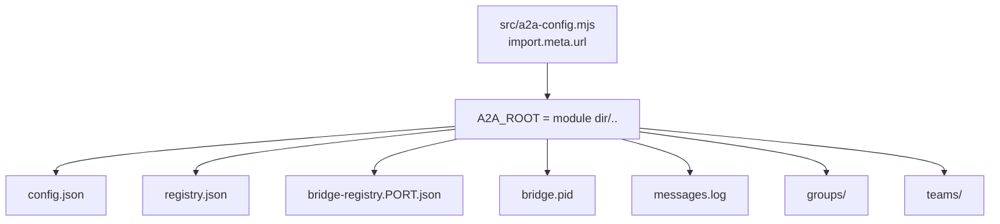

```js
const __filename = fileURLToPath(import.meta.url);
const __dirname = dirname(__filename);
const A2A_ROOT = resolve(join(__dirname, ".."));

const CONFIG_FILE = join(A2A_ROOT, "config.json");
const REGISTRY_FILE = join(A2A_ROOT, "registry.json");
const GROUPS_DIR = join(A2A_ROOT, "groups");
const TEAMS_DIR = join(A2A_ROOT, "teams");
const PID_FILE = join(A2A_ROOT, "bridge.pid");
const DEFAULT_LOG_FILE = join(A2A_ROOT, "messages.log");
```

*`src/a2a-config.mjs:7-16`*

| Durable artifact | Writers | Authority and use | File mode | Write behavior |
| --- | --- | --- | --- | --- |
| `config.json` | [`patchConfig()`][ref-24], [`configSet()`][ref-25] | Bind coordinates, protocol preference, operator key, peer keys, log settings | `0600` | Temp file plus `rename` |
| `registry.json` | [`saveRegistry()`][ref-26], [`installToken()`][ref-27] | Cached agent ids and groups plus install token; never liveness | `0644` | Temp file plus `rename`; first token claim uses `link(2)` |
| `bridge-registry.<port>.json` | [`saveBridgeRegistry()`][ref-28] | Recovery snapshot of the bridge's live rows, including launch records | `0600` | Temp file plus `rename` |
| `bridge.pid` | [`writePid()`][ref-29], [`removePid()`][ref-30] | Local bridge process hint | Process umask | Temp file plus `rename`; errors swallowed |
| `messages.log` | [`appendMessageLog()`][ref-31] | Human-readable delivery audit | `0644` on creation | Append; optional in-place tail truncation |

`A2A_ROOT` is derived from the module's own location rather than from `HOME` or the working directory, so every process launched from the same checkout resolves the same files regardless of where an agent's shell happens to be. The consequence is that the checkout directory is the installation root: on the machine where this wiki was generated, the repository root holds `config.json` and `bridge-registry.*.json` at mode `-rw-------` and `registry.json` at `-rw-r--r--`, matching the modes in the table. [`writeJson()`][ref-32] creates a fresh temp file named `<path>.<pid>.<timestamp>.tmp` for every write, so the requested mode is applied on each replacement rather than only on first creation, and a reader never observes a partially written JSON document.

<a id="configuration-and-persistent-state-export-inventory"></a>
### Export inventory

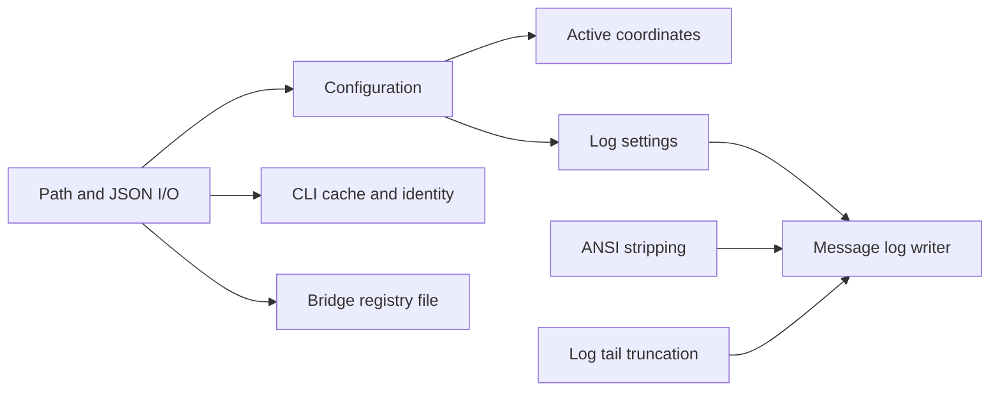

| Family | Exports | Runtime importers | Contract |
| --- | --- | --- | --- |
| Path and JSON I/O | `stripTrailingSlash`, [`ensureDirs()`][ref-33], `normalizeFsPath`, `looksLikeFilePath`, `targetDirectoryFor`, [`readJson()`][ref-34], [`writeJson()`][ref-32] | none (tests only) | `file://` or plain paths only; missing or empty file yields defaults; malformed JSON or a non-object top level throws |
| Configuration | [`loadConfig()`][ref-35], [`patchConfig()`][ref-24], `nestedGet`, [`nestedSet()`][ref-36], [`configGet()`][ref-37], [`configSet()`][ref-25] | CLI, bridge, transport router | Defaults merge, protocol normalization, validated dotted writes |
| Active coordinates | [`activeKey()`][ref-38], [`activePort()`][ref-39], [`activeHost()`][ref-40], [`activeUrl()`][ref-41], [`bridgeUrl()`][ref-42] | CLI, bridge | Environment over config over constant |
| Process lock | [`readPid()`][ref-43], [`writePid()`][ref-29], [`removePid()`][ref-30] | CLI, bridge | Positive safe-integer PID; owner-guarded removal |
| Bridge registry file | [`bridgeRegistryPath()`][ref-44], [`loadBridgeRegistry()`][ref-45], [`saveBridgeRegistry()`][ref-28] | Bridge | One file per listener port; `0600` |
| Groups and team specs | [`isTrustedGroupPathSegment()`][ref-46], [`resolvedTrustedGroupDirectory()`][ref-47], `isExistingDirectory`, [`sanitizeAgentName()`][ref-48], [`isGroup()`][ref-49], [`listGroupNames()`][ref-50], [`listGroupMembers()`][ref-51], [`teamSpecsDir()`][ref-52], [`listTeamSpecNames()`][ref-53] | CLI, `a2a-tokens`, runtime snapshot | Traversal-safe single-segment group names; filesystem-backed launcher references |
| CLI cache and identity | [`loadRegistry()`][ref-54], [`saveRegistry()`][ref-26], [`installToken()`][ref-27], [`generateKey()`][ref-55], [`peerKeyForUrl()`][ref-56] | CLI, bridge, `a2a-tokens`, runtime snapshot | Closed registry shape; per-install token; operator secrets; peer key by canonical URL |
| Log settings | [`logConfig()`][ref-57], [`messageLogPath()`][ref-58], [`messageLogEnabled()`][ref-59], `messageLogMaxBytes`, [`messageLogRedactRemote()`][ref-60] | CLI (`messageLogPath`) | Environment and config resolution of log behavior |
| Log tail truncation | `isAsciiDigit`, `isUtf8Continuation`, [`truncateRotatedMessageLogTail()`][ref-61], `stripLeadingUtf8Continuations`, `findNextLineStartedHeader`, `isoLogHeaderStartsAt` | none (tests only) | Retained tail starts on a UTF-8 boundary and an ISO header line |
| ANSI stripping | `isCsiParamByte`, `isCsiIntermediateByte`, `isCsiFinalByte`, `isEscFinalByte`, [`stripAnsiCodes()`][ref-62], `scanCsi`, `scanOsc`, `scanGenericEsc` | none (tests only) | ECMA-48 / ECMA-35 state machine without regular expressions |
| Message log writer | `formatLogStatus`, `formatLogBytes`, [`formatLogHeader()`][ref-63], [`formatLogBody()`][ref-64], [`rotateLogIfNeeded()`][ref-65], [`appendMessageLog()`][ref-31] | Bridge (`appendMessageLog`) | Best-effort, never-throwing audit append |

The 63 exports fall into eleven families, but only 27 exports have a runtime importer. The runtime surface concentrates in [`src/cli.mjs`][ref-3] (21 names) and [`src/a2a-server.mjs`][ref-4] (12 names), with [`src/a2a-tokens.mjs`][ref-66], [`src/runtime/runtime-snapshot.mjs`][ref-17], and [`src/transport-router.mjs`][ref-18] each consuming a narrow slice. The bridge is the only runtime caller of the message log writer, which makes it the single producer of `messages.log`; the CLI resolves the log path only to print it, follow it with `tail -F` in `a2a log`, and report it in the doctor bundle. The installer imports the module dynamically for [`activeKey()`][ref-38], [`configSet()`][ref-25], and [`generateKey()`][ref-55], so operator-key generation at install time passes through the same coercion and file mode as `a2a config set key`.

<a id="configuration-and-persistent-state-schema-contracts"></a>
### Schema contracts

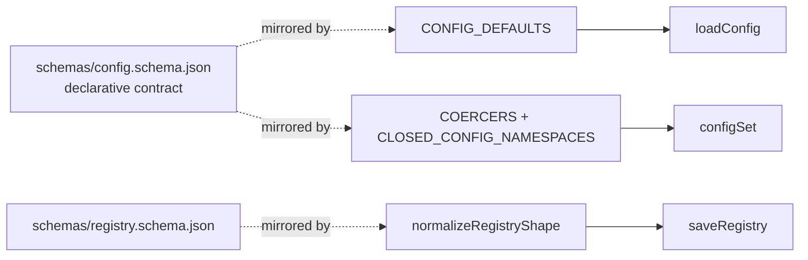

| `config.json` field | Schema type and constraint | Schema default | Code default ([`CONFIG_DEFAULTS`][ref-67]) | [`configSet()`][ref-25] coercion ([`COERCERS`][ref-68]) |
| --- | --- | --- | --- | --- |
| `port` | integer, 1–65535, required | `7742` | `7742` | Strict decimal integer, 1–65535 |
| `host` | string, required | `127.0.0.1` | `127.0.0.1` | Non-empty bare host; rejects `://` and `/` |
| `url` | string or null, `format: uri` | `null` | `null` | `http:` or `https:` only; hash, query, and trailing slashes removed; empty string becomes `null` |
| `key` | string or null | `null` | `null` | Trimmed; empty becomes `null` |
| `global` | boolean | `false` | `false` | `true`, `false`, `"true"`, `"false"` only |
| `protocol` | enum `tmux`, `iterm` | `tmux` | `tmux` | Trimmed, lowercased; `iterm2` aliases to `iterm`; other values throw |
| `log.mode` | enum `on`, `off` | `on` | `on` | Exact `on` or `off` |
| `log.path` | string or null | `messages.log` | Absolute `<A2A_ROOT>/messages.log` | String; empty or `null` becomes `null` |
| `log.maxBytes` | integer, minimum 0 | `0` | `0` | Strict non-negative integer |
| `log.redactRemote` | boolean | `false` | `false` | Boolean or `"true"` / `"false"` |
| `peers` | map of `{url, key}`, both required, no extra keys | `{}` | `{}` | Every `peers.*` key rejected as an unknown setting |
| other top-level keys | allowed (`additionalProperties: true`) | none | none | Stored as the raw value |

| `registry.json` field | Schema type | Default | Enforcement |
| --- | --- | --- | --- |
| `agents` | string array, required | `[]` | Non-arrays replaced with `[]` |
| `groups` | string array, required | `[]` | Non-arrays replaced with `[]` |
| `installToken` | string or null | `null` | Empty or non-string becomes `null` |
| other keys | forbidden (`additionalProperties: false`) | none | Dropped on every write |

```js
const CLOSED_CONFIG_NAMESPACES = new Set([ "log", "peers" ]);

export function configSet(key, value) {
    if (typeof key !== "string" || key.trim() === "") {
        throw new Error("config set requires a non-empty key");
    }
    // Known keys keep their strict coercion (ports must be ints, log.mode must
    // be on|off, etc.). Novel top-level keys are stored as the raw value —
    // config.schema.json allows additional top-level properties — but keys
    // inside schema-closed namespaces must be documented settings.
    // Object.hasOwn so `config set toString x` can't dredge up a prototype fn.
    const coerce = Object.hasOwn(COERCERS, key) ? COERCERS[key] : undefined;
    if (!coerce && CLOSED_CONFIG_NAMESPACES.has(key.split(".")[0])) {
        throw new Error(`unknown setting: ${key}`);
    }
    const coerced = coerce ? coerce(value) : value;
    const updated = patchConfig(nestedSet(loadConfig(), key, coerced));
    return nestedGet(updated, key);
}
```

*`src/a2a-config.mjs:380-398`*

[`schemas/config.schema.json`][ref-19] and [`schemas/registry.schema.json`][ref-20] are declarative contracts that no runtime module loads; no `src/` file reads either schema. Enforcement is reimplemented in code: [`CONFIG_DEFAULTS`][ref-67] mirrors the schema defaults, [`COERCERS`][ref-68] and [`CLOSED_CONFIG_NAMESPACES`][ref-69] reproduce its closed `log` and `peers` objects at write time, and [`normalizeRegistryShape()`][ref-70] reproduces the registry schema's `additionalProperties: false` so that callers spreading a hand-edited registry back into [`saveRegistry()`][ref-26] cannot re-persist unknown keys. The duplication avoids a runtime JSON Schema dependency but leaves the two copies to drift independently; `log.path` already differs, since the schema default is the relative `messages.log` while the code default is an absolute path under `A2A_ROOT`, and the schema's `log.path` description documents the resolution rule that reconciles them.

<a id="configuration-and-persistent-state-configuration-normalization"></a>
### Configuration normalization

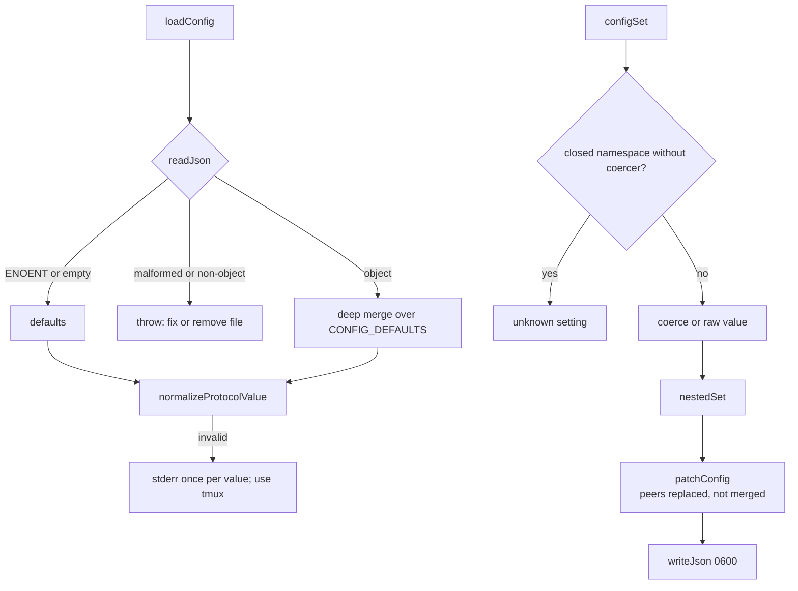

[`loadConfig()`][ref-35] deep-merges persisted values over [`CONFIG_DEFAULTS`][ref-67] through [`mergeDefaults()`][ref-71] and then normalizes `protocol`. An invalid persisted protocol falls back to `tmux` with one stderr warning per distinct value per process, because `loadConfig()` runs on nearly every accessor and an unconditional warning would flood stderr; direct mutation through [`configSet()`][ref-25] rejects the same value. The difference preserves startup availability for a hand-edited file without allowing new invalid state through the documented write path. [`patchConfig()`][ref-24] sits between the two policies: it coerces an invalid `protocol` to `tmux` with the warning instead of throwing, so programmatic callers that bypass `configSet()` cannot persist an invalid protocol but also receive no exception.

[`readJson()`][ref-34] distinguishes absence from corruption. A missing or empty file yields defaults, while unparseable JSON, unreadable files, and top-level arrays or scalars throw with an instruction to fix or remove the file; earlier behavior silently treated a top-level array as all-defaults. [`patchConfig()`][ref-24] passes `peers` in the merge's replace list, so writing a peer map replaces it wholesale and a removed peer cannot survive through recursive merging. [`nestedSet()`][ref-36] replaces non-object intermediates with fresh objects rather than spreading them, which prevents a string value from exploding into index keys. [`configGet()`][ref-37] with no key lists every documented key from [`USER_KEYS`][ref-72] plus unknown top-level extras, while skipping top-level names such as `log` that prefix a documented dotted key so the listing remains flat.

<a id="configuration-and-persistent-state-environment-precedence"></a>
### Environment precedence

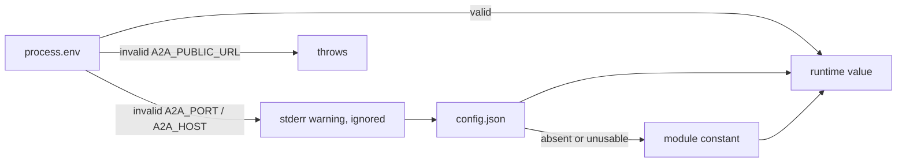

| Runtime value | Resolver | Precedence | Invalid environment value |
| --- | --- | --- | --- |
| Operator key | [`activeKey()`][ref-38] | trimmed `A2A_KEY` → `config.key` → `null` | Not applicable |
| Port | [`activePort()`][ref-39] | `A2A_PORT` (1–65535) → `config.port` when a positive safe integer → `7742` | Warning; falls through |
| Host | [`activeHost()`][ref-40] | `A2A_HOST` (bare host) → `config.host` → `127.0.0.1` | Warning; falls through |
| Public URL | [`activeUrl()`][ref-41] | `A2A_PUBLIC_URL` → `config.url` → `null`, both normalized | Throws |
| Bridge client URL | [`bridgeUrl()`][ref-42] | `A2A_BRIDGE` verbatim → `http://<activeHost()>:<activePort()>` | Not validated |
| Bridge registry file | [`bridgeRegistryPath()`][ref-44] | `A2A_BRIDGE_REGISTRY_FILE` → `<A2A_ROOT>/bridge-registry.<port>.json` | Not validated |
| Log path | [`messageLogPath()`][ref-58] | `A2A_LOG_FILE` → `config.log.path` → `<A2A_ROOT>/messages.log` | Not validated |
| Log enabled | [`messageLogEnabled()`][ref-59] | `A2A_LOG=0` off, `A2A_LOG=1` on → `config.log.mode !== "off"` | Other values defer to config |

Environment variables outrank `config.json` because one checkout serves several concurrent processes that need different coordinates: test harnesses point each bridge at its own registry file through `A2A_BRIDGE_REGISTRY_FILE`, and [`agentEnv()`][ref-73] copies `A2A_BRIDGE`, `A2A_BRIDGE_PUBLIC`, `A2A_PUBLIC_URL`, `A2A_PORT`, `A2A_HOST`, and `A2A_KEY` from the launching process into every spawned agent so that agents route to the bridge that created them. Validation strength differs by variable. A malformed `A2A_PORT` or `A2A_HOST` is reported and ignored, so a bad override degrades to the configured bridge, whereas a malformed `A2A_PUBLIC_URL` raises an exception in every caller of [`activeUrl()`][ref-41]. `A2A_BRIDGE` is returned without normalization.

<a id="configuration-and-persistent-state-persistence-and-installation-identity"></a>
### Persistence and installation identity

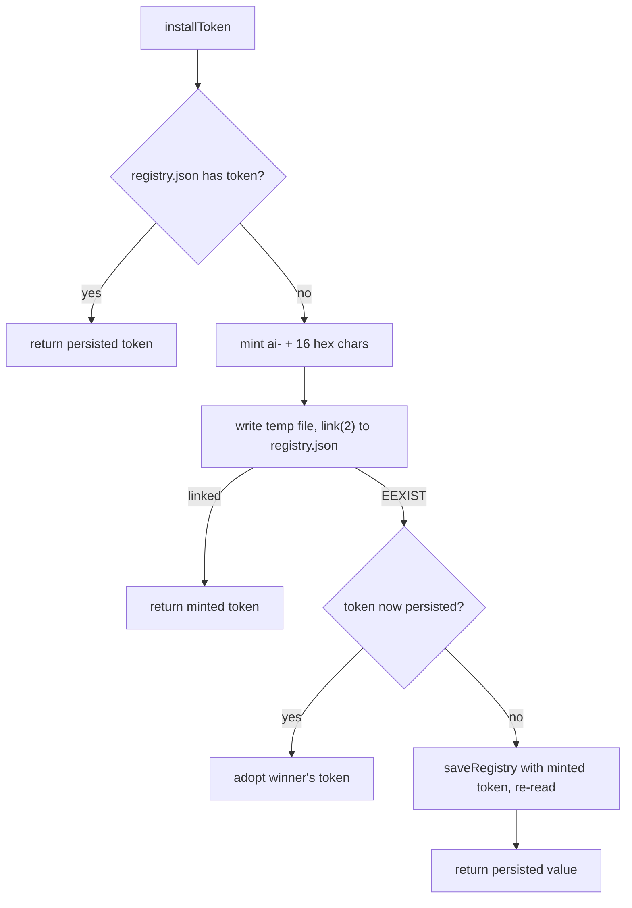

```js
function claimRegistryFileWithToken(cached, token) {
    ensureDirs(REGISTRY_FILE);
    const tmp = `${REGISTRY_FILE}.${process.pid}.${Date.now()}.claim.tmp`;
    try {
        writeFileSync(tmp, `${JSON.stringify(normalizeRegistryShape({ ...cached, installToken: token }), null, 2)}\n`, { mode: FILE_MODE_DEFAULT });
        linkSync(tmp, REGISTRY_FILE);
        return true;
    } catch ( err ) {
        if (err && err.code === "EEXIST") {
            return false;
        }
        throw err;
    } finally {
        try {
            unlinkSync(tmp);
        } catch {
            /* best effort */
        }
    }
}
```

*`src/a2a-config.mjs:716-735`*

| Secret or marker | Generator | Format | Stored in |
| --- | --- | --- | --- |
| Install token | [`installToken()`][ref-27] | `ai-` + 8 random bytes as hex | `registry.json`; tmux option [`@a2a-install-token`][ref-74]; iTerm bridge ownership map at [`OWNERSHIP_PATH`][ref-75] (`~/.local/state/a2a/iterm2-bridge.ownership.json` by default) |
| Operator or peer key | [`generateKey()`][ref-55] | `a2a-` + 16 random bytes as hex | `config.json` `key`, or a peer's `peers.<name>.key` |

[`installToken()`][ref-27] gives each checkout a stable identity that is stronger than a session name, because names are user-controlled and reusable while the token is random per installation. [`claimRegistryFileWithToken()`][ref-76] makes the first claim atomic: `link(2)` fails with `EEXIST` for every concurrent loser, which then adopts the winner's token instead of minting a second one. That guarantee covers only the case where `registry.json` does not yet exist. When the file exists without a token, the fallback writes and re-reads, which narrows but does not close the window in which two first callers return different tokens; the comment above the function records that earlier last-writer-wins behavior left sessions tagged with the losing token invisible to `kill --all`.

The persisted bridge registry is a recovery snapshot rather than the live authority. [`bridgeRegistryPath()`][ref-44] keys the file by listener port because two bridges from one checkout sharing a file would overwrite each other and restart holding the other bridge's agents; the repository root on the generating machine holds both `bridge-registry.6553.json` and `bridge-registry.7742.json`. [`saveBridgeRegistry()`][ref-28] writes `0600` because registration rows carry `backendEnv`, and [`agentEnv()`][ref-73] places `A2A_KEY` into that map whenever the launcher has it set. On the bridge side, [`restorePersistedRegistry()`][ref-77] runs before `server.listen`, drops rows without a valid id, a non-empty `tmuxTarget`, and a recognized `local` or `remote` kind, and starts empty with a stderr notice when the file is unreadable; [`persistRegistry()`][ref-78] reports write failures without failing the request that already changed the in-memory map. See [Bridge Server and Registry](#bridge-server-and-registry) for the registration semantics those rows encode.

[`writePid()`][ref-29] runs only inside the listen callback, so the PID file appears after the socket is bound. [`removePid()`][ref-30] accepts an expected PID and deletes the file only when it still contains that value; the bridge passes its own PID on `SIGINT`, `SIGTERM`, and `exit`, which prevents an exiting stale bridge from deleting the PID file of its replacement. [`readPid()`][ref-43] accepts only an all-digit positive safe integer and returns `null` for anything else, leaving liveness verification to the CLI's bridge-startup logic described in [Command-Line Orchestrator](#command-line-orchestrator).

<a id="configuration-and-persistent-state-group-and-team-spec-discovery"></a>
### Group and team-spec discovery

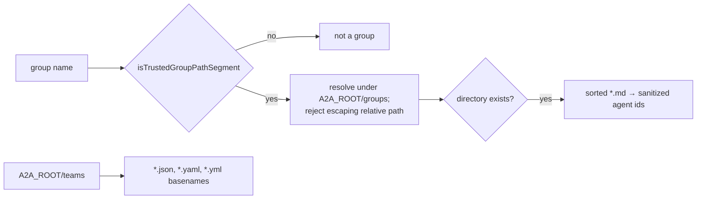

[`isTrustedGroupPathSegment()`][ref-46] admits only names matching `^[A-Za-z0-9._-]+$` that are not `.`, `..`, or any string containing `..`, `/`, or `\`, and [`resolvedTrustedGroupDirectory()`][ref-47] re-checks the joined path with `path.relative` before any `stat`. The double check rejects traversal before the filesystem is consulted, so a group name supplied through a message or CLI argument cannot address a directory outside `groups/`. [`listGroupMembers()`][ref-51] treats every `.md` file in sorted order as one member and derives the agent id through [`sanitizeAgentName()`][ref-48], which collapses unsafe characters to `-` and falls back to `agent`. [`listTeamSpecNames()`][ref-53] lists only top-level `.json`, `.yaml`, and `.yml` files in `<A2A_ROOT>/teams`; nested directory specs are resolved by the team-spec module instead, and [`teamSpecsDir()`][ref-52] creates the directory as a side effect of returning it. The CLI passes both [`REPO_TEAMS_DIR`][ref-79] and `teamSpecsDir()` to team resolution, and both evaluate to `<checkout>/teams`; see [Team Specifications and Backend Translation](#team-specifications-and-backend-translation) for the resolution order.

<a id="configuration-and-persistent-state-message-log"></a>
### Message log

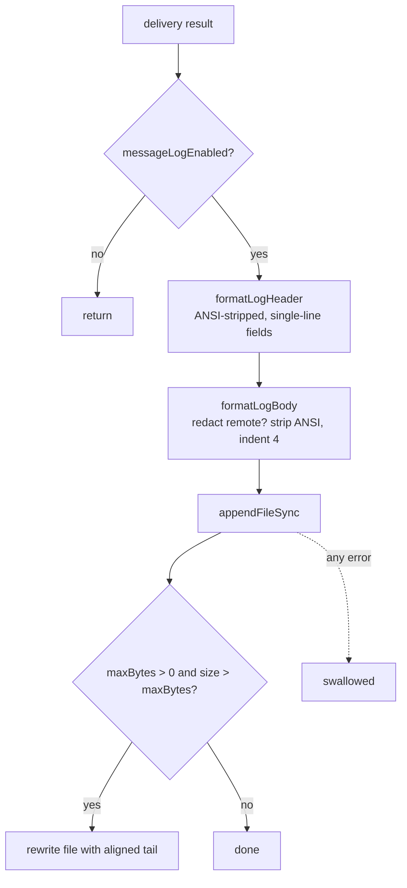

```js
export function formatLogHeader(entry, stamp) {
    const from = cleanLogHeaderField(entry.from);
    const to = cleanLogHeaderField(entry.to);
    const action = cleanLogHeaderField(entry.action || "message", "message");
    const origin = cleanLogHeaderField(entry.origin);
    return `[${stamp}] ${from} -> ${to}  ${action}/${origin}  ${formatLogBytes(entry)}  ${formatLogStatus(entry)}`;
}
```

*`src/a2a-config.mjs:1067-1073`*

[`appendMessageLog()`][ref-31] is intentionally non-fatal: every error inside it is swallowed, because audit I/O must never fail an inter-agent delivery. Header fields pass through ANSI stripping and newline collapsing, so a sender id or error string cannot forge an additional log entry, while body lines keep their content but receive a four-space indent that keeps entries scannable under `tail -f`. [`formatLogBody()`][ref-64] substitutes `[redacted remote body]` only when `log.redactRemote` is true and the entry's final transport is `remote`, preserving local debugging detail while allowing federated content suppression.

[`rotateLogIfNeeded()`][ref-65] is tail truncation rather than file rotation: when `log.maxBytes` is positive and the file exceeds it, the file is rewritten in place with its last `maxBytes` bytes and no rotated sibling is kept. [`truncateRotatedMessageLogTail()`][ref-61] drops orphaned UTF-8 continuation bytes and advances to the next line that begins with an ISO `[YYYY-MM-DDT` header, so the retained file never starts mid-character or mid-entry. The rewrite reads and then overwrites the same path without a temp file, so an append from another process that lands between the read and the write is discarded. The default `maxBytes` of `0` disables the check entirely; the generating machine's `messages.log` measured 5,346,455 bytes under that default.

[`stripAnsiCodes()`][ref-62] implements the ECMA-48 / ECMA-35 escape grammar as a byte-class state machine covering CSI, OSC terminated by BEL or `ESC \`, and generic `ESC` sequences. Its comment records that earlier SGR-only and Fe-only versions left OSC hyperlinks, cursor-movement CSIs, and charset switches in persisted lines, which broke plain-text matching against the log. Malformed sequences drop only the introducer bytes, while an unterminated OSC consumes the remainder of the string.

See [Runtime State and Observability](#runtime-state-and-observability) for the consumers of `registry.json` and [Bridge Server and Registry](#bridge-server-and-registry) for the live map.

## Message Framing and Identity

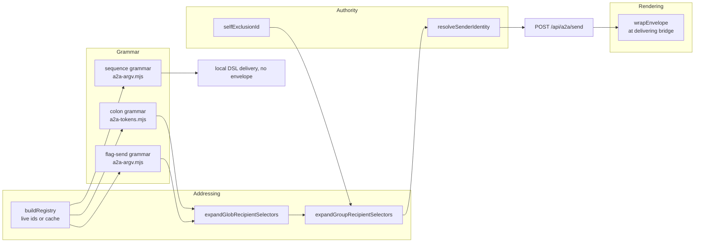

The message boundary splits one outbound send into four independently testable concerns: syntax, addressing, authority, and rendering. [`src/a2a-tokens.mjs`][ref-66] owns the registry-aware colon grammar, [`src/a2a-argv.mjs`][ref-80] owns the flag-send and sequence grammars, [`src/recipient-selectors.mjs`][ref-81] owns wildcard expansion, [`src/cli/sender-identity.mjs`][ref-23] owns sender authority, and [`src/server/envelope.mjs`][ref-82] owns the terminal-visible `<a2a>` header. The split exists so that convenience syntax added to a grammar cannot widen who a message claims to come from or how its header is escaped; the order in which [`main()`][ref-8] tries the grammars is owned by [Command-Line Orchestrator](#command-line-orchestrator-dispatch-and-command-families).

- [Parser and selector inventory](#message-framing-and-identity-parser-and-selector-inventory)
- [Send grammars](#message-framing-and-identity-send-grammars)
- [Recipient registry and selectors](#message-framing-and-identity-recipient-registry-and-selectors)
- [Sender authority](#message-framing-and-identity-sender-authority)
- [Envelope contract](#message-framing-and-identity-envelope-contract)

<a id="message-framing-and-identity-parser-and-selector-inventory"></a>
### Parser and selector inventory

| Module | Public surface | Policy boundary |
| --- | --- | --- |
| [`src/a2a-tokens.mjs`][ref-66] | [`ACTIONS`][ref-83], `ACTION_ALIASES`, [`buildRegistry()`][ref-84], [`classifyToken()`][ref-85], [`isColonFlagArgv()`][ref-86], [`parseColonFlagArgv()`][ref-87] | Registry-aware colon grammar and recipient cache refresh |
| [`src/a2a-argv.mjs`][ref-80] | [`isSequenceFlagArgv()`][ref-88], [`isFlagSendArgv()`][ref-89], [`parseFlagSendArgv()`][ref-90], [`parseSequenceFlagArgv()`][ref-91]; re-exports the two colon functions | Flag-send versus raw sequence grammar |
| [`src/recipient-selectors.mjs`][ref-81] | [`hasUnescapedGlob()`][ref-92], [`globPatternToRegExp()`][ref-93], [`expandGlobRecipientSelectors()`][ref-94] | Case-insensitive `*`/`?` expansion with backslash escapes |
| [`src/cli/sender-identity.mjs`][ref-23] | [`resolveSenderIdentity()`][ref-95], [`selfExclusionId()`][ref-96], `VALID_ORIGINS` | Actor id, authority class, operator surface |
| [`src/server/envelope.mjs`][ref-82] | [`sanitizeForXmlCharacterData()`][ref-97], [`escapeXml()`][ref-98], [`wrapEnvelope()`][ref-99] | Terminal framing and display provenance |
| [`src/cli.mjs`][ref-3] | [`getRegistry()`][ref-100], [`expandGroupRecipientSelectors()`][ref-101], [`sanitizeEnvelopeMeta()`][ref-102] | I/O glue: live agent list, group directories, reserved-key stripping |

<a id="message-framing-and-identity-send-grammars"></a>
### Send grammars

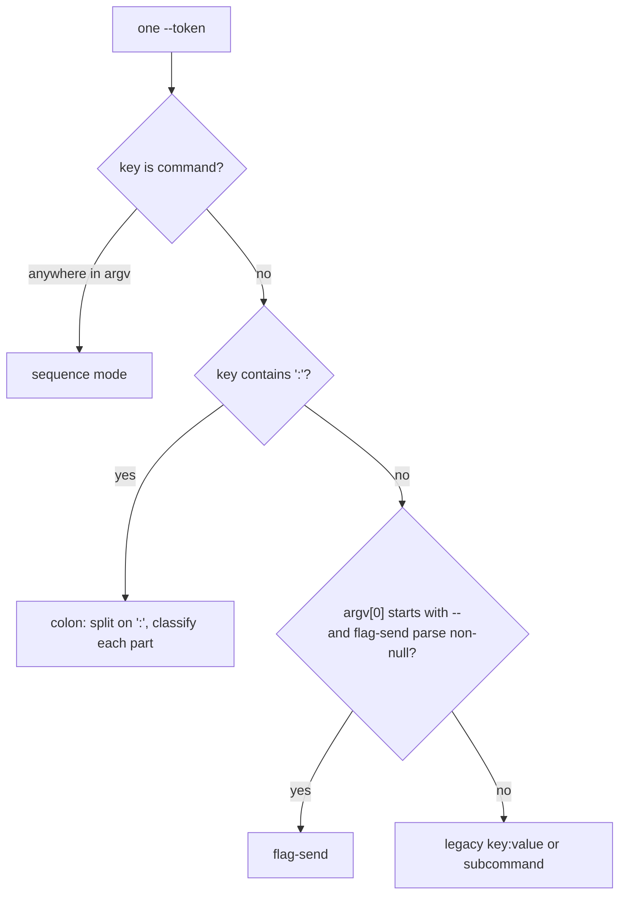

| Grammar | Detection | Recipients | Action | Content source | Metadata | Delivery class |
| --- | --- | --- | --- | --- | --- | --- |
| Colon | Any `--` token whose key contains `:` ([`isColonFlagArgv()`][ref-86]) | Colon parts that are not actions, bare `--<agent|group>`, `--to X` placed first | One action token from `ACTIONS`; a second throws | `--ask:bob=body`, `--content`, or positional; any two together throw | Bare `--source X`; any unreserved `--key=value` | Bridge envelope |
| Flag-send | `argv[0]` starts with `--`, no `--command`, and a registry-free parse returns non-null ([`isFlagSendArgv()`][ref-89]) | Bare `--<name>` flags checked against the registry; `--to X` first | Bare `--message`, `--reply`, `--ask`, `--write`; last one wins | `--content` or positional, never both | None; an unknown `--key=value` makes the argv not a flag send | Bridge envelope |
| Sequence | Any `--command` key ([`isSequenceFlagArgv()`][ref-88]) | Bare `--<name>` flags, `--to X` | Fixed `sequence` | `--write TEXT`, `--write -`, or `--stdin`; positional content throws | None; `--from`/`--origin` accepted and unused by delivery | Local DSL, no envelope |

```js
const RESERVED_FLAG_KEYS = new Set([ "from", "to", "origin", "content", "url", "key", "id", "target", "desc", "lines", "system-prompt", "port", "user" ]);
const VALUE_FLAG_KEYS = new Set([ "from", "to", "origin", "content" ]);
// Bare meta keys that may consume the NEXT argv word as their value. Only
// keys actually read downstream qualify: the CLI's sendNormalizedEnvelope
// (src/cli.mjs) reads `meta.source` to override the resolved sender source;
// every other meta key is spread into the bridge POST body and silently
// dropped by the server. Any other bare unknown flag throws — historically a
// typo'd recipient (`--scot`) swallowed the first word of the message into
// meta and silently broadcast the rest. Explicit `--key=value` metadata is
// still accepted (the `=` binds the value, so nothing can be swallowed).
const META_FLAG_KEYS = new Set([ "source" ]);
```

*Caption: `src/a2a-tokens.mjs:6-16`*

The colon grammar treats every unbound token as suspect. [`RESERVED_FLAG_KEYS`][ref-103] names flags that belong to other subcommands (`--url`, `--key`, `--lines`, `--user`, and others) and throws when they appear in a send, while [`META_FLAG_KEYS`][ref-104] admits exactly one bare metadata key, `--source`, because it is the only metadata the CLI reads. Every other bare flag that [`classifyToken()`][ref-85] cannot match to an action, agent, or group throws `unknown flag`, which closes the historical failure in which a misspelled recipient consumed the first message word and the remainder broadcast to every agent. `--key=value` metadata stays legal because `=` binds the value and nothing can be swallowed; of that metadata, only `mood` and `priority` survive into the rendered header.

The flag-send grammar is stricter about metadata and looser about detection. [`parseFlagSendArgv()`][ref-90] returns `null` for any unknown `--key=value`, so such an argv is not a send at all and falls through to subcommand dispatch, and it always returns `meta: {}`. Action keys are matched with `Object.hasOwn` rather than `in`, preventing `--toString` from resolving to a prototype method. Detection runs the parser with no registry, so every bare flag counts as a recipient at that stage; the authoritative parse in `main()` repeats with the live registry, where [`assertKnownRecipient()`][ref-105] throws for names that are neither known agents nor groups and skips the check for unescaped globs. A flag-send with no recipient and no `--to` sets `broadcast: true`, which is the only path to an all-agents envelope send; a colon send with no recipient falls back to the single inferred peer instead.

[`parseSequenceFlagArgv()`][ref-91] joins repeated `--command` values with `|`, the DSL step separator, rejects a second `--write`, and refuses positional words so a body can never be silently dropped. The sequence grammar is the one grammar whose output never becomes an envelope; see [Command sequence DSL](#terminal-transport-system-command-sequence-dsl) for the language itself.

<a id="message-framing-and-identity-recipient-registry-and-selectors"></a>
### Recipient registry and selectors

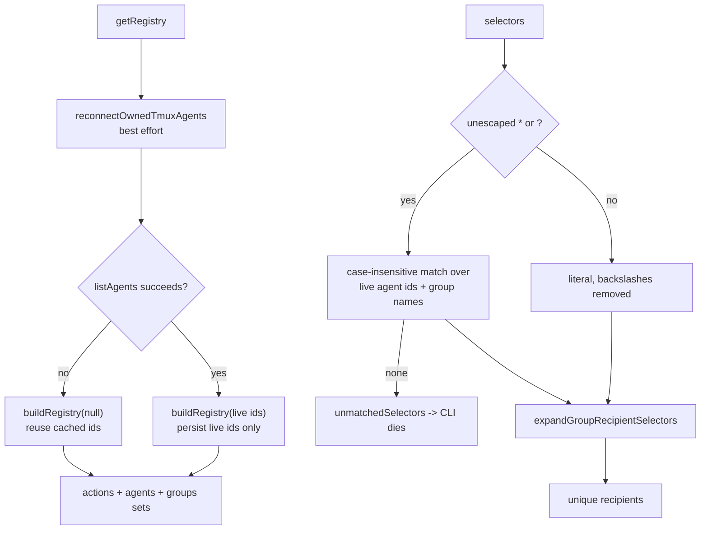

[`buildRegistry()`][ref-84] treats a live bridge agent list as ground truth and writes only those ids back to `registry.json`; cached ids are consulted only when the bridge is unreachable and the caller passes `null`. Merging cached ids into a live list previously re-hydrated dead agents into the cache on every send. [`getRegistry()`][ref-100] runs owned-session reconnection before listing agents, because a freshly restarted bridge has an empty in-memory map and every recipient would otherwise fail as an unknown flag.

[`expandGlobRecipientSelectors()`][ref-94] deduplicates candidates and results in first-seen order and reports unmatched wildcard selectors separately instead of dropping them. A backslash escapes `*`, `?`, or `\`, so `web\*` addresses the agent literally named `web*`, and [`globPatternToRegExp()`][ref-93] anchors the pattern and escapes every regex metacharacter so selector text cannot inject regex syntax. Group names are glob candidates alongside agent ids; [`expandGroupRecipientSelectors()`][ref-101] then replaces each group name with its member ids and dies on an empty group, so a wildcard can address whole groups. Glob selectors require a reachable bridge, while literal selectors survive a failed agent listing and are validated later by the bridge itself.

<a id="message-framing-and-identity-sender-authority"></a>
### Sender authority

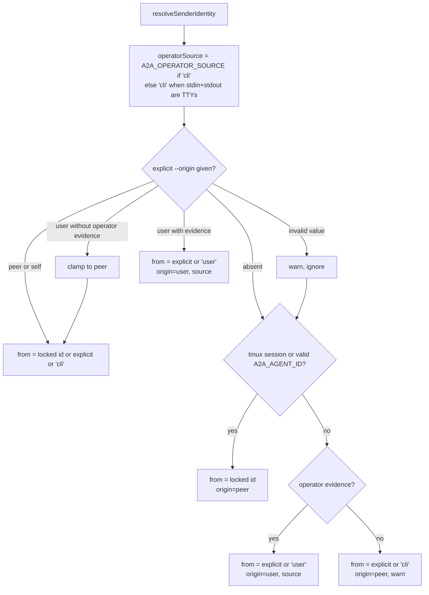

| Output field | Values | Meaning |
| --- | --- | --- |
| `fromId` | locked agent id, explicit `--from`, `user`, or `cli` | Actor rendered in the envelope |
| `origin` | `user`, `peer`, `self` (`VALID_ORIGINS`) | Authority class the bridge validates and the receiver trusts |
| `source` | `cli` only (`VALID_OPERATOR_SOURCES`) | Operator surface shown in place of `origin` for human sends |

[`resolveSenderIdentity()`][ref-95] never throws, because the channel adapter and dashboard shell out through it with incomplete context and must still deliver. Its fail-closed default stamps a process with neither a locked agent identity nor operator evidence as `from=cli origin=peer`, preventing `sudo` wrappers, environment-stripping spawners, and CI shells from impersonating the human. Operator evidence is an interactive TTY on both stdin and stdout, or `A2A_OPERATOR_SOURCE=cli`, which [`src/cli/dashboard-tui.mjs`][ref-106] sets when it shells out non-interactively on the human's behalf. [`normalizeOriginForContext()`][ref-107] clamps an explicit `--origin user` without that evidence to `peer`.

An explicit, valid `--origin` is evaluated before the locked identity. For `peer` and `self` the locked tmux or `A2A_AGENT_ID` id still replaces a conflicting `--from`, but an accepted `--origin user` returns the explicit `--from` (or `user`) even inside an agent session, although the preceding warning reports that `--from` was ignored. [`selfExclusionId()`][ref-96] applies the same tmux-first, `A2A_AGENT_ID`-second precedence for broadcast and inferred-peer exclusion, so iTerm-backed agents, which have no `TMUX`, do not deliver their own broadcasts back to themselves; `A2A_AGENT_ID` must match `[A-Za-z0-9_-]+` to count.

[`sendNormalizedEnvelope()`][ref-108] applies one override after identity resolution: a `--source X` metadata value replaces the resolved `source` without passing through `VALID_OPERATOR_SOURCES`. The override changes only the display label of user-origin messages and cannot grant `origin=user`, because the origin decision has already been made.

<a id="message-framing-and-identity-envelope-contract"></a>
### Envelope contract

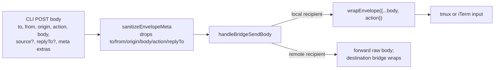

```js
export function wrapEnvelope(msg) {
  const safeBody = sanitizeForXmlCharacterData(String(msg.body));
  const origin = displayOrigin(msg);
  const originAttr = origin ? ` origin="${escapeXml(origin)}"` : "";
  const extras = Object.entries(msg)
    .filter(([k]) => ENVELOPE_EXTRA_DISPLAY_KEYS.has(k))
    .filter(([, v]) => typeof v === "string")
    .map(([k, v]) => ` ${escapeXml(k)}="${escapeXml(v)}"`)
    .join("");
  return `<a2a from="${escapeXml(msg.from)}"${originAttr}${extras}>\n${safeBody}\n</a2a>`;
}

function displayOrigin(msg) {
  if (msg?.origin === "user") {
    return typeof msg.source === "string" && msg.source.trim()
      ? msg.source.trim()
      : "cli";
  }
  if (msg?.origin === "self") {
    return "self";
  }
  return null;
}
```

*Caption: `src/server/envelope.mjs:82-104`*

| Header attribute | Present when | Value | Escaping |
| --- | --- | --- | --- |
| `from` | Always | Sender actor id | [`escapeXml()`][ref-98] |
| `origin` | `origin` is `user` or `self` | Trimmed `source` or `cli` for user; `self` for self | `escapeXml()` |
| `mood` | String value supplied | Free text | `escapeXml()` |
| `priority` | String value supplied | Free text | `escapeXml()` |
| `action` | Never | Carried in the POST body and message log, not rendered | Not applicable |

[`wrapEnvelope()`][ref-99] runs at the delivering bridge ([`src/a2a-server.mjs`][ref-109]), which spreads the raw `/api/a2a/send` body into it; [`ENVELOPE_EXTRA_DISPLAY_KEYS`][ref-110] is therefore an allowlist rather than a denylist, so a sender cannot render provenance-looking attributes such as `trusted="yes"` or leak internal objects into the header. Header values are attribute-escaped, while the body only loses XML-illegal control characters and lone surrogates through [`sanitizeForXmlCharacterData()`][ref-97]; nothing parses the envelope, so leaving `<`, `>`, and `&` literal preserves code, JSX, shell syntax, comparisons, and quoted envelope examples. Peer origin is omitted from the header because the `from` actor already names the peer, and user origin displays the operator surface rather than the word `user`. The CLI strips reserved keys from metadata through [`OUTBOUND_ENVELOPE_RESERVED`][ref-111] before posting so metadata cannot overwrite `to`, `from`, `origin`, `body`, `action`, or `replyTo`.

See [Bridge Server and Registry](#bridge-server-and-registry-delivery-and-federation) for server-side origin and peer-namespace validation and [Terminal Transport System](#terminal-transport-system-command-sequence-dsl) for the sequence path.

## Terminal Transport System

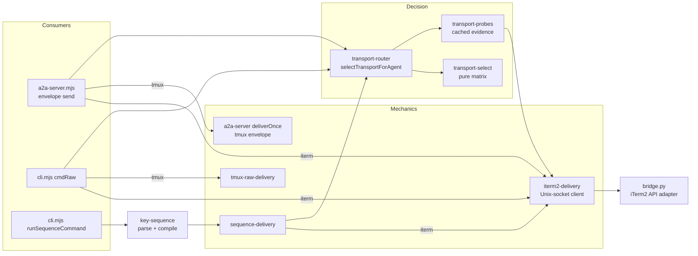

The transport stack treats `config.protocol` as a preference rather than a global switch. Capability evidence is gathered by [`src/transport-probes.mjs`][ref-11], evaluated by pure policy in [`src/transport-select.mjs`][ref-13], and applied per recipient by [`src/transport-router.mjs`][ref-18]. This arrangement permits a mixed swarm in which one agent remains reachable through tmux while another uses iTerm2, and it lets an unavailable optional iTerm bridge fall back to tmux without changing persisted configuration. Three consumers share the one decision layer: the bridge envelope path in [`src/a2a-server.mjs`][ref-4], the CLI raw path, and the CLI command-sequence path. Each consumer still owns its own delivery mechanics, so their retry and warning behavior differs; the differences are tabulated in [tmux delivery](#terminal-transport-system-tmux-delivery) and [Failure semantics](#terminal-transport-system-failure-semantics).

- [Selection and probe caching](#terminal-transport-system-selection-and-probe-caching) covers the capability matrix, probe TTLs, generation counters, and iTerm session identity.
- [tmux delivery](#terminal-transport-system-tmux-delivery) covers the three tmux paths, the settle-delay formula, verification, and submit keys.
- [iTerm2 RPC bridge](#terminal-transport-system-iterm2-rpc-bridge) covers the Node client, the Python adapter's operation table, reconnect supervision, ownership, and the launcher.
- [Command sequence DSL](#terminal-transport-system-command-sequence-dsl) covers grammar, variables, the key table, chord bytes, and compilation.
- [Failure semantics](#terminal-transport-system-failure-semantics) covers per-path outcomes and comments that no longer match the code.

### Module inventory

| Module | Important symbols | Responsibility | Production importers |
| --- | --- | --- | --- |
| [`src/transport-select.mjs`][ref-13] | [`viableItermGuid()`][ref-112], [`isDefaultTmuxPlaceholder()`][ref-113], [`pickTransport()`][ref-114], [`explainPick()`][ref-115] | Pure capability matrix, no I/O | router, agent-transport, iterm-agent-resolve, `cli/iterm-restart-plan.mjs`, `cli.mjs`, `a2a-server.mjs` |
| [`src/transport-probes.mjs`][ref-11] | [`bridgeReachable()`][ref-116], [`tmuxSessionAlive()`][ref-117], [`itermGuidByName()`][ref-118], [`itermGuidExists()`][ref-119], [`itermSessionIsAgent()`][ref-120], [`itermSessionAgentId()`][ref-121], [`listITermSessionsWithOwnership()`][ref-122], [`isA2aOwnedITermSession()`][ref-123], [`invalidateITermSessionCache()`][ref-124] | Cached bridge, tmux, and iTerm evidence | router, `cli.mjs`, `cli/session-inventory.mjs`, `runtime/runtime-snapshot.mjs`, `cli/iterm-restart-plan.mjs` |
| [`src/transport-router.mjs`][ref-18] | [`activeProtocol()`][ref-125], [`selectTransportForAgent()`][ref-126], [`deliverViaActiveProtocol()`][ref-127], [`resolveITerm2GuidByName()`][ref-128] | Probe integration and raw dispatch | `cli.mjs`, `a2a-server.mjs`, sequence-delivery |
| [`src/agent-transport.mjs`][ref-129] | [`isAgentSessionAlive()`][ref-130], [`shouldReviveAgentInTmux()`][ref-131] | Liveness policy over injected probes | `cli.mjs` (`isAgentSessionAlive` only) |
| [`src/backend-delivery.mjs`][ref-16] | [`submitKeysForBackend()`][ref-132], [`submitRecoveryKeysForBackend()`][ref-133] | Backend submit chord in tmux spelling | tmux-raw-delivery, iterm2-delivery, key-sequence, `a2a-server.mjs`, `cli.mjs` |
| [`src/tmux-raw-delivery.mjs`][ref-134] | [`exactTmuxTarget()`][ref-135], [`rawPasteLooksUnsubmitted()`][ref-136], [`deliverRawTmuxInput()`][ref-137] | Synchronous raw tmux paste with verification | router, probes, sequence-delivery |
| [`src/tmux-paste-verifier.mjs`][ref-138] | [`pasteLooksUnsubmitted()`][ref-139] | Placeholder and prompt-overlap test over captured text | tmux-raw-delivery, `a2a-server.mjs` |
| [`src/iterm-agent-resolve.mjs`][ref-140] | [`resolveLiveItermTarget()`][ref-141], [`resolveLiveItermGuid()`][ref-142] | Live-name over stored-GUID reconciliation | none; tests only |
| [`src/iterm2-delivery.mjs`][ref-12] | [`deliverITerm2Input()`][ref-143], [`deliverITerm2Sequence()`][ref-144], [`rpcTimeoutForSteps()`][ref-145], lifecycle wrappers | Node Unix-socket RPC client | router, probes, sequence-delivery, `cli.mjs`, `a2a-server.mjs` |
| [`src/key-sequence.mjs`][ref-14] | [`KEY_TABLE`][ref-146], [`computeSettleMs()`][ref-147], [`parseCommandDsl()`][ref-148], [`compileSequence()`][ref-149], [`compileOpToTmuxKeys()`][ref-150], [`compileOpToBytes()`][ref-151], [`chordBytes()`][ref-152] | Transport-neutral command language | iterm2-delivery, sequence-delivery, `cli.mjs` |
| [`src/sequence-delivery.mjs`][ref-153] | [`deliverSequenceViaActiveProtocol()`][ref-154], [`buildTmuxOperationBatches()`][ref-155] | Ordered op-list execution | `cli.mjs` |
| [`cmd/a2a-iterm2-bridge/bridge.py`][ref-156] | [`OPS`][ref-157], [`ITermLink`][ref-158], [`supervise()`][ref-159], [`_run_op()`][ref-160], [`handle_client()`][ref-161] | iTerm2 API adapter and GUID ownership store | Unix-socket clients |
| [`cmd/a2a-iterm2-bridge/launch.sh`][ref-162] | [`find_python()`][ref-163], [`ensure_venv()`][ref-164], [`cmd_start()`][ref-165], [`cmd_stop()`][ref-166] | Python resolution and daemon control | [`runIterm2BridgeLauncher()`][ref-167] in `cli.mjs` |

Two modules carry policy that production code does not import. [`src/iterm-agent-resolve.mjs`][ref-140] prefers a live name match over a stored GUID without checking ownership, while the CLI uses its own [`resolveLiveItermTargetForAgent()`][ref-168] in [`src/cli.mjs`][ref-3], which prefers a stored GUID that is still live and otherwise accepts only a name match owned by this installation's token. [`shouldReviveAgentInTmux()`][ref-131] is likewise exercised only by tests. The CLI variant is the authoritative behavior; the standalone module documents an earlier, weaker policy and should not be assumed to describe runtime reconciliation.

<a id="terminal-transport-system-selection-and-probe-caching"></a>
### Selection and probe caching

```mermaid
flowchart TD
  SELECT["selectTransportForAgent"] --> TARGET["tmuxTarget or agentId:0.0"]
  TARGET --> TMUX{"tmux session alive?"}
  TMUX --> FAST{"preference=tmux, tmux alive,<br/>no stored iTerm GUID?"}
  FAST -->|yes| T["tmux, no iTerm probes"]
  FAST -->|no| BRIDGE{"iTerm bridge reachable?"}
  BRIDGE -->|yes| GUID{"stored GUID in live list?"}
  GUID -->|no or absent| NAME["itermGuidByName: tag, then legacy title"]
  GUID -->|yes| MATRIX["pickTransport"]
  NAME --> MATRIX
  BRIDGE -->|no| MATRIX
  MATRIX --> I["iterm + GUID"]
  MATRIX --> T2["tmux"]
  MATRIX --> NONE["null + explainPick reason"]
```

```js
export function pickTransport({ agent = {}, preference = "tmux", bridgeReachable = false, itermNameMatch = false, tmuxSessionAlive = false } = {}) {
    const itermViable = Boolean(bridgeReachable && (viableItermGuid(agent.itermGuid) || itermNameMatch));
    let tmuxViable = Boolean(agent.tmuxTarget && typeof agent.tmuxTarget === "string" && tmuxSessionAlive);
    // iTerm-backed agents carry a placeholder tmux target for registration.
    // Ignore coincidental tmux sessions with the same name when iTerm works.
    if (tmuxViable && isDefaultTmuxPlaceholder(agent) && viableItermGuid(agent.itermGuid) && itermViable) {
        tmuxViable = false;
    }

    if (itermViable && !tmuxViable) {
        return "iterm";
    }
    if (tmuxViable && !itermViable) {
        return "tmux";
    }
    if (!itermViable && !tmuxViable) {
        return null;
    }
    // Both viable — preference wins.
    return preference === "iterm" ? "iterm" : "tmux";
}
```

*Caption: `src/transport-select.mjs:64-84`*

| Bridge reachable | Non-blank GUID or name match | tmux target string with live session | Target equals `${agentId}:0.0` and GUID non-blank | Result |
| --- | --- | --- | --- | --- |
| no | any | no | any | `null` |
| no | any | yes | any | `tmux` |
| yes | no | no | any | `null` |
| yes | no | yes | any | `tmux` |
| yes | yes | no | any | `iterm` |
| yes | yes | yes | yes | `iterm` (placeholder suppressed, preference ignored) |
| yes | yes | yes | no | preference: `iterm` when `preference === "iterm"`, otherwise `tmux` |

[`pickTransport()`][ref-114] defines viability conservatively: a stored GUID is never sufficient without a reachable bridge, and tmux requires both a string target and a live session. The placeholder row exists because iTerm-spawned agents register `${agentId}:0.0` as a compatibility target even when no tmux session exists; without suppression, an unrelated tmux session that happens to share the agent name would win under the default `tmux` preference and receive another agent's messages. [`explainPick()`][ref-115] renders the same inputs as a log reason and orders the actionable remedy first, emitting `a2a bridge iterm start` when iTerm is preferred, the agent has an iTerm shape, and the bridge is down.

[`selectTransportForAgent()`][ref-126] supplies the matrix inputs and adds two behaviors the pure function cannot know about. The fast path returns tmux without pinging the iTerm bridge when the preference is `tmux`, the target is alive, and no GUID is stored, which keeps tmux-only swarms free of socket round-trips on every send. Outside the fast path, a stored GUID is validated against the live session list through [`itermGuidExists()`][ref-119] and discarded when absent, because trusting a GUID from a closed window would fail with `unknown session` instead of falling through to a live tmux pane. A name-resolved GUID is then passed to the matrix as the agent's GUID, so placeholder suppression also applies to agents found by tag rather than by registry record. [`activeProtocol()`][ref-125] reads the preference from configuration on every call, mapping anything other than `iterm` to `tmux`.

#### Probe cache semantics

| Probe | Constant | Cached on success | Cached on failure | Concurrency |
| --- | --- | --- | --- | --- |
| [`bridgeReachable()`][ref-116] (`ping`, 1,000 ms RPC timeout) | `BRIDGE_REACHABLE_TTL_MS = 5000` | `{expires}` for 5,000 ms | Cache cleared to `null` | One in-flight ping shared by all callers |
| [`tmuxSessionAlive()`][ref-117] (`tmux has-session -t =<session>`) | `TMUX_ALIVE_TTL_MS = 2000` | Per-session entry for 2,000 ms | Entry deleted | Synchronous `spawnSync`; expired entries swept at most once per 2,000 ms |
| iTerm session list (`list_sessions`) | `ITERM_SESSIONS_TTL_MS = 2000` | Indexed entry for 2,000 ms, including an empty list | Not stored | One in-flight listing shared by all callers |

| Event | Bridge-reachable cache | Session-list cache | tmux cache |
| --- | --- | --- | --- |
| Successful `list_sessions` | Refreshed for 5,000 ms | Replaced | Unchanged |
| Failed `list_sessions` | Cleared | Unchanged (expired entries are not reused) | Unchanged |
| [`invalidateITermSessionCache()`][ref-124] | Retained; pending ping dropped | Cleared; pending listing dropped | Unchanged |
| [`resetTransportProbeCache()`][ref-169] (tests) | Cleared | Cleared | Cleared, sweep timer reset |
| Result arriving after a generation bump | Not written | Not written | Not applicable |

```js
export function invalidateITermSessionCache() {
    probeGeneration++;
    pendingBridgePing = null;
    pendingITermSessions = null;
    cachedITermSessions = null;
}
```

*Caption: `src/transport-probes.mjs:395-400`*

[`src/transport-probes.mjs`][ref-11] caches only positive evidence because the long-lived bridge calls the router on every send: a dead bridge must be re-detected on the next delivery, and an agent spawned immediately after a failed probe must be reachable without waiting out a TTL. The generation counter closes the remaining race. A ping or listing started before a spawn, kill, or close completes may still resolve to its caller, but it cannot overwrite the cache that the invalidation emptied, so stale pre-spawn state never shadows the new session. A listing doubles as a ping in both directions: success refreshes reachability, and failure clears a previously cached success, while explicit invalidation leaves an independent successful ping untouched. All GUID, name, and ownership queries read one indexed entry built by [`buildITermSessionCacheEntry()`][ref-170], so a single `list_sessions` round-trip answers every iTerm question asked during one delivery.

#### iTerm session identity

| Session kind | Indexed under (`guidByAgentName`) | [`itermSessionIsAgent()`][ref-120] match rule | [`itermSessionAgentId()`][ref-121] result |
| --- | --- | --- | --- |
| Tagged with `user.a2a_agent_id` | The tag only; first tagged session wins | Tag equality only; a mismatching tag is a different agent even when the title matches | The tag |
| Untagged, titled | Full title and the title prefix before the first space-dash-space separator, unless a tag already owns that key | Exact title, or title followed by whitespace, then `-`, `–`, or `—`, then whitespace | Title head before the separator when it matches `^[A-Za-z0-9_-]+$`, else `null` |
| Untagged, untitled | Not indexed | No match | `null` |

The durable tag outranks the title because backends retitle their tabs; Claude Code writes the task title, so a title lookup stops finding the agent and the CLI would respawn a duplicate. Tags are indexed in a first pass so a legacy session's title can never claim an id that a tagged session already owns. Separator tolerance exists because iTerm decorates `session.name` with ` — <pwd>` according to the active profile, so a session named `driver` reads back as `driver — ~/path`.

#### Liveness policy

[`isAgentSessionAlive()`][ref-130] in [`src/agent-transport.mjs`][ref-129] fast-paths tmux when no iTerm GUID is stored, probes iTerm when needed, and checks tmux again after an optional iTerm failure. The final recheck covers a session created during an in-flight bridge probe and prevents an unavailable optional adapter from hiding a valid tmux fallback. Its production caller, [`agentSessionAlive()`][ref-171] in [`src/cli.mjs`][ref-3], invokes it only for agents without a stored GUID, filters the iTerm list to sessions carrying this installation's token, and wraps the tmux probe in the CLI's own `exactTmuxTarget()`; GUID-backed agents instead go through [`resolveLiveItermTargetForAgent()`][ref-168]. Restart consumers are documented in [Agent Lifecycle](#agent-lifecycle-transport-aware-restart).

<a id="terminal-transport-system-tmux-delivery"></a>
### tmux delivery

```mermaid
flowchart TD
  START["deliverOnce / deliverRawTmuxInput"] --> LOAD["load-buffer -b unique-name"]
  LOAD --> PASTE["paste-buffer -p -d"]
  PASTE -->|nonzero| DEL["delete-buffer, hard failure"]
  PASTE --> SUBMIT{"submit requested?"}
  SUBMIT -->|no, raw only| OK["ok + bytes"]
  SUBMIT -->|yes| WAIT["settle: floor + KiB × perKb, capped"]
  WAIT --> KEY["send-keys backend submit"]
  KEY -->|nonzero| FAILK["hard failure"]
  KEY --> VERIFY{"verification enabled?"}
  VERIFY -->|no| OK
  VERIFY -->|yes| BACKOFF["sleep 200 × 1.5^attempt"]
  BACKOFF --> CAPTURE["capture-pane -p -S -10"]
  CAPTURE --> CLEAR{"pasteLooksUnsubmitted?"}
  CLEAR -->|no| OK
  CLEAR -->|yes, retries remain| KEY
  CLEAR -->|yes, exhausted| END["raw: ok + warning<br/>server: one more submit key, ok"]
```

| Property | Bridge envelope path | Raw CLI path | Sequence path |
| --- | --- | --- | --- |
| Entry | [`tmuxDeliver()`][ref-172] → [`deliverOnce()`][ref-173] in `a2a-server.mjs` | [`deliverRawTmuxInput()`][ref-137] via [`deliverViaActiveProtocol()`][ref-127] from [`cmdRaw()`][ref-174] | `tmuxPaste()`, `tmuxTypeLiteral()`, `tmuxSendKeys()` in [`src/sequence-delivery.mjs`][ref-153] |
| Target form | Recorded target, unmodified | `=`-prefixed exact target | `=`-prefixed exact target |
| Serialization | [`withTargetLock()`][ref-175] per target string | None (one CLI process) | None |
| Settle source | Server [`computeSettleMs()`][ref-176], `A2A_PASTE_SETTLE_*`, read once at module load | Private `computeSettleMs()` in [`src/tmux-raw-delivery.mjs`][ref-177], `A2A_RAW_PASTE_SETTLE_*`, read per call | Compiled `sleep` op from [`computeSettleMs()`][ref-147], `A2A_RAW_PASTE_SETTLE_*` |
| Sleep primitive | `await sleep()` | `Atomics.wait` (blocks the CLI process) | `setTimeout` |
| Verification switch | Off when `A2A_PASTE_VERIFY=0` | Off when `A2A_RAW_PASTE_VERIFY=0` or `A2A_PASTE_VERIFY=0` | None |
| Retry count | `A2A_PASTE_MAX_ENTER_RETRIES`, default 5, minimum 1 | `A2A_RAW_PASTE_MAX_ENTER_RETRIES`, default 5, minimum 1 | None |
| Base retry delay | `A2A_PASTE_VERIFY_RETRY_DELAY_MS`, default 200 | `A2A_RAW_PASTE_VERIFY_RETRY_DELAY_MS`, default 200 | None |
| Capture failure | Treated as submitted; no warning | `ok:true` + `tmux paste verify could not read pane; submit uncertain` | Not applicable |
| Retries exhausted | One extra submit key; `ok:true`, no warning | `ok:true` + `tmux paste submit could not be verified; leaving input in pane` | Not applicable |

```js
export function computeSettleMs(byteLength) {
    const floor = parseNonNegativeIntegerEnv("A2A_RAW_PASTE_SETTLE_FLOOR_MS", SETTLE_FLOOR_MS_DEFAULT);
    const perKb = parseNonNegativeIntegerEnv("A2A_RAW_PASTE_SETTLE_PER_KB_MS", SETTLE_PER_KB_MS_DEFAULT);
    const ceiling = parseNonNegativeIntegerEnv("A2A_RAW_PASTE_SETTLE_CEILING_MS", SETTLE_CEILING_MS_DEFAULT);
    const kib = byteLength <= 0 ? 0 : Math.ceil(byteLength / BYTES_PER_KIB);
    return Math.max(0, Math.min(ceiling, floor + kib * perKb));
}
```

*Caption: `src/key-sequence.mjs:52-58`*

```js
function computeSettleMs(byteLength) {
    const kib = byteLength <= 0 ? 0 : Math.ceil(byteLength / SERVER_BODY_BYTES_PER_KIB);
    const scaled = PASTE_SETTLE_FLOOR_MS + kib * PASTE_SETTLE_PER_KB_MS;
    return Math.max(0, Math.min(PASTE_SETTLE_CEILING_MS, scaled));
}
```

*Caption: `src/a2a-server.mjs:458-462`*

| Settle parameter | Default | Raw, sequence, and iTerm variable | Server variable |
| --- | ---: | --- | --- |
| Floor | 300 ms | `A2A_RAW_PASTE_SETTLE_FLOOR_MS` | `A2A_PASTE_SETTLE_FLOOR_MS` |
| Per started KiB | 8 ms | `A2A_RAW_PASTE_SETTLE_PER_KB_MS` | `A2A_PASTE_SETTLE_PER_KB_MS` |
| Ceiling | 1,500 ms | `A2A_RAW_PASTE_SETTLE_CEILING_MS` | `A2A_PASTE_SETTLE_CEILING_MS` |

| UTF-8 payload | Settle with defaults |
| ---: | ---: |
| 0 bytes | 300 ms |
| 100 bytes | 308 ms |
| 10,240 bytes | 380 ms |
| 153,600 bytes | 1,500 ms |

| Verify attempt | Delay after submit key (defaults) |
| ---: | ---: |
| 0 | 200 ms |
| 1 | 300 ms |
| 2 | 450 ms |
| 3 | 675 ms |
| 4 | 1,012 ms |

The settle formula is defined three times with the same shape: exported in [`src/key-sequence.mjs`][ref-14] (also consumed by the iTerm client), private in [`src/tmux-raw-delivery.mjs`][ref-177], and private in the server. Every path separates paste from submit and waits a byte-scaled interval because a submit key that arrives before the receiving TUI commits the bracketed-paste end marker is absorbed into the paste, leaving the message unsubmitted. Any started KiB adds the per-KiB increment, so a 100-byte message waits 308 ms rather than the floor. The server reads its knobs under the `A2A_PASTE_` prefix once at startup, while raw and sequence delivery read the `A2A_RAW_PASTE_` prefix on each call; tuning one prefix does not affect the other path.

[`withTargetLock()`][ref-175] serializes server deliveries per target because awaited sleeps would otherwise let two concurrent `/api/a2a/send` requests interleave load, paste, and submit on one pane; before delivery became asynchronous, `spawnSync` blocking provided that serialization implicitly. The server iTerm path uses the same lock under the key `iterm:<guid>` through [`itermDeliver()`][ref-178], so concurrent bracketed pastes to one iTerm session are ordered by the bridge rather than by the Python sidecar. [`exactTmuxTarget()`][ref-135] prefixes `=` unless the target already begins with `=`, `$`, `@`, or `%`, because tmux resolves `-t name` by prefix and a dead `alice` would otherwise reach a live `alice-worker`. The server envelope path does not apply this prefix to its paste and submit commands; exactness on that path comes from the preceding [`tmuxSessionAlive()`][ref-117] probe, which always queries `=<session>`.

| Backend | tmux submit (`send-keys`) | iTerm raw delivery steps | DSL auto-submit op |
| --- | --- | --- | --- |
| `cursor-agent` | `C-Enter` | `ESC`, `ENTER` keys (bytes `\x1b\r`) | chord `C` + `ENTER` |
| Any other or empty | `Enter` | `ENTER` key (byte `\r`) | key `ENTER` |
| Any, with `A2A_ITERM2_SUBMIT_BYTES` set | Unchanged | Override bytes; `\x1b`, `\r`, `\t` become keys, other characters become `type` steps | Unchanged |

[`submitKeysForBackend()`][ref-132] in [`src/backend-delivery.mjs`][ref-16] is the single backend-to-key mapping; the iTerm client and DSL compiler translate its tmux spelling into their own representations. [`submitRecoveryKeysForBackend()`][ref-133] returns an empty list for every backend and has no production caller; the test named `paste delivery does not use recovery keys that can cancel submitted content` in [`tests/backend-delivery.test.mjs`][ref-179] records the intent that no speculative cancel key follows a paste.

[`pasteLooksUnsubmitted()`][ref-139] in [`src/tmux-paste-verifier.mjs`][ref-138] reports unsubmitted input when the captured text contains `[Pasted text #N` or when one of the last six non-trailing-blank lines is a prompt line (`>`, `›`, or `❯` followed by whitespace) whose text overlaps the first line of the pasted content by prefix in either direction. An arbitrary non-empty prompt does not count, so a stray retry cannot submit text the recipient was typing. [`rawPasteLooksUnsubmitted()`][ref-136] wraps that test as a tri-state, returning `null` when `capture-pane` fails so the raw path can report uncertainty instead of claiming submission; the server's [`pasteStillUnsubmitted()`][ref-180] collapses the same failure to `false`.

```js
    if (!submitted) {
        // Placeholder still visible after retries. Resolution is to send Enter and move on
        // rather than warn/block -- a stuck placeholder clears on the next Enter in practice.
        spawnSync(TMUX_EXECUTABLE, [ "send-keys", "-t", target, ...submitKeys ]);
    }
    return { ok: true, bytes: Buffer.byteLength(content, "utf8") };
}
```

*Caption: `src/a2a-server.mjs:557-563`*

<a id="terminal-transport-system-iterm2-rpc-bridge"></a>
### iTerm2 RPC bridge

```mermaid
sequenceDiagram
  participant Node as iterm2-delivery.mjs
  participant Socket as Unix socket (0600)
  participant Python as bridge.py handle_client
  participant Link as ITermLink
  participant API as iTerm2 API
  Node->>Socket: connect, one JSON request + newline
  Socket->>Python: readline, json.loads
  Python->>Python: OPS[op] lookup
  Python->>Link: _run_op races handler vs link.closed
  Link->>API: session operation
  API-->>Link: result, or websocket closed
  Link-->>Python: result or "connection lost during op"
  Python-->>Node: one JSON response + newline, close
```

| Client call | Timeout |
| --- | --- |
| Default RPC (`rpc()`) | `A2A_ITERM2_RPC_TIMEOUT_MS` when a positive integer, else 5,000 ms |
| [`pingITerm2Bridge()`][ref-181] | 1,000 ms |
| [`spawnITerm2Window()`][ref-182] | 15,000 ms |
| `send_keys` via [`deliverITerm2Input()`][ref-143] or [`deliverITerm2Sequence()`][ref-144] | Base + 250 ms per step + every `sleep` step's `ms` |

```js
export function rpcTimeoutForSteps(steps) {
    let ms = baseRpcTimeoutMs();
    for ( const step of Array.isArray(steps) ? steps : [] ) {
        ms += RPC_PER_STEP_BUDGET_MS;
        if (step && step.type === "sleep" && Number.isFinite(step.ms)) {
            ms += Math.max(0, step.ms);
        }
    }
    return ms;
}
```

*Caption: `src/iterm2-delivery.mjs:41-50`*

[`src/iterm2-delivery.mjs`][ref-12] opens one Unix-socket connection per request through [`rpc()`][ref-183] and settles exactly once, converting socket errors, timeouts, malformed JSON, and a close without a response into `{ok:false,error}`. The step-scaled timeout exists because the bridge replies only after executing every step, including sleeps of up to 60,000 ms; a fixed timeout would report failure while the bridge was still delivering, and a caller retry would then deliver twice. The socket path is `A2A_ITERM2_BRIDGE_SOCKET` or `~/.local/state/a2a/iterm2-bridge.sock`.

#### Raw delivery and verification

[`deliverITerm2Input()`][ref-143] sends a `paste` step, a settle `sleep` step from [`computeSettleMs()`][ref-147], and the backend submit keys from [`submitBytesForBackend()`][ref-184] as one `send_keys` request rather than using `send_text`, whose single combined write races the receiving TUI's bracketed-paste commit. Verification then runs as separate `screen` requests through [`screenLooksUnsubmitted()`][ref-185], which is on unless `A2A_ITERM_PASTE_VERIFY=0`.

| Verification parameter | Value |
| --- | --- |
| Attempts | 3 (`ITERM_VERIFY_MAX_RETRIES`) |
| Delay before each read | 200 ms × (attempt + 1): 200, 400, 600 ms |
| Screen lines requested | 8 |
| Lines inspected for prompt overlap | Last 5, skipping blank lines and rules of three or more `─`/`━` |
| Unsubmitted signals | `[Pasted text #N` anywhere in the 8 lines; prompt line overlapping the content's first line; a `</a2a>` line when the content contains `</a2a>` |
| Resubmit | One `ENTER` key step, regardless of backend |
| Unreadable screen | `ok:true` + `iterm paste verify could not read screen; submit uncertain` |
| Resubmit RPC failure | `ok:true` + `iterm resubmit ENTER failed: …; paste may be left in input` |
| Persisting after 3 reads | `ok:true` + `iterm paste placeholder persisted after retries; left in input` |

The `</a2a>` signal covers multi-line envelopes, whose wrapped tail sits below the prompt line and therefore never matches the first-line overlap test. The iTerm verifier is linear in backoff and inspects fewer lines than the tmux verifier, and its resubmit always sends `ENTER`, so a `cursor-agent` recipient receives a plain carriage return on retry rather than its `ESC CR` submit chord.

#### Operation table

| Operation | Request `params` | Success response | Node caller |
| --- | --- | --- | --- |
| `ping` | none | `version` (`"0.3"`); while disconnected returns `ok:false` with `version` and the reconnecting error | [`pingITerm2Bridge()`][ref-181] |
| `list_sessions` | none | `sessions[]` of `guid`, `name`, `job_name`, `pwd`, `window_id`, `tab_id`, `install_token`, `agent_id` | [`listITerm2Sessions()`][ref-186] |
| `send_text` | `guid`, `text`, `submit=false`, `submit_bytes="\r"` | `bytes` of the bracketed payload | none |
| `send_keys` | `guid`, non-empty `steps[]` | `bytes` of every emitted payload, including paste markers | [`deliverITerm2Input()`][ref-143], [`deliverITerm2Sequence()`][ref-144] |
| `screen` | `guid`, `lines=40` | `lines[]`, the last N lines of the visible screen contents | [`screenITerm2Session()`][ref-187], verifier |
| `spawn` | `name`, `cwd` (default home), `command`, `where="window"`, `parent_guid` (required for `tab`), optional `install_token`, `shell`, `path_env` | `guid` | [`spawnITerm2Window()`][ref-182] |
| `close` | `guid` | none | [`closeITerm2Session()`][ref-188] |
| `focus` | `guid` | none | [`focusITerm2Session()`][ref-189] |
| `set_name` | `guid`, `name` | none | [`setITerm2SessionName()`][ref-190] |
| `configure_session` | `guid`, `native_scroll=true` | none | [`configureITerm2Session()`][ref-191] |

| `send_keys` step `type` | Required fields | Bytes written |
| --- | --- | --- |
| `paste` | `text` string | `\x1b[200~` + text + `\x1b[201~` |
| `type` | `text` string | Text as given |
| `key` | `key` present in `KEY_BYTES` | Table bytes |
| `chord` | `mods` list, `key` string | [`_chord_bytes()`][ref-192] |
| `sleep` | `ms` non-negative integer, no upper bound | None; `asyncio.sleep` |
| other | — | Request fails with `step N: unknown type` |

[`op_send_keys()`][ref-193] validates each step as it reaches it and writes each payload immediately, so a malformed step N fails the request after steps 0 through N−1 have already reached the terminal. Every handler resolves the session per request with `get_session_by_id`, and a missing GUID returns `unknown session: <guid>`; [`op_close()`][ref-194] also drops that GUID's ownership entry on this path, giving the Node side a recognizable benign-cleanup string. [`op_configure_session()`][ref-195] sets the session-local profile property `Allow Alternate Mouse Scroll` to the inverse of `native_scroll`, so the mouse wheel scrolls iTerm's buffer instead of sending arrow keys into the agent's input history. [`op_send_text()`][ref-196] remains in [`OPS`][ref-157] but has no Node caller.

#### Connection supervision

```python
async def _run_op(handler, op, params):
    link = LINK
    if link is None:
        if op == "ping":
            return {"ok": False, "version": VERSION, "error": DISCONNECTED_ERROR}
        return {"ok": False, "error": DISCONNECTED_ERROR}
    # Race the op against the link closing: an RPC in flight when iTerm2 dies
    # waits on a reply future only the (now dead) dispatch loop resolves.
    task = asyncio.ensure_future(handler(link.app, link.connection, params))
    closed = asyncio.ensure_future(link.closed.wait())
    try:
        await asyncio.wait({task, closed}, return_when=asyncio.FIRST_COMPLETED)
    finally:
        closed.cancel()
    if not task.done():
        task.cancel()
        return {"ok": False, "error": f"iTerm2 connection lost during {op}"}
    try:
        return task.result()
    except Exception as exc:
        return {"ok": False, "error": f"{type(exc).__name__}: {exc}"}
```

*Caption: `cmd/a2a-iterm2-bridge/bridge.py:623-643`*

[`cmd/a2a-iterm2-bridge/bridge.py`][ref-156] owns its event loop instead of using `iterm2.run_until_complete`, because the library helper opens exactly one connection and cannot replace it after iTerm2 restarts. [`supervise()`][ref-159] keeps one [`ITermLink`][ref-158] per websocket and never reuses a closed link; [`_connect_once()`][ref-197] clears `ITERM2_COOKIE` and `ITERM2_KEY` and invalidates the library's process-wide `App` singleton so a new iTerm2 process neither rejects a stale cookie nor receives an `App` bound to the dead connection. Connection failures retry with delay doubling from 0.5 s to a 5.0 s cap, a lost link reconnects immediately with the delay reset, and `authenticate()` never launches iTerm2, so a quit application stays quit. [`main()`][ref-198] opens the socket only after the first successful connection and applies mode `0600`, which makes socket existence a truthful readiness signal for the launcher; [`_run_op()`][ref-160] then answers during later outages with an explicit disconnected error, so `ping` reports `ok:false` and the Node probes fall back to tmux rather than waiting on a reply future that the dead dispatch loop will never resolve.

#### Spawn and ownership

[`op_spawn()`][ref-199] writes a mode-`0700` wrapper script through [`_write_spawn_script()`][ref-200] using the caller's `$SHELL` as the shebang (default `/bin/sh`), an explicit `export PATH=` from the CLI's environment, a `cd` into the validated `cwd`, and a detached `( sleep 60 && rm -f -- <script> ) &` cleanup before the backend command. Login mode is avoided because replaying shell rc files costs one to three seconds per spawn, and the script is not self-deleting because iTerm re-executes it on profile restore and an already-removed script surfaced `execvp failed`. Display-name assignment is best effort, while setting `user.a2a_agent_id` is mandatory: on failure the new session is force-closed and the request fails, since an untagged session would later be indistinguishable from a retitled foreign tab.

The bridge persists `guid → install_token` as the iTerm analog of tmux's `@a2a-install-token` session option. [`op_list_sessions()`][ref-201] reports the token beside each GUID and garbage-collects entries whose GUID is no longer present; spawn adds an entry and close removes it. Writes use a `.tmp` file and atomic `replace`, a corrupt or unreadable file loads as an empty map so the bridge still boots, and persistence failure leaves the in-memory map authoritative until restart. Ownership consumers are documented in [Runtime State and Observability](#runtime-state-and-observability).

#### Launcher

| Order | Python candidate | Accepted when |
| ---: | --- | --- |
| 1 | `A2A_PYTHON` | Set and executable |
| 2 | `~/.config/iterm2/AppSupport/iterm2env/versions/3.14.0/bin/python3.14` | Executable |
| 3 | `~/Library/Application Support/iTerm2/iterm2env/versions/3.14.0/bin/python3.14` | Executable |
| 4 | `versions/*/bin/python3*` under either iTerm2 runtime root | Executable and not ending in `-config` |
| 5 | `$STATE_DIR/iterm2-venv/bin/python3` | `import iterm2` succeeds; otherwise built once from the first `python3` on `PATH` with `pip install iterm2` |

| Command | Behavior |
| --- | --- |
| `start` | No-op when the PID is live; otherwise removes a stale socket, launches `nohup` with output appended to the log, writes the PID, and polls for the socket every 0.2 s up to 50 times (10 s); on timeout or early exit prints the last 15 log lines, kills the process, removes the PID file, and exits 1 |
| `stop` | Sends `SIGTERM`, polls 10 times at 0.2 s (2 s), then `SIGKILL`; removes PID file and socket |
| `status` | Prints PID and socket; exits 1 when not running |
| `restart` | `stop` then `start` |
| `foreground` | Removes a stale socket and `exec`s the bridge |
| other | Usage message, exit 2 |

| Artifact | Default location | Override | Read by |
| --- | --- | --- | --- |
| State directory | `~/.local/state/a2a` | `A2A_ITERM2_BRIDGE_STATE_DIR` | `launch.sh` only |
| Socket | `$STATE_DIR/iterm2-bridge.sock` | `A2A_ITERM2_BRIDGE_SOCKET` | `launch.sh`, `bridge.py`, Node client (defaults to `~/.local/state/a2a/iterm2-bridge.sock`) |
| PID file | `$STATE_DIR/iterm2-bridge.pid` | none | `launch.sh` |
| Log | `$STATE_DIR/iterm2-bridge.log` | none | `launch.sh` |
| Ownership map | `~/.local/state/a2a/iterm2-bridge.ownership.json` | `A2A_ITERM2_BRIDGE_OWNERSHIP` | `bridge.py` |
| Private virtual environment | `$STATE_DIR/iterm2-venv` | none | `launch.sh` |

[`cmd/a2a-iterm2-bridge/launch.sh`][ref-162] prefers iTerm2's bundled runtime because it already contains the `iterm2` package, and falls back to a private virtual environment so a machine without that runtime still works after a one-time build. Only the virtual environment is checked for an importable `iterm2`; an executable `A2A_PYTHON` or bundled interpreter is accepted without that check. Stale PID and socket cleanup keeps `start` idempotent, and the CLI reaches these commands through [`runIterm2BridgeLauncher()`][ref-167], which accepts exactly the five commands above. `A2A_ITERM2_BRIDGE_STATE_DIR` relocates the launcher's socket but not the Node client's default socket or the ownership map, so relocating state requires setting `A2A_ITERM2_BRIDGE_SOCKET` for every process as well.

<a id="terminal-transport-system-command-sequence-dsl"></a>
### Command sequence DSL

```mermaid
flowchart LR
  SPEC["--command string"] --> SPLIT["split on top-level |"]
  VARS["write / stdin / target / self / now / env"] --> PARSE["parseStep per segment"]
  SPLIT --> PARSE
  PARSE --> OPS["paste | type | key | chord | sleep"]
  OPS --> COMPILE["compileSequence:<br/>prepend body, settle sleeps, auto-submit"]
  COMPILE --> ROUTE["selectTransportForAgent"]
  ROUTE -->|tmux| BATCH["buildTmuxOperationBatches<br/>→ tmux commands"]
  ROUTE -->|iterm| STEPS["opToBridgeStep<br/>→ one send_keys request"]
```

| Step form (checked in this order) | Produces | Constraint |
| --- | --- | --- |
| `STEP*N` | The inner step's ops unrolled N times | 1 ≤ N ≤ 1000; nests |
| `SLEEP(ms)` | `sleep` | 0 ≤ ms ≤ 60,000 |
| `$name` or `${name}` | `paste` of the variable's value; nothing when empty | Unknown variable or missing env name throws |
| `"text"` or `'text'` | `type`; nothing when empty | Only `\\`, `\'`, `\"` are unescaped; other backslashes stay literal |
| Named key, exact uppercase | `key` | Must be a `KEY_TABLE` name |
| `MOD[-MOD]-TAIL` | `chord` | Modifiers `C`, `S`, `M`, `A` (alias of `M`), deduplicated and sorted `C`, `S`, `M`; tail is a key name (case-insensitive) or one character |
| `/text` | `type` of the whole token | Slash commands typed as keystrokes |
| anything else | error | `unknown command step` |

| Variable | Value in [`runSequenceCommand()`][ref-202] |
| --- | --- |
| `$write`, `$content`, `$command` | `--write` body, or stdin when `--stdin` or `--write -` |
| `$stdin` | The same body as `$write` |
| `$target` | Recipient id, compiled per recipient |
| `$self` | Current agent id or empty string |
| `$now` | ISO-8601 timestamp |
| `${env:NAME}` | `process.env[NAME]`; throws when absent |

[`parseCommandDsl()`][ref-148] splits on `|` only outside quotes, drops empty segments, and rejects unterminated quotes, unknown variables, and unrecognized bare tokens instead of turning them into empty input, because a silent empty would deliver a partial command. Variables become `paste` operations and quoted literals become `type` operations: a body is delivered as one bracketed paste the TUI treats as a unit, while literals arrive as keystrokes so backend slash-command handlers fire. Named keys are case-sensitive at top level but case-insensitive as chord tails.

#### Key table

| Name | tmux spelling | Bytes | Name | tmux spelling | Bytes |
| --- | --- | --- | --- | --- | --- |
| `ENTER` | `Enter` | `\r` | `INS` | `IC` | `ESC [2~` |
| `ESC` | `Escape` | `ESC` | `DEL` | `DC` | `ESC [3~` |
| `TAB` | `Tab` | `\t` | `F1` | `F1` | `ESC OP` |
| `BTAB` | `BTab` | `ESC [Z` | `F2` | `F2` | `ESC OQ` |
| `SPACE` | `Space` | space | `F3` | `F3` | `ESC OR` |
| `BSPACE` | `BSpace` | `\x7f` | `F4` | `F4` | `ESC OS` |
| `UP` | `Up` | `ESC [A` | `F5` | `F5` | `ESC [15~` |
| `DOWN` | `Down` | `ESC [B` | `F6` | `F6` | `ESC [17~` |
| `RIGHT` | `Right` | `ESC [C` | `F7` | `F7` | `ESC [18~` |
| `LEFT` | `Left` | `ESC [D` | `F8` | `F8` | `ESC [19~` |
| `HOME` | `Home` | `ESC OH` | `F9` | `F9` | `ESC [20~` |
| `END` | `End` | `ESC OF` | `F10` | `F10` | `ESC [21~` |
| `PGUP` | `PageUp` | `ESC [5~` | `F11` | `F11` | `ESC [23~` |
| `PGDN` | `PageDown` | `ESC [6~` | `F12` | `F12` | `ESC [24~` |

| Chord condition | iTerm bytes ([`chordBytes()`][ref-152] and [`_chord_bytes()`][ref-192]) | tmux argument |
| --- | --- | --- |
| `C` with `ENTER` | `ESC \r` | `C-Enter` |
| `S` with `TAB` | `ESC [Z` | `S-Tab` |
| `C` or `S` with any other named key | The key's plain bytes; the modifier is dropped | `C-<tmux name>` / `S-<tmux name>` |
| `S` with one character | Uppercased character | `S-<char>` |
| `C` with one character | Character code AND `0x1f` (after any shift uppercasing) | `C-<char>` |
| `M` with anything | `ESC` prefixed to the result | `M-…` |

[`KEY_TABLE`][ref-146] in [`src/key-sequence.mjs`][ref-14] supplies tmux spellings to [`compileOpToTmuxKeys()`][ref-150], while production iTerm bytes come from the separate [`KEY_BYTES`][ref-203] dictionary and [`_chord_bytes()`][ref-192] in `bridge.py`, because the Node runner sends structured steps and lets Python encode them. The two 28-entry tables are identical in the current working tree, but they are a manually synchronized protocol contract marked only by comments on both sides. The JavaScript [`compileOpToBytes()`][ref-151] and [`chordBytes()`][ref-152] mirror the Python encoder and have no importer under `src/`. Because named-key chords drop `C` and `S` in the byte encoding, a chord such as `C-UP` reaches tmux as a modified key but reaches iTerm as a plain up arrow.

#### Compilation

```js
function shouldAppendSubmit(ops) {
    if (ops.length === 0) {
        return false;
    }
    for ( let i = ops.length - 1; i >= 0; i-- ) {
        const op = ops[i];
        if (op.kind === "sleep") {
            continue;
        }
        if (op.kind === "paste" || op.kind === "type") {
            return true;
        }
        return false;
    }
    return false;
}
```

*Caption: `src/key-sequence.mjs:453-468`*

| Implicit operation in [`compileSequence()`][ref-149] | Condition |
| --- | --- |
| Leading `paste` of the write body | Body is non-empty and no step references `$write`, `$content`, `$command`, or `$stdin` |
| `sleep(computeSettleMs(bytes))` | After every `paste` |
| Backend submit ops | `submit` is not `false` and the last non-sleep op is `paste` or `type` |
| Error `command sequence compiled to zero ops` | Nothing remains after compilation |

[`referencesBodyVariable()`][ref-204] strips nested repeat markers and ignores quoted literals before testing for a body reference; without the stripping, `$write*2` would fail the variable pattern, the body would also be prepended, and the message would arrive three times. The submit rule ends a sequence on a commit only when the sequence ends on text, so a sequence that already ends on a key or chord is delivered exactly as written.

| Op | tmux realization ([`buildTmuxOperationBatches()`][ref-155]) | iTerm realization ([`opToBridgeStep()`][ref-205]) |
| --- | --- | --- |
| `paste` | Own batch: `load-buffer` + `paste-buffer -p -d` ([`tmuxPaste()`][ref-206]) | `paste` step |
| `type` | Adjacent types concatenated: `send-keys -l -- text` ([`tmuxTypeLiteral()`][ref-207]) | `type` step |
| `key`, `chord` | Adjacent keys and chords share one `send-keys` | `key` / `chord` step |
| `sleep` | Own batch: `setTimeout` | `sleep` step inside the one request |
| unknown | `invalid` batch that fails at execution | Throws |

[`deliverSequenceViaActiveProtocol()`][ref-154] in [`src/sequence-delivery.mjs`][ref-153] runs the compiled list in order through the router's choice. Batching reduces tmux subprocess count without reordering, while the iTerm path sends the entire list as one `send_keys` request with a step-scaled timeout. Neither sequence runner performs submit verification; the compiled settle sleeps are the only protection against an early submit. [`runSequenceCommand()`][ref-202] compiles every recipient before delivering to any, so a parse error aborts before terminal input, and it rejects remote recipients because sequences require a local pane; recipient resolution belongs to [Command-Line Orchestrator](#command-line-orchestrator).

<a id="terminal-transport-system-failure-semantics"></a>
### Failure semantics

```mermaid
flowchart TD
  PICK{"transport chosen?"} -->|null| NONE["transport none<br/>CLI exit / server 502"]
  PICK -->|yes| DELIVER["paste / keys"]
  DELIVER -->|command or RPC error| HARD["ok:false, hard failure"]
  DELIVER -->|accepted| OBS{"submission observable?"}
  OBS -->|confirmed| OK["ok"]
  OBS -->|unknown or still visible| SOFT["ok + warning<br/>(server tmux: ok, silent)"]
```

| Condition | Raw CLI (tmux / iTerm) | Bridge envelope (tmux / iTerm) | Command sequence |
| --- | --- | --- | --- |
| No viable transport | `ok:false`, `transport:"none"`, [`explainPick()`][ref-115] reason | HTTP 502 with the reason; message log row records transport `tmux` | Same as raw |
| tmux `load-buffer`, `paste-buffer`, or `send-keys` non-zero | Hard failure | Hard failure | Hard failure at that op |
| iTerm socket error, timeout, malformed JSON, close without reply, or `ok:false` | Hard failure | HTTP 502 | Hard failure |
| iTerm2 API disconnected | `ping` returns `ok:false`, so selection falls back to a live tmux target or returns no route | Same | Same |
| Capture or screen unreadable | `ok:true` + warning | tmux: treated as submitted, silent; iTerm: `ok:true` + warning | Not verified |
| Paste still visible after retries | `ok:true` + warning, input left in pane | tmux: one more submit key, silent; iTerm: `ok:true` + warning | Not verified |
| Later op or `send_keys` step fails | Not applicable | Not applicable | Failure after earlier ops already reached the terminal; the CLI aborts remaining recipients |
| Client timeout while the bridge is still executing | Hard failure although delivery may complete | Same | Same; reduced by [`rpcTimeoutForSteps()`][ref-145] |

Transport operations are intentionally non-transactional because terminals expose no rollback. The warning-success policy avoids duplicate resubmission when the only missing fact is screen observability, while hard errors are reserved for commands and RPCs that reported failure. The server tmux path is the exception: it treats unobservable submission as success without a warning and sends one extra submit key after exhausted retries, on the stated assumption that a stuck placeholder clears on the next submit. Envelope-level 502 handling belongs to [Delivery and federation](#bridge-server-and-registry-delivery-and-federation).

#### Comments that diverge from code

| Location | Comment states | Code behavior |
| --- | --- | --- |
| `src/transport-router.mjs:7-9` | iTerm is viable with a recorded `itermGuid` alone | [`pickTransport()`][ref-114] also requires a reachable bridge |
| `src/transport-router.mjs:42-43` | `cli.mjs` still calls `resolveITerm2GuidByName` | No module under `src/` imports it |
| `src/a2a-server.mjs:446-448` | `computeSettleMs(100)` returns 300 | Returns 308; one started KiB adds 8 ms |
| `src/a2a-server.mjs:471` | Capture failure returns `false`, "allowing retry logic to proceed" | `false` ends the retry loop as submitted |
| `src/iterm2-delivery.mjs:136` | `verify` is reserved and the bridge does not verify | `verify` enables screen-based retries |
| `src/iterm2-delivery.mjs:387-388` | Command runs in a self-deleting `zsh -l` script | Caller's shell without login mode; delayed background removal |
| `src/key-sequence.mjs:12` | Grammar lives in `docs/command-dsl.md` | The file does not exist |
| `src/key-sequence.mjs:403` | Trailing `ENTER` when the final op is `paste` | Backend submit ops when the last non-sleep op is `paste` or `type` |

See [Agent Lifecycle](#agent-lifecycle) for transport-aware revival and [Bridge Server and Registry](#bridge-server-and-registry) for envelope routing.

## Runtime State and Observability

```mermaid
flowchart LR
  BR["bridge registry Map"] --> ROUTE["GET /api/a2a/runtime-snapshot"]
  ROUTE --> SNAPFN["buildRuntimeSnapshotFromState<br/>750 ms cache unless fresh=1"]
  TM["tmux list-sessions<br/>name + @a2a-install-token"] --> SNAPFN
  IT["iTerm session list<br/>guid + tag + install token"] --> SNAPFN
  CACHE["registry.json<br/>cached ids + install token"] --> SNAPFN
  SNAPFN --> INV["buildSessionInventory<br/>registered / views / orphans / itermOrphans"]
  INV --> STATUS["buildStatusSnapshot<br/>version 1"]
  STATUS --> CLI["CLI collectRuntimeSnapshot"]
  CLI --> PROJ["status · list · events · attention · doctor"]
  CLI --> KILL["kill --all (fresh=1)"]
```

The runtime model reconciles four evidence sources whose failure modes differ: bridge registrations (lost on bridge restart), tmux sessions (named by users, prefix-matched by tmux unless exact), iTerm sessions (GUIDs that die with the session), and the cached id list in `registry.json`. [`src/cli/session-inventory.mjs`][ref-208] classifies that evidence without I/O, [`src/runtime/runtime-snapshot.mjs`][ref-17] collects it and owns caching, [`src/cli/status-snapshot.mjs`][ref-209] turns the inventory into a versioned health model, and [`src/cli/redesign-runtime.mjs`][ref-210] projects that model into events, attention, layout, reload, and doctor views. One shared definition of "live" serves the status line, both dashboards, `a2a list`, and destructive cleanup, so an operator view can never disagree with what `kill --all` is about to remove.

- [Module inventory and command surface](#runtime-state-and-observability-module-inventory)
- [Session classification](#runtime-state-and-observability-session-classification)
- [Snapshot collection and caching](#runtime-state-and-observability-snapshot-collection-and-caching)
- [Status snapshot schema](#runtime-state-and-observability-status-snapshot-schema)
- [Events, attention, and doctor projections](#runtime-state-and-observability-events-attention-and-doctor)
- [Reload and layout plans](#runtime-state-and-observability-reload-and-layout-plans)

<a id="runtime-state-and-observability-module-inventory"></a>
### Module inventory and command surface

```mermaid
flowchart TD
  SERVER["src/a2a-server.mjs"] --> RS["runtime-snapshot.mjs"]
  CLIM["src/cli.mjs"] --> RS
  RS --> SI["session-inventory.mjs"]
  RS --> SS["status-snapshot.mjs"]
  CLIM --> SI
  CLIM --> SS
  CLIM --> RR["redesign-runtime.mjs"]
```

| Module | Important symbols | Responsibility | Live-graph fan-in |
| --- | --- | --- | ---: |
| [`src/cli/session-inventory.mjs`][ref-208] | [`buildSessionInventory()`][ref-211], [`makeItermOwnershipChecker()`][ref-212], [`findOwnedItermSessionByName()`][ref-213], [`isViewName()`][ref-214], [`baseFromView()`][ref-215] | Pure registered/view/orphan classification | 4 |
| [`src/runtime/runtime-snapshot.mjs`][ref-17] | [`buildRuntimeSnapshotFromState()`][ref-216], [`clearRuntimeSnapshotCache()`][ref-217], [`tmuxListSessions()`][ref-218] | Evidence collection, request coalescing, [`RUNTIME_SNAPSHOT_CACHE_TTL_MS`][ref-219] = 750 | 3 |
| [`src/cli/status-snapshot.mjs`][ref-209] | [`buildStatusSnapshot()`][ref-220], [`formatStatusSegment()`][ref-221], [`formatHumanStatus()`][ref-222] | Versioned health, counts, attention list | 4 |
| [`src/cli/redesign-runtime.mjs`][ref-210] | [`buildRuntimeEvents()`][ref-223], [`buildAttentionStack()`][ref-224], [`buildLayoutPlan()`][ref-225], [`buildReloadPlan()`][ref-226], [`buildDoctorSnapshot()`][ref-227], [`maskConfig()`][ref-228], [`buildPmWorkerSpec()`][ref-229] | Pure projections and plans over a status snapshot or team spec | 2 |

Fan-in counts come from the live codebase-map graph (`/api/graph`, 2026-10-13); the bridge and the CLI are the only runtime importers of the snapshot module, and every other dependent is a test.

| Command | Handler | Flags | Output |
| --- | --- | --- | --- |
| `a2a status` | [`cmdStatus()`][ref-230] | `--json` or `--segment` (mutually exclusive), `--peers` or `--no-peers` (mutually exclusive) | [`formatHumanStatus()`][ref-222], raw snapshot JSON, or [`formatStatusSegment()`][ref-221] |
| `a2a list` | [`cmdList()`][ref-231] | `--json`, `--no-peers`; peers are fetched unless `--no-peers` | Cohort-grouped table or a stable JSON shape with `registered`, `views`, `orphans`, `itermOrphans`, `peers` |
| `a2a events` | [`cmdEvents()`][ref-232] | `--json`, `--peers`, `--no-peers` | Numbered event lines or event JSON |
| `a2a attention` | [`cmdAttention()`][ref-233] | `--json`, `--peers`, `--no-peers` | `attention: clear` or `#N severity kind id: message` |
| `a2a doctor` | [`cmdDoctor()`][ref-234] | `--json`, `--peers`, `--no-peers`, `--bundle DIR` | Summary, doctor JSON, or `doctor.json` + `status.json` + `events.json` written into `DIR` |
| `a2a reload TEAM` | [`cmdReload()`][ref-235] | `--dry-run`, `--json` | Reload plan; applies safe additions only when the plan is safe |
| `a2a layout TEAM` | [`cmdLayout()`][ref-236] | `--json` | Layout validation plan |

`status`, `list`, `events`, `attention`, and `doctor` all obtain their data from one function, [`collectRuntimeSnapshot()`][ref-237] in [`src/cli.mjs`][ref-3], so their counts cannot drift from each other. `status` defaults to local-only and requires `--peers` for federation fan-out, while `list` defaults to fan-out; the asymmetry keeps the tmux status-line segment cheap while making the interactive roster complete. Flag parsing for the event, attention, doctor, reload, and layout handlers goes through [`parseSimpleCommandArgs()`][ref-238], which rejects unknown flags and values on boolean flags rather than forwarding them.

<a id="runtime-state-and-observability-session-classification"></a>
### Session classification

```mermaid
flowchart TD
  ROW["bridge registration"] --> REMOTE{"isRemoteRouted(agent) === true?"}
  REMOTE -->|yes| PEER["status = peer"]
  REMOTE -->|no or throws| LIVE{"target session in tmux list<br/>OR agentId in iTerm-live ids?"}
  LIVE -->|yes| L["status = live"]
  LIVE -->|no| B["status = bridge-only"]
  SESSION["tmux session"] --> REG{"name is a registered id<br/>or a registered target's session?"}
  REG -->|yes| SKIP["not an orphan"]
  REG -->|no| VIEW{"isViewName?"}
  VIEW -->|yes| V["views bucket"]
  VIEW -->|no| OWN{"install-token owned<br/>OR id in registry.json cache?"}
  OWN -->|yes| O["orphans bucket"]
  OWN -->|no| IGNORE["ignored"]
  ITS["iTerm session"] --> IG{"GUID registered?"}
  IG -->|yes| SKIP
  IG -->|no| IOWN{"checker(guid) === true<br/>and parsed agent id unregistered?"}
  IOWN -->|yes| IO["itermOrphans bucket"]
  IOWN -->|no| IGNORE
```

| Bucket | Entry fields | Membership rule |
| --- | --- | --- |
| `registered` | `agentId`, `tmuxTarget` (default `${agentId}:0.0`), `itermGuid` (trimmed or `null`), `cwd`, `description`, `cohort`, `status`, `yolo` (boolean or `null`), `backend` | Every bridge row with a non-empty string `agentId` |
| `views` | `session`, `baseName`, `known`, `sources` (`description` and/or `tmux`), `existsInTmux` | `${cohort}-view` implied by a `team:`/`group:` description, plus every tmux session accepted by [`isViewName()`][ref-214] (`a2a-view` or a non-empty prefix followed by `-view`) |
| `orphans` | session name | Unregistered, non-view tmux session that is install-token owned or present in the cached id list |
| `itermOrphans` | `guid`, `name` | Unregistered iTerm GUID that the synchronous ownership checker proves owned and whose parsed agent id is not registered |

[`buildSessionInventory()`][ref-211] receives every external fact as an argument and every predicate as an injected callback whose default answers "not owned", so a pure test that omits a callback can never manufacture an orphan. Predicate exceptions are caught and treated as `false`, which keeps a pathological tmux state from turning into a destructive false positive. Registration matching uses the session parsed out of the recorded `tmuxTarget`, not only the agent id, so a manually registered pane inside a differently named session counts as registered and is never offered for cleanup. A view's base is `known` when a registered description implied it, when `isGroup(base)` succeeds, or when a team spec resolves for it; the description source short-circuits filesystem team discovery.

`src/cli/session-inventory.mjs:262-282`

```js
  // Orphans: tmux sessions that a2a owns but the bridge no longer knows
  // about. The install token is the durable ownership proof; the cache is
  // only a compatibility hint for older sessions that pre-date the token.
  const orphans = [];
  for (const s of tmuxSessions) {
    if (registeredIds.has(s) || registeredTmuxSessions.has(s)) {
      continue;
    }
    if (isViewName(s)) {
      continue;
    }
    let owned;
    try {
      owned = isA2aOwnedSession(s) === true;
    } catch {
      owned = false;
    }
    if (owned || cached.has(s)) {
      orphans.push(s);
    }
  }
```

The tmux orphan rule is an **OR**: install-token ownership or membership in the cached `registry.json` id list each suffices. The cache branch keeps cleanup working for sessions created before the `@a2a-install-token` marker existed, at the cost of being weaker than token proof, because the cache is a list of names and names are user-reusable. The module header comment (lines 11–16) still states that both conditions are required; the executable rule and three tests contradict it: [`legacy cache still marks a tmux session as an orphan without an install token`][ref-239], [`install-token ownership marks an orphan even when the cache missed it`][ref-240], and [`install-token and legacy cache both classify unregistered tmux sessions as orphans`][ref-241]. The weaker bucket is contained at the destructive boundary: `kill --all` re-intersects it with token ownership (see [Teardown and orphan sweep](#agent-lifecycle-teardown-and-orphan-sweep)).

[`makeItermOwnershipChecker()`][ref-212] exists because the classifier compares the checker's result with `=== true`; wiring the asynchronous transport-probe ownership query directly would return a Promise, which is never `=== true`, and would silently disable iTerm orphan detection. The factory closes over one already-fetched session list, keeps the first token seen per GUID, and refuses ownership outright when the expected install token is empty. [`findOwnedItermSessionByName()`][ref-213] is the name-keyed counterpart used by spawn, kill, and attach: it matches the durable agent tag or decorated title only when the install token also matches, so an unrelated user window titled with an agent name cannot be adopted.

<a id="runtime-state-and-observability-snapshot-collection-and-caching"></a>
### Snapshot collection and caching

```mermaid
sequenceDiagram
  participant CLI as cli.mjs collectRuntimeSnapshot
  participant BR as a2a-server.mjs
  participant RS as buildRuntimeSnapshotFromState
  CLI->>BR: GET /api/a2a/runtime-snapshot?self&cwd[&fresh=1]
  BR->>RS: registry rows, cache = !fresh
  RS-->>BR: {snapshot, inventory, registeredAgents, peerSnapshots, registry, bridgeError}
  BR-->>CLI: 200 with all four inventory arrays
  Note over CLI: peers requested → rebuild status snapshot with peer rows
  CLI->>RS: fallback when bridge unreachable or shape invalid (cache=false)
```

`src/a2a-server.mjs:986-993`

```js
    if (method === HTTP_METHOD_GET && path === API_PATH_A2A_RUNTIME_SNAPSHOT) {
        const url = new URL(req.url, `${URL_PROTOCOL_HTTP}//${HOST}:${PORT}`);
        const self = url.searchParams.get("self") || null;
        const launchCwd = url.searchParams.get("cwd") || process.cwd();
        const fresh = url.searchParams.get("fresh") === "1";
        ok(res, await buildRuntimeSnapshotFromState({ registeredAgents: Array.from(registry.values()), self, launchCwd, cache: !fresh, isRemoteRouted: shouldRemoteDeliver }));
        return true;
    }
```

The 750 ms cache lives in the **bridge process** ([`src/a2a-server.mjs`][ref-242]), the only long-lived caller. [`collectRuntimeSnapshot()`][ref-237] asks the bridge route first and accepts the response only when `inventory.registered`, `views`, `orphans`, `itermOrphans`, `snapshot.attention`, and `registeredAgents` are all arrays; any other answer, including a connection error, falls back to a local, uncached [`buildRuntimeSnapshotFromState()`][ref-216] call with an explicit bridge error. The fallback keeps a newer CLI working against an older or stopped bridge and still reports local tmux state when the registry is unreachable. Peer fan-out happens in the CLI, not the bridge, so the bridge cache never holds peer credentials or remote latency; when peers are requested, the CLI rebuilds the status snapshot from the bridge's inventory plus its own peer rows.

`src/runtime/runtime-snapshot.mjs:185-205`

```js
  if (cacheKey && pendingRuntimeSnapshots.has(cacheKey)) {
    return await pendingRuntimeSnapshots.get(cacheKey);
  }
  const generation = runtimeSnapshotGeneration;
  const pending = collectRuntimeSnapshot({
    registeredAgents, peerSnapshots, bridgeError, self, launchCwd, registry, isRemoteRouted,
  }).then((value) => {
    if (cacheKey && generation === runtimeSnapshotGeneration) {
      runtimeSnapshotCache = {
        key: cacheKey,
        expires: Date.now() + RUNTIME_SNAPSHOT_CACHE_TTL_MS,
        value,
      };
    }
    return value;
  }).finally(() => {
    // A reset may already have started a newer collection under the same key.
    if (cacheKey && pendingRuntimeSnapshots.get(cacheKey) === pending) {
      pendingRuntimeSnapshots.delete(cacheKey);
    }
  });
```

| Cache property | Mechanism | Failure prevented |
| --- | --- | --- |
| Identity | `JSON.stringify` of registered rows, peer snapshots, bridge error, `self`, `launchCwd`, and the freshly read `registry.json` state | A metadata-only change (cwd, argv, peer error) serving a stale snapshot |
| Excluded from key | `isRemoteRouted` predicate | None; the predicate is constant per process |
| Coalescing | One pending promise per key in `pendingRuntimeSnapshots` | Twenty concurrent status requests spawning twenty tmux and iTerm probes |
| Invalidation | [`clearRuntimeSnapshotCache()`][ref-217] increments a generation, clears pending entries, drops the cached value | A collection started before a registration change repopulating the cache afterward |
| Invalidation triggers | Successful register and actual unregister in the bridge (`src/a2a-server.mjs:942`, `:975`) | A just-registered agent appearing as missing for up to 750 ms |
| Bypass | `fresh=1` query, sent by `kill --all` | Destructive cleanup acting on a snapshot up to 750 ms old |

One collection reads tmux sessions and install tokens in a single `list-sessions -F "#{session_name}\t#{@a2a-install-token}"` call and lists iTerm sessions once; iTerm liveness for a registration is then a set lookup by parsed agent tag or by stored GUID. Reading the GUID as well as the tag keeps an iTerm window live after the operator retitles it. An iTerm listing failure degrades to an empty list rather than an error, so an unavailable optional sidecar leaves tmux-backed state intact.

<a id="runtime-state-and-observability-status-snapshot-schema"></a>
### Status snapshot schema

```mermaid
flowchart LR
  INV["inventory"] --> AG["agents[]"]
  INV --> OR["orphans[] status=tmux-only"]
  INV --> VW["views[] existsInTmux only"]
  PEERS["peerSnapshots"] --> PR["peers[]"]
  AG --> ATT["attention[]"]
  OR --> ATT
  VW --> ATT
  PR --> ATT
  ERR["bridgeError"] --> ATT
  ATT --> HEALTH["health: error > warn > ok"]
```

| Field | Type | Derivation |
| --- | --- | --- |
| `version` | number | Constant `1` |
| `generatedAt` | ISO string | Argument `Date` or string, else now |
| `self` | string or `null` | Caller's agent id or tmux session |
| `health` | `ok` · `warn` · `error` | `error` when a bridge error exists; else `warn` when any attention item exists; else `ok` |
| `bridge.ok`, `bridge.error` | boolean, string or `null` | Presence of the bridge error string |
| `counts.localAgents` | number | `registered.length + orphans.length` |
| `counts.registeredAgents` | number | Registered rows, including `peer`-status rows |
| `counts.liveAgents`, `counts.bridgeOnlyAgents`, `counts.tmuxOnlyAgents` | number | Status tallies; tmux-only equals orphan count |
| `counts.views`, `counts.knownViews`, `counts.unknownViews` | number | Views that exist in tmux, split by `known` |
| `counts.peers`, `counts.remoteAgents`, `counts.peerErrors` | number | Peer snapshot tallies |
| `counts.attention` | number | Attention item count |
| `agents[]` | objects | `id`, `status` (default `unknown`), `cohort`, `backend`, `yolo`, `cwd`, `tmuxTarget`, `self` |
| `orphans[]` | objects | `id`, `status: "tmux-only"`, `self` |
| `views[]` | objects | `session`, `baseName`, `known`, `existsInTmux`, `sources`, `self`; views absent from tmux are dropped |
| `peers[]` | objects | `peer`, `url`, `error`, `agents[]` of `id`, `status` (default `peer`), `cwd`, `description`, `yolo` |
| `attention[]` | objects | `kind`, `id`, `message`, optional `severity` |

| Attention kind | Source | Severity field |
| --- | --- | --- |
| `bridge-error` | Bridge or registry read error | `error` |
| `bridge-only` | Registered row without a live tmux or iTerm surface | absent (projected as `warn`) |
| `tmux-only` | Orphan tmux session | absent (projected as `warn`) |
| `unknown-view` | View session that exists but matches no team or group | absent (projected as `warn`) |
| `peer-error` | Peer fetch failure | `warn` |

`src/cli/status-snapshot.mjs:17-25`

```js
function healthFor({ bridgeError, attentionCount }) {
  if (bridgeError) {
    return "error";
  }
  if (attentionCount > 0) {
    return "warn";
  }
  return "ok";
}
```

[`buildStatusSnapshot()`][ref-220] is the single place where inventory becomes operator meaning: every non-healthy fact becomes exactly one attention item, and health is a pure function of those items. [`formatStatusSegment()`][ref-221] emits nothing for an empty healthy install, `a2a bridge down` on bridge error, and otherwise `a2a LIVE/LOCAL[ Nv][ !N]`, which lets a tmux `status-right` call `a2a status --segment` without rendering noise on machines that run no agents. [Shell integration](#command-line-orchestrator-shell-integration) documents the wrapper script and its effect on a stopped bridge.

Three projection properties follow directly from the source and are visible to consumers. `itermOrphans` are not projected into the status snapshot, its counts, or attention, although `a2a list` shows them as `iterm-only` rows and `kill --all` closes them. A registered row whose status is `peer` (a remote-routed registration such as the Dot callback) is counted in `localAgents` and `registeredAgents`, so the segment denominator includes it. Such a row is not `live`, so it also produces a `warn`-severity `agent.status` event.

<a id="runtime-state-and-observability-events-attention-and-doctor"></a>
### Events, attention, and doctor projections

```mermaid
flowchart TD
  SNAP["status snapshot"] --> EV["buildRuntimeEvents"]
  SNAP --> AS["buildAttentionStack"]
  SNAP --> DOC["buildDoctorSnapshot"]
  EV --> DOC
  CFG["loadConfig()"] --> MASK["maskConfig"] --> DOC
  REG["registry: agents, groups, installToken"] --> DOC
  TMUX["tmuxListSessions()"] --> DOC
```

| Event type | Severity | Target | Emitted per |
| --- | --- | --- | --- |
| `bridge.ok` | `info` | `bridge` | Snapshot without bridge error |
| `bridge.error` | `error` | `bridge` | Snapshot with bridge error |
| `agent.status` | `info` when `live`, else `warn` | agent id | Registered agent; `data` carries `cohort`, `backend`, `yolo` |
| `agent.tmux-only` | `warn` | session name | Orphan tmux session |
| `view.status` | `info` when known, else `warn` | view session | Existing view; `data` carries `baseName`, `sources` |
| `peer.status` | `info` | peer name | Reachable peer |
| `peer.error` | `warn` | peer name | Unreachable or rejected peer |
| `attention` | item severity or `warn` | item id | Attention item; `data.kind` carries its kind |

[`buildRuntimeEvents()`][ref-223] is not an event log; it is a deterministic re-description of one snapshot, numbered from `sequence: 1` and stamped with the snapshot's `generatedAt`. Determinism lets two calls on the same snapshot compare equal and lets the doctor bundle store events beside the status they were derived from. Attention facts appear twice by design (once as their domain event, once as an `attention` event) so a consumer filtering on `type` alone sees the operator queue without reconstructing it. [`buildAttentionStack()`][ref-224] is the narrower projection the Go dashboard consumes through `a2a attention --json`: an indexed list of `index`, `kind`, `id`, `severity` (default `warn`), and `message`.

[`buildDoctorSnapshot()`][ref-227] assembles `generatedAt`, `health`, `counts`, `paths` (`cwd`, message log, repository teams directory, bridge URL), `versions` (Node, platform, and a hard-coded `a2a` string `1.1.0` in [`cmdDoctor()`][ref-234]), tmux session names, masked config, registry ids and groups, attention, and events. [`maskConfig()`][ref-228] replaces every non-empty operator or peer key with `***` and leaves peer URLs intact, while the registry section reports `installTokenPresent` instead of the token; the bundle written by `--bundle DIR` is therefore shareable without exporting credentials or the ownership marker that authorizes cleanup.

<a id="runtime-state-and-observability-reload-and-layout-plans"></a>
### Reload and layout plans

```mermaid
flowchart TD
  SPEC["normalized team spec"] --> PLAN["buildReloadPlan"]
  LIVE["bridge rows with description team:NAME"] --> PLAN
  PLAN --> ADD["add-agent · safe"]
  PLAN --> KEEP["keep-agent · noop"]
  PLAN --> REP["replace-agent · unsafe"]
  PLAN --> REM["remove-agent · unsafe"]
  ADD --> APPLY{"cmdReload: --dry-run?"}
  APPLY -->|yes| PRINT["print only"]
  APPLY -->|no| SAFE{"safeToApply?"}
  SAFE -->|no| REFUSE["exit 1"]
  SAFE -->|yes| START["startTeam(safe adds, dashboard false)"]
```

`src/cli/redesign-runtime.mjs:265-277`

```js
    const backendChanged =
      current.backend && agent.backend && current.backend !== agent.backend;
    const cwdChanged = current.cwd && agent.cwd && current.cwd !== agent.cwd;
    const yoloChanged =
      typeof current.yolo === "boolean" && current.yolo !== agent.yolo;
    if (backendChanged || cwdChanged || yoloChanged) {
      pushChange({
        action: "replace-agent",
        safety: "unsafe",
        agent: agent.id,
        detail: "backend, cwd, or yolo changed; restart explicitly",
      });
    } else {
```

[`buildReloadPlan()`][ref-226] considers only bridge rows whose `description` is exactly `team:<name>`, so agents joined under a different cohort tag never appear as removals. Additions are the only mutation [`cmdReload()`][ref-235] performs, because adding a session does not change any running process; replacements and removals would kill work in progress and are reported for an explicit restart. Backend and cwd differences count only when both sides are non-empty, which tolerates legacy rows without that metadata, whereas yolo counts whenever the registration carries a boolean. Because [`startTeam()`][ref-243] registers the effective yolo after a CLI `--no-yolo` override, a team started with `--no-yolo` from a version-2 spec plans every member as `replace-agent`.

[`buildLayoutPlan()`][ref-225] validates a nested `layout` tree (`direction` `row` or `column`, alias `flex_direction`; positive `flex`, default 1; non-empty `panes`; leaf `agent` that must name a spec agent; optional `focus` and `zoom`). It reports missing and duplicated agents and sets `valid` only when both lists are empty; without a `layout` key it synthesizes a single row of all agents. The plan is a preview: no command in [`src/cli.mjs`][ref-3] consumes the tree to arrange tmux panes, and dashboard views use linked windows instead.

See [Agent Lifecycle](#agent-lifecycle) for the cleanup consumers of the inventory and [Dashboard and Operator Interfaces](#dashboard-and-operator-interfaces) for the roster projections.

## Team Specifications and Backend Translation

```mermaid
flowchart LR
  REF["NAME or --team-file"] --> RESOLVE["resolveTeamSpecPath /<br/>resolveExplicitTeamSpecPath"]
  RESOLVE --> LOAD["loadTeamSpec<br/>JSON or YAML, BOM stripped"]
  LOAD --> NORM["normalizeTeamSpec /<br/>normalizeTeamAgent (cli.mjs)"]
  NORM --> YOLO["teamAgentEffectiveYolo<br/>--no-yolo override"]
  YOLO --> TRANSLATE["translateCommonAgentSettings"]
  TRANSLATE --> CLAUDE["claude argv"]
  TRANSLATE --> CODEX["codex argv"]
  TRANSLATE --> GEMINI["gemini argv"]
  TRANSLATE --> CURSOR["cursor-agent argv"]
  START["a2a start argv"] --> PSA["parseStartArgs"]
  PSA --> SINGLE["applyCliYolo<br/>single / group"]
  SINGLE --> TRANSLATE
```

Team specifications separate declarative role intent from backend command syntax. [`src/a2a-team-spec.mjs`][ref-15] owns location and file parsing, [`normalizeTeamSpec()`][ref-244] in [`src/cli.mjs`][ref-3] owns field merging and validation, [`src/cli/parse-start-args.mjs`][ref-9] separates launcher flags from pass-through backend flags, and [`src/agent-backend-args.mjs`][ref-245] projects the common `approval`, `sandbox`, `model`, and `yolo` fields onto four CLIs with incompatible permission vocabularies. A spec therefore stays backend-neutral, while explicit `args` keep vendor-specific behavior authoritative.

- [Module inventory](#team-specifications-and-backend-translation-module-inventory)
- [Spec resolution](#team-specifications-and-backend-translation-spec-resolution)
- [Spec fields and normalization](#team-specifications-and-backend-translation-spec-fields-and-normalization)
- [Yolo resolution](#team-specifications-and-backend-translation-yolo-resolution)
- [Start argv partition](#team-specifications-and-backend-translation-start-argv-partition)
- [Backend translation matrix](#team-specifications-and-backend-translation-backend-translation-matrix)
- [Backend CLI schemas](#team-specifications-and-backend-translation-backend-cli-schemas)
- [Shipped sample teams](#team-specifications-and-backend-translation-shipped-sample-teams)

<a id="team-specifications-and-backend-translation-module-inventory"></a>
### Module inventory

| Module | Important symbols | Responsibility |
| --- | --- | --- |
| [`src/a2a-team-spec.mjs`][ref-15] | [`AmbiguousTeamSpecDirectoryError`][ref-246], [`resolveTeamSpecPath()`][ref-247], [`resolveExplicitTeamSpecPath()`][ref-248], [`TEAM_SPEC_YOLO_DEFAULT_TRUE_VERSION`][ref-249], [`teamSpecDefaultsToYolo()`][ref-250], [`parseTeamFlags()`][ref-251], [`teamArgFragments()`][ref-252], [`mergeTeamArgs()`][ref-253], [`loadTeamSpec()`][ref-254] | Discovery, parse, version gate, argument fragments |
| [`src/cli.mjs`][ref-3] | [`normalizeTeamSpec()`][ref-244], [`normalizeTeamAgent()`][ref-255], [`combinedRolePrompt()`][ref-256], [`loadResolvedTeamSpec()`][ref-257], [`loadTeamSpecFromFile()`][ref-258], [`applyCliYolo()`][ref-259] | Field merge, id rules, role text, CLI yolo for non-team starts |
| [`src/agent-backend-args.mjs`][ref-245] | [`translateCommonAgentSettings()`][ref-260], [`applyBackendDefaults()`][ref-261] | Common settings to backend argv |
| [`src/cli/parse-start-args.mjs`][ref-9] | [`parseStartArgs()`][ref-262], [`BACKEND_FLAGS`][ref-263] | Launcher/backend argv partition |
| [`src/cli/team-agent-args.mjs`][ref-264] | [`teamAgentEffectiveYolo()`][ref-265], [`translateTeamAgentArgs()`][ref-266] | CLI opt-out plus agent-local yolo, error attribution |
| [`schemas/a2a-team.schema.json`][ref-267] | draft-07 schema | Documentation contract; no runtime module loads it |

<a id="team-specifications-and-backend-translation-spec-resolution"></a>
### Spec resolution

```mermaid
flowchart TD
  REF["reference"] --> PATHLIKE{"absolute, contains '/',<br/>or ends .yaml/.yml/.json?"}
  PATHLIKE -->|yes| LITERAL["cwd-relative literal path first"]
  PATHLIKE -->|no| CANON
  LITERAL --> CANON["cwd/teams, then package teams/"]
  CANON --> LAST{"bare name?"}
  LAST -->|yes| DIRECT["cwd-relative path last"]
  LAST -->|no| PROBE
  DIRECT --> PROBE["each candidate: file wins;<br/>directory is probed"]
  PROBE --> NAMED["dir/dir.ext"]
  NAMED -->|absent| TEAM["dir/team.ext"]
  TEAM -->|absent| SOLE{"spec files in dir"}
  SOLE -->|one| ONE["sole file"]
  SOLE -->|several| AMBIG["AmbiguousTeamSpecDirectoryError"]
  SOLE -->|none| NEXT["next candidate"]
```

[`resolveTeamSpecPath()`][ref-247] distinguishes path-like references from bare team names so an unrelated directory in the working directory cannot shadow a canonical spec; bare names still reach the cwd-relative path, but only after the teams directories. Extension detection uses an allowlist of `.yaml`, `.yml`, and `.json` instead of `extname()` alone because team names such as `release-1.2` contain dots. The repository teams directory ([`REPO_TEAMS_DIR`][ref-79]) and the installed directory ([`TEAMS_DIR`][ref-268]) both resolve to `<package root>/teams` in the current tree, so the candidate de-duplication in [`candidatePaths()`][ref-269] collapses them into one probe.

[`probeDirectory()`][ref-270] prefers `<dir>/<dir>.<ext>`, then `team.<ext>`, then a sole spec file, and raises [`AmbiguousTeamSpecDirectoryError`][ref-246] when more than one residual candidate exists rather than choosing by directory order. [`resolveExplicitTeamSpecPath()`][ref-248] serves `--team-file` and `--team` with the literal location only; [`loadTeamSpecFromFile()`][ref-258] turns a miss into a hard error instead of falling back to group or single-agent launch, and a positional `NAME` given alongside replaces only the team runtime name. [`loadTeamSpec()`][ref-254] strips a UTF-8 BOM, parses by extension, treats an empty YAML document as `{}`, and rejects any top level that is not an object.

<a id="team-specifications-and-backend-translation-spec-fields-and-normalization"></a>
### Spec fields and normalization

```mermaid
flowchart TD
  RAW["raw spec"] --> AG{"agents is map or array?"}
  AG -->|map| IDS["key is default id"]
  AG -->|array| AIDS["item.id or agent-N"]
  IDS --> MERGE["{...defaults, ...agent}"]
  AIDS --> MERGE
  MERGE --> ENV["env: defaults env then agent env"]
  MERGE --> ARGS["args: defaults args+flags, then agent args+flags"]
  MERGE --> ROLE["role: defaults role/role_file, then agent role/role_file"]
  MERGE --> CHECK["backend allowlist, id regex,<br/>duplicate ids, nonempty"]
```

| Field | Scope | Runtime rule | Source |
| --- | --- | --- | --- |
| `version` | Top | Integer or digit string; `>= 2` turns on yolo-by-default | [`teamSpecDefaultsToYolo()`][ref-250] |
| `name` | Top | Defaults to file stem; must match `[A-Za-z0-9_-]+` | [`normalizeTeamSpec()`][ref-244] |
| `description` | Top | Stringified; empty when absent | `normalizeTeamSpec()` |
| `dashboard` | Top | `true` only; CLI `--dashboard` takes precedence when passed | [`startTeam()`][ref-243] |
| `agents` | Top | Map of id to agent, or array with `id` (missing id becomes `agent-N`); at least one; ids unique | `normalizeTeamSpec()` |
| `backend` | Defaults, agent | `claude` (default), `codex`, `gemini`, `cursor-agent`; other values die | [`normalizeTeamAgent()`][ref-255] |
| `cwd` | Defaults, agent | Resolved against launch cwd; absolute paths allowed | `normalizeTeamAgent()` |
| `env` | Defaults, agent | Keys `[A-Za-z_][A-Za-z0-9_]*`, values stringified, NUL rejected; agent keys override defaults | `validateEnvMap()` in [`src/cli.mjs`][ref-3] |
| `args` | Defaults, agent | Array only, stringified; defaults first, then agent | [`teamArgFragments()`][ref-252] |
| `flags` | Defaults, agent | String split with shell-like quotes and backslash escapes, or array | [`parseTeamFlags()`][ref-251] |
| `role`, `role_file` | Defaults, agent | Mutually exclusive per scope; `role_file` relative to the spec directory; defaults text precedes agent text, joined by a blank line | [`combinedRolePrompt()`][ref-256] |
| `model` | Defaults, agent | Stringified; becomes `--model` unless already in args | [`translateCommonAgentSettings()`][ref-260] |
| `approval` | Defaults, agent | `default`, `plan`, `edit`, `never` ([`COMMON_APPROVALS`][ref-271]) | `translateCommonAgentSettings()` |
| `sandbox` | Defaults, agent | `default`, `read-only`, `workspace-write`, `danger-full-access` | `translateCommonAgentSettings()` |
| `yolo` | Defaults, agent | Boolean or absent; non-boolean dies | `normalizeTeamAgent()` |

Normalization lives in the CLI rather than the spec module because it needs `die()`, id validation, and environment validation shared with single-agent starts. Agent fields override defaults by shallow spread, but `env`, argument fragments, and role text accumulate, so team-wide policy (a base role, shared environment, common flags) is stated once while each agent appends its own. [`startTeam()`][ref-243] translates every agent and checks every backend executable before spawning the first session, so an invalid `approval` value or missing CLI in the last agent aborts the launch without leaving earlier agents running.

[`schemas/a2a-team.schema.json`][ref-267] is a documentation contract that diverges from the loader in five places, and no runtime module reads it:

| Schema statement | Runtime behavior |
| --- | --- |
| `args` is a string | [`teamArgFragments()`][ref-252] ignores a string `args`; string arguments must use `flags` |
| `additionalProperties: false` with no `flags` property | `flags` is the only string-argument path the loader honors |
| `model`, `approval`, `sandbox` reference `#/$defs/*` entries | Those `$defs` entries do not exist in the schema |
| Array agents require `id` while the agent definition forbids extra properties | The loader accepts array agents and defaults a missing `id` to `agent-N` |
| `name` and agent ids allow `.` | The loader requires `[A-Za-z0-9_-]+` and dies on a dot |

No shipped spec under `teams/` uses `args` or `flags`; [`teams/star-wars/star-wars.yaml`][ref-272] shows the common shape of `version: 2`, `defaults`, and role-bearing agents.

<a id="team-specifications-and-backend-translation-yolo-resolution"></a>
### Yolo resolution

```js
    // yolo resolution order: explicit per-agent → explicit team default →
    // schema-version gate. Explicit booleans (true or false) always win,
    // even false against schema_version >= 2.
    for ( const value of [ defaults.yolo, raw.yolo ] ) {
        if (value != null && typeof value !== "boolean") {
            die(`agent '${agentId}': yolo must be a boolean`);
        }
    }
    let yolo;
    if (typeof raw.yolo === "boolean") {
        yolo = raw.yolo;
    } else if (typeof defaults.yolo === "boolean") {
        yolo = defaults.yolo;
    } else {
        yolo = schemaYoloDefault === true;
    }
```

*Caption: `src/cli.mjs:1660-1675`*

| Launch kind | Inputs | Effective yolo |
| --- | --- | --- |
| Team | agent `yolo`, defaults `yolo`, `version`, CLI `--no-yolo` | `false` when `--no-yolo`; otherwise the spec-resolved value ([`teamAgentEffectiveYolo()`][ref-265]) |
| Single or group | CLI `--yolo` / `--no-yolo` (default on) | CLI value through [`applyCliYolo()`][ref-259] |

[`teamSpecDefaultsToYolo()`][ref-250] gates yolo-by-default at [`TEAM_SPEC_YOLO_DEFAULT_TRUE_VERSION`][ref-249] (`2`). Unversioned and version-1 specs remain interactive unless they set `yolo`, preserving replay equivalence: upgrading a2a cannot silently move an older spec's agents into bypass mode. The CLI default of `yolo: true` from [`parseStartArgs()`][ref-262] does not force team agents on; only `--no-yolo` overrides a spec, which keeps the spec authoritative in the permissive direction and the operator authoritative in the restrictive one. `startTeam()` records the same effective value on the bridge registration so restart and reload compare the authority the agent actually has.

<a id="team-specifications-and-backend-translation-start-argv-partition"></a>
### Start argv partition

| Flag | Value | Result field | Notes |
| --- | --- | --- | --- |
| positional `NAME` | first bare word | `name` | Later bare words go to `backendArgs` |
| `--user` | required | `name` | Alternative to positional name |
| `--prompt` | required; may be empty or start with `--` | `promptText` | Appended in source order with blank-line separators |
| `--prompt-file` | required path | `promptText` | Read relative to cwd at parse time |
| `--skill` | required; repeatable | `skills` | |
| `--team-file`, `--team` | required path | `teamFile` | Literal resolution only |
| `--cohort` | required | `cohort` | Orthogonal tmux description tag |
| `--url` | required | `url` | Global mode only |
| `--port` | integer 1–65535 | `port` | Global mode only |
| `--insecure` | boolean | `insecure` | Global mode only |
| `--require-team` | boolean | `requireTeam` | Disables group and single fallback |
| `--dashboard`, `--layout` | boolean | `dashboard: true` | `null` when absent |
| `--yolo` / `--no-yolo` | boolean | `yolo` | Default `true` |
| `--global` / `--no-global` | boolean | `global` | Tri-state; `null` defers to `config.global` |
| `--claude[=PATH]` | optional path | `backend`, `backendCommand` | A following word is taken as `PATH` only when it looks like a path |
| `--codex`, `--gemini`, `--cursor-agent` | boolean | `backend` | Clears `backendCommand` |
| `--` | terminator | `backendArgs` | Everything after is forwarded |
| any other `--flag` | optional next word | `backendArgs` | Next word forwarded when it does not start with `--` |

[`parseStartArgs()`][ref-262] partitions argv without knowing any backend's flag vocabulary: launcher-owned flags are consumed, and [`consumeUnknownBackendFlag()`][ref-273] forwards everything else together with one following non-flag word, leaving validation to the backend CLI that owns those flags. Every boolean rejects `=value` and every value flag rejects a missing value, so a misspelled launcher flag degrades only into a backend flag rather than a silent mis-parse of launcher state. The parser lives outside `cli.mjs` because importing the composition root executes `main()`; the CLI injects a process-exiting `die()` and tests inject a throwing one.

Team launches consume only part of this result. [`cmdStart()`][ref-274] does not pass `backendArgs` or the selected backend to `startTeam()`; each team agent's backend and arguments come from the spec, and only the `--claude=PATH` executable override reaches the team, keyed by the selected backend. Persona flags (`--prompt`, `--prompt-file`, `--skill`) are rejected outright for team and group starts because those roles come from spec or group files.

<a id="team-specifications-and-backend-translation-backend-translation-matrix"></a>
### Backend translation matrix

```mermaid
flowchart TD
  IN["agent.args, approval, sandbox, model, yolo"] --> VALID["approval / sandbox allowlists"]
  VALID --> MODEL{"model and no --model in args?"}
  MODEL --> UN{"yolo or approval=never?"}
  UN -->|yes| BYPASS["backend bypass flags"]
  UN -->|no| MODE["backend approval/sandbox mapping"]
  BYPASS --> GUARD["skip any flag already in args"]
  MODE --> GUARD
  GUARD --> OUT["argv"]
```

| Backend | `yolo` or `approval: never` | `approval: plan` | `approval: edit` | `approval: default` with non-default `sandbox` | `model` |
| --- | --- | --- | --- | --- | --- |
| `claude` | `--dangerously-skip-permissions` | `--permission-mode plan` | `--permission-mode acceptEdits` | Ignored; Claude has no CLI sandbox | `--model` |
| `codex` | `--dangerously-bypass-approvals-and-sandbox` | `--ask-for-approval never --sandbox <sandbox or read-only>` | `--ask-for-approval never --sandbox <sandbox or workspace-write>` | `--sandbox <sandbox>` | `--model` unless `-m`/`--model` |
| `gemini` | `--approval-mode yolo --skip-trust` | `--approval-mode plan --skip-trust` | `--approval-mode auto_edit --skip-trust` | Never translated; `--sandbox` is a container toggle | `--model` unless `-m`/`--model` |
| `cursor-agent` | `--yolo --sandbox disabled --approve-mcps` | `--mode plan` plus sandbox mapping | `--yolo` plus sandbox mapping | `danger-full-access` → `--sandbox disabled`; other → `--sandbox enabled` | `--model` |

[`translateCommonAgentSettings()`][ref-260] never overwrites an equivalent flag already present in `agent.args`; [`hasAnyFlag()`][ref-275] matches both the bare flag and its `--flag=` form, and alias sets such as `-a`/`--ask-for-approval` and `--yolo`/`--force`/`-f` count as equivalents. Claude treats `approval: never` as bypass regardless of sandbox, because gating it on `danger-full-access` previously left tool-approval prompts active in unattended agents. Codex uses the bypass flag rather than `workspace-write` for unattended mode because `workspace-write` blocks writes outside the agent cwd, including a2a's own state files, and `codex exec` rejects `--ask-for-approval`. Gemini receives `--skip-trust` whenever any unattended mode is active, since its first-launch trust dialog would otherwise stall a headless agent, and `sandbox` is never synthesized for it because `--sandbox` enables Docker or Podman rather than restricting permissions. An unknown backend throws, and [`translateTeamAgentArgs()`][ref-266] rewraps any translation error as `agent '<id>': …` so the failing team member is named.

[`applyBackendDefaults()`][ref-261] prepends the Codex bypass flag unless an approval or sandbox override is already present. It is exported and covered by [`tests/agent-backend-args.test.mjs`][ref-276], but no runtime module imports it; unattended Codex launches receive the bypass flag through `translateCommonAgentSettings()` instead.

<a id="team-specifications-and-backend-translation-backend-cli-schemas"></a>
### Backend CLI schemas

```mermaid
flowchart LR
  subgraph DocOnly["schemas/ — documentation-only, no runtime reader"]
    CJ["claude.json<br/>knownFlagName: 69"]
    XJ["codex.json<br/>knownOptionKey: 66"]
    GJ["gemini.json<br/>knownCliOption: 23 + 13 aliases"]
    TF["transform-flags.mjs<br/>FLAG_REGISTRY, no importers"]
  end
  subgraph Runtime["runtime argv producers"]
    TCAS["translateCommonAgentSettings"]
    PERSONA["applyPersonaToBackendArgs"]
  end
  TCAS -. "flags enumerated in" .-> CJ
  TCAS -.-> XJ
  TCAS -.-> GJ
  PERSONA -.-> CJ
  PERSONA -.-> XJ
  PERSONA -.-> GJ
  TF -. "flags and aliases enumerated in" .-> CJ
  TF -.-> XJ
  TF -.-> GJ
  CURSOR["cursor-agent argv"] -. "no schema file" .-> NONE["none"]
```

| File | `$id` / `title` constant | Required top-level keys | Flag vocabulary | Value vocabulary |
| --- | --- | --- | --- | --- |
| [`schemas/claude.json`][ref-551] | `claude-code-cli-reference.schema.json` / `CLI reference` | 8: `documentationIndex`, `title`, `summary`, `commands`, `flags`, `systemPromptFlags`, `notes`, `seeAlso` | [`knownFlagName`][ref-552]: 69 strings; short aliases (`-c`, `-n`, `-p`, `-r`, `-v`, `-w`) are separate members | No per-flag value enum; [`systemPromptFlags`][ref-553] pins the two replacement and two append system-prompt flags |
| [`schemas/codex.json`][ref-554] | `codex-cli-reference.schema.json` / `Command line options` | 8: `title`, `summary`, `howToRead`, `globalFlagOptions`, `commandOverview`, `commandDetails`, `flagCombinationsAndSafetyTips`, `relatedResources` | [`knownOptionKey`][ref-555]: 66 strings; long name and aliases joined in one string (`--model, -m`); positionals as `PROMPT`, `SESSION_ID` | [`knownOptionType`][ref-556] holds value sets as display strings (`untrusted \| on-request \| never`, `read-only \| workspace-write \| danger-full-access`); [`commandDetails`][ref-557] requires all 20 subcommand entries |
| [`schemas/gemini.json`][ref-558] | `gemini-cli-cheatsheet.schema.json` / `Gemini CLI cheatsheet` | 10: `title`, `summary`, `cliCommands`, `positionalArguments`, `interactiveCommands`, `cliOptions`, `modelSelection`, `extensionsManagement`, `mcpServerManagement`, `skillsManagement` | [`knownCliOption`][ref-559]: 23 long options; [`knownCliOptionAlias`][ref-560]: 13 short aliases in a separate, unpaired enum | [`knownAllowedValue`][ref-561]: approval modes `default`, `auto_edit`, `yolo`, `plan`, output formats, and model aliases |

```json
    "knownOptionKey": {
      "enum": [
        "PROMPT",
        "--image, -i",
        "--model, -m",
        "--oss",
        "--profile, -p",
        "--sandbox, -s",
        "--ask-for-approval, -a",
        "--dangerously-bypass-approvals-and-sandbox, --yolo",
```

*`schemas/codex.json:1036-1045`*

[`schemas/claude.json`][ref-551], [`schemas/codex.json`][ref-554], and [`schemas/gemini.json`][ref-558] are documentation-only JSON Schema (draft 2020-12) documents: no file in the repository names, loads, or imports them, the live codebase-map overview of `schemas/` indexes only `schemas/transform-flags.mjs`, and no instance document carrying any of their `title` constants exists in the tree. Each schema describes a structured transcription of one vendor's CLI reference page rather than an a2a file format, closing every object with `additionalProperties: false` and restricting flag names, command syntaxes, and option types to closed enums. The closed enums are the part with value for a2a, because they record per backend the exact flag spellings that existed when each page was transcribed; unlike [`schemas/a2a-team.schema.json`][ref-267] and [`schemas/config.schema.json`][ref-19], which describe a2a's own files, these three describe third-party CLIs, and all of them share the status of declarative contracts without a runtime reader. [`package.json`][ref-562] lists `schemas` in `files`, so the three documents ship in the npm package.

The three files transcribe three differently organized vendor pages and therefore disagree on structure. Claude lists each short alias as its own enum member, Codex packs the long name and its aliases into one display string, so an exact-match lookup for `-m` fails until the string is split on `, `, and Gemini keeps long options and aliases in two enums with no pairing between them. Value vocabularies are equally uneven: Gemini enumerates approval-mode values, Codex embeds them inside type display strings, and Claude enumerates none. Validating argv against the three files would require a per-backend adapter, and none exists.

| Backend | Runtime flag or argument | Producer | Schema entry |
| --- | --- | --- | --- |
| `claude` | `--model`, `--dangerously-skip-permissions`, `--permission-mode` | [`translateCommonAgentSettings()`][ref-260] | [`knownFlagName`][ref-552] members |
| `claude` | `--append-system-prompt` | [`applyPersonaToBackendArgs()`][ref-563] | `knownFlagName`; `systemPromptFlags.appendFlags` |
| `codex` | `--model`/`-m`, `--dangerously-bypass-approvals-and-sandbox`, `--ask-for-approval`/`-a` `never`, `--sandbox`/`-s` | `translateCommonAgentSettings()` | [`knownOptionKey`][ref-555] strings; values in [`knownOptionType`][ref-556] |
| `codex` | Trailing persona positional | `applyPersonaToBackendArgs()` | `knownOptionKey` member `PROMPT` |
| `gemini` | `--model`/`-m`, `--approval-mode` (`yolo`, `plan`, `auto_edit`), `--skip-trust` | `translateCommonAgentSettings()` | [`knownCliOption`][ref-559], [`knownCliOptionAlias`][ref-560], [`knownAllowedValue`][ref-561] |
| `gemini` | `--prompt-interactive` | `applyPersonaToBackendArgs()` | `knownCliOption` |
| `cursor-agent` | `--yolo`, `--sandbox disabled\|enabled`, `--approve-mcps`, `--mode plan` | `translateCommonAgentSettings()` | No schema file |

A read-only cross-check run on 2026-10-13, a Node script that parsed the three files, split Codex keys on `, `, and imported [`FLAG_REGISTRY`][ref-460], found every flag in the table above for `claude`, `codex`, and `gemini` present in the corresponding schema enum, and every flag and alias that `FLAG_REGISTRY` maps for those three backends present as well. Cursor Agent has no schema file, which matches `FLAG_REGISTRY` mapping `cursor-agent` to `null` for every concept (see [Flag transformer](#installation-and-generated-assets-flag-transformer)). The agreement is a snapshot rather than an enforced property: no test, lint rule, or script compares the argv produced by [`src/agent-backend-args.mjs`][ref-245] or [`preparePersonaDelivery()`][ref-418] with these files, so a vendor rename leaves every copy to drift independently.

Value vocabularies already diverge between [`schemas/transform-flags.mjs`][ref-459] and the schemas. The transformer's [`approvalMode`][ref-564] concept lists `on-request` and `never` for Codex where `knownOptionType` also admits `untrusted`, and lists `default`, `auto_edit`, and `yolo` for Gemini where `knownAllowedValue`, and the runtime's `approval: plan` translation, also use `plan`. The divergence is inert because [`transformParsedFlags()`][ref-565] never reads the `allowed` lists; it copies values through unchecked.

<a id="team-specifications-and-backend-translation-shipped-sample-teams"></a>
### Shipped sample teams

```mermaid
flowchart TD
  SW["teams/star-wars/"] --> SWY["star-wars.yaml<br/>version 2, 5 inline roles"]
  SW --> SWMD["c3po · chewbacca · darth-vader · han-solo · yoda .md"]
  SW --> LOG["council-log.md"]
  SWY -->|"a2a start star-wars<br/>probeDirectory: dir/dir.yaml"| TEAM["startTeam: 5 claude agents"]
  SWMD -.->|"installGroups copies dir to groups/star-wars"| GROUP["startGroup: one agent per .md"]
  LOG -.->|"same copy"| GROUP
  LOG -.->|"named 'the council log' in roles, no path"| TEAM
  WW["teams/west-world/"] --> WWY["west-world.yaml<br/>unversioned, 39 inline roles"]
  WW --> BIBLE["west-world-bible.md"]
  WW --> END["westworld-season-5-ending.md"]
  WWY -->|"a2a start west-world"| TEAM2["startTeam: 4 backends"]
  TEAM2 -.->|"roles name flat teams/west-world-bible.md"| BIBLE
  TEAM2 -.->|"roles name flat teams/westworld-season-5-ending.md"| END
```

| File | Kind | Loader treatment | Role in the sample |
| --- | --- | --- | --- |
| [`teams/star-wars/star-wars.yaml`][ref-272] | Team spec | Resolved as `<dir>/<dir>.yaml` by [`probeDirectory()`][ref-270] | `version: 2`, `defaults.backend: claude`, five agents with inline `role` |
| [`teams/star-wars/yoda.md`][ref-566] | Group persona | Ignored by team launch; group member `yoda` when the directory is a group | Inverted-syntax voice; the YAML embeds the same text |
| [`teams/star-wars/han-solo.md`][ref-567] | Group persona | Group member `han-solo` | Voice only; the YAML adds the scope lane and Chewbacca translation duty |
| [`teams/star-wars/darth-vader.md`][ref-568] | Group persona | Group member `darth-vader` | Voice only; the YAML adds the risk-and-destruction lane |
| [`teams/star-wars/c3po.md`][ref-569] | Group persona | Group member `c3po` | Voice plus an appended a2a communications section with CLI examples |
| [`teams/star-wars/chewbacca.md`][ref-570] | Group persona | Group member `chewbacca` | Wookiee-only voice; the YAML adds the verification-by-execution lane |
| [`teams/star-wars/council-log.md`][ref-571] | Consult ledger | Group member `council-log` when the directory is a group | Six-row verdict table the YAML roles read and append to |
| [`teams/west-world/west-world.yaml`][ref-572] | Team spec | Resolved as `<dir>/<dir>.yaml` | 39 agents, no `version`, four backends |
| [`teams/west-world/west-world-bible.md`][ref-573] | Canon brief | Never opened by a2a | Shared reference every agent is told to read first |
| [`teams/west-world/westworld-season-5-ending.md`][ref-574] | Swarm deliverable | Never opened by a2a | Converged output document owned by the `showrunner` agent |

| Sample | `version` | Yolo default | Agents | Backend, approval → translated argv |
| --- | --- | --- | ---: | --- |
| `star-wars` | `2` | on | 5 | `claude`, `default` → `--dangerously-skip-permissions` for every agent unless `--no-yolo` |
| `west-world` | absent | off | 29 | `claude`, `default` → none |
| `west-world` | absent | off | 3 | `gemini`, `plan` → `--approval-mode plan --skip-trust` (`season-architect`, `the-sublime`, `rehoboam`) |
| `west-world` | absent | off | 2 | `gemini`, `default` → none (`continuity-bible`, `bernard-lowe`) |
| `west-world` | absent | off | 2 | `codex`, `default` → none (`ending-critic`, `maeve-millay`) |
| `west-world` | absent | off | 2 | `cursor-agent`, `default` → none (`william-man-in-black`, `felix-and-sylvester`) |
| `west-world` | absent | off | 1 | `codex`, `never` → `--dangerously-bypass-approvals-and-sandbox` (`ashley-stubbs`) |

The rows were produced on 2026-10-13 by a read-only Node probe that imported [`resolveTeamSpecPath()`][ref-247], `loadTeamSpec()`, and [`teamSpecDefaultsToYolo()`][ref-250] from `src/a2a-team-spec.mjs`, replayed the `{...defaults, ...agent}` merge and yolo order of [`normalizeTeamAgent()`][ref-255], and passed each agent to [`translateCommonAgentSettings()`][ref-260]. No sample agent sets `args`, `flags`, `model`, `sandbox`, `cwd`, `env`, or `role_file`.

`teams/star-wars/` and `teams/west-world/` are sample teams and the only tracked content under `teams/`. [`.gitignore`][ref-575] ignores `teams/`, and `git check-ignore --no-index` reports that rule matching both directories, but the ten files belong to the repository's initial commit and Git applies ignore rules only to untracked paths, so they stay tracked while any new file placed beside them, such as an appended council log or a regenerated deliverable, stays ignored unless force-added. Packaging follows a different rule: [`package.json`][ref-562] lists `teams` in `files`, and `npm pack --dry-run --ignore-scripts` (npm 11.16.0) on this working tree packs 284 files under `teams/`, only ten of them tracked, so a publish from a working tree also ships the ignored generators, plans, and nested `node_modules` described in [Artifact inventory](#installation-and-generated-assets-artifact-inventory).

```yaml
version: 2
name: star-wars
description: Five-agent character-driven review council for the DisputeWell codebase — each persona owns one review lane and answers consults with a concrete verdict.
dashboard: true

defaults:
  backend: claude
  role: |
    you are in the star wars universe... may the force be with you.
```

*`teams/star-wars/star-wars.yaml:1-9`*

[`teams/star-wars/star-wars.yaml`][ref-272] exercises the version-2 contract in its smallest complete form. `version: 2` turns on yolo-by-default through [`teamSpecDefaultsToYolo()`][ref-250], `defaults` supplies the backend and a one-line base role that [`combinedRolePrompt()`][ref-256] prepends to each agent's text, and every agent carries an inline `role` rather than a `role_file`. Four of the five roles are lane contracts (`YOUR LANE`, `REPORTING`, `DONE`, `FIRST ACTION FROM COLD START`) that partition review work and prescribe `a2a list` plus `a2a peek` as the cold-start protocol, so the sample demonstrates a2a coordination conventions, not only spec syntax. The spec is a captured working team rather than a neutral template: its description targets the DisputeWell codebase, and the Chewbacca role hard-codes `/Users/op/Documents/dev/DisputeWell` as the directory in which checks run ([`star-wars.yaml:238`][ref-576]).

The five persona files are the group-mode rendition of the same cast and are never read by team launch, because no agent sets `role_file` and the YAML embeds expanded versions of their text. They become live only when the directory is used as a group, which [`installGroups()`][ref-483] arranges by copying `teams/star-wars/` to the installed `groups/star-wars`; [`startGroup()`][ref-416] then reads each member file in full as the persona ([`src/cli.mjs:3606`][ref-577]). Because a group member's persona is exactly its file, each file carries its own reply instruction (`a2a --reply --<peer>`), and [`teams/star-wars/c3po.md`][ref-569] appends a short a2a communications section. Where both a spec and a group copy are discoverable, [`cmdStart()`][ref-274] starts a group only when no team spec resolved ([`src/cli.mjs:3979`][ref-578]), so `a2a start star-wars` launches the YAML cast.

[`teams/star-wars/council-log.md`][ref-571] is a sample consult ledger rather than a persona: a Markdown table with `agent`, `requester`, `question`, `verdict`, and `evidence` columns holding six C-3PO rows from a role-play consult, including a requester `start-wars` that names no agent in the spec. The YAML roles tell every member to read "the council log" and append rows to it, but name no path, so agents locate the ledger by convention. In a group copy, [`listGroupMembers()`][ref-51] turns it into a sixth member `council-log` whose persona is the table; [Install-location coupling](#installation-and-generated-assets-install-location-coupling) owns that installer-side consequence.

```yaml
  ashley-stubbs:
    backend: codex
    approval: never
    role: |
```

*`teams/west-world/west-world.yaml:309-312`*

[`teams/west-world/west-world.yaml`][ref-572] is the large-swarm sample: 39 agents and no `version` field, so every agent stays interactive unless it opts out, and exactly one does, through `approval: never` on `ashley-stubbs` ([`west-world.yaml:309`][ref-579]), which [`translateCommonAgentSettings()`][ref-260] treats as bypass regardless of yolo. The spec exercises per-agent `backend` overrides over the implicit `claude` default across all four supported backends, and it reaches three outcomes of the [Backend translation matrix](#team-specifications-and-backend-translation-backend-translation-matrix): no added flags, Gemini plan mode, and Codex bypass. It is the counterexample to the version-2 sample: starting it with the default CLI `--yolo` still leaves 38 agents prompting for approval, as [Yolo resolution](#team-specifications-and-backend-translation-yolo-resolution) specifies for unversioned specs. `dashboard: true` in both samples makes a team start build the linked-window view.

```yaml
    The swarm's deliverable is a file at `teams/westworld-season-5-ending.md`.
    Contribute toward that artifact. When you have a concrete finding, pitch,
    objection, fix, or improvement, frame it so the orchestrator can fold it
    into the document.

    At the start of your work, read `teams/west-world-bible.md` if it exists.
    Treat it as the shared canon brief for the room. If it is missing, rely on
    known canon but flag uncertainty instead of bluffing.
```

*`teams/west-world/west-world.yaml:13-20`*

[`teams/west-world/west-world-bible.md`][ref-573] and [`teams/west-world/westworld-season-5-ending.md`][ref-574] are sample working documents that a2a never opens. The team-spec loader reads only `.yaml`, `.yml`, and `.json`, and [`probeDirectory()`][ref-270] selects `west-world.yaml` by name before scanning siblings, so neither Markdown file affects resolution or produces an ambiguity error. The defaults role assigns their meaning: the bible is the canon brief every agent reads first, and the ending document is the showrunner-owned deliverable the swarm converges on. The shipped ending file is one such deliverable, and its own `Room status` section records which agents contributed and which were blocked ([`westworld-season-5-ending.md:469`][ref-580]).

The role text and the tracked layout disagree on location. Both roles name flat paths (`teams/west-world-bible.md`, `teams/westworld-season-5-ending.md`, [`west-world.yaml:13`][ref-581]) while the files sit under `teams/west-world/`, and no agent sets `cwd`, so agents resolve those paths against the launch directory. Launched from the checkout root, every agent finds no bible and takes the role's "if it is missing" fallback, and the `showrunner` creates a new flat deliverable instead of revising the tracked one. No test loads either sample; the one test that names `star-wars`, in [`tests/install-script.test.mjs`][ref-549], expects the flat `teams/star-wars.yaml` and fails, as recorded in [Measured results](#verification-architecture-measured-results).

See [Agent Lifecycle](#agent-lifecycle) for materialization of normalized specifications and [Runtime State and Observability](#runtime-state-and-observability) for reload planning against them.

## Bridge Server and Registry

```mermaid
flowchart TB
  HTTP["HTTP request"] --> CORS["origin gate"]
  CORS --> PUBLIC["OPTIONS / health / spec capability routes"]
  CORS --> AUTH["operator, peer, or local-open auth"]
  AUTH --> ROUTES["/message:send and /api/a2a routes"]
  ROUTES --> REG["registry Map"]
  ROUTES --> SEND["send pipeline"]
  REG <--> DISK["bridge-registry.PORT.json"]
  SEND --> REMOTE["remote bridge or adapter callback"]
  SEND --> LOCAL["tmux or iTerm"]
```

[`src/a2a-server.mjs`][ref-4] is the long-lived routing authority and the `a2a-server` executable declared in [`package.json`][ref-1]. Its in-memory [`registry`][ref-277] `Map` owns current registrations, while a per-port registry file supports process restart and inspection. The module exports nothing: evaluation resolves bind coordinates, restores valid rows, creates the HTTP listener, writes the PID, and installs signal handlers, so external behavior is locked by subprocess tests in [`tests/a2a-server-vitest.test.mjs`][ref-278] rather than by imported internals. Keeping registration, authentication, and delivery in one process gives every client the same view of which agents exist and which credential may act on each of them.

- [Module inventory and configuration](#bridge-server-and-registry-module-inventory-and-configuration)
- [HTTP route table](#bridge-server-and-registry-http-route-table)
- [HTTP and authentication boundary](#bridge-server-and-registry-http-and-authentication-boundary)
- [Registration ownership](#bridge-server-and-registry-registration-ownership)
- [Delivery and federation](#bridge-server-and-registry-delivery-and-federation)
- [A2A protocol façade](#bridge-server-and-registry-a2a-protocol-façade)
- [Implementation boundaries](#bridge-server-and-registry-implementation-boundaries)

<a id="bridge-server-and-registry-module-inventory-and-configuration"></a>
### Module inventory and configuration

```mermaid
flowchart LR
  SERVER["a2a-server.mjs"] --> AUTH["server/auth.mjs"]
  SERVER --> BODY["server/read-json-body.mjs"]
  SERVER --> ENV["server/envelope.mjs"]
  SERVER --> CONFIG["a2a-config.mjs"]
  SERVER --> ROUTER["transport-router.mjs"]
  SERVER --> SELECT["transport-select.mjs"]
  SERVER --> ITERM["iterm2-delivery.mjs"]
  SERVER --> SUBMIT["backend-delivery.mjs"]
  SERVER --> VERIFY["tmux-paste-verifier.mjs"]
  SERVER --> SNAP["runtime/runtime-snapshot.mjs"]
```

| Module | Important symbols | Responsibility |
| --- | --- | --- |
| [`src/a2a-server.mjs`][ref-4] | [`handleRequest()`][ref-279], [`handleA2ARoutes()`][ref-280], [`handleBridgeSendBody()`][ref-281], [`tmuxDeliver()`][ref-172], [`itermDeliver()`][ref-178], [`remoteDeliver()`][ref-282] | Executable registry and delivery server |
| [`src/server/auth.mjs`][ref-22] | [`isLoopbackAddress()`][ref-283], [`secretsEqualUtf8()`][ref-284], [`isTrustedBrowserLoopbackHostname()`][ref-285], [`authFromRequest()`][ref-286], [`configuredPeerUrl()`][ref-287] | Credential and browser-origin classification |
| [`src/server/read-json-body.mjs`][ref-288] | [`readJsonBody()`][ref-289] | Single-settlement JSON reader with a 1 MiB byte cap |
| [`src/server/envelope.mjs`][ref-82] | [`wrapEnvelope()`][ref-99] | Local terminal framing; see [Message Framing and Identity](#message-framing-and-identity) |

The live codebase-map graph records ten import edges out of [`src/a2a-server.mjs`][ref-4] and zero dependents, consistent with an executable leaf that is only ever launched, never imported. The three `src/server/*` modules have no dependencies of their own and two dependents each (the server and its tests), which keeps credential and body-reading policy testable without binding a port.

| Environment variable | Default | Effect |
| --- | --- | --- |
| `A2A_HOST`, `A2A_PORT` | `config.host` / `config.port`, then `127.0.0.1` / `7742` | Listener bind coordinates; precedence is owned by [Configuration and Persistent State](#configuration-and-persistent-state) |
| `A2A_KEY` | `config.key` | Operator credential; [`checkAuth()`][ref-290] overlays it on the loaded config, while peer keys come only from `config.peers` |
| `A2A_PUBLIC_URL` | `config.url` | Own canonical URL for remote-versus-local routing and the agent card `url` |
| `A2A_BRIDGE_REGISTRY_FILE` | `bridge-registry.<port>.json` under the a2a root | Persisted registry path ([`bridgeRegistryPath()`][ref-44]) |
| `A2A_PASTE_SETTLE_FLOOR_MS` | `300` | Minimum delay between tmux paste and submit key |
| `A2A_PASTE_SETTLE_PER_KB_MS` | `8` | Additional settle delay per started KiB of envelope |
| `A2A_PASTE_SETTLE_CEILING_MS` | `1500` | Upper bound on settle delay |
| `A2A_PASTE_VERIFY_RETRY_DELAY_MS` | `200` | Base verification delay, multiplied by 1.5 per attempt |
| `A2A_PASTE_MAX_ENTER_RETRIES` | `5` (minimum 1) | Submit-and-verify attempts per tmux delivery |
| `A2A_PASTE_VERIFY` | enabled | The literal value `0` disables pane capture after submit |

The six paste variables are parsed by a non-negative-integer reader that silently falls back to the default on malformed input, so a mistyped tuning value degrades to stock timing rather than preventing the bridge from starting.

<a id="bridge-server-and-registry-http-route-table"></a>
### HTTP route table

```mermaid
flowchart LR
  ANY["any request"] --> PRE["origin gate + OPTIONS"]
  PRE --> OPEN["public: /health, agent card, 501 capability routes"]
  PRE --> SPECSEND["/message:send: version, then auth"]
  PRE --> API["everything else: auth, then /api/a2a dispatch"]
```

| Method | Path | Authentication | Handler | Status codes |
| --- | --- | --- | --- | --- |
| `OPTIONS` | any | none (origin gate only) | [`handleRequest()`][ref-279] | 200, 403 |
| `GET` | `/health` | none | [`handleRequest()`][ref-279] | 200 `{ok, agents, auth}` |
| `GET` | `/.well-known/agent-card.json` | none | [`handleSpecRoute()`][ref-291] | 200, 400 version |
| `POST` | `/message:stream` | none | [`handleSpecRoute()`][ref-291] | 501 `StreamingNotSupportedError`, 400 version |
| `POST`, `PUT`, `PATCH` | `/tasks/<id>/subscribe`, `/push-config`, `/pushNotificationConfig` | none | [`handleSpecRoute()`][ref-291] | 501 `PushNotificationNotSupportedError`, 400 version |
| `POST` | `/message:send` | any authenticated class | [`handleSpecMessageSendRoute()`][ref-292] | 200, 400, 401, 403, 404, 413, 502 |
| `POST` | `/api/a2a/register` | operator-like, or peer inside its namespace | [`handleA2ARoutes()`][ref-280] | 200, 400, 401, 403, 409, 413 |
| `DELETE` | `/api/a2a/register/<agentId>` | operator-like, or peer inside its namespace | [`handleA2ARoutes()`][ref-280] | 200 `{agentId, removed}`, 400, 401, 403, 409 |
| `GET` | `/api/a2a/agents` | any authenticated class | [`handleA2ARoutes()`][ref-280] | 200 `{agents, registrationOwnership: true}`, 401 |
| `GET` | `/api/a2a/runtime-snapshot?self=&cwd=&fresh=1` | any authenticated class | [`handleA2ARoutes()`][ref-280] | 200, 401 |
| `POST` | `/api/a2a/send` | any authenticated class | [`handleBridgeSendBody()`][ref-281] | 200, 400, 401, 403, 404, 413, 502 |
| any | any other path | authenticated | [`handleRequest()`][ref-279] | 404 when authenticated, 401 otherwise |

Every route answers 403 before dispatch when an `Origin` header is present and untrusted, and any exception escaping a handler becomes 500 unless headers were already sent. Compatibility routes answer `{success, data, timestamp}` or `{success: false, error}`; spec routes answer bare protocol objects or `{error: {name, message, …}}`. The `runtime-snapshot` route is the bridge-side projection consumed by status tooling; its `fresh=1` parameter bypasses the 750 ms snapshot cache described in [Runtime State and Observability](#runtime-state-and-observability).

<a id="bridge-server-and-registry-http-and-authentication-boundary"></a>
### HTTP and authentication boundary

```mermaid
flowchart TD
  REQ["handleRequest"] --> ORIGIN{"Origin header present and untrusted?"}
  ORIGIN -->|yes| E403["403"]
  ORIGIN -->|no| OPTIONS{"OPTIONS?"}
  OPTIONS -->|yes| O200["200"]
  OPTIONS -->|no| HEALTH{"GET /health?"}
  HEALTH -->|yes| H200["200"]
  HEALTH -->|no| SPEC{"spec capability route?"}
  SPEC -->|yes| VER1["negotiate A2A-Version → card or 501"]
  SPEC -->|no| SEND{"POST /message:send?"}
  SEND -->|yes| VER2["negotiate A2A-Version"]
  VER2 --> AUTH1{"authenticated?"}
  AUTH1 -->|no| E401A["401"]
  AUTH1 -->|yes| SPECSEND["handleSpecMessageSendRoute"]
  SEND -->|no| AUTH2{"authenticated?"}
  AUTH2 -->|no| E401B["401"]
  AUTH2 -->|yes| DISPATCH["handleA2ARoutes"]
  DISPATCH -->|unmatched| E404["404"]
```

```js
export function authFromRequest(req, cfg) {
  const loopback = isLoopbackAddress(req.socket?.remoteAddress || "");
  if (!cfg.key && !Object.keys(cfg.peers || {}).length) {
    return loopback
      ? { ok: true, kind: "local-open", loopback }
      : { ok: false };
  }
  const header = firstHeader(req.headers.authorization);
  const token = header.startsWith("Bearer ") ? header.slice(7) : header;
  if (!token) {
    return { ok: false };
  }

  /** Always evaluate every peer digest so match position does not leak via early exit */
  let matchedPeer = null;
  for (const [name, p] of Object.entries(cfg.peers || {})) {
    const pk = typeof p?.key === "string" ? p.key : "";
    if (pk && secretsEqualUtf8(token, pk)) {
      matchedPeer = name;
    }
  }

  const operatorConfigured = typeof cfg.key === "string" && cfg.key !== "";
  if (operatorConfigured && secretsEqualUtf8(token, cfg.key)) {
    return { ok: true, kind: "operator", loopback };
  }
  if (matchedPeer !== null) {
    return { ok: true, kind: "peer", peer: matchedPeer, loopback };
  }
  return { ok: false };
}
```
*src/server/auth.mjs:48-78*

[`handleRequest()`][ref-279] separates public capability discovery from state-changing routes. `OPTIONS`, `/health`, the agent card, and the structured 501 capability responses complete before any credential is read; `/message:send` negotiates protocol version before authenticating; every remaining path, including unmatched ones, requires authentication, so an unauthenticated caller cannot distinguish a missing route from a protected one. Browser origins are trusted when [`isTrustedBrowserLoopbackHostname()`][ref-285] accepts the hostname (`localhost`, `127.0.0.1`, `::1` in bracketed or expanded form) or the scheme is `chrome-extension:`, because the Claude Bridge extension calls the bridge from an extension origin that has no loopback hostname.

[`authFromRequest()`][ref-286] grants `local-open` only when neither an operator key nor any peer key is configured and the socket address is `127.0.0.1`, `::1`, or `::ffff:127.0.0.1`. Once one key exists, loopback no longer bypasses credentials. [`secretsEqualUtf8()`][ref-284] compares SHA-256 digests with `timingSafeEqual`, every configured peer key is evaluated without early exit, and an operator-key match takes precedence over a duplicate peer-key match. The `Authorization` header is accepted either as `Bearer <token>` or as a raw token.

| Authentication class | Credential source | Authority |
| --- | --- | --- |
| `local-open` | Keyless bridge plus loopback socket | Operator-like registration and deletion |
| `operator` | `A2A_KEY` over `config.key` | Any registration, deletion, and send origin |
| `peer` | `config.peers.<name>.key` | Exact peer id or `<peer>__<agent>` namespace; sends must use `origin=peer` |

[`readJsonBody()`][ref-289] caps request bytes rather than JavaScript string length and tags oversize errors with `code: 413`, which every bridge route maps directly to the HTTP status. All terminal events share one settlement guard, so `end` or `close` cannot resolve after an abort or oversize rejection, and settled chunks are drained without retention to keep the socket alive long enough to answer 413. The channel adapter implements a separate text reader with a 2 MiB cap because its payloads are opaque text, not JSON; see [Claude Code Channel Adapter](#claude-code-channel-adapter).

<a id="bridge-server-and-registry-registration-ownership"></a>
### Registration ownership

```mermaid
flowchart TD
  REGISTER["POST /api/a2a/register"] --> SHAPE{"valid agentId and tmuxTarget?"}
  SHAPE -->|no| E400["400"]
  SHAPE -->|yes| OWNER{"operator-like or peer namespace?"}
  OWNER -->|no| E403["403"]
  OWNER -->|yes| FORMAT{"registrationOwner absent or 1-128 safe chars?"}
  FORMAT -->|no| E400B["400"]
  FORMAT -->|yes| INSTANCE{"existing row and either side owned, owners differ?"}
  INSTANCE -->|yes| E409["409"]
  INSTANCE -->|no| LOCALROW{"peer over local row?"}
  LOCALROW -->|yes| E409B["409"]
  LOCALROW -->|no| KIND["kind = local if operator-like, else remote"]
  KIND --> URL{"remote: configured peer URL exists?"}
  URL -->|no| E403B["403"]
  URL -->|yes| NORM{"bridgeUrl is http(s)?"}
  NORM -->|no| E400C["400"]
  NORM -->|yes| SAVE["upsert Map, persist, clear snapshot cache"]
```

```js
            const existing = registry.get(body.agentId);
            if (body.registrationOwner !== undefined && (typeof body.registrationOwner !== "string" || !/^[A-Za-z0-9_-]{1,128}$/.test(body.registrationOwner))) {
                fail(res, 400, "invalid registration owner");
                return true;
            }
            // Owned adapter routes may only be renewed by the same instance. Ordinary
            // registrations keep their existing overwrite behavior; an operator can
            // explicitly unregister an abandoned route before replacing it.
            if (existing && (existing.registrationOwner || body.registrationOwner) && existing.registrationOwner !== body.registrationOwner) {
                fail(res, 409, "agent registration belongs to another instance");
                return true;
            }
            if (peer && existing?.kind === REGISTRY_KIND_LOCAL) {
                fail(res, 409, "remote peer cannot overwrite local registration");
                return true;
            }
```
*src/a2a-server.mjs:873-888*

| Field group | Fields | Source |
| --- | --- | --- |
| Identity | `agentId`, `kind`, `registeredAt`, optional `registrationOwner` | `kind` and `registeredAt` are bridge-derived |
| Terminal routing | `tmuxTarget`, optional `itermGuid`, optional `bridgeUrl` | `itermGuid` kept only when viable; peer `bridgeUrl` comes from config, never the body |
| Launch context | `cwd`, `description`, `backend`, `backendCommand`, `backendArgs`, `backendEnv` | Restart metadata; see [Agent Lifecycle](#agent-lifecycle) |
| Agent intent | `startupPrompt`, `yolo` (`null` when unclaimed), `installToken` (`null` when absent) | Reconnect and orphan-ownership evidence |

[`handleA2ARoutes()`][ref-280] derives `kind` from caller authentication rather than trusting the request body: [`isOperatorLike()`][ref-293] callers create `local` rows with any body-supplied `bridgeUrl`, while [`peerOwnsAgentId()`][ref-294] callers create `remote` rows whose URL is the authenticated peer's configured URL. `registrationOwner` adds instance ownership above credential ownership. Replacement is guarded symmetrically: an owned row cannot be replaced by an unowned or differently owned request, and an owned request cannot claim an existing unowned row. Unowned rows keep last-writer-wins overwrite, which preserves the CLI's ordinary re-registration behavior.

Deletion applies the owner guard only when the caller presents `x-a2a-registration-owner`. A DELETE carrying a different owner value receives 409, while a DELETE without the header removes an owned row; the test `an older owner cannot overwrite or delete a replacement registration` in [`tests/a2a-dots-vitest.test.mjs`][ref-295] relies on this as the explicit operator path for abandoned adapter routes. The guard therefore protects replacement routes from adapters that identify themselves, which the Dot adapter always does on shutdown, rather than from arbitrary credential holders.

Registry persistence is weaker than in-memory commit by design. [`persistRegistry()`][ref-78] writes the full row set with mode `0600` and reports disk errors to stderr without failing a request whose map mutation already happened, while [`restorePersistedRegistry()`][ref-77] runs before `listen` and drops rows lacking a valid id, a nonempty `tmuxTarget`, or a `local`/`remote` kind; an unreadable file starts the bridge empty because the CLI reconnect path can re-register surviving sessions. Registration always clears the runtime snapshot cache, and deletion clears it only when a row was actually removed.

<a id="bridge-server-and-registry-delivery-and-federation"></a>
### Delivery and federation

```mermaid
flowchart TD
  SEND["handleBridgeSendBody"] --> FIELDS{"valid ids, origin present, action, string body?"}
  FIELDS -->|no| E400["400 + failed log"]
  FIELDS -->|yes| ORIGIN{"origin in user/peer/self?"}
  ORIGIN -->|no| E400O["400 + failed log"]
  ORIGIN -->|yes| PEER{"peer auth: origin=peer, from≠cli, from in namespace?"}
  PEER -->|no| E403["403 + failed log"]
  PEER -->|yes| CLAIM{"peer claims a local sender row?"}
  CLAIM -->|yes| E403L["403 + failed log"]
  CLAIM -->|no| DISCOVER{"peer sender unknown?"}
  DISCOVER -->|yes| INFER{"configured peer URL or replyTo?"}
  INFER -->|none| E403U["403, no log"]
  INFER -->|invalid| E400U["400, no log"]
  INFER -->|ok| ROW["persist inferred remote row"]
  DISCOVER -->|no| RECIP
  ROW --> RECIP{"recipient registered?"}
  RECIP -->|no| E404["404 + failed log"]
  RECIP -->|yes| REMOTE{"bridgeUrl differs from own URL?"}
  REMOTE -->|yes| FORWARD["remoteDeliver"]
  REMOTE -->|no| PICK["selectTransportForAgent"]
  PICK -->|none| E502["502 + failed log"]
  PICK -->|iterm| ITERM["itermDeliver under iterm:GUID lock"]
  PICK -->|tmux| TMUX["tmuxDeliver under target lock"]
  FORWARD --> LOG["message log"]
  ITERM --> LOG
  TMUX --> LOG
  LOG -->|failed| E502B["502"]
  LOG -->|ok| E200["200 compatibility or spec response"]
```

```js
function itermDeliver(recipient, content, itermGuid) {
    const guid = itermGuid || recipient.itermGuid;
    const lockKey = `iterm:${guid}`;
    return withTargetLock(lockKey, () => deliverITerm2Input({ target: guid, content, backend: recipient.backend, submit: true }));
}
```
*src/a2a-server.mjs:105-109*

[`handleBridgeSendBody()`][ref-281] is the single delivery core behind both `/api/a2a/send` and `/message:send`. It normalizes an absent action to `message`, rejects peer claims that use a non-peer origin, the reserved sender `cli`, an id outside the peer namespace, or a sender id already registered as local. An unknown peer sender becomes an inferred `remote` row (`tmuxTarget` `<from>:0.0`) whose URL is the authenticated peer's configured URL or, failing that, the request `replyTo`; this lets a recipient reply to a previously unseen federated actor without separate registration choreography. Validation, unknown-recipient, transport-selection, and delivery outcomes are written to the message log, but the two inferred-row failures (no peer URL, invalid URL) return without a log entry, and the inferred row is persisted without clearing the runtime snapshot cache.

[`shouldRemoteDeliver()`][ref-296] compares canonical URLs rather than checking `kind`: transport locality is decided by a `bridgeUrl` that differs from the bridge's own `A2A_PUBLIC_URL`/`config.url`, so an operator-created `local` row with a callback URL, which is how the Dot adapter registers, is still forwarded over HTTP. [`remoteDeliver()`][ref-282] posts the body with the normalized action to `<bridgeUrl>/api/a2a/send`, attaches `Authorization: Bearer <key>` only when [`peerKeyForUrl()`][ref-56] finds a configured peer whose canonical URL equals the target, times out after 5,000 ms, and never rejects. Success depends on the parsed response's `success` field rather than HTTP status alone, and a non-JSON reply is reported as a failure carrying the status code.

Local delivery is serialized per destination by [`withTargetLock()`][ref-175]: tmux deliveries lock on the exact `tmuxTarget`, and [`itermDeliver()`][ref-178] locks on `iterm:<GUID>`. The lock exists because [`deliverOnce()`][ref-173] awaits sleeps between `load-buffer`, `paste-buffer -p -d`, and `send-keys`; without it, two concurrent sends to one pane would interleave pastes and submit keys, while different targets still proceed in parallel. The bridge path settles for [`computeSettleMs()`][ref-176], passes the registered `tmuxTarget` to `-t` without the `=` exact-match prefix, treats a failed `capture-pane` in [`pasteStillUnsubmitted()`][ref-180] as submitted, and answers exhausted retries with one final submit key and `ok: true` without a warning field. The bridge therefore reports success to HTTP callers in cases where the CLI raw path reports uncertainty; [Terminal Transport System](#terminal-transport-system-tmux-delivery) owns the comparison between the two tmux paths.

<a id="bridge-server-and-registry-a2a-protocol-façade"></a>
### A2A protocol façade

```mermaid
flowchart LR
  CARD["GET /.well-known/agent-card.json"] --> CAP["capability document"]
  MESSAGE["POST /message:send"] --> SHAPE{"body.message is an object?"}
  SHAPE -->|yes| MAP["mapProtocolSendMessageRequest"]
  SHAPE -->|no| COMPAT["mapCompatibilityMessageSendBody"]
  MAP --> CORE["handleBridgeSendBody"]
  COMPAT --> CORE
  CORE --> TASK["TASK_STATE_SUBMITTED task (protocol body)"]
  CORE --> OK["{success, data} (compatibility body)"]
  STREAM["POST /message:stream"] --> N501["501"]
  PUSH["task subscribe / push-config routes"] --> N501
```

| Spec input | Mapping | Default |
| --- | --- | --- |
| `message.messageId` | Required, nonempty | none (400) |
| `message.role` | Must equal `ROLE_USER` | none (400) |
| `metadata.to` or `message.metadata.to` | Recipient id | none (400) |
| `from`, `origin`, `source`, `action`, `replyTo` | Request metadata, then message metadata | `a2a-client`, `user`, `api`, `message`, none |
| `message.parts[]` | Exactly one of `text`/`raw`/`url`/`data` per part; `text` verbatim, `data` JSON-stringified, joined with `\n` | `raw`/`url` rejected (400) |

[`handleSpecRoute()`][ref-291] exposes only capabilities the bridge implements, and [`buildAgentCard()`][ref-297] advertises one `http+json` interface at `A2A_PUBLIC_URL`/`config.url`, or at the bind host and port when no public URL exists, with `discovery`, `registration`, and `messaging` capabilities. [`negotiateA2AVersion()`][ref-298] requires `Major.Minor` with major `1`, defaults an absent `A2A-Version` header to `1.0`, and answers a malformed or unsupported version with 400 `VersionNotSupportedError` and `supportedVersions: ["1.0"]`; the check applies to the agent card and both 501 routes as well as to `/message:send`. Streaming and task push/subscription routes return structured 501 errors rather than pretending support.

[`mapProtocolSendMessageRequest()`][ref-299] defaults `origin` to `user`, so a peer credential must set `origin: "peer"` in metadata or receive 403 from the shared core. A body without a `message` object falls through [`mapCompatibilityMessageSendBody()`][ref-300], which forwards only `to`, `from`, `origin`, `body`, `action`, and `replyTo`; `source`, `mood`, and `priority` therefore do not reach the envelope on that path, whereas `/api/a2a/send` passes the raw body to [`wrapEnvelope()`][ref-99]. The successful protocol response from [`buildSpecAckTask()`][ref-301] is a `TASK_STATE_SUBMITTED` task whose history contains the incoming message and whose `metadata.delivery` records bytes and routing; it acknowledges bridge acceptance and delivery, not downstream agent completion.

<a id="bridge-server-and-registry-implementation-boundaries"></a>
### Implementation boundaries

```mermaid
flowchart LR
  COMMENT["comments and CORS advertisement"] -.->|differ from| CODE["executed behavior"]
  CODE --> TABLE["boundary table"]
```

| Property | Executed behavior | Evidence |
| --- | --- | --- |
| CORS methods | `Access-Control-Allow-Methods` advertises `GET,POST,DELETE,OPTIONS`, while capability-route matching also recognizes `PUT` and `PATCH` | [`CORS_ALLOW_METHODS`][ref-302], [`isSpecFacingRoute()`][ref-303] |
| CORS headers | Allowed request headers are `Content-Type`, `Authorization`, `A2A-Version`; `x-a2a-registration-owner` is not listed, so preflighted browser deletes cannot present an owner | [`CORS_ALLOW_HEADERS`][ref-304] |
| Bind host | The listener binds `activeHost()`, which `A2A_HOST` or `config.host` may set to a non-loopback address, although the origin-gate comment states the bridge binds `127.0.0.1` only | [`server.listen`][ref-305], [`handleRequest()`][ref-279] |
| Registry readability | `GET /api/a2a/agents` and `runtime-snapshot` accept any authenticated class, so a peer credential reads every row, including `backendEnv`, `startupPrompt`, and `installToken` | [`handleA2ARoutes()`][ref-280] |
| Peer deletion | A peer may delete any id inside its namespace without a `kind` check, while registration forbids a peer from overwriting a `local` row | [`handleA2ARoutes()`][ref-280] |
| Unauthenticated health | `/health` reports the registration count and whether any credential is configured | [`handleRequest()`][ref-279] |

These properties are current implementation behavior, not documented guarantees. The registry-readability and peer-deletion rows matter most for federation: a peer key authorizes routing within its namespace but also exposes launch metadata of local agents, so operators who share peer keys across trust domains share that metadata as well.

See [Message Framing and Identity](#message-framing-and-identity) for envelope rendering, [Terminal Transport System](#terminal-transport-system) for transport selection, and [ChatGPT Dot Adapter](#chatgpt-dot-adapter) for the owned callback registration.

## ChatGPT Dot Adapter

```mermaid
flowchart TB
  CHAT["ChatGPT / MCP client"] --> MCP["MCP listener<br/>A2A_DOTS_HOST:7743"]
  MCP --> ERA{"modern request?"}
  ERA -->|yes| MODERN["createModernHandler"]
  ERA -->|no| LEGACY["SDK Streamable HTTP"]
  MODERN --> TOOLS["shared tool router"]
  LEGACY --> TOOLS
  TOOLS --> BRIDGE["a2a bridge HTTP"]
  TOOLS --> CLI["a2a CLI subprocess"]
  BRIDGE --> CALLBACK["callback listener<br/>127.0.0.1:7744"]
  CALLBACK --> EVENTS["durable event service"]
  EVENTS --> STORE["events.json"]
  CALLBACK --> INBOX["bounded receive_messages inbox"]
  EVENTS --> WEBHOOK["signed HTTPS webhooks"]
```

[`src/a2a-dots.mjs`][ref-7] is the `a2a-dots` executable: a long-lived adapter that lets an MCP client such as ChatGPT act as the a2a peer `dot`. It runs two HTTP listeners, a Streamable MCP endpoint for tool clients and a callback endpoint registered as the `dot` row's `bridgeUrl`, so a reply addressed to `dot` arrives over HTTP instead of a terminal. One tool router serves both the legacy initialize-era and the stateless `2026-07-28` MCP eras, and an optional event service adds signed webhook delivery without changing the inbox contract. Separating the MCP and callback origins keeps the client-facing listener from ever becoming the bridge's delivery target, which configuration enforces by rejecting a callback URL with the MCP listener's origin.

- [Module inventory and configuration](#chatgpt-dot-adapter-module-inventory-and-configuration)
- [Registration and tools](#chatgpt-dot-adapter-registration-and-tools)
- [Callback inbox](#chatgpt-dot-adapter-callback-inbox)
- [Modern MCP](#chatgpt-dot-adapter-modern-mcp)
- [Durable events and webhooks](#chatgpt-dot-adapter-durable-events-and-webhooks)
- [Security boundaries](#chatgpt-dot-adapter-security-boundaries)

<a id="chatgpt-dot-adapter-module-inventory-and-configuration"></a>
### Module inventory and configuration

```mermaid
flowchart LR
  DOTS["a2a-dots.mjs"] --> CONFIG["config.mjs"]
  DOTS --> TOOLS["tools.mjs"]
  DOTS --> INBOX["inbox.mjs"]
  DOTS --> MODERN["mcp-modern.mjs"]
  DOTS --> EVENTS["events.mjs"]
  DOTS --> STORE["event-store.mjs"]
  DOTS --> GUARD["callback-guard.mjs"]
  DOTS --> HOOKS["webhooks.mjs"]
  MODERN --> TOOLS
  EVENTS --> MODERN
  EVENTS --> HOOKS
  GUARD --> HOOKS
```

| Module | Important symbols | Responsibility |
| --- | --- | --- |
| [`src/a2a-dots.mjs`][ref-7] | [`reconcileRegistration()`][ref-306], [`sendMessage()`][ref-307], [`runCli()`][ref-308], [`acceptedRecord()`][ref-309], [`serveLegacyMcp()`][ref-310], [`shutdown()`][ref-311] | Process composition, both listeners, bridge client |
| [`src/dots/config.mjs`][ref-312] | [`dotsConfig()`][ref-313], [`eventsConfig()`][ref-314], [`agentId()`][ref-315] | Strict environment normalization |
| [`src/dots/tools.mjs`][ref-316] | [`TOOL_DEFINITIONS`][ref-317], [`createToolRouter()`][ref-318], [`startAgentArgs()`][ref-319] | One tool implementation for both MCP eras |
| [`src/dots/inbox.mjs`][ref-320] | [`createInbox()`][ref-321] | Bounded generation-cursor reply buffer |
| [`src/dots/mcp-modern.mjs`][ref-322] | [`PROTOCOL_VERSION`][ref-323], [`RpcError`][ref-324], [`isModernRequest()`][ref-325], [`validateProtocolHeaders()`][ref-326], [`createModernHandler()`][ref-327] | Stateless MCP `2026-07-28` dispatch |
| [`src/dots/events.mjs`][ref-328] | [`eventDefinitions()`][ref-329], [`subscriptionIdFor()`][ref-330], [`createEventService()`][ref-331] | Event semantics and delivery scheduler |
| [`src/dots/event-store.mjs`][ref-332] | [`EventStateError`][ref-333], [`redactSubscription()`][ref-334], [`createEventStore()`][ref-335] | Atomic single-file journal, outbox, and subscriptions |
| [`src/dots/webhooks.mjs`][ref-336] | [`parseSigningSecret()`][ref-337], [`sign()`][ref-338], [`signingHeaders()`][ref-339], [`constantTimeEquals()`][ref-340] | Standard Webhooks wire contract |
| [`src/dots/callback-guard.mjs`][ref-341] | [`addressReason()`][ref-342], [`parseCallbackUrl()`][ref-343], [`createCallbackGuard()`][ref-344] | SSRF-resistant callback verification and delivery |

| Environment variable | Default | Effect |
| --- | --- | --- |
| `A2A_DOTS_HOST` | `127.0.0.1` | MCP listener bind host; must be a bare hostname or IP |
| `A2A_DOTS_PORT` | `7743` | MCP listener port (1–65535) |
| `A2A_DOTS_CALLBACK_PORT` | `7744` | Callback listener port on fixed host `127.0.0.1`; must differ from the MCP port |
| `A2A_DOTS_MCP_PATH` | `/mcp` | MCP route; absolute, no `?`, `#`, or whitespace, and not `/health` |
| `A2A_DOTS_CALLBACK_URL` | `http://127.0.0.1:<callback port>` | URL registered as the `dot` row's `bridgeUrl`; HTTP(S), no credentials, query, or fragment, and not the MCP origin |
| `A2A_BRIDGE` | `http://127.0.0.1:7742` | Bridge base URL |
| `A2A_KEY` | empty | Bearer credential sent to the bridge |
| `A2A_DOTS_AGENT_ID` | `dot` | Registered agent id |
| `A2A_DOTS_BIN` | `a2a` | CLI executable for lifecycle tools |
| `A2A_DOTS_MAX_INBOX` | `1000` | Retained inbox messages |
| `A2A_DOTS_REQUEST_TIMEOUT_MS` | `2000` (max 60,000) | Per-request bridge timeout; shutdown deadline adds 1,000 ms |
| `A2A_DOTS_RECONCILE_MS` | `2000` (max 60,000) | Base registration reconcile interval |
| `A2A_DOTS_EVENTS_KEY` | empty (events disabled) | Bearer key for event methods and, when set, for tool calls; minimum 16 characters |
| `A2A_DOTS_EVENTS_PRINCIPAL` | `chatgpt` | Principal recorded on subscriptions |
| `A2A_DOTS_STATE_DIR` | `~/.a2a/dots` | Directory holding `events.json` |
| `A2A_DOTS_CALLBACK_KEY` | empty | Bearer key required on the callback route when set |
| `A2A_DOTS_ALLOWED_ORIGINS` | the MCP listener origin | Comma-separated `Origin` allowlist for the modern path |
| `A2A_DOTS_EVENTS_TTL_MS` | `86400000` | Default subscription lifetime |
| `A2A_DOTS_EVENTS_MIN_TTL_MS` | `60000` | Floor applied to requested lifetimes |
| `A2A_DOTS_EVENTS_MAX_TTL_MS` | the default TTL | Ceiling applied to requested lifetimes |
| `A2A_DOTS_EVENTS_ALLOW_UNBOUNDED_TTL` | off | `1` lets `ttlMs: null` create a subscription without expiry |
| `A2A_DOTS_EVENTS_VERIFICATION_TTL_MS` | `3600000` | Validity of a callback verification and of a retiring secret |
| `A2A_DOTS_EVENTS_MAX_ATTEMPTS` | `5` (max 20) | Delivery attempts before terminal failure |
| `A2A_DOTS_EVENTS_RETRY_BASE_MS` | `1000` | Exponential retry base |
| `A2A_DOTS_EVENTS_RETRY_MAX_MS` | `30000` | Retry delay ceiling |
| `A2A_DOTS_EVENTS_DEADLINE_MS` | `5000` | Single deadline for DNS, connect, and response per callback exchange |
| `A2A_DOTS_EVENTS_MAX_JOURNAL` | `500` | Retained journal records |

[`dotsConfig()`][ref-313] parses every numeric value with a strict positive-integer reader that throws on junk such as `7743junk` or `0`, and module evaluation calls it before either listener binds, so an invalid environment exits with status 1 instead of serving a half-configured adapter. This is the opposite policy from the bridge's paste tuning, which falls back silently; the adapter fails closed because several of its values are security parameters.

| Listener | Method and path | Status codes |
| --- | --- | --- |
| MCP | `POST <mcpPath>`, modern request | 200 result; 400, 401, 403, 404, 500 per [`errorResponse()`][ref-345]; 413 over 1 MiB |
| MCP | `POST <mcpPath>`, legacy request | SDK Streamable HTTP response |
| MCP | `GET`/`DELETE <mcpPath>` | SDK legacy handling |
| MCP | `GET /health` | 200 ready, 503 starting/degraded/stopping |
| MCP | anything else | 404 |
| Callback | `POST /api/a2a/send` | 200, 400, 401, 404, 413, 503 |
| Callback | anything else | 404 |

<a id="chatgpt-dot-adapter-registration-and-tools"></a>
### Registration and tools

```mermaid
flowchart TD
  R["reconcileRegistration"] --> LIST["GET /api/a2a/agents"]
  LIST --> CAP{"registrationOwnership === true?"}
  CAP -->|no| DEGRADED["degraded"]
  CAP -->|yes| ROW{"dot row exists?"}
  ROW -->|owned by another UUID| CONFLICT["degraded; never overwrite"]
  ROW -->|missing, wrong URL, or wrong backend| REGISTER["POST with owner UUID"]
  ROW -->|matches| READY["ready"]
  REGISTER --> VERIFY{"returned owner, URL, backend match?"}
  VERIFY -->|yes| READY
  VERIFY -->|no| DEGRADED
  DEGRADED --> BACKOFF["retry interval doubles up to max(30 s, base)"]
```

[`reconcileRegistration()`][ref-306] runs on a self-rescheduling loop, on every `/health` request, and before every tool that reads inventory or starts work, sharing one in-flight promise across callers. It refuses to proceed unless [`bridgeAgents()`][ref-346] reports `registrationOwnership: true`, because an older bridge would accept the registration but not enforce instance ownership. [`registerDot()`][ref-347] sends `backend: "mcp"`, the callback URL, and a per-process `randomUUID()` owner; a row owned by another UUID is reported as degraded rather than replaced, and a row with this owner but a drifted URL or backend is repaired. The owner UUID is never persisted, so a crashed adapter cannot hand its route to a successor; [`unregisterDot()`][ref-348] deletes with `x-a2a-registration-owner` during [`shutdown()`][ref-311] whenever a registration was attempted, including one whose response was lost.

| Tool | Required | Optional | Backing operation | Validation |
| --- | --- | --- | --- | --- |
| `send_message` | `to`, `text` | `action` ∈ `message`/`reply`/`ask` | Bridge `POST /api/a2a/send` with `from=<dot id>`, `origin=peer`, `source=chatgpt-dot` | Recipient must be in reconciled inventory; nonempty text |
| `list_agents` | none | none | Reconciled bridge inventory | No arguments accepted |
| `get_agent` | `agent` | none | Reconciled bridge inventory | Agent id syntax; must be registered |
| `receive_messages` | none | `after` (cursor string) | Inbox read | Cursor syntax; see [Callback inbox](#chatgpt-dot-adapter-callback-inbox) |
| `start_team` | `team` | none | `a2a start --require-team <team>` | Nonempty, no leading `-`, no control characters |
| `start_agent` | `agent` | `backend` ∈ `claude`/`codex`/`gemini`/`cursor-agent`; `prompt`; `skills[]`; `cohort`; `cwd`; `interactive` | `a2a start <agent> [--<backend>] [--prompt P] [--skill S]… [--cohort C] [--no-yolo]` | Not the dot id; prompt nonempty without NUL; skills safe single segments; cohort is an agent id; `cwd` absolute existing directory |
| `stop_agent` | `agent` | none | `a2a kill --agent <agent>` | Not the dot id; must be registered |
| `peek_agent` | `agent` | `lines` integer 1–2000, default 30 | `a2a peek <agent> --lines=N` | Must be registered |

[`createToolRouter()`][ref-318] rejects unknown tools and any argument field outside the tool's allowlist before invoking a dependency, and [`runCli()`][ref-308] passes argv arrays to `spawn` without a shell, returning stdout, else stderr, else `ok` on exit 0. [`agentId()`][ref-315] requires the first character to be alphanumeric or `_`, so no id or cohort can start with `-` and be parsed as a CLI option; prompt text travels as the argument after `--prompt`, which the tests show arriving intact even when it begins with `--`. `start_team` uses `--require-team` and `stop_agent` uses `--agent` so that an MCP client naming a team cannot fall back to a group or single-agent launch, or expand a kill to a whole team; see [Team Specifications and Backend Translation](#team-specifications-and-backend-translation) and [Agent Lifecycle](#agent-lifecycle).

<a id="chatgpt-dot-adapter-callback-inbox"></a>
### Callback inbox

```mermaid
flowchart TD
  POST["POST /api/a2a/send on callback listener"] --> SIZE{"JSON object ≤ 1 MiB?"}
  SIZE -->|no| E4xx["400 / 413"]
  SIZE -->|yes| STOP{"stopping?"}
  STOP -->|yes| E503S["503"]
  STOP -->|no| KEY{"callback key set and bearer invalid?"}
  KEY -->|yes| E401["401"]
  KEY -->|no| TO{"to = dot id?"}
  TO -->|no| E404["404"]
  TO -->|yes| VALID{"string body; valid from/origin/action?"}
  VALID -->|no| E400["400"]
  VALID -->|yes| RECORD["acceptedRecord"]
  RECORD --> DURABLE{"events enabled?"}
  DURABLE -->|yes| COMMIT["events.emit: journal + outbox in one write"]
  COMMIT -->|throws| E503["503; no inbox publish"]
  COMMIT -->|ok| ENQUEUE["inbox.enqueue"]
  DURABLE -->|no| ENQUEUE
  ENQUEUE --> E200["200 {bytes, cursor}"]
```

```js
        const accepted = acceptedRecord(body);
        // Emitted from the real accepted path. The event is persisted before this
        // request is acknowledged and before the message is published to the
        // inbox: a failed persist is NOT acknowledged, because returning 200 would
        // drop the message while telling the bridge it was accepted, and
        // publishing first would leave a visible message the adapter refused.
        if (events) {
            try {
                events.emit(accepted, {
                    // from/origin are what the caller claimed. This route does not
                    // independently authenticate a peer identity, and the bridge does not
                    // attach authenticated provenance, so the payload says so plainly
                    // rather than implying a verified sender.
                    senderClaimed: true,
                    bridgeAuthenticated,
                    transport: "a2a-bridge-callback"
                });
            } catch ( error ) {
                const reason = error instanceof Error ? error.message : String(error);
                process.stderr.write(`a2a-dots event persist failed: ${reason}\n`);
                return sendJson(res, 503, { success: false, error: `event state not persisted: ${reason}` });
            }
        }
        // Durable commit succeeded (or events are disabled); publish to the inbox.
        const message = inbox.enqueue(accepted);
        return sendJson(res, 200, { success: true, data: { bytes: Buffer.byteLength(body.body, "utf8"), cursor: message.cursor } });
```
*src/a2a-dots.mjs:379-404*

The [`callbackServer`][ref-349] treats persistence, visibility, and acknowledgement as one ordering invariant. [`acceptedRecord()`][ref-309] assigns an adapter-owned `a2amsg_<uuid>` id and acceptance time and carries `replyTo`, `source`, `teamId`, and `taskId` only when the sender supplied them; when events are enabled the durable write must succeed before [`createInbox()`][ref-321] publishes the record or HTTP returns 200. The ordering prevents both acknowledged loss and inbox messages the durable service refused, and the 200 body's `bytes` field satisfies the bridge's [`remoteDeliver()`][ref-282] success contract.

The callback route authenticates its caller only when `A2A_DOTS_CALLBACK_KEY` is set, and the bridge sends a bearer token on that hop only when `config.peers` contains an entry whose canonical URL equals the callback URL. Enabling callback authentication therefore requires the operator to configure both sides with the same key; the event provenance field `bridgeAuthenticated` reports whether that check ran, and `senderClaimed: true` states that `from` and `origin` are never independently verified here.

| Inbox read input | Outcome |
| --- | --- |
| absent | Entire retained window; `reset:false`, `gap:false` |
| `<this generation>:<n>` with `n` ≤ last sequence | Messages after `n`; `gap:true` when messages after `n` were already evicted |
| `<other generation UUID>:<n>` | `reset:true`; entire retained window |
| decimal legacy cursor | `reset:true`; entire retained window |
| `<this generation>:<n>` with `n` beyond last sequence | Error `cursor is ahead of this inbox` |
| any other string | Error `invalid inbox cursor` |

Inbox cursors use `<generation UUID>:<sequence>` and every read returns `generation`, `cursor`, and `oldestCursor`. These explicit states let clients distinguish adapter restart from bounded-buffer loss. When events are enabled, startup replays the durable journal's retained window into a fresh inbox with `restored: true` and the original `receivedAt`, so a restart preserves content while still reporting `reset:true` to a client holding an old-generation cursor.

<a id="chatgpt-dot-adapter-modern-mcp"></a>
### Modern MCP

```mermaid
flowchart TD
  REQ["POST <mcpPath>"] --> PARSE["readJson: object, ≤ 1 MiB"]
  PARSE --> ERA{"MCP-Protocol-Version = 2026-07-28,<br/>modern-only method, or _meta version = 2026-07-28?"}
  ERA -->|no| LEGACY["serveLegacyMcp"]
  ERA -->|yes| ORIGIN["validateOrigin"]
  ORIGIN --> RPC["jsonrpc 2.0, string method, non-null id"]
  RPC --> HEADERS["validateProtocolHeaders"]
  HEADERS --> ID{"id present?"}
  ID -->|no| REFUSE["error: notifications not accepted"]
  ID -->|yes| AUTH{"events/* or protected tools/call?"}
  AUTH -->|yes| AUTHZ["events.authorize(bearer)"]
  AUTH -->|no| DISPATCH
  AUTHZ --> DISPATCH["dispatch"]
  DISPATCH --> COMPLETE["resultType: complete + serverInfo _meta"]
```

```js
        const needsAuth = AUTHORIZED_METHODS.has(body.method) ||
          (body.method === "tools/call" && deps.protectToolCalls?.() === true);
        const principal = needsAuth ? deps.events.authorize(authorization) : null;
        return { status: 200, body: { jsonrpc: "2.0", id, result: await dispatch(body, principal) } };
```
*src/dots/mcp-modern.mjs:279-282*

| Method | Authorization | Result |
| --- | --- | --- |
| `server/discover` | none; exempt from `_meta` requirements | `supportedVersions` (`2026-07-28` plus SDK initialize-era versions) and `capabilities` |
| `tools/list` | none | The eight tool definitions |
| `tools/call` | bearer `A2A_DOTS_EVENTS_KEY` when events are enabled | `content`, `structuredContent`, `isError:false`; tool failures become `isError:true` results |
| `events/list` | bearer always; 403 when events are disabled | One event definition |
| `events/subscribe` | bearer always; 403 when events are disabled | `{id, refreshBefore, cursor, truncated}` |
| `events/unsubscribe` | bearer always; 403 when events are disabled | `{}`; idempotent for absent subscriptions |
| other | n/a | `-32601`, HTTP 404 |

| Header or field | Rule | Error |
| --- | --- | --- |
| `Origin` | Absent allowed; present must be in `A2A_DOTS_ALLOWED_ORIGINS` | `-32602`, HTTP 403 |
| `MCP-Protocol-Version` | Required and equal to `2026-07-28` | `-32020` missing; `-32022` unsupported with `data.supported` |
| `params._meta["io.modelcontextprotocol/protocolVersion"]` | Required except for `server/discover`; must equal the header | `-32602` missing; `-32020` mismatch |
| `Mcp-Method` | Required; must equal body `method` | `-32020` |
| `Mcp-Name` | Required for `tools/call`, `resources/read`, `prompts/get`; must equal `params.name` or `params.uri`; `=?base64?…?=` values are decoded | `-32020` |
| `params._meta["io.modelcontextprotocol/clientCapabilities"]` | Required object except for `server/discover` | `-32602` |
| `id` | String or number; `null` rejected; absent rejected as a notification | `-32602`; `-32020` for side-effecting methods |

[`createModernHandler()`][ref-327] answers the stateless `2026-07-28` revision directly because the installed SDK (version 1.29.0) negotiates only initialize-era versions; the modern path has no initialize handshake or session, and every result is wrapped by [`completeResult()`][ref-350] with `resultType: "complete"` and the server info in `_meta`. Protocol errors use JSON-RPC codes with an HTTP status carried on [`RpcError`][ref-324] (default 400), unknown tool names are protocol errors, and execution failures are tool results so the client model can act on them. Because the MCP [`server`][ref-351] parses every POST through [`readJson()`][ref-352], which rejects any JSON value that is not an object, JSON-RPC batch arrays are refused with 400 before era detection.

Event exposure couples the two eras through one boundary: when `A2A_DOTS_EVENTS_KEY` is set, `tools/call` requires the same bearer token on the modern path and, through [`assertToolCallAuthorized()`][ref-353], on the legacy SDK path. This dual-era guard prevents a client from bypassing modern authorization by selecting the legacy transport. The `Origin` allowlist, by contrast, is applied only by [`validateOrigin()`][ref-354] on the modern path; [`serveLegacyMcp()`][ref-310] constructs the SDK transport with only `sessionIdGenerator: undefined` and passes no allowlist.

<a id="chatgpt-dot-adapter-durable-events-and-webhooks"></a>
### Durable events and webhooks

```mermaid
stateDiagram-v2
  [*] --> queued: emit or subscribe replay
  queued --> delivered: 2xx
  queued --> failed: 410 endpoint gone / 413 payload too large
  queued --> queued: other status or error, attempts < max
  queued --> failed: attempts exhausted
  queued --> failed: subscription expired / payload unavailable / over 256 KiB
  delivered --> [*]
  failed --> [*]
```

| Event element | Contract |
| --- | --- |
| Event name | `a2a.message.received`, delivery mode `webhook` only |
| Filters | `to` (must equal the dot id), `from[]` (≤ 64 agent ids), `origin[]` (≤ 3), `action[]` (≤ 3); unknown keys rejected |
| Payload `data` | `messageId`, `to`, `from`, `origin`, `action`, `text`, `receivedAt`, optional `replyTo`/`source`/`teamId`/`taskId`, `provenance {senderClaimed, bridgeAuthenticated, transport}` |
| Webhook body | `{eventId, name, timestamp, data, cursor}`; `eventId` is `msg_<uuid>` and stable across retries |
| Oversize body | Above 256 KiB, `text` is replaced by `contentTruncated`, `contentBytes`, `contentAvailableAtCursor`; still oversize fails terminally |
| Subscription id | `sub_` + first 32 hex digits of SHA-256 over principal, normalized URL, event name, canonical filters |
| Lifetime | `ttlMs` clamped to `[min, max]`; absent uses the default; `null` uses the default unless unbounded TTL is enabled |
| Replay | `params.cursor` of this store's generation enqueues retained matching events after it; a foreign generation returns `truncated:true` without replay |

| Webhook header | Value |
| --- | --- |
| `content-type` | `application/json` |
| `webhook-id` | Event id, or `msg_verification_<uuid>` for the handshake |
| `webhook-timestamp` | Unix seconds of this attempt |
| `webhook-signature` | Space-separated `v1,<base64 HMAC-SHA256(key, "<id>.<timestamp>.<body>")>`, one per active key |
| `X-MCP-Subscription-Id` | Subscription id |

```js
export function signingHeaders({ secretKey, secretKeys, id, body, subscriptionId, timestampSeconds }) {
  const keys = (secretKeys && secretKeys.length ? secretKeys : [secretKey]).filter(Boolean);
  if (!keys.length) {
    throw new Error("signing requires at least one secret key");
  }
  const stamp = Number.isSafeInteger(timestampSeconds) ? timestampSeconds : Math.floor(Date.now() / 1000);
  return {
    "content-type": "application/json",
    "webhook-id": id,
    "webhook-timestamp": String(stamp),
    "webhook-signature": keys.map((key) => sign(key, id, stamp, body)).join(" "),
    "X-MCP-Subscription-Id": subscriptionId,
  };
}
```
*src/dots/webhooks.mjs:94-107*

[`createEventService()`][ref-331] journals every accepted message whether or not a subscription exists, so durable acceptance never depends on subscriber state and truncated payloads can point at a cursor that survives restart. Subscription requires a `whsec_`-prefixed canonical base64 secret decoding to 24–64 bytes ([`parseSigningSecret()`][ref-337]), a callback URL accepted by the guard, and a verification handshake: a signed POST of `{type: "verification", challenge}` that must answer 2xx with the challenge echoed. A successful verification is cached for `A2A_DOTS_EVENTS_VERIFICATION_TTL_MS`, a refresh presenting a new secret keeps the previous one signing for the same window, and a subscription owned by another principal answers 403. Callback rejection and verification failure use the `-32015` code that, per the comment on `CALLBACK_ENDPOINT_ERROR` in [`src/dots/mcp-modern.mjs`][ref-322], the ChatGPT MCP Events guide requires for callback endpoint failures.

A single drain loop delivers queued rows; retries back off as `min(base × 2^(attempts−1), max)`, and each drain is bounded to `2 × maxAttempts + 2` passes so a stuck destination cannot pin the loop. Subscriptions are not removed on expiry: [`createEventService()`][ref-331] skips expired subscriptions when matching new events and fails their queued rows with `subscription expired`. Startup calls `drain()` after both listeners bind, so rows queued by a previous process resume without a new message.

```js
      const next = { ...state, sequence, journal, outbox };
      // Write first; only adopt the new state once it is durable, so a failed
      // flush leaves the store exactly as it was and the caller can refuse to
      // acknowledge the message.
      atomicWrite(path, next);
      state.sequence = sequence;
      state.journal = journal;
      state.outbox = outbox;
      evictTerminalDeliveries();
      return record;
```
*src/dots/event-store.mjs:184-193*

| `events.json` key | Content | Limit and policy |
| --- | --- | --- |
| `version` | `1` | Any other value is refused |
| `generation` | UUID issuing every event cursor | Missing value is refused; a fresh store is written immediately so restart reuses it |
| `sequence` | Last issued event sequence | Cursor `<generation>:<sequence>` |
| `subscriptions` | Map of id → `{id, principal, url, name, arguments, argumentsCanonical, secret, previousSecret?, previousSecretUntil?, refreshBefore, verifiedUntil, createdAt, updatedAt}` | Secrets stored in the file; outward views pass through [`redactSubscription()`][ref-334] |
| `journal` | Array of `{eventId, name, timestamp, data, sequence, cursor}` | Last `A2A_DOTS_EVENTS_MAX_JOURNAL` records (default 500) |
| `outbox` | Map of `<subscriptionId>:<eventId>` → `{key, subscriptionId, eventId, cursor, event, state, attempts, nextAttemptAt, lastStatus, lastError, terminalReason, deliveryAcknowledgedAt}` | 5,000 rows; only settled rows are evicted, queued rows never |

[`createEventStore()`][ref-335] keeps the journal, outbox, and subscriptions in one `events.json` file under `A2A_DOTS_STATE_DIR`, written through a temporary file, `rename`, and `chmod 0600`, with the directory created as `0700`. One file means one write commits a journal append together with its outbox rows, so a crash cannot leave an event journaled without its deliveries. A missing file is a fresh start, but an unreadable, unparsable, non-object, wrong-version, or generation-less file raises [`EventStateError`][ref-333] and is left untouched; because the store is opened at module evaluation, the adapter refuses to start rather than overwrite subscriptions and invalidate issued cursors. Registration ownership is deliberately absent from this file.

[`createCallbackGuard()`][ref-344] requires `https:`, rejects embedded credentials and fragments, and classifies every resolved address with [`addressReason()`][ref-342]: loopback, RFC 1918, carrier-grade NAT, link-local, documentation, benchmarking, multicast, unique-local, site-local, NAT64, Teredo, 6to4, IPv4-mapped and IPv4-compatible forms are all refused. All DNS answers must be public, the first is pinned as the connection's lookup result with `autoSelectFamily` disabled, SNI still carries the hostname, redirects are refused, responses above 64 KiB fail, and one deadline races DNS, connection, and response. Pinning closes the DNS-rebinding window between validation and connection, and racing the deadline instead of relying on abort covers resolvers that ignore abort signals.

<a id="chatgpt-dot-adapter-security-boundaries"></a>
### Security boundaries

```mermaid
flowchart LR
  CLIENT["MCP client"] -->|"bearer when events enabled"| MCPL["MCP listener"]
  BRIDGE["bridge"] -->|"optional callback bearer"| CBL["callback listener"]
  MCPL -->|"argv, no shell"| CLI["a2a CLI"]
  EVT["event service"] -->|"HTTPS, pinned, signed"| HOOK["webhook endpoint"]
```

| Boundary | Mechanism | Failure prevented |
| --- | --- | --- |
| Bridge row ownership | Process UUID, owner-checked replacement, owner header on delete | Stale adapter removes or replaces a newer adapter's route |
| Tool and event authentication | `Bearer` token compared by SHA-256 digest with `timingSafeEqual` | Remote lifecycle control and subscription creation |
| Callback provenance | Optional callback bearer; `senderClaimed`/`bridgeAuthenticated` in every event | False claim of a bridge-authenticated sender |
| Callback destinations | HTTPS, all-public DNS, pinned address, no redirects, 64 KiB response cap | SSRF and DNS rebinding |
| Durable state | Atomic `0600` file in a `0700` directory, corruption fail-closed, redacted outward views | Secret disclosure and silent state loss |
| CLI invocation | Agent-id syntax without leading `-`, field allowlists, argv arrays without a shell | Shell and option injection |
| Health route | Aggregate delivery counts only from `publicSnapshot()` | Disclosure of webhook URLs, subscription ids, or secrets |

Two implementation limits are material. `A2A_DOTS_HOST` may be a non-loopback address while `A2A_DOTS_EVENTS_KEY` is empty, leaving tool calls unauthenticated even though the comments above [`assertToolCallAuthorized()`][ref-353] and the modern handler's `protectToolCalls` describe keyless mode as loopback-only; [`dotsConfig()`][ref-313] performs no such check. The `events` capability is omitted from `server/discover` when events are disabled, while the comment above [`eventsConfig()`][ref-314] states that discovery still advertises it. The adapter's own credentials also require the `Bearer ` prefix, unlike the bridge and channel, which accept a raw token.

See [Bridge Server and Registry](#bridge-server-and-registry) for remote callback routing and owner enforcement, and [Codex plugin package](#agent-skills-and-plugin-packaging-codex-plugin-package) for the plugin manifest that points Codex and ChatGPT Work at this adapter.

## Claude Code Channel Adapter

```mermaid
flowchart LR
  WEBHOOK["HTTP POST/PUT/PATCH any path"] --> GATE["X-Sender allowlist, then bearer on non-loopback"]
  GATE --> VERDICT{"yes/no + 5-letter id?"}
  VERDICT -->|yes| PERM["notifications/claude/channel/permission"]
  VERDICT -->|no| NOTIFY["notifications/claude/channel"]
  PERM --> CLAUDE["Claude Code session (MCP stdio)"]
  NOTIFY --> CLAUDE
  CLAUDE --> REPLY["reply tool"]
  REPLY --> CLI["spawnSync a2a argv"]
  CLAUDE --> REQ["permission_request notification"]
  REQ --> SSE["GET /events mirror"]
  REPLY --> SSE
```

[`src/a2a-channel.mjs`][ref-6] is the `a2a-channel` executable: an HTTP ingress listener combined with an MCP stdio server owned by Claude Code. The HTTP listener and SSE mirror run even when no stdio peer is attached, but notifications reach an agent only while Claude Code hosts the process over MCP. Its `reply` tool shells back into the normal a2a CLI, so outbound messages inherit the CLI's sender-identity and bridge delivery rules instead of a second send implementation; see [Message Framing and Identity](#message-framing-and-identity).

- [Module inventory and configuration](#claude-code-channel-adapter-module-inventory-and-configuration)
- [HTTP and stdio contracts](#claude-code-channel-adapter-http-and-stdio-contracts)
- [Reply tool and boundaries](#claude-code-channel-adapter-reply-tool-and-boundaries)

<a id="claude-code-channel-adapter-module-inventory-and-configuration"></a>
### Module inventory and configuration

```mermaid
flowchart LR
  CHANNEL["a2a-channel.mjs"] --> AUTH["channel/auth.mjs"]
  CHANNEL --> BODY["channel/read-text-body.mjs"]
  CHANNEL --> SSE["channel/sse-utils.mjs"]
  CHANNEL --> TOKENS["a2a-tokens.mjs ACTIONS"]
```

| Module | Important symbols | Responsibility |
| --- | --- | --- |
| [`src/a2a-channel.mjs`][ref-6] | [`validatePeerId()`][ref-355], [`RESERVED_PEER_IDS`][ref-356], [`handleHttpRequest()`][ref-357], [`rejectUnauthorizedEventStream()`][ref-358], MCP [`Server`][ref-359] | HTTP and stdio process composition |
| [`src/channel/auth.mjs`][ref-360] | [`isLoopbackHost()`][ref-361], [`parseAllowedSenders()`][ref-362], [`channelStartupProblem()`][ref-363], [`bearerToken()`][ref-364] | Bind-time and request authentication policy |
| [`src/channel/read-text-body.mjs`][ref-365] | [`readTextBody()`][ref-366] | Single-settlement UTF-8 reader with a 2 MiB byte cap |
| [`src/channel/sse-utils.mjs`][ref-367] | [`sseFrameFromText()`][ref-368], [`broadcastSseChunk()`][ref-369] | Injection-safe SSE framing and fan-out |

| Environment variable | Default | Effect |
| --- | --- | --- |
| `A2A_CHANNEL_HOST` | `127.0.0.1` | Bind host; anything other than `127.0.0.1`, `localhost`, or `::1` is non-loopback |
| `A2A_CHANNEL_PORT` | `8788` | Bind port; unparsable values fall back to `8788` |
| `A2A_CHANNEL_SENDERS` | empty | Comma-separated exact `X-Sender` allowlist |
| `A2A_CHANNEL_KEY` | empty | Token required on non-loopback binds for mutating requests and `/events` |
| `A2A_CHANNEL_BIN` | `a2a` | CLI executable used by `reply` |
| `A2A_CHANNEL_SSE_KEEPALIVE_MS` | `30000` | Interval of `: ping` SSE comments; non-positive or invalid values use the default |

The reply subprocess receives the channel's full environment, so `A2A_BRIDGE`, `A2A_KEY`, and `A2A_AGENT_ID` set for the Claude Code session govern which bridge the reply reaches and which sender it claims. [`channelStartupProblem()`][ref-363] refuses a non-loopback bind unless both a nonempty sender allowlist and a channel key exist, exiting with status 1 before `listen`; on loopback with an empty allowlist the process starts but answers every mutating request with 403.

<a id="claude-code-channel-adapter-http-and-stdio-contracts"></a>
### HTTP and stdio contracts

```mermaid
flowchart TD
  START["process startup"] --> HOST{"loopback host?"}
  HOST -->|no| CONFIG{"senders nonempty and key set?"}
  CONFIG -->|no| EXIT["exit 1 before listen"]
  CONFIG -->|yes| LISTEN["listen"]
  HOST -->|yes| LISTEN
  REQ["HTTP request"] --> SSE{"GET /events?"}
  SSE -->|yes| REMOTE{"non-loopback and token invalid?"}
  REMOTE -->|yes| E401S["401"]
  REMOTE -->|no| STREAM["200 text/event-stream"]
  SSE -->|no| MUTATE{"POST / PUT / PATCH?"}
  MUTATE -->|no| E404["404"]
  MUTATE -->|yes| SENDER{"X-Sender allowlisted?"}
  SENDER -->|no| E403["403"]
  SENDER -->|yes| KEY{"non-loopback and token invalid?"}
  KEY -->|yes| E401["401"]
  KEY -->|no| BODY{"body ≤ 2 MiB?"}
  BODY -->|no| E413["413"]
  BODY -->|yes| KIND["verdict or channel notification → 200"]
```

| Method | Path | Gate | Response |
| --- | --- | --- | --- |
| `GET` | `/events` | Token on non-loopback binds | 200 SSE stream starting with `: connected`; 401 |
| `POST`, `PUT`, `PATCH` | any | `X-Sender` allowlist, then token on non-loopback binds | 200 `verdict recorded` or `ok`; 400; 401; 403; 413 |
| any other | any | none | 404 |
| any | any | handler exception | 500 |

| MCP surface | Direction | Shape |
| --- | --- | --- |
| Capabilities | server → client | `experimental["claude/channel"]`, `experimental["claude/channel/permission"]`, `tools` |
| `notifications/claude/channel` | server → client | `{content: body, meta: {chat_id, path, method}}` |
| `notifications/claude/channel/permission` | server → client | `{request_id: lowercase id, behavior: "allow" \| "deny"}` |
| `notifications/claude/channel/permission_request` | client → server | `{request_id, tool_name, description, input_preview}`; mirrored to SSE as a reply prompt |
| `reply` tool | client → server | `{peer, text, action?}`; see [Reply tool and boundaries](#claude-code-channel-adapter-reply-tool-and-boundaries) |

[`handleHttpRequest()`][ref-357] checks exact `X-Sender` membership before token authentication, then reads at most 2 MiB through [`readTextBody()`][ref-366]. A body matching [`PERMISSION_REPLY_RE`][ref-370] (`y`, `yes`, `n`, or `no`, case-insensitive, then a five-letter id drawn from `a`–`z` without `l`) becomes a permission verdict; every other body becomes a channel notification whose `chat_id` is a per-process counter and whose `path` and `method` metadata are sanitized to `[A-Za-z0-9_/:-]` (200 characters) and uppercase letters. Sanitizing metadata matters because Claude Code renders it as attributes of a `<channel>` tag, while the body content is passed through unchanged as the notification payload.

[`sseFrameFromText()`][ref-368] prefixes every source line with `data: ` and splits on CR, LF, and CRLF, so mirrored text cannot inject SSE fields or terminate an event early. [`broadcastSseChunk()`][ref-369] removes a listener whose write throws without interrupting the rest, and the keepalive interval writes `: ping` comments that force write errors on half-open sockets. The [`httpServer`][ref-371] disables `requestTimeout` and `headersTimeout` so long-lived SSE streams survive, which also removes Node's default timeouts from the mutating routes.

<a id="claude-code-channel-adapter-reply-tool-and-boundaries"></a>
### Reply tool and boundaries

```mermaid
flowchart LR
  ARGS["peer, text, action"] --> CHECK{"peer matches [A-Za-z0-9_-]+ and not reserved?"}
  CHECK -->|no| ERR["MCP error: invalid peer id"]
  CHECK -->|yes| ARGV["--peer -- text<br/>or --action --peer -- text"]
  ARGV --> RUN["spawnSync A2A_CHANNEL_BIN"]
  RUN --> MIRROR["SSE mirror: peer, text, output"]
  RUN --> RESULT["tool result; isError on nonzero exit"]
```

```js
    // SECURITY: "--" terminates flag parsing (a2a-argv.mjs treats everything
    // after it as positional). Without it, reply text starting with "--" is
    // parsed as CLI flags — e.g. "--from=cli ..." overrides sender identity
    // and "--help" aborts the send.
    const argv = action === "message" ? [ `--${peer}`, "--", text ] : [ `--${action}`, `--${peer}`, "--", text ];
```
*src/a2a-channel.mjs:128-132*

[`validatePeerId()`][ref-355] rejects ids outside `[A-Za-z0-9_-]+` and, case-insensitively, every name in [`RESERVED_PEER_IDS`][ref-356]: the exported [`ACTIONS`][ref-83] (`message`, `reply`, `ask`, `write`) plus `content`, `from`, `origin`, `to`, `command`, `stdin`, `no-submit`, and `submit`, which mirror private flag sets in the CLI parser. A peer named `from` would otherwise turn `--from <text>` into a sender override. The `--` terminator places reply text after flag parsing, and an unrecognized `action` silently becomes `message`; the subprocess runs without a shell, and its stdout or stderr is returned to Claude Code and mirrored to `/events`.

| Boundary | Executed behavior | Consequence |
| --- | --- | --- |
| Token format | [`bearerToken()`][ref-364] accepts `Bearer <key>` or a raw `Authorization` value | Operator-facing text says bearer, but either form passes, as on the bridge |
| Token comparison | `bearerToken(req) === CHANNEL_KEY` / `!==` | Plain string comparison, unlike the digest-based comparison in the bridge and Dot adapter |
| Loopback SSE | `/events` is unauthenticated on loopback binds | Any local process can read mirrored reply text and permission prompts |
| Reply execution | `spawnSync` | The HTTP listener and SSE fan-out are blocked for the duration of each CLI invocation |
| Sender gate | Exact `X-Sender` header membership | The header is an identifier, not a credential; on loopback it is the only gate |

These boundaries follow from the channel's scope as a local developer bridge: the sender allowlist routes and labels webhook traffic, while the startup rule ties any network exposure to the presence of a key. Deployments that bind beyond loopback depend on that key alone, so its plain comparison and the raw-token acceptance are the properties to review first.

See [Message Framing and Identity](#message-framing-and-identity) for the CLI grammar protected by peer-name validation and [Bridge Server and Registry](#bridge-server-and-registry) for the delivery path a reply takes.

## Command-Line Orchestrator

```mermaid
flowchart TD
  BIN["bin/a2a.mjs"] --> MAIN["cli.mjs main"]
  MAIN --> PARSERS["send grammars<br/>a2a-tokens / a2a-argv"]
  MAIN --> SWITCH["subcommand switch"]
  PARSERS --> SEND["sendNormalizedEnvelope"]
  PARSERS --> SEQ["runSequenceCommand"]
  SWITCH --> SEND
  SWITCH --> FAMILIES["lifecycle, terminal UX,<br/>inspection, planning, admin"]
  SEND --> HTTP["request / ensureBridgeRunning"]
  FAMILIES --> HTTP
  FAMILIES --> GLOBAL["ngrok + dual registration"]
  SEQ --> TRANSPORT["local transport router"]
```

[`src/cli.mjs`][ref-3] is the repository's composition root: it binds pure parser, transport, team, identity, and observability modules to filesystem, HTTP, tmux, subprocess, and terminal I/O. [`bin/a2a.mjs`][ref-2] contains only a shebang and the import, and the module ends with an unconditional call to [`main()`][ref-8]; that side effect is why every testable policy lives in an extracted leaf module instead of an export of `cli.mjs`. The live codebase-map graph reports no exports from `src/cli.mjs`, confirming that nothing imports it as a library.

- [Composition inventory](#command-line-orchestrator-composition-inventory)
- [Dispatch and command families](#command-line-orchestrator-dispatch-and-command-families)
- [Lazy bridge client](#command-line-orchestrator-lazy-bridge-client)
- [Bridge daemon management](#command-line-orchestrator-bridge-daemon-management)
- [Envelope send workflow](#command-line-orchestrator-envelope-send-workflow)
- [Global and dual-registration mode](#command-line-orchestrator-global-and-dual-registration-mode)
- [Shell integration](#command-line-orchestrator-shell-integration)

<a id="command-line-orchestrator-composition-inventory"></a>
### Composition inventory

| File | Role | Consumed by |
| --- | --- | --- |
| [`bin/a2a.mjs`][ref-2] | Published `a2a` executable shim | Shell |
| [`src/cli.mjs`][ref-3] | I/O composition, command handlers, lifecycle | `bin/a2a.mjs` |
| [`src/cli/parse-start-args.mjs`][ref-9] | Pure `start` argv partition | `parseStartArgsForCli()` |
| [`src/cli/sender-identity.mjs`][ref-23] | Pure sender authority | [`sendNormalizedEnvelope()`][ref-108], [`currentAgentId()`][ref-372] |
| [`src/cli/team-agent-args.mjs`][ref-264] | Team yolo and translation wrapper | [`startTeam()`][ref-243] |
| [`src/cli/iterm-restart-plan.mjs`][ref-373] | Pure stored-versus-live GUID choice: stored GUID live, else first session whose agent tag matches | [`restartViaIterm()`][ref-374] |
| [`src/cli/reconnect-targets.mjs`][ref-375] | Pure target selection: group, team, single name, `--all` live tmux, else cached ids still live | [`resolveReconnectTargets()`][ref-376] wrapper, which first prefers live cohort members |

The pure modules receive their I/O as injected functions or plain data. [`resolveReconnectTargets()`][ref-375] takes `isGroup`, `listGroupMembers`, `loadResolvedTeamSpec`, `tmuxListSessions`, and `loadRegistry` as parameters, so the selection order (group before team before literal name) is testable without tmux or a bridge, while the CLI wrapper adds the one bridge-dependent rule: registered agents tagged `team:<name>` or `group:<name>` win over static membership.

<a id="command-line-orchestrator-dispatch-and-command-families"></a>
### Dispatch and command families

```mermaid
flowchart TD
  MAIN["main"] --> HELP{"empty, help, -h, --help?"}
  HELP -->|yes| USAGE["usage(0)"]
  HELP -->|no| LEGACY{"lead is say/ask/reply<br/>and a from:/to:/origin: word?"}
  LEGACY -->|yes| DOSEND1["doSend(parseArgs)"]
  LEGACY -->|no| SUB{"lead is a named subcommand?"}
  SUB -->|yes| SWITCH["subcommand switch"]
  SUB -->|no| SEQ{"isSequenceFlagArgv?"}
  SEQ -->|yes| RUNSEQ["runSequenceCommand"]
  SEQ -->|no| COLON{"isColonFlagArgv?"}
  COLON -->|yes| SEND1["sendNormalizedEnvelope"]
  COLON -->|no| FLAG{"isFlagSendArgv?"}
  FLAG -->|yes| SEND2["sendNormalizedEnvelope"]
  FLAG -->|no| KV{"any from:/to:/origin: word?"}
  KV -->|yes| DOSEND2["doSend(parseArgs)"]
  KV -->|no| SWITCH
  SWITCH -->|unknown| DIE["die: unknown command"]
```

```js
    const lead = argv[0];
    const isSubcommand = new Set([ "bridge", "raw", "command", "completion", "say", "ask", "reply", "start", "start-global", "kill", "reconnect", "ui", "attach", "peek", "log", "status", "events", "attention", "doctor", "reload", "layout", "iterm", "pm", "list", "auth", "config", "gen-key", "register", "unregister" ]).has(lead);
```

*Caption: `src/cli.mjs:5726-5727`*

[`main()`][ref-8] checks the subcommand set before any grammar so that a subcommand's own flags (`a2a raw --bob`, `a2a command --command …`) are never reinterpreted as a top-level send. Among the grammars, sequence detection runs first because `--command` must never be wrapped in an `<a2a>` envelope, colon runs second because a colon token is unambiguous anywhere in argv, and flag-send runs third because its detection is the loosest. The legacy positional form (`to:bob`, `from:`, `origin:`), parsed by [`parseArgs()`][ref-377] and sent by [`doSend()`][ref-378], is checked both for a leading `say`/`ask`/`reply` and as a last resort before the switch. Every branch converts thrown errors into `die(message, 1)`, so all user-facing failures exit with code 1, while usage errors from `die()` default to code 2.

| Command | Handler | Family | Behavior owner |
| --- | --- | --- | --- |
| `--<agent> …`, `--ask:<agent> …` | [`sendNormalizedEnvelope()`][ref-108] | Envelope delivery | This section |
| `say`, `ask`, `reply` | [`doSend()`][ref-378] | Envelope delivery | This section |
| `--<agent> --command …`, `command` | [`runSequenceCommand()`][ref-202], [`cmdCommand()`][ref-379] | Direct input, no envelope | [Terminal Transport System](#terminal-transport-system-command-sequence-dsl) |
| `raw` | [`cmdRaw()`][ref-174] | Direct input, no envelope | [Terminal Transport System](#terminal-transport-system) |
| `start`, `start-global` | [`cmdStart()`][ref-274], [`cmdStartGlobal()`][ref-380] | Lifecycle | [Agent Lifecycle](#agent-lifecycle-launch-and-adoption) |
| `kill` | [`cmdKill()`][ref-381] | Lifecycle | [Agent Lifecycle](#agent-lifecycle-teardown-and-orphan-sweep) |
| `reconnect` | [`cmdReconnect()`][ref-382] | Lifecycle | [Agent Lifecycle](#agent-lifecycle-reconnect-attach-and-peek) |
| `attach`, `peek` | [`cmdAttach()`][ref-383], [`cmdPeek()`][ref-384] | Terminal UX | [Agent Lifecycle](#agent-lifecycle-reconnect-attach-and-peek) |
| `ui` | [`cmdUi()`][ref-385] | Terminal UX | [Dashboard and Operator Interfaces](#dashboard-and-operator-interfaces) |
| `iterm` | [`cmdIterm()`][ref-386] | Terminal UX | [Dashboard and Operator Interfaces](#dashboard-and-operator-interfaces) |
| `list` | [`cmdList()`][ref-231] | Runtime inspection | [Runtime State and Observability](#runtime-state-and-observability) |
| `status`, `events`, `attention`, `doctor` | [`cmdStatus()`][ref-230], [`cmdEvents()`][ref-232], [`cmdAttention()`][ref-233], [`cmdDoctor()`][ref-234] | Runtime inspection | [Runtime State and Observability](#runtime-state-and-observability) |
| `log` | [`cmdLog()`][ref-387] | Runtime inspection | [Configuration and Persistent State](#configuration-and-persistent-state) |
| `reload`, `layout`, `pm` | [`cmdReload()`][ref-235], [`cmdLayout()`][ref-236], [`cmdPm()`][ref-388] | Declarative planning | [Runtime State and Observability](#runtime-state-and-observability) |
| `bridge` | [`cmdBridge()`][ref-389] | Bridge administration | This section |
| `register`, `unregister` | [`cmdRegister()`][ref-390], [`cmdUnregister()`][ref-391] | Bridge administration | [Bridge Server and Registry](#bridge-server-and-registry-registration-ownership) |
| `auth`, `config` | [`cmdAuth()`][ref-392], [`cmdConfig()`][ref-393] | Bridge administration | [Configuration and Persistent State](#configuration-and-persistent-state) |
| `gen-key` | [`generateKey()`][ref-55] inline | Bridge administration | [Configuration and Persistent State](#configuration-and-persistent-state) |
| `completion` | [`cmdCompletion()`][ref-394] | Shell integration | [Shell integration](#command-line-orchestrator-shell-integration) |

[`cmdCompletion()`][ref-394] prints `completions/a2a.bash` or `completions/a2a.zsh` and exits 0 on `EPIPE`, because `source <(a2a completion zsh)` closes the pipe once the shell has read the script. [`usage()`][ref-395] points readers of the sequence examples at `docs/command-dsl.md`, which does not exist in the working tree.

<a id="command-line-orchestrator-lazy-bridge-client"></a>
### Lazy bridge client

```js
async function request(method, pathname, body, opts = {}) {
    try {
        return await requestOnce(method, pathname, body);
    } catch ( err ) {
        if (err?.code !== "ECONNREFUSED") {
            throw err;
        }
        if (opts.autoStartBridge === false || !isLocalBridgeUrl()) {
            throw new Error(`connection refused at ${bridgeUrl()}`, { cause: err });
        }
        await ensureBridgeRunning();
        return requestOnce(method, pathname, body);
    }
}
```

*Caption: `src/cli.mjs:427-440`*

```mermaid
flowchart TD
  ENSURE["ensureBridgeRunning"] --> INFLIGHT{"startup promise in flight?"}
  INFLIGHT -->|yes| SHARE["await shared promise"]
  INFLIGHT -->|no| HEALTH{"GET /health success?"}
  HEALTH -->|yes| DONE["return"]
  HEALTH -->|no| LOCAL{"bridge URL is this host's listener?"}
  LOCAL -->|no| REMOTE["throw: remote bridge cannot be started locally"]
  LOCAL -->|yes| PID{"bridge.pid"}
  PID -->|"live, looks like this bridge"| STOP["SIGTERM, wait up to 5 s"]
  PID -->|dead| CLEAN["remove pid file"]
  PID -->|"live, foreign process"| SPAWN
  STOP --> SPAWN["detached node a2a-server.mjs"]
  CLEAN --> SPAWN
  SPAWN --> POLL["poll /health every <=250 ms for 5 s"]
  POLL -->|healthy| DONE
  POLL -->|"spawn error or exit"| FAIL["throw"]
  POLL -->|timeout| FAIL
```

| Constant or rule | Value | Location |
| --- | --- | --- |
| Local request deadline | 5,000 ms per request | [`LOCAL_REQUEST_TIMEOUT_MS`][ref-396] |
| Peer request deadline | 5,000 ms | [`peerRequest()`][ref-397] |
| Health probe deadline | 2,000 ms | [`bridgeHealthy()`][ref-398] |
| Startup and stale-stop budget | 5,000 ms each | [`ensureBridgeRunning()`][ref-10] |
| Auto-start trigger | `ECONNREFUSED` on a local URL only | [`request()`][ref-399] |
| Local URL test | `http:`, same host or loopback pair, same port, root path | [`isLocalBridgeUrl()`][ref-400] |

[`request()`][ref-399] treats the bridge as lazily started infrastructure: only a refused connection to a URL that [`isLocalBridgeUrl()`][ref-400] recognizes as this machine's listener triggers startup and a single retry, while HTTP 4xx and 5xx responses return as ordinary `{status, body}` results for command-specific rendering. [`requestJsonAtUrl()`][ref-401] holds one elapsed-time deadline across connect and body, rejects a body truncated by `aborted` or `close`, and rejects non-JSON responses, so a half-received reply cannot parse as an empty success.

[`ensureBridgeRunning()`][ref-10] shares one in-flight promise per process, so concurrent callers within one command cannot spawn two bridges. It refuses to start anything when `A2A_BRIDGE` names a remote bridge, and it signals a recorded PID only after [`pidLooksLikeBridge()`][ref-402] proves that the process is either titled `a2a-bridge` or a Node invocation (without `-e`/`-p`) of this installation's canonical `a2a-server.mjs`. A recorded PID that belongs to an unrelated live process is left untouched, preventing a recycled PID from turning startup into a kill of someone else's process. Startup waits for `/health` rather than trusting a detached `spawn()`, and reports early exit or spawn errors instead of timing out silently.

<a id="command-line-orchestrator-bridge-daemon-management"></a>
### Bridge daemon management

```mermaid
flowchart TD
  CMD["a2a bridge ARGS"] --> T{"first arg"}
  T -->|"iterm / iterm2"| IT["launch.sh ACTION<br/>default status"]
  T -->|all| BOTH["HTTP bridge + launch.sh<br/>default status"]
  T -->|"start/stop/status/restart<br/>with protocol=iterm"| BOTH
  T -->|"other action or protocol=tmux"| HTTP["cmdHttpBridge<br/>default start"]
  BOTH --> HTTPACT["cmdHttpBridge; restart = stop + start"]
  HTTPACT -->|"error caught"| ITACT["launch.sh still runs"]
  HTTPACT --> ITACT
  ITACT --> EXIT["exitCode = launcher status or 1"]
```

| Invocation | HTTP bridge | Python iTerm sidecar | Default action |
| --- | --- | --- | --- |
| `a2a bridge [ACTION]`, protocol `tmux` | `start`, `stop`, `status` (`bridge` aliases `start`) | Untouched | `start` |
| `a2a bridge [ACTION]`, protocol `iterm` | `start`, `stop`, `status`, `restart` | Same action | `start` |
| `a2a bridge all [ACTION]` | `start`, `stop`, `status`, `restart` | Same action | `status` |
| `a2a bridge iterm [ACTION]` | Untouched | `start`, `stop`, `status`, `restart`, `foreground` ([`ITERM2_BRIDGE_ACTIONS`][ref-403]) | `status` |

[`cmdBridge()`][ref-389] manages the Node bridge and the Python sidecar as one lifecycle unit whenever the configured protocol is `iterm` or `all` is explicit, because iTerm-backed delivery is unavailable unless both are up. An HTTP-side failure is logged and caught so [`runIterm2BridgeLauncher()`][ref-167] still runs; the command then exits nonzero, reporting partial failure without suppressing the other daemon's attempted action. [`cmdHttpBridge()`][ref-404] refuses to stop a remote bridge, stops a listener found through `lsof` only when it passes the same ownership test, leaves an unrecognized PID file intact, and fails loudly when a healthy bridge is listening with no manageable PID rather than reporting it stopped.

<a id="command-line-orchestrator-envelope-send-workflow"></a>
### Envelope send workflow

```mermaid
flowchart TD
  SEND["sendNormalizedEnvelope"] --> BODY{"content nonempty?"}
  BODY -->|no| E1["die"]
  BODY -->|yes| HEAL["ensureBridgeRunning + reconnectOwnedTmuxAgents"]
  HEAL --> ACT["normalizeOutboundAction<br/>message / reply / ask"]
  ACT --> SELECTORS{"explicit selectors?"}
  SELECTORS -->|"no, broadcast"| OTHERS["all registered except self<br/>none -> die"]
  SELECTORS -->|"no, direct"| INFER["inferPeer: exactly one other agent"]
  SELECTORS -->|yes| EXPAND["globs over agent ids + group names,<br/>then group expansion"]
  OTHERS --> ID["resolveSenderIdentity once"]
  INFER --> ID
  EXPAND --> ID
  ID --> META["sanitizeEnvelopeMeta; --source override;<br/>replyTo = A2A_BRIDGE_PUBLIC"]
  META --> LOOP["for each unique recipient"]
  LOOP --> LOCAL{"local registration and session dead?"}
  LOCAL -->|yes| REVIVE["restartRegisteredAgentSession"]
  LOCAL -->|no| POST["POST /api/a2a/send"]
  REVIVE -->|ok| POST
  REVIVE -->|failed| SKIP["count failure, continue"]
  POST -->|"200 + success"| OKC["count sent"]
  POST -->|otherwise| SKIP
  OKC --> RESULT{"sent = 0 and failed > 0?"}
  SKIP --> RESULT
  RESULT -->|yes| FAIL["die: all recipients unreachable"]
  RESULT -->|no| SUCCESS["exit 0"]
```

[`sendNormalizedEnvelope()`][ref-108] is the single convergence point for colon, flag-send, legacy positional, and `say`/`ask`/`reply` sends, so every grammar inherits the same healing, selector, identity, and partial-failure policy. [`reconnectOwnedTmuxAgents()`][ref-405] runs at most once per process and re-registers only install-token-owned tmux sessions and iTerm sessions, and it does nothing when the bridge URL is remote, because a remote registry must not acquire local placeholders without callback routes. Remote recipients, identified by [`agentIsRemote()`][ref-406] through `kind: "remote"` or a `bridgeUrl` that is neither the local listener nor this machine's public URL, skip the local liveness check and are left to the bridge; an unparsable `bridgeUrl` counts as remote so it can never authorize touching a local pane.

A send without selectors means "the other agent": [`inferPeer()`][ref-407] succeeds only when exactly one non-self agent is registered and otherwise names the candidates, which prevents an ambiguous direct message from silently becoming a broadcast. A multi-recipient send succeeds when at least one recipient accepts delivery and exits 1 only when every attempt failed, preserving partial broadcast progress while still failing single-recipient sends. Each accepted delivery logs `from -> to [origin/action] (bytes)` to stderr, giving the operator per-recipient evidence without a second command.

<a id="command-line-orchestrator-global-and-dual-registration-mode"></a>
### Global and dual-registration mode

```mermaid
sequenceDiagram
  participant CLI as a2a start --global [--url R]
  participant Local as local bridge (callback)
  participant Ngrok as ngrok :4040 API
  participant Primary as primary bridge (R or local)
  CLI->>Local: ensureBridgeRunning with A2A_BRIDGE=local listener
  CLI->>Ngrok: reuse https tunnel for port, else spawn ngrok (10 s)
  CLI->>CLI: A2A_BRIDGE_PUBLIC = tunnel URL; save config.url
  CLI->>CLI: A2A_BRIDGE = R when --url given
  CLI->>Local: register agent without bridgeUrl
  CLI->>Primary: register agent with bridgeUrl = public URL
  alt primary registration fails
    CLI->>Local: restore previous row or DELETE
  end
```

| Gate or rule | Behavior | Location |
| --- | --- | --- |
| Global mode selection | `--global`/`--no-global` win; else `config.global === true` | [`resolveGlobalMode()`][ref-408] |
| `start-global` alias | Prepends `--global` unless `--global` or `--no-global` is already present | [`cmdStartGlobal()`][ref-380] |
| Non-global misuse | `--insecure`, `--url`, `--port` without global mode die | [`cmdStart()`][ref-274] |
| Operator key | Required unless `--insecure`; `--insecure` without a key warns | `cmdStart()` |
| Tunnel discovery | `GET http://localhost:4040/api/tunnels`, 2,000 ms, `https` tunnel whose `config.addr` port matches | [`getNgrokUrl()`][ref-409] |
| Tunnel start | `ngrok http PORT`, detached, polled every 500 ms for 10 s | [`startNgrok()`][ref-410] |
| `--url` | Must be `http:`/`https:`, no credentials; query and fragment dropped | [`normalizePeerUrlForConfig()`][ref-411] |
| Spawned routing env | `A2A_BRIDGE`, `A2A_BRIDGE_PUBLIC`, `A2A_PUBLIC_URL`, `A2A_PORT`, `A2A_HOST`, `A2A_KEY` copied into each agent and its registration | [`agentEnv()`][ref-73] |

Global start brings up the local bridge as a callback listener before switching command routing to an optional remote bridge, because replies from the remote side must have a reachable local target before any agent is announced there. [`registerLocalAgent()`][ref-412] activates dual registration only when the agent's recorded `A2A_BRIDGE` is not the local listener: it snapshots any existing local row, writes the terminal locally without `bridgeUrl` through [`localBridgeUrl()`][ref-413], and then registers the public callback URL on the primary bridge. When the primary write fails it restores the previous local row or deletes the new one, so a half-registered agent never remains routable locally while invisible remotely.

[`unregisterAgentRegistration()`][ref-414] reverses the order, deleting the remote route first and the callback row second; a failed remote delete therefore leaves the local metadata, including the remote address, available for retry. ngrok coordination lives in the CLI rather than the bridge because it couples local process state, external tunnel discovery, and the environment exported into spawned agents, none of which belong to delivery policy. [`startNgrok()`][ref-410] destroys its piped stderr once the outcome is known, since an open pipe otherwise keeps `a2a start --global` from exiting while the detached tunnel lives.

<a id="command-line-orchestrator-shell-integration"></a>
### Shell integration

```mermaid
flowchart LR
  SH["bash / zsh"] -->|"a2a completion bash or zsh"| CC["cmdCompletion"]
  CC -->|"prints file verbatim"| FILES["completions/a2a.bash<br/>completions/a2a.zsh"]
  FILES -->|"agent-id helpers"| LIST["a2a list --json --no-peers"]
  TMUX["tmux status-right"] --> SEG["scripts/a2a-status-segment.sh"]
  SEG -->|"$A2A_BIN status --segment --no-peers"| STATUS["cmdStatus → formatStatusSegment"]
  STATUS -->|"ECONNREFUSED on local URL"| AUTO["request() starts the local bridge"]
```

| File | Entry point | Behavior | CI check ([`.github/workflows/a2a-maintenance-verify.yml`][ref-550]) |
| --- | --- | --- | --- |
| [`completions/a2a.bash`][ref-630] | [`_a2a()`][ref-631], registered with `complete -F _a2a a2a` | Fixed word list per subcommand; agent ids from [`__a2a_agent_ids()`][ref-632] | `bash -n` |
| [`completions/a2a.zsh`][ref-633] | `#compdef a2a`, [`_a2a()`][ref-634] | `_arguments` specifications with descriptions; agent ids from [`__a2a_agents()`][ref-635] and [`__a2a_agent_flags()`][ref-636] | none |
| [`scripts/a2a-status-segment.sh`][ref-637] | top-level statements | Runs `a2a status --segment --no-peers` through `A2A_BIN` (default `a2a`), discards stderr, always exits 0 | `bash -n` |

The two completion scripts are hand-maintained static files. [`cmdCompletion()`][ref-394] reads `completions/a2a.<shell>` from [`COMPLETIONS_DIR`][ref-638] and writes it unchanged, so the completion vocabulary is a second copy of the argv grammar that no test compares against [`main()`][ref-8] or the per-command parsers. The subcommand list itself matches: both files offer exactly the 29 names in the `isSubcommand` set of `main()` plus `help`. Below the subcommand level, the twelve offers in the following table diverge from the parsers.

```bash
__a2a_agent_ids() {
  a2a list --json --no-peers 2>/dev/null \
    | sed -n 's/.*"agentId":"\([^"]*\)".*/\1/p'
}
```

*`completions/a2a.bash:9-12`*

| Completion offer | Executed grammar | Effect |
| --- | --- | --- |
| Agent ids in both files (`__a2a_agent_ids`, `__a2a_agents`, `__a2a_agent_flags`) | [`cmdList()`][ref-231] writes `JSON.stringify(payload, null, 2)` at [`src/cli.mjs:5386`][ref-639], so every key renders as `"agentId": "<id>"` with a space after the colon | The `sed` pattern requires `"agentId":"` and extracts nothing; a pretty-printed sample built with the same `JSON.stringify` call yields zero ids, so no agent name and no `--<agent>` flag is ever completed |
| `kill`: `--all --rebuild --dashboard --layout` | [`cmdKill()`][ref-381] accepts `--all` and `--agent NAME` | `--rebuild`, `--dashboard`, `--layout` exit with `unknown flag`; `--agent` is never offered |
| `attach`: same four flags | [`cmdAttach()`][ref-383] accepts `--native-scroll`, `--cc`, `--dashboard`, `--layout`, `--rebuild` | `--all` exits with `unknown flag`; `--native-scroll` and `--cc` are never offered |
| `peek`: same four flags | [`cmdPeek()`][ref-384] accepts only `--lines` | Every offered flag fails; `--lines` is never offered |
| `ui`: same four flags | [`cmdUi()`][ref-385] accepts only `--rebuild` | `--all`, `--dashboard`, `--layout` fail |
| `log`: same four flags | [`cmdLog()`][ref-387] accepts `--path`, `--follow` (`-f`), `--lines` | Every offered flag fails; no real flag is offered |
| `unregister`: same four flags | [`cmdUnregister()`][ref-391] accepts no flags | Every offered flag fails |
| `say`, `ask`, `reply`: `--from --ask --reply --message --write` and `--<agent>` | The subcommand path parses with [`parseArgs()`][ref-377] restricted to `to`, `from`, `origin`, each requiring a value | Only `--from` works; `--to` and `--origin` are never offered; zsh describes `--write` as "broadcast to all", while [`ACTION_ALIASES`][ref-640] maps `write` to `message` |
| `register`: `--target --description --cwd --backend` | [`cmdRegister()`][ref-390] accepts `--id`, `--target`, `--desc`; `--id` is required | Three of four offered flags fail; the required `--id` is never offered |
| `start`, `start-global` | [`parseStartArgs()`][ref-262] also recognizes `--team`, `--require-team`, `--layout` | Not offered; no failure, because unknown start flags are forwarded to the backend |
| `bridge all` second word: `start stop status restart foreground` | [`cmdBridge()`][ref-389] accepts `start`, `stop`, `status`, `restart` after `all` | `a2a bridge all foreground` exits with `unknown bridge action`; the `iterm2` alias is never offered |
| Top-level `--` words: `--ask --reply --message --write --from --command --stdin --no-submit` | [`VALUE_FLAGS`][ref-641] in the flag-send grammar also accepts `--to`, `--content`, `--origin` | Not offered |

The `command`, `raw`, `config`, `auth`, `completion`, `list`, `status`, `events`, `attention`, `doctor`, `reload`, `layout`, `iterm`, and `pm` branches match their parsers ([`parseSequenceFlagArgv()`][ref-91] for `command`). The four-flag branch shared by `kill`, `attach`, `peek`, `ui`, `unregister`, and `log` is the source of most failures: one `case` arm serves six commands whose parsers are each closed through [`parseSimpleCommandArgs()`][ref-238], so every flag that is valid for one of them is an `unknown flag` exit for the others. Because CI applies only `bash -n` to the bash file and nothing to the zsh file, neither syntax checking nor the Vitest suite can detect vocabulary drift.

```sh
A2A_BIN="${A2A_BIN:-a2a}"

"$A2A_BIN" status --segment --no-peers 2>/dev/null || true
```

*`scripts/a2a-status-segment.sh:5-7`*

[`scripts/a2a-status-segment.sh`][ref-637] adapts [`cmdStatus()`][ref-230] to a tmux `status-right` command: `--segment` selects [`formatStatusSegment()`][ref-221], whose output contract belongs to [Status snapshot schema](#runtime-state-and-observability-status-snapshot-schema), and `|| true` with stderr discarded means a failing CLI renders as an empty segment instead of an error in the status line. `--no-peers` restates the default of `a2a status`, which fans out to peers only under `--peers`; [`validateStatusArgs()`][ref-642] accepts it, and the flag pins the cheap local path even if that default changes. The segment is not read-only with respect to the bridge: [`collectRuntimeSnapshot()`][ref-237] calls [`request()`][ref-399] without disabling auto-start, so when the configured bridge is local and refuses the connection, each status refresh starts it, and `a2a bridge down` appears only when that start fails. A status line that runs this script therefore restarts a deliberately stopped local bridge on its next refresh.

See [Agent Lifecycle](#agent-lifecycle) for the handlers that materialize and remove sessions and [Bridge Server and Registry](#bridge-server-and-registry-delivery-and-federation) for how the bridge routes the resulting remote rows.

## Agent Lifecycle

```mermaid
flowchart LR
  DECL["single / group / team declaration"] --> PROBE["probeAgentAlive"]
  PROBE -->|"owned iTerm or same-named tmux"| ADOPT["adopt: stamp token, paste prompt"]
  PROBE -->|absent| SPAWN["spawnAgentInPlace"]
  ADOPT --> REGISTER["registerLocalAgent<br/>restart metadata"]
  SPAWN --> REGISTER
  REGISTER --> DASH["optional linked-window view"]
  REGISTER --> RESTART["restartRegisteredAgentSession<br/>on send / raw / attach"]
  REGISTER --> RECONNECT["cmdReconnect after bridge loss"]
  REGISTER --> KILL["killOne / cmdKill"]
```

Agent lifecycle is **adopt-or-create** rather than unconditional spawning. A live session under the agent's name is re-registered without restarting its backend, while a new session receives routing environment, an install-token ownership marker, optional persona content, and enough launch metadata (`backend`, `backendCommand`, `backendArgs`, `backendEnv`, `cwd`, `startupPrompt`, `yolo`, `installToken`) for a later process to restart it from another terminal. Teardown distinguishes remote routes, dedicated sessions, and manually registered panes so that a registration never acts as ownership of an unrelated same-named terminal. [`src/cli.mjs`][ref-3] owns every handler in this section; their dispatch is documented in [Command-Line Orchestrator](#command-line-orchestrator).

- [Lifecycle command reference](#agent-lifecycle-command-reference)
- [Launch and adoption](#agent-lifecycle-launch-and-adoption)
- [Transport-aware restart](#agent-lifecycle-transport-aware-restart)
- [Teardown and orphan sweep](#agent-lifecycle-teardown-and-orphan-sweep)
- [Reconnect, attach, and peek](#agent-lifecycle-reconnect-attach-and-peek)

### Lifecycle inventory

| Component | Important symbols | Responsibility |
| --- | --- | --- |
| Start dispatch | [`cmdStart()`][ref-274], [`parseStartArgs()`][ref-262] | Team → group → single selection, persona and global-mode guards |
| Single launch | [`startSingle()`][ref-415] | One agent; optional cohort join and single-member view |
| Group launch | [`startGroup()`][ref-416] | One agent per `.md` file in a group directory |
| Team launch | [`startTeam()`][ref-243] | Per-agent backend, cwd, env, role, yolo from a normalized spec |
| Launch command | [`agentEnv()`][ref-73], [`buildAgentLaunchCommand()`][ref-417], [`preparePersonaDelivery()`][ref-418] | Routing env, quoting, parent-session scrubbing, persona inline-or-paste choice |
| Spawn boundary | [`spawnAgentInPlace()`][ref-419], [`probeAgentAlive()`][ref-420] | Owned iTerm reuse, new window/tab, or tmux fallback |
| Ownership marker | [`tmuxSetInstallToken()`][ref-421] | Session-scoped `@a2a-install-token` via `$NN` session id |
| Restart | [`restartRegisteredAgentSession()`][ref-422], [`restartViaIterm()`][ref-374], [`restartViaTmux()`][ref-423], [`resolveItermRestartSession()`][ref-373] | Restore the recorded transport and metadata |
| Kill | [`killOne()`][ref-424], [`killGroup()`][ref-425], [`killTeam()`][ref-426], [`cmdKill()`][ref-381] | Close exact surface, unregister, prune cache, sweep owned leftovers |
| Reconnect | [`cmdReconnect()`][ref-382], [`resolveReconnectTargets()`][ref-375], [`reconnectOwnedTmuxAgents()`][ref-405] | Re-register surviving sessions without backend restart |
| Inspection | [`cmdAttach()`][ref-383], [`cmdPeek()`][ref-384] | Focus, attach, or capture the correct transport |

<a id="agent-lifecycle-command-reference"></a>
### Lifecycle command reference

```mermaid
flowchart LR
  START["a2a start"] --> PSA["parseStartArgs (pure)"]
  KILLC["a2a kill"] --> PSC["parseSimpleCommandArgs"]
  REC["a2a reconnect"] --> PSC
  ATT["a2a attach"] --> PSC
  PEEK["a2a peek"] --> PSC
  UI["a2a ui"] --> PSC
```

| `a2a start` argument | Effect |
| --- | --- |
| `NAME` (first positional), `--user NAME` | Agent, group, or team reference; defaults to the sanitized cwd basename |
| `--team-file PATH`, `--team PATH` | Explicit spec; a missing file is a hard error; `NAME` then overrides the team runtime name |
| `--cohort NAME` | Description tag `team:NAME` (or `group:NAME` when joining a group cohort); links into an existing `NAME-view` |
| `--prompt TEXT`, `--prompt-file PATH`, `--skill NAME` | Persona text merged in source order; skills repeatable; rejected for teams and groups |
| `--dashboard`, `--layout` | Build or open the linked-window view |
| `--yolo`, `--no-yolo` | Yolo is the default; `--no-yolo` keeps backend approvals and sandboxing |
| `--global`, `--no-global` | Tri-state over `config.global`; `--url`, `--port` (1–65535), `--insecure` require global mode |
| `--require-team` | Fail instead of falling back to group or single launch |
| `--claude[=PATH]`, `--gemini`, `--codex`, `--cursor-agent` | Backend; only `--claude` accepts an executable override |
| Any other `--flag [value]`, extra positionals, everything after `--` | Forwarded to the backend argv |

| Command | Arguments and flags | Constraints |
| --- | --- | --- |
| `a2a kill` | `NAME`, `--agent NAME`, `--all` | `--agent` excludes `--all` and `NAME`; `--all` excludes `NAME`; one positional |
| `a2a reconnect` | `NAME`, `--all`, `--dashboard` / `--layout` | `--all` excludes `NAME` |
| `a2a attach` | `NAME` (optional), `--dashboard` / `--layout`, `--rebuild`, `--native-scroll` / `--cc` | Without `NAME`, the sole other registered agent is inferred; native scroll is refused inside tmux |
| `a2a peek` | `NAME` (optional), `--lines N` | `N` is a positive integer, default 30; without `NAME`, the sole other agent is inferred |
| `a2a ui` | `NAME` (required), `--rebuild` | Accepts a base reference or a literal `*-view` name |

[`parseStartArgs()`][ref-262] lives in [`src/cli/parse-start-args.mjs`][ref-9] because importing [`src/cli.mjs`][ref-3] runs `main()`; its forwarding policy (an unknown flag consumes one following non-flag token) gives backend CLIs authority over their own flags without a2a enumerating them. Every other lifecycle command uses the closed [`parseSimpleCommandArgs()`][ref-238] grammar, so a mistyped destructive flag fails rather than being read as a target.

<a id="agent-lifecycle-launch-and-adoption"></a>
### Launch and adoption

```mermaid
flowchart TD
  START["cmdStart"] --> SPEC{"--team-file, or NAME resolves a team spec?"}
  SPEC -->|"--require-team and no spec"| FAILT["exit 1"]
  SPEC -->|yes| TEAM["startTeam"]
  SPEC -->|no| GROUP{"isGroup(name)?"}
  GROUP -->|yes| SG["startGroup"]
  GROUP -->|no| SINGLE["startSingle"]
  START --> OPENV{"local mode, --dashboard,<br/>and REF-view exists?"}
  OPENV -->|yes| OPEN["open existing view; no spawn"]
  TEAM --> LOOP["per member: probe → adopt or spawn → prompt → register"]
  SG --> LOOP
  SINGLE --> LOOP
  LOOP --> ZERO{"group/team: zero registrations?"}
  ZERO -->|yes| FAIL["exit 1"]
  ZERO -->|no| VIEW{"dashboard wanted and ≥1 tmux member?"}
  VIEW -->|yes| DASH["createDashboardView REF-view"]
  VIEW -->|no| ATTACH["attach first tmux member, or report detached start"]
```

[`cmdStart()`][ref-274] resolves a team spec before a group and a group before a single agent, rejects `--prompt`, `--prompt-file`, and `--skill` when a team or group already supplies roles, and applies global-mode prerequisites (operator key unless `--insecure`, `ngrok` binary, tunnel URL) before any terminal is created. With `--dashboard` in local mode and an existing `REF-view` session, it opens that view and spawns nothing, which makes repeated `a2a start TEAM --dashboard` an idempotent "open the cockpit" command. Group and team loops tolerate per-member failure, close only sessions they created when prompt paste or registration fails, and fail the command only when no member registers.

`src/cli.mjs:1293-1299`

```js
    if (tmuxSessionExists(name)) {
        const target = tmuxTargetForSession(name);
        if (target) {
            return { alive: true, transport: "tmux", tmuxTarget: target };
        }
    }
    return { alive: false, transport: null };
```

[`probeAgentAlive()`][ref-420] applies different adoption evidence per transport. iTerm adoption requires an install-token-owned session matched by tag or title, whereas tmux adoption accepts **any** session with the agent's exact name. The launcher then stamps this install's token onto that session with [`tmuxSetInstallToken()`][ref-421]. The stamp converts sessions from older installs into sweepable ones, but it also means `a2a start NAME` claims a pre-existing user tmux session named `NAME`. Adoption never changes the running backend: requested backend args are recorded with a warning, and the persona is pasted into the running process as a startup message.

`src/cli.mjs:1199-1200`

```js
    const unsets = `unset ${STALE_PARENT_SESSION_ENV_VARS.join(" ")};`;
    return `${unsets} export A2A_SESSION=1; ${exports ? `${exports} ` : ""}if command -v caffeinate >/dev/null 2>&1; then exec caffeinate -i -t 3600 ${quoted}; else exec ${quoted}; fi`;
```

[`agentEnv()`][ref-73] copies the bridge routing variables (`A2A_BRIDGE`, `A2A_BRIDGE_PUBLIC`, `A2A_PUBLIC_URL`, `A2A_PORT`, `A2A_HOST`, `A2A_KEY`), validated spec env, and `A2A_AGENT_ID` into the recorded `backendEnv`, so a restart from a different terminal reproduces the same routes. [`buildAgentLaunchCommand()`][ref-417] owns the shell boundary: it throws on non-string or NUL-bearing argv, single-quotes every argument, unsets the parent-session markers `CLAUDE_TUI_FIX_ACTIVE`, `CLAUDECODE`, `CLAUDE_CODE_SESSION_ID`, `CLAUDE_CODE_CHILD_SESSION`, and `CLAUDE_CODE_ENTRYPOINT`, exports `A2A_SESSION=1`, and `exec`s the backend under `caffeinate -i -t 3600` when that binary exists. The unset list exists because a Claude wrapper exits 127 when it sees its own marker, killing any agent spawned from inside a wrapped session.

[`preparePersonaDelivery()`][ref-418] injects the persona inline (`--append-system-prompt` for Claude, `--prompt-interactive` for Gemini, a trailing positional for Codex and Cursor Agent) and measures the resulting launch command. When it exceeds `A2A_INLINE_PERSONA_COMMAND_MAX` bytes (default 1,800; `0` disables the check), the persona moves to a startup message pasted after spawn. The paste waits a settle delay of 500 ms plus 60 ms per KiB, capped at 1,500 ms, then submits up to five times while `[Pasted text #N` remains visible, as implemented in [`pasteStartupPrompt()`][ref-427]. Moving large personas out of argv avoids shell length limits and quoting of multi-kilobyte role files.

```mermaid
flowchart TD
  SPAWN["spawnAgentInPlace"] --> PREF{"protocol=iterm and bridge reachable?"}
  PREF -->|yes| OWNED{"owned session by tag or name?"}
  OWNED -->|yes| REUSE["reuse GUID, created=false"]
  OWNED -->|"name matches, token differs"| REFUSE["error: not owned by this install"]
  OWNED -->|none| NEWIT["spawn window, or tab under parent GUID"]
  NEWIT -->|"ok + viable GUID"| IT["iterm target"]
  NEWIT -->|failure| FALLBACK["warn: run a2a bridge iterm restart"]
  PREF -->|"protocol=iterm, bridge down"| FALLBACK
  PREF -->|"protocol=tmux"| NEWTM
  FALLBACK --> NEWTM["tmux new-session -d -P"]
  NEWTM --> TM["first pane target, honouring base-index"]
```

[`spawnAgentInPlace()`][ref-419] treats iTerm as an opportunistic preference: a reachable sidecar is used, and an unavailable one degrades to tmux with an instruction rather than a failure. A same-named iTerm session owned by another install is an error rather than a fallback, because silently creating a tmux twin would leave two surfaces answering to one name. Group and team launches pass the GUID of the first iTerm-registered member as the parent so later members open as tabs in one window. Dashboards are tmux-only, so iTerm-only teams skip the view with a message.

<a id="agent-lifecycle-transport-aware-restart"></a>
### Transport-aware restart

```mermaid
flowchart TD
  RESTART["restartRegisteredAgentSession"] --> REMOTE{"agentIsRemote?"}
  REMOTE -->|yes| NOOP["ok, restarted=false"]
  REMOTE -->|no| GUID{"viable recorded itermGuid?"}
  GUID -->|yes| BRIDGE{"iTerm bridge reachable?"}
  BRIDGE -->|no| FAIL["ok=false: start the iTerm bridge"]
  BRIDGE -->|yes| PLAN["resolveItermRestartSession<br/>over GUID-or-token-filtered sessions"]
  PLAN -->|stored GUID live| NOOP
  PLAN -->|"same-name session, different GUID"| REREG["re-register live GUID"]
  PLAN -->|none| RESPAWNIT["spawn window → wait 1.5 s → prompt → re-register<br/>close window if prompt or register fails"]
  GUID -->|no| TMUX{"recorded tmux target alive?"}
  TMUX -->|yes| NOOP
  TMUX -->|no| SHARED{"target session == agentId<br/>and no session named agentId?"}
  SHARED -->|no| REFUSE["refuse: existing or shared session"]
  SHARED -->|yes| RESPAWNTM["new-session → wait 0.5 s → stamp token → prompt → register<br/>kill session on any failure"]
```

`src/cli.mjs:2282-2289`

```js
async function restartViaTmux({ agent, backend, backendCommand, backendArgs }) {
    // A manual registration can point into a shared session. Never replace that
    // session or silently redirect its missing pane to a new agent-named session.
    const recorded = agent.tmuxTarget || `${agent.agentId}:0.0`;
    const sessionName = recorded.replace(/^=/, "").split(":")[0];
    if (sessionName !== agent.agentId || tmuxSessionExists(agent.agentId)) {
        return { ok: false, restarted: false, error: `registered pane '${recorded}' is unavailable; refusing to replace an existing or shared session` };
    }
```

[`restartRegisteredAgentSession()`][ref-422] trusts the recorded transport over fresh probes: a row with a viable GUID is restarted only through iTerm, so a sidecar outage produces an explicit failure instead of a stray tmux duplicate that would corrupt the registry. iTerm GUIDs live only as long as their session, so a changed owned GUID is written back by re-registration and onto the in-memory row that the caller keeps using. The tmux branch refuses whenever the recorded pane lives in a session not named after the agent, or when a session with the agent's name already exists; both cases mean a respawn would replace or shadow something the registration does not own. Restart runs implicitly before an envelope send to a dead local recipient, before `raw` and `command` input, and before `attach`, which makes the recorded metadata a self-healing contract rather than documentation.

<a id="agent-lifecycle-teardown-and-orphan-sweep"></a>
### Teardown and orphan sweep

```mermaid
flowchart TD
  KILL["cmdKill"] --> AGENT{"--agent NAME?"}
  AGENT -->|yes| ONE["registered row required → killOne"]
  AGENT -->|no| ALL{"--all, or no NAME and no self?"}
  ALL -->|yes| SNAP["collectRuntimeSnapshot fresh=1"]
  SNAP --> SWEEP["killOne every registered row<br/>+ token-owned views + token-owned tmux orphans<br/>+ iTerm orphans"]
  ALL -->|no| NAMEQ["NAME, or self when omitted"]
  NAMEQ --> TSPEC{"team spec resolves?"}
  TSPEC -->|yes| KT["killTeam"]
  TSPEC -->|no| GDIR{"group directory?"}
  GDIR -->|yes| KG["killGroup"]
  GDIR -->|no| DESC{"a row has description group:NAME / team:NAME?"}
  DESC -->|group| KG
  DESC -->|team| KT
  DESC -->|no| ONE2["killOne NAME"]
  KT --> MEMBERS["spec/dir members + tagged rows<br/>skip rows tagged for another cohort<br/>then kill NAME-view"]
  KG --> MEMBERS
```

`src/cli.mjs:4339-4343`

```js
    if (hasAll || (!name && !self)) {
        const { registeredAgents, inventory: inv } = await collectRuntimeSnapshot({ fresh: true });
        const ownership = tmuxListSessionOwnership(installToken());
        const viewsToKill = inv.views.filter((v) => v.existsInTmux && ownership.ownedSessionIds.has(v.session));
        const tmuxOrphans = inv.orphans.filter((id) => ownership.ownedSessionIds.has(id));
```

| [`killOne()`][ref-424] branch | Condition | Terminal action | Registration |
| --- | --- | --- | --- |
| Remote route | [`agentIsRemote()`][ref-406] | None (`remote session not modified`) | Unregistered on the routing bridge |
| iTerm, sidecar down | Recorded GUID, bridge unreachable | None | **Kept**; exit 1 with a retry hint |
| iTerm | Recorded GUID live, or owned session found by name | `close` RPC; `unknown session` / `already closed` count as success | Unregistered |
| Manual pane | Registered target's session name differs from the id | `kill-pane` on that exact pane only | Unregistered |
| Dedicated session | Session named after the id | `kill-session`, then `kill-window` on every captured `window_id` still linked into views | Unregistered |
| Session gone, view link survives | No session; one token-owned window named after the id | `kill-window` on that `window_id` | Unregistered |
| Any close failure | Error from tmux or iTerm | Reported | **Kept** (`skipped`) |

[`killOne()`][ref-424] removes the registration only after terminal cleanup succeeds or is proven unnecessary, so a failed close never orphans a running process from the routing table that could reach it. After a successful unregister it prunes the id from the cached `registry.json` list, which removes the name from the legacy orphan branch. Capturing global `window_id` values before killing a session lets teardown also remove dashboard links that would otherwise keep the agent's process alive inside a `*-view` session.

[`cmdKill()`][ref-381] narrows `--agent` to one registered row so the Dot `stop_agent` tool can never expand a team or group name. The `--all` path asks the bridge for a **fresh** snapshot and re-intersects views and tmux orphans with current token ownership, so the cache-only orphan branch described in [Session classification](#runtime-state-and-observability-session-classification) is listed by `a2a list` but never destroyed. iTerm orphans need no second filter because their bucket already requires token proof. Team and group kills merge declared members with rows carrying the matching tag but skip any member whose live row carries a different cohort tag, protecting an agent that was reassigned to another cohort.

<a id="agent-lifecycle-reconnect-attach-and-peek"></a>
### Reconnect, attach, and peek

```mermaid
flowchart TD
  RC["cmdReconnect"] --> TGT["resolveReconnectTargets"]
  TGT -->|"NAME tagged team:/group: on bridge"| COH["tagged rows, view NAME-view"]
  TGT -->|"group NAME"| GM["group members, view NAME-view"]
  TGT -->|"team NAME"| TS["spec ids, view NAME-view, description team:NAME"]
  TGT -->|"other NAME"| ONE["[NAME]"]
  TGT -->|"--all"| ALLS["all non-view tmux sessions + owned iTerm ids, view a2a-view"]
  TGT -->|"no NAME"| CACHED["cached ids that are live"]
  COH --> EACH["per id: skip remote · require live surface · skip unowned unregistered (bulk only)"]
  GM --> EACH
  TS --> EACH
  ONE --> EACH
  ALLS --> EACH
  CACHED --> EACH
  EACH --> REG["registerLocalAgent with preserved metadata"]
  REG --> VIEWQ{"--dashboard and ≥1 tmux member?"}
  VIEWQ -->|yes| BRV["buildReconnectView"]
```

[`cmdReconnect()`][ref-382] re-registers sessions that outlived a bridge restart without launching another backend. It carries forward `backend`, `backendCommand`, `backendArgs`, `backendEnv`, `cwd`, `startupPrompt`, `bridgeUrl`, and `yolo` from the surviving row. The install token comes from that row, then from the token on the live tmux session, then from this install, so a reconnect never downgrades a yolo agent to interactive or drops its ownership proof. Bulk reconnect silently skips dead surfaces and reports unowned, unregistered tmux sessions as skipped. An explicit `NAME` reports a dead surface as a failure and bypasses the ownership skip, treating the operator's naming as consent. An implicit variant, [`reconnectOwnedTmuxAgents()`][ref-405], runs at most once per CLI process before any send, raw input, or sequence: it registers only token-owned tmux sessions and token-owned iTerm sessions, and it is skipped entirely when the configured bridge is not local.

```mermaid
flowchart TD
  ATTACH["cmdAttach"] --> NOID{"NAME given?"}
  NOID -->|no| INFER["sole other registered agent"]
  NOID -->|yes| TEAM
  INFER --> TEAM{"--dashboard, or NAME is group / team / tagged cohort?"}
  TEAM -->|yes| UI["cmdUi(ref[, --rebuild])"]
  TEAM -->|no| REMOTE{"remote row?"}
  REMOTE -->|yes| FAIL["exit 1"]
  REMOTE -->|no| ITERM{"live iTerm target (re-registers moved GUID)?"}
  ITERM -->|yes| FOCUS["focus GUID"]
  ITERM -->|"no, but viable GUID recorded"| RESTARTI["restart via iTerm → focus"]
  ITERM -->|no GUID| TMUX{"tmux target alive?"}
  TMUX -->|yes| OPEN["switch-client inside tmux,<br/>new iTerm2 tab via tmux -CC from iTerm2,<br/>else attach in place"]
  TMUX -->|"no, NAME-view exists"| VIEWATT["attach NAME-view"]
  TMUX -->|"no, registered"| REVIVE["restart recorded transport → attach"]
  TMUX -->|"no registration, not *-view"| BOOT["cmdStart([NAME])"]
  TMUX -->|"*-view name"| MISS["exit 1 with member hint"]
```

[`cmdAttach()`][ref-383] treats team, group, and tagged-cohort labels as dashboards and recovers dead registered agents on their recorded transport. An unknown single-agent name is bootstrapped through `cmdStart`, while a missing `*-view` name is never converted into an agent. The open step depends on the caller's terminal, as implemented in [`attachTmuxSession()`][ref-428]. Inside tmux it switches the client. From iTerm2 outside tmux, [`openTmuxSessionInItermTab()`][ref-429] detaches stale control-mode clients, clears iTerm2's `@hidden` window list, and opens the session through `tmux -CC` in a new tab, giving the operator native scrollback without consuming the invoking shell. Elsewhere it attaches in place, and a non-interactive shell skips the attach with instructions.

[`cmdPeek()`][ref-384] reads the last `N` lines (default 30) through the iTerm `screen` RPC for a reachable iTerm session and through `tmux capture-pane -p -S -N` on the registered target otherwise. The `-S -N` start offset pulls scrollback history; without it the capture is capped at the visible pane height. Unlike attach, peek never restarts anything: a recorded GUID whose sidecar or session is unavailable fails with `no reachable iterm session` rather than falling back to a same-named tmux session, and remote rows are rejected because their terminals are not local.

See [Dashboard and Operator Interfaces](#dashboard-and-operator-interfaces) for linked-window view construction.

## Dashboard and Operator Interfaces

```mermaid
flowchart TB
  CLI["cmdUi / createDashboardView / buildReconnectView"] --> VIEW["REF-view tmux session<br/>stamped with install token"]
  VIEW --> W0["window 0 'command': dashboard process"]
  VIEW --> LINKS["windows 1..N: link-window of tmux members at slot index"]
  W0 --> PICK{"buildDashboardControlArgv"}
  PICK --> GO["Go Bubble Tea: a2a-dashboard or go run"]
  PICK --> NODE["Node fallback: dashboard-tui.mjs"]
  GO --> A2A["a2a list --json --no-peers · a2a attention --json · a2a peek --lines=500 · a2a send / raw / attach"]
  NODE --> A2A2["a2a list --json --no-peers · a2a peek --lines=500 · a2a send / attach"]
  GO --> TMUXOPS["tmux link-window / select-window / switch-client / choose-tree"]
  NODE --> TMUXOPS
```

Dashboard views are tmux sessions named `REF-view` whose window zero runs a control process and whose numbered windows are links to tmux-backed agents' own windows. iTerm-backed members appear in the roster without a linked window and open through `a2a attach`. Neither dashboard reads bridge or tmux state directly for roster, preview, or messaging: both spawn the public CLI, so the human cockpit observes the same transport selection, sender authority (`--from user` with `A2A_OPERATOR_SOURCE=cli`), and restart behavior as scripts. The dashboards call tmux directly only for window navigation and link repair, the one capability the CLI does not expose.

- [View construction and repair](#dashboard-and-operator-interfaces-view-construction-and-repair)
- [Node and Go capabilities](#dashboard-and-operator-interfaces-node-and-go-capabilities)
- [Node key bindings](#dashboard-and-operator-interfaces-node-key-bindings)
- [Go key bindings](#dashboard-and-operator-interfaces-go-key-bindings)
- [Input probe](#dashboard-and-operator-interfaces-input-probe)
- [Go module manifests](#dashboard-and-operator-interfaces-go-module-manifests)

### Interface inventory

| Component | Runtime status | Responsibility |
| --- | --- | --- |
| [`cmd/a2a-dashboard/main.go`][ref-430] | Preferred when `A2A_DASHBOARD_BIN` is set, `a2a-dashboard` is on `PATH`, or `go` is on `PATH` | Bubble Tea cockpit with focus panes, raw insert, attention, command palette |
| [`src/cli/dashboard-tui.mjs`][ref-21] | Fallback when neither a binary nor Go exists | ANSI/readline cockpit with no dependency beyond Node |
| [`cmd/a2a-input-probe/main.go`][ref-431] | Diagnostic only; not launched by any a2a command | Records decoded key and mouse messages |
| [`createDashboardView()`][ref-432] | CLI composition | Validates members, replaces the view, links windows, attaches |
| [`buildReconnectView()`][ref-433] | CLI composition | Same view build for `reconnect --dashboard` |
| [`cmdUi()`][ref-385] | CLI command | Attach fast path or membership-based rebuild |
| [`buildDashboardControlArgv()`][ref-434] | CLI composition | Selects the dashboard implementation |

<a id="dashboard-and-operator-interfaces-view-construction-and-repair"></a>
### View construction and repair

```mermaid
flowchart TD
  CREATE["createDashboardView"] --> GUARD{"members non-empty and view not a member?"}
  GUARD -->|no| DIE["exit 1"]
  GUARD -->|yes| SOURCES["dashboardMemberSource per member"]
  SOURCES -->|"viable itermGuid"| IS["iterm slot"]
  SOURCES -->|"registered pane, else first pane of recorded session, else same-named session"| TS["tmux window"]
  SOURCES -->|none| MISSING["exit 1: no live tmux pane"]
  IS --> REPLACE["kill existing REF-view"]
  TS --> REPLACE
  REPLACE --> W0["new-session -n command; stamp install token"]
  W0 --> PIN["pin command window to index 0 (warn on failure)"]
  PIN --> LINK["link-window -d into slot index; rename to member id"]
  LINK -->|link failure| KILLV["kill view, exit 1"]
  LINK --> SELECT["select window 0 (warn on failure) → switch, attach, or report detached"]
```

`src/cli.mjs:3343-3356`

```js
function buildDashboardControlArgv(viewSession, members) {
    const args = [ "--session", viewSession, ...members.flatMap((member, index) => [ "--member", `${member}:${index + 1}` ]) ];
    if (process.env.A2A_DASHBOARD_BIN || hasBinary(DASHBOARD_BUBBLE_TEA_BIN)) {
        return [ DASHBOARD_BUBBLE_TEA_BIN, ...args ];
    }
    if (hasBinary("go")) {
        return [ "go", "-C", DASHBOARD_BUBBLE_TEA_DIR, "run", ".", ...args ];
    }
    // No Bubble Tea binary and no Go toolchain: exec'ing `go run` would kill
    // window 0 instantly and fail the whole dashboard build. Fall back to the
    // built-in Node command center, which speaks the same --session/--member
    // contract.
    return [ process.execPath, DASHBOARD_TUI_SCRIPT, ...args ];
}
```

[`createDashboardView()`][ref-432] resolves every member's surface before touching tmux and aborts when any declared member has none, so a view is never half-built around a missing agent. [`dashboardMemberSource()`][ref-435] resolves a registered pane, then the first pane of its recorded session, then the same-named session. That order lets `a2a register --target` panes inside shared sessions appear in a view. [`linkDashboardSources()`][ref-436] links each tmux member at the window index equal to its roster slot and leaves gaps at iTerm slots, so the slot number shown in the roster is also a tmux window index. Failure to pin window 0 with [`pinDashboardCommandWindow()`][ref-437] or to select it is downgraded to a warning because the linked agent windows remain usable, whereas a failed link kills the half-built view. The view session receives the install token, which is what lets `kill --all` remove it.

The shared `--session` plus repeated `--member id:slot` argv lets either implementation inhabit the same view, and the selection order prefers the richer Go cockpit while guaranteeing that window 0 never runs a command that exits immediately. `go run` compiles [`cmd/a2a-dashboard/main.go`][ref-430] on every view build when no prebuilt binary is on `PATH`; it does not use the binary checked into `cmd/a2a-dashboard/`.

`cmd/a2a-dashboard/main.go:1181-1199`

```go
func resolveViewWindowTarget(session string, item member, source string) (string, error) {
	wid, err := agentWindowID(source)
	if err == nil && wid != "" {
		if index, ok := viewWindowIndexByWindowID(session, wid); ok {
			return session + ":" + index, nil
		}
		if result := run("tmux", "link-window", "-d", "-s", source, "-t", session+":"); result.Err != nil {
			return "", fmt.Errorf("relink %s failed: %s", item.ID, firstNonEmpty(result.Stderr, result.Err.Error()))
		}
		if index, ok := viewWindowIndexByWindowID(session, wid); ok {
			return session + ":" + index, nil
		}
		return "", fmt.Errorf("relinked %s but could not resolve window index", item.ID)
	}
	if index, ok := viewWindowIndexForMember(session, item); ok {
		return session + ":" + index, nil
	}
	return "", fmt.Errorf("cannot open %s: source window unavailable", item.ID)
}
```

Repair is lazy and identical in both implementations ([`resolveViewWindowTarget()`][ref-438] in Go, [`jumpToAgent()`][ref-439] in Node). A registered iTerm member opens through `a2a attach`. Otherwise the agent's source window is resolved to its global tmux `window_id`, which `link-window` preserves across sessions and which therefore joins the agent session to the view regardless of renumbering. A missing link is re-created on demand. When the source session itself is gone, the surviving view window is found by name and then by original slot. The surviving-link case is the behavior locked by the real-tmux test [`Enter opens a surviving linked dashboard tab when the source agent session is gone`][ref-440]. [`cmdUi()`][ref-385] attaches to an existing `REF-view` without recomputing membership unless `--rebuild` is passed; the slow path lists agents without auto-starting the bridge, resolves members through [`resolveReconnectTargets()`][ref-375], keeps only members with an openable surface, and rebuilds. Routine entry stays cheap and repair happens per window on first use.

<a id="dashboard-and-operator-interfaces-node-and-go-capabilities"></a>
### Node and Go capabilities

```mermaid
flowchart LR
  TICK["5 s tick"] --> LIST["a2a list --json --no-peers"]
  LIST --> ROSTER["roster status / yolo"]
  TICK --> PEEK["a2a peek SELECTED --lines=500"]
  PEEK --> PREVIEW["preview pane"]
  TICK -->|Go only| ATTN["a2a attention --json --no-peers"]
  ATTN --> PANEL["attention panel + header count"]
```

| Capability | Node fallback ([`src/cli/dashboard-tui.mjs`][ref-21]) | Go dashboard ([`cmd/a2a-dashboard/main.go`][ref-430]) |
| --- | --- | --- |
| Roster with status, mark, and yolo/safe mode | Yes | Yes |
| Preview of last 500 lines via `a2a peek` | Yes; PgUp/PgDn in 10-line steps | Yes; viewport with line, half-page, page, top/bottom |
| Refresh cadence | 5 s `setInterval`, paused outside normal mode | 5 s `tea.Tick`, also refreshes on selection change |
| Open slot, selected, or by-name; tmux chooser; lazy link repair | Yes | Yes |
| Message, ask, group message, broadcast | Yes | Yes |
| Raw input (`a2a raw --to … --content …`, optional `--open`) | No | Yes: single, marked, with `/` or `@` prefix |
| Attention surface | No; header shows bridge status only | Yes: `!` panel and `!N attention` in header and footer |
| Command palette and help panel | Help footer toggle only | `:` palette over a shared command table; `?` help panel |
| Pane focus | Single focus | Roster and preview focus via Tab, `[`, `]` |
| Mouse | None | Wheel scrolls the preview viewport; the dashboard sets tmux `mouse on` for its view session |

`src/cli/dashboard-tui.mjs:959-964`

```js
  const timer = setInterval(() => {
    if (state.mode === "normal") {
      refresh(state);
      render(state);
    }
  }, 5000);
```

Both cockpits deliberately share one data contract with the CLI: [`readA2aState()`][ref-441] and [`readA2AState()`][ref-442] parse `a2a list --json --no-peers`, whose JSON shape is documented in [`cmdList()`][ref-231] as the stable machine interface, while the human table may change. The Go cockpit additionally calls `a2a attention --json --no-peers` and turns a failure or malformed reply into a synthetic `attention-error` item instead of hiding the panel. Messages pass `--from user` with `A2A_OPERATOR_SOURCE=cli`, so dashboard sends carry operator provenance under the authority rules in [Message Framing and Identity](#message-framing-and-identity), and Go raw input uses [`sendRawInputCmd()`][ref-443] to invoke `a2a raw` rather than `tmux send-keys`, inheriting transport selection and paste verification.

The view builder prints the hint `1-9 quick jump, Enter open, ! attention, ? help, : commands, m message, a ask` regardless of which implementation runs; under the Node fallback `!` and `:` have no binding and `?` toggles a footer rather than opening a panel.

<a id="dashboard-and-operator-interfaces-node-key-bindings"></a>
### Node key bindings

```mermaid
stateDiagram-v2
  [*] --> normal
  normal --> prompt: m / a / g (marked) / b
  normal --> quick_target: q
  prompt --> normal: Enter (send) / Esc
  quick_target --> normal: Enter (open first match) / Esc
  normal --> [*]: x / Ctrl+C
```

| Key | Mode | Action |
| --- | --- | --- |
| `↑` / `↓` | normal | Move selection and refresh preview |
| `PgUp` / `PgDn` | normal | Scroll preview 10 lines back or forward |
| `Home` / `End` | normal | Select first or last roster member |
| `1`–`9` | normal | Open the member whose slot equals the digit |
| `Enter` | normal | Open the selected member |
| `q` | normal | Enter open-by-name filter |
| `Space` | normal | Toggle mark on selected member |
| `m` / `a` | normal | Message or ask the selected member |
| `g` | normal | Message marked members (logs a hint when none are marked) |
| `b` | normal | Broadcast message |
| `r` (also `p`, `l`) | normal | Refresh roster and preview |
| `c` | normal | `tmux choose-tree -w` |
| `?` | normal | Toggle help footer |
| `x`, `Ctrl+C` | any / normal | Exit |
| `Enter` / `Esc` / `Backspace` / printable | prompt, quick-target | Submit or open first match / cancel / delete / type |

The [`HELP`][ref-444] table omits the `p` and `l` refresh aliases that [`handleNormalKey()`][ref-445] accepts. Every normal-mode key handler returns to rendering, and the 5-second refresh does not run while a prompt or filter is open, so typed input is never overwritten by a redraw from a background refresh.

<a id="dashboard-and-operator-interfaces-go-key-bindings"></a>
### Go key bindings

```mermaid
stateDiagram-v2
  [*] --> normal
  normal --> quick_open: q
  normal --> prompt: m / a / g / b
  normal --> raw_insert: i / o / I / O / slash / @
  normal --> palette: colon
  normal --> help: ?
  help --> palette: colon
  palette --> normal: Enter runs command / Esc
  quick_open --> normal: Enter / Esc
  prompt --> normal: Enter / Esc
  raw_insert --> normal: Enter pastes / Esc
  help --> normal: ? / Enter / Esc
  normal --> [*]: x / Ctrl+C
  help --> [*]: x
```

| Key | Scope | Action |
| --- | --- | --- |
| `x`, `Ctrl+C` | normal | Quit |
| `Tab`, `Shift+Tab` / `[` / `]` | normal | Toggle focus / focus roster / focus preview |
| `?` | normal | Help panel |
| `:` | normal, help | Command palette |
| `!` | normal | Toggle attention panel |
| `Enter` | normal | Open selected member |
| `1`–`9` | normal | Open slot; status `no agent in slot N` when empty |
| `q` | normal | Open-by-name filter |
| `Space` | normal | Toggle mark |
| `m` / `a` / `g` / `b` | normal | Message / ask / message marked / broadcast |
| `i` / `o` | normal | Raw insert into selected pane / raw insert then open |
| `I` / `O` | normal | Raw insert into marked panes / then open |
| `/` / `@` | normal | Raw insert pre-filled with `/` or `@` |
| `r` / `c` | normal | Refresh / `tmux choose-tree -w` |
| `PgUp`, `PgDn`, `Ctrl+U`, `Ctrl+D` | normal, any focus | Scroll preview page or half page |
| `Ctrl+Home` / `Ctrl+End` | normal, any focus | Preview top / bottom |
| `↑`/`k`, `↓`/`j` | normal | Roster selection, or preview scroll when preview has focus |
| `Home` / `End` | normal | First/last member, or preview top/bottom when preview has focus |
| Mouse wheel | normal | Scroll preview viewport |
| `↑`/`k`, `↓`/`j`, `Enter`, `Esc`, typing | palette | Choose, run, cancel, filter |

[`dashboardCommands`][ref-446] is a single table that drives the help panel, the palette, and the palette's dispatch, so a key cannot be documented in help without also being executable from the palette; [`main_test.go`][ref-447] locks that coupling. Palette filtering ranks key-plus-name matches before description-only matches. The viewport's default key map is replaced so that `Space`, `u`, `d`, `b`, `f`, `h`, and `l` keep dashboard meanings instead of scrolling, and arrow keys are routed by focus rather than by the viewport. The key binding table is reproduced from [`handleNormalKey()`][ref-448].

<a id="dashboard-and-operator-interfaces-input-probe"></a>
### Input probe

```mermaid
flowchart LR
  TERM["terminal / tmux"] --> TEA["Bubble Tea, all-motion mouse"]
  TEA --> LOG["last 200 KEY / MOUSE events, newest first"]
  FLAG["--enable-tmux-mouse inside tmux"] --> OPT["tmux set-option mouse on"]
```

[`cmd/a2a-input-probe/main.go`][ref-431] prints every decoded key (string, type, alt, runes) and mouse message (cell, button, action) with millisecond timestamps, keeping the last 200 events and showing the current tmux `mouse` option. `--enable-tmux-mouse` turns tmux mouse mode on for the current session so wheel behavior can be compared before and after. The probe is a separate Go module with no a2a imports; it exists to make terminal-emulator and tmux differences in wheel and modifier decoding observable when changing the dashboard's key map, which is why the dashboard sets tmux `mouse on` and replaces the viewport key bindings.

<a id="dashboard-and-operator-interfaces-go-module-manifests"></a>
### Go module manifests

```mermaid
flowchart LR
  CI["CI go job matrix"] --> D["cmd/a2a-dashboard"]
  CI --> P["cmd/a2a-input-probe"]
  D --> SD["setup-go go-version-file: go.mod"]
  P --> SP["setup-go go-version-file: go.mod"]
  SD --> TD["go test -race ./..."]
  SP --> TP["go test -race ./..."]
```

| Manifest | Module path | `go` directive | Direct requirements | Indirect requirements | Checksum file |
| --- | --- | --- | --- | --- | --- |
| [`cmd/a2a-dashboard/go.mod`][ref-643] | `a2a-dashboard` | `1.24.0` | `github.com/charmbracelet/bubbletea v1.3.10`, `github.com/charmbracelet/lipgloss v1.1.0` | 18, including `github.com/charmbracelet/bubbles v0.21.0` | [`cmd/a2a-dashboard/go.sum`][ref-644], 45 lines |
| [`cmd/a2a-input-probe/go.mod`][ref-645] | `a2a-input-probe` | `1.24.0` | `github.com/charmbracelet/bubbletea v1.3.10` | 18, including `github.com/charmbracelet/lipgloss v1.1.0` | [`cmd/a2a-input-probe/go.sum`][ref-646], 43 lines |

```go
require (
	github.com/charmbracelet/bubbletea v1.3.10
	github.com/charmbracelet/lipgloss v1.1.0
)

require (
	github.com/aymanbagabas/go-osc52/v2 v2.0.1 // indirect
	github.com/charmbracelet/bubbles v0.21.0 // indirect
```

*`cmd/a2a-dashboard/go.mod:5-12`*

Each Go program is its own module with a bare module path, no `go.work` file joins them, and neither imports a2a code, so the diagnostic probe never builds against the dashboard's dependency set and either module can be tested or deleted alone. The CI `go` job runs `go test -race ./...` once per module and passes `go-version-file: <module>/go.mod` to `setup-go`; neither manifest declares a `toolchain` line, so the `go 1.24.0` directive is the only version source CI receives, while the local run recorded in [Measured results](#verification-architecture-measured-results) used Go 1.26.5. The dashboard manifest misclassifies one requirement: [`cmd/a2a-dashboard/main.go`][ref-647] imports `github.com/charmbracelet/bubbles/key` and `github.com/charmbracelet/bubbles/viewport` directly, yet [`go.mod`][ref-648] marks `bubbles v0.21.0` as `// indirect`, which `go mod tidy` would move into the direct block. The build is unaffected because the requirement and its checksums are present. The probe's `lipgloss` entry is correctly indirect, since [`cmd/a2a-input-probe/main.go`][ref-431] imports only `bubbletea`. The compiled outputs `cmd/a2a-dashboard/a2a-dashboard` and `cmd/a2a-input-probe/a2a-input-probe` are excluded by `.gitignore`.

See [Runtime State and Observability](#runtime-state-and-observability) for the roster data and [Agent Lifecycle](#agent-lifecycle) for attach and restart semantics.

## Agent Skills and Plugin Packaging

```mermaid
flowchart LR
  subgraph Skills["skills/ (copied to ~/.claude/skills)"]
    RT["skills/a2a/SKILL.md<br/>protocol + CLI reference"]
    TH["skills/a2a-team-harness/<br/>team design to YAML"]
  end
  subgraph Plugin["Codex plugin package"]
    MKT[".agents/plugins/marketplace.json<br/>a2a-local"] --> PJ["plugins/a2a/plugin.json"]
    PJ --- MCPJ["plugins/a2a/mcp.json"]
    PJ --- CA["plugins/a2a/skills/coordinate-agents"]
  end
  TH -->|"teams/NAME.yaml"| START["a2a start NAME"]
  RT -->|"send, reply, peek, kill"| CLI["a2a CLI"]
  START --> CLI
  MCPJ -->|"http://127.0.0.1:7743/mcp"| DOTS["a2a-dots MCP listener"]
  DOTS -->|"argv, no shell"| CLI
  DOTS --> BRIDGE["a2a-server"]
  CLI --> BRIDGE
  DOCS["docs/dots.md<br/>docs/plugin-spec.md"] -.->|describe| DOTS
  DOCS -.->|describe| Plugin
```

The repository ships agent-facing instruction artifacts beside its code: a runtime skill that teaches spawned agents the envelope protocol and the CLI, a team-harness skill that turns a task into a launchable team spec, a Codex plugin package that points a local Codex or ChatGPT Work client at the Dot adapter, and two prose documents for that adapter and package. Every one of them is a contract written in prose against [`src/cli.mjs`][ref-3], the team-spec loader, or [`src/a2a-dots.mjs`][ref-7], and nothing in the repository parses or tests the prose, so the source can move while the text stands still. The subsections map each file to the runtime contract it depends on and record where the text and the current working tree disagree.

- [Artifact inventory](#agent-skills-and-plugin-packaging-artifact-inventory)
- [Runtime skill](#agent-skills-and-plugin-packaging-runtime-skill)
- [Team-harness skill](#agent-skills-and-plugin-packaging-team-harness-skill)
- [Codex plugin package](#agent-skills-and-plugin-packaging-codex-plugin-package)
- [Prose documentation](#agent-skills-and-plugin-packaging-prose-documentation)
- [Drift against source](#agent-skills-and-plugin-packaging-drift-against-source)

<a id="agent-skills-and-plugin-packaging-artifact-inventory"></a>
### Artifact inventory

```mermaid
flowchart LR
  INST["scripts/install.mjs<br/>stages 3 and 4"] --> HOME["~/.claude/skills/a2a<br/>~/.claude/skills/a2a-team-harness"]
  CODEX["codex plugin marketplace add"] --> MKT2[".agents/plugins/marketplace.json"]
  NPM["package.json files"] --> SHIP["skills/, docs/ shipped"]
  NPM -.->|"not listed"| NOSHIP["plugins/, .agents/"]
```

| Path | Kind | Consumer | Distribution | Owning subsection |
| --- | --- | --- | --- | --- |
| [`skills/a2a/SKILL.md`][ref-582] | Claude skill | Every spawned agent; operators | Installer stage 3 | [Runtime skill](#agent-skills-and-plugin-packaging-runtime-skill) |
| [`skills/a2a-team-harness/SKILL.md`][ref-583] | Claude skill, seven-stage design procedure | Planning agent before launch | Installer stage 4 (whole tree) | [Team-harness skill](#agent-skills-and-plugin-packaging-team-harness-skill) |
| [`skills/a2a-team-harness/references/architecture.md`][ref-584] | Design theory | Harness Stage 0 | Installer stage 4 | Team-harness skill |
| [`skills/a2a-team-harness/references/topologies.md`][ref-585] | Worked roster per topology | Harness Stage 2 | Installer stage 4 | Team-harness skill |
| [`skills/a2a-team-harness/references/execution-discipline.md`][ref-586] | Fifteen drop-in role blocks for fix-to-terminus swarms | Harness Stages 4 and 5 | Installer stage 4 | Team-harness skill |
| [`skills/a2a-team-harness/references/team-spec-contract.md`][ref-587] | Binding YAML rules and validation checklist | Harness Stage 7 | Installer stage 4 | Team-harness skill |
| [`skills/a2a-team-harness/assets/harness-template.md`][ref-588] | Fill-in role brief | Harness Stage 4 | Installer stage 4 | Team-harness skill |
| [`skills/a2a-team-harness/assets/team-spec.example.yaml`][ref-589] | Three-agent star spec (`bug-killers`) | Harness Stage 7 | Installer stage 4 | Team-harness skill |
| [`skills/a2a-team-harness/assets/bug-killers/scanner.md`][ref-590] | `role_file` for the example's read-only auditor | `team-spec.example.yaml` | Installer stage 4 | Team-harness skill |
| [`skills/a2a-team-harness/assets/bug-killers/surgeon.md`][ref-591] | `role_file` for the example's fixer | `team-spec.example.yaml` | Installer stage 4 | Team-harness skill |
| [`skills/a2a-team-harness/assets/fix-swarm.example.yaml`][ref-592] | Four-agent racing-pairs spec with every discipline block inline | Harness Stage 7 | Installer stage 4 | Team-harness skill |
| [`.agents/plugins/marketplace.json`][ref-593] | Local plugin marketplace `a2a-local` | Codex | `codex plugin marketplace add <checkout>` | [Codex plugin package](#agent-skills-and-plugin-packaging-codex-plugin-package) |
| [`plugins/a2a/plugin.json`][ref-594] | Plugin identity and `com.openai` presentation | Codex, ChatGPT Work | Marketplace entry | Codex plugin package |
| [`plugins/a2a/mcp.json`][ref-595] | Streamable HTTP MCP endpoint | Codex, ChatGPT Work | Marketplace entry | Codex plugin package |
| [`plugins/a2a/skills/coordinate-agents/SKILL.md`][ref-596] | Tool-selection and reply-handling skill | Model in the plugin host | Marketplace entry | Codex plugin package |
| [`docs/dots.md`][ref-597] | Operator guide to `a2a-dots` | Humans; linked from the plugin skill | npm `files` (`docs`) | [Prose documentation](#agent-skills-and-plugin-packaging-prose-documentation) |
| [`docs/plugin-spec.md`][ref-598] | Package specification and local setup | Humans; linked from the plugin skill | npm `files` (`docs`) | Prose documentation |

The two skill trees reach agents through the installer, whose copy semantics belong to [Installer stages](#installation-and-generated-assets-installer-stages); [`copyTreeWithBackup()`][ref-453] copies every file under each tree, which is why the harness's `references/` and `assets/` arrive beside its `SKILL.md`. The plugin package takes a different route: the `files` list in [`package.json`][ref-562] names `skills` and `docs` but neither `plugins` nor `.agents`, and [`scripts/install.mjs`][ref-449] never reads either directory, so the package exists only in a checkout and is registered by pointing Codex at that checkout. The split keeps the Claude path self-contained while leaving the Codex path dependent on a live source tree, which is the arrangement the plugin skill itself states when it says its linked documents "live in the source repository, outside the install cache".

<a id="agent-skills-and-plugin-packaging-runtime-skill"></a>
### Runtime skill

```mermaid
flowchart TD
  START["cmdStart / startGroup / startTeam"] --> COMPOSE["composePersona"]
  COMPOSE --> AUTO["## Skill: a2a<br/>A2A_SKILL_LOAD_PROMPT"]
  COMPOSE --> NAME["## Agent Name block"]
  COMPOSE --> PROMPT["--prompt text or role text"]
  COMPOSE -->|"single start only"| EXTRA["--skill NAME bodies<br/>readSkillBody"]
  EXTRA --> USER["~/.claude/skills/NAME/SKILL.md"]
  EXTRA --> PROJ["./.claude/skills/NAME/SKILL.md"]
  AUTO -.->|"path points at"| MISSING["checkout/skill/a2a/SKILL.md<br/>(does not exist)"]
```

| Block in [`skills/a2a/SKILL.md`][ref-582] | Instructs the agent to | Source contract it relies on | Owning section |
| --- | --- | --- | --- |
| `<identity>`, `<embodiment>`, `<character_neutrality>`, core rule 4 | Treat the a2a name as a persona; persona precedence is `--prompt`, then name, then `--skill` | The `## Agent Name` block that [`composePersona()`][ref-599] prepends to every persona | This subsection |
| `<message_economy>`, `<partnership>`, `<peer_message_workflow>`, `<edge_cases>` | Send only substantive messages; reply through `a2a`, never in the pane | Send grammars and inferred-peer rules | [Message Framing and Identity](#message-framing-and-identity-send-grammars) |
| `<message_format>` | Pass prose bodies through a quoted heredoc | Flag-send positional content | [Send grammars](#message-framing-and-identity-send-grammars) |
| `<peer_protocol>`, `<sender_trust>`, `<action_semantics>` | Read `from` and `origin` from the `<a2a>` header; answer with `--reply`, ask with `--ask` | [`wrapEnvelope()`][ref-99] header and the `message` / `reply` / `ask` actions | [Envelope contract](#message-framing-and-identity-envelope-contract) |
| `<delegation>` | Run decompose, spawn, monitor, correct, synthesize with `a2a start --prompt --skill`, `a2a peek`, `a2a list`, `a2a kill` | [`cmdStart()`][ref-274], [`cmdList()`][ref-231], [`cmdKill()`][ref-381] | [Agent Lifecycle](#agent-lifecycle) |
| `# CLI Reference` | Construct commands | An earlier copy of [`usage()`][ref-395] | [Command-Line Orchestrator](#command-line-orchestrator-dispatch-and-command-families) |

```js
const REPO_TEAMS_DIR = join(dirname(fileURLToPath(import.meta.url)), "..", "teams");
const COMPLETIONS_DIR = join(dirname(fileURLToPath(import.meta.url)), "..", "completions");
const PACKAGE_A2A_SKILL_PATH = join(dirname(fileURLToPath(import.meta.url)), "..", "skill", "a2a", "SKILL.md");
```

*`src/cli.mjs:36-38`*

```js
// The skills live in `skills/` (plural). This pointed at a non-existent
// `skill/` for long enough that every install silently reported "skipped:
// skill/a2a/SKILL.md not found in package" and still exited 0 — the skill,
// which is the entire point of the install, never landed.
const A2A_SKILL_SRC_DIR = path.join(A2A_ROOT, "skills", "a2a");
const A2A_SKILL_FILE = path.join(A2A_SKILL_SRC_DIR, "SKILL.md");
```

*`scripts/install.mjs:89-94`*

The runtime skill reaches an agent by two independent paths. The installer copies [`skills/a2a/`][ref-582] to `~/.claude/skills/a2a` through [`installSkill()`][ref-478], and [`composePersona()`][ref-599] prepends a `## Skill: a2a` block whose body is [`A2A_SKILL_LOAD_PROMPT`][ref-600] to every persona built by single, group, and team starts, so an agent is pointed at the protocol text even when nobody passes `--skill a2a`. The two paths disagree about where the file lives: [`A2A_SKILL_SRC_DIR`][ref-601] uses the plural `skills/`, and the installer comment records that the singular spelling once kept the skill from ever landing, while [`PACKAGE_A2A_SKILL_PATH`][ref-602] in the CLI still spells `skill/`, a directory that does not exist in this checkout. Every spawned agent therefore receives an instruction to load a missing file and depends on the installed copy under `~/.claude/skills/a2a` being discoverable by its backend under the name `a2a`.

`--skill NAME` is the operator's way to append further skill text, and [`readSkillBody()`][ref-603] resolves it from `~/.claude/skills/NAME/SKILL.md` first and `./.claude/skills/NAME/SKILL.md` second, skipping `a2a` because the automatic block already covers it; the runtime skill's own CLI reference states that order correctly. Team and group starts pass an empty skill list to `composePersona()`, which is the source of the harness rule that a per-agent skill must be named inside the role text. The skill's colon example `a2a --message:darth --mood=angry` is also load-bearing in the other direction: the comment above [`ENVELOPE_EXTRA_DISPLAY_KEYS`][ref-110] in [`src/server/envelope.mjs`][ref-604] cites that example as the origin of `mood`, one of the two metadata keys rendered into the header, so the skill text and the header allowlist are coupled by a comment rather than by a test.

<a id="agent-skills-and-plugin-packaging-team-harness-skill"></a>
### Team-harness skill

```mermaid
flowchart LR
  IN["task, plan, ticket,<br/>or transcript"] --> S0["Stage 0 size"]
  S0 --> S1["Stage 1 concerns"] --> S2["Stage 2 topology"] --> S3["Stage 3 roles"]
  S3 --> S4["Stage 4 harness"] --> S5["Stage 5 coordination"] --> S6["Stage 6 pressure test"]
  S6 -->|fails| S1
  S6 --> S7["Stage 7 emit"]
  S7 --> PLAN["teams/NAME.plan.md"]
  S7 --> YAML["teams/NAME.yaml"]
  S7 --> ROLES["teams/NAME/ROLE.md"]
  YAML --> LAUNCH["a2a start NAME"]
```

| File | Role inside the skill | Runtime contract it encodes |
| --- | --- | --- |
| [`SKILL.md`][ref-583] | Seven stages, output mode (write files or print), done condition | `a2a start <team-name>`; `version: 2`; `role` / `role_file` |
| [`references/architecture.md`][ref-584] | Orchestrator-worker rationale and the isolation-boundary rule | None; design theory only |
| [`references/topologies.md`][ref-585] | Star, pipeline, adversarial pair, supervised and racing pairs, fan-out, composition | Backend casting (`claude` manager, `codex` fixer) |
| [`references/execution-discipline.md`][ref-586] | AUTHORITIES, RUN LOCK, static worklist, correct-side contract, bans, drift re-anchor, never-park, NEXT ACTION, reporting | `a2a peek`, `a2a --<agent> --command '$write\|ENTER' --write ...` |
| [`references/team-spec-contract.md`][ref-587] | File resolution, field rules, orchestrator command surface, validation checklist | Team-spec resolver and normalizer |
| [`assets/harness-template.md`][ref-588] | Eight-field role brief plus execution add-ons | Inline `role:` or `role_file:` text |
| [`assets/team-spec.example.yaml`][ref-589] | Worked star: `orchestrator`, `scanner`, `surgeon` | `defaults.role` plus two spec-relative `role_file` entries |
| [`assets/bug-killers/scanner.md`][ref-590], [`assets/bug-killers/surgeon.md`][ref-591] | The two role files that example references | Read by `role_file` relative to the spec directory |
| [`assets/fix-swarm.example.yaml`][ref-592] | Racing pairs `alpha-mgr`/`alpha-fix`, `beta-mgr`/`beta-fix`, discipline blocks numbered to `execution-discipline.md` | `backend: codex` on fixers; RUN LOCK in `<REPO>/.audit/status.md` |

```yaml
  scanner:
    role_file: bug-killers/scanner.md

  surgeon:
    role_file: bug-killers/surgeon.md
```

*`skills/a2a-team-harness/assets/team-spec.example.yaml:35-39`*

[`skills/a2a-team-harness/SKILL.md`][ref-583] is a design procedure that runs before any agent exists and ends in two artifacts, a human plan and a team-spec YAML, so the expensive decisions (team size, cut lines, integration owner) are reviewed on paper rather than discovered by a running swarm. Its binding half is [`references/team-spec-contract.md`][ref-587], whose field rules match the loader on the points that decide launch behavior: [`combinedRolePrompt()`][ref-256] rejects `role` and `role_file` at one level and joins `defaults` text before agent text, [`loadRoleText()`][ref-605] resolves `role_file` against the spec's directory, and [`teamSpecDefaultsToYolo()`][ref-250] turns on unattended mode at `version: 2`, all as [Spec fields and normalization](#team-specifications-and-backend-translation-spec-fields-and-normalization) and [Yolo resolution](#team-specifications-and-backend-translation-yolo-resolution) describe. The example spec's `role_file: bug-killers/scanner.md` therefore resolves to `assets/bug-killers/scanner.md` when the example is launched in place and to `teams/bug-killers/scanner.md` under the flat layout the contract prescribes, which is why the two role files ship beside the example rather than inside it.

[`references/execution-discipline.md`][ref-586] states that each of its fifteen patterns came from runs of the `dw-bug-killers` swarm, and its RUN LOCK and static-worklist blocks match the generators described in [Worklist generators](#installation-and-generated-assets-worklist-generators), which record `RUN LOCK: HELD` in `status.md` while an oracle runs. [`assets/fix-swarm.example.yaml`][ref-592] is the assembled form of those blocks, numbered pattern by pattern, so the reference and the asset are meant to change together; nothing enforces that coupling beyond the comment at the top of the asset. The harness's rule that per-agent skills belong inside role text follows from [`startTeam()`][ref-243], which composes each team persona with no `--skill` list.

<a id="agent-skills-and-plugin-packaging-codex-plugin-package"></a>
### Codex plugin package

```mermaid
flowchart LR
  HOST["Codex / local ChatGPT Work"] -->|"codex plugin add a2a@a2a-local"| MKT[".agents/plugins/marketplace.json<br/>source.path ./plugins/a2a"]
  MKT --> PDIR["plugins/a2a/"]
  PDIR --> PJ["plugin.json<br/>name a2a, version 0.1.0"]
  PDIR --> MJ["mcp.json<br/>server a2a-dots"]
  PDIR --> SK["skills/coordinate-agents/SKILL.md"]
  MJ -->|"streamable-http"| LIS["dotsConfig defaults<br/>127.0.0.1:7743 /mcp"]
  LIS --> ROUTER["createToolRouter<br/>eight tools"]
  SK -.->|"documents"| ROUTER
```

```json
{
  "$schema": "https://agent-plugins.org/schemas/1.0.0/mcp.schema.json",
  "mcpServers": {
    "a2a-dots": {
      "type": "streamable-http",
      "url": "http://127.0.0.1:7743/mcp"
    }
  }
}
```

*`plugins/a2a/mcp.json:1-9`*

| Manifest field | Value | Source counterpart | Agreement |
| --- | --- | --- | --- |
| Marketplace `name` ([`marketplace.json`][ref-593]) | `a2a-local` | `codex plugin add a2a@a2a-local` in [`docs/plugin-spec.md`][ref-606] | Match |
| Marketplace `source` | `{ "source": "local", "path": "./plugins/a2a" }` | Directory [`plugins/a2a/`][ref-594] | Match |
| `plugin.json` `version` | `0.1.0` | [`SERVER_INFO`][ref-607] `version` `1.1.0` | Independent version lines |
| `mcp.json` server key | `a2a-dots` | `SERVER_INFO.name` `a2a-dots` | Match |
| `mcp.json` `url` host and port | `127.0.0.1:7743` | [`dotsConfig()`][ref-313] defaults for `A2A_DOTS_HOST` and `A2A_DOTS_PORT` | Match only at defaults |
| `mcp.json` `url` path | `/mcp` | `A2A_DOTS_MCP_PATH` default | Match only at defaults |
| Callback port in [`coordinate-agents`][ref-608] | `7744` | `A2A_DOTS_CALLBACK_PORT` default | Match |
| `mcp.json` credential | none | [`assertToolCallAuthorized()`][ref-353] requires `Bearer` when `A2A_DOTS_EVENTS_KEY` is set | Manifest carries no token |

```js
const TOOL_FIELDS = {
  send_message: ["to", "text", "action"],
  list_agents: [],
  get_agent: ["agent"],
  receive_messages: ["after"],
  start_team: ["team"],
  stop_agent: ["agent"],
  start_agent: ["agent", "backend", "prompt", "skills", "cohort", "cwd", "interactive"],
  peek_agent: ["agent", "lines"],
};
```

*`src/dots/tools.mjs:83-92`*

| Tool | Input documented in [`coordinate-agents/SKILL.md`][ref-596] | Allowed fields in [`TOOL_FIELDS`][ref-609] | Agreement |
| --- | --- | --- | --- |
| `list_agents` | none | none | Match |
| `get_agent` | `agent` | `agent` | Match |
| `send_message` | `to`, `text`, optional `action` of `message` / `reply` / `ask` | `to`, `text`, `action` | Match |
| `receive_messages` | optional `after` cursor | `after` | Match |
| `start_team` | `team` | `team` | Match |
| `start_agent` | `agent`; optional `backend`, `prompt`, `skills`, `cohort`, absolute `cwd`, `interactive` | same seven | Match; `interactive: true` becomes `--no-yolo` in [`startAgentArgs()`][ref-319] |
| `peek_agent` | `agent`; optional `lines` | `agent`, `lines` | Match |
| `stop_agent` | `agent` | `agent` | Match |

The package is a pointer, not a runtime: [`plugins/a2a/plugin.json`][ref-594] carries presentation text and default prompts, [`plugins/a2a/mcp.json`][ref-595] names one Streamable HTTP endpoint, and [`coordinate-agents/SKILL.md`][ref-596] tells the host model which of the eight tools in [`TOOL_DEFINITIONS`][ref-317] to call and how to treat replies. Identity, the inbox, registration ownership, and lifecycle authority all stay in the adapter described in [ChatGPT Dot Adapter](#chatgpt-dot-adapter), so a host that loads the package gains exactly the `dot` peer's authority and no more; the skill's statement that the adapter "never sends as the human operator" restates the fixed `origin: "peer"` in [Registration and tools](#chatgpt-dot-adapter-registration-and-tools). The tool surface in the skill matches the router field for field, and the adapter repeats the same tool guidance in the MCP `instructions` string built by [`createMcpServer()`][ref-610], so a host that ignores the plugin skill still receives it over the legacy initialize path.

Three properties of the manifest follow from the source rather than from the package's own text. The URL is the adapter's default bind, so an operator who changes `A2A_DOTS_PORT`, `A2A_DOTS_HOST`, or `A2A_DOTS_MCP_PATH` must edit `mcp.json` by hand, because nothing generates it. The manifest declares no credential, while setting `A2A_DOTS_EVENTS_KEY` makes [`EVENTS_ENABLED`][ref-611] true and requires a `Bearer` token on every `tools/call` in both eras ([Modern MCP](#chatgpt-dot-adapter-modern-mcp)); the package as written therefore reaches a keyless loopback adapter, and any other arrangement depends on the host supplying the header, which this repository does not define. No file under `tests/` reads `plugins/` or `.agents/`, so the agreement in the tables above is maintained by hand.

<a id="agent-skills-and-plugin-packaging-prose-documentation"></a>
### Prose documentation

```mermaid
flowchart LR
  DOTSMD["docs/dots.md"] -->|"reference links"| SRC["src/a2a-dots.mjs<br/>src/dots/*.mjs"]
  PSPEC["docs/plugin-spec.md"] -->|"package table"| PKG["plugins/a2a/*<br/>.agents/plugins/marketplace.json"]
  CA2["coordinate-agents/SKILL.md"] -->|"absolute links"| DOTSMD
  CA2 -->|"absolute links"| PSPEC
```

| Document | Scope | Sections | Content not held in this wiki |
| --- | --- | --- | --- |
| [`docs/dots.md`][ref-597] | Operator guide to `a2a-dots` | Topology, MCP tools, run defaults, identity, reply path, registration and readiness, incremental inbox reads, tests, automatic message events (protocol surface, subscription lifecycle, callback verification, signing, delivery states, truncated-event retrieval, durable state, trust boundary, authentication, cloud activation gates, event tests) | The seven-secret table separating adapter, bridge, webhook, OpenAI tunnel, and ngrok credentials; the open host-side activation gates; the procedure for recovering a truncated event's text through `receive_messages` |
| [`docs/plugin-spec.md`][ref-598] | Specification of the Codex plugin package | Package table, operations, local setup, verification | The `codex plugin marketplace add`, `codex plugin add`, and `codex plugin list` commands; the upgrade order for adapter, bridge, and installed skill cache |

[`docs/dots.md`][ref-597] is the operator-facing companion to [ChatGPT Dot Adapter](#chatgpt-dot-adapter), which owns the adapter's mechanics in this wiki; the document's statements checked here agree with the source on the default ports and path, the eight tools and their CLI translations, the `1.1.0` server version in [`SERVER_INFO`][ref-607], and the omission of the `events` capability from `server/discover` when no key is set. What has decayed is its reference list, which links symbols by line number into files that have since grown, as tabulated in [Drift against source](#agent-skills-and-plugin-packaging-drift-against-source). [`docs/plugin-spec.md`][ref-598] is the human-facing specification of the package mapped in [Codex plugin package](#agent-skills-and-plugin-packaging-codex-plugin-package); it describes the same tool set as [`src/dots/tools.mjs`][ref-316] and states that the package holds no credentials or startup hook, which matches the manifests. [`docs/plugin-spec.md`][ref-598] and the plugin skill address the checkout through the absolute path `/Users/op/Documents/dev/a2a` ([`plugin-spec.md`][ref-606], [`coordinate-agents/SKILL.md`][ref-608]), so the package's setup instructions are bound to one machine's layout.

<a id="agent-skills-and-plugin-packaging-drift-against-source"></a>
### Drift against source

```mermaid
flowchart LR
  TEXT["skill or doc statement"] --> CHECK{"matches source?"}
  CHECK -->|no| ROW["drift table row"]
  CHECK -->|yes| TABLES["agreement tables above"]
```

```js
        // Agent cwd may legitimately live outside the launch directory (e.g.
        // running a2a from one repo while pointing agents at sibling repos).
        // Resolve relative paths against launchCwd but allow absolute escapes.
        cwd: merged.cwd ? resolve(launchCwd, String(merged.cwd)) : launchCwd,
```

*`src/cli.mjs:1679-1682`*

| Artifact and statement | Current source behavior | Evidence |
| --- | --- | --- |
| [`skills/a2a/SKILL.md`][ref-612]: "Spawned agents are instructed to read the a2a skill automatically" (same text in `usage()`) | The instruction names `<checkout>/skill/a2a/SKILL.md`; no `skill/` directory exists, while the installer and the repository use `skills/` | [`PACKAGE_A2A_SKILL_PATH`][ref-602], [`A2A_SKILL_LOAD_PROMPT`][ref-600] |
| [`skills/a2a/SKILL.md`][ref-613] frontmatter: "`<a2a_message>` routing" | The delivered envelope tag is `<a2a ...>` | [`wrapEnvelope()`][ref-99] |
| [`skills/a2a/SKILL.md`][ref-614]: envelope example `origin="user\|peer\|self"`, with `user` meaning a human | `origin` renders the operator source (default `cli`) for user-origin sends, `self` for self, and is omitted for peers | [`displayOrigin()`][ref-615] |
| [`skills/a2a/SKILL.md`][ref-616]: "ENTER is appended automatically" after a final paste or type | The compiler appends the backend submit ops, `C-Enter` for `cursor-agent`, when the last non-sleep op is a paste or type | [`compileSequence()`][ref-149]; [Command sequence DSL](#terminal-transport-system-command-sequence-dsl) |
| [`skills/a2a/SKILL.md`][ref-617]: "See docs/iterm-transport.md" | The file does not exist; transport selection is documented only in this wiki | [Terminal Transport System](#terminal-transport-system) |
| [`skills/a2a/SKILL.md`][ref-618]: `a2a list` "columns: NAME TARGET STATUS MODE COHORT CWD", `view` as a status | Output is grouped under cohort header lines that carry shared status, mode, cwd, and `view <session>`; rows add `iterm-only` | [`cmdList()`][ref-231] |
| [`skills/a2a/SKILL.md`][ref-619]: `kill --all` reaps "every `*-view` dashboard present in tmux" and orphans "cached in `~/.claude/skills/a2a/registry.json` _and_" token-stamped | Views and tmux orphans are both filtered to sessions carrying this install's token, cache membership is not required, iTerm orphans are closed too, and the cache file is `<A2A_ROOT>/registry.json` | [`cmdKill()`][ref-381]; [Teardown and orphan sweep](#agent-lifecycle-teardown-and-orphan-sweep) |
| [`skills/a2a/SKILL.md`][ref-620] CLI reference for `start` and `kill` | `usage()` also documents `--team-file`, `--cohort`, `--no-yolo`, `kill --agent`, `raw`, `status`, `events`, `attention`, `doctor`, `reload`, `layout`, `pm`; the skill omits them | [`usage()`][ref-395] |
| [`skills/a2a-team-harness/SKILL.md`][ref-621] and the contract: kebab-case "so `sanitizeId` leaves it unchanged" | [`sanitizeId()`][ref-622] only derives a default name from the cwd basename; team names and agent ids pass [`normalizeDeclaredAgentId()`][ref-623], which accepts `[A-Za-z0-9_-]+` and exits on anything else instead of sanitizing | [`normalizeTeamSpec()`][ref-244], [`normalizeTeamAgent()`][ref-255] |
| [`skills/a2a-team-harness/SKILL.md`][ref-624] Stage 7 template: `cwd: $HOME/Documents/dev/a2a` | `cwd` is passed to `path.resolve` against the launch directory with no environment expansion, so `$HOME` becomes a literal path segment under the launch cwd | `src/cli.mjs:1679-1682` above |
| [`skills/a2a-team-harness/SKILL.md`][ref-625]: write specs to `$HOME/Documents/dev/a2a/teams/` | That directory is ignored by the `teams/` rule in [`.gitignore`][ref-474] apart from the two tracked samples, and it is the package teams directory only for a checkout at that path | [`candidatePaths()`][ref-269]; [Artifact inventory](#installation-and-generated-assets-artifact-inventory) |
| [`team-spec-contract.md`][ref-626] "File resolution": flat, then nested | Candidates are `<cwd>/teams`, then the package `teams/`, then a cwd-relative path for bare names; each base tries `<ref>` itself, probed when it is a directory, before `<ref>.yaml\|.yml\|.json`, and a directory also resolves through a sole spec file | [`candidatePaths()`][ref-269], [`probeDirectory()`][ref-270]; [Spec resolution](#team-specifications-and-backend-translation-spec-resolution) |
| [`team-spec-contract.md`][ref-627]: "The file stem must equal `name`" | Not enforced; a `name` field overrides the stem, which is only the default | [`normalizeTeamSpec()`][ref-244] |
| [`docs/dots.md`][ref-628] references | 33 of its 39 line-anchored links land on a line other than the named definition, for example `ref-tool-definitions` on the `import` at `tools.mjs` line 6 while `TOOL_DEFINITIONS` is at line 13 | [`TOOL_DEFINITIONS`][ref-317], [`createModernHandler()`][ref-327] |
| [`docs/dots.md`][ref-629] inline citations `a2a-dots.mjs:359`, `:371`, `:441` | `events.emit` is at line 387, the 503 at line 399, and the startup `drain()` at line 475 | [`src/a2a-dots.mjs`][ref-7] |

The runtime skill's drift concentrates in its CLI reference, which is a hand-maintained copy of [`usage()`][ref-395] that has not followed the command set, and in the automatic load instruction, which is the one row that affects every spawned agent rather than an agent reading a reference table. The harness drift is confined to conventions stated more strictly than the loader enforces, with one exception: the Stage 7 template's `$HOME` cwd, copied verbatim, produces a working directory under the launch cwd instead of the home directory, because the loader treats `cwd` as a filesystem path rather than a shell word. The [`docs/dots.md`][ref-597] rows are reference decay only; the behavior those links describe still matches the source.

## Installation and Generated Assets

```mermaid
flowchart LR
  WRAP["install (sh)"] -->|"--yes"| INSTALL["scripts/install.mjs"]
  NPM["npm install"] --> HINT["scripts/postinstall-hint.mjs"]
  INSTALL --> DEPS["checkout node_modules"]
  INSTALL --> LINKS["a2a / a2a-server symlinks"]
  INSTALL --> SKILLS["~/.claude/skills/a2a<br/>~/.claude/skills/a2a-team-harness"]
  INSTALL --> SAMPLES["welcome doc + sample group/team"]
  INSTALL --> CONFIG["config.json operator key"]
  INSTALL --> TUNNEL["ngrok binary + authtoken"]
  INSTALL --> PROFILE["shell profile PATH line"]
  INSTALL --> VERIFY["a2a help"]
  GENERATOR["dw-bug-killers generators"] --> AUDIT["target repo .audit/"]
  GENERATOR --> TEAM["teams/*.yaml + role files"]
```

Installation is a conservative migration of repository entrypoints and skills into user-owned locations, while the worklist generators produce task-specific coordination assets for another repository. Neither belongs to the message runtime, but both shape the filesystem and team specifications consumed by runtime commands, so their safety contracts matter to agents modifying packaging or generated workflows. The content of the two installed skill trees, and the Codex plugin package that the installer does not touch, is mapped in [Agent Skills and Plugin Packaging](#agent-skills-and-plugin-packaging).

- [Artifact inventory](#installation-and-generated-assets-artifact-inventory)
- [Installer stages](#installation-and-generated-assets-installer-stages)
- [Installer safety](#installation-and-generated-assets-installer-safety)
- [Bootstrap wrapper and npm lifecycle](#installation-and-generated-assets-bootstrap-wrapper-and-npm-lifecycle)
- [Install-location coupling](#installation-and-generated-assets-install-location-coupling)
- [Flag transformer](#installation-and-generated-assets-flag-transformer)
- [Worklist generators](#installation-and-generated-assets-worklist-generators)

<a id="installation-and-generated-assets-artifact-inventory"></a>
### Artifact inventory

```mermaid
flowchart TB
  subgraph Tracked
    I["install"]
    S["scripts/install.mjs"]
    H["scripts/postinstall-hint.mjs"]
    F["schemas/transform-flags.mjs"]
  end
  subgraph Ignored["Ignored by .gitignore teams/"]
    M["generate-worklist.mjs"]
    T["generate-worklist.mts"]
    TT["generate-worklist.test.mts"]
  end
  TT --> T
```

| Artifact | Git status | Important symbols | Responsibility |
| --- | --- | --- | --- |
| [`scripts/install.mjs`][ref-449] | Tracked | [`parseInstallArgv()`][ref-450], [`writeFileAtomic()`][ref-451], [`ensureSymlinkWithoutReplacing()`][ref-452], [`copyTreeWithBackup()`][ref-453], [`INSTALL_STEPS`][ref-454], [`verifyInstall()`][ref-455], [`main()`][ref-456] | Eleven-stage interactive or unattended installer |
| [`install`][ref-457] | Tracked | POSIX shell wrapper | Node 18 gate, then `exec` of the installer with `--yes` |
| [`scripts/postinstall-hint.mjs`][ref-458] | Tracked | top-level statements | Non-mutating npm `postinstall` guidance |
| [`schemas/transform-flags.mjs`][ref-459] | Tracked | [`FLAG_REGISTRY`][ref-460], [`transformFlags()`][ref-461], [`registerCli()`][ref-462], [`registerFlag()`][ref-463] | Standalone cross-backend flag transformer with no importers |
| [`teams/dw-bug-killers/generate-worklist.mjs`][ref-464] | Untracked, ignored | [`importPackage()`][ref-465], [`writeTeamSpec()`][ref-466], [`resetArtifacts()`][ref-467] | Earlier worklist generator; one agent per surface with inline roles |
| [`teams/dw-bug-killers/generate-worklist.mts`][ref-468] | Untracked, ignored | [`findTscProjects()`][ref-469], [`extractLogBugs()`][ref-470], [`writeTeamSpec()`][ref-471], [`mainEslint()`][ref-472] | Successor generator with ESLint mode, gate-runner, and role files |
| [`teams/dw-bug-killers/generate-worklist.test.mts`][ref-473] | Untracked, ignored | `node:test` suite | Tests for the `.mts` generator; the only scanned edge into it |

`git ls-files teams` lists only the `star-wars` and `west-world` samples; every other entry under `teams/`, including both generators, is excluded by the `teams/` rule in [`.gitignore`][ref-474] and exists only in this working tree.

<a id="installation-and-generated-assets-installer-stages"></a>
### Installer stages

```mermaid
flowchart TD
  ARGS["parseInstallArgv"] --> HELP{"--help?"}
  HELP -->|yes| USAGE["print help, exit"]
  HELP -->|no| PRE["print prerequisites"]
  PRE --> LOOP["for each INSTALL_STEPS entry"]
  LOOP --> RESULT["ok / changed / skipped / warning"]
  LOOP -->|stepFail| EXIT1["exit 1 immediately"]
  RESULT --> SUMMARY["printSummary"]
  SUMMARY --> BROKEN{"verifyInstall set INSTALL_BROKEN?"}
  BROKEN -->|yes| EXITB["exit 1"]
  BROKEN -->|no| EXIT0["exit 0"]
```

```js
const INSTALL_STEPS = [
  ["Install dependencies", installDependencies],
  ["Link commands", installBinaries],
  ["Install Claude skill", installSkill],
  ["Install team-harness skill", installTeamHarnessSkill],
  ["Install welcome document", installWelcomeDoc],
  ["Install sample group", installGroups],
  ["Install sample team", installTeams],
  ["Generate operator key", ensureOperatorKey],
  ["Set up ngrok", setupNgrok],
  ["Configure PATH", configureShellPath],
  ["Verify install", verifyInstall],
];
```

*`scripts/install.mjs:1409-1421`*

| # | Stage | Function | Destination | Guard | Failure class |
| ---: | --- | --- | --- | --- | --- |
| 1 | Install dependencies | [`installDependencies()`][ref-475] | Checkout `node_modules` via `npm install --no-audit --no-fund --loglevel=error` | Skipped when `js-yaml`, `zod`, and `@modelcontextprotocol/sdk` all exist | Hard failure on npm error or still-missing dependency |
| 2 | Link commands | [`installBinaries()`][ref-476] | `a2a` → `bin/a2a.mjs`, `a2a-server` → `src/a2a-server.mjs` in the first writable of `~/.local/bin`, `~/bin`, `/usr/local/bin` ([`detectInstallBinDir()`][ref-477]) | [`ensureSymlinkWithoutReplacing()`][ref-452] | Warning on conflict; hard failure when only sudo-gated `/usr/local/bin` remains |
| 3 | Install Claude skill | [`installSkill()`][ref-478] | `skills/a2a` → `~/.claude/skills/a2a` | [`copyTreeWithBackup()`][ref-453] | Hard failure when the source `SKILL.md` is missing |
| 4 | Install team-harness skill | [`installTeamHarnessSkill()`][ref-479] | `skills/a2a-team-harness` → `~/.claude/skills/a2a-team-harness` | `copyTreeWithBackup()` | Warning when the source is missing |
| 5 | Install welcome document | [`installWelcomeDoc()`][ref-480] | [`src/a2a-welcome.md`][ref-481] → `~/.claude/a2a-welcome.md` | [`copyFileWithBackup()`][ref-482] | Skip when the source is missing |
| 6 | Install sample group | [`installGroups()`][ref-483] | `teams/star-wars/` → `~/.claude/skills/a2a/groups/star-wars` | Create-only | Skip when the destination exists |
| 7 | Install sample team | [`installTeams()`][ref-484] | `teams/star-wars.yaml` → `~/.claude/skills/a2a/teams/star-wars.yaml` | Create-only | Skip; the source path does not exist in this checkout |
| 8 | Generate operator key | [`ensureOperatorKey()`][ref-485] | `config.json` `key` through `configSet("key", generateKey())` | Skipped when [`activeKey()`][ref-38] returns a key from env or config | Warning only |
| 9 | Set up ngrok | [`setupNgrok()`][ref-486] | `brew install --cask ngrok` (macOS) or `snap install ngrok` (Linux); `ngrok config add-authtoken` | No auto-install under CI | Warning only; never fails the install |
| 10 | Configure PATH | [`configureShellPath()`][ref-487] | `~/.zshrc`, `~/.bashrc` or `~/.bash_profile`, or fish `config.fish` | Only when the bin directory is absent from `PATH` and the profile text lacks it | Warning for unrecognized shells |
| 11 | Verify install | [`verifyInstall()`][ref-455] | Runs `a2a help` through the installed link, or `node bin/a2a.mjs help` when linking was declined | Missing deps, nonzero exit, missing link, or missing skill | Sets `INSTALL_BROKEN`; process exits 1 |

| Option | Environment equivalent | Effect |
| --- | --- | --- |
| `--yes`, `-y` | `A2A_SETUP_YES=1`, `CI=1`, `CI=true` | Answers every `y/N` confirmation and suppresses step explanations |
| `--no-ngrok` | `A2A_SETUP_NO_NGROK=1` | Skips stage 9 |
| `--no-key` | `A2A_SETUP_NO_KEY=1` | Skips stage 8 |
| `--no-path` | `A2A_SETUP_NO_PATH=1` | Skips stage 10 |
| `--verify-ngrok` | none | Starts `ngrok http 4599` for up to 20 seconds and classifies its log |
| `--help`, `-h` | none | Prints usage and exits |

[`verifyInstall()`][ref-455] proves usability by executing the CLI rather than by inspecting a symlink, because the earlier check reported a ready install over a clone with no `node_modules` that then failed with `ERR_MODULE_NOT_FOUND`. Declined steps are recorded separately from defects, so an operator who skips linking receives a note while an unexpected missing link marks the install broken. [`promptValue()`][ref-488] is the one input that `--yes` does not answer: an ngrok authtoken is an account secret, so the installer asks on a TTY and otherwise records the missing credential as a warning. With `--verify-ngrok`, [`classifyNgrokAuthLog()`][ref-489] maps `ERR_NGROK_4018` to a rejected credential and treats `client session established` followed by `ERR_NGROK_334` as an accepted credential on a busy account, and it deliberately does not parse a tunnel URL.

<a id="installation-and-generated-assets-installer-safety"></a>
### Installer safety

```mermaid
flowchart TD
  DEST["destination path"] --> LSTAT{"lstat"}
  LSTAT -->|ENOENT| CREATE["create symlink"]
  LSTAT -->|symlink, target missing| REPLACE["replace dangling link"]
  LSTAT -->|symlink to same source| SKIP["skip"]
  LSTAT -->|other symlink or file| CONFLICT["conflict warning; untouched"]
  FILE["copied file"] --> DIFF{"exists and differs?"}
  DIFF -->|absent| ATOMIC["temp write + rename"]
  DIFF -->|identical| UNCHANGED["skip"]
  DIFF -->|differs| BACKUP["copy to .bak.TIMESTAMP, then temp write + rename"]
```

[`ensureSymlinkWithoutReplacing()`][ref-452] never replaces an existing file or a live symlink to a different target; the one replacement it performs is a dangling symlink, which cannot be anyone's working file and which previously aborted the installer with `EEXIST` because `existsSync` follows links. Skill and document updates go through [`copyFileWithBackup()`][ref-482], which keeps a `.bak.<timestamp>` copy of any differing destination before an atomic [`writeFileAtomic()`][ref-451] replacement; sample groups and team specs are create-only; an existing operator key is never regenerated. PATH edits append a `# added by a2a install` marker and one export line after backing up the profile, and they are skipped when the profile already contains the bin directory in either `$HOME`-relative or absolute form.

"Non-destructive" in the installer's vocabulary means guarded destination replacement and backups, not absence of system side effects. A run can execute npm lifecycle scripts, install ngrok through Homebrew or Snap, pass the pasted authtoken as a process argument to `ngrok config add-authtoken`, and `chmod 0755` both `bin/a2a.mjs` and `src/a2a-server.mjs` inside the checkout. Under CI, `--yes` is implied but ngrok auto-installation is refused, so an unattended build cannot install system packages as a side effect.

<a id="installation-and-generated-assets-bootstrap-wrapper-and-npm-lifecycle"></a>
### Bootstrap wrapper and npm lifecycle

```mermaid
flowchart LR
  USER["./install args"] --> NODE{"node on PATH and major ≥ 18?"}
  NODE -->|no| HINTS["print brew/apt hint, exit 1"]
  NODE -->|yes| EXEC["exec node scripts/install.mjs --yes args"]
  NPMI["npm install"] --> POST["postinstall-hint.mjs"]
  POST --> SILENT{"A2A_SILENT_POSTINSTALL=1 or CI=1?"}
  SILENT -->|yes| QUIET["exit 0"]
  SILENT -->|no| PRINT["print ./install, npm run bootstrap, npm link"]
```

```sh
NODE_MAJOR="$(node -p 'process.versions.node.split(".")[0]' 2>/dev/null || echo 0)"
if [ "$NODE_MAJOR" -lt 18 ]; then
  red "a2a install: Node.js 18 or newer is required, found $(node --version)"
  exit 1
fi

# --yes suppresses the per-step y/N confirmations. It does NOT suppress the one
# unavoidable question: if ngrok has no authtoken, the installer asks for it,
# because an authtoken is a per-account secret that cannot be generated locally.
exec node "$SCRIPT_DIR/scripts/install.mjs" --yes "$@"
```

*`install:44-53`*

The root [`install`][ref-457] wrapper resolves its own directory with `CDPATH` cleared, gates on Node 18, and always supplies `--yes`, so `./install` and `npm run bootstrap` are the unattended path while `npm run setup` keeps per-step confirmations. Its header comment advertises a `--verify-tunnel` option, but [`parseInstallArgv()`][ref-450] recognizes only `--verify-ngrok` and ignores unknown arguments without error, so the documented spelling performs no verification. The same comment lists eight steps, while [`INSTALL_STEPS`][ref-454] contains eleven.

[`scripts/postinstall-hint.mjs`][ref-458] prints choices after `npm install` and performs no mutation. It suppresses output for `A2A_SILENT_POSTINSTALL=1` or `CI=1` but not `CI=true`, whereas [`isCI()`][ref-490] in the installer accepts both, so GitHub Actions runners print the hint. The hint points readers to `docs/cli.md`, which does not exist in the repository, and it offers `npm link`, which exposes all four `bin` entries from [`package.json`][ref-1], while the installer links only `a2a` and `a2a-server`.

<a id="installation-and-generated-assets-install-location-coupling"></a>
### Install-location coupling

```mermaid
flowchart LR
  subgraph Installer writes
    IG["~/.claude/skills/a2a/groups/star-wars"]
    IT["~/.claude/skills/a2a/teams/star-wars.yaml"]
  end
  subgraph Runtime reads
    RG["A2A_ROOT/groups"]
    RT["A2A_ROOT/teams"]
  end
  ROOT{"checkout == ~/.claude/skills/a2a?"}
  IG --> ROOT
  IT --> ROOT
  ROOT -->|yes| RG
  ROOT -->|yes| RT
  ROOT -->|no| INVISIBLE["samples not discovered"]
```

The installer places sample content under `~/.claude/skills/a2a/{groups,teams}`, while [`src/a2a-config.mjs`][ref-5] discovers groups under `<A2A_ROOT>/groups` and team specs under `<A2A_ROOT>/teams`, where `A2A_ROOT` is the checkout. The two locations coincide only when the checkout itself is `~/.claude/skills/a2a`, which is the historical layout that the comment above `SAFE_GROUP_SEGMENT` still names. For a checkout elsewhere, such as the one this wiki was generated from, the installed sample group is invisible to [`isGroup()`][ref-49] and the checkout has no `groups/` directory at all. Stage 7 cannot succeed in this checkout regardless of location, because its source `teams/star-wars.yaml` does not exist; the tracked spec lives at [`teams/star-wars/star-wars.yaml`][ref-272]. The sample group copy also carries `star-wars.yaml` and `council-log.md`, and [`listGroupMembers()`][ref-51] treats every `.md` file as a persona, so `council-log` becomes a group member when that directory is used as a group.

<a id="installation-and-generated-assets-flag-transformer"></a>
### Flag transformer

```mermaid
flowchart LR
  ARGV["argv string or array"] --> TOK["tokenize"]
  TOK --> EXTRACT["extract flags + positionals"]
  EXTRACT --> DETECT{"sourceCli given?"}
  DETECT -->|no| SCORE["detectFormat<br/>unique flag +10, shared flag +1"]
  DETECT -->|yes| MAP
  SCORE --> MAP["resolve concept per source flag"]
  MAP --> TRANSLATED["translated"]
  MAP --> DROPPED["dropped: no target equivalent"]
  MAP --> PASS["passthrough: unknown to source"]
  TRANSLATED --> SER["serialize"]
  PASS --> SER
```

| Backend key | Concepts with a mapping | Concepts mapped to `null` |
| --- | ---: | ---: |
| `claude` | 29 | 11 |
| `codex` | 13 | 27 |
| `gemini` | 16 | 24 |
| `cursor-agent` | 0 | 40 |

```js
export function registerFlag(concept, cli, spec) {
  if (!FLAG_REGISTRY.has(concept)) {
    const entry = Object.fromEntries(CLIS.map((c) => [c, null]));
    FLAG_REGISTRY.set(concept, entry);
  }
  FLAG_REGISTRY.get(concept)[cli] = spec;
  // Rebuild indices
  KNOWN_FLAGS.set(cli, knownFlagsFor(cli));
  const idx = buildFlagIndex();
  for (const [k, v] of idx) FLAG_INDEX.set(k, v);
}
```

*`schemas/transform-flags.mjs:544-554`*

[`schemas/transform-flags.mjs`][ref-459] is a standalone tokenizer, registry, and serializer for translating CLI concepts across four backend keys, runnable directly as `node schemas/transform-flags.mjs --target <cli>`. It is not the runtime team translator in [`src/agent-backend-args.mjs`][ref-245], and no file in the repository imports it. [`FLAG_REGISTRY`][ref-460] holds 40 concepts, but `cursor-agent` is `null` for every one, so a Cursor Agent target drops every recognized flag and emits only passthrough flags.

[`detectFormat()`][ref-491] scores flags unique to one backend at +10 and shared flags at +1, and a flag unknown to the detected source is passed through untranslated rather than re-scored against other backends. Executing `transformFlags("--model x --yolo --verbose", "codex")` on this tree detects `claude`, translates `--model`, drops `--verbose`, and passes `--yolo` through unchanged because `--yolo` is a Codex alias rather than a Claude flag. [`registerFlag()`][ref-463] rebuilds the per-backend known-flag set and merges a fresh index into `FLAG_INDEX`, but it never deletes superseded index entries and never rebuilds `UNIQUE_FLAGS`, so dynamically registered flags do not participate in unique-flag detection; [`registerCli()`][ref-462] adds a backend to `CLIS` without touching the index. [`tokenize()`][ref-492] splits on spaces and tabs, honors quote characters while counting `{`/`}` depth for embedded JSON, and has no backslash escapes, so callers cannot rely on shell-equivalent parsing.

<a id="installation-and-generated-assets-worklist-generators"></a>
### Worklist generators

```mermaid
flowchart TD
  START["generator main"] --> CHECK["repo is a directory with package.json"]
  CHECK --> DRY{"--dry-run?"}
  DRY -->|yes| PRINT["print commands and paths only"]
  DRY -->|no| RESET["rm -rf target .audit/test-audit or .audit/eslint-audit"]
  RESET --> RUN["run each oracle sequentially under RUN LOCK in status.md"]
  RUN --> PARSE["extract failure lines"]
  PARSE --> WRITE["worklist.md + worklist.json"]
  WRITE --> SPEC["team YAML for a2a start"]
  SPEC --> EXIT["exit 0 when GREEN, 1 when RED"]
```

| Property | [`generate-worklist.mjs`][ref-464] | [`generate-worklist.mts`][ref-468] |
| --- | --- | --- |
| Default target repository | `$HOME/Documents/dev/DisputeWell` | `process.cwd()` |
| Typecheck project discovery | Filesystem walk for `tsconfig.json` | `-p`/`--project` arguments in `typecheck*` npm scripts ([`findTscProjects()`][ref-469]); walk only as fallback |
| `tsc` environment | Inherited | `NODE_OPTIONS=--max-old-space-size=8192`, recorded in the command text |
| Failure extraction | First 200 unique matching lines (400 for `tsc`) | Clustered by normalized signature ([`extractLogBugs()`][ref-470]) with leak patterns such as `TimeoutNegativeWarning` and `"level":"error"` |
| GREEN rule | Every exit code is 0 | Every exit code is 0 and no failure line was extracted ([`worklistStatus()`][ref-493]) |
| Agents emitted | One per surface, including passing surfaces | One per failing surface plus `gate-runner` |
| Role storage | Inline `role` strings in the YAML | `role_file` paths under `teams/<team>/roles/` plus `base-role.md` |
| Team spec path | `teams/dw-bug-killers/dw-bug-killers.yaml` | `teams/dw-bug-killers.yaml` (flat) |
| ESLint mode | none | `--eslint`: `npx eslint . --format json`, bucketed by [`ESLINT_BUCKET_GLOBS`][ref-494] into `teams/dw-eslint-killers.yaml` |

Both generators are task-specific tooling for a separate repository rather than a2a runtime code, and both are destructive by design: a real run removes the target repository's `.audit/test-audit` (or `.audit/eslint-audit`) directory and the team's previous generated files before executing any oracle, which keeps stale results from leaking into a fresh worklist. `--dry-run` (or `--dry`) is the only non-mutating path. Each oracle runs sequentially while `status.md` records `RUN LOCK: HELD`, which matches the single-heavy-command discipline that the generated roles impose on the swarm.

The two files are not a typed mirror of each other, and their outputs conflict. [`writeTeamSpec()`][ref-471] in the `.mts` writes the flat `teams/dw-bug-killers.yaml` and deletes the nested `teams/dw-bug-killers/dw-bug-killers.yaml`, which is exactly the file that [`writeTeamSpec()`][ref-466] in the `.mjs` produces, because a nested spec beside the flat one confuses directory probing in team resolution. The `.mts` output depends on the CLI's `role_file` support, which loads role text relative to the spec directory and rejects an agent or defaults block that sets both `role` and `role_file` ([`combinedRolePrompt()`][ref-256]).

Both generators load `js-yaml` through [`importPackage()`][ref-465], which tries a local import first and otherwise fetches `https://unpkg.com/js-yaml@4.1.0/dist/js-yaml.mjs` and executes it through a `data:` URL import. In the `.mjs`, that load is a top-level `await`, so even `--help` and `--dry-run` can trigger the network fallback; the `.mts` defers it until a spec is written. The fallback executes remotely served code without integrity pinning whenever `js-yaml` is not resolvable from the generator's location.

See [Team Specifications and Backend Translation](#team-specifications-and-backend-translation) for consumption of generated YAML and [Verification Architecture](#verification-architecture) for test coverage of these artifacts.

## Verification Architecture

```mermaid
flowchart TB
  PURE["Pure policy suites<br/>parsers, selection, inventory, projections"] --> VITEST["vitest run<br/>55 files, fileParallelism=false"]
  PROC["Subprocess suites<br/>real CLI, bridge, Dot, channel, installer"] --> VITEST
  NET["Random-port HTTP + Unix-socket fakes"] --> PROC
  TMUX["Real tmux server<br/>(some suites skip without tmux)"] --> VITEST
  GO["cmd/a2a-dashboard/main_test.go"] --> GOTOOL["go test -race ./... per Go module<br/>CI only, no package script"]
  MTS["teams/dw-bug-killers/*.test.mts"] --> OUT["git-ignored, outside Vitest include"]
```

The verification strategy tests policy at pure seams and behavior at real process boundaries. Leaf modules extracted from [`src/cli.mjs`][ref-3] (inventory, snapshot, projections, start-argv, reconnect targets, restart plan) are imported directly. The CLI, bridge, Dot adapter, channel adapter, and installer are executed as child processes against fake binaries on `PATH`, random-port HTTP fakes, Unix-socket fakes, and, where needed, the real tmux server. Static import edges therefore understate coverage: the live graph shows zero importers for [`src/cli/dashboard-tui.mjs`][ref-21], which a test still drives inside real tmux.

- [Harness configuration](#verification-architecture-harness-configuration)
- [Test-file inventory](#verification-architecture-test-file-inventory)
- [Measured results](#verification-architecture-measured-results)
- [Isolation boundaries and gaps](#verification-architecture-isolation-boundaries-and-gaps)

<a id="verification-architecture-harness-configuration"></a>
### Harness configuration

```mermaid
flowchart LR
  PKG["package.json scripts"] --> T["test / test:vitest → vitest run"]
  PKG --> TS["test:vitest:* → named subsets"]
  PKG --> L["lint → eslint src tests scripts bin"]
  CFG["vitest.config.mjs"] --> T
  ESL["eslint.config.mjs"] --> L
```

`vitest.config.mjs:1-9`

```js
import { defineConfig } from "vitest/config";

export default defineConfig({
  test: {
    include: ["tests/*.test.mjs", "tests/*vitest.test.mjs"],
    fileParallelism: false,
    watch: false,
  },
});
```

| Script ([`package.json`][ref-1]) | Command | Scope |
| --- | --- | --- |
| `test`, `test:vitest` | `vitest run` | All 55 included files |
| `test:vitest:argv`, `:channel`, `:cli`, `:config`, `:server`, `:team-spec`, `:tokens` | `vitest run tests/<name>.test.mjs` | One file each |
| `test:vitest:dots` | `vitest run` on four Dot files | Dot adapter family |
| `test:vitest:dots-events` | `vitest run` on two event files | Durable events |
| `lint`, `lint:fix` | `eslint src tests scripts bin [--fix]` | Runtime, tests, scripts, executable shim |

| CI job ([`.github/workflows/a2a-maintenance-verify.yml`][ref-550]) | Command | Scope |
| --- | --- | --- |
| `javascript` | `npm install --ignore-scripts`, then `npm test -- --reporter=verbose` on Node 22 with apt-installed tmux | All 55 Vitest files |
| `go` | `go test -race ./...`, matrix over `cmd/a2a-dashboard` and `cmd/a2a-input-probe` | Both Go modules |
| `syntax` | `python3 -m py_compile` on `cmd/a2a-iterm2-bridge/bridge.py`; `bash -n` on `launch.sh`, `install`, `scripts/a2a-status-segment.sh`, `completions/a2a.bash` | Parse validity only |

The workflow runs on pushes to `main` and on pull requests, pins every action by commit SHA, and checks out without persisted credentials. CI is the only place Go tests and Python or shell parsing are exercised; it runs on Node 22, while the measured local run below used Node 24.18.0. ESLint is not part of CI.

[`vitest.config.mjs`][ref-495] includes root-level `tests/*.test.mjs` only; the second pattern is a subset of the first, so exactly 55 files run and nothing under `tests/helpers/` or nested directories is collected. File parallelism is disabled: several files drive one shared tmux server and spawn the CLI against the checkout's own `config.json` and `registry.json` ([`REGISTRY_FILE`][ref-496] resolves next to `src/`), so concurrent files would race on the same sessions and files. [`tests/run.mjs`][ref-497] spawns `vitest run` directly from `node_modules`; no package script references it. [`eslint.config.mjs`][ref-498] starts from `js.configs.all` and `eslint-plugin-n` `flat/all`, disables stylistic rules, and enforces correctness rules such as `no-shadow`, `require-atomic-updates`, `preserve-caught-error`, and `n/prefer-node-protocol`. The `require-atomic-updates` rule is the reason for the recurring `// eslint-disable-next-line require-atomic-updates` comments beside deliberate single-command write-backs in the lifecycle code, each of which states why no concurrent writer exists.

<a id="verification-architecture-test-file-inventory"></a>
### Test-file inventory

```mermaid
flowchart LR
  F1["Parsers and argv · 6"] --> V["55 files / 669 tests"]
  F2["Identity and envelope · 2"] --> V
  F3["Configuration · 5"] --> V
  F4["Team spec and backend · 5"] --> V
  F5["Transport and DSL · 15"] --> V
  F6["Runtime model · 5"] --> V
  F7["CLI lifecycle and operator · 6"] --> V
  F8["Bridge server · 3"] --> V
  F9["Dot adapter · 4"] --> V
  F10["Channel adapter · 3"] --> V
  F11["Installer · 1"] --> V
```

| Family | Files (tests) | Harness | Contract verified |
| --- | --- | --- | --- |
| Parsers and argv | [`a2a-argv-vitest`][ref-499] (6), [`a2a-tokens-vitest`][ref-500] (6), [`parsers`][ref-501] (11), [`cli-command-argv`][ref-502] (16), [`recipient-selectors`][ref-503] (4), [`parse-start-args`][ref-504] (33) | Pure imports | Unknown bare flags throw, no phantom recipients from prototype-chain names, sequence mode wins over send syntax, glob expansion and escapes, start-argv forwarding and tri-state global |
| Identity and envelope | [`sender-identity`][ref-505] (29), [`envelope`][ref-506] (7) | Pure imports | Locked tmux / `A2A_AGENT_ID` identity, fail-closed peer origin, attribute escaping and literal bodies |
| Configuration | [`a2a-config-get`][ref-507] (2), [`a2a-config-protocol`][ref-508] (2), [`a2a-config-vitest`][ref-509] (18), [`config`][ref-510] (4), [`strip-ansi-codes`][ref-511] (21) | Imports against the checkout's config files | Env precedence, protocol alias and coercion, pid and group helpers with traversal guards, UTF-8-safe log rotation, ANSI stripping |
| Team spec and backend | [`a2a-team-spec-vitest`][ref-512] (3), [`a2a-team-spec-dotted-names`][ref-513] (3), [`team-spec`][ref-514] (22), [`team-spec-yolo`][ref-515] (10), [`agent-backend-args`][ref-276] (38) | Pure imports, temp spec files | Spec resolution and dotted names, version-2 yolo gate, per-backend permission flags never duplicated |
| Transport and DSL | [`transport-select`][ref-516] (12), [`transport-select-guid`][ref-517] (4), [`transport-probes`][ref-518] (27), [`transport-probes-cache`][ref-519] (3), [`transport-router`][ref-520] (8), [`agent-transport`][ref-521] (10), [`backend-delivery`][ref-179] (3), [`tmux-raw-delivery`][ref-522] (8), [`iterm2-delivery`][ref-523] (8), [`iterm-agent-resolve`][ref-524] (5), [`sequence-delivery`][ref-525] (3), [`key-sequence`][ref-526] (30), [`key-sequence-body-ref`][ref-527] (3), [`key-sequence-chord`][ref-528] (4), [`key-sequence-stdin`][ref-529] (1) | Pure imports, Unix-socket fake sidecar, real tmux (three files skip without tmux) | Capability matrix, positive-only probe caching, exact tmux targeting, submit verification, RPC timeout budgeting, DSL compile and key-table parity |
| Runtime model | [`session-inventory`][ref-530] (40), [`session-inventory-regressions`][ref-531] (3), [`runtime-snapshot`][ref-532] (8), [`status-snapshot`][ref-533] (3), [`redesign-runtime`][ref-534] (6) | Pure imports; `vi.mock` of `spawnSync`, registry, probes | Bucket rules including the OR orphan rule, sync ownership checker, cache identity, coalescing, generation invalidation, counts, events, reload and layout plans, doctor masking |
| CLI lifecycle and operator | [`cli-vitest`][ref-535] (23), [`cli-regressions`][ref-536] (17), [`attach`][ref-537] (5), [`reconnect`][ref-538] (5), [`iterm-restart-plan`][ref-539] (4), [`dashboard-tui`][ref-440] (1) | Real `node src/cli.mjs` with fake tmux/claude/osascript on `PATH`, fake HTTP bridge, fake iTerm socket; real tmux for the dashboard | Start/register/token stamping, peek capture arguments, reconnect ownership, kill safety, iTerm reuse refusal, attach in tmux / iTerm2 / plain terminals, restart planning, dashboard link repair |
| Bridge server | [`a2a-server-vitest`][ref-278] (13), [`auth`][ref-540] (8), [`read-json-body`][ref-541] (6) | Real bridge process on a test port, pure auth and body readers | Version negotiation, agent card, registry persistence across restart, peer ownership, byte caps and single settlement |
| Dot adapter | [`a2a-dots-vitest`][ref-295] (21), [`dots-contracts`][ref-542] (19), [`dots-events`][ref-543] (82), [`dots-events-runtime`][ref-544] (17) | [`tests/helpers/dots-runtime.mjs`][ref-545] copies `src` and `bin` into a temp root with its own config and registry | Owned callback registration, eight tools over MCP, modern and legacy auth parity, webhook signing, SSRF guard, durable outbox |
| Channel adapter | [`a2a-channel-vitest`][ref-546] (6), [`channel-body`][ref-547] (4), [`channel-sse`][ref-548] (3) | Real channel process, pure helpers | Sender allowlist, non-loopback bearer requirement, reply argv injection, SSE framing and keepalive |
| Installer | [`install-script`][ref-549] (11) | Real installer subprocess with an isolated `HOME` | Unattended CI mode, symlink replacement rules, skill installation, sample team, executable verification |

| Go test ([`cmd/a2a-dashboard/main_test.go`][ref-447]) | Contract |
| --- | --- |
| `TestCommandHelpAndPaletteUseSharedCommandTable` | Help and palette render from one command table; `attention` query ranks the attention command first |
| `TestAttentionLinesAndAgentKeys` | Registered rows key by `agentId` or `id`; empty attention renders `attention clear` |
| `TestDashboardViewsExposeHelpPaletteAndAttention` | Help, palette, and attention surfaces appear in the rendered view |

<a id="verification-architecture-measured-results"></a>
### Measured results

```mermaid
flowchart LR
  RUN["npx vitest run --reporter=verbose<br/>2026-10-13, Node 24.18.0, vitest 4.1.7"] --> RES["55 files: 50 pass, 5 fail<br/>669 tests: 656 pass, 13 fail"]
  GORUN["go test -count=1 -v ./... in cmd/a2a-dashboard<br/>go 1.26.5"] --> GORES["3 of 3 pass"]
```

The suite was measured on 2026-10-13 against the uncommitted working tree with `npx vitest run --reporter=verbose` (87.4 s) and, in `cmd/a2a-dashboard`, `go test -count=1 -v ./...`. Vitest reported **656 of 669 tests passing in 50 of 55 files**, with no skipped tests on a machine with tmux 3.7b; Go reported 3 of 3 passing. The failing tests are listed below with the assertion each one reported.

| File | Failing test | Reported assertion |
| --- | --- | --- |
| [`a2a-config-vitest`][ref-509] | environment-driven accessors prefer env overrides and handle invalid edge cases | `warnings.at(-1)` is `undefined`; no invalid-port warning was captured |
| [`a2a-config-vitest`][ref-509] | invalid persisted protocol is coerced to tmux with a one-time warning | 0 protocol warnings captured, expected 1 |
| [`cli-regressions`][ref-536] | prototype-chain flag names are rejected as unknown flags | `unknown flag --toString` with exit 1, expected exit 2 |
| [`cli-regressions`][ref-536] | peek passes -S -\<lines\> to capture-pane so --lines exceeds pane height | Log shows `capture-pane -t =a2a-test-peek …`; the regex expects the target without `=` |
| [`cli-regressions`][ref-536] | peek falls back after one failed iTerm bridge ping | `no reachable iterm session for 'a2a-test-iterm-peek'`, exit 1 |
| [`cli-regressions`][ref-536] | reconnect registers a live owned iTerm session with its guid | `registering a local agent on a remote bridge requires a public callback URL` |
| [`cli-regressions`][ref-536] | reconnect --all batches tmux ownership instead of probing each session | Same remote-bridge registration error for `a2a-test-owned` |
| [`cli-regressions`][ref-536] | kill --all uses a fresh daemon runtime snapshot | `kill --all must probe each tmux session once before killing` (0 vs 1) |
| [`cli-regressions`][ref-536] | start under protocol=tmux ignores a same-named unowned iTerm session | `iterm session 'a2a-test-imp' is not owned by this install; refusing to adopt it` |
| [`cli-regressions`][ref-536] | start under protocol=iterm reuses a same-named iTerm session by guid | `iterm session 'a2a-test-iterm-reuse' is not owned by this install` |
| [`cli-vitest`][ref-535] | attach on a team ref builds the dashboard view from live agent sessions | Output lists iTerm slots for `vitest-runner`, `typecheck-root`, `typecheck-tests`, `gate-runner` and view `dw-bug-killers-view` instead of `window 1: alpha-mgr` |
| [`install-script`][ref-549] | sample team step installs the tracked star-wars.yaml spec | Installer output contains `source team spec not found` |
| [`transport-router`][ref-520] | selectTransportForAgent — stale registry guid › tmux-preferred live tmux agents skip iTerm bridge probing | `bridgeReachable` called once, expected zero calls |

Several failures trace to the current source rather than to flakiness. The two reconnect failures follow from `isLocalBridgeUrl()` requiring the bridge URL's port to equal `activePort()`: the fake bridge listens on an ephemeral port while [`cli-regressions`][ref-536] does not set `A2A_PORT`, so registration takes the global-mode callback path (`src/cli.mjs:231-242`, `:634-641`); [`cli-vitest`][ref-535] already carries a `localBridgePortEnv()` helper whose comment documents exactly this requirement. The peek-argument failure follows from the `tmux()` wrapper rewriting every `-t` target to the exact `=name` form (`src/cli.mjs:697-702`), which the test's regular expression predates. The two `start` failures print a refusal that only the iTerm branch of [`spawnAgentInPlace()`][ref-419] produces, and that branch runs only when the active protocol is `iterm`, which is the value recorded in the checkout's `config.json` at measurement time. The `attach` failure runs `a2a attach dw-bug-killers` without a test bridge URL, and its output shows registrations from the operator's live bridge rather than the test's fixtures. The suite therefore cannot be cited as green evidence for this working tree, and lifecycle results depend on the machine's own a2a configuration.

<a id="verification-architecture-isolation-boundaries-and-gaps"></a>
### Isolation boundaries and gaps

```mermaid
flowchart TD
  SUITE["subprocess suite"] --> ENV{"environment"}
  ENV -->|"install-script"| ISO["isolated HOME"]
  ENV -->|"Dot runtime"| COPY["copied src/bin + own config.json / registry.json"]
  ENV -->|"cli-vitest, cli-regressions, a2a-config-vitest"| LIVE["inherits process.env and the checkout's config.json / registry.json"]
  LIVE --> RISK["results depend on operator config and live bridge"]
```

| Boundary | Isolated by | Not isolated |
| --- | --- | --- |
| Ports | `listen(0, "127.0.0.1")` fakes and free-port probes; [`cli-vitest`][ref-535] pairs each fake bridge with a matching `A2A_PORT` | [`cli-regressions`][ref-536] omits `A2A_PORT`, so its fake bridge is classified as remote; a `cli-vitest` call without `A2A_BRIDGE` (the team-ref `attach` test) reaches the configured bridge |
| iTerm sidecar | Per-test Unix socket path or a dead socket path via `A2A_ITERM2_BRIDGE_SOCKET` | [`cli-vitest`][ref-535] and [`attach`][ref-537] do not set `A2A_ITERM2_BRIDGE_SOCKET`, so any iTerm probe they trigger targets the operator's default sidecar socket |
| tmux | Fake `tmux` shim on `PATH` for [`cli-regressions`][ref-536] and [`attach`][ref-537]; unique session names for real-tmux suites | [`cli-vitest`][ref-535], [`dashboard-tui`][ref-440], and the real-tmux transport suites share the operator's tmux server |
| Persistent files | Dot runtime copies `src` and `bin` so config resolves inside the temp root | CLI and config suites read and write the checkout's `config.json` and `registry.json` |
| Home directory | `install-script` only | Every other subprocess suite inherits `HOME` |

The isolation pattern follows from where state lives: [`src/a2a-config.mjs`][ref-496] resolves `config.json` and `registry.json` relative to the source directory, so only a suite that copies the source (the Dot runtime helper) obtains private state. Suites that run `node src/cli.mjs` from the checkout share the operator's protocol preference, install token, and bridge, which is what the `attach` and `start` failures above demonstrate.

| Gap | Evidence |
| --- | --- |
| Real iTerm2 application, global mode, and ngrok are not exercised | Suites use socket fakes and `--no-ngrok` |
| Go dashboard key handling, mouse, raw insert, and link repair are untested | [`main_test.go`][ref-447] covers rendering and the command table only |
| Node dashboard covers one repair path | [`dashboard-tui`][ref-440] has a single test |
| Input probe, `schemas/transform-flags.mjs`, `scripts/postinstall-hint.mjs`, and the worklist generators have no suite in `tests/` | No test file references them |
| Generator tests are outside routine runs | `teams/dw-bug-killers/generate-worklist.test.mts` is git-ignored via `teams/` and excluded by the Vitest include |
| Go tests run only in CI | No `package.json` script runs `go test`; only the `go` job in [`.github/workflows/a2a-maintenance-verify.yml`][ref-550] does |
| Lint covers `src`, `tests`, `scripts`, `bin` only | `schemas`, `teams`, root configs, `.mts`, Python, and Go are not linted; CI applies only `py_compile` and `bash -n` syntax checks to the Python bridge and four shell files |
| `itermOrphans` have no status-snapshot projection | [`buildStatusSnapshot()`][ref-220] reads only `registered`, `orphans`, `views` |
| Layout plans are validated but never applied | No caller consumes `buildLayoutPlan().tree` |

See each owning runtime section for the behavior these tests lock; test names are evidence of contracts, not substitutes for the source-derived rationale above.

## Repository Documentation and External Tools

```mermaid
flowchart LR
  README["README.md<br/>operator entry document"] -.describes.-> RUNTIME["runtime sections of this wiki"]
  IMG["image.png<br/>promotional artwork"] -.unreferenced.-> NONE["no consumer"]
  TC["tools/tunnel-client/README.md"] --> BUNDLE["ignored v0.0.16/darwin-arm64 bundle"]
  BUNDLE -.optional exposure.-> DOTS["a2a-dots MCP listener"]
  PROP["iterm2-plugin.md<br/>status: proposal"] --> SPIKE["cmd/a2a-iterm2-plugin/spike.py<br/>Phase 0 spike"]
  SPIKE -.not wired.-> RUNTIME
```

Five artifacts accompany the runtime without being loaded by it: the operator-facing [`README.md`][ref-649], the promotional [`image.png`][ref-650], the vendor-bundle notes in [`tools/tunnel-client/README.md`][ref-651], the iTerm2-native host proposal [`iterm2-plugin.md`][ref-652], and that proposal's Phase 0 spike [`cmd/a2a-iterm2-plugin/spike.py`][ref-653]. None is imported, executed, or read by any `src/`, `bin/`, or `scripts/` file, so each can drift from the code without failing a test; the subsections below record where each one diverges from current source and which wiki section owns the behavior it describes.

- [Artifact inventory](#repository-documentation-and-external-tools-artifact-inventory)
- [Operator README](#repository-documentation-and-external-tools-operator-readme)
- [Promotional image](#repository-documentation-and-external-tools-promotional-image)
- [OpenAI tunnel-client bundle](#repository-documentation-and-external-tools-openai-tunnel-client-bundle)
- [iTerm2-native host proposal and Phase 0 spike](#repository-documentation-and-external-tools-iterm2-native-host-proposal-and-phase-0-spike)

<a id="repository-documentation-and-external-tools-artifact-inventory"></a>
### Artifact inventory

| Artifact | Git status | Referenced by | Role |
| --- | --- | --- | --- |
| [`README.md`][ref-649] | Tracked; one paragraph modified in the working tree | No repository file | Operator entry document with GitHub-hosted references |
| [`image.png`][ref-650] | Tracked since the initial commit; 1536 × 1024 PNG, 2,177,613 bytes | No repository file | Promotional illustration |
| [`tools/tunnel-client/README.md`][ref-651] | Tracked; the bundle directory it describes is ignored by [`.gitignore`][ref-654] | No runtime file | Provenance and checksum of a downloaded vendor executable |
| [`iterm2-plugin.md`][ref-652] | Untracked | The docstring of `spike.py` | Design proposal for an iTerm2-hosted a2a authority |
| [`cmd/a2a-iterm2-plugin/spike.py`][ref-653] | Untracked | No repository file | Phase 0 status-bar spike for that proposal |

<a id="repository-documentation-and-external-tools-operator-readme"></a>
### Operator README

```mermaid
flowchart LR
  R1["Configuration and State Model"] --> W1["Configuration and Persistent State"]
  R2["Command-Line Grammar and Dispatch"] --> W2["Message Framing and Identity"]
  R3["Message Envelope and Delivery Semantics"] --> W3["Message Framing and Identity · Terminal Transport System"]
  R4["Transport Layer"] --> W4["Terminal Transport System"]
  R5["HTTP Bridge Server"] --> W5["Bridge Server and Registry"]
  R6["MCP Channel Sidecar"] --> W6["Claude Code Channel Adapter"]
  R7["Team Specifications"] --> W7["Team Specifications and Backend Translation"]
  R8["Runtime Observability and Dashboards"] --> W8["Runtime State and Observability · Dashboard and Operator Interfaces"]
  R9["Installation and Developer Tooling"] --> W9["Installation and Generated Assets · Verification Architecture"]
```

| README section | Owning wiki section |
| --- | --- |
| Configuration and State Model | [Configuration and Persistent State](#configuration-and-persistent-state) |
| Command-Line Grammar and Dispatch | [Message Framing and Identity](#message-framing-and-identity), [Command-Line Orchestrator](#command-line-orchestrator) |
| Message Envelope and Delivery Semantics | [Envelope contract](#message-framing-and-identity-envelope-contract), [Command sequence DSL](#terminal-transport-system-command-sequence-dsl) |
| Transport Layer | [Terminal Transport System](#terminal-transport-system) |
| HTTP Bridge Server | [Bridge Server and Registry](#bridge-server-and-registry) |
| MCP Channel Sidecar | [Claude Code Channel Adapter](#claude-code-channel-adapter) |
| Team Specifications | [Team Specifications and Backend Translation](#team-specifications-and-backend-translation) |
| Runtime Observability and Dashboards | [Runtime State and Observability](#runtime-state-and-observability), [Dashboard and Operator Interfaces](#dashboard-and-operator-interfaces) |
| Installation and Developer Tooling | [Installation and Generated Assets](#installation-and-generated-assets), [Shell integration](#command-line-orchestrator-shell-integration), [Verification Architecture](#verification-architecture) |

[`README.md`][ref-649] is the operator-facing entry document: nine sections in the same overview-bullet, diagram, table, and rationale format as this wiki, written for a reader browsing the GitHub repository. Its reference definitions at [`README.md:339`][ref-655] onward are absolute `github.com/MauricioAndrades/a2a/blob/main/` URLs, so they resolve against the `main` branch rather than the checked-out working tree, which is the `a2a-dots` branch with uncommitted source changes. Nothing tests or renders the README, so the table below records every checkable claim that current source contradicts; the owning wiki section is authoritative in each case.

| README claim | Current source | Status |
| --- | --- | --- |
| `src/cli.mjs` is "~6,300 lines" ([`README.md:76`][ref-656]) | 5,907 lines | Overstated |
| Links to `docs/command-dsl.md` and `docs/iterm-transport.md` ([`README.md:120`][ref-657], [`README.md:162`][ref-658]) | Neither file exists; `docs/` holds `dots.md`, `plugin-spec.md`, and the wiki files | Dangling links |
| One `KEY_TABLE` generates both the tmux and the raw-byte target, so one sequence runs unchanged on iTerm2 ([`README.md:120`][ref-657]) | Production iTerm bytes come from the separate `KEY_BYTES` table in `bridge.py`, and named-key chords lose `C` and `S` on iTerm; see [Command sequence DSL](#terminal-transport-system-command-sequence-dsl) | Partly contradicted |
| The iTerm2 bridge exposes `ping`, `list_sessions`, `send_text`, `send_keys`, `screen`, `spawn` ([`README.md:154`][ref-659]) | `OPS` registers ten operations, adding `close`, `focus`, `set_name`, `configure_session`; see [iTerm2 RPC bridge](#terminal-transport-system-iterm2-rpc-bridge) | Incomplete |
| A recipient addressed as `<peer>/<agent>` is forwarded to the peer bridge ([`README.md:202`][ref-660]) | [`PEER_AGENT_ID_SEPARATOR`][ref-661] (`/`) only labels peer rows in `a2a list`; routing follows a registration's `bridgeUrl` (see [Delivery and federation](#bridge-server-and-registry-delivery-and-federation)), and agent ids must match `[A-Za-z0-9_-]+` | Contradicted |
| Claude Code wires the channel through the project's `.mcp.json` ([`README.md:227`][ref-662]) | The checkout holds `.mcp.disabled.json`, and `.gitignore` excludes every `.mcp.*` file | No tracked or active `.mcp.json` |
| The orphan bucket requires both a cached name and a matching install token ([`README.md:299`][ref-663]) | Either proof suffices; see [Session classification](#runtime-state-and-observability-session-classification) | Contradicted |
| The Node TUI renders a palette with `!` attention and `:` commands, and the Go binary is resolved via `A2A_DASHBOARD_BIN` ([`README.md:303`][ref-664]) | The Node fallback binds neither key, and the Go dashboard is also found on `PATH` or run through `go run`; see [Node and Go capabilities](#dashboard-and-operator-interfaces-node-and-go-capabilities) and [View construction and repair](#dashboard-and-operator-interfaces-view-construction-and-repair) | Contradicted |
| Every spawn instructs the agent to read the installed `SKILL.md` ([`README.md:331`][ref-665]) | [`composePersona()`][ref-599] prepends `Load the a2a skill location at` followed by [`PACKAGE_A2A_SKILL_PATH`][ref-602], which is `<checkout>/skill/a2a/SKILL.md`; the checkout has `skills/a2a/` and no `skill/` directory, and the installer copies the skill to `~/.claude/skills/a2a` | The injected path does not exist |
| Shell completion is generated rather than hand-maintained and completes live agent ids ([`README.md:333`][ref-666]) | `cmdCompletion()` prints static files, and their id extraction matches no `a2a list --json` output; see [Shell integration](#command-line-orchestrator-shell-integration) | Contradicted |

The skill-path row is the one with runtime consequences beyond documentation: every single, group, and team launch places that sentence at the top of the persona, so the first instruction every spawned agent receives names a file that does not exist in this tree.

<a id="repository-documentation-and-external-tools-promotional-image"></a>
### Promotional image

| Depicted element | Runtime counterpart |
| --- | --- |
| Central message `<a2a_message from="scout" to="reviewer" origin="peer" ts="…">` | [`wrapEnvelope()`][ref-99] renders `<a2a from="…">` with `origin` only for `user` or `self`, and no `to` or timestamp attribute; see [Envelope contract](#message-framing-and-identity-envelope-contract) |
| Panels labelled `origin: broadcast` | The valid origins are `user`, `peer`, and `self`; broadcast is a recipient set, not an origin; see [Sender authority](#message-framing-and-identity-sender-authority) |
| Claude, Gemini, Codex, and Cursor agents | The four backends `claude`, `gemini`, `codex`, `cursor-agent` |
| ChatGPT agent | Reaches a2a only as the MCP peer registered by [`src/a2a-dots.mjs`][ref-7]; see [ChatGPT Dot Adapter](#chatgpt-dot-adapter) |
| Copilot and Perplexity agents | No backend, adapter, or source file mentions either |
| Bridge panel `STATUS: RUNNING`, `AGENTS: 6`, `TRANSPORT: LOCAL + REMOTE` | Illustrative; no command prints this layout |

[`image.png`][ref-650] is marketing artwork headed "Every agent. One conversation." showing robot operators for seven vendors around a central a2a bridge, with footer tags for persistent sessions, real terminals, secure messaging, team coordination, local and remote operation, and engineers. It has been tracked since the initial commit, and no file in the repository references it, including the README. The rows above matter only because the picture contains code-shaped text: its envelope, attribute set, and origin vocabulary are not the wire format, so the owning sections remain the reference for anything an agent or parser consumes.

<a id="repository-documentation-and-external-tools-openai-tunnel-client-bundle"></a>
### OpenAI tunnel-client bundle

[`tools/tunnel-client/README.md`][ref-651] records a locally downloaded OpenAI `tunnel-client` v0.0.16 bundle for Apple Silicon: the pinned upstream release ([`tools/tunnel-client/README.md:5`][ref-667]), the archive name, a verified archive SHA-256, and the rule that the bundled `cloudflared`, license, and manifest files stay beside the executable. The bundle directory `tools/tunnel-client/v0.0.16/darwin-arm64/` is excluded by [`.gitignore:51`][ref-654], so only the README is tracked and the executable is per-machine state. No file under `src/`, `bin/`, `scripts/`, `cmd/`, `schemas/`, `tests/`, or `skills/`, nor `install` or `package.json`, mentions `tunnel-client` or `cloudflared`; a2a neither launches nor configures the bundle, in contrast with ngrok, which the CLI starts and queries itself in [Global and dual-registration mode](#command-line-orchestrator-global-and-dual-registration-mode). The bundle's only in-repository context is [`docs/dots.md`][ref-668], which directs operators to expose only the `a2a-dots` MCP listener through OpenAI Secure MCP Tunnel and whose secrets table ([`docs/dots.md:280`][ref-669]) attributes `CONTROL_PLANE_API_KEY` and `OPENAI_ADMIN_KEY` to the tunnel-client daemon rather than to any a2a process. Keeping the executable out of Git and its keys outside the repository keeps a vendor credential path separate from the a2a authentication boundaries described in [Security boundaries](#chatgpt-dot-adapter-security-boundaries).

<a id="repository-documentation-and-external-tools-iterm2-native-host-proposal-and-phase-0-spike"></a>
### iTerm2-native host proposal and Phase 0 spike

```mermaid
flowchart LR
  P0["Phase 0<br/>API spike"] --> P1["Phase 1<br/>AutoLaunch sidecar parity"]
  P1 --> P2["Phase 2<br/>event registry + native UI"]
  P2 --> P3["Phase 3<br/>authenticated reverse channel"]
  P3 --> P4["Phase 4<br/>host protocol parity"]
  P4 --> P5["Phase 5<br/>selectable authority"]
  SPIKE["spike.py: one status-bar component"] -.partial.-> P0
```

| Phase ([`iterm2-plugin.md:214`][ref-670]) | Proposed scope | Writable authority during the phase | Repository state |
| --- | --- | --- | --- |
| 0 — API spike | One status-bar component, Toolbelt web view, session monitor, and custom control-sequence monitor; the proposal's next action narrows this to the status-bar component alone ([`iterm2-plugin.md:418`][ref-671]) | Node bridge | [`spike.py`][ref-653] registers the status-bar component only |
| 1 — AutoLaunch sidecar parity | Existing `OPS` handlers under `iterm2.run_forever`, same Unix socket, installed into iTerm2's AutoLaunch folder | Node bridge ([`iterm2-plugin.md:140`][ref-672]) | Not started; [`bridge.py`][ref-156] and [`launch.sh`][ref-162] remain the sidecar |
| 2 — Event-driven registry and native UI | Session lifecycle pushed to the Node bridge; Toolbelt and status-bar surfaces | Node bridge | Not started |
| 3 — Authenticated reverse channel | Bounded OSC 1337 events bound to the emitting session | Node bridge ([`iterm2-plugin.md:399`][ref-673]) | Not started |
| 4 — Host protocol parity | Full bridge contract suite against a plugin-host candidate | Node bridge until parity is shown | Not started |
| 5 — Selectable authority | `host=iterm\|node` with an exclusive host lock | The selected host | Not started |

[`iterm2-plugin.md`][ref-652] is a design proposal, not implemented behavior: its title names it a proposal and its phase statement ([`iterm2-plugin.md:11`][ref-674]) records that implementation had not started. The decision it commits to ([`iterm2-plugin.md:17`][ref-675], [decision log][ref-676]) is that an iTerm2 AutoLaunch daemon becomes the primary local a2a host on iTerm-first macOS installations, the Node bridge remains the host for headless tmux, Linux, and non-iTerm use behind the same HTTP and Unix-socket contracts, and exactly one writable authority runs per installation. The document is also a resumable context capture written before the spike and before this wiki's expansion, so several of its statements no longer describe the tree:

| Proposal statement | Current state |
| --- | --- |
| Implementation has not started ([`iterm2-plugin.md:11`][ref-674]); no plugin directory or source file exists ([`iterm2-plugin.md:414`][ref-677]) | `cmd/a2a-iterm2-plugin/spike.py` exists |
| Phase 0 registers four API surfaces ([`iterm2-plugin.md:214`][ref-670]) | The next action and the spike cover one surface |
| `docs/wiki.md` is a 1,425-line wiki with 41 Mermaid diagrams and 142 references ([`iterm2-plugin.md:258`][ref-678]) | This wiki exceeds 4,000 lines and 500 reference definitions |

```python
    @iterm2.StatusBarRPC
    async def a2a_spike_status(knobs):
        return "a2a spike"

    await component.async_register(connection, a2a_spike_status)
```

*`cmd/a2a-iterm2-plugin/spike.py:24-28`*

[`cmd/a2a-iterm2-plugin/spike.py`][ref-653] is an untracked Phase 0 spike, not part of the runtime: [`main()`][ref-679] registers one `iterm2.StatusBarComponent` with identifier [`COMPONENT_ID`][ref-680] `com.a2a.spike.status`, no knobs, and no update cadence, whose callback returns the fixed string `a2a spike`. It imports no a2a module, opens no socket, and is compiled by no CI job, since the `syntax` job runs `py_compile` on `bridge.py` only. The narrow scope follows the proposal's gate: no bridge logic is ported until the component is observed in the installed iTerm2 application, and the repository does not yet record that observation. The spike runs under `iterm2.run_forever`, the library helper that the production bridge replaces with its own supervised loop because the helper cannot reconnect after iTerm2 restarts (see [iTerm2 RPC bridge](#terminal-transport-system-iterm2-rpc-bridge)); whether AutoLaunch relaunch compensates for that is one of the proposal's open assumptions ([`iterm2-plugin.md:406`][ref-681]).

See [Terminal Transport System](#terminal-transport-system) for the iTerm2 transport that the proposal would reorganize, and [Command-Line Orchestrator](#command-line-orchestrator) for the CLI surface the README introduces.

## References

```mermaid
flowchart LR
  W["Wiki components and workflows"] --> S["Current working-tree source anchors"]
```

Reference targets are repository-relative so agents loading the wiki from a checkout resolve the same working-tree files from which the claims were derived.

[ref-1]: ../package.json
[ref-2]: ../bin/a2a.mjs
[ref-3]: ../src/cli.mjs
[ref-4]: ../src/a2a-server.mjs
[ref-5]: ../src/a2a-config.mjs
[ref-6]: ../src/a2a-channel.mjs
[ref-7]: ../src/a2a-dots.mjs
[ref-8]: ../src/cli.mjs#L5720
[ref-9]: ../src/cli/parse-start-args.mjs
[ref-10]: ../src/cli.mjs#L368
[ref-11]: ../src/transport-probes.mjs
[ref-12]: ../src/iterm2-delivery.mjs
[ref-13]: ../src/transport-select.mjs
[ref-14]: ../src/key-sequence.mjs
[ref-15]: ../src/a2a-team-spec.mjs
[ref-16]: ../src/backend-delivery.mjs
[ref-17]: ../src/runtime/runtime-snapshot.mjs
[ref-18]: ../src/transport-router.mjs
[ref-19]: ../schemas/config.schema.json
[ref-20]: ../schemas/registry.schema.json
[ref-21]: ../src/cli/dashboard-tui.mjs
[ref-22]: ../src/server/auth.mjs
[ref-23]: ../src/cli/sender-identity.mjs
[ref-24]: ../src/a2a-config.mjs#L258
[ref-25]: ../src/a2a-config.mjs#L382
[ref-26]: ../src/a2a-config.mjs#L667
[ref-27]: ../src/a2a-config.mjs#L687
[ref-28]: ../src/a2a-config.mjs#L557
[ref-29]: ../src/a2a-config.mjs#L489
[ref-30]: ../src/a2a-config.mjs#L499
[ref-31]: ../src/a2a-config.mjs#L1106
[ref-32]: ../src/a2a-config.mjs#L228
[ref-33]: ../src/a2a-config.mjs#L113
[ref-34]: ../src/a2a-config.mjs#L199
[ref-35]: ../src/a2a-config.mjs#L254
[ref-36]: ../src/a2a-config.mjs#L272
[ref-37]: ../src/a2a-config.mjs#L287
[ref-38]: ../src/a2a-config.mjs#L415
[ref-39]: ../src/a2a-config.mjs#L420
[ref-40]: ../src/a2a-config.mjs#L444
[ref-41]: ../src/a2a-config.mjs#L463
[ref-42]: ../src/a2a-config.mjs#L472
[ref-43]: ../src/a2a-config.mjs#L476
[ref-44]: ../src/a2a-config.mjs#L531
[ref-45]: ../src/a2a-config.mjs#L544
[ref-46]: ../src/a2a-config.mjs#L567
[ref-47]: ../src/a2a-config.mjs#L581
[ref-48]: ../src/a2a-config.mjs#L604
[ref-49]: ../src/a2a-config.mjs#L609
[ref-50]: ../src/a2a-config.mjs#L617
[ref-51]: ../src/a2a-config.mjs#L625
[ref-52]: ../src/a2a-config.mjs#L637
[ref-53]: ../src/a2a-config.mjs#L642
[ref-54]: ../src/a2a-config.mjs#L652
[ref-55]: ../src/a2a-config.mjs#L737
[ref-56]: ../src/a2a-config.mjs#L753
[ref-57]: ../src/a2a-config.mjs#L766
[ref-58]: ../src/a2a-config.mjs#L789
[ref-59]: ../src/a2a-config.mjs#L798
[ref-60]: ../src/a2a-config.mjs#L813
[ref-61]: ../src/a2a-config.mjs#L844
[ref-62]: ../src/a2a-config.mjs#L977
[ref-63]: ../src/a2a-config.mjs#L1067
[ref-64]: ../src/a2a-config.mjs#L1075
[ref-65]: ../src/a2a-config.mjs#L1080
[ref-66]: ../src/a2a-tokens.mjs
[ref-67]: ../src/a2a-config.mjs#L27
[ref-68]: ../src/a2a-config.mjs#L306
[ref-69]: ../src/a2a-config.mjs#L380
[ref-70]: ../src/a2a-config.mjs#L662
[ref-71]: ../src/a2a-config.mjs#L183
[ref-72]: ../src/a2a-config.mjs#L64
[ref-73]: ../src/cli.mjs#L1161
[ref-74]: ../src/cli.mjs#L745
[ref-75]: ../cmd/a2a-iterm2-bridge/bridge.py#L70
[ref-76]: ../src/a2a-config.mjs#L716
[ref-77]: ../src/a2a-server.mjs#L136
[ref-78]: ../src/a2a-server.mjs#L165
[ref-79]: ../src/cli.mjs#L36
[ref-80]: ../src/a2a-argv.mjs
[ref-81]: ../src/recipient-selectors.mjs
[ref-82]: ../src/server/envelope.mjs
[ref-83]: ../src/a2a-tokens.mjs#L3
[ref-84]: ../src/a2a-tokens.mjs#L48
[ref-85]: ../src/a2a-tokens.mjs#L66
[ref-86]: ../src/a2a-tokens.mjs#L101
[ref-87]: ../src/a2a-tokens.mjs#L111
[ref-88]: ../src/a2a-argv.mjs#L80
[ref-89]: ../src/a2a-argv.mjs#L94
[ref-90]: ../src/a2a-argv.mjs#L112
[ref-91]: ../src/a2a-argv.mjs#L210
[ref-92]: ../src/recipient-selectors.mjs#L5
[ref-93]: ../src/recipient-selectors.mjs#L26
[ref-94]: ../src/recipient-selectors.mjs#L70
[ref-95]: ../src/cli/sender-identity.mjs#L107
[ref-96]: ../src/cli/sender-identity.mjs#L193
[ref-97]: ../src/server/envelope.mjs#L27
[ref-98]: ../src/server/envelope.mjs#L74
[ref-99]: ../src/server/envelope.mjs#L82
[ref-100]: ../src/cli.mjs#L2012
[ref-101]: ../src/cli.mjs#L1583
[ref-102]: ../src/cli.mjs#L333
[ref-103]: ../src/a2a-tokens.mjs#L6
[ref-104]: ../src/a2a-tokens.mjs#L16
[ref-105]: ../src/a2a-argv.mjs#L31
[ref-106]: ../src/cli/dashboard-tui.mjs#L448
[ref-107]: ../src/cli/sender-identity.mjs#L57
[ref-108]: ../src/cli.mjs#L2331
[ref-109]: ../src/a2a-server.mjs#L808
[ref-110]: ../src/server/envelope.mjs#L17
[ref-111]: ../src/cli.mjs#L54
[ref-112]: ../src/transport-select.mjs#L40
[ref-113]: ../src/transport-select.mjs#L52
[ref-114]: ../src/transport-select.mjs#L64
[ref-115]: ../src/transport-select.mjs#L93
[ref-116]: ../src/transport-probes.mjs#L74
[ref-117]: ../src/transport-probes.mjs#L107
[ref-118]: ../src/transport-probes.mjs#L252
[ref-119]: ../src/transport-probes.mjs#L408
[ref-120]: ../src/transport-probes.mjs#L325
[ref-121]: ../src/transport-probes.mjs#L344
[ref-122]: ../src/transport-probes.mjs#L365
[ref-123]: ../src/transport-probes.mjs#L377
[ref-124]: ../src/transport-probes.mjs#L395
[ref-125]: ../src/transport-router.mjs#L34
[ref-126]: ../src/transport-router.mjs#L76
[ref-127]: ../src/transport-router.mjs#L126
[ref-128]: ../src/transport-router.mjs#L48
[ref-129]: ../src/agent-transport.mjs
[ref-130]: ../src/agent-transport.mjs#L36
[ref-131]: ../src/agent-transport.mjs#L14
[ref-132]: ../src/backend-delivery.mjs#L2
[ref-133]: ../src/backend-delivery.mjs#L6
[ref-134]: ../src/tmux-raw-delivery.mjs
[ref-135]: ../src/tmux-raw-delivery.mjs#L74
[ref-136]: ../src/tmux-raw-delivery.mjs#L96
[ref-137]: ../src/tmux-raw-delivery.mjs#L120
[ref-138]: ../src/tmux-paste-verifier.mjs
[ref-139]: ../src/tmux-paste-verifier.mjs#L4
[ref-140]: ../src/iterm-agent-resolve.mjs
[ref-141]: ../src/iterm-agent-resolve.mjs#L16
[ref-142]: ../src/iterm-agent-resolve.mjs#L47
[ref-143]: ../src/iterm2-delivery.mjs#L145
[ref-144]: ../src/iterm2-delivery.mjs#L318
[ref-145]: ../src/iterm2-delivery.mjs#L41
[ref-146]: ../src/key-sequence.mjs#L66
[ref-147]: ../src/key-sequence.mjs#L52
[ref-148]: ../src/key-sequence.mjs#L376
[ref-149]: ../src/key-sequence.mjs#L412
[ref-150]: ../src/key-sequence.mjs#L565
[ref-151]: ../src/key-sequence.mjs#L601
[ref-152]: ../src/key-sequence.mjs#L633
[ref-153]: ../src/sequence-delivery.mjs
[ref-154]: ../src/sequence-delivery.mjs#L39
[ref-155]: ../src/sequence-delivery.mjs#L85
[ref-156]: ../cmd/a2a-iterm2-bridge/bridge.py
[ref-157]: ../cmd/a2a-iterm2-bridge/bridge.py#L513
[ref-158]: ../cmd/a2a-iterm2-bridge/bridge.py#L532
[ref-159]: ../cmd/a2a-iterm2-bridge/bridge.py#L584
[ref-160]: ../cmd/a2a-iterm2-bridge/bridge.py#L623
[ref-161]: ../cmd/a2a-iterm2-bridge/bridge.py#L646
[ref-162]: ../cmd/a2a-iterm2-bridge/launch.sh
[ref-163]: ../cmd/a2a-iterm2-bridge/launch.sh#L16
[ref-164]: ../cmd/a2a-iterm2-bridge/launch.sh#L40
[ref-165]: ../cmd/a2a-iterm2-bridge/launch.sh#L89
[ref-166]: ../cmd/a2a-iterm2-bridge/launch.sh#L71
[ref-167]: ../src/cli.mjs#L3040
[ref-168]: ../src/cli.mjs#L2255
[ref-169]: ../src/transport-probes.mjs#L421
[ref-170]: ../src/transport-probes.mjs#L195
[ref-171]: ../src/cli.mjs#L1302
[ref-172]: ../src/a2a-server.mjs#L493
[ref-173]: ../src/a2a-server.mjs#L513
[ref-174]: ../src/cli.mjs#L2829
[ref-175]: ../src/a2a-server.mjs#L400
[ref-176]: ../src/a2a-server.mjs#L458
[ref-177]: ../src/tmux-raw-delivery.mjs#L56
[ref-178]: ../src/a2a-server.mjs#L105
[ref-179]: ../tests/backend-delivery.test.mjs
[ref-180]: ../src/a2a-server.mjs#L473
[ref-181]: ../src/iterm2-delivery.mjs#L371
[ref-182]: ../src/iterm2-delivery.mjs#L400
[ref-183]: ../src/iterm2-delivery.mjs#L60
[ref-184]: ../src/iterm2-delivery.mjs#L112
[ref-185]: ../src/iterm2-delivery.mjs#L245
[ref-186]: ../src/iterm2-delivery.mjs#L341
[ref-187]: ../src/iterm2-delivery.mjs#L357
[ref-188]: ../src/iterm2-delivery.mjs#L439
[ref-189]: ../src/iterm2-delivery.mjs#L457
[ref-190]: ../src/iterm2-delivery.mjs#L500
[ref-191]: ../src/iterm2-delivery.mjs#L481
[ref-192]: ../cmd/a2a-iterm2-bridge/bridge.py#L222
[ref-193]: ../cmd/a2a-iterm2-bridge/bridge.py#L245
[ref-194]: ../cmd/a2a-iterm2-bridge/bridge.py#L462
[ref-195]: ../cmd/a2a-iterm2-bridge/bridge.py#L431
[ref-196]: ../cmd/a2a-iterm2-bridge/bridge.py#L161
[ref-197]: ../cmd/a2a-iterm2-bridge/bridge.py#L564
[ref-198]: ../cmd/a2a-iterm2-bridge/bridge.py#L675
[ref-199]: ../cmd/a2a-iterm2-bridge/bridge.py#L350
[ref-200]: ../cmd/a2a-iterm2-bridge/bridge.py#L313
[ref-201]: ../cmd/a2a-iterm2-bridge/bridge.py#L126
[ref-202]: ../src/cli.mjs#L2967
[ref-203]: ../cmd/a2a-iterm2-bridge/bridge.py#L187
[ref-204]: ../src/key-sequence.mjs#L529
[ref-205]: ../src/sequence-delivery.mjs#L232
[ref-206]: ../src/sequence-delivery.mjs#L178
[ref-207]: ../src/sequence-delivery.mjs#L200
[ref-208]: ../src/cli/session-inventory.mjs
[ref-209]: ../src/cli/status-snapshot.mjs
[ref-210]: ../src/cli/redesign-runtime.mjs
[ref-211]: ../src/cli/session-inventory.mjs#L129
[ref-212]: ../src/cli/session-inventory.mjs#L34
[ref-213]: ../src/cli/session-inventory.mjs#L66
[ref-214]: ../src/cli/session-inventory.mjs#L108
[ref-215]: ../src/cli/session-inventory.mjs#L118
[ref-216]: ../src/runtime/runtime-snapshot.mjs#L152
[ref-217]: ../src/runtime/runtime-snapshot.mjs#L256
[ref-218]: ../src/runtime/runtime-snapshot.mjs#L44
[ref-219]: ../src/runtime/runtime-snapshot.mjs#L26
[ref-220]: ../src/cli/status-snapshot.mjs#L31
[ref-221]: ../src/cli/status-snapshot.mjs#L176
[ref-222]: ../src/cli/status-snapshot.mjs#L200
[ref-223]: ../src/cli/redesign-runtime.mjs#L17
[ref-224]: ../src/cli/redesign-runtime.mjs#L103
[ref-225]: ../src/cli/redesign-runtime.mjs#L183
[ref-226]: ../src/cli/redesign-runtime.mjs#L233
[ref-227]: ../src/cli/redesign-runtime.mjs#L411
[ref-228]: ../src/cli/redesign-runtime.mjs#L403
[ref-229]: ../src/cli/redesign-runtime.mjs#L318
[ref-230]: ../src/cli.mjs#L5119
[ref-231]: ../src/cli.mjs#L5372
[ref-232]: ../src/cli.mjs#L5176
[ref-233]: ../src/cli.mjs#L5193
[ref-234]: ../src/cli.mjs#L5210
[ref-235]: ../src/cli.mjs#L5237
[ref-236]: ../src/cli.mjs#L5277
[ref-237]: ../src/cli.mjs#L5082
[ref-238]: ../src/cli.mjs#L5140
[ref-239]: ../tests/session-inventory.test.mjs#L273
[ref-240]: ../tests/session-inventory.test.mjs#L287
[ref-241]: ../tests/session-inventory.test.mjs#L298
[ref-242]: ../src/a2a-server.mjs#L986
[ref-243]: ../src/cli.mjs#L3756
[ref-244]: ../src/cli.mjs#L1693
[ref-245]: ../src/agent-backend-args.mjs
[ref-246]: ../src/a2a-team-spec.mjs#L19
[ref-247]: ../src/a2a-team-spec.mjs#L147
[ref-248]: ../src/a2a-team-spec.mjs#L179
[ref-249]: ../src/a2a-team-spec.mjs#L219
[ref-250]: ../src/a2a-team-spec.mjs#L227
[ref-251]: ../src/a2a-team-spec.mjs#L233
[ref-252]: ../src/a2a-team-spec.mjs#L293
[ref-253]: ../src/a2a-team-spec.mjs#L299
[ref-254]: ../src/a2a-team-spec.mjs#L303
[ref-255]: ../src/cli.mjs#L1642
[ref-256]: ../src/cli.mjs#L1618
[ref-257]: ../src/cli.mjs#L1717
[ref-258]: ../src/cli.mjs#L1736
[ref-259]: ../src/cli.mjs#L1352
[ref-260]: ../src/agent-backend-args.mjs#L42
[ref-261]: ../src/agent-backend-args.mjs#L169
[ref-262]: ../src/cli/parse-start-args.mjs#L143
[ref-263]: ../src/cli/parse-start-args.mjs#L36
[ref-264]: ../src/cli/team-agent-args.mjs
[ref-265]: ../src/cli/team-agent-args.mjs#L3
[ref-266]: ../src/cli/team-agent-args.mjs#L7
[ref-267]: ../schemas/a2a-team.schema.json
[ref-268]: ../src/a2a-config.mjs#L14
[ref-269]: ../src/a2a-team-spec.mjs#L68
[ref-270]: ../src/a2a-team-spec.mjs#L108
[ref-271]: ../src/agent-backend-args.mjs#L19
[ref-272]: ../teams/star-wars/star-wars.yaml
[ref-273]: ../src/cli/parse-start-args.mjs#L65
[ref-274]: ../src/cli.mjs#L3964
[ref-275]: ../src/agent-backend-args.mjs#L22
[ref-276]: ../tests/agent-backend-args.test.mjs
[ref-277]: ../src/a2a-server.mjs#L126
[ref-278]: ../tests/a2a-server-vitest.test.mjs
[ref-279]: ../src/a2a-server.mjs#L1023
[ref-280]: ../src/a2a-server.mjs#L854
[ref-281]: ../src/a2a-server.mjs#L747
[ref-282]: ../src/a2a-server.mjs#L586
[ref-283]: ../src/server/auth.mjs#L3
[ref-284]: ../src/server/auth.mjs#L15
[ref-285]: ../src/server/auth.mjs#L29
[ref-286]: ../src/server/auth.mjs#L48
[ref-287]: ../src/server/auth.mjs#L80
[ref-288]: ../src/server/read-json-body.mjs
[ref-289]: ../src/server/read-json-body.mjs#L12
[ref-290]: ../src/a2a-server.mjs#L573
[ref-291]: ../src/a2a-server.mjs#L339
[ref-292]: ../src/a2a-server.mjs#L825
[ref-293]: ../src/a2a-server.mjs#L230
[ref-294]: ../src/a2a-server.mjs#L234
[ref-295]: ../tests/a2a-dots-vitest.test.mjs
[ref-296]: ../src/a2a-server.mjs#L268
[ref-297]: ../src/a2a-server.mjs#L289
[ref-298]: ../src/a2a-server.mjs#L301
[ref-299]: ../src/a2a-server.mjs#L708
[ref-300]: ../src/a2a-server.mjs#L728
[ref-301]: ../src/a2a-server.mjs#L736
[ref-302]: ../src/a2a-server.mjs#L60
[ref-303]: ../src/a2a-server.mjs#L318
[ref-304]: ../src/a2a-server.mjs#L61
[ref-305]: ../src/a2a-server.mjs#L1116
[ref-306]: ../src/a2a-dots.mjs#L157
[ref-307]: ../src/a2a-dots.mjs#L215
[ref-308]: ../src/a2a-dots.mjs#L235
[ref-309]: ../src/a2a-dots.mjs#L269
[ref-310]: ../src/a2a-dots.mjs#L412
[ref-311]: ../src/a2a-dots.mjs#L480
[ref-312]: ../src/dots/config.mjs
[ref-313]: ../src/dots/config.mjs#L33
[ref-314]: ../src/dots/config.mjs#L69
[ref-315]: ../src/dots/config.mjs#L18
[ref-316]: ../src/dots/tools.mjs
[ref-317]: ../src/dots/tools.mjs#L13
[ref-318]: ../src/dots/tools.mjs#L160
[ref-319]: ../src/dots/tools.mjs#L97
[ref-320]: ../src/dots/inbox.mjs
[ref-321]: ../src/dots/inbox.mjs#L3
[ref-322]: ../src/dots/mcp-modern.mjs
[ref-323]: ../src/dots/mcp-modern.mjs#L13
[ref-324]: ../src/dots/mcp-modern.mjs#L43
[ref-325]: ../src/dots/mcp-modern.mjs#L98
[ref-326]: ../src/dots/mcp-modern.mjs#L113
[ref-327]: ../src/dots/mcp-modern.mjs#L186
[ref-328]: ../src/dots/events.mjs
[ref-329]: ../src/dots/events.mjs#L31
[ref-330]: ../src/dots/events.mjs#L24
[ref-331]: ../src/dots/events.mjs#L143
[ref-332]: ../src/dots/event-store.mjs
[ref-333]: ../src/dots/event-store.mjs#L15
[ref-334]: ../src/dots/event-store.mjs#L33
[ref-335]: ../src/dots/event-store.mjs#L81
[ref-336]: ../src/dots/webhooks.mjs
[ref-337]: ../src/dots/webhooks.mjs#L15
[ref-338]: ../src/dots/webhooks.mjs#L57
[ref-339]: ../src/dots/webhooks.mjs#L94
[ref-340]: ../src/dots/webhooks.mjs#L66
[ref-341]: ../src/dots/callback-guard.mjs
[ref-342]: ../src/dots/callback-guard.mjs#L138
[ref-343]: ../src/dots/callback-guard.mjs#L149
[ref-344]: ../src/dots/callback-guard.mjs#L168
[ref-345]: ../src/dots/mcp-modern.mjs#L52
[ref-346]: ../src/a2a-dots.mjs#L146
[ref-347]: ../src/a2a-dots.mjs#L128
[ref-348]: ../src/a2a-dots.mjs#L135
[ref-349]: ../src/a2a-dots.mjs#L348
[ref-350]: ../src/dots/mcp-modern.mjs#L167
[ref-351]: ../src/a2a-dots.mjs#L423
[ref-352]: ../src/a2a-dots.mjs#L80
[ref-353]: ../src/a2a-dots.mjs#L300
[ref-354]: ../src/dots/mcp-modern.mjs#L88
[ref-355]: ../src/a2a-channel.mjs#L71
[ref-356]: ../src/a2a-channel.mjs#L69
[ref-357]: ../src/a2a-channel.mjs#L153
[ref-358]: ../src/a2a-channel.mjs#L85
[ref-359]: ../src/a2a-channel.mjs#L97
[ref-360]: ../src/channel/auth.mjs
[ref-361]: ../src/channel/auth.mjs#L1
[ref-362]: ../src/channel/auth.mjs#L5
[ref-363]: ../src/channel/auth.mjs#L14
[ref-364]: ../src/channel/auth.mjs#L24
[ref-365]: ../src/channel/read-text-body.mjs
[ref-366]: ../src/channel/read-text-body.mjs#L12
[ref-367]: ../src/channel/sse-utils.mjs
[ref-368]: ../src/channel/sse-utils.mjs#L5
[ref-369]: ../src/channel/sse-utils.mjs#L21
[ref-370]: ../src/a2a-channel.mjs#L83
[ref-371]: ../src/a2a-channel.mjs#L221
[ref-372]: ../src/cli.mjs#L736
[ref-373]: ../src/cli/iterm-restart-plan.mjs#L4
[ref-374]: ../src/cli.mjs#L2183
[ref-375]: ../src/cli/reconnect-targets.mjs#L1
[ref-376]: ../src/cli.mjs#L4732
[ref-377]: ../src/cli.mjs#L471
[ref-378]: ../src/cli.mjs#L2424
[ref-379]: ../src/cli.mjs#L3019
[ref-380]: ../src/cli.mjs#L4095
[ref-381]: ../src/cli.mjs#L4311
[ref-382]: ../src/cli.mjs#L4789
[ref-383]: ../src/cli.mjs#L4429
[ref-384]: ../src/cli.mjs#L4667
[ref-385]: ../src/cli.mjs#L4940
[ref-386]: ../src/cli.mjs#L5300
[ref-387]: ../src/cli.mjs#L5014
[ref-388]: ../src/cli.mjs#L5322
[ref-389]: ../src/cli.mjs#L3053
[ref-390]: ../src/cli.mjs#L5544
[ref-391]: ../src/cli.mjs#L5570
[ref-392]: ../src/cli.mjs#L5641
[ref-393]: ../src/cli.mjs#L5594
[ref-394]: ../src/cli.mjs#L2626
[ref-395]: ../src/cli.mjs#L58
[ref-396]: ../src/cli.mjs#L52
[ref-397]: ../src/cli.mjs#L458
[ref-398]: ../src/cli.mjs#L2601
[ref-399]: ../src/cli.mjs#L427
[ref-400]: ../src/cli.mjs#L231
[ref-401]: ../src/cli.mjs#L270
[ref-402]: ../src/cli.mjs#L2505
[ref-403]: ../src/cli.mjs#L3032
[ref-404]: ../src/cli.mjs#L3102
[ref-405]: ../src/cli.mjs#L2047
[ref-406]: ../src/cli.mjs#L244
[ref-407]: ../src/cli.mjs#L2001
[ref-408]: ../src/cli.mjs#L3952
[ref-409]: ../src/cli.mjs#L1776
[ref-410]: ../src/cli.mjs#L1801
[ref-411]: ../src/cli.mjs#L1074
[ref-412]: ../src/cli.mjs#L634
[ref-413]: ../src/cli.mjs#L623
[ref-414]: ../src/cli.mjs#L675
[ref-415]: ../src/cli.mjs#L3158
[ref-416]: ../src/cli.mjs#L3589
[ref-417]: ../src/cli.mjs#L1186
[ref-418]: ../src/cli.mjs#L1475
[ref-419]: ../src/cli.mjs#L1221
[ref-420]: ../src/cli.mjs#L1281
[ref-421]: ../src/cli.mjs#L862
[ref-422]: ../src/cli.mjs#L2154
[ref-423]: ../src/cli.mjs#L2282
[ref-424]: ../src/cli.mjs#L4116
[ref-425]: ../src/cli.mjs#L4217
[ref-426]: ../src/cli.mjs#L4262
[ref-427]: ../src/cli.mjs#L1515
[ref-428]: ../src/cli.mjs#L1017
[ref-429]: ../src/cli.mjs#L991
[ref-430]: ../cmd/a2a-dashboard/main.go
[ref-431]: ../cmd/a2a-input-probe/main.go
[ref-432]: ../src/cli.mjs#L3542
[ref-433]: ../src/cli.mjs#L4752
[ref-434]: ../src/cli.mjs#L3343
[ref-435]: ../src/cli.mjs#L3434
[ref-436]: ../src/cli.mjs#L3510
[ref-437]: ../src/cli.mjs#L3370
[ref-438]: ../cmd/a2a-dashboard/main.go#L1181
[ref-439]: ../src/cli/dashboard-tui.mjs#L377
[ref-440]: ../tests/dashboard-tui.test.mjs
[ref-441]: ../src/cli/dashboard-tui.mjs#L211
[ref-442]: ../cmd/a2a-dashboard/main.go#L1065
[ref-443]: ../cmd/a2a-dashboard/main.go#L813
[ref-444]: ../src/cli/dashboard-tui.mjs#L38
[ref-445]: ../src/cli/dashboard-tui.mjs#L805
[ref-446]: ../cmd/a2a-dashboard/main.go#L160
[ref-447]: ../cmd/a2a-dashboard/main_test.go
[ref-448]: ../cmd/a2a-dashboard/main.go#L343
[ref-449]: ../scripts/install.mjs
[ref-450]: ../scripts/install.mjs#L56
[ref-451]: ../scripts/install.mjs#L297
[ref-452]: ../scripts/install.mjs#L422
[ref-453]: ../scripts/install.mjs#L514
[ref-454]: ../scripts/install.mjs#L1409
[ref-455]: ../scripts/install.mjs#L1346
[ref-456]: ../scripts/install.mjs#L1423
[ref-457]: ../install
[ref-458]: ../scripts/postinstall-hint.mjs
[ref-459]: ../schemas/transform-flags.mjs
[ref-460]: ../schemas/transform-flags.mjs#L6
[ref-461]: ../schemas/transform-flags.mjs#L509
[ref-462]: ../schemas/transform-flags.mjs#L539
[ref-463]: ../schemas/transform-flags.mjs#L544
[ref-464]: ../teams/dw-bug-killers/generate-worklist.mjs
[ref-465]: ../teams/dw-bug-killers/generate-worklist.mjs#L61
[ref-466]: ../teams/dw-bug-killers/generate-worklist.mjs#L216
[ref-467]: ../teams/dw-bug-killers/generate-worklist.mjs#L349
[ref-468]: ../teams/dw-bug-killers/generate-worklist.mts
[ref-469]: ../teams/dw-bug-killers/generate-worklist.mts#L895
[ref-470]: ../teams/dw-bug-killers/generate-worklist.mts#L1255
[ref-471]: ../teams/dw-bug-killers/generate-worklist.mts#L740
[ref-472]: ../teams/dw-bug-killers/generate-worklist.mts#L1714
[ref-473]: ../teams/dw-bug-killers/generate-worklist.test.mts
[ref-474]: ../.gitignore
[ref-475]: ../scripts/install.mjs#L580
[ref-476]: ../scripts/install.mjs#L633
[ref-477]: ../scripts/install.mjs#L370
[ref-478]: ../scripts/install.mjs#L704
[ref-479]: ../scripts/install.mjs#L740
[ref-480]: ../scripts/install.mjs#L771
[ref-481]: ../src/a2a-welcome.md
[ref-482]: ../scripts/install.mjs#L473
[ref-483]: ../scripts/install.mjs#L796
[ref-484]: ../scripts/install.mjs#L825
[ref-485]: ../scripts/install.mjs#L854
[ref-486]: ../scripts/install.mjs#L1050
[ref-487]: ../scripts/install.mjs#L1176
[ref-488]: ../scripts/install.mjs#L538
[ref-489]: ../scripts/install.mjs#L976
[ref-490]: ../scripts/install.mjs#L23
[ref-491]: ../schemas/transform-flags.mjs#L401
[ref-492]: ../schemas/transform-flags.mjs#L337
[ref-493]: ../teams/dw-bug-killers/generate-worklist.mts#L1326
[ref-494]: ../teams/dw-bug-killers/generate-worklist.mts#L511
[ref-495]: ../vitest.config.mjs
[ref-496]: ../src/a2a-config.mjs#L12
[ref-497]: ../tests/run.mjs
[ref-498]: ../eslint.config.mjs
[ref-499]: ../tests/a2a-argv-vitest.test.mjs
[ref-500]: ../tests/a2a-tokens-vitest.test.mjs
[ref-501]: ../tests/parsers.test.mjs
[ref-502]: ../tests/cli-command-argv.test.mjs
[ref-503]: ../tests/recipient-selectors.test.mjs
[ref-504]: ../tests/parse-start-args.test.mjs
[ref-505]: ../tests/sender-identity.test.mjs
[ref-506]: ../tests/envelope.test.mjs
[ref-507]: ../tests/a2a-config-get.test.mjs
[ref-508]: ../tests/a2a-config-protocol.test.mjs
[ref-509]: ../tests/a2a-config-vitest.test.mjs
[ref-510]: ../tests/config.test.mjs
[ref-511]: ../tests/strip-ansi-codes.test.mjs
[ref-512]: ../tests/a2a-team-spec-vitest.test.mjs
[ref-513]: ../tests/a2a-team-spec-dotted-names.test.mjs
[ref-514]: ../tests/team-spec.test.mjs
[ref-515]: ../tests/team-spec-yolo.test.mjs
[ref-516]: ../tests/transport-select.test.mjs
[ref-517]: ../tests/transport-select-guid.test.mjs
[ref-518]: ../tests/transport-probes.test.mjs
[ref-519]: ../tests/transport-probes-cache.test.mjs
[ref-520]: ../tests/transport-router.test.mjs
[ref-521]: ../tests/agent-transport.test.mjs
[ref-522]: ../tests/tmux-raw-delivery.test.mjs
[ref-523]: ../tests/iterm2-delivery.test.mjs
[ref-524]: ../tests/iterm-agent-resolve.test.mjs
[ref-525]: ../tests/sequence-delivery.test.mjs
[ref-526]: ../tests/key-sequence.test.mjs
[ref-527]: ../tests/key-sequence-body-ref.test.mjs
[ref-528]: ../tests/key-sequence-chord.test.mjs
[ref-529]: ../tests/key-sequence-stdin.test.mjs
[ref-530]: ../tests/session-inventory.test.mjs
[ref-531]: ../tests/session-inventory-regressions.test.mjs
[ref-532]: ../tests/runtime-snapshot.test.mjs
[ref-533]: ../tests/status-snapshot.test.mjs
[ref-534]: ../tests/redesign-runtime.test.mjs
[ref-535]: ../tests/cli-vitest.test.mjs
[ref-536]: ../tests/cli-regressions.test.mjs
[ref-537]: ../tests/attach.test.mjs
[ref-538]: ../tests/reconnect.test.mjs
[ref-539]: ../tests/iterm-restart-plan.test.mjs
[ref-540]: ../tests/auth.test.mjs
[ref-541]: ../tests/read-json-body.test.mjs
[ref-542]: ../tests/dots-contracts.test.mjs
[ref-543]: ../tests/dots-events.test.mjs
[ref-544]: ../tests/dots-events-runtime.test.mjs
[ref-545]: ../tests/helpers/dots-runtime.mjs
[ref-546]: ../tests/a2a-channel-vitest.test.mjs
[ref-547]: ../tests/channel-body.test.mjs
[ref-548]: ../tests/channel-sse.test.mjs
[ref-549]: ../tests/install-script.test.mjs
[ref-550]: ../.github/workflows/a2a-maintenance-verify.yml
[ref-551]: ../schemas/claude.json
[ref-552]: ../schemas/claude.json#L575
[ref-553]: ../schemas/claude.json#L225
[ref-554]: ../schemas/codex.json
[ref-555]: ../schemas/codex.json#L1036
[ref-556]: ../schemas/codex.json#L1106
[ref-557]: ../schemas/codex.json#L103
[ref-558]: ../schemas/gemini.json
[ref-559]: ../schemas/gemini.json#L599
[ref-560]: ../schemas/gemini.json#L626
[ref-561]: ../schemas/gemini.json#L646
[ref-562]: ../package.json#L49
[ref-563]: ../src/cli.mjs#L1449
[ref-564]: ../schemas/transform-flags.mjs#L134
[ref-565]: ../schemas/transform-flags.mjs#L436
[ref-566]: ../teams/star-wars/yoda.md
[ref-567]: ../teams/star-wars/han-solo.md
[ref-568]: ../teams/star-wars/darth-vader.md
[ref-569]: ../teams/star-wars/c3po.md
[ref-570]: ../teams/star-wars/chewbacca.md
[ref-571]: ../teams/star-wars/council-log.md
[ref-572]: ../teams/west-world/west-world.yaml
[ref-573]: ../teams/west-world/west-world-bible.md
[ref-574]: ../teams/west-world/westworld-season-5-ending.md
[ref-575]: ../.gitignore#L5
[ref-576]: ../teams/star-wars/star-wars.yaml#L238
[ref-577]: ../src/cli.mjs#L3606
[ref-578]: ../src/cli.mjs#L3979
[ref-579]: ../teams/west-world/west-world.yaml#L309
[ref-580]: ../teams/west-world/westworld-season-5-ending.md#L469
[ref-581]: ../teams/west-world/west-world.yaml#L13
[ref-582]: ../skills/a2a/SKILL.md
[ref-583]: ../skills/a2a-team-harness/SKILL.md
[ref-584]: ../skills/a2a-team-harness/references/architecture.md
[ref-585]: ../skills/a2a-team-harness/references/topologies.md
[ref-586]: ../skills/a2a-team-harness/references/execution-discipline.md
[ref-587]: ../skills/a2a-team-harness/references/team-spec-contract.md
[ref-588]: ../skills/a2a-team-harness/assets/harness-template.md
[ref-589]: ../skills/a2a-team-harness/assets/team-spec.example.yaml
[ref-590]: ../skills/a2a-team-harness/assets/bug-killers/scanner.md
[ref-591]: ../skills/a2a-team-harness/assets/bug-killers/surgeon.md
[ref-592]: ../skills/a2a-team-harness/assets/fix-swarm.example.yaml
[ref-593]: ../.agents/plugins/marketplace.json
[ref-594]: ../plugins/a2a/plugin.json
[ref-595]: ../plugins/a2a/mcp.json
[ref-596]: ../plugins/a2a/skills/coordinate-agents/SKILL.md
[ref-597]: ../docs/dots.md
[ref-598]: ../docs/plugin-spec.md
[ref-599]: ../src/cli.mjs#L1407
[ref-600]: ../src/cli.mjs#L56
[ref-601]: ../scripts/install.mjs#L93
[ref-602]: ../src/cli.mjs#L38
[ref-603]: ../src/cli.mjs#L1385
[ref-604]: ../src/server/envelope.mjs#L10
[ref-605]: ../src/cli.mjs#L1613
[ref-606]: ../docs/plugin-spec.md#L43
[ref-607]: ../src/a2a-dots.mjs#L33
[ref-608]: ../plugins/a2a/skills/coordinate-agents/SKILL.md#L35
[ref-609]: ../src/dots/tools.mjs#L83
[ref-610]: ../src/a2a-dots.mjs#L310
[ref-611]: ../src/a2a-dots.mjs#L37
[ref-612]: ../skills/a2a/SKILL.md#L475
[ref-613]: ../skills/a2a/SKILL.md#L3
[ref-614]: ../skills/a2a/SKILL.md#L250
[ref-615]: ../src/server/envelope.mjs#L94
[ref-616]: ../skills/a2a/SKILL.md#L443
[ref-617]: ../skills/a2a/SKILL.md#L454
[ref-618]: ../skills/a2a/SKILL.md#L479
[ref-619]: ../skills/a2a/SKILL.md#L528
[ref-620]: ../skills/a2a/SKILL.md#L465
[ref-621]: ../skills/a2a-team-harness/SKILL.md#L226
[ref-622]: ../src/cli.mjs#L1052
[ref-623]: ../src/cli.mjs#L1065
[ref-624]: ../skills/a2a-team-harness/SKILL.md#L398
[ref-625]: ../skills/a2a-team-harness/SKILL.md#L83
[ref-626]: ../skills/a2a-team-harness/references/team-spec-contract.md#L8
[ref-627]: ../skills/a2a-team-harness/references/team-spec-contract.md#L13
[ref-628]: ../docs/dots.md#L348
[ref-629]: ../docs/dots.md#L206
[ref-630]: ../completions/a2a.bash
[ref-631]: ../completions/a2a.bash#L14
[ref-632]: ../completions/a2a.bash#L9
[ref-633]: ../completions/a2a.zsh
[ref-634]: ../completions/a2a.zsh#L28
[ref-635]: ../completions/a2a.zsh#L7
[ref-636]: ../completions/a2a.zsh#L15
[ref-637]: ../scripts/a2a-status-segment.sh
[ref-638]: ../src/cli.mjs#L37
[ref-639]: ../src/cli.mjs#L5386
[ref-640]: ../src/a2a-argv.mjs#L4
[ref-641]: ../src/a2a-argv.mjs#L6
[ref-642]: ../src/cli.mjs#L5067
[ref-643]: ../cmd/a2a-dashboard/go.mod
[ref-644]: ../cmd/a2a-dashboard/go.sum
[ref-645]: ../cmd/a2a-input-probe/go.mod
[ref-646]: ../cmd/a2a-input-probe/go.sum
[ref-647]: ../cmd/a2a-dashboard/main.go#L8
[ref-648]: ../cmd/a2a-dashboard/go.mod#L12
[ref-649]: ../README.md
[ref-650]: ../image.png
[ref-651]: ../tools/tunnel-client/README.md
[ref-652]: ../iterm2-plugin.md
[ref-653]: ../cmd/a2a-iterm2-plugin/spike.py
[ref-654]: ../.gitignore#L51
[ref-655]: ../README.md#L339
[ref-656]: ../README.md#L76
[ref-657]: ../README.md#L120
[ref-658]: ../README.md#L162
[ref-659]: ../README.md#L154
[ref-660]: ../README.md#L202
[ref-661]: ../src/cli.mjs#L53
[ref-662]: ../README.md#L227
[ref-663]: ../README.md#L299
[ref-664]: ../README.md#L303
[ref-665]: ../README.md#L331
[ref-666]: ../README.md#L333
[ref-667]: ../tools/tunnel-client/README.md#L5
[ref-668]: ../docs/dots.md#L69
[ref-669]: ../docs/dots.md#L280
[ref-670]: ../iterm2-plugin.md#L214
[ref-671]: ../iterm2-plugin.md#L418
[ref-672]: ../iterm2-plugin.md#L140
[ref-673]: ../iterm2-plugin.md#L399
[ref-674]: ../iterm2-plugin.md#L11
[ref-675]: ../iterm2-plugin.md#L17
[ref-676]: ../iterm2-plugin.md#L337
[ref-677]: ../iterm2-plugin.md#L414
[ref-678]: ../iterm2-plugin.md#L258
[ref-679]: ../cmd/a2a-iterm2-plugin/spike.py#L14
[ref-680]: ../cmd/a2a-iterm2-plugin/spike.py#L11
[ref-681]: ../iterm2-plugin.md#L406
