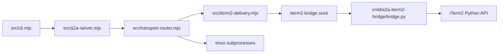
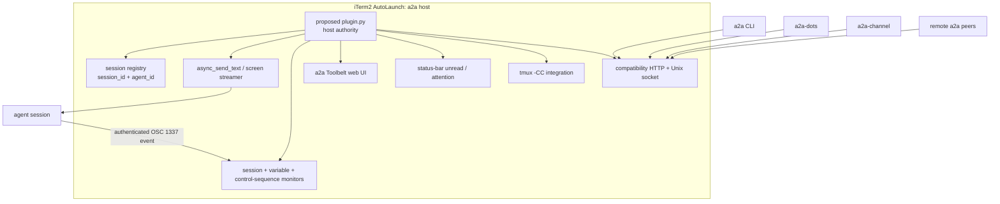
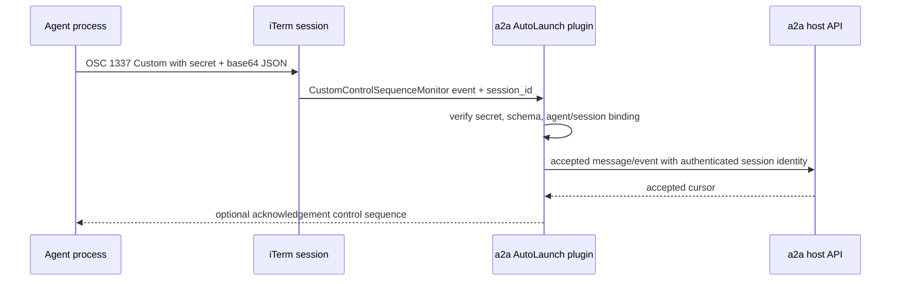
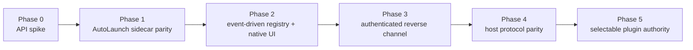

# iTerm2-native a2a host proposal

Continue this task. Read this proposal and context dump in full before taking any action. Do not re-derive settled decisions. Start at [Next action](#next-action).

## Task

> “doesn't iterm have plugins capabilities? couldn't we create an iterm a2a plugin that solves all our messaging needs?”

## Phase

Phase: **Plugin implemented** (2026-10-13). [`cmd/a2a-iterm2-plugin/plugin.py`][ref-plugin] is the running a2a iTerm2 bridge plus plugin surfaces: iTerm mode works like tmux mode, plus a status-bar unread badge, an authenticated OSC agent-event channel, a Toolbelt roster with targeted sends, a single-instance lock, and launchd auto-start (installed). See [Implementation](#implementation) and [Verified](#verified-2026-10-13). Plugin host authority (Phases 4–5) is decided against; see [Scope of this implementation](#scope-of-this-implementation).

## Implementation

| Piece | File | What it does |
| --- | --- | --- |
| Plugin entrypoint | [`cmd/a2a-iterm2-plugin/plugin.py`][ref-plugin] | Imports the bridge; adds socket ops `present`, `status`, `notify`, `clear_unread`, `show_toolbelt`; registers the `a2a` status-bar component (count, unread badge, click-to-focus), the OSC 1337 `Custom=id=a2a` subscription, and the `a2a` Toolbelt web view; runs the bridge's server and reconnect loop |
| Bridge as a module | [`cmd/a2a-iterm2-bridge/bridge.py`][ref-bridge-file] | Entrypoint guarded by `__main__`; `ON_CONNECT` hooks re-run after every iTerm2 reconnect (registrations are per connection); `acquire_instance_lock` holds `<socket>.lock` and refuses a second process with a split-brain error (exit 3); only the lock holder removes a stale socket and writes the pid file |
| Launcher | `cmd/a2a-iterm2-bridge/launch.sh` | Runs the plugin (falls back to `bridge.py`); no longer deletes the socket or writes the pid file itself; `install`/`uninstall` a per-user launchd agent `com.a2a.iterm2-plugin` with KeepAlive |
| Agent events (CLI) | `cmdNotify` in `src/cli.mjs`, [`src/cli/plugin-notify.mjs`](src/cli/plugin-notify.mjs) | `a2a notify [--kind attention\|done\|info] TEXT`: OSC into the agent's own pane tty when a control-mode client presents its session, else the plugin socket; per-agent token = HMAC-SHA256(plugin secret, `a2a-notify-v1:<agent>`)[:32] |
| Node client | `notifyITerm2Plugin`, `iTerm2PluginSecretPath` in `src/iterm2-delivery.mjs` | `notify` RPC; secret path next to the socket |
| Parity check | [`scripts/iterm2-socket-contract.mjs`](scripts/iterm2-socket-contract.mjs) | Same requests to a bare `bridge.py` and the plugin; compares every shared op and requires `unknown op` for plugin-only ops on the bare bridge |
| CLI spawn | `spawnAgentInPlace` in `src/cli.mjs` | Every new agent runs in its own detached tmux session; in iTerm mode it is then presented through the plugin. Agents registered by guid from before are still adopted |
| CLI attach | `openTmuxSessionInItermTab` in `src/cli.mjs` | From iTerm2, presents through the plugin (`presentInItermViaPlugin`); osascript `tmux -CC` tab is the fallback |
| CLI restart | `restartViaIterm` in `src/cli.mjs` | A dead guid-registered agent respawns in tmux and its registration moves to the tmux pane |
| Delivery | `selectTransportForAgent` in `src/transport-router.mjs` | A live tmux agent without an iTerm guid is delivered via its pane under either preference |
| Node client | `presentITerm2TmuxSession` in `src/iterm2-delivery.mjs` | `present` RPC |

### Verified (2026-10-13)

| Acceptance criterion | Evidence |
| --- | --- |
| Closing an agent's window does not end it; `a2a attach` returns the same process | End to end through the real CLI on stub agent `a2a-e2e`: started in tmux (pane pid 1964); `a2a attach` → "opened 'a2a-e2e' in iTerm2 via the a2a plugin (new tmux -CC window)"; window closed operator-style (AppleScript `close`) → `@hidden=i_30`, pid 1964 alive, `a2a list` status `live`; `a2a attach` again → same pid 1964, earlier message still on screen; `a2a kill a2a-e2e` → "tmux killed, bridge unregistered" |
| `a2a --bob "message"` contract preserved | `a2a --a2a-e2e 'e2e hello before close'` delivered over tmux (46 bytes), text present in the pane |
| Plugin starts without manual commands | **Installed** on this machine: `a2a bridge iterm install` → launchd `com.a2a.iterm2-plugin` running (pid 4947, `runs = 1`); after `kill 4947`, launchd restarted it as pid 5028 within 3 s (`runs = 2`); `launch.sh start` then answers "managed by launchd" |
| Quitting and reopening iTerm2 restores the plugin and reconciles surviving routes | **Real iTerm2 quit and reopen** (2026-10-14, launchd one-shot run outside iTerm2's process tree, operator-approved; log `/tmp/a2a-iterm-restart-check.txt`). Stub `a2a-restart-probe` presented before the quit. iTerm2 exited 3 s after the quit request; while it was down the plugin (pid 24443) and the stub (pane pid 55980) stayed alive. After `open -a iTerm` the plugin log shows `iTerm2 connection lost; reconnecting` → `connect failed (ConnectionRefusedError); retrying` → `connected to iTerm2` within 5 s, then re-registration of the status-bar component, OSC event listener, Toolbelt tool and session-event stream — no restart command issued, same plugin pid before and after. Routes reconciled: `a2a list` showed `a2a-restart-probe live` before and after (same pane pid 55980); `present` reopened it in a new `tmux -CC` window; a message sent after the restart reached the pane. The check script's own `ping after`/`status after` lines are blank because the script passed an invalid default argument (`{\}`) to its JSON helper; re-read cleanly afterwards against the same process: `ping` → `{"ok":true,"version":"0.3"}`, `status` → `{"ok":true,"pid":24443,"version":"1.1","watchers":1,…}`, launchd `state = running, pid = 24443` (pid unchanged from before the quit, so the plugin reconnected in place; `watchers 1` is the Node bridge's resubscribed push stream). Operator accepted this evidence on 2026-10-14 rather than re-running the quit/reopen to regenerate the two blank lines |
| Status bar observed in the UI | Component applied to a scratch stub session through a session-only profile override (no saved profile touched); window capture showed `a2a 2 agents · a2a-e2e-a: needs review of migration` with a red badge `3` |
| Unread count increments from an agent event | Stub agents `a2a-e2e-a`/`-b` (backend `exec cat`) presented through the plugin; `a2a notify --kind attention …` as a, `--kind done …` and `… info` as b → accepted `via osc`, attributed to sessions `5A8CCDEA…` (a) and `34F39CDC…` (b); unread a=1, b=2, total 3 |
| Unread clears on click | **Physical mouse click** (CGEvent, posted only after checking iTerm2 was frontmost with the scratch window current) on the component in a scratch `tmux -CC` window → plugin log "status bar clicked in session 7B55B67B…; focusing a2a-click-probe", unread 1 → 0. The click exposed two badge bugs, both fixed and re-checked on screen: a status bar created after an event showed no badge (iTerm2 applies a global count only to existing instances; the component now badges each new instance on first render), and a per-session badge survived the clear (clearing now zeroes per-session badges) — window capture after the click handler ran shows `a2a 0 agents` with no badge |
| Custom OSC attributed to its session; wrong secret rejected | Three forgeries written into a's pane tty, all rejected with unread unchanged: token from a wrong secret → `wrong secret`; valid token for b emitted from a's pane → `attribution: tmux window @1 is not in the tmux session of agent 'a2a-e2e-b'`; garbage payload → `malformed payload`. Socket path: unpresented stub `a2a-e2e-c` → `via socket` accepted; zero token → `wrong secret` |
| Toolbelt sends distinct messages to ≥2 selected sessions | Redesigned panel (ChatGPT-style: avatar rows, status dots, unread pills, recipient chips, rounded composer; light/dark) captured on screen in an iTerm2 window, and rendered at Toolbelt width in headless Chrome. Driven end to end over the Chrome DevTools protocol against the live plugin: clicked the rows of stubs `a2a-tb-a` and `a2a-tb-b`, typed a custom message for b and a shared composer message, clicked send → "✓a2a-tb-a — delivered \| ✓a2a-tb-b — delivered"; a's pane received the shared text, b's pane its own. Auth: page without token 403, API without token 403, foreign Host 403 |
| Starting both writable hosts fails with a clear split-brain error | With the plugin serving: a direct second `plugin.py` → exit 3, "split-brain refused: another a2a iTerm2 bridge (pid 3194) already serves …"; `launch.sh start` with the pid file removed → exit 1 with the same error; socket inode `51704689` and pid file unchanged; same for a second bare `bridge.py` on a temp socket; under launchd a manual start is refused while pid 5028 keeps serving |
| Existing iTerm Unix-socket contract unchanged | `scripts/iterm2-socket-contract.mjs` bare `bridge.py` (temp socket) vs live plugin: 20/20 — 15 shared requests identical, 5 plugin-only ops answer `unknown op` on the bare bridge; `tests/iterm2-delivery.test.mjs` passes unchanged |
| Session create, terminate, focus, identity changes without the 2,000 ms TTL | One process, two `transport-probes` instances (push-subscribed vs control), both primed, scratch tmux sessions presented through the plugin: **create** — `session_created` 629 ms after present began; at 1,085 ms after priming the push cache saw the new session, the control cache did not. **Terminate** — both primed with the session; `session_terminated` 157 ms after `tmux kill-session`; at 490 ms the push cache no longer saw it, the control cache still did. **Identity** — `user.a2a_agent_id` set on a live session → `session_identity_changed` event; at 638 ms the push cache resolved the new tag, the control cache did not. Focus changes emit `focus_changed`. Live Node bridge restarted onto this code: plugin `status` reports `watchers 1` |
| Unit suites | 116/116 across `iterm2-watch`, `plugin-notify`, `iterm2-delivery`, `transport-router`, `transport-probes`, `iterm-restart-plan`, `session-inventory`, `agent-transport`, `runtime-snapshot`, `status-snapshot`; eslint clean on changed JS. `tests/cli-regressions.test.mjs`: 17/17 in an isolated copy of the tree (it writes `config.json`/`registry.json` at the repo root, so it is not run in place). Its 7 stale failures were resolved: 5 expectations updated to current deliberate behavior (exact `=name` tmux targets, `parseSimpleCommandArgs` exit 1, ownership-listing count, guid-registered `peek` refusing a placeholder pane), the fake tmux now prints pane targets like real tmux, the iTerm-reuse test stamps the real install token, and `killOne` now probes `has-session` once per agent instead of three times (code fix). `runCli` points `A2A_HOST`/`A2A_PORT` at the fake bridge so unregister never reaches the live 7742 bridge. `tests/cli-vitest.test.mjs`: 23/23 (2026-10-14) in an isolated copy with a private tmux server (`TMUX_TMPDIR`), a fake `claude` on PATH, a dead iTerm2 socket, and `A2A_ITERM2_WATCH=0` — it creates real tmux sessions named like operator sessions (`dw-bug-killers-view`, `alpha-mgr`) and spawns `claude`, so it is never run against the live tmux server or install |

### Scope of this implementation

Implemented: agent persistence through tmux, Toolbelt roster with targeted sends, authenticated OSC reverse channel with unread attention, launchd auto-start, single-instance lock, socket-contract parity.

**Decided against — plugin host authority (Phases 4–5); confirmed by the operator 2026-10-13 ("Keep Node as sole host").** The Node HTTP bridge stays the only registry authority on every install; the plugin never registers, unregisters, or serves `/api/a2a/*`, and reaches the registry only through the a2a CLI. With one writable host there is no `host=iterm|node` selector to build, and the HTTP-side parity criterion has no second implementation to run against. What can run twice — the socket surface — is guarded by the instance lock and checked by the contract script. Basis: the decision log already rejects an immediate Python port of authentication, federation, persistence, and A2A routes, and nothing measured since shows a capability that needs the plugin to own the registry. Reopen only if the plugin must serve while the Node bridge is down.

Event-driven session updates are implemented: the plugin's `watch` stream op pushes iTerm2 session created / terminated / focus / identity (`name`, `user.a2a_agent_id`) events, and the Node bridge (`subscribeITermSessionPush` in `src/transport-probes.mjs`, started by `src/a2a-server.mjs`) drops its cached session list and runtime snapshot on each one. The 2 s TTL remains only as the fallback when no plugin is running. The registry itself (agent registrations) is not rewritten by these events — routing reads live session state through the invalidated cache.

## Proposal

### Outcome

The iTerm2 extension should become the **primary local a2a host on iTerm-first macOS installations**, not merely a leaf transport adapter. It should own native session discovery, lifecycle events, terminal delivery, attention state, and operator UI. The portable Node implementation should remain available as the headless and non-iTerm host behind the same external protocol.

One authority must run for a given installation. The plugin-host and Node-host modes must not maintain independent writable registries at the same time; a mode selector chooses which process owns registration and `/api/a2a/send`.

### Evidence basis

| Observed fact | Observation | Evidence |
| --- | --- | --- |
| Current iTerm bridge is already a session-control service | Ten RPC operations are registered: `ping`, `list_sessions`, `send_text`, `send_keys`, `screen`, `spawn`, `close`, `focus`, `set_name`, `configure_session` | [`OPS`][ref-bridge-ops] |
| Current Node client already has a stable local IPC boundary | It connects to `~/.local/state/a2a/iterm2-bridge.sock` and exchanges one newline-delimited JSON request/response | [`DEFAULT_SOCKET`][ref-iterm-client-socket], [`rpc`][ref-iterm-client-rpc] |
| Current iTerm discovery is polling-based | Successful bridge pings cache for 5,000 ms; tmux and iTerm session evidence cache for 2,000 ms | [`BRIDGE_REACHABLE_TTL_MS`][ref-probe-ttls] |
| Current bridge owns authentication, federation, envelopes, and delivery logs | [`handleBridgeSendBody`][ref-handle-send] validates authority and chooses remote, iTerm, or tmux delivery | [`handleBridgeSendBody`][ref-handle-send] |
| iTerm2 supports long-running extension daemons | Official tutorial distinguishes simple scripts from daemons that observe notifications or act periodically | [Python API Introduction][iterm-daemons] |
| iTerm2 supports embedded native-adjacent UI | Official Targeted Input example hosts a web app and registers it as a Toolbelt tool | [Targeted Input][iterm-targeted-input] |
| iTerm2 supports session-aware shell-to-plugin events | Official custom-control-sequence example identifies the emitting session and requires a shared secret | [Custom Escape Sequence][iterm-custom-sequence] |
| iTerm2 supports attention indicators | Official unread-count example sets per-session red-badge counts on a status-bar component | [Unread Count][iterm-unread] |
| iTerm2 exposes tmux control-mode integration | Official examples enumerate `tmux -CC` connections, create tmux windows/tabs, and issue arbitrary tmux commands | [Tmux Integration][iterm-tmux] |

The official API observations were fetched on 2026-10-13. No plugin code was executed during this session; all claims below labeled “proposed” remain design decisions or assumptions until the spike records runtime values.

### Current architecture



```python
# cmd/a2a-iterm2-bridge/bridge.py:513-524
OPS = {
    "ping": op_ping,
    "list_sessions": op_list_sessions,
    "send_text": op_send_text,
    "send_keys": op_send_keys,
    "screen": op_screen,
    "spawn": op_spawn,
    "close": op_close,
    "focus": op_focus,
    "set_name": op_set_name,
    "configure_session": op_configure_session,
}
```

[`bridge.py`][ref-bridge-file] already performs the hard iTerm-specific work: session enumeration, stable session-id routing, bracketed paste, key encoding, screen capture, spawn, focus, close, and ownership tagging. The external launcher and Node probes turn it into a manually supervised sidecar, which leaves iTerm lifecycle knowledge outside the process that actually receives iTerm events.

```js
// src/transport-probes.mjs:26-28
export const BRIDGE_REACHABLE_TTL_MS = 5000;
export const TMUX_ALIVE_TTL_MS = 2000;
export const ITERM_SESSIONS_TTL_MS = 2000;
```

[`transport-probes.mjs`][ref-probes-file] compensates for the sidecar boundary with TTL caches and repeated inventories. An AutoLaunch daemon can subscribe to session creation, termination, focus, variable, and screen events directly, replacing polling with authoritative pushes for the iTerm surface.

### Target architecture



The proposed plugin preserves the existing HTTP and Unix-socket contracts so the CLI, Dot adapter, Claude channel, and remote peers do not need iTerm-specific code. Native iTerm operations move behind those contracts. The Node host remains the alternative authority for headless tmux, Linux, and non-iTerm environments.

### Capability mapping

| a2a need | iTerm2 mechanism | Proposed ownership |
| --- | --- | --- |
| Discover and identify sessions | [`EachSessionOnceMonitor`][iterm-targeted-input], session variables, stable session id | Plugin registry |
| Deliver message text | [`Session.async_send_text()`][iterm-session] with bracketed-paste markers | Plugin delivery |
| Send keys and chords | [`Session.async_send_text()`][iterm-session] byte sequences; existing key table | Plugin delivery |
| Peek and detect attention | [`async_get_screen_contents()`][iterm-session] and [`ScreenStreamer`][iterm-screen] | Plugin event loop |
| Spawn/focus/close sessions | Window, tab, session APIs | Plugin lifecycle |
| Operator roster and targeted input | Custom Toolbelt web-view tool | Plugin UI |
| Unread and attention state | Status-bar component and per-session unread count | Plugin UI |
| Agent-to-host replies/events | Authenticated custom OSC 1337 control sequence | Plugin ingress |
| Session metadata | `user.a2a_agent_id`, installation token, status variables | Plugin registry |
| tmux inside iTerm | `tmux -CC` integration API | Plugin tmux adapter |
| Headless tmux | Existing Node/tmux host | Portable host |
| Federation and MCP adapters | Existing compatibility HTTP protocol | Selected host authority |

### External protocol contract

The target keeps the current external API stable:

| Surface | Required compatibility |
| --- | --- |
| `GET /health` | Host health and registration count |
| `GET /api/a2a/agents` | Registration inventory and ownership support |
| `POST /api/a2a/register` | Guarded local/remote upsert |
| `DELETE /api/a2a/register/:id` | Guarded unregister |
| `POST /api/a2a/send` | Authority validation, federation, local delivery |
| `GET /api/a2a/runtime-snapshot` | Status-compatible runtime projection |
| `/.well-known/agent-card.json` and `/message:send` | Existing A2A compatibility façade |
| Unix-socket operations | Existing `OPS` request/response shape during migration |

The first implementation should not port the bridge HTTP semantics to Python. Phase 1 keeps [`src/a2a-server.mjs`][ref-server-file] authoritative and replaces only the iTerm sidecar lifecycle. Host authority moves only after the same protocol conformance suite passes against both implementations.

### Session identity and reverse messaging



The proposed reverse channel uses iTerm2’s custom control-sequence monitor because it supplies the emitting session id and includes a shared-secret gate. The payload should contain only a bounded JSON envelope or a cursor reference. Large content should travel through the local socket/HTTP inbox rather than OSC to avoid depending on an unmeasured terminal escape-sequence size limit.

Session identity remains a tuple:

```text
{
  agentId: string,
  sessionId: string,
  installToken: string,
  registrationOwner: string,
  sessionSecret: string
}
```

`agentId` is the logical route, `sessionId` is iTerm’s live identity, `installToken` prevents cross-install adoption, `registrationOwner` prevents stale-process replacement, and `sessionSecret` authenticates custom control sequences from the pane.

### Native operator interface

The Toolbelt UI should begin as a focused replacement for the current dashboard:

- Live roster grouped by team/cohort.
- Targeted `message`, `ask`, and raw input.
- Multi-select and broadcast.
- Screen preview and attention state.
- Start, focus, close, and restart controls.
- Remote-peer rows distinguished from local sessions.
- Delivery result and uncertainty warnings.

The status-bar component should expose local live count, bridge/federation health, and per-session unread attention. Clicking it should focus the highest-priority session and clear only that session’s unread badge.

### Security model

| Boundary | Required control |
| --- | --- |
| External HTTP | Preserve operator/peer bearer authentication and namespace checks |
| Local Unix socket | Mode `0600`; reject non-object and oversized messages |
| Custom control sequence | Per-session secret, bounded payload, strict schema, session-id binding |
| Toolbelt web server | Loopback-only random port, unguessable capability token, no unauthenticated mutation |
| Session adoption | Installation token plus `user.a2a_agent_id`; never title-only |
| Registration mutation | Preserve `registrationOwner` conflict semantics |
| Remote routes | Never focus, close, or inspect a same-named local pane |
| Plugin/Node mode | Exclusive authority lock; fail startup on split-brain |

The shared secret in the official custom-control-sequence example prevents arbitrary displayed text from invoking a function. The proposed design strengthens that example with per-session secrets and identity binding because a2a events mutate routing and attention state.

### Migration plan



1. **Phase 0 — API spike.** Register one status-bar component, one Toolbelt web view, one session monitor, and one custom control-sequence monitor in `cmd/a2a-iterm2-plugin/spike.py`. Record actual startup, restart, session identity, payload, and click behavior.
2. **Phase 1 — AutoLaunch sidecar parity.** Move the existing `OPS` handlers behind `iterm2.run_forever(main)`, preserve the Unix socket, and install into iTerm2’s AutoLaunch folder. Remove no Node behavior.
3. **Phase 2 — Event-driven registry and native UI.** Push session lifecycle changes into the existing Node bridge and add Toolbelt/status-bar surfaces. Retain periodic reconciliation as a bounded recovery mechanism, not the primary source.
4. **Phase 3 — Authenticated reverse channel.** Add bounded OSC event parsing and map the emitting iTerm session to the registered agent. Keep normal outbound delivery unchanged.
5. **Phase 4 — Host protocol parity.** Run the full bridge contract suite against a plugin-host candidate. Port authority, federation, persistence, and snapshots only when parity is demonstrated.
6. **Phase 5 — Selectable authority.** Add `host=iterm|node`; enforce an exclusive host lock and retain Node as the headless/non-iTerm implementation.

### Acceptance criteria

- **iTerm mode works like tmux mode:** closing an agent's iTerm window or tab does not end the agent, and `a2a attach <agent>` brings back the same running process (not a fresh backend with the startup prompt re-sent). This is the operator's stated reason for the plugin (2026-10-13).
- Starting iTerm2 launches the plugin without `a2a bridge iterm start`.
- Quitting and reopening iTerm2 restores the plugin and reconciles surviving routes without a manual restart command.
- `a2a --bob "message"` and `a2a peek bob` preserve their current CLI contracts.
- Session create, terminate, focus, and identity changes update the registry without waiting for the current 2,000 ms iTerm session-list TTL.
- The Toolbelt sends distinct messages to at least two selected sessions.
- Status-bar unread count increments from an observed agent event and clears on click.
- A custom OSC event is attributed to the session that emitted it; a wrong secret is rejected.
- Existing iTerm Unix-socket contract tests pass unchanged during Phase 1.
- Bridge auth, federation, owner-conflict, logging, and A2A façade tests pass against any proposed plugin host before Phase 5.
- `tmux -CC` sessions are manageable through the plugin; ordinary headless tmux remains manageable through the Node host.
- Starting both writable hosts fails with a clear split-brain error.

## Environment

| Item | Observed value |
| --- | --- |
| Repository | `/Users/op/Documents/dev/a2a` |
| Branch | `a2a-dots` |
| Node | `v24.18.0` |
| Python | `3.14.6` |
| codebase-map | Live at `localhost:3777`; project root matches repository; graph built `2026-10-13T21:47:36.846Z` with 111 files and 145 import edges |
| Current iTerm bridge | `running (pid 69738)`, socket `/Users/op/.local/state/a2a/iterm2-bridge.sock` |
| AutoLaunch directory | `/Users/op/Library/Application Support/iTerm2/Scripts/AutoLaunch` did not exist when checked |
| Relevant secret env names | `A2A_KEY`, `A2A_ITERM2_BRIDGE_SOCKET`, `A2A_ITERM2_RPC_TIMEOUT_MS`; values were not read |

## Files in flight

### `iterm2-plugin.md`

- [`iterm2-plugin.md`][ref-proposal] is this grounded proposal and resumable state capture.
- Defines the target architecture, protocol boundaries, security model, migration phases, and acceptance criteria.
- **STABLE:** proposal document only; no implementation imports it.

### `docs/wiki.md`

- [`docs/wiki.md`][ref-wiki] was rewritten earlier in the session as a 1,425-line source-derived engineering wiki with all 45 runtime modules, 41 Mermaid diagrams, and 142 validated source references.
- **STABLE:** documentation validation passed; file is untracked in the current working tree.

### `docs/wiki_outline.json`

- [`docs/wiki_outline.json`][ref-wiki-outline] was rewritten earlier in the session as the codebase-map-backed section inventory covering all 45 runtime modules.
- **STABLE:** valid JSON; file is untracked in the current working tree.

No runtime source file was modified while writing the proposal (the implementation came later; see [Implementation](#implementation)).

## Commands run

1. Fetched [Example Scripts index][iterm-examples].
   - Observed status-bar components, tmux integration, event monitors, custom Toolbelt tools, context menus, custom escape sequences, broadcasting, and window/session control.
2. Fetched [Targeted Input][iterm-targeted-input], [Custom Escape Sequence][iterm-custom-sequence], [Unread Count][iterm-unread], [Tmux Integration][iterm-tmux], [Python API Introduction][iterm-daemons], [Session API][iterm-session], and [Screen API][iterm-screen].
   - Observed the exact API precedents used in the proposal.
3. Read [`cmd/a2a-iterm2-bridge/bridge.py`][ref-bridge-file], [`src/iterm2-delivery.mjs`][ref-iterm-client-file], [`src/transport-probes.mjs`][ref-probes-file], and [`src/a2a-server.mjs`][ref-server-file].
   - Confirmed the current socket contract, iTerm operations, cache values, and bridge authority boundary.
4. Ran repository and toolchain observations:

   ```text
   git branch --show-current
   → a2a-dots

   node --version
   → v24.18.0

   python3 --version
   → Python 3.14.6
   ```

5. Queried the live codebase-map graph:

   ```text
   curl -s http://localhost:3777/api/graph
   → project root /Users/op/Documents/dev/a2a
   → build 2026-10-13T21:47:36.846Z
   → 111 files, 145 import edges
   ```

6. Ran the current adapter status check:

   ```text
   a2a bridge iterm status
   → running (pid 69738)
   → socket=/Users/op/.local/state/a2a/iterm2-bridge.sock
   ```

7. Inspected `/Users/op/Library/Application Support/iTerm2/Scripts/AutoLaunch`.
   - Observed that the directory did not exist.

No plugin implementation or plugin runtime test was run in the proposal session; implementation evidence is in [Verified](#verified-2026-10-13).

## Findings

### iTerm2 extension-host capability

The fetched official examples demonstrate long-running daemons, registered functions, event monitors, Toolbelt web views, clickable status components, custom context menus, custom escape sequences, broadcasting, and tmux integration. The earlier “thin transport adapter” framing omitted capabilities directly relevant to a2a’s dashboard, attention, reverse-message, and session-lifecycle needs.

### Current bridge transport core

[`bridge.py`][ref-bridge-file] already maps stable iTerm session ids to a2a identity, injects bracketed paste, sends keys, captures screens, creates and focuses sessions, and persists installation ownership. The proposal is primarily a lifecycle, event, UI, and authority reorganization rather than a new terminal-delivery implementation.

### Current iTerm polling boundary

[`transport-probes.mjs`][ref-probes-file] caches successful bridge reachability for 5,000 ms and iTerm inventories for 2,000 ms. A daemon inside iTerm can observe lifecycle events directly; this was later implemented and measured (session create/terminate/identity events reach the Node cache in 157–638 ms, see [Verified](#verified-2026-10-13)).

### Targeted Input precedent

The official Targeted Input example runs a local web server, exposes it through iTerm’s Toolbelt, enumerates broadcast-domain sessions, and submits distinct values to individual sessions. Its shape directly supports the proposed a2a roster, multi-select, targeted message, and broadcast UI.

### Custom OSC scope

The official custom-control-sequence monitor reports which session emitted a secret-gated OSC 1337 sequence. This supports authenticated event/reply signaling. No payload-size limit was measured in this session, so the proposal limits OSC to bounded envelopes or cursors and keeps large bodies on socket/HTTP channels.

### iTerm tmux integration boundary

The official tmux examples operate on iTerm control-mode connections created through `tmux -CC`. They do not establish control over arbitrary headless tmux servers. The Node host remains necessary for non-`-CC`, non-iTerm, and non-macOS operation.

## Decision log

### Plugin role

**Decision:** Make the iTerm plugin the primary local host for iTerm-first installations.

**Rejected:** Keep it as a passive leaf adapter. The official Toolbelt, event, status, custom-sequence, and tmux examples cover responsibilities beyond transport.

**Status:** Committed for the proposal; implementation is gated by Phase 0.

### Portability

**Decision:** Preserve the Node host as the headless/non-iTerm implementation behind the same protocol.

**Rejected:** Delete the Node bridge and make iTerm mandatory. That removes Linux, CI, ordinary tmux, and operation while iTerm is closed.

**Status:** Committed.

### Registry authority

**Decision:** Exactly one writable host owns registration per installation.

**Rejected:** Let the plugin and Node bridge independently reconcile writable registries. Dual authorities create split-brain ownership, deletion, and federation races.

**Status:** Committed.

### Migration order

**Decision:** First package existing `OPS` behavior as AutoLaunch, then add event/UI capabilities, and port host authority only after protocol parity.

**Rejected:** Rewrite the full bridge in Python immediately. Authentication, federation, persistence, A2A compatibility, and logging already have Node tests; a big-bang port would discard that evidence.

**Status:** Committed.

### Reverse channel

**Decision:** Use authenticated custom OSC for bounded session-originated events and cursors; retain socket/HTTP for large content.

**Rejected:** Encode arbitrary message bodies in terminal control sequences. No payload limit or terminal-path reliability value was observed.

**Status:** Provisional until Phase 0 measures OSC behavior.

### Native UI

**Decision:** Implement the operator surface as an iTerm Toolbelt web view plus status-bar attention component.

**Rejected:** Treat the existing terminal dashboard as the final iTerm UI. The official examples provide native placement, click handling, per-session badges, and web rendering.

**Status:** Committed.

### Agent persistence in iTerm mode

**Decision:** In iTerm mode, agents run inside tmux sessions and iTerm presents them through its tmux integration (`tmux -CC`), managed by the plugin through the Tmux Integration API (`async_get_tmux_connections`, `TmuxConnection`, both present in the installed `iterm2` 2.30 library). The visible window is a view, not the process owner.

**Rejected:** Spawning the agent as an iTerm window's own command (the current `op_spawn` in `cmd/a2a-iterm2-bridge/bridge.py`). Measured 2026-10-13: a process run that way died 5.1s after its window closed, and `a2a attach` then relaunched a blank backend. No plugin hook can keep a closed tab's process alive.

**Supporting observation:** with the operator's iTerm setting (`ClosingTmuxWindowKillsTmuxWindows_selection = 0`), closing a `tmux -CC` window *hid* it: the tmux session's `@hidden` option recorded the window, its process kept running, and the control client stayed attached.

**Plugin-API measurements (2026-10-13):**
- `iterm2.async_get_tmux_connections` and `TmuxConnection.async_create_window()` work in the installed `iterm2` 2.30; a process in a tmux window of a *two-window* session survived its tab being closed with `tab.async_close(force=True)`.
- **Correction:** in a *single-window* session, `session.async_close(force=True)` killed the tmux window, the session and its process. An API force-close is therefore not safe; a2a never force-closes a presentation tab. Persistence rests on iTerm's interactive close path with the operator's hide setting, which an end-to-end test confirmed (see [Verified](#verified-2026-10-13)).
- `TmuxConnection.async_set_tmux_window_visible(id, True)` succeeds only for a hidden window and answers `INVALID_WINDOW_ID` for a visible one; `present` calls it only when the window has no tab. iTerm's `Tab.tmux_window_id` is tmux's `@N` without the `@`.

**Status:** Implemented and verified.

### Agent event channel

**Decision:** iTerm2 identity `a2a` is public; authentication is a per-agent token (HMAC-SHA256 of the plugin's install secret over `a2a-notify-v1:<agent>`, 32 hex chars) carried in the payload, plus binding: the emitting session must present the claimed agent (its tmux window belongs to the agent's tmux session, or its `user.a2a_agent_id` tag matches). Agents that are not presented send the same token over the socket; those events carry no session.

**Rejected:** the official example's single shared secret as the iTerm2 identity. Every agent would hold it, so any pane could raise events for any agent.

**Measured (2026-10-13, tmux 3.7b, iTerm2 3.7.4beta1):** an OSC 1337 `Custom` sequence written to a pane's tty reaches iTerm2 through `tmux -CC` with `allow-passthrough off`, and the notification carries the presenting session's id. `CustomControlSequenceMonitor.async_get()` drops that id, so the plugin subscribes with `async_subscribe_to_custom_escape_sequence_notification` directly.

**Tab titles are not identity:** a tab presented through `tmux -CC` reports a tmux-driven `name` (measured: `mods-MacBook-Pro.local (cat)` before and after `set_name`), tmux agents are identified by tmux session name, and plain iTerm2 sessions by the `user.a2a_agent_id` tag (push-resolved in 638 ms). A title rename still fires an identity event and invalidates the cache, but never changes which agent a session is.

**Limit:** the secret file is readable by the user's processes, so the boundary is "text displayed in a terminal cannot raise events, and a pane can only speak for its own agent", not isolation between the user's processes.

### Status-bar layout encoding

**Measured:** a session-level `Status Bar Layout` override renders built-in components, but an RPC component renders only when `registration request v2` (base64 of the serialized `RPCRegistrationRequest`) sits in the component's `configuration` beside `knobs`, not inside `knobs` — per iTerm2's `iTermStatusBarRPCProvidedTextComponent.m` and confirmed on screen.

## Dead ends

### Thin-adapter recommendation

The initial recommendation kept the Node bridge central and treated an iTerm plugin only as better packaging for `bridge.py`. The official examples index invalidated the assumption behind that recommendation by demonstrating Toolbelt web apps, authenticated custom control sequences, attention badges, event monitors, and tmux control-mode APIs. Do not restart design from the thin-adapter premise.

### Plugin-only universal runtime

Making iTerm the only implementation was rejected because official tmux integration requires `tmux -CC`, and an AutoLaunch process cannot serve while iTerm is absent. Do not remove the portable Node host.

### Immediate Python authority port

Porting registration, authentication, federation, persistence, delivery logging, and A2A spec routes before AutoLaunch parity was rejected. The current Node authority has established tests and semantics; preserve it through Phases 0–3.

## Active assumptions

| Assumption | Basis | Risk if wrong | Resolution |
| --- | --- | --- | --- |
| Installed iTerm2 supports the documented Python API 0.26 features | Official current documentation; current bridge connects successfully | A required Toolbelt, monitor, or status API may be absent locally | Phase 0 records registration and callbacks in the installed app |
| AutoLaunch restarts the daemon reliably after iTerm restart | Official AutoLaunch guidance | Manual recovery remains necessary | Quit/reopen iTerm during Phase 0 and record process/socket recovery |
| Toolbelt web views can provide the complete proposed interaction model | Targeted Input example | UI security, focus, or lifecycle restrictions may block flows | Prototype roster, targeted send, and multi-select only |
| Custom OSC carries bounded JSON reliably | Official example proves small command payloads only | Truncation or escape processing corrupts events | Measure sizes and keep large data on socket/HTTP |
| Per-session user variables remain suitable identity markers | Current bridge successfully reads/writes `user.a2a_agent_id` | Variable reset or cloning could misidentify a session | Test relaunch, tab duplication, tmux, and backend retitling |
| One protocol suite can validate both host implementations | Existing HTTP and socket boundaries are explicit | Hidden process assumptions may make tests host-specific | Extract a host-conformance fixture before Phase 4 |

## Current position

Stopped at: plugin implemented and verified ([Verified](#verified-2026-10-13)); launchd agent `com.a2a.iterm2-plugin` installed and serving.

## Next action

None required. Optional: add the `a2a` component to the status bar of the profile agents run in (Settings → Profiles → Session → Configure Status Bar), and open View → Toolbelt → a2a.

## References

[ref-plugin]: cmd/a2a-iterm2-plugin/plugin.py
[ref-bridge-file]: cmd/a2a-iterm2-bridge/bridge.py
[ref-bridge-ops]: cmd/a2a-iterm2-bridge/bridge.py#L513
[ref-proposal]: iterm2-plugin.md
[ref-wiki]: docs/wiki.md
[ref-wiki-outline]: docs/wiki_outline.json
[ref-iterm-client-file]: src/iterm2-delivery.mjs
[ref-iterm-client-socket]: src/iterm2-delivery.mjs#L8
[ref-iterm-client-rpc]: src/iterm2-delivery.mjs#L60
[ref-probes-file]: src/transport-probes.mjs
[ref-probe-ttls]: src/transport-probes.mjs#L26
[ref-server-file]: src/a2a-server.mjs
[ref-handle-send]: src/a2a-server.mjs#L747

[iterm-examples]: https://iterm2.com/python-api/examples/index.html#examples-index
[iterm-daemons]: https://iterm2.com/python-api/tutorial/index.html
[iterm-targeted-input]: https://iterm2.com/python-api/examples/targeted_input.html
[iterm-custom-sequence]: https://iterm2.com/python-api/examples/ccs.html
[iterm-unread]: https://iterm2.com/python-api/examples/unread.html
[iterm-tmux]: https://iterm2.com/python-api/examples/tmux.html
[iterm-session]: https://iterm2.com/python-api/session.html
[iterm-screen]: https://iterm2.com/python-api/screen.html
